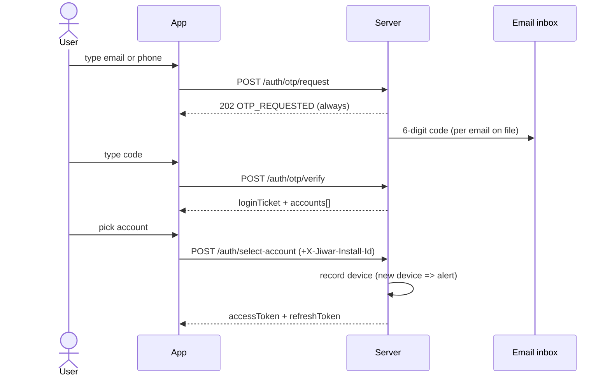
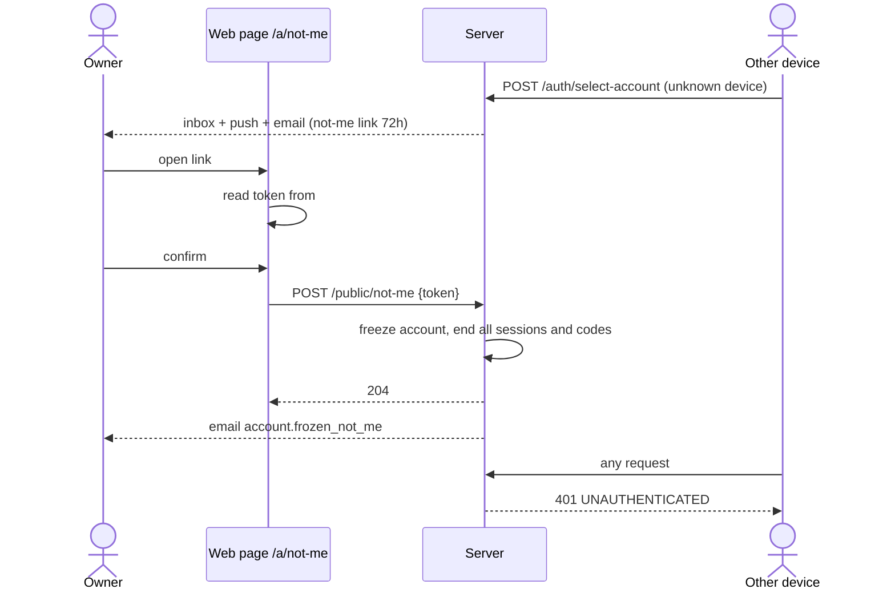
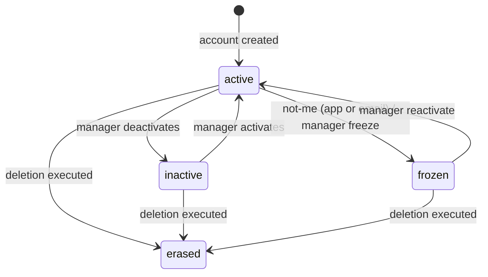
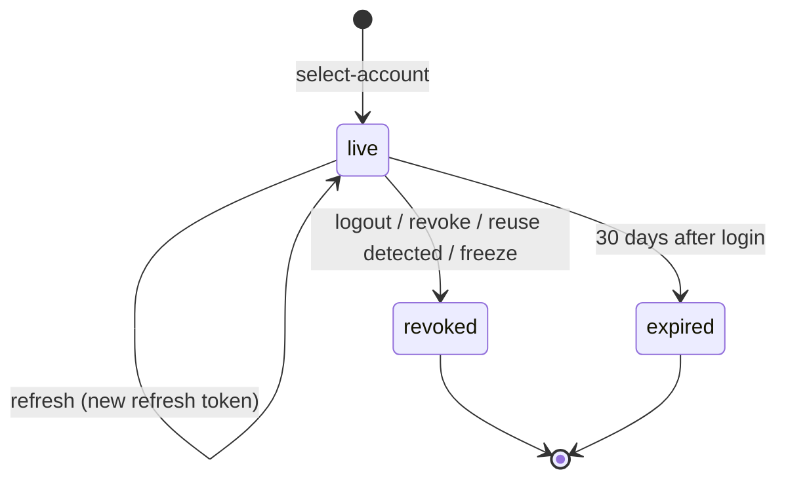

# تسجيل الدخول — Login

> **التطبيق/الواجهة:** resident app · family member · guard app · technician app · manager dashboard · public web page (no login) لصفحة "لست أنا" `/a/not-me`
> **الصلاحيات:** لا توجد صلاحية: endpoints الـ`/auth/*` و`POST /public/not-me` عامة (`@Public`). `POST /me/devices/{id}/not-me` لأي حساب مسجّل الدخول (resident, family, staff, manager) بدون permission.
> **المصادر:** ADR 0002 · ADR 0003 · ADR 0004 · ADR 0023 · ADR 0036 · `docs/api/v0-notes.md` · `src/core/auth/` (`auth.controller.ts`, `auth.service.ts`, `otp.service.ts`, `session.service.ts`, `auth-policy.ts`, `devices.ts`, `login-alerts.ts`, `action-tokens.ts`, `identifier.ts`) · `src/core/accounts/not-me.controller.ts`, `not-me.service.ts`, `account-writer.ts` (`freeze`), `account-lifecycle.ts` · `src/core/access/permissions.guard.ts`

## الفكرة باختصار
المستخدم يكتب **إيميل أو رقم موبايل**، فيصله **كود من 6 أرقام على الإيميل المسجّل** (حتى لو كتب رقم الموبايل؛ لا يوجد SMS). بعد إدخال الكود يرى قائمة الحسابات التي يفتحها هذا الكود (حساب لكل كمبوند ولكل صفة: ساكن، فرد أسرة، موظف، مدير)، فيختار واحدًا ويحصل على access token و refresh token.
عند كل دخول من **جهاز جديد** على الحساب يصل تنبيه "تسجيل دخول جديد" (في الـinbox + إيميل + push)، ومعه زر **"لست أنا"** الذي **يجمّد الحساب فورًا** وينهي كل الجلسات.
الحساب المجمّد أو الموقوف أو حساب كمبوند معلّق لا يستطيع الدخول، والرد لا يكشف ذلك أبدًا.

## الأدوار ومين بيعمل إيه

| الدور | ماذا يفعل في هذه الفيتشر |
|---|---|
| أي شخص (بدون دخول) | يطلب كود، يدخل الكود، يختار حسابًا، يجدد التوكن، يخرج |
| صاحب الحساب داخل التطبيق | يرى تنبيه الجهاز الجديد في الـinbox ويضغط "لست أنا" من التطبيق |
| صاحب الإيميل (بدون دخول) | يفتح رابط "لست أنا" من إيميل التنبيه على صفحة ويب عامة ويؤكد التجميد |
| المدير (`accounts.manage`) | يعيد تفعيل الحساب المجمّد — راجع `../03-community/04-frozen-accounts-and-erasure.md` |
| النظام | يرسل الكود، يسجّل الجهاز ويقرر هل هو جديد، يطبّق حدود المحاولات، يكشف إعادة استخدام refresh token قديم ويلغي الجلسة |

## الشاشات اللي الفيتشر محتاجها
- **شاشة إدخال المعرّف**: حقل واحد يقبل إيميل أو موبايل (صيغة مصرية محلية `01…` أو دولية `+…`).
- **شاشة إدخال الكود**: 6 أرقام، عدّاد صلاحية (5 دقائق افتراضيًا)، زر "إعادة إرسال الكود"، ورسالة محايدة "إن كان هذا الإيميل/الرقم مسجّلًا فقد أُرسل كود إلى الإيميل المسجّل".
- **شاشة اختيار الحساب**: تظهر عندما يرجع أكثر من حساب؛ كل عنصر = اسم الكمبوند + نوع الحساب.
- **حالة "لم يصلني كود"**: نص إرشادي (راجع الإيميل الصحيح/الـspam، أو تواصل مع الإدارة). الباك لا يعطي سببًا.
- **حالة انتهاء الجلسة**: الرجوع لشاشة الدخول عند فشل الـrefresh أو عند `401 UNAUTHENTICATED`.
- **زر/قائمة "تسجيل الخروج"**.
- **عنصر تنبيه "تسجيل دخول جديد" في الـinbox** + صفحة تفاصيله: نوع الجهاز، الوقت، وزر "لست أنا".
- **ديالوج تأكيد "لست أنا"** (في التطبيق): يشرح أن الحساب سيُجمَّد، وكل الجلسات ستنتهي بما فيها الجلسة الحالية، وأن الإدارة هي من تعيد التفعيل.
- **صفحة ويب عامة `/a/not-me#<token>`**: شرح + زر تأكيد، ثم شاشة "تم" أو "الرابط لم يعد صالحًا".
- **شاشة بعد التجميد** (في التطبيق): "تم إيقاف حسابك، تواصل مع إدارة الكمبوند" ثم الخروج.

## الفلو خطوة بخطوة

### 1) طلب الكود — `POST /auth/otp/request`
1. المستخدم يكتب `identifier` (مطلوب، 3–254 حرفًا). إذا احتوى على `@` يُعامل كإيميل (يُحوَّل لحروف صغيرة)، وإلا كرقم موبايل (يُحوَّل لصيغة E.164، والدولة الافتراضية مصر).
2. التطبيق يرسل الهيدر `Accept-Language` لأن الحساب لم يُثبت بعد؛ لغة إيميل الكود تأتي منه وليس من لغة الحساب المحفوظة.
3. الرد دائمًا **`202`** بنفس الشكل `{ code: "OTP_REQUESTED", message }` سواء كان المعرّف مسجّلًا أم لا.
   - استثناء: معرّف بصيغة غير صالحة (ليس إيميلًا ولا رقمًا صحيحًا) ← `400 VALIDATION_FAILED` على الحقل `identifier` (`INVALID_FORMAT`).
   - تجاوز الحد ← `429 RATE_LIMITED` (يحدث أيضًا لمعرّف غير مسجّل).
4. في الخلفية (بعد الرد): السيرفر يبحث عن كل الحسابات **النشطة** في كمبوندات **نشطة** المرتبطة بهذا المعرّف، ويجمعها حسب **الإيميل المسجّل عليها**:
   - لكل إيميل مختلف يُنشأ كود مستقل ويُرسل إلى ذلك الإيميل. الكود يفتح فقط الحسابات المرتبطة بالإيميل الذي وصله.
   - أي طلب جديد **يُبطل كل الأكواد القديمة** لنفس المعرّف.
   - الحساب المجمّد/الموقوف/الممسوح أو الكمبوند المعلّق لا يُرسل له شيء.
5. الشاشة التالية: إدخال الكود.

### 2) إدخال الكود — `POST /auth/otp/verify`
1. المستخدم يدخل `code` (6 أرقام بالضبط) مع نفس `identifier`.
2. نجاح ← `200 { loginTicket, accounts: [{ accountId, tenantName, accountType }] }`.
   - `loginTicket` صالح **5 دقائق** (`LOGIN_TICKET_TTL_SECONDS` = 300) ولمرة واحدة.
   - `accounts` هي الحسابات النشطة التي يفتحها هذا الكود فقط.
3. فشل (كود خطأ، منتهي، مستهلك، أو معرّف غير معروف) ← `401 OTP_INVALID` برسالة واحدة.
   - كل كود له **5 محاولات** (`OTP_MAX_ATTEMPTS`). المحاولة الخامسة الخاطئة "تحرق" الكود، وأي محاولة بعدها = `OTP_INVALID` حتى لو كان الكود صحيحًا. الحل: طلب كود جديد.
4. إذا رجع حساب واحد: التطبيق يستطيع الانتقال مباشرة لخطوة 3 بدون عرض قائمة (الباك يحتاج نداء `select-account` في كل الأحوال).

### 3) اختيار الحساب — `POST /auth/select-account`
1. التطبيق يرسل `{ loginTicket, accountId }`، ومعه الهيدر **`X-Jiwar-Install-Id`** (UUID يولّده التطبيق مرة واحدة عند التثبيت ويحفظه). المتصفح لا يرسله.
2. السيرفر **يستهلك الـticket** (حتى لو فشلت الخطوة)، ويتحقق أن الحساب ما زال نشطًا وأن الكمبوند نشط.
3. **تسجيل الجهاز** (قبل إنشاء الجلسة، وإذا فشل لا يتم الدخول):
   - التطبيق يُعرَف بالـinstall id. المتصفح يُعرَف بـ"نوع المتصفح + نظام التشغيل" فقط (مثل Chrome/Windows).
   - أول جهاز على الحساب = baseline، بدون تنبيه.
   - جهاز معروف ← يُحدَّث وقت آخر استخدام فقط.
   - **جهاز جديد** ← تنبيه `account.new_device_login` (راجع الفلو 6).
4. نجاح ← `200 { accessToken, accessTokenExpiresIn, refreshToken, refreshTokenExpiresAt, accountId, accountType }`.
5. فشل (ticket منتهي/مستخدم، accountId ليس من القائمة، أو الحساب لم يعد نشطًا) ← `401 LOGIN_TICKET_INVALID`. الـticket استُهلك، فالمستخدم يعود لطلب كود جديد.
6. بعد الدخول: التطبيق يقرأ `GET /me` ليعرف الدور والـpermissions (راجع `02-profile-and-sessions.md`)، ويسجّل push token (راجع `03-notifications-and-push.md`).

### 4) تجديد التوكن — `POST /auth/refresh`
1. التطبيق يرسل `{ refreshToken }` قبل انتهاء الـaccess token أو عند `401`.
2. نجاح ← `200` بنفس شكل `TokensView`، مع **refresh token جديد** (القديم يبطل فورًا). `refreshTokenExpiresAt` **لا يتمدد**: يبقى 30 يومًا من لحظة الدخول، بعدها لا بد من دخول جديد بكود.
3. فشل ← `401 REFRESH_TOKEN_INVALID` في كل الحالات: توكن منتهي، جلسة ملغاة، حساب لم يعد نشطًا (مجمّد/موقوف/ممسوح) أو كمبوند معلّق. في الحالة الأخيرة تُلغى الجلسة أيضًا.
4. **كشف إعادة الاستخدام**: إذا وصل refresh token قديم (سبق تدويره) أو وصل طلبا refresh في نفس اللحظة لنفس الجلسة ← الجلسة **تُلغى بالكامل** ويُرجع `401`. لذلك يجب أن ينفّذ التطبيق refresh واحدًا فقط في كل مرة (طابور/قفل).

### 5) تسجيل الخروج — `POST /auth/logout`
1. التطبيق يرسل `{ refreshToken }`.
2. الرد دائمًا `204` (حتى لو التوكن غير صالح).
3. تُلغى الجلسة، ويُحذف معها push token الخاص بهذه الجلسة. الـaccess token يتوقف عن العمل من الطلب التالي.

### 6) تنبيه الدخول من جهاز جديد (تلقائي)
يحدث داخل `select-account` عندما يكون الجهاز غير معروف على هذا الحساب وليس أول جهاز:
1. إشعار في الـinbox: `account.new_device_login` (critical) بالبارامترات `deviceType` (`ios` | `android` | `desktop_web` | `mobile_web` | `unknown`) و`at` (وقت الدخول ISO). `targetType = known_device` و`targetId` = id الجهاز الجديد.
2. Push (إن كان مفعّلًا): "تسجيل دخول جديد إلى حسابك" — يصل دائمًا لأنه critical.
3. إيميل للإيميل المسجّل (`account.new_device_login`): اسم الكمبوند، وصف الجهاز بالعربي (مثل "تطبيق على iPhone"، "متصفح على كمبيوتر")، الوقت بتوقيت الكمبوند، و**رابط "لست أنا"** صالح **72 ساعة** ولمرة واحدة: `<PUBLIC_APP_URL>/a/not-me#<token>`.
4. لا يوجد في التنبيه أي IP أو موقع جغرافي.

### 7) "لست أنا" من التطبيق — `POST /me/devices/{id}/not-me`
1. المستخدم يفتح إشعار `account.new_device_login` ويضغط "لست أنا".
2. ديالوج تأكيد (إلزامي في التصميم لأن الفعل لا يُلغى من المستخدم).
3. التطبيق ينادي الـendpoint بـ`id = targetId` من الإشعار.
4. `204` ← السيرفر:
   - يعلّم الجهاز "disowned"؛
   - **يجمّد الحساب** (`frozen`، السبب `login_not_me`)، **ورقم الموبايل يبقى** على الحساب؛
   - ينهي **كل الجلسات** (بما فيها الجلسة الحالية) وكل الأكواد المعلّقة ويحذف كل push tokens؛
   - يرسل إيميل `account.frozen_not_me` (critical).
5. الطلب التالي من التطبيق سيرجع `401`، فيعرض التطبيق شاشة "تم إيقاف حسابك، تواصل مع الإدارة" ويعود لشاشة الدخول.
6. id جهاز ليس من أجهزة الحساب ← `404 DEVICE_NOT_FOUND`. إذا كان الحساب مجمّدًا بالفعل لا يتغير شيء (ولن يصل الطلب أصلًا لأن الجلسة انتهت).

### 8) "لست أنا" من الإيميل — صفحة ويب عامة `/a/not-me#<token>` ثم `POST /public/not-me`
1. صاحب الإيميل يفتح الرابط. صفحة الويب تقرأ الـtoken من `location.hash`، وتمسحه من شريط العنوان (`history.replaceState`)، ولا تضعه في URL أو `localStorage` أو analytics.
2. الصفحة تعرض ما سيحدث (تجميد الحساب، إنهاء كل الجلسات، الإدارة تعيد التفعيل) وتطلب **تأكيدًا**.
3. بعد التأكيد فقط: `POST /public/not-me { token }`.
4. `204` ← نفس نتيجة الفلو 7، ثم شاشة "تم إيقاف الحساب، تواصل مع إدارة الكمبوند". الرابط يعمل **مرة واحدة**.
5. `404 ACTION_TOKEN_INVALID`: رابط غير معروف أو مستخدم أو منتهي (بعد 72 ساعة) أو لصفحة أخرى ← "هذا الرابط لم يعد صالحًا". لا تقل للمستخدم هل الرابط كان موجودًا.
6. `429 RATE_LIMITED` (حد لكل IP) ← "حاول لاحقًا".

### 9) ماذا يحدث عند التجميد (للتصميم: نص ديالوج التأكيد)
التجميد (من "لست أنا" أو من المدير) يشغّل في نفس اللحظة ردود فعل في باقي الأنظمة:
- تنتهي رموز دخول البوابة (resident entry QR) الخاصة بالحساب.
- تُلغى تصاريح الزوار النشطة التي أصدرها الحساب — راجع `../05-gate/04-visitor-passes.md`.
- تنتهي تفويضات استلام الطرود التي أعطاها.
- إذا كان الحساب primary على وحدة: الوحدة تدخل "تحت المراجعة" (`primary_frozen`). إذا كان فرد أسرة: الـprimary يُبلَّغ بالإيميل.
- للفني: البلاغات التي في يده ترجع لطابور التوزيع. للحارس: الوردية المفتوحة تُغلق.
- إعادة التفعيل لا تعيد ما أُلغي (التصاريح مثلًا تحتاج إنشاء من جديد).

### 10) ماذا يرى الحساب المجمّد عند الدخول
- `otp/request` يرجع نفس رد `202` المعتاد، لكن **لا يصل أي كود** لأن الحساب المجمّد مستبعد.
- إذا كان للمعرّف حسابات أخرى نشطة، يظهر في قائمة الاختيار النشطة فقط؛ المجمّد لا يظهر.
- إذا كانت لديه جلسة مفتوحة: أي طلب ← `401 UNAUTHENTICATED`، والـrefresh ← `401 REFRESH_TOKEN_INVALID`.
- لا يوجد كود خطأ خاص مثل "حسابك مجمّد" عند الدخول (حتى لا يُكشف وجود الحساب). الإبلاغ يتم بالإيميل (`account.frozen` أو `account.frozen_not_me`). نفس السلوك ينطبق على الحساب الموقوف (`inactive`) والكمبوند المعلّق.
- العودة: المدير يعيد التفعيل؛ مع `login_not_me` لا يحتاج رقم موبايل جديد، فيصل للحساب إيميل `account.reactivated` ويستطيع الدخول من جديد.

## الحالات (Statuses)

### حالة الحساب (`AccountStatus`) كما تؤثر على الدخول

| الحالة | المعنى | يدخل؟ | من يغيّرها |
|---|---|---|---|
| `active` | حساب عادي | نعم | الإنشاء، أو المدير عند إعادة التفعيل |
| `inactive` | موقوف من المدير | لا (لا يصله كود، والجلسات انتهت) | المدير (`PATCH /accounts/{id}/status`) |
| `frozen` | مجمّد: رقم انتقل لشخص آخر، أو "لست أنا" | لا | "لست أنا" (المستخدم)، أو المدير (`POST /accounts/{id}/freeze`)؛ الخروج منه بـ`POST /accounts/{id}/reactivate` فقط |
| `erased` | ممسوح (tombstone) | لا، نهائيًا | تنفيذ طلب الحذف — راجع `04-privacy-consents-export-deletion.md` |

### دورة الجلسة

| الحالة | المعنى | ما الذي يغيّرها |
|---|---|---|
| live | جلسة صالحة (refresh token صالح) | `select-account` يبدؤها، و`refresh` يدوّر سرّها |
| revoked | ملغاة | logout، إلغاء من قائمة الجلسات، "خروج من كل الأجهزة"، إعادة استخدام refresh قديم، تجميد/إيقاف الحساب |
| expired | انتهت مدة الـ30 يومًا | الوقت |

## البيانات اللي بتظهر

### قائمة اختيار الحساب (`accounts[]` من `otp/verify`)
| الحقل | المعنى |
|---|---|
| `accountId` | يُرسل في `select-account` |
| `tenantName` | اسم الكمبوند |
| `accountType` | `resident` \| `family` \| `staff` \| `manager` |
لا يوجد اسم شخص ولا دور تفصيلي (حارس/فني) هنا؛ الدور يأتي من `GET /me` بعد الدخول.

### رد التوكنات (`TokensView`)
| الحقل | المعنى |
|---|---|
| `accessToken` | يُرسل في `Authorization: Bearer …` |
| `accessTokenExpiresIn` | عمره بالثواني. استخدم القيمة الراجعة ولا تفترض رقمًا ثابتًا |
| `refreshToken` | سرّي؛ يُحفظ في التخزين الآمن للجهاز فقط |
| `refreshTokenExpiresAt` | نهاية الجلسة (30 يومًا من الدخول، ثابتة) |
| `accountId`, `accountType` | الحساب الذي دخل؛ التطبيق يوجّه المستخدم للتطبيق/الواجهة المناسبة |
الردود الثلاثة (`verify`, `select-account`, `refresh`) عليها `Cache-Control: no-store`.

### إشعار الجهاز الجديد
`kind = account.new_device_login`، `params = { deviceType, at }`، `targetId` = id الجهاز. التطبيق يكتب النص بلغة المستخدم (مثل: "تم الدخول إلى حسابك من تطبيق على Android في 12 أكتوبر 10:30"). لا IP، لا مكان، لا اسم جهاز.

## القواعد والقيود
- **المعرّف**: 3–254 حرفًا. موبايل بدون كود دولة يُفهم مصريًا.
- **الكود**: 6 أرقام، صالح 5 دقائق (`OTP_TTL_SECONDS` = 300)، 5 محاولات لكل كود، والطلب الجديد يُبطل القديم.
- **حدود المحاولات** (نافذة 15 دقيقة، `OTP_RATE_LIMIT_WINDOW_SECONDS` = 900):
  - طلب كود: 20 لكل IP، و5 لكل معرّف.
  - إدخال كود: 20 لكل IP.
  - "لست أنا" من الإيميل: 20 لكل IP.
  - عند التجاوز: `429 RATE_LIMITED` بدون مدة انتظار محددة في الرد.
- **loginTicket**: 5 دقائق، مرة واحدة. لتبديل الحساب بعد الدخول: خروج ثم دخول جديد بكود.
- **مدد التوكنات** (`auth-policy.ts`، نفس القيم لكل أنواع الحسابات): refresh = 30 يومًا. access = القيمة في `accessTokenExpiresIn` (الكود الحالي يعطي 15 ساعة، راجع الملاحظات).
- **كل طلب** يتحقق من أن الجلسة غير ملغاة، وأن الحساب `active` والكمبوند `active`؛ وإلا `401 UNAUTHENTICATED` فورًا (لا ينتظر انتهاء التوكن).
- **التعرف على الجهاز**: التطبيق بالـinstall id؛ المتصفح بنوعه ونظام التشغيل فقط. لذلك Chrome على كمبيوتر Windows آخر **لا يُعتبر جهازًا جديدًا**. إذا لم يرسل التطبيق `X-Jiwar-Install-Id` سيُعامل كمتصفح.
- **رابط "لست أنا"**: 72 ساعة، مرة واحدة، يعمل فقط على صفحة `/a/not-me`.
- **الحساب المجمّد بسبب `login_not_me`** يحتفظ برقم الموبايل، وإعادة تفعيله لا تحتاج رقمًا جديدًا (عكس التجميد بسبب `phone_reassigned`).
- لا `Idempotency-Key` في هذه الـendpoints.

## الأخطاء اللي الـUI لازم يتعامل معاها

| HTTP + `code` | متى | رسالة/سلوك مقترح |
|---|---|---|
| `400 VALIDATION_FAILED` (`identifier`: `INVALID_FORMAT`) | معرّف ليس إيميلًا أو رقمًا صالحًا | "اكتب إيميلًا أو رقم موبايل صحيحًا" |
| `400 VALIDATION_FAILED` (`code`) | الكود ليس 6 أرقام | تحقق محلي قبل الإرسال |
| `429 RATE_LIMITED` | محاولات كثيرة (طلب كود، إدخال كود، not-me) | "محاولات كثيرة، حاول بعد قليل" وتعطيل الزر مؤقتًا |
| `401 OTP_INVALID` | كود خطأ/منتهي/محروق، أو معرّف غير مسجّل | "الكود غير صحيح أو انتهت صلاحيته" + زر "إرسال كود جديد" |
| `401 LOGIN_TICKET_INVALID` | ticket منتهي/مستخدم، أو الحساب لم يعد نشطًا | "انتهت مهلة الدخول، ابدأ من جديد" ← شاشة المعرّف |
| `401 REFRESH_TOKEN_INVALID` | الجلسة انتهت أو أُلغيت أو الحساب لم يعد نشطًا | خروج صامت إلى شاشة الدخول |
| `401 UNAUTHENTICATED` | أي طلب بعد إلغاء الجلسة/تجميد الحساب | جرّب refresh مرة واحدة؛ إذا فشل ← شاشة الدخول |
| `404 DEVICE_NOT_FOUND` | "لست أنا" من التطبيق على جهاز ليس للحساب | "تعذّر تنفيذ الطلب" |
| `404 ACTION_TOKEN_INVALID` | رابط "لست أنا" غير صالح/مستخدم/منتهي | "هذا الرابط لم يعد صالحًا" |

## الإشعارات

| الحدث | `kind` | المستلم | Push؟ | الضغط يفتح |
|---|---|---|---|---|
| دخول من جهاز جديد | `account.new_device_login` | صاحب الحساب | نعم، critical (يتجاوز كتم الفئة وساعات الهدوء والإيقاف المؤقت) | تفاصيل التنبيه مع زر "لست أنا" (`targetId` = id الجهاز) |
| نفس الحدث بالإيميل | إيميل `account.new_device_login` (critical) | الإيميل المسجّل | — | رابط `/a/not-me#token` |
| تم التجميد بـ"لست أنا" | إيميل `account.frozen_not_me` (critical، بدون inbox لأن الجلسات انتهت) | الإيميل المسجّل | لا | — |
| إعادة التفعيل | إيميل `account.reactivated` | الإيميل المسجّل | لا | — |
| كود الدخول | إيميل الكود (ليس إشعارًا) | كل إيميل مسجّل مرتبط بالمعرّف | لا | — |

## الـEndpoints

| Method + path | من يناديه | الغرض | رد النجاح |
|---|---|---|---|
| `POST /auth/otp/request` | عام | طلب كود | `202 { code: "OTP_REQUESTED", message }` |
| `POST /auth/otp/verify` | عام | إدخال الكود | `200 { loginTicket, accounts[] }` |
| `POST /auth/select-account` | عام (+`X-Jiwar-Install-Id`) | اختيار حساب وبدء جلسة | `200 TokensView` |
| `POST /auth/refresh` | عام (بالـrefresh token) | تجديد التوكن | `200 TokensView` |
| `POST /auth/logout` | عام (بالـrefresh token) | إنهاء الجلسة الحالية | `204` |
| `POST /me/devices/{id}/not-me` | صاحب الحساب | "لست أنا" من التطبيق | `204` |
| `POST /public/not-me` | صفحة الويب العامة | "لست أنا" من الإيميل `{ token }` | `204` |

## ملاحظات للديزاين وحاجات ناقصة في الباك
- **مدة الـaccess token**: ADR 0004 يقول 15 دقيقة، لكن `auth-policy.ts` يحسب `FIFTEEN_MINUTES = 15 * 60 * 60` أي **15 ساعة** (السطر الأصلي معلّق). التطبيق يجب أن يعتمد على `accessTokenExpiresIn` وليس على رقم ثابت.
- **صفحة الويب `/a/not-me` غير موجودة في الباك**: هي عقد على تطبيق الويب (v0-notes). حتى تُبنى، رابط "لست أنا" في الإيميل لا يعمل.
- **لا يوجد endpoint لقائمة الأجهزة المعروفة** (`GET /me/devices`): زر "لست أنا" في التطبيق متاح فقط من إشعار التنبيه (`targetId`). إذا حُذف الإشعار (retention) لا يمكن الوصول للجهاز. قائمة الجلسات (`GET /me/sessions`) لا تحمل device id.
- **لا يوجد سبب واضح لمن لم يصله كود** (مجمّد، موقوف، غير مسجّل، كمبوند معلّق): مقصود لمنع كشف الحسابات. التصميم يحتاج نص إرشادي عام.
- **التبديل بين الحسابات** (مثلًا ساكن في كمبوندين) يتطلب دخولًا جديدًا بكود؛ لا يوجد "switch account" بالـticket نفسه.
- الباك **لا يمنع** حسابًا من نوع معيّن من الدخول في تطبيق آخر (مثلًا ساكن في تطبيق الحارس). التطبيق يقرر حسب `accountType` و`GET /me`.
- نص إيميل `account.reactivated` يقول "أُعيد تفعيل حسابك **برقم هاتف جديد**" حتى في حالة `login_not_me` التي يبقى فيها الرقم نفسه.
- التعرف على المتصفح بنوعه ونظامه فقط: دخول من متصفح مماثل على جهاز آخر لا يُطلق تنبيهًا.
- الـendpoint العام `POST /public/not-me` لا يحمل هيدرات `PublicPageHeaders` (no-store/noindex) مثل endpoints التصدير العامة؛ صفحة الويب نفسها يجب أن تُقدَّم بها (v0-notes).
- `refreshTokenExpiresAt` لا يتمدد مع الاستخدام: المستخدم النشط يومياً سيُطلب منه الدخول بكود كل 30 يومًا. يحتاج قرار تصميم (تنبيه مسبق؟).
