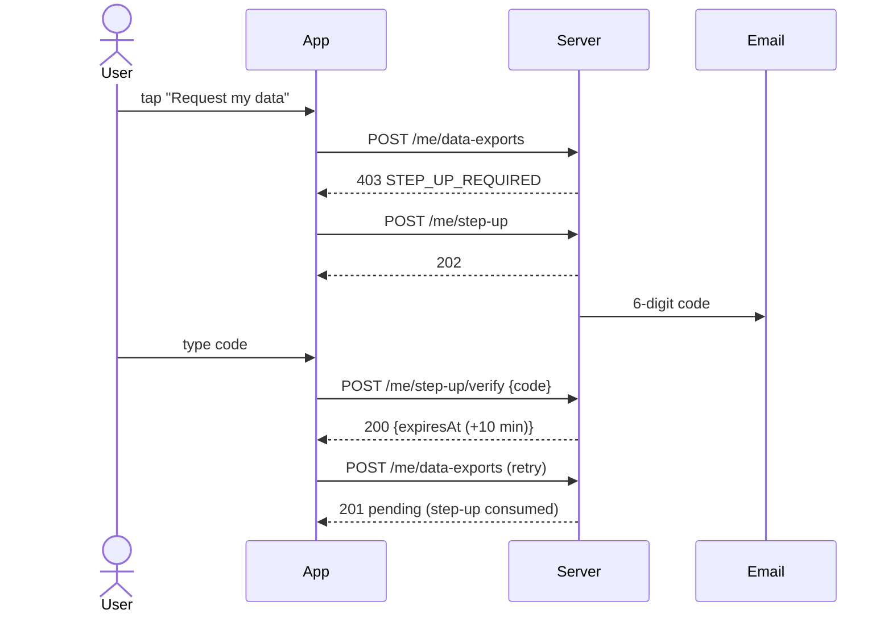
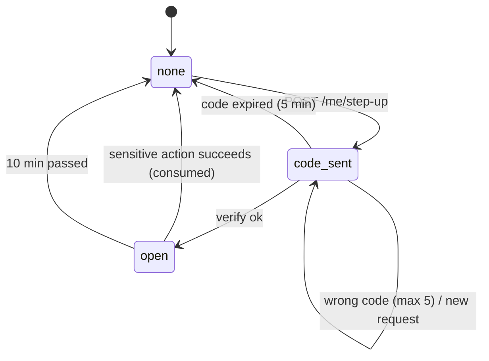

# الملف الشخصي والجلسات — Profile and Sessions

> **التطبيق/الواجهة:** resident app · family member · guard app · technician app · manager dashboard
> **الصلاحيات:** `GET /me`، اللغة، الجلسات، الـstep-up، `GET /me/units`، `GET /me/delegations`: أي حساب مسجّل الدخول بدون permission. الصورة الشخصية: `profile.photo` (موجودة افتراضيًا في دوري `resident` و`family_member` فقط؛ الموظف والمدير لا يملكانها).
> **المصادر:** ADR 0004 · ADR 0029 · ADR 0031 · ADR 0036 · ADR 0037 · `src/core/accounts/me.controller.ts`, `account-self.service.ts`, `views/me.views.ts`, `dto/me.dto.ts` · `src/core/files/me-photo.controller.ts`, `account-photo.service.ts`, `purposes.ts` · `src/core/auth/step-up.controller.ts`, `step-up.service.ts`, `session.service.ts` · `src/community/residents/me-units.controller.ts`, `views/me-units.views.ts`

## الفكرة باختصار
شاشة "حسابي": بيانات الحساب (الاسم، الموبايل، الإيميل، المستند مقنّع، الجنسية، الصورة)، الدور والصلاحيات، تغيير لغة التطبيق، وإدارة الصورة الشخصية التي يراها الحارس على البوابة.
وفيها "الأجهزة/الجلسات": قائمة الجلسات المفتوحة، وإنهاء جلسة واحدة أو كل الجلسات ("لم أكن أنا").
وفيها آلية **التأكيد الإضافي (step-up)**: كود جديد على الإيميل قبل إجراء حساس (اليوم: طلب نسخة البيانات فقط).
وأخيرًا ملخص "وحداتي" و"تفويضاتي".

## الأدوار ومين بيعمل إيه

| الدور | ماذا يفعل |
|---|---|
| ساكن (`resident`) / فرد أسرة (`family`) | يقرأ حسابه، يغيّر اللغة، يضع/يغيّر/يحذف صورته، يدير جلساته، يطلب step-up، يقرأ وحداته وتفويضاته |
| موظف (`staff`: حارس، فني، مشرف صيانة) / مدير (`manager`) | نفس ما سبق **عدا الصورة** (`403 FORBIDDEN`). `GET /me/units` يرجع قائمة فارغة عادةً |
| الحارس | يرى صورة الساكن فقط عند مسح QR صالح (خارج هذا الملف) |
| النظام | يحذف الصورة القديمة عند الاستبدال، ويحذف push tokens مع الجلسات الملغاة، وينهي رموز البوابة عند "خروج من كل الأجهزة" |

## الشاشات اللي الفيتشر محتاجها
- **شاشة حسابي**: الصورة، الاسم، الموبايل، الإيميل، نوع المستند + الرقم مقنّع، الجنسية، الدور.
- **اختيار اللغة**: عربي / English.
- **إدارة الصورة**: زر التقاط/اختيار صورة، شريط رفع، معاينة، زر "حذف الصورة" مع تأكيد.
- **قائمة الجلسات (الأجهزة)**: عنصر لكل جلسة مع علامة "هذا الجهاز".
- **ديالوج إنهاء جلسة واحدة**.
- **ديالوج "تسجيل الخروج من كل الأجهزة"** يوضح أن الجهاز الحالي سيخرج أيضًا، وأن رموز الدخول للبوابة على الموبايل ستتوقف.
- **شيت التأكيد الإضافي (step-up)**: رسالة "أرسلنا كودًا إلى إيميلك"، حقل 6 أرقام، "إعادة الإرسال". يُفتح تلقائيًا عندما يرجع إجراء حساس `STEP_UP_REQUIRED`.
- **قائمة وحداتي**: كارت لكل وحدة.
- **قائمة تفويضاتي**: من فوّضني ومن فوّضته.

## الفلو خطوة بخطوة

### 1) عرض الحساب — `GET /me`
1. التطبيق ينادي `GET /me` بعد الدخول وعند فتح شاشة حسابي.
2. الرد `200 MeView` (راجع "البيانات اللي بتظهر"). الرد `no-store` لأن `photoUrl` رابط مؤقت.
3. التطبيق يستخدم `permissions` لإظهار/إخفاء الأزرار فقط؛ كل endpoint يتحقق بنفسه.
4. لا تحفظ `photoUrl` في الكاش: أعد قراءة `GET /me` عند الحاجة (الرابط ينتهي بعد دقائق).

### 2) تغيير اللغة — `PATCH /me/locale`
1. المستخدم يختار اللغة.
2. التطبيق يرسل `{ locale: "ar" | "en" }`.
3. `200 { preferredLocale }`. نفس القيمة مرة ثانية لا تغيّر شيئًا.
4. أثرها: لغة الإيميلات ونصوص الـpush وأي رسالة يرسلها السيرفر لاحقًا. نصوص الـinbox يرسمها التطبيق بلغته.

### 3) وضع أو تغيير الصورة الشخصية
المسار العام لرفع الملفات موضح في README. خطوات الصورة تحديدًا:
1. `POST /files/uploads { purpose: "resident_photo", contentType, size }`:
   - الأنواع: `image/jpeg`, `image/png`, `image/webp`. الحد: **5 MB**.
   - الرد: رابط PUT مؤقت + `fileId`.
2. التطبيق يرفع الملف مباشرة بـPUT على الرابط (بنفس `Content-Type` و`Content-Length`).
3. `POST /files/{fileId}/finalize`: السيرفر يتأكد من الحجم والنوع والمحتوى الفعلي.
4. `PUT /me/photo { fileId }` ← `204`:
   - الملف ينتقل للحساب.
   - الصورة القديمة (إن وجدت) تُحذف في نفس العملية.
5. التطبيق يعيد قراءة `GET /me` لعرض `photoUrl` الجديد.
6. أي `fileId` ليس ملفًا نهائيًا من نوع `resident_photo` رفعه نفس الحساب ← `400 VALIDATION_FAILED` على `fileId` بالكود `FILE_NOT_AVAILABLE` (نفس الرد لكل الحالات: ملف لشخص آخر، لم يكتمل، محذوف، مستخدم من قبل، نوع آخر، id غير معروف).

### 4) حذف الصورة — `DELETE /me/photo`
1. ديالوج تأكيد.
2. `204`. إذا لم تكن هناك صورة أصلًا: أيضًا `204` (آمن للتكرار).
3. أثرها: الحارس لن يرى صورة عند مسح رمز الدخول.

### 5) قائمة الجلسات — `GET /me/sessions`
1. `200 { data: SessionView[], nextCursor: null }` (قائمة محدودة، بدون صفحات).
2. الترتيب: الأحدث استخدامًا أولًا.
3. تظهر الجلسات الحية فقط (غير ملغاة وغير منتهية).
4. `isCurrent = true` على جلسة هذا الجهاز: اعرض "هذا الجهاز" وامنع أو حذّر عند إنهائها.
5. لا يظهر IP أبدًا. `userAgent` نص خام؛ التطبيق يستخرج منه وصفًا مفهومًا (مثل "Chrome على Windows").

### 6) إنهاء جلسة واحدة — `POST /me/sessions/{id}/revoke`
1. المستخدم يختار جلسة ويؤكد.
2. `204`. الجلسة تنتهي فورًا، ومعها push token الخاص بها. الجهاز الآخر يرجع له `401` في طلبه التالي.
3. إنهاء الجلسة الحالية (`isCurrent`) مسموح، ويعني فعليًا تسجيل خروج هذا الجهاز.
4. جلسة ليست لهذا الحساب أو ملغاة من قبل ← `404 SESSION_NOT_FOUND` ← أعد تحميل القائمة.

### 7) "لم أكن أنا": الخروج من كل الأجهزة — `POST /me/sessions/revoke-all`
1. ديالوج تأكيد قوي.
2. `200 { revoked: <عدد> }`.
3. في نفس العملية:
   - كل الجلسات تنتهي، **بما فيها الحالية**؛
   - كل رموز الدخول للبوابة (resident entry QR) المسجّلة على الحساب تنتهي؛
   - كل push tokens للحساب تُحذف.
4. التطبيق يعرض رسالة نجاح ثم يعود لشاشة الدخول (الطلب التالي سيرجع `401`).
5. هذا **لا يجمّد الحساب** (الفرق عن "لست أنا" في `01-login.md`): المستخدم يستطيع الدخول فورًا بكود جديد.

### 8) التأكيد الإضافي (step-up)
يُستخدم اليوم في إجراء واحد فقط: **طلب نسخة من البيانات** `POST /me/data-exports` (راجع `04-privacy-consents-export-deletion.md`). طلب الحذف لا يحتاجه (يحتاج كلمة تأكيد)، والخروج من كل الأجهزة لا يحتاجه.
1. التطبيق ينادي الإجراء الحساس مباشرة. إذا لم يكن هناك step-up صالح ← `403 STEP_UP_REQUIRED`.
2. التطبيق يفتح شيت التأكيد، وينادي `POST /me/step-up` ← `202` (بدون body). كود من 6 أرقام يُرسل إلى **إيميل الحساب**، صالح 5 دقائق. أي طلب جديد يُبطل الكود السابق.
3. المستخدم يدخل الكود ← `POST /me/step-up/verify { code }`:
   - صحيح ← `200 { expiresAt }`: هذه **الجلسة** مفتوحة لإجراء حساس واحد لمدة **10 دقائق**.
   - خطأ/منتهي ← `403 STEP_UP_CODE_INVALID`. لكل كود 5 محاولات.
4. التطبيق يعيد نداء الإجراء الحساس تلقائيًا.
5. الإجراء يستهلك الـstep-up: **كود واحد = إجراء واحد**. إذا فشل الإجراء (مثلًا `DATA_EXPORT_ACTIVE`) يبقى الـstep-up صالحًا حتى نهاية الـ10 دقائق.
6. الكود مرتبط بالجلسة التي طلبته: لا يعمل من جهاز/جلسة أخرى، ولا يصلح لتسجيل الدخول.

### 9) وحداتي — `GET /me/units`
1. `200 { data: MyUnitView[], nextCursor: null }`: إشغالات الحساب النشطة أولًا، ثم عضوياته في أسر (لحساب فرد الأسرة).
2. كارت الوحدة يعرض الحقول في الجدول أدناه.
3. **ما يستطيع المستخدم فعله في كل وحدة** (أزرار الزوار، البلاغات، الطرود…) يأتي من `GET /me/units/{unitId}/capabilities`، وصلاحيات فرد الأسرة من `GET /me/units/{unitId}/permissions` — التفاصيل في `../03-community/01-units-and-occupancy.md`.

### 10) تفويضاتي — `GET /me/delegations`
1. `200 { data: MyDelegationView[], nextCursor: null }`: التفويضات **السارية** فقط (غير ملغاة وغير منتهية) التي يحملها الحساب أو أعطاها.
2. إنشاء وإلغاء التفويض خارج هذا الملف (فيتشر الأسرة والتفويض).

## الحالات (Statuses)

### الـstep-up على الجلسة

| الحالة | المعنى | ما الذي يغيّرها |
|---|---|---|
| none | لا يوجد تأكيد صالح | الحالة الافتراضية؛ أو بعد الاستهلاك؛ أو بعد 10 دقائق |
| code_sent | كود أُرسل ولم يُدخل بعد (5 دقائق) | `POST /me/step-up` |
| open | الجلسة مفتوحة لإجراء حساس واحد (حتى `expiresAt`) | `POST /me/step-up/verify` صحيح |

حالات الجلسة نفسها موضحة في `01-login.md`.

## البيانات اللي بتظهر

### `GET /me` (`MeView`)
| الحقل | المعنى / ملاحظات |
|---|---|
| `id` | id الحساب |
| `type` | `resident` \| `family` \| `staff` \| `manager` |
| `status` | دائمًا `active` عمليًا (الحسابات الأخرى لا تصل لهذا الـendpoint) |
| `fullName`, `phone`, `email` | بيانات الحساب. للعرض فقط (لا يوجد endpoint لتعديلها من المستخدم) |
| `preferredLocale` | `ar` \| `en` |
| `idDocumentType` | `national_id` \| `passport` \| null |
| `idDocumentNumberMasked` | **مقنّع** مثل `••••1234`. الرقم الكامل لا يُرجع أبدًا |
| `nationality` | أو null |
| `photoUrl` | رابط مؤقت (دقائق، `S3_URL_TTL_SECONDS` = 300 افتراضيًا) أو null. لا تحفظه |
| `role` | `{ id, key, name }`. أدوار النظام تُترجم بالـ`key` (`resident`, `family_member`, `guard`, `technician`, `maintenance_supervisor`, `manager`)؛ `name` لأدوار مخصصة |
| `permissions` | قائمة أكواد مرتبة؛ لإظهار/إخفاء الأزرار |
**لا يُرجع**: تاريخ الميلاد، رقم المستند الكامل.

### `GET /me/sessions` (`SessionView`)
| الحقل | المعنى |
|---|---|
| `id` | id الجلسة (للإنهاء) |
| `createdAt` | وقت الدخول |
| `lastUsedAt` | آخر دخول أو refresh (لا يتحدث مع كل طلب) |
| `userAgent` | نص خام أو null |
| `isCurrent` | جلسة هذا الجهاز |
**لا يُرجع**: IP، نوع الجهاز، id الجهاز المعروف.

### `GET /me/units` (`MyUnitView`)
| الحقل | المعنى |
|---|---|
| `unitId`, `code` | الوحدة وكودها |
| `building`, `floor` | أو null |
| `unitType` | `apartment` \| `villa` \| `townhouse` \| `duplex` \| `penthouse` \| `studio` \| `commercial` \| `other` \| null |
| `areaSqm` | نص بخانتين عشريتين (متر مربع)؛ التطبيق يحوّل للقدم المربع إن أراد |
| `status` | `active` أو `closed` (الوحدة في وضع الإغلاق) |
| `capacity` | `owner` \| `tenant` \| `member` |
| `resides` | `false` فقط للمالك غير المقيم |
| `isPrimary` | هل المستخدم هو الساكن الرئيسي |
| `household` | للـprimary فقط: `{ memberCount, pendingInvites }` |

### `GET /me/delegations` (`MyDelegationView`)
| الحقل | المعنى |
|---|---|
| `id`, `unitId`, `unitCode` | التفويض والوحدة |
| `role` | `delegate` (أنا المفوَّض) أو `delegator` (أنا من فوّض) |
| `counterpart` | الطرف الآخر بالاسم فقط: `{ id, fullName }`، أو `{ id, erased: true }` إن كان ممسوحًا |
| `scopes` | `household` و/أو `workers` |
| `expiresAt` | نهاية التفويض |

### `POST /me/step-up/verify`
`{ expiresAt }`: حتى متى تبقى الجلسة مفتوحة لإجراء حساس.

## القواعد والقيود
- **اللغة**: `ar` أو `en` فقط.
- **الصورة**: JPEG/PNG/WebP، 5 MB كحد أقصى، يرفعها صاحب الحساب فقط (`profile.photo`). يراها صاحب الحساب في `GET /me` والحارس عند مسح QR صالح، ولا أحد غيرهما. عند الاستبدال/الحذف تُحذف القديمة فورًا. حد عام: 10 رفعات غير مكتملة في نفس الوقت لكل حساب (`FILE_PENDING_LIMIT`).
- **الجلسات**: لا حد لعدد الجلسات. إنهاء جلسة يحذف push token الخاص بها. الخروج من كل الأجهزة ينهي أيضًا رموز البوابة.
- **step-up**:
  - الكود 6 أرقام، صالح 5 دقائق، 5 محاولات لكل كود.
  - حد الطلب وحد التحقق: 5 لكل جلسة كل 15 دقيقة (لكل منهما) ← `429 RATE_LIMITED`.
  - بعد التحقق: 10 دقائق، لإجراء واحد، على نفس الجلسة.
- لا `Idempotency-Key` في هذه الـendpoints.

## الأخطاء اللي الـUI لازم يتعامل معاها

| HTTP + `code` | متى | رسالة/سلوك مقترح |
|---|---|---|
| `400 VALIDATION_FAILED` (`locale`) | لغة غير `ar`/`en` | لا يحدث من واجهة اختيار مغلقة |
| `400 VALIDATION_FAILED` (`fileId`: `FILE_NOT_AVAILABLE`) | الصورة غير جاهزة أو ليست للمستخدم | "تعذّر استخدام هذه الصورة، أعد الرفع" |
| `400 VALIDATION_FAILED` (`contentType`: `FILE_TYPE_NOT_ALLOWED` / `size`: `FILE_TOO_LARGE`) | عند `POST /files/uploads` | تحقق محلي: الصيغ المسموحة وحد 5 MB |
| `409 FILE_UPLOAD_MISSING` / `409 FILE_UPLOAD_EXPIRED` / `422 FILE_CONTENT_MISMATCH` | عند `finalize` | "فشل رفع الصورة، حاول مرة أخرى" |
| `429 FILE_PENDING_LIMIT` | رفعات كثيرة غير مكتملة | "حاول لاحقًا" |
| `403 FORBIDDEN` | موظف/مدير يحاول وضع صورة | لا تعرض خيار الصورة لهم |
| `404 SESSION_NOT_FOUND` | جلسة غير موجودة/ملغاة | أعد تحميل القائمة |
| `403 STEP_UP_REQUIRED` | إجراء حساس بدون تأكيد (أو الحساب بلا إيميل) | افتح شيت التأكيد |
| `403 STEP_UP_CODE_INVALID` | كود خطأ/منتهي/مستهلك | "الكود غير صحيح أو انتهت صلاحيته" + "إرسال كود جديد" |
| `429 RATE_LIMITED` | طلبات step-up كثيرة | "حاول بعد قليل" |
| `401 UNAUTHENTICATED` | بعد إنهاء الجلسة الحالية أو كل الجلسات | شاشة الدخول |

## الإشعارات
لا يوجد إشعار inbox لهذه الأفعال (تغيير اللغة، الصورة، إنهاء الجلسات).

| الحدث | القناة | المستلم | Push؟ | ملاحظات |
|---|---|---|---|---|
| طلب step-up | إيميل كود "رمز التأكيد من جوار" | إيميل الحساب | لا | يُرسل مباشرة، لا تؤثر عليه التفضيلات |
| إنهاء كل الجلسات / جلسة | لا شيء | — | — | الجهاز الآخر يكتشف ذلك بـ`401` فقط |

## الـEndpoints

| Method + path | من يناديه | الغرض | رد النجاح |
|---|---|---|---|
| `GET /me` | أي حساب | بيانات الحساب والدور والصلاحيات | `200 MeView` (no-store) |
| `PATCH /me/locale` | أي حساب | تغيير اللغة `{ locale }` | `200 { preferredLocale }` |
| `POST /files/uploads` | `profile.photo` | بدء رفع الصورة | رابط PUT + id (راجع README) |
| `POST /files/{id}/finalize` | صاحب الملف | إنهاء الرفع | الملف `ready` |
| `PUT /me/photo` | `profile.photo` | وضع/استبدال الصورة `{ fileId }` | `204` |
| `DELETE /me/photo` | `profile.photo` | حذف الصورة | `204` |
| `GET /me/sessions` | أي حساب | الجلسات الحية | `200 { data: SessionView[], nextCursor: null }` |
| `POST /me/sessions/{id}/revoke` | أي حساب | إنهاء جلسة | `204` |
| `POST /me/sessions/revoke-all` | أي حساب | إنهاء كل الجلسات | `200 { revoked }` |
| `POST /me/step-up` | أي حساب | إرسال كود تأكيد | `202` |
| `POST /me/step-up/verify` | أي حساب | التحقق من الكود `{ code }` | `200 { expiresAt }` |
| `GET /me/units` | أي حساب | وحداتي | `200 { data: MyUnitView[], nextCursor: null }` |
| `GET /me/units/{unitId}/capabilities` | أي حساب | ما يُسمح به في الوحدة | راجع `../03-community/01-units-and-occupancy.md` |
| `GET /me/units/{unitId}/permissions` | فرد أسرة | صلاحياتي في الوحدة | راجع `../03-community/01-units-and-occupancy.md` |
| `GET /me/delegations` | أي حساب | تفويضاتي السارية | `200 { data: MyDelegationView[], nextCursor: null }` |

## ملاحظات للديزاين وحاجات ناقصة في الباك
- **لا يوجد تعديل للاسم أو الموبايل أو الإيميل من المستخدم**: التعديل عند المدير فقط (`PATCH /accounts/{id}/contact`). شاشة الحساب للعرض، ويُفضّل زر "اطلب تعديل من الإدارة" (طلبات الإدارة).
- `GET /me` لا يرجع تاريخ الميلاد (v0-notes: يُضاف إذا احتاجه التصميم).
- قائمة الجلسات تعطي `userAgent` خامًا فقط؛ لا يوجد `deviceType` رغم أن الباك يحسبه للأجهزة المعروفة. التطبيق يحتاج parser بسيط، أو إضافة الحقل في الباك.
- لا يوجد ربط بين الجلسة والجهاز المعروف، ولا قائمة أجهزة معروفة (`GET /me/devices`)، فلا يمكن "لست أنا" من شاشة الجلسات.
- `lastUsedAt` يتحدث فقط عند الدخول والـrefresh، لذلك قد يبدو أقدم من الاستخدام الفعلي.
- **الـstep-up مستخدم في إجراء واحد فقط** (طلب نسخة البيانات). ADR 0036 يصفه كآلية عامة للإجراءات الحساسة؛ لا يوجد إجراء آخر يطلبه اليوم.
- حساب بلا إيميل يحصل على `STEP_UP_REQUIRED` عند `POST /me/step-up` نفسه (لا يوجد كود خاص). عمليًا كل حساب نشط له إيميل.
- `photoUrl` ينتهي خلال دقائق: الصورة في التطبيق يجب أن تُحمَّل فور القراءة، أو يعاد طلب `GET /me` عند فشل التحميل.
