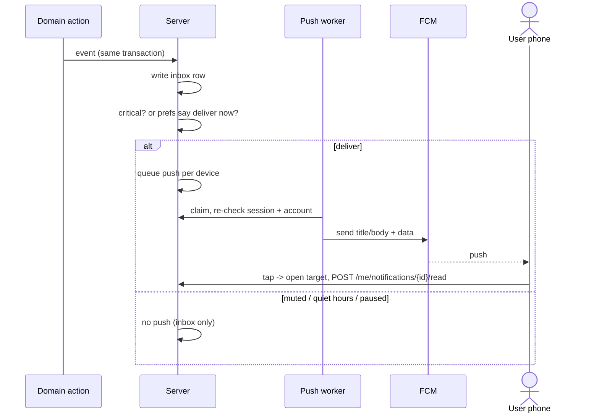
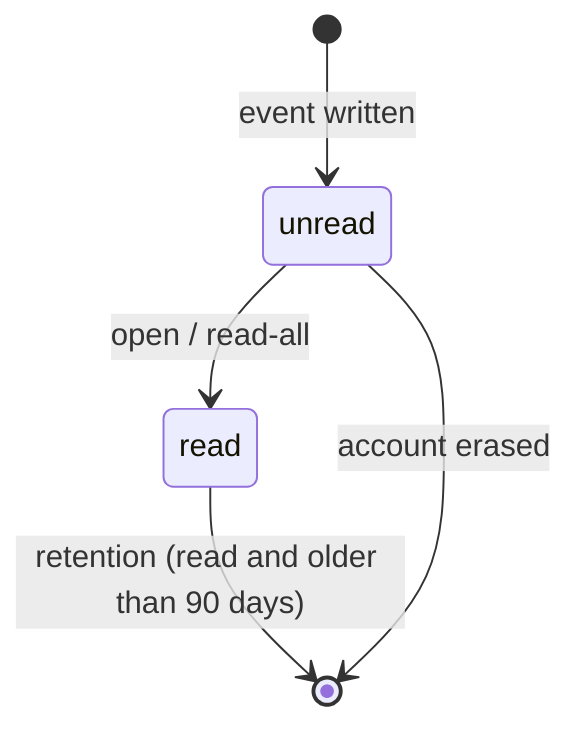
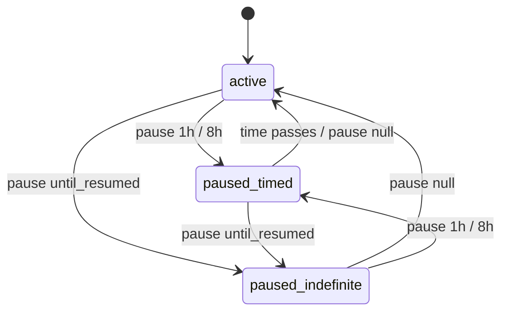

# الإشعارات والـPush والتفضيلات — Notifications, Push and Preferences

> **التطبيق/الواجهة:** resident app · family member · guard app · technician app · manager dashboard (الـinbox والتفضيلات لكل حساب داخل كمبوند؛ الـpush لتطبيقات الموبايل فقط)
> **الصلاحيات:** لا توجد permission: `/me/notifications`، `/me/notification-preferences`، `/me/push-tokens` متاحة لأي حساب مسجّل الدخول (resident, family, staff, manager) وعلى بياناته هو فقط. المدير يعدّل تفضيلات ساكن نيابةً عنه بـ`residents.assist` — راجع `05-assisted-mode.md`.
> **المصادر:** ADR 0027 · ADR 0036 · ADR 0041 · `docs/api/v0-notes.md` · `src/core/notifications/` (`kinds.ts`, `notifier.ts`, `notifications.service.ts`, `notifications.controller.ts`) · `src/core/push/` (`push-texts.ts`, `push-outbox.ts`, `push-processor.ts`, `push-devices.service.ts`, `push-tokens.controller.ts`) · `src/core/preferences/` (`categories.ts`, `delivery-decision.ts`, `notification-preferences.service.ts`)

## الفكرة باختصار
كل حدث مهم يكتب **إشعارًا في صندوق الوارد (inbox)** داخل التطبيق للحساب المعني. الـinbox هو المرجع: يُسجَّل فيه كل شيء مهما كانت التفضيلات.
الإشعار في الـinbox يحمل **كودًا (`kind`) وبارامترات** فقط، والتطبيق هو من يكتب النص بلغة المستخدم.
نسخة من الإشعار تصل **push** على الموبايلات المسجّلة، بنص يكتبه السيرفر (عربي/إنجليزي)، حسب تفضيلات المستخدم.
التفضيلات: لكل **فئة** (صيانة، بوابة وزوار، طرود، الأسرة، أمان الحساب، طلبات الإدارة) مفتاحان (إيميل، push)، مع **ساعات هدوء** و**إيقاف مؤقت**. الإشعارات **الحرجة (critical)** تصل دائمًا.

## الأدوار ومين بيعمل إيه

| الدور | ماذا يفعل |
|---|---|
| أي حساب (ساكن، فرد أسرة، حارس، فني، مشرف، مدير) | يقرأ إشعاراته، عدد غير المقروء، يعلّم كمقروء، يضبط تفضيلاته، يسجّل/يحذف push token لجهازه |
| المدير (`residents.assist`) | يقرأ ويعدّل تفضيلات ساكن/فرد أسرة لا يستخدم التطبيق — `05-assisted-mode.md` |
| النظام | يكتب الإشعارات مع الحدث، يقرر الـpush حسب التفضيلات، يرسل عبر FCM، يحذف المقروء القديم بعد 90 يومًا، يمسح أسماء الزوار/العمال من الإشعارات عند انتهاء بياناتهم |

## الشاشات اللي الفيتشر محتاجها
- **أيقونة الجرس مع شارة (badge)**: عدد غير المقروء، وتمييز خاص (لون/نقطة) عند وجود **غير مقروء حرج**.
- **قائمة الإشعارات (inbox)**: الأحدث أولًا، فلتر "غير المقروء"، تمييز بصري للمقروء/غير المقروء وللحرج، زر "تعليم الكل كمقروء".
- **عنصر الإشعار**: أيقونة حسب الفئة، نص يبنيه التطبيق من `kind` + `params`، الوقت. الضغط يفتح الشاشة الهدف (`targetType` + `targetId`) ويعلّمه كمقروء.
- **شاشة إعدادات الإشعارات**:
  - جدول الفئات × القناتين (إيميل / push) بمفاتيح on/off؛
  - ساعات الهدوء (من–إلى) مع إظهار توقيت الكمبوند؛
  - الإيقاف المؤقت: ساعة، 8 ساعات، حتى أعيد التشغيل، ومع إيقاف فعّال: "ينتهي الساعة …" وزر "استئناف"؛
  - ملاحظة ثابتة: "الإشعارات الحرجة تصل دائمًا" مع أمثلة.
- **طلب إذن الإشعارات من نظام التشغيل** ثم تسجيل الـtoken (بدون شاشة؛ عند فتح التطبيق).
- **التعامل مع الضغط على Push**: فتح التطبيق على الشاشة الهدف مباشرة.

## الفلو خطوة بخطوة

### 1) إنشاء الإشعار (تلقائي، في الخلفية)
1. فعل ما في أي نظام (حارس يطلب موافقة، فني يكمل بلاغ، طرد يصل…) يكتب إشعارًا لكل مستلم **في نفس العملية**: الإشعار موجود فقط إذا نجح الفعل.
2. أولوية الإشعار (`priority`) ونوع الهدف (`targetType`) يحددهما الكتالوج، وليس المرسل.
3. في نفس اللحظة يُقرر الـpush لكل جهاز مسجّل للمستلم (الفلو 6).
4. الإشعارات لا تُسجَّل في الـaudit (الفعل نفسه هو المسجّل).

### 2) قائمة الإشعارات — `GET /me/notifications`
1. Query: `cursor`، `limit` (1–100، افتراضيًا 20)، `unread=true|false` (اختياري).
2. `200 { data: NotificationView[], nextCursor }` — الأحدث أولًا، صفحات بالـcursor (راجع README).
3. `unread=true` يرجع غير المقروء فقط.
4. التطبيق يرسم النص من `kind` و`params` (لكل kind نص عربي وإنجليزي في التطبيق).
5. بعض `params` قد **تختفي** لاحقًا (اسم الزائر أو العامل) عندما تنتهي صلاحية بياناته؛ يجب أن يكون للنص صيغة بديلة بدون الاسم ("زائر"، "العامل").

### 3) الشارة — `GET /me/notifications/unread-count`
1. `200 { unread, critical }`: كل غير المقروء، وغير المقروء الحرج منه.
2. يُستدعى عند فتح التطبيق، وعند وصول push، وبعد التعليم كمقروء (لا يوجد real-time/websocket).

### 4) تعليم إشعار كمقروء — `POST /me/notifications/{id}/read`
1. عند فتح الإشعار. `204`.
2. تكراره لا يغيّر شيئًا (idempotent).
3. id لإشعار شخص آخر أو غير موجود ← `404 NOTIFICATION_NOT_FOUND`.

### 5) تعليم الكل كمقروء — `POST /me/notifications/read-all`
1. `200 { read: <عدد ما تم تعليمه> }`.
2. أعد قراءة الشارة.

### 6) تسجيل جهاز للـpush — `POST /me/push-tokens`
1. بعد الدخول وعند كل فتح للتطبيق: التطبيق يأخذ FCM token من النظام، ويرسل `{ token, platform: "android" | "ios" }` مع الهيدر **`X-Jiwar-Install-Id`** (نفس UUID الدخول).
2. `204`. لا يرجع أي شيء، ولا يوجد endpoint يعرض الأجهزة أو الـtokens.
3. قواعد:
   - token واحد لكل (حساب + تثبيت): التسجيل مرة أخرى يستبدله.
   - إذا دخل نفس التثبيت على حساب آخر، الـtoken **ينتقل** للحساب الجديد ويُحذف من القديم.
   - حتى **10 أجهزة** لكل حساب؛ الحادي عشر يحذف الأقدم استخدامًا.
   - الـtoken **مرتبط بالجلسة** التي سجّلته: ينتهي مع الخروج أو إلغاء الجلسة.
4. بدون `X-Jiwar-Install-Id` صالح ← `400 INSTALL_ID_REQUIRED`. جلسة منتهية ← `401 UNAUTHENTICATED`.

### 7) حذف token الجهاز — `DELETE /me/push-tokens`
1. مع `X-Jiwar-Install-Id`. `204` دائمًا (آمن للتكرار).
2. يُستخدم عندما يطفئ المستخدم الإشعارات من التطبيق أو عند الخروج (الخروج يحذفه تلقائيًا أيضًا).

### 8) إرسال الـpush (تلقائي)
1. لكل إشعار جديد ولكل جهاز مسجّل للمستلم:
   - kind **حرج** ← يُرسل دائمًا (بأولوية عالية).
   - غير حرج ← يُرسل **فقط إذا كان التسليم "الآن" مسموحًا**: الفئة مفعّلة لقناة `push`، وليس في ساعات هدوء، وليس في إيقاف مؤقت. وإلا **لا push إطلاقًا** (لا يُؤجَّل)؛ الإشعار موجود في الـinbox.
2. المرسل في الخلفية (كل 5 ثوانٍ افتراضيًا) يعيد التحقق قبل كل إرسال: الجلسة حية والحساب `active`، وإلا يحذف الجهاز ولا يرسل.
3. النص: العنوان والنص من `push-texts.ts` بلغة الحساب (`preferredLocale`)، **بدون أسماء أشخاص** وبدون أكواد خام.
4. `data` في الرسالة: `{ notificationId, kind, targetType, targetId }` (كلها نصوص) — التطبيق يفتح الشاشة الهدف منها.
5. إعادة المحاولة عند أعطال مؤقتة: 30ث، 2د، 10د، 30د، ساعتان، ثم يتوقف (5 محاولات). قد **يضيع** push؛ لا يتكرر أبدًا لنفس الجهاز (collapse id = id الإشعار).
6. إذا لم تُضبط مفاتيح FCM على السيرفر: الـtokens تُقبل، لكن لا يُرسل أي push.

### 9) قراءة التفضيلات — `GET /me/notification-preferences`
1. `200 PreferencesView`: كل الفئات الست مع `email` و`push`، و`quietHours`، و`pause`، و`timeZone`.
2. الافتراضي لحساب جديد: كل المفاتيح on، بدون ساعات هدوء، بدون إيقاف.

### 10) تعديل التفضيلات — `PATCH /me/notification-preferences`
1. يُرسل **فقط ما تغيّر**؛ ما لا يُذكر يبقى كما هو.
2. الحقول:
   - `categories` (اختياري): مصفوفة، كل فئة مرة واحدة على الأكثر: `{ category, email?, push? }`.
   - `quietHours` (اختياري): `{ start: "HH:MM", end: "HH:MM" }` بتوقيت الكمبوند؛ إذا كان `end` قبل `start` فالفترة تعبر منتصف الليل (مثل 22:00–07:00). `null` يلغي ساعات الهدوء. لا يجوز `start = end`.
   - `pause` (اختياري): `"1h"` | `"8h"` | `"until_resumed"`؛ `null` ينهي الإيقاف.
3. `200 PreferencesView` بالحالة الجديدة.
4. أثر فوري: الإيميلات المؤجلة لهذا الحساب يُعاد تقريرها (مثلًا إنهاء الإيقاف يطلق الإيميلات المحجوزة فورًا).

### 11) كيف تُطبَّق التفضيلات على الإيميل (لنص شاشة الإعدادات)
1. حرج ← يُرسل فورًا دائمًا.
2. الفئة مطفأة للإيميل ← لا يُرسل، **إلا** الإيميلات التي هي السجل الوحيد للإشعار (ليس لها نسخة في الـinbox، مثل إشعارات الأسرة والتفويض): هذه لا تُلغى أبدًا.
3. إيقاف مؤقت ← الإيميل **يُحجز** حتى نهاية الإيقاف (لا يضيع). "حتى أعيد التشغيل" لا يحجز إيميلات السجل الوحيد.
4. ساعات هدوء ← يُحجز حتى نهاية الفترة.
5. إيميل محجوز أكثر من 7 أيام وله نسخة في الـinbox يُحذف (الـinbox يبقى السجل).
6. الفرق المهم للتصميم: **الإيميل يُؤجَّل، الـpush لا يُرسل أصلًا** أثناء الهدوء/الإيقاف.

### 12) الاحتفاظ والمسح (تلقائي)
- كل ساعة (sweep): حذف الإشعارات **المقروءة** الأقدم من 90 يومًا (`NOTIFICATIONS_RETENTION_DAYS`). غير المقروءة تبقى حتى تُقرأ.
- عند انتهاء بيانات زائر أو عامل: يُحذف `visitorName`/`workerName` من إشعاراته (مقروءة أو لا)؛ باقي الإشعار يبقى.
- عند مسح الحساب: كل إشعاراته وتفضيلاته وأجهزته تُحذف.

## الحالات (Statuses)

### حالة الإشعار في الـinbox

| الحالة | المعنى | ما الذي يغيّرها |
|---|---|---|
| unread (`readAt = null`) | جديد | يُنشأ مع الحدث |
| read (`readAt` موجود) | مقروء | `POST …/{id}/read` أو `read-all` |
| (محذوف) | لم يعد موجودًا | مقروء + أقدم من 90 يومًا، أو مسح الحساب |

### حالة الإيقاف المؤقت

## البيانات اللي بتظهر

### عنصر الإشعار (`NotificationView`)
| الحقل | المعنى |
|---|---|
| `id` | للتعليم كمقروء |
| `kind` | كود من الكتالوج (الجدول أدناه) |
| `priority` | `normal` \| `critical` — للعرض والشارة |
| `params` | بارامترات النص (نصوص/أرقام). لا تحمل أبدًا مستندًا أو هاتفًا أو كودًا |
| `targetType`, `targetId` | ما يفتحه الضغط (قد يكون null نظريًا) |
| `readAt` | وقت القراءة أو null |
| `createdAt` | وقت الحدث |

ملاحظة: `priority` (للشارة والعرض) غير `critical` (للتسليم). مثلًا `ticket.assigned` و`entry_credential.issued` أولويتهما `normal` في الـinbox لكنهما يصلان دائمًا كـpush.

### الشارة (`UnreadCountView`)
`{ unread, critical }`.

### التفضيلات (`PreferencesView`)
| الحقل | المعنى |
|---|---|
| `categories[]` | `{ category, email, push }` لكل فئة من: `maintenance`, `gate_visitors`, `parcels`, `household`, `account_security`, `management` |
| `quietHours` | `{ start, end }` أو null |
| `pause` | `{ until }` (`null` = حتى إعادة التشغيل) أو null. الإيقاف المنتهي يظهر null |
| `timeZone` | توقيت الكمبوند، مثل `Africa/Cairo` (اعرضه بجانب ساعات الهدوء) |

### الـpush
العنوان والنص بالعربي/الإنجليزي من السيرفر؛ `data = { notificationId, kind, targetType, targetId }`. لا أسماء أشخاص على شاشة القفل.

### كتالوج الإشعارات (ما يمكن أن يظهر في الـinbox)
الأعمدة: المستلم · الفئة · `priority` · critical (يتجاوز التفضيلات) · `targetType` · عنوان الـpush بالعربي. نصوص الـpush الكاملة في `src/core/push/push-texts.ts`.

**البوابة والزوار والعمال**
| `kind` | المستلم | الفئة | priority | critical | target | عنوان الـpush |
|---|---|---|---|---|---|---|
| `gate.approval_requested` | أفراد الوحدة الذين يحق لهم دعوة زوار | `gate_visitors` | critical | نعم | `gate_approval_request` | زائر عند البوابة |
| `gate.approval_reversed` | الحارس الذي طلب الموافقة | `gate_visitors` | critical | نعم | `gate_approval_request` | تم سحب الموافقة |
| `worker.entered` | أفراد الوحدة المستحقون لإشعارات الزوار | `gate_visitors` | normal | لا | `worker_engagement` | وصل العامل |
| `worker.exited` | نفس السابق | `gate_visitors` | normal | لا | `worker_engagement` | غادر العامل |
| `visitor_pass.not_me` | صاحب التصريح | `gate_visitors` | normal | لا | `visitor_pass` | تم إلغاء تصريح الزائر |
| `entry_credential.issued` | صاحب الحساب | `account_security` | normal | نعم | `entry_credential` | تسجيل هاتف جديد للدخول |

**الحساب والأمان والخصوصية**
| `kind` | المستلم | الفئة | priority | critical | target | عنوان الـpush |
|---|---|---|---|---|---|---|
| `account.new_device_login` | صاحب الحساب | `account_security` | critical | نعم | `known_device` | تسجيل دخول جديد إلى حسابك |
| `data_export.ready` | صاحب الحساب | `account_security` | normal | لا | `data_export` | ملف بياناتك جاهز |
| `account.deletion_requested` | صاحب الحساب | `account_security` | critical | نعم | `account_deletion_request` | طلب حذف الحساب |
| `account.deletion_reminder` | صاحب الحساب | `account_security` | critical | نعم | `account_deletion_request` | سيتم حذف حسابك قريبًا |
| `account.deletion_delayed` | صاحب الحساب | `account_security` | critical | نعم | `account_deletion_request` | تأجيل حذف الحساب |
| `account.deletion_queued` | المديرون أصحاب `accounts.erase` | `account_security` | normal | لا | `account_deletion_request` | طلب حذف بحاجة إلى مراجعة |
| `account.deletion_closed` | صاحب الحساب | `account_security` | normal | لا | `account_deletion_request` | تم إغلاق طلب الحذف |
| `account.assisted_action` | صاحب الحساب | `account_security` | normal | لا | `account` | تم إجراء تغيير على حسابك |
| `household.member_account_deleted` | الـprimary للوحدة | `household` | normal | لا | `household_member` | تم حذف حساب أحد أفراد الأسرة |

**الصيانة** (تفاصيل في ملفات `../06-maintenance/`)
| `kind` | المستلم | priority | critical | عنوان الـpush |
|---|---|---|---|---|
| `ticket.emergency` | كل الموزعين (dispatchers) | critical | نعم | بلاغ طارئ |
| `ticket.assigned` | الفني | normal | نعم | بلاغ جديد مسند إليك |
| `ticket.unassigned` | الفني السابق | normal | لا | تمت إعادة إسناد البلاغ |
| `ticket.status_changed` | مقدّم البلاغ | normal | لا | تحديث على البلاغ |
| `ticket.completed` | مقدّم البلاغ (للتأكيد أو الرفض) | normal | لا | اكتمل العمل |
| `ticket.declined` | الموزعون | normal | لا | تم رفض البلاغ |
| `ticket.technician_unavailable` | الموزعون | normal | لا | الفني غير متاح |
| `ticket.priority_changed` | الفني | normal | لا | تغيّرت أولوية البلاغ |
| `ticket.rejected` | الموزعون + الفني | normal | لا | تم رفض العمل |
| `ticket.reopened` | الموزعون + الفني | normal | لا | أُعيد فتح البلاغ |
| `ticket.escalated` | الموزعون | normal | لا | بلاغ بحاجة إلى متابعة |
| `ticket.auto_closed` | مقدّم البلاغ | normal | لا | تم إغلاق البلاغ |
| `ticket.message` | من يحق له رؤية الرسالة | normal | لا | رسالة جديدة |
| `ticket.opened_on_behalf` | مقدّم البلاغ | normal | لا | تم فتح بلاغ باسمك |
| `ticket.unassignable` | الموزعون | normal | لا | لا يوجد فني متاح |
| `ticket.unassignable_emergency` | الموزعون | critical | نعم | بلاغ طارئ بلا فني |
| `ticket.sla_breached` | الموزعون والمديرون | normal | لا | بلاغ متأخر |
| `ticket.sla_breached_emergency` | الموزعون والمديرون | critical | نعم | بلاغ طارئ متأخر |
| `ticket.resident_escalated` | الموزعون والمديرون | normal | لا | طلب متابعة من ساكن |
| `ticket.resident_escalated_emergency` | الموزعون والمديرون | critical | نعم | تصعيد بلاغ طارئ |
| `ticket.visit_proposed` | الطرف الآخر في الزيارة | normal | لا | اقتراح موعد زيارة |
| `ticket.visit_confirmed` | الطرف الآخر | normal | لا | تم تأكيد الزيارة |
| `ticket.visit_cancelled` | أطراف الزيارة | normal | لا | تم إلغاء الزيارة |
| `ticket.visit_arrived` | سكان الوحدة | normal | لا | وصل الفني |
| `ticket.visit_arrival_confirmed` | الفني | normal | لا | تم تأكيد الوصول |
| `ticket.visit_no_access` | سكان الوحدة | normal | لا | تعذّر دخول الفني |
| `ticket.visit_late` | السكان والتوزيع | normal | لا | تأخر موعد الزيارة |
| `ticket.visit_consent_granted` | الـprimary | normal | لا | السماح بالدخول في غيابكم |
| `ticket.category_changed` | الفني | normal | لا | تغيّر تصنيف البلاغ |
كلها فئة `maintenance` و`targetType = ticket`.

**الطرود** (فئة `parcels`، `targetType = parcel`، لا شيء منها حرج)
| `kind` | المستلم | عنوان الـpush |
|---|---|---|
| `parcel.arrived` | كل ساكن مستحق في الوحدة | وصل طرد |
| `parcel.collected` | باقي سكان الوحدة (ليس المستلم) | تم استلام الطرد |
| `parcel.reminder` | سكان الوحدة (مرة عند أيام التذكير) | طرد بانتظار الاستلام |
| `parcel.held_long` | المديرون (مرة) | طرد محتجز منذ مدة طويلة |
| `parcel.rejected` | الحراس | تم رفض الطرد |
| `parcel.unclaimable` | المديرون (مرة) | طرد بلا مستلم |

**طلبات الإدارة** (فئة `management`، `targetType = management_request`، لا شيء منها حرج، `params = { requestNumber, topicKey }`)
| `kind` | المستلم | عنوان الـpush |
|---|---|---|
| `management_request.replied` | صاحب الطلب | رد جديد من الإدارة |
| `management_request.status_changed` | صاحب الطلب | تحديث على طلبك |
| `management_request.auto_closed` | صاحب الطلب | تم إغلاق الطلب |
| `management_request.opened_for_you` | صاحب الطلب | تم فتح طلب باسمك |
| `management_appointment.proposed` | صاحب الطلب | اقتراح موعد |
| `management_appointment.countered` | صاحب الطلب | اقتراح موعد آخر |
| `management_appointment.confirmed` | صاحب الطلب | تم تأكيد الموعد |
| `management_appointment.cancelled` | صاحب الطلب | تم إلغاء الموعد |
| `management_request.created` | من يتعامل مع الطلبات | طلب جديد |
| `management_request.assigned` | الموظف المسند إليه | طلب مسند إليك |
| `management_request.escalated` | أصحاب `requests.manage` | طلب متأخر |
| `management_request.resident_replied` | المسند إليه، وإلا كل المتعاملين | رد جديد على طلب |
| `management_request.reopened` | المسند إليه، وإلا كل المتعاملين | أُعيد فتح الطلب |
| `management_request.withdrawn` | المسند إليه | تم سحب الطلب |
| `management_appointment.requested` | المسند إليه، وإلا المتعاملون | طلب موعد |
| `management_appointment.accepted` | المسند إليه، وإلا المتعاملون | تم قبول الموعد |
| `management_appointment.cancelled_by_resident` | المسند إليه، وإلا المتعاملون | ألغى الساكن الموعد |

## القواعد والقيود
- الـinbox للحساب نفسه فقط؛ لا يمكن قراءة إشعار شخص آخر.
- القائمة: `limit` من 1 إلى 100 (افتراضي 20)، `unread` فقط `true`/`false`.
- الاحتفاظ: المقروء يُحذف بعد 90 يومًا؛ غير المقروء لا يُحذف.
- **الإشعارات الحرجة** (`critical = true`) تتجاهل كل التفضيلات في الإيميل والـpush: `account.new_device_login`، `entry_credential.issued`، `account.deletion_requested`/`_reminder`/`_delayed`، `ticket.emergency`، `ticket.unassignable_emergency`، `ticket.sla_breached_emergency`، `ticket.resident_escalated_emergency`، `ticket.assigned`، `gate.approval_requested`، `gate.approval_reversed`. ومن الإيميلات: تجميد الحساب، رابط التصدير المساعَد، أكواد الدخول.
- التحكم **لكل فئة × قناة**، وليس لكل kind.
- ساعات الهدوء بصيغة `HH:MM` وبتوقيت الكمبوند (`timeZone`)، وليس توقيت الهاتف.
- الإيقاف: `1h`، `8h`، `until_resumed` فقط.
- Push token: 1–4096 حرفًا، `platform` = `android` | `ios`، يتطلب `X-Jiwar-Install-Id`، حتى 10 أجهزة لكل حساب.
- Push لا يُرسل بعد انتهاء الجلسة، ولا لحساب غير `active`، ولا لكمبوند معلّق.
- لا `Idempotency-Key` في هذه الـendpoints.

## الأخطاء اللي الـUI لازم يتعامل معاها

| HTTP + `code` | متى | رسالة/سلوك مقترح |
|---|---|---|
| `404 NOTIFICATION_NOT_FOUND` | تعليم إشعار غير موجود (حُذف بالـretention أو ليس للمستخدم) | تجاهل بصمت وأعد تحميل القائمة |
| `400 VALIDATION_FAILED` (`unread`, `limit`, `cursor`) | قيم query خاطئة | لا يحدث من واجهة صحيحة |
| `400 VALIDATION_FAILED` (`categories.N.category`: `INVALID_VALUE` / `DUPLICATE_VALUE`؛ `categories.N.email|push`: `INVALID_TYPE`؛ `FIELD_NOT_ALLOWED`) | تفضيلات بشكل خاطئ | لا يحدث من واجهة صحيحة |
| `400 VALIDATION_FAILED` (`quietHours.start|end`: `INVALID_FORMAT`؛ `quietHours`: `INVALID_SCHEDULE`) | وقت ليس `HH:MM`، أو البداية = النهاية | "اختر وقتي بداية ونهاية مختلفين" |
| `400 VALIDATION_FAILED` (`pause`) | قيمة إيقاف غير مسموحة | — |
| `400 INSTALL_ID_REQUIRED` | تسجيل/حذف token بدون install id صالح | خطأ برمجي في التطبيق |
| `401 UNAUTHENTICATED` | تسجيل token بجلسة منتهية | إعادة الدخول |

## الإشعارات
هذه الفيتشر هي نفسها نظام الإشعارات؛ لا تُنتج إشعارات خاصة بها. تغيير التفضيلات بواسطة المدير يُنتج `account.assisted_action` (راجع `05-assisted-mode.md`).

| الحدث | `kind` | المستلم | Push؟ | الضغط يفتح |
|---|---|---|---|---|
| أي إشعار | حسب الكتالوج أعلاه | حسب الكتالوج | حرج: دائمًا؛ غيره: حسب التفضيلات وفي اللحظة نفسها فقط | الشاشة الهدف حسب `targetType`/`targetId` |

## الـEndpoints

| Method + path | من يناديه | الغرض | رد النجاح |
|---|---|---|---|
| `GET /me/notifications` | أي حساب | قائمة الإشعارات (`cursor`, `limit`, `unread`) | `200 { data: NotificationView[], nextCursor }` |
| `GET /me/notifications/unread-count` | أي حساب | الشارة | `200 { unread, critical }` |
| `POST /me/notifications/{id}/read` | أي حساب | تعليم إشعار كمقروء | `204` |
| `POST /me/notifications/read-all` | أي حساب | تعليم الكل كمقروء | `200 { read }` |
| `GET /me/notification-preferences` | أي حساب | قراءة التفضيلات | `200 PreferencesView` |
| `PATCH /me/notification-preferences` | أي حساب | تعديل التفضيلات | `200 PreferencesView` |
| `POST /me/push-tokens` | تطبيق موبايل (+`X-Jiwar-Install-Id`) | تسجيل token `{ token, platform }` | `204` |
| `DELETE /me/push-tokens` | تطبيق موبايل (+`X-Jiwar-Install-Id`) | حذف token هذا الجهاز | `204` |

## ملاحظات للديزاين وحاجات ناقصة في الباك
- **لا real-time**: لا websocket ولا SSE. الشارة والقائمة تتحدّث عند فتح التطبيق، عند وصول push، أو بالسحب للتحديث.
- **نصوص الـinbox على التطبيق**: الباك يرسل `kind` + `params` فقط. يجب كتابة نص عربي وإنجليزي لكل kind (67 kind)، مع صيغة بدون الاسم عندما يُمسح `visitorName`/`workerName`. نصوص الـpush في `push-texts.ts` مرجع جيد.
- بعض الـparams أكواد تحتاج ترجمة في التطبيق: `deviceType`، `blockers` (نص مفصول بفواصل)، `reason` و`action` في `account.assisted_action`، `status`، `categoryKey`، `carrier`، `method`، `clock`، `topicKey`.
- **لا حذف لإشعار** من المستخدم، ولا "تعليم كغير مقروء"، ولا فلتر حسب الفئة. القائمة فقط بـ`unread`.
- **لا تحكم لكل kind**: المستخدم الذي يريد كتم "وصل العامل" فقط لا يستطيع؛ عليه إطفاء فئة `gate_visitors` كاملة (v0-notes تعتبره موضوعًا للتصميم).
- شاشة الإعدادات يجب أن **تقول صراحة** أي الإشعارات تصل دائمًا (v0-notes)، وأن الإيميل يُؤجَّل أثناء الهدوء بينما الـpush لا يُرسل.
- مفتاح الإيميل لفئة ما لا يمنع "إيميلات السجل الوحيد" (مثل إشعارات الأسرة والتفويض)؛ قد يستغرب المستخدم وصولها بعد الإطفاء. يحتاج نص توضيحي.
- لا توجد قائمة بالأجهزة المسجّلة للـpush (مقصود، ADR 0041).
- لا web push للوحات التحكم (خارج النطاق في ADR 0041)؛ المدير على الويب يعتمد على الـinbox فقط.
- لا يوجد kind لفشل التصدير (`data_export` بحالة `failed`) ولا لإلغاء طلب الحذف (يُرسل إيميل فقط) — راجع `04-privacy-consents-export-deletion.md`.
- يوجد في `src/notifications/` موديول قديم (`__legacy__`، push قديم بـ`NotificationType`/`Role`) **غير موصول** في `app.module.ts` ويستورد ملفات غير موجودة؛ ليس جزءًا من الـAPI ولا يُعتمد عليه.
