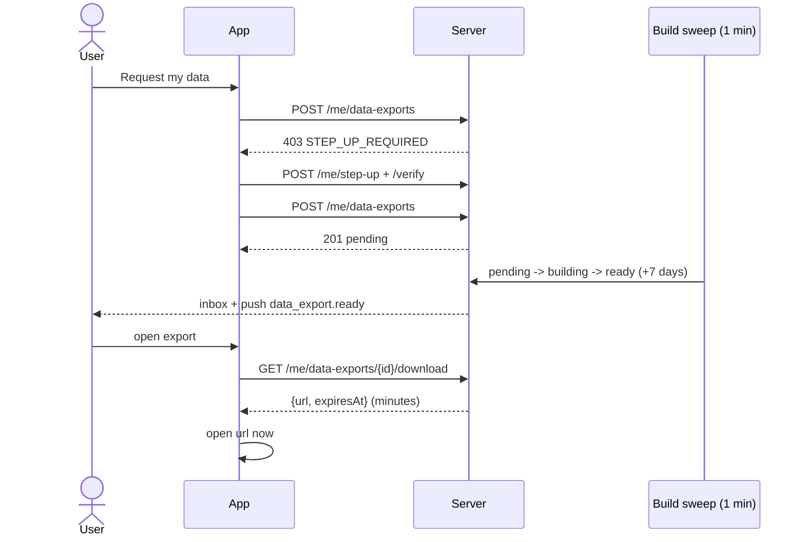
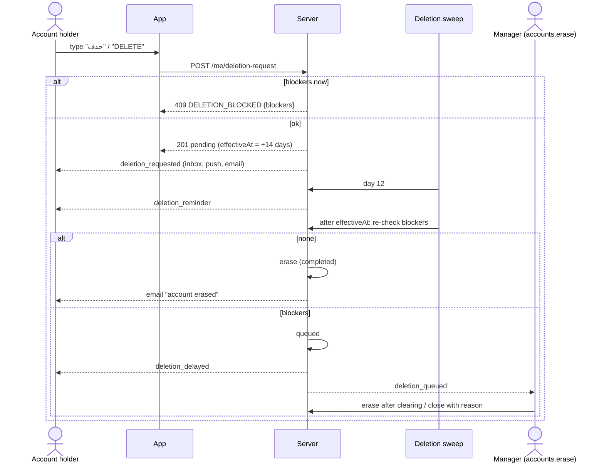
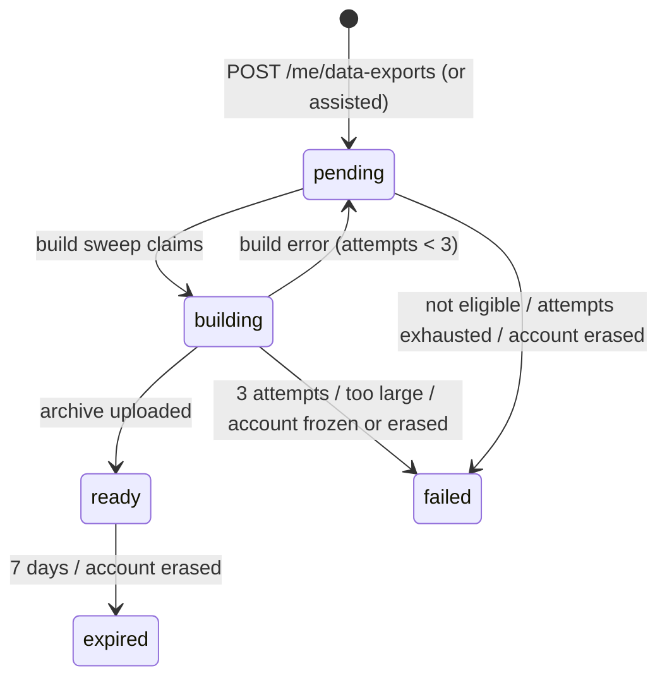
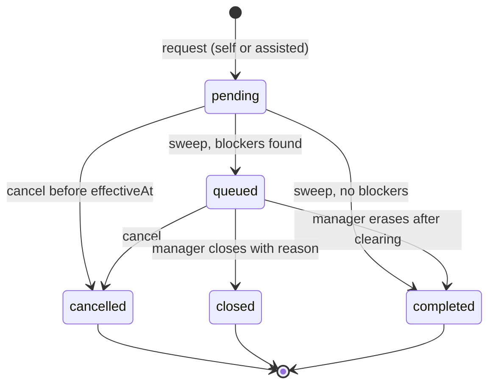
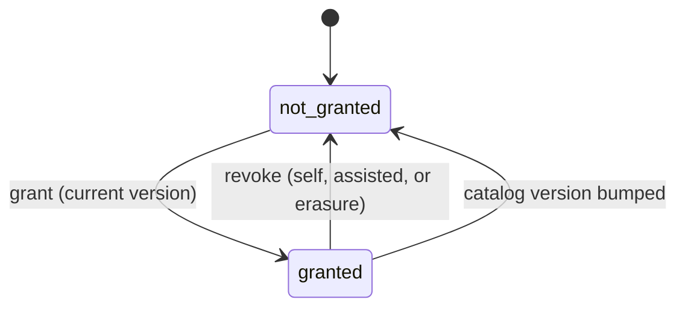

# الخصوصية: الموافقات ونسخة البيانات وحذف الحساب — Privacy: Consents, Data Export, Account Deletion

> **التطبيق/الواجهة:** resident app · family member (والموافقات/التصدير/الحذف متاحة تقنيًا لأي حساب داخل كمبوند) · public web page (no login) لصفحة تنزيل النسخة المرسلة بالإيميل `/a/export`
> **الصلاحيات:** لا توجد permission: `/me/consents`، `/me/data-exports`، `/me/deletion-request` لأي حساب مسجّل الدخول وعلى نفسه فقط. التصدير يحتاج **step-up** على الجلسة. الـendpoints العامة `/public/data-exports/*` بدون دخول. جانب المدير (`accounts.erase`, `accounts.legal_hold`) في `../03-community/04-frozen-accounts-and-erasure.md`، والتنفيذ نيابةً عن الساكن (`residents.assist`) في `05-assisted-mode.md`.
> **المصادر:** ADR 0023 · ADR 0036 · ADR 0037 · `docs/api/v0-notes.md` · `src/core/consents/` (`consent-catalog.ts`, `consents.service.ts`, `consents.controller.ts`) · `src/core/exports/` (`data-exports.service.ts`, `data-exports.controller.ts`, `core-sections.ts`) · `src/core/accounts/account-deletion.service.ts`, `me.controller.ts`, `account-emails.ts` · `src/community/residents/erasure-hooks.ts`

## الفكرة باختصار
ثلاث أدوات خصوصية في شاشة واحدة "الخصوصية والبيانات":
1. **الموافقات (consents)**: المستخدم يوافق أو يسحب موافقته على استخدام محدد لبياناته. اليوم يوجد كود واحد فقط: `ticket_phone_share` (السماح للفني المسؤول عن بلاغي برؤية رقم موبايلي).
2. **نسخة من بياناتي (export)**: ملف ZIP بكل بيانات الحساب في هذا الكمبوند. يحتاج تأكيدًا بكود على الإيميل، يُجهَّز في الخلفية، ويُنزَّل من التطبيق برابط مؤقت لمدة 7 أيام.
3. **حذف الحساب**: المستخدم يكتب كلمة تأكيد، فتبدأ **فترة تراجع 14 يومًا** يعمل فيها الحساب عاديًا ويمكن الإلغاء. بعدها يُمسح الحساب تلقائيًا، إلا إذا كان هناك مانع، فيذهب الطلب لطابور المدير.

## الأدوار ومين بيعمل إيه

| الدور | ماذا يفعل |
|---|---|
| صاحب الحساب (ساكن، فرد أسرة، وأي حساب آخر) | يرى الموافقات ويمنحها/يسحبها؛ يطلب نسخة بياناته وينزّلها؛ يطلب حذف حسابه ويلغيه ويتابع حالته |
| صاحب الإيميل (بدون دخول) | ينزّل نسخة طلبها المدير نيابةً عنه، من رابط الإيميل + كود يصله |
| المدير (`residents.assist`) | نفس الأفعال نيابةً عن ساكن لا يستخدم التطبيق — `05-assisted-mode.md` |
| المدير (`accounts.erase`) | يتعامل مع الطلبات `queued`: تنفيذ المسح أو إغلاق الطلب — `../03-community/04-frozen-accounts-and-erasure.md` |
| المدير (`accounts.legal_hold`) | يضع/يرفع حجزًا قانونيًا يمنع المسح |
| الفني المسؤول عن البلاغ | يرى رقم المبلّغ فقط إذا كانت `ticket_phone_share` ممنوحة (وبقية الشروط) |
| النظام | يبني ملف التصدير ويرسل إشعار الجاهزية ويحذف الملف بعد 7 أيام؛ يذكّر قبل الحذف بيومين؛ ينفّذ الحذف أو يضعه في الطابور |

## الشاشات اللي الفيتشر محتاجها
- **شاشة "الخصوصية والبيانات"** تجمع الأقسام الثلاثة.
- **قائمة الموافقات**: لكل موافقة نصها (من التطبيق حسب الكود والإصدار)، مفتاح on/off، وتاريخ المنح.
- **شيت عرض نص الموافقة + زر "أوافق"** (يجب عرض نص الإصدار الحالي قبل المنح).
- **قسم "نسخة من بياناتي"**: زر "اطلب نسخة"، قائمة آخر الطلبات (حتى 10) بحالتها، وزر "تنزيل" للجاهز مع "متاح حتى …".
- **شيت التأكيد الإضافي (step-up)** — مشترك، موضح في `02-profile-and-sessions.md`.
- **حالة "يتم التجهيز"** و**حالة "حاول بعد …"** (طلب واحد في اليوم).
- **صفحة ويب عامة `/a/export#<token>`**: شرح، زر "أرسل لي كود"، حقل الكود، زر "تنزيل"، رسائل الأخطاء.
- **قسم "حذف الحساب"**:
  - شاشة شرح (ماذا يُمسح، ماذا يبقى، فترة الـ14 يومًا)؛
  - حقل كتابة كلمة التأكيد (`حذف` أو `DELETE`)؛
  - شاشة "لا يمكن الحذف الآن" تعرض كل مانع وكيف يُزال؛
  - شاشة حالة الطلب: "سيُحذف حسابك يوم …" + زر "إلغاء الطلب"؛
  - حالة "تأخر الحذف" (queued) مع الموانع.

## الفلو خطوة بخطوة

### أ) الموافقات

#### 1) القائمة — `GET /me/consents`
1. `200 { data: ConsentView[], nextCursor: null }`: **كل** موافقات الكتالوج، ممنوحة أو لا.
2. لكل عنصر: `code`، `version` (الإصدار الحالي للنص)، `granted`، `grantedAt`.
3. `granted = true` فقط إذا مُنحت على **الإصدار الحالي**. منح قديم على إصدار سابق يظهر `granted: false`.

#### 2) المنح — `POST /me/consents/grant`
1. التطبيق يعرض نص الموافقة المطابق لـ`code` و`version` من القائمة.
2. المستخدم يضغط "أوافق" ← `{ code, version }` حيث `version` هو الإصدار الذي **عُرض** فعلًا.
3. `200 ConsentView` بالحالة الجديدة. المنح المكرر لا يكتب شيئًا ويرجع نفس الحالة.
4. إذا تغيّر الإصدار على السيرفر ← `409 CONSENT_VERSION_MISMATCH` مع `params.current`: اعرض النص الجديد واطلب الموافقة مرة أخرى.

#### 3) السحب — `POST /me/consents/revoke`
1. `{ code }`. مسموح في أي وقت، وأثره **فوري** (الفني لن يرى الرقم في قراءته التالية).
2. `200 ConsentView`. السحب لموافقة غير ممنوحة لا يكتب شيئًا.

#### 4) أثر `ticket_phone_share`
يرى **الفني المسند إليه البلاغ حاليًا** `reporterPhone` في تفاصيل البلاغ فقط إذا تحققت كلها لحظة القراءة: البلاغ مفتوح (`assigned`, `en_route`, `in_progress`, `on_hold`)، المبلّغ `active` وله رقم، المبلّغ ما زال يملك صلاحية `tickets` على الوحدة، والموافقة ممنوحة على الإصدار الحالي. لا يراه الموزّع ولا السكان الآخرون ولا فنيون آخرون. التفاصيل في ملفات `../06-maintenance/`.

### ب) نسخة من البيانات

#### 5) الطلب — `POST /me/data-exports`
1. المستخدم يضغط "اطلب نسخة".
2. التطبيق ينادي الـendpoint (بدون body).
3. إذا رجع `403 STEP_UP_REQUIRED` ← شيت التأكيد: `POST /me/step-up` ثم `POST /me/step-up/verify { code }` ثم إعادة الطلب خلال 10 دقائق (راجع `02-profile-and-sessions.md`).
4. نجاح ← `201 DataExportView` بحالة **`pending`**. الـstep-up يُستهلك.
5. الموانع (كلها تُفحص مع قفل الحساب):
   - طلب آخر قيد التجهيز (`pending` أو `building`) ← `409 DATA_EXPORT_ACTIVE`؛
   - طلب خلال آخر 24 ساعة (حتى لو انتهى) ← `429 DATA_EXPORT_RATE_LIMITED` مع `params.retryAfter` (وقت ISO): اعرض "يمكنك الطلب مجددًا بعد …"؛
   - حساب مجمّد أو ممسوح ← `409 ACCOUNT_NOT_ELIGIBLE`.
   - إذا فشل الطلب بسبب مانع، يبقى الـstep-up صالحًا حتى انتهاء مدته.

#### 6) التجهيز (تلقائي)
1. كل دقيقة يأخذ النظام الطلبات `pending` ويحوّلها إلى `building`.
2. يبني ZIP يحتوي ملفات JSON + ملفات الحساب (مثل صورته)، ويرفعه للتخزين الخاص.
3. عند النجاح: الحالة `ready`، `readyAt`، و`expiresAt` = بعد **7 أيام**، وإشعار **`data_export.ready`** في الـinbox (بدون رابط) + push "ملف بياناتك جاهز".
4. عند الفشل: إعادة المحاولة حتى 3 مرات، ثم `failed`. أيضًا `failed` إذا تجاوز الملف 512 MB، أو إذا جُمّد/مُسح الحساب أثناء التجهيز. **لا يصل أي إشعار عند الفشل.**

#### 7) القائمة — `GET /me/data-exports`
1. `200 { data: DataExportView[], nextCursor: null }`: آخر **10** طلبات، الأحدث أولًا.
2. لا تحتوي رابطًا أبدًا. التطبيق يعيد قراءتها عند فتح الشاشة أو عند وصول `data_export.ready`.

#### 8) التنزيل من التطبيق — `GET /me/data-exports/{id}/download`
1. متاح فقط لطلب `ready` لم تنتهِ مدته.
2. `200 { url, expiresAt }` (no-store). **الرابط صالح دقائق فقط**: افتحه فورًا ولا تحفظه أو تشاركه. اسم الملف `jiwar-export-YYYY-MM-DD.zip`.
3. يمكن التنزيل أكثر من مرة خلال الـ7 أيام (كل مرة رابط جديد).
4. طلب غير جاهز/منتهٍ/ليس للمستخدم ← `404 DATA_EXPORT_NOT_FOUND`.

#### 9) الانتهاء (تلقائي)
بعد 7 أيام من الجاهزية: الحالة `expired` والملف يُحذف.

#### 10) التنزيل من رابط الإيميل (للطلب الذي قدّمه المدير) — صفحة `/a/export#<token>`
الطلب المقدّم من المدير (`assisted = true`) يصل لإيميل الحساب برابط (إضافةً إلى إشعار الـinbox). الصفحة:
1. تقرأ الـtoken من `location.hash`، وتمسحه من شريط العنوان، ولا تضعه في URL/تخزين/analytics.
2. زر "أرسل لي كود" ← `POST /public/data-exports/code { token }` ← `202`: كود من 6 أرقام يصل **لنفس الإيميل** (صالح 5 دقائق).
3. المستخدم يدخل الكود ← `POST /public/data-exports/download { token, code }` ← `200 { url, expiresAt }`: افتح `url` فورًا.
4. **كل تنزيل يحتاج كودًا جديدًا**. الرابط يسمح بـ**3 تنزيلات ناجحة** فقط، ثم يتوقف.
5. الرابط يتوقف أيضًا عند انتهاء الـ7 أيام أو فشل/انتهاء الطلب.
6. الأخطاء: `404 ACTION_TOKEN_INVALID` (الرابط لم يعد صالحًا — نفس الرد لكل الأسباب)، `403 STEP_UP_CODE_INVALID` (كود خطأ ← "أرسل كودًا جديدًا")، `429 RATE_LIMITED`، `400 VALIDATION_FAILED`، `503 STORAGE_UNAVAILABLE` (حاول لاحقًا). لا تقل أبدًا هل الرابط كان موجودًا.

### ج) حذف الحساب

#### 11) قراءة حالة الطلب — `GET /me/deletion-request`
1. `200 DeletionRequestResponse`: **آخر** طلب مهما كانت حالته.
2. لا يوجد أي طلب سابق ← `404 DELETION_REQUEST_NOT_FOUND`: اعرض زر "حذف حسابي".
3. حسب الحالة:
   - `pending`: "سيُحذف حسابك يوم `effectiveAt`" + زر "إلغاء"؛
   - `queued`: "تأخر الحذف" + الموانع من `blockers` + زر "إلغاء"؛
   - `cancelled` أو `closed`: زر "حذف حسابي" متاح من جديد؛
   - `completed`: لن يراها المستخدم (الحساب ممسوح ولا يستطيع الدخول).

#### 12) تقديم الطلب — `POST /me/deletion-request`
1. شاشة الشرح، ثم يكتب المستخدم كلمة التأكيد: `حذف` أو `DELETE` (أيهما، بغض النظر عن لغة التطبيق؛ تُقبل بحروف كبيرة/صغيرة ومع مسافات حولها).
2. `{ confirmation }` (1–50 حرفًا).
3. نجاح ← `201 DeletionRequestResponse` بحالة `pending` و`effectiveAt` = الآن + **14 يومًا** (`DELETION_GRACE_DAYS`).
4. يصل فورًا: إشعار `account.deletion_requested` (حرج) + push + إيميل التأكيد بتاريخ الحذف.
5. **الحساب يعمل عاديًا** خلال الفترة.
6. الأخطاء:
   - كلمة خاطئة ← `400 CONFIRMATION_MISMATCH` (`params.expected = ["حذف","DELETE"]`)؛
   - طلب مفتوح بالفعل (`pending` أو `queued`) ← `409 DELETION_ALREADY_REQUESTED`؛
   - **مانع** ← `409 DELETION_BLOCKED` مع `params.blockers` (قائمة أكواد): اعرض كل مانع وطريقة إزالته (الجدول في "القواعد والقيود").

#### 13) الإلغاء — `POST /me/deletion-request/cancel`
1. مسموح إذا كان الطلب `pending` ولم يصل `effectiveAt` بعد، أو إذا كان `queued`.
2. `204`. الحالة تصبح `cancelled`، ويصل إيميل "أُلغي طلب حذف حسابك" (لا يوجد إشعار inbox).
3. لا يوجد طلب مفتوح ← `404 DELETION_REQUEST_NOT_FOUND`.
4. `pending` وقد مرّ `effectiveAt` (والتنفيذ لم يحدث بعد) ← `409 DELETION_GRACE_OVER`.

#### 14) التذكير (تلقائي)
قبل `effectiveAt` بيومين (يوم 12)، مرة واحدة: إشعار `account.deletion_reminder` (حرج) + push + إيميل.

#### 15) التنفيذ (تلقائي، sweep كل ساعة تقريبًا بعد `effectiveAt`)
1. يعيد النظام فحص الموانع.
2. **بدون موانع** ← المسح (`completed`):
   - الحساب يصبح `erased`: الاسم والموبايل والإيميل والمستند والجنسية وتاريخ الميلاد تُمسح، والصف يبقى كـ"مستخدم محذوف" في السجلات المالية والتدقيق؛
   - تُحذف الجلسات ووسائل الدخول والأجهزة والتفضيلات والإشعارات والصورة وملفات التصدير؛ تُسحب الموافقات؛ تنتهي الإشغالات والعضويات والتفويضات والعمال المسجّلون باسمه؛
   - يصل إيميل أخير "حُذف حسابك"؛
   - إذا كان فرد أسرة: الـprimary يصله `household.member_account_deleted` (كود الوحدة فقط).
3. **مع موانع** ← `queued` مع `blockers`:
   - صاحب الحساب: `account.deletion_delayed` (حرج) + إيميل بالموانع؛
   - المديرون أصحاب `accounts.erase`: `account.deletion_queued`.
4. بعد `queued`: المدير إما ينفّذ المسح بعد إزالة الموانع، أو يغلق الطلب (`closed`) بسبب (`blockers_unresolved` | `withdrawn` | `other`) فيصل للحساب `account.deletion_closed` + إيميل، ويمكنه الطلب مرة أخرى. التفاصيل في `../03-community/04-frozen-accounts-and-erasure.md`.

## الحالات (Statuses)

### طلب التصدير (`DataExportStatus`)
| الحالة | المعنى | من يحرّكها |
|---|---|---|
| `pending` | في الانتظار | الطلب (المستخدم أو المدير)؛ أو رجوع بعد محاولة بناء فاشلة |
| `building` | قيد التجهيز | sweep البناء (كل دقيقة) |
| `ready` | جاهز للتنزيل حتى `expiresAt` | نجاح البناء |
| `expired` | انتهت الـ7 أيام وحُذف الملف | sweep الانتهاء؛ أو مسح الحساب |
| `failed` | فشل نهائي (3 محاولات، حجم > 512 MB، حساب لم يعد مؤهلًا، مسح الحساب) | sweep البناء |

### طلب الحذف (`DeletionRequestStatus`)
| الحالة | المعنى | من يحرّكها |
|---|---|---|
| `pending` | فترة التراجع (14 يومًا) | المستخدم أو المدير (assisted) |
| `cancelled` | أُلغي | المستخدم أو المدير (assisted) |
| `queued` | انتهت الفترة لكن يوجد مانع؛ في طابور المدير | sweep الحذف |
| `completed` | الحساب مُسح | sweep الحذف، أو المدير من الطابور |
| `closed` | أغلقه المدير دون مسح | المدير (`POST /erasures/{id}/close`) |

### الموافقة
| الحالة | المعنى |
|---|---|
| not granted | لم تُمنح، أو سُحبت، أو مُنحت على إصدار قديم |
| granted | ممنوحة على الإصدار الحالي |

## البيانات اللي بتظهر

### الموافقة (`ConsentView`)
| الحقل | المعنى |
|---|---|
| `code` | `ticket_phone_share` (الوحيد حاليًا) |
| `version` | الإصدار الحالي للنص (1 حاليًا)؛ يُرسل عند المنح |
| `granted` | ممنوحة على الإصدار الحالي |
| `grantedAt` | وقت المنح أو null |
النص نفسه **لا يأتي من الباك**؛ التطبيق يحمل نص كل (code, version).

### طلب التصدير (`DataExportView`)
| الحقل | المعنى |
|---|---|
| `id` | للتنزيل |
| `status` | الحالات أعلاه |
| `requestedAt` | وقت الطلب |
| `readyAt` | وقت الجاهزية أو null |
| `expiresAt` | آخر موعد للتنزيل أو null |
| `assisted` | طلبه المدير نيابةً عنك (يُرسل أيضًا على الإيميل) |
**لا يُرجع**: رابطًا، سبب الفشل، حجم الملف.

### رابط التنزيل (`DownloadView`)
`{ url, expiresAt }` — صالح دقائق، no-store، يُستخدم فورًا ولا يُخزّن.

### محتوى ملف ZIP (للنص التوضيحي)
`README.json`، `account.json` (المستند مقنّع)، `notification-preferences.json`، `consents.json`، `sessions.json` (بدون IP)، `notifications/NNN.json`، `deletion-requests.json`، `files/` (الصورة وملفات الحساب)، `push-devices.json` (بدون token)، `units.json`، `permissions/<unitCode>.json` (لفرد الأسرة)، `delegations.json`، `workers.json` (بدون رقم مستند العامل أو صورته)، `wage-payments.json`، `visitor-passes.json` (بدون أكواد)، `entry-credentials.json`، `tickets/MT-…json`، `management-requests/…json`. لا يحتوي أبدًا رقم مستند أو تاريخ ميلاد أو صورة شخص آخر.

### طلب الحذف (`DeletionRequestResponse`)
| الحقل | المعنى |
|---|---|
| `id` | id الطلب |
| `status` | الحالات أعلاه |
| `requestedAt` | وقت الطلب |
| `effectiveAt` | آخر موعد للتراجع؛ بعده التنفيذ |
| `assisted` | قدّمه المدير نيابةً عنك |
| `blockers` | فقط في `queued`: أكواد الموانع؛ فارغة في غير ذلك |

## القواعد والقيود

### الموافقات
- الكتالوج مغلق في الكود؛ اليوم `ticket_phone_share` (إصدار 1، مطفأة افتراضيًا).
- المنح يجب أن يحمل الإصدار الحالي؛ رفع الإصدار يُسقط كل المنح القديمة حتى يُمنح الجديد.
- السحب في أي وقت، وأثره فوري.

### التصدير
- step-up إلزامي للطلب من التطبيق (كود واحد = طلب واحد، صالح 10 دقائق بعد التحقق).
- طلب نشط واحد فقط، وطلب واحد كل 24 ساعة.
- الحساب المجمّد والممسوح لا يصدّر (`inactive` مسموح تقنيًا لكنه لا يستطيع الدخول).
- الملف حتى 512 MB، متاح 7 أيام، ثم يُحذف.
- رابط الإيميل (للطلب المساعَد): 3 تنزيلات ناجحة كحد أقصى، كود جديد لكل تنزيل، حد الطلبات لكل IP (20/15 دقيقة) ولكل رابط (5/15 دقيقة) لكل خطوة.

### الحذف
- كلمة التأكيد: `حذف` أو `DELETE`.
- فترة التراجع: 14 يومًا (`DELETION_GRACE_DAYS`). الطلبات القديمة قبل R1 تحتفظ بـ30 يومًا.
- طلب مفتوح واحد فقط.
- **الموانع** (تُفحص عند الطلب وعند التنفيذ):

| `blocker` | المعنى | كيف يُزال (نص للشاشة) |
|---|---|---|
| `primary_resident` | المستخدم هو الساكن الرئيسي (primary) لوحدة حالية | نقل صفة الـprimary لشخص آخر في الوحدة أو إنهاء الإشغال — راجع `../03-community/01-units-and-occupancy.md`، أو التواصل مع الإدارة |
| `active_staff_role` | حساب موظف أو مدير نشط | لا يمكن من التطبيق؛ يجب أن توقف الإدارة الحساب أولًا (راجع الملاحظات) |
| `legal_hold` | حجز قانوني على البيانات | ترفعه الإدارة (`accounts.legal_hold`)؛ المستخدم يعرف بوجود الحجز فقط، لا السبب |
| `open_worker_obligations` | أجر عامل مسجّل باسمه لم يُسوَّ، أو عامل له كود ما زال تعاقده مفتوحًا (`pending_review`/`active`/`suspended`) | إنهاء تعاقد العامل، ثم تسوية الإدارة لالتزام الأجر (`POST /worker-engagements/:id/wage-obligation/settle`) |

- الإلغاء: حتى `effectiveAt` في `pending`، أو في أي وقت في `queued`.
- المسح نهائي ولا يمكن التراجع عنه. السجلات المالية والتدقيق تبقى بدون هوية.
- لا `Idempotency-Key` في هذه الـendpoints.

## الأخطاء اللي الـUI لازم يتعامل معاها

| HTTP + `code` | متى | رسالة/سلوك مقترح |
|---|---|---|
| `400 VALIDATION_FAILED` (`code`: `INVALID_VALUE`) | كود موافقة غير معروف | لا يحدث من واجهة صحيحة |
| `409 CONSENT_VERSION_MISMATCH` (`params.current`) | التطبيق عرض نصًا قديمًا | اعرض نص الإصدار الجديد واطلب الموافقة |
| `403 STEP_UP_REQUIRED` | طلب تصدير بدون تأكيد | افتح شيت التأكيد |
| `403 STEP_UP_CODE_INVALID` | كود تأكيد خطأ (في التطبيق أو صفحة الإيميل) | "الكود غير صحيح أو انتهت صلاحيته" + إرسال كود جديد |
| `409 DATA_EXPORT_ACTIVE` | طلب قيد التجهيز | "طلبك السابق قيد التجهيز، سنُعلمك عند جاهزيته" |
| `429 DATA_EXPORT_RATE_LIMITED` (`params.retryAfter`) | طلب خلال 24 ساعة | "يمكنك طلب نسخة جديدة بعد …" |
| `409 ACCOUNT_NOT_ELIGIBLE` | حساب مجمّد/ممسوح | نادرًا ما يظهر للمستخدم |
| `404 DATA_EXPORT_NOT_FOUND` | تنزيل طلب غير جاهز/منتهٍ | "الملف لم يعد متاحًا" وأعد تحميل القائمة |
| `503 STORAGE_UNAVAILABLE` | التخزين لا يرد | "حاول لاحقًا" |
| `404 ACTION_TOKEN_INVALID` | رابط إيميل التصدير غير صالح/مستهلك/منتهٍ | "هذا الرابط لم يعد صالحًا" |
| `429 RATE_LIMITED` | صفحة الإيميل: محاولات كثيرة | "حاول لاحقًا" |
| `400 CONFIRMATION_MISMATCH` (`params.expected`) | كلمة تأكيد خاطئة | "اكتب كلمة حذف أو DELETE للتأكيد" |
| `409 DELETION_ALREADY_REQUESTED` | طلب مفتوح موجود | انتقل لشاشة حالة الطلب |
| `409 DELETION_BLOCKED` (`params.blockers`) | يوجد مانع | شاشة الموانع (لكل مانع شرح وطريقة إزالة) |
| `404 DELETION_REQUEST_NOT_FOUND` | لا يوجد طلب (قراءة) أو لا يوجد طلب مفتوح (إلغاء) | اعرض زر "حذف حسابي" |
| `409 DELETION_GRACE_OVER` | الإلغاء بعد انتهاء الفترة وقبل التنفيذ | "انتهت فترة التراجع، تواصل مع الإدارة" |

## الإشعارات

| الحدث | `kind` | المستلم | Push؟ | الضغط يفتح |
|---|---|---|---|---|
| نسخة البيانات جاهزة | `data_export.ready` (`expiresAt`) | صاحب الحساب | نعم، غير حرج (حسب التفضيلات) | قسم "نسخة من بياناتي" (`targetId` = id الطلب) |
| نسخة مساعَدة جاهزة | إيميل `data_export.link` (حرج) | إيميل الحساب | — | صفحة `/a/export#token` |
| تقديم طلب حذف | `account.deletion_requested` (`effectiveAt`) + إيميل | صاحب الحساب | نعم، حرج | شاشة حالة الحذف |
| قبل الحذف بيومين | `account.deletion_reminder` (`effectiveAt`) + إيميل | صاحب الحساب | نعم، حرج | شاشة حالة الحذف |
| تأجيل الحذف لوجود مانع | `account.deletion_delayed` (`blockers`) + إيميل | صاحب الحساب | نعم، حرج | شاشة حالة الحذف مع الموانع |
| طلب في الطابور | `account.deletion_queued` (`blockers`) | المديرون (`accounts.erase`) | نعم، غير حرج | طابور المسح في لوحة المدير |
| المدير أغلق الطلب | `account.deletion_closed` (`reason`) + إيميل | صاحب الحساب | نعم، غير حرج | شاشة حالة الحذف |
| إلغاء الطلب | إيميل `account.deletion_cancelled` فقط | صاحب الحساب | لا | — |
| حجز قانوني | إيميل `account.legal_hold_placed` فقط (بدون السبب) | صاحب الحساب | لا | — |
| تم المسح | إيميل `account.erased` فقط | الإيميل السابق | لا | — |
| حذف حساب فرد أسرة | `household.member_account_deleted` (`unitCode`) + إيميل | الـprimary | نعم، غير حرج | شاشة الأسرة |

## الـEndpoints

| Method + path | من يناديه | الغرض | رد النجاح |
|---|---|---|---|
| `GET /me/consents` | أي حساب | كل الموافقات وحالتها | `200 { data: ConsentView[], nextCursor: null }` |
| `POST /me/consents/grant` | أي حساب | منح `{ code, version }` | `200 ConsentView` |
| `POST /me/consents/revoke` | أي حساب | سحب `{ code }` | `200 ConsentView` |
| `POST /me/data-exports` | أي حساب + step-up | طلب نسخة | `201 DataExportView` (`pending`) |
| `GET /me/data-exports` | أي حساب | آخر 10 طلبات | `200 { data: DataExportView[], nextCursor: null }` |
| `GET /me/data-exports/{id}/download` | أي حساب | رابط تنزيل مؤقت | `200 { url, expiresAt }` (no-store) |
| `POST /public/data-exports/code` | صفحة الويب العامة | إرسال كود للإيميل `{ token }` | `202` |
| `POST /public/data-exports/download` | صفحة الويب العامة | التنزيل `{ token, code }` | `200 { url, expiresAt }` (no-store) |
| `GET /me/deletion-request` | أي حساب | آخر طلب حذف | `200 DeletionRequestResponse` |
| `POST /me/deletion-request` | أي حساب | طلب الحذف `{ confirmation }` | `201 DeletionRequestResponse` |
| `POST /me/deletion-request/cancel` | أي حساب | إلغاء الطلب | `204` |

## ملاحظات للديزاين وحاجات ناقصة في الباك
- **نص الموافقة ليس في الـAPI**: التطبيق يجب أن يحمل نص كل `(code, version)` بالعربي والإنجليزي. عند رفع الإصدار يحتاج التطبيق تحديثًا، وإلا يحصل على `CONSENT_VERSION_MISMATCH`.
- **لا سجل موافقات للمستخدم في الـAPI**: التاريخ الكامل (منح/سحب/من قام به) موجود في ملف التصدير فقط.
- **لا إشعار عند فشل التصدير**: الحالة تصبح `failed` بصمت، والسبب (`failureCode`) لا يُرجع. التطبيق يعرض "تعذّر التجهيز، اطلب مرة أخرى" (مع ملاحظة قيد 24 ساعة: فشل الطلب لا يلغي القيد).
- **صفحة الويب `/a/export` غير موجودة في الباك**: عقد على تطبيق الويب (v0-notes)؛ حتى تُبنى، روابط إيميلات التصدير المساعَد لا تعمل.
- **إلغاء طلب الحذف والحجز القانوني بالإيميل فقط** (لا يوجد kind في الـinbox). إذا أراد التصميم تأكيدًا داخل التطبيق فهو من رد `204` نفسه.
- **حسابات الموظفين والمديرين لا يمكنها الحذف عمليًا**: الطلب الذاتي يرجع دائمًا `active_staff_role` (الحساب نشط وقت الطلب)، والمسار المساعَد يقبل حسابات `resident`/`family` فقط. لا يوجد مسار لموظف يريد حذف بياناته بعد إيقاف حسابه.
- `params.blockers` في `account.deletion_delayed` و`account.deletion_queued` نص واحد مفصول بفواصل (`primary_resident,legal_hold`)، بينما في `DELETION_BLOCKED` وفي `blockers` بالرد هو مصفوفة.
- v0-notes: شاشة الحذف يجب أن تشرح كل مانع وما يزيله. الباك لا يرجع روابط أو تفاصيل (مثلًا أي وحدة، أي عامل)؛ التطبيق يستنتجها من `GET /me/units` (`isPrimary`) وقوائم العمال.
- قيد "طلب تصدير واحد كل 24 ساعة" يُحسب من آخر طلب حتى لو فشل أو كان مقدّمًا من المدير.
- المسح ينفّذه sweep يعمل كل ساعة افتراضيًا، فقد يتأخر التنفيذ حتى ساعة بعد `effectiveAt`؛ خلالها الإلغاء يرجع `DELETION_GRACE_OVER`.
