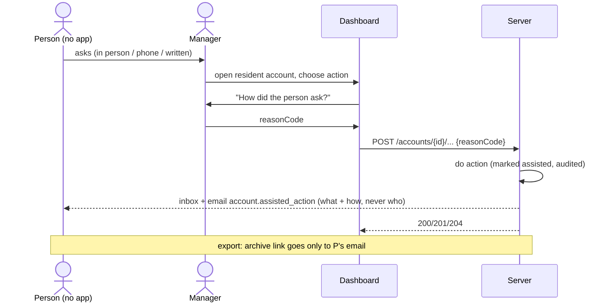
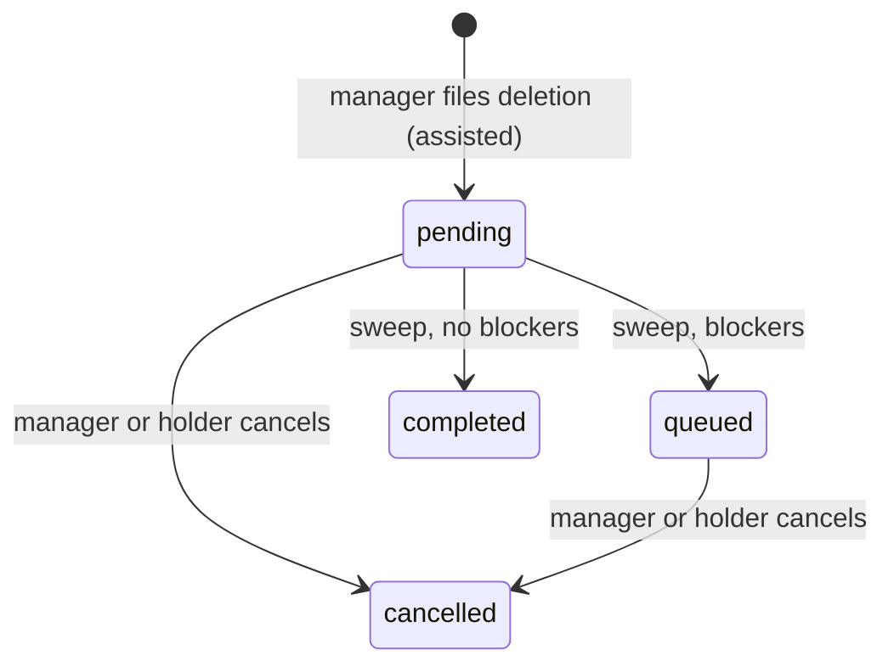

# الوضع المساعَد: المدير ينفّذ نيابةً عن الساكن — Assisted Mode

> **التطبيق/الواجهة:** manager dashboard (والساكن يرى النتيجة في resident app / family member وفي إيميله)
> **الصلاحيات:** `residents.assist` (موجودة افتراضيًا في دور `manager` فقط)
> **المصادر:** ADR 0036 (Assisted path) · `docs/api/v0-notes.md` · `src/core/assist/` (`assist.controller.ts`, `assist.service.ts`, `dto/assist.dto.ts`) · `src/core/common/reasons.ts` (`REASON_CODES.assist`) · `src/core/accounts/account-emails.ts` (`account.assisted_action`)

## الفكرة باختصار
بعض السكان لا يستخدمون التطبيق (كبار السن مثلًا). يطلبون من الإدارة بالحضور أو بالتليفون أو كتابةً أن تغيّر إعدادات إشعاراتهم، أو تسجّل/تسحب موافقة، أو تطلب نسخة من بياناتهم، أو تقدّم/تلغي طلب حذف حسابهم.
المدير ينفّذ ذلك من لوحة التحكم على حساب الساكن. **كل فعل كتابة يحتاج سببًا** (كيف طلب الشخص)، ويُعلَّم أنه "مساعَد"، و**الساكن يُبلَّغ دائمًا** (inbox + إيميل) بما فُعل وكيف طُلب، دون ذكر اسم المدير.
نسخة البيانات **لا تصل للمدير أبدًا**: تذهب لإيميل الساكن نفسه.

## الأدوار ومين بيعمل إيه

| الدور | ماذا يفعل |
|---|---|
| المدير (`residents.assist`) | يقرأ ويعدّل تفضيلات الإشعارات؛ يقرأ ويمنح ويسحب الموافقات؛ يرى حالة طلبات التصدير ويطلب نسخة جديدة؛ يرى طلب الحذف ويقدّمه ويلغيه |
| صاحب الحساب (ساكن أو فرد أسرة) | يصله إشعار وإيميل بكل فعل؛ يستطيع التراجع بنفسه من التطبيق (إلغاء الحذف، سحب الموافقة، تعديل التفضيلات)؛ ينزّل النسخة من رابط الإيميل أو من التطبيق |
| موظف/مدير آخر كحساب مستهدف | غير مسموح: المسار يقبل حسابات `resident` و`family` فقط |
| النظام | يسجّل الفعل في الـaudit مع السبب، يرسل الإشعار والإيميل، يبني نسخة البيانات ويرسل رابطها للإيميل |

## الشاشات اللي الفيتشر محتاجها
في لوحة المدير، داخل صفحة حساب الساكن (الوصول للحساب من قوائم السكان — راجع ملفات `../03-community/`):
- **تبويب "إعدادات الإشعارات (نيابةً)"**: نفس شكل شاشة الساكن (فئات × قنوات، ساعات هدوء، إيقاف مؤقت) + توقيت الكمبوند.
- **تبويب "الموافقات (نيابةً)"**: قائمة الموافقات مع زر منح/سحب، ونص الموافقة لعرضه/قراءته على الشخص.
- **تبويب "نسخة البيانات (نيابةً)"**: آخر 10 طلبات بحالتها وتواريخها، وزر "اطلب نسخة لإيميل الساكن".
- **تبويب "حذف الحساب (نيابةً)"**: حالة آخر طلب، زر "تقديم طلب حذف"، زر "إلغاء الطلب".
- **ديالوج السبب** يظهر قبل **كل** فعل كتابة: "كيف طلب الشخص؟" بثلاث خيارات: بالحضور / بمكالمة / بطلب مكتوب.
- **ديالوج الموانع** عند رفض طلب الحذف (`DELETION_BLOCKED`).
- **رسالة ثابتة** في الصفحة: "سيتم إبلاغ صاحب الحساب بكل تغيير".

في تطبيق الساكن: عنصر inbox لـ`account.assisted_action` (راجع `03-notifications-and-push.md`).

## الفلو خطوة بخطوة

### 0) قاعدة مشتركة لكل الأفعال
1. المسار: `/accounts/{id}/…` حيث `{id}` هو id حساب الساكن.
2. الحساب يجب أن يكون `resident` أو `family` في نفس الكمبوند وغير ممسوح؛ غير ذلك ← `404 ACCOUNT_NOT_FOUND` (نفس الرد لكل الحالات).
3. **القراءة** (GET) لا تُبلغ أحدًا ولا تُسجَّل في الـaudit.
4. **الكتابة** تحتاج `reasonCode` في الـbody: `in_person` | `phone_call` | `written_request`.
   - غائب ← `400 REASON_REQUIRED`؛
   - قيمة أخرى ← `400 VALIDATION_FAILED` على `reasonCode` بالكود `INVALID_REASON_CODE` (`params.allowed`).
   - السبب يُفحص قبل وجود الحساب.
5. بعد كل كتابة ناجحة، في نفس العملية:
   - إشعار للساكن `account.assisted_action` بالبارامترات `action` و`reason`؛
   - إيميل `account.assisted_action` (إن كان للحساب إيميل)، مثل: "إدارة <الكمبوند> طلبت حذف حسابك بمكالمة منك. إذا لم تطلب ذلك، تواصل مع إدارة المجمع."
6. الفعل يُسجَّل في الـaudit (وفي سجل الموافقات للموافقات) على أنه `assisted` مع السبب.

### 1) تفضيلات الإشعارات
1. `GET /accounts/{id}/notification-preferences` ← `200 PreferencesView` (نفس شكل الساكن).
2. المدير يغيّر ما طلبه الشخص، يختار السبب.
3. `PATCH /accounts/{id}/notification-preferences` بنفس حقول `PATCH /me/notification-preferences` (`categories`, `quietHours`, `pause`) + `reasonCode`. يُرسل ما تغيّر فقط.
4. `200 PreferencesView` بالحالة الجديدة. الساكن يصله `action = notification_preferences`.
5. قواعد الحقول والأخطاء نفسها الموضحة في `03-notifications-and-push.md`.

### 2) الموافقات
1. `GET /accounts/{id}/consents` ← قائمة كل الموافقات وحالتها (`code`, `version`, `granted`, `grantedAt`).
2. **منح**: المدير يقرأ/يعرض نص الإصدار الحالي على الشخص، ثم `POST /accounts/{id}/consents/grant { code, version, reasonCode }` ← `200 ConsentView`. الساكن يصله `action = consent_granted`.
3. **سحب**: `POST /accounts/{id}/consents/revoke { code, reasonCode }` ← `200 ConsentView`. الساكن يصله `action = consent_revoked`. الأثر فوري.
4. إصدار قديم ← `409 CONSENT_VERSION_MISMATCH` (`params.current`).

### 3) نسخة البيانات
1. `GET /accounts/{id}/data-exports` ← آخر 10 طلبات: `status`, `requestedAt`, `readyAt`, `expiresAt`, `assisted`. **لا رابط أبدًا**. المدير يستخدمها ليجيب الشخص ("جاهزة حتى يوم …").
2. `POST /accounts/{id}/data-exports { reasonCode }` ← `201 DataExportView` (`pending`، `assisted: true`). لا يحتاج step-up.
3. الساكن يصله فورًا `action = data_export`.
4. عند الجاهزية (تلقائي): إشعار `data_export.ready` في inbox الساكن + **إيميل `data_export.link`** لإيميل الساكن برابط `/a/export#<token>`. الساكن يفتح الرابط، يطلب كودًا على نفس الإيميل، وينزّل (حتى 3 مرات، كود جديد لكل مرة) — التفاصيل في `04-privacy-consents-export-deletion.md`. إذا كان يستخدم التطبيق يستطيع التنزيل منه أيضًا.
5. الموانع (نفس طلب الساكن): `409 DATA_EXPORT_ACTIVE`، `429 DATA_EXPORT_RATE_LIMITED` (`params.retryAfter`، القيد 24 ساعة يشمل الطلبات الذاتية والمساعَدة)، `409 ACCOUNT_NOT_ELIGIBLE` (حساب مجمّد)، `409 ACCOUNT_HAS_NO_EMAIL` (حساب بلا إيميل؛ لا يحدث عمليًا).

### 4) طلب الحذف
1. `GET /accounts/{id}/deletion-request` ← آخر طلب (`status`, `requestedAt`, `effectiveAt`, `assisted`, `blockers`)، أو `404 DELETION_REQUEST_NOT_FOUND` إن لم يوجد.
2. **تقديم**: المدير يؤكد (التصميم يجب أن يضع تأكيدًا قويًا؛ الـAPI لا يطلب كلمة تأكيد هنا) ← `POST /accounts/{id}/deletion-request { reasonCode }` ← `201 DeletionRequestResponse` (`pending`، `assisted: true`، `effectiveAt` = بعد 14 يومًا).
3. الساكن يصله: `account.assisted_action` (`action = deletion_requested`) **و** `account.deletion_requested` (حرج) + إيميلا التأكيد. باقي الدورة (تذكير، تنفيذ، طابور) كما في `04-privacy-consents-export-deletion.md`.
4. الموانع: `409 DELETION_BLOCKED` (`params.blockers`)، `409 DELETION_ALREADY_REQUESTED`.
5. **إلغاء** (مثلًا طلب قُدّم بالخطأ أو الشخص غيّر رأيه): `POST /accounts/{id}/deletion-request/cancel { reasonCode }` ← `204`. يعمل على `pending` قبل `effectiveAt` وعلى `queued`. الساكن يصله `action = deletion_cancelled` + إيميل الإلغاء.
   - لا يوجد طلب مفتوح ← `404 DELETION_REQUEST_NOT_FOUND`؛ انتهت الفترة ← `409 DELETION_GRACE_OVER`.

## الحالات (Statuses)
هذا المسار لا يضيف حالات خاصة به؛ يحرّك نفس حالات طلب التصدير وطلب الحذف والموافقة الموضحة في `04-privacy-consents-export-deletion.md`، مع العلامة `assisted = true`.

| ما يحرّكه المدير هنا | من | إلى |
|---|---|---|
| طلب تصدير | — | `pending` |
| طلب حذف | — | `pending` |
| إلغاء حذف | `pending` / `queued` | `cancelled` |
| منح موافقة | not granted | granted |
| سحب موافقة | granted | not granted |

## البيانات اللي بتظهر
- **التفضيلات**: `PreferencesView` كما عند الساكن (`categories[]`, `quietHours`, `pause`, `timeZone`).
- **الموافقات**: `ConsentView` (`code`, `version`, `granted`, `grantedAt`).
- **التصدير**: `DataExportView` (`id`, `status`, `requestedAt`, `readyAt`, `expiresAt`, `assisted`). **مخفي عن المدير دائمًا**: الرابط، الـtoken، محتوى الملف.
- **الحذف**: `DeletionRequestResponse` (`id`, `status`, `requestedAt`, `effectiveAt`, `assisted`, `blockers`).
- **ما يراه الساكن** (`account.assisted_action`): `action` ∈ `notification_preferences`, `consent_granted`, `consent_revoked`, `data_export`, `deletion_requested`, `deletion_cancelled`؛ و`reason` ∈ `in_person`, `phone_call`, `written_request`. `targetType = account` و`targetId` = id حسابه. **لا اسم للمدير**.
- نصوص الإيميل الجاهزة (عربي): "غيّرت تفضيلات الإشعارات"، "سجّلت موافقتك"، "سحبت موافقتك"، "طلبت نسخة من بياناتك، تصلك على هذا البريد"، "طلبت حذف حسابك"، "ألغت طلب حذف حسابك" + "بحضورك" / "بمكالمة منك" / "بطلب مكتوب منك".

## القواعد والقيود
- الصلاحية `residents.assist` على كل الـendpoints (بما فيها القراءة)؛ بدونها `403 FORBIDDEN`.
- الحساب المستهدف: `resident` أو `family`، في نفس الكمبوند، ليس `erased`. الحساب المجمّد مقبول (لكن التصدير له مرفوض بـ`ACCOUNT_NOT_ELIGIBLE`).
- `reasonCode` إلزامي في كل كتابة، من قائمة مغلقة من 3 قيم، كود فقط بدون نص حر.
- كل كتابة تُبلغ الساكن دائمًا، حتى لو لم يتغيّر شيء فعليًا.
- التصدير المساعَد: يذهب لإيميل الساكن فقط، لا step-up، نفس قيود التصدير (طلب نشط واحد، طلب كل 24 ساعة).
- الحذف المساعَد: لا كلمة تأكيد في الـAPI، نفس الموانع وفترة الـ14 يومًا.
- القراءة: آخر 10 طلبات تصدير، وآخر طلب حذف فقط.
- لا `Idempotency-Key` في هذه الـendpoints: زر الإرسال يجب أن يُعطَّل أثناء الطلب لتجنّب التكرار (التكرار يرجع `DATA_EXPORT_ACTIVE` أو `DELETION_ALREADY_REQUESTED`، لكن المنح/السحب/التفضيلات المكررة تُرسل إشعارًا إضافيًا للساكن).

## الأخطاء اللي الـUI لازم يتعامل معاها

| HTTP + `code` | متى | رسالة/سلوك مقترح |
|---|---|---|
| `403 FORBIDDEN` | المدير بدون `residents.assist` | أخفِ التبويبات |
| `404 ACCOUNT_NOT_FOUND` | الحساب ليس ساكنًا/فرد أسرة، أو ممسوح، أو من كمبوند آخر | "هذا الحساب غير متاح لهذا الإجراء" |
| `400 REASON_REQUIRED` | لم يُختر سبب | اجعل اختيار السبب إلزاميًا قبل الإرسال |
| `400 VALIDATION_FAILED` (`reasonCode`: `INVALID_REASON_CODE`) | سبب غير معروف | لا يحدث من قائمة مغلقة |
| `400 VALIDATION_FAILED` (حقول التفضيلات) | قيم تفضيلات خاطئة | كما في `03-notifications-and-push.md` |
| `409 CONSENT_VERSION_MISMATCH` (`params.current`) | نص موافقة قديم | أعد تحميل الموافقات واعرض النص الحالي |
| `409 DATA_EXPORT_ACTIVE` | نسخة قيد التجهيز | "يوجد طلب قيد التجهيز" |
| `429 DATA_EXPORT_RATE_LIMITED` (`params.retryAfter`) | طلب خلال 24 ساعة | "يمكن الطلب مجددًا بعد …" |
| `409 ACCOUNT_NOT_ELIGIBLE` | الحساب مجمّد | "لا يمكن تصدير بيانات حساب موقوف" |
| `409 ACCOUNT_HAS_NO_EMAIL` | الحساب بلا إيميل | "أضف إيميلًا للحساب أولًا" |
| `409 DELETION_ALREADY_REQUESTED` | طلب حذف مفتوح | اعرض حالة الطلب الحالي |
| `409 DELETION_BLOCKED` (`params.blockers`) | يوجد مانع | ديالوج الموانع مع ما يزيل كلًا منها (الجدول في `04-privacy-consents-export-deletion.md`) |
| `404 DELETION_REQUEST_NOT_FOUND` | لا يوجد طلب (قراءة/إلغاء) | "لا يوجد طلب حذف" |
| `409 DELETION_GRACE_OVER` | الإلغاء بعد انتهاء فترة التراجع | "انتهت فترة التراجع؛ الطلب في التنفيذ" |

## الإشعارات

| الحدث | `kind` | المستلم | Push؟ | الضغط يفتح |
|---|---|---|---|---|
| أي كتابة مساعَدة | `account.assisted_action` (`action`, `reason`) + إيميل | صاحب الحساب | نعم، غير حرج (حسب تفضيلاته) | صفحة الحساب/الخصوصية في التطبيق (`targetType = account`) |
| طلب حذف مساعَد | `account.deletion_requested` + إيميل (حرج) | صاحب الحساب | نعم، حرج | شاشة حالة الحذف |
| نسخة مساعَدة جاهزة | `data_export.ready` + إيميل `data_export.link` (حرج) | صاحب الحساب | نعم (الإشعار غير حرج) | قسم نسخة البيانات / صفحة `/a/export` |
| إلغاء حذف مساعَد | إيميل `account.deletion_cancelled` (إضافة إلى `account.assisted_action`) | صاحب الحساب | — | — |

## الـEndpoints

| Method + path | من يناديه | الغرض | رد النجاح |
|---|---|---|---|
| `GET /accounts/{id}/notification-preferences` | مدير (`residents.assist`) | قراءة تفضيلات الساكن | `200 PreferencesView` |
| `PATCH /accounts/{id}/notification-preferences` | مدير | تعديلها + `reasonCode` | `200 PreferencesView` |
| `GET /accounts/{id}/consents` | مدير | قراءة الموافقات | `200 { data: ConsentView[], nextCursor: null }` |
| `POST /accounts/{id}/consents/grant` | مدير | منح `{ code, version, reasonCode }` | `200 ConsentView` |
| `POST /accounts/{id}/consents/revoke` | مدير | سحب `{ code, reasonCode }` | `200 ConsentView` |
| `GET /accounts/{id}/data-exports` | مدير | حالة آخر 10 طلبات | `200 { data: DataExportView[], nextCursor: null }` |
| `POST /accounts/{id}/data-exports` | مدير | طلب نسخة لإيميل الساكن `{ reasonCode }` | `201 DataExportView` |
| `GET /accounts/{id}/deletion-request` | مدير | آخر طلب حذف | `200 DeletionRequestResponse` |
| `POST /accounts/{id}/deletion-request` | مدير | تقديم طلب حذف `{ reasonCode }` | `201 DeletionRequestResponse` |
| `POST /accounts/{id}/deletion-request/cancel` | مدير | إلغاء طلب الحذف `{ reasonCode }` | `204` |

## ملاحظات للديزاين وحاجات ناقصة في الباك
- **الساكن يُبلَّغ حتى عند عدم وجود تغيير**: منح موافقة ممنوحة أصلًا، أو PATCH بنفس القيم، يرسل `account.assisted_action` وإيميلًا. يُفضّل أن تمنع الواجهة الإرسال عندما لا يوجد تغيير.
- **لا كلمة تأكيد في الحذف المساعَد**: الحماية الوحيدة هي السبب والإبلاغ. التصميم يحتاج تأكيدًا قويًا في اللوحة.
- **لا سجل للأفعال المساعَدة في الـAPI** لهذا الحساب (من فعل ماذا ومتى): موجود فقط في الـaudit العام (`audit.read`) وفي ملف تصدير الساكن (`consents.json` يقول `assisted` دون id المدير).
- **نص الموافقة ليس في الـAPI**: لوحة المدير تحتاج نفس نصوص التطبيق لكل `(code, version)` لتقرأها على الشخص.
- **لا مسار مساعَد لموظف أو مدير** (حسابات `staff`/`manager` ترجع `ACCOUNT_NOT_FOUND`).
- **لا مسار مساعَد للغة الحساب** (`preferredLocale`) رغم أنها تحدد لغة الإيميلات التي يعتمد عليها هذا الشخص تحديدًا.
- إذا لم يكن لدى الشخص وصول لإيميله فلن يستطيع تنزيل النسخة إطلاقًا (التصميم المقصود: لا تُسلَّم للمدير أبدًا). نص الشاشة يجب أن يوضح ذلك للمدير قبل الطلب.
- v0-notes: شاشات الإدارة تستخدم `/accounts/{id}/…` مع `reasonCode` في كل كتابة، والحساب يُبلَّغ دائمًا — مطبّق كما هو.
