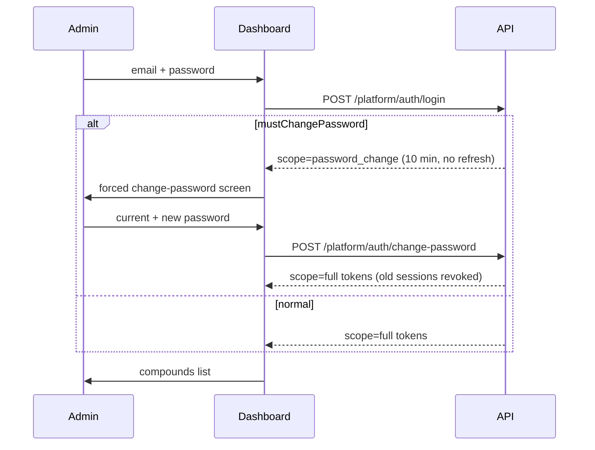
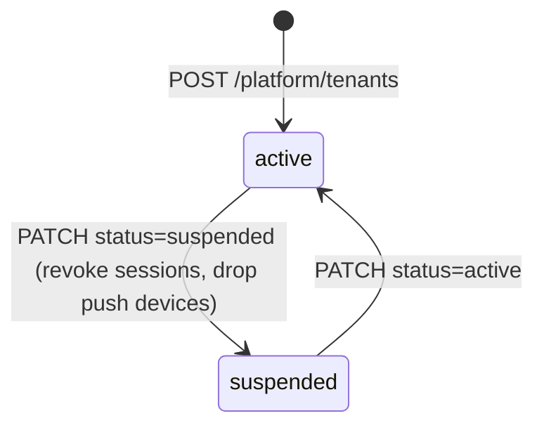
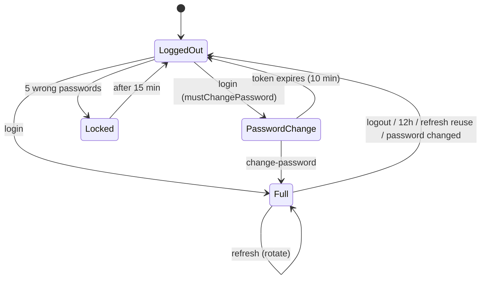

# لوحة مالك المنصة (السوبر أدمن) — Platform Super Admin

> **التطبيق/الواجهة:** super-admin dashboard
> **الصلاحيات:** لا توجد permission codes. السوبر أدمن ليس حسابًا داخل كمبوند. له جدول وجلسات وتوكن مستقلة (`aud: platform`). كل المسارات تحت `/platform/*` يحميها `PlatformAuthGuard`. توكن تطبيقات الكمبوند مرفوض هنا، والعكس صحيح.
> **المصادر:** ADR 0001 · ADR 0011 · ADR 0014 · `src/core/platform/` · `src/core/audit/platform-audit.service.ts` · `src/core/audit/security-events.service.ts`

## الفكرة باختصار
مالك المنصة (Jiwar) يدخل لوحة مستقلة بالبريد وكلمة المرور. من هذه اللوحة يضيف الكمبوندات الجديدة (كل كمبوند = tenant)، ومع كل كمبوند يضيف أول مدير له. ويستطيع إيقاف كمبوند أو إعادة تفعيله، وإضافة مديرين أو تعطيلهم. **لا يرى أي بيانات داخل الكمبوند**: لا وحدات ولا سكان ولا إشغالات. ويقرأ سجل التدقيق الخاص بالمنصة وسجل الأحداث الأمنية.

## الأدوار ومين بيعمل إيه
| الدور | ماذا يستطيع |
|---|---|
| Platform admin (السوبر أدمن) | الدخول، وتغيير كلمة المرور، وعرض الكمبوندات وإنشاؤها، وإيقاف كمبوند أو تفعيله، وإضافة مدير، وتفعيل مدير أو تعطيله، وقراءة سجل المنصة والأحداث الأمنية |
| النظام (bootstrap) | عند أول تشغيل للسيرفر ينشئ أول سوبر أدمن من متغيرات البيئة `SUPERADMIN_EMAIL` و`SUPERADMIN_PASSWORD`، مع `mustChangePassword = true` |
| مدير الكمبوند | لا دور له في هذه اللوحة. هو "عميل" المنصة الذي ينشئه السوبر أدمن. إدارة الحسابات من داخل الكمبوند في `./03-staff-accounts.md` |

## الشاشات اللي الفيتشر محتاجها
- **شاشة الدخول**: بريد وكلمة مرور، مع رسالة خطأ عامة واحدة فقط.
- **شاشة تغيير كلمة المرور الإجبارية**: تظهر بعد أول دخول، وبعد أي دخول ما دام الحساب عليه `mustChangePassword`. فيها كلمة المرور الحالية والجديدة.
- **شاشة تغيير كلمة المرور الاختيارية**: من إعدادات الحساب أثناء الجلسة.
- **قائمة الكمبوندات**: الاسم والحالة وتاريخ الإنشاء، مع تحميل الصفحات (cursor).
- **نموذج إنشاء كمبوند**: اسم الكمبوند وبيانات أول مدير.
- **تفاصيل الكمبوند**: بياناته الأساسية وقائمة مديريه (الاسم، البريد، الهاتف، الحالة).
- **حوار تأكيد إيقاف الكمبوند**: يوضح أن كل الجلسات ستنتهي فورًا.
- **حوار تأكيد إعادة تفعيل الكمبوند**.
- **نموذج إضافة مدير لكمبوند**.
- **حوار تفعيل مدير أو تعطيله**.
- **سجل تدقيق المنصة**: جدول مع فلاتر.
- **سجل الأحداث الأمنية**: جدول مع فلاتر.
- **زر تسجيل الخروج**.

## الفلو خطوة بخطوة

### 1) أول سوبر أدمن (bootstrap، في الخلفية)
1. عند تشغيل السيرفر يتحقق: هل يوجد أي platform admin؟
2. إذا لم يوجد، وكان `SUPERADMIN_EMAIL` و`SUPERADMIN_PASSWORD` موجودين في البيئة: ينشئه بالحالة `active` ومعه `mustChangePassword = true`. ويسجل `platform_admin.created` في سجل المنصة (`metadata.source = bootstrap`، والفاعل `system`).
3. إذا كان يوجد أدمن: لا يحدث شيء. البيئة لا تعدّل أدمن موجودًا أبدًا.
4. إذا لم يوجد أدمن ولا متغيرات: تحذير في السجلات، ويعمل السيرفر بشكل عادي.
5. لا يوجد endpoint لإضافة أدمن آخر (انظر آخر الملف).

### 2) تسجيل الدخول
1. يكتب الأدمن `email` (من 3 إلى 254 حرفًا) و`password` (من 1 إلى 200)، ثم `POST /platform/auth/login`.
2. يُحذف الفراغ من أطراف البريد ويُحوَّل إلى حروف صغيرة.
3. قبل أي فحص يُحسب حد المحاولات: 20 محاولة لكل IP و10 لكل بريد خلال 15 دقيقة (القيم الافتراضية). **كل محاولة تُحسب، حتى الناجحة.** عند تجاوز الحد: `429 RATE_LIMITED`.
4. النتيجة:
   - **فشل لأي سبب** (بريد غير موجود، كلمة مرور خاطئة، حساب مقفول مؤقتًا، حساب `disabled`): نفس الخطأ `401 INVALID_CREDENTIALS`. **لا تستطيع** الواجهة معرفة السبب، ولا أن تقول "الحساب مقفول".
   - **نجاح والحساب عليه `mustChangePassword`**: `200` مع `scope: "password_change"` و`accessToken` صالح 10 دقائق، **بدون** `refreshToken`. انتقل إلى شاشة تغيير كلمة المرور الإجبارية.
   - **نجاح عادي**: `200` مع `scope: "full"` و`accessToken` (10 دقائق) و`refreshToken` و`refreshTokenExpiresAt` (بعد 12 ساعة). انتقل إلى قائمة الكمبوندات.
5. الدخول الناجح يصفّر عداد المحاولات الفاشلة، ويسجل `lastLoginAt`، ويسجل الحدث `platform.login_succeeded`.

### 3) القفل بعد محاولات فاشلة (lockout)
1. كل كلمة مرور خاطئة تزيد العداد `failedAttempts`.
2. عندما يصل العداد إلى 5 (الافتراضي `PLATFORM_LOGIN_MAX_FAILURES`) يُقفل الحساب 15 دقيقة (`PLATFORM_LOCKOUT_SECONDS = 900`)، ويعود العداد إلى صفر، ويُسجل الحدث `platform.login_locked`.
3. أثناء القفل: حتى كلمة المرور الصحيحة تُرجع `401 INVALID_CREDENTIALS`. وكلمة المرور الخاطئة أثناء القفل تزيد العداد، فإذا وصل إلى 5 مرة أخرى يتجدد القفل 15 دقيقة من تلك اللحظة.
4. إدخال كلمة المرور **الحالية** خطأً في شاشة تغيير كلمة المرور يُحسب أيضًا محاولة فاشلة.
5. لا يوجد endpoint لفك القفل يدويًا. يجب انتظار انتهاء المدة.

### 4) تغيير كلمة المرور (إجباري أو اختياري)
1. يكتب الأدمن `currentPassword` و`newPassword` (كلاهما من 1 إلى 200 حرف في النموذج)، ثم `POST /platform/auth/change-password` بالتوكن `password_change` أو `full`.
2. الفحوص بالترتيب:
   - كلمة المرور الحالية خاطئة: `401 INVALID_CREDENTIALS` (وتُحسب في القفل).
   - الجديدة أقل من 12 حرفًا: `400 VALIDATION_FAILED` على `newPassword` بالكود `INVALID_LENGTH` مع `params.min = 12`.
   - الجديدة مطابقة للحالية: `400 VALIDATION_FAILED` على `newPassword` بالكود `SAME_AS_CURRENT`.
3. عند النجاح: `200` مع توكنات `full` جديدة. **تُلغى كل الجلسات السابقة للأدمن**، فيخرج من أي تبويب أو جهاز آخر. ويُسجل `platform_admin.password_changed` في سجل المنصة.
4. إذا انتهى توكن `password_change` (بعد 10 دقائق): `401 UNAUTHENTICATED`. ارجع إلى شاشة الدخول، والدخول يعطي توكن `password_change` جديدًا.
5. توكن `password_change` بعد استخدامه (أي بعد تغيير كلمة المرور): `401 UNAUTHENTICATED`.
6. أي endpoint آخر بتوكن `password_change`: `403 PASSWORD_CHANGE_REQUIRED`. أعد المستخدم إلى شاشة تغيير كلمة المرور.

### 5) تجديد التوكن والخروج
1. يعيش `accessToken` 10 دقائق. عندما يرجع أي طلب `401 UNAUTHENTICATED`، استدعِ `POST /platform/auth/refresh` مع `refreshToken` (من 20 إلى 200 حرف).
2. عند النجاح: توكنات `full` جديدة، ويُلغى `refreshToken` القديم (rotation). **لا يتمدد `refreshTokenExpiresAt`**: عمر الجلسة كلها 12 ساعة من الدخول، وبعدها يلزم دخول جديد.
3. عند الفشل: `401 REFRESH_TOKEN_INVALID`، فانتقل إلى شاشة الدخول. يحدث ذلك إذا انتهت الجلسة أو أُلغيت، أو صار الأدمن `disabled`، أو كان عليه `mustChangePassword`.
4. **إعادة استخدام refresh token قديم** (سبق تدويره)، أو طلبا تجديد في اللحظة نفسها: تُلغى الجلسة كلها ويُسجل `session.refresh_reuse_detected`. لذلك يجب أن تمنع الواجهة طلبي تجديد متوازيين.
5. الخروج: `POST /platform/auth/logout` مع `refreshToken`. الرد دائمًا `204` حتى لو كان التوكن غير صالح. احذف التوكنات محليًا وانتقل إلى شاشة الدخول.
6. كل طلب محمي يتحقق من أن الأدمن ما زال `active` وأن جلسته ما زالت قائمة. إذن إلغاء الجلسة يسري فورًا، لا عند انتهاء التوكن.

### 6) قائمة الكمبوندات
1. `GET /platform/tenants?cursor=&limit=` (`limit` من 1 إلى 100، والافتراضي 20).
2. الترتيب: الأحدث أولًا حسب تاريخ الإنشاء.
3. كل عنصر فيه: `id` و`name` و`status` و`createdAt`. لا يوجد بحث ولا فلتر ولا عدد مستخدمين.
4. إذا لم يكن `nextCursor` فارغًا، اعرض "تحميل المزيد".

### 7) إنشاء كمبوند مع أول مدير
1. يملأ السوبر أدمن النموذج، ثم `POST /platform/tenants`:
   - `name`: إجباري، من 2 إلى 200 حرف بعد حذف الفراغات الطرفية.
   - `manager.fullName`: إجباري، من 2 إلى 200.
   - `manager.phone`: إجباري. رقم مصري محلي، أو دولي يبدأ بـ `+`، ويُخزن بصيغة E.164.
   - `manager.email`: إجباري.
   - `manager.idDocumentType`: إجباري، `national_id` أو `passport`.
   - `manager.idDocumentNumber`: إجباري، من 1 إلى 40. للرقم القومي 14 رقمًا. للجواز من 5 إلى 20 حرفًا أو رقمًا.
   - `manager.nationality`: إجباري للجواز (كود ISO من حرفين). مع الرقم القومي يجب أن يكون `EG` أو يُترك فارغًا.
   - `manager.birthDate` (`YYYY-MM-DD`): إجباري للجواز، ويُتجاهل مع الرقم القومي لأن التاريخ يُستخرج منه.
   - `manager.preferredLocale`: اختياري، `ar` أو `en`، والافتراضي `ar`.
2. يحدث كل ذلك في transaction واحدة: الكمبوند، ونسخة من الأدوار الافتراضية بصلاحياتها (انظر `./02-roles-and-permissions.md`)، وصف الإعدادات بقيمه الافتراضية (انظر `./04-compound-settings-and-audit.md`)، وإعدادات الصيانة الافتراضية، وأول مدير مع بيانات دخوله. إما أن ينجح كل شيء أو يفشل كل شيء.
3. عند النجاح: `201` مع تفاصيل الكمبوند، وفي `managers` المدير الجديد. انتقل إلى شاشة تفاصيل الكمبوند.
4. يُسجل `tenant.created` في سجل المنصة، و`account.created` في سجل الكمبوند نفسه (والفاعل هو السوبر أدمن).
5. **لا يُرسل أي بريد أو رسالة إلى المدير.** على السوبر أدمن أن يبلغه بنفسه. يدخل المدير بكود OTP على بريده (انظر ملف تسجيل الدخول و`../README.md`).

### 8) تفاصيل الكمبوند
1. `GET /platform/tenants/{id}`: الكمبوند و`managers` (كل الحسابات من نوع `manager`، الأقدم أولًا).
2. المدير في الحالة `frozen` يكون `phone` عنده `null`.
3. المدير الممسوح (`erased`) يرجع `{ id, erased: true }` فقط. اعرضه "مستخدم محذوف".
4. كمبوند غير موجود: `404 TENANT_NOT_FOUND`.

### 9) إيقاف كمبوند أو إعادة تفعيله
1. يختار السوبر أدمن الحالة الجديدة، ثم `PATCH /platform/tenants/{id}/status` مع `status`: `active` أو `suspended`.
2. عند `suspended`، في نفس الـtransaction:
   - تُلغى كل جلسات كل حسابات الكمبوند **فورًا**. كل مستخدم في أي تطبيق يحصل على `401` في طلبه التالي.
   - تُحذف كل أجهزة الـpush المسجلة في الكمبوند.
   - تفشل أي محاولة دخول لحساب في هذا الكمبوند، لأن الحساب لا يظهر في المطابقة أصلًا.
3. عند `active` (إعادة التفعيل): يستطيع المستخدمون الدخول مرة أخرى. الجلسات الملغاة لا تعود، وعلى كل شخص تسجيل الدخول من جديد. وتُسجَّل أجهزة الـpush من جديد عند دخول كل شخص.
4. عند النجاح: `200` مع `TenantView` (بدون قائمة المديرين). أعد قراءة التفاصيل عند الحاجة.
5. إذا تغيرت الحالة فعلًا: يُسجل `tenant.status_changed` في سجل المنصة مع `metadata.sessionsRevoked`، ويُسجل الحدث الأمني `session.revoked` بالسبب `tenant_suspended`.
6. إرسال الحالة الحالية نفسها لا يغيّر شيئًا ولا يُسجل. لكن إرسال `suspended` مرة أخرى يحذف أي جلسات أو أجهزة push ظهرت بعد الإيقاف الأول.
7. **لا يصل أي إشعار أو بريد** إلى مديري الكمبوند أو سكانه.

### 10) إضافة مدير لكمبوند موجود
1. `POST /platform/tenants/{id}/managers` بنفس حقول `manager` في الخطوة 7 (بدون `name`).
2. مسموح حتى لو كان الكمبوند `suspended`.
3. عند النجاح: `201` مع `ManagerView`. يُسجل `tenant.manager_added` في سجل المنصة، و`account.created` في سجل الكمبوند.
4. لا يوجد بريد ترحيب.

### 11) تفعيل مدير أو تعطيله
1. `PATCH /platform/tenants/{id}/managers/{accountId}/status` مع `status`: `active` أو `inactive` فقط.
2. إذا لم يكن الحساب من نوع `manager`، أو كان ممسوحًا، أو غير موجود: `404 ACCOUNT_NOT_FOUND`.
3. عند `inactive`: تُلغى كل جلسات المدير فورًا، وتُحذف أجهزة الـpush الخاصة به، وتُحرَّر المهام المسندة إليه (مثلًا طلبات الإدارة تعود بلا مسؤول). التفاصيل في `./03-staff-accounts.md`.
4. نقل حساب من `frozen` إلى `active` مرفوض: `409 ACCOUNT_FROZEN`. الحساب المجمد يعود فقط بمسار إعادة التفعيل داخل الكمبوند (`../03-community/04-frozen-accounts-and-erasure.md`).
5. عند النجاح: `200` مع `ManagerView`. يُسجل التغيير `account.status_changed` في سجل **الكمبوند** (الفاعل `platform_admin`)، ولا يُسجل في سجل المنصة.

### 12) سجل تدقيق المنصة
1. `GET /platform/audit` مع فلاتر اختيارية: `action`، `actorId`، `targetType`، `targetId`، `targetTenantId`، `from` (شامل)، `to` (غير شامل)، `cursor`، `limit`.
2. الترتيب: الأحدث أولًا.
3. الإجراءات التي تظهر هنا فقط: `tenant.created`، `tenant.status_changed`، `tenant.manager_added`، `platform_admin.created`، `platform_admin.password_changed`.

### 13) الأحداث الأمنية
1. `GET /platform/security-events` مع فلاتر: `event`، `identifierHash` (64 حرف hex)، `accountId`، `tenantId`، `platformAdminId`، `from`، `to`، `cursor`، `limit`.
2. يشمل أحداث **كل** الكمبوندات وأحداث المنصة نفسها (القائمة الكاملة في قسم البيانات).
3. التسجيل fail-open: إذا فشل تسجيل حدث لا يُمنع الدخول. أي أن بعض الأحداث قد تكون ناقصة من السجل.

## الحالات (Statuses)

**حالة الكمبوند (`TenantStatus`)**
| الحالة | المعنى | من يغيّرها |
|---|---|---|
| `active` | الكمبوند يعمل وحساباته تستطيع الدخول | الحالة الافتراضية عند الإنشاء. ويعيدها السوبر أدمن من `suspended` |
| `suspended` | موقوف: كل الجلسات ملغاة ولا يستطيع أحد الدخول | السوبر أدمن عبر `PATCH /platform/tenants/{id}/status` |

**حالة جلسة السوبر أدمن**
| الحالة | المعنى | الدخول إليها والخروج منها |
|---|---|---|
| scope `password_change` | دخل، لكن يجب أن يغيّر كلمة المرور، ولا يُسمح بغير ذلك | دخول والحساب عليه `mustChangePassword`. يخرج منها بتغيير كلمة المرور أو بانتهاء الدقائق العشر |
| scope `full` | جلسة كاملة | دخول عادي أو بعد تغيير كلمة المرور. تنتهي بالخروج، أو بعد 12 ساعة، أو بتغيير كلمة المرور، أو بإعادة استخدام refresh token |
| locked (`lockedUntil`) | مقفول 15 دقيقة بعد 5 محاولات خاطئة | تلقائي، ويُفك وحده بعد المدة |
| `disabled` (`PlatformAdminStatus`) | الأدمن موقوف | لا يوجد endpoint يضعه في هذه الحالة. موجودة في قاعدة البيانات فقط |

حالات المدير (`AccountStatus`: `active`، `inactive`، `frozen`، `erased`) موضحة في `./03-staff-accounts.md`.

## البيانات اللي بتظهر

**التوكنات (`PlatformTokensView`)**
| الحقل | المعنى |
|---|---|
| `scope` | `full` أو `password_change` |
| `accessToken` | يُرسل في `Authorization: Bearer` |
| `accessTokenExpiresIn` | بالثواني (600) |
| `refreshToken` | في `full` فقط. يُخزن بأمان ولا يُعرض على الشاشة |
| `refreshTokenExpiresAt` | في `full` فقط. موعد انتهاء الجلسة كلها |

ردود الدخول والتغيير والتجديد كلها `Cache-Control: no-store`.

**قائمة الكمبوندات (`TenantView`)**: `id`، `name`، `status`، `createdAt`.

**تفاصيل الكمبوند (`TenantDetailView`)**: الحقول نفسها، ومعها `managers[]`.

**المدير (`ManagerView`)**
| الحقل | ملاحظة |
|---|---|
| `id` | |
| `fullName` | |
| `email` | ظاهر للسوبر أدمن، لأن المديرين عملاء المنصة |
| `phone` | `null` إذا كان الحساب `frozen` |
| `status` | `active` أو `inactive` أو `frozen` |
| `erased: true` | يظهر فقط على الحساب الممسوح، ومعه `id` فقط بلا أي حقل آخر |

رقم الهوية أو الجواز وتاريخ الميلاد **لا يُرجعان** للسوبر أدمن.

**سجل تدقيق المنصة (`PlatformAuditEntryView`)**
| الحقل | المعنى |
|---|---|
| `occurredAt` | وقت الحدث |
| `actorType` | `platform_admin` أو `system` (أو `account` نظريًا) |
| `actorId` | معرّف الأدمن، أو `null` إذا كان `system` |
| `action` | كود الإجراء (القائمة في الخطوة 12) |
| `targetType` / `targetId` | `tenant` أو `account` أو `platform_admin`، مع المعرّف |
| `targetTenantId` | الكمبوند المعني إن وُجد |
| `changes` | الحقول التي تغيرت بصيغة `{field: {from, to}}`. أي حقل شخصي أو سري يظهر `{changed: true}` فقط (مثلًا `passwordHash`) |
| `metadata` | أكواد وأعداد فقط (مثلًا `sessionsRevoked` و`source: bootstrap`) |
| `requestId`، `ip`، `userAgent` | مصدر الطلب. تظهر للسوبر أدمن، ولا تظهر لمدير الكمبوند |

**الأحداث الأمنية (`SecurityEventView`)**: `id`، `occurredAt`، `event`، `identifierHash` (HMAC للبريد أو الهاتف، **وليس البريد نفسه أبدًا**)، `accountId`، `tenantId`، `platformAdminId`، `ip`، `userAgent`، `requestId`، `metadata` (مثلًا `reason` في `platform.login_failed`، وقيمه: `unknown_email` / `wrong_password` / `locked` / `disabled`).

أسماء الأحداث (`event`): `otp.requested`، `otp.verify_failed`، `otp.challenge_exhausted`، `otp.rate_limited`، `login.succeeded`، `session.refresh_reuse_detected`، `session.revoked`، `platform.login_failed`، `platform.login_locked`، `platform.login_succeeded`، `invite.token_invalid`، `account.phone_reassigned`، `registration.link_invalid`، `step_up.requested`، `step_up.verified`، `step_up.failed`، `login.new_device`، `account.not_me`.

## القواعد والقيود
- السوبر أدمن **لا يستطيع** قراءة الوحدات أو السكان أو الإشغالات أو أي بيانات داخل الكمبوند. المتاح له: الكمبوند نفسه ومديروه فقط.
- مدة `accessToken` عشر دقائق، والجلسة 12 ساعة ثابتة. توكن تغيير كلمة المرور عشر دقائق.
- الحدود الافتراضية (قابلة للتغيير من البيئة): 20 محاولة دخول لكل IP و10 لكل بريد كل 15 دقيقة، والقفل بعد 5 محاولات خاطئة لمدة 15 دقيقة.
- كلمة المرور الجديدة: 12 حرفًا على الأقل و200 على الأكثر، ومختلفة عن الحالية.
- اسم الكمبوند: من 2 إلى 200 حرف. لا يلزم أن يكون فريدًا، ولا يوجد endpoint لتعديله.
- بريد المدير وهاتفه لا يلزم أن يكونا فريدين على مستوى المنصة. الفريد هو (كمبوند، نوع الحساب، بريد) و(كمبوند، نوع الحساب، هاتف). أي أن مديرًا في كمبوندين = حسابان منفصلان (ADR 0002).
- لا يوجد `Idempotency-Key` على أي endpoint هنا. إذا انقطعت الشبكة أثناء إنشاء كمبوند، أعد عرض القائمة قبل إعادة المحاولة، حتى لا يُنشأ كمبوند مكرر.
- تغيير حالة المدير يقتصر على `active` و`inactive`. للتجميد والمسح مسارات أخرى داخل الكمبوند.
- القوائم cursor-paged (انظر `../README.md`).

## الأخطاء اللي الـUI لازم يتعامل معاها
| HTTP + code | متى | رسالة أو سلوك مقترح |
|---|---|---|
| `401 INVALID_CREDENTIALS` | دخول فاشل لأي سبب، أو كلمة المرور الحالية خاطئة عند التغيير | "البريد أو كلمة المرور غير صحيحة، أو الحساب مقفول مؤقتًا. حاول بعد قليل." |
| `429 RATE_LIMITED` | محاولات دخول كثيرة | "محاولات كثيرة. حاول مرة أخرى بعد 15 دقيقة." |
| `400 VALIDATION_FAILED` | حقول ناقصة أو غير صحيحة. قيم `fields[].code` الممكنة: `INVALID_LENGTH`، `SAME_AS_CURRENT`، `INVALID_EMAIL`، `INVALID_PHONE`، `INVALID_NATIONAL_ID`، `INVALID_PASSPORT_NUMBER`، `INVALID_NATIONALITY`، `BIRTH_DATE_REQUIRED`، `INVALID_BIRTH_DATE` | اعرض الخطأ تحت الحقل المعني |
| `401 UNAUTHENTICATED` | انتهى `accessToken`، أو أُلغيت الجلسة، أو عُطّل الأدمن، أو انتهى توكن `password_change` أو استُخدم | جرّب التجديد مرة واحدة. إذا فشل، ارجع إلى شاشة الدخول |
| `401 REFRESH_TOKEN_INVALID` | فشل التجديد | ارجع إلى شاشة الدخول: "انتهت الجلسة، سجّل الدخول مرة أخرى." |
| `403 PASSWORD_CHANGE_REQUIRED` | استخدام توكن `password_change` في أي شاشة أخرى | انتقل إلى شاشة تغيير كلمة المرور |
| `404 TENANT_NOT_FOUND` | معرّف كمبوند غير صحيح | "الكمبوند غير موجود." |
| `404 ACCOUNT_NOT_FOUND` | المدير غير موجود، أو ليس من نوع manager، أو ممسوح | "المدير غير موجود." |
| `409 ACCOUNT_FROZEN` | محاولة تفعيل مدير مجمد | "الحساب مجمد. يجب أن تسجل إدارة الكمبوند رقمًا جديدًا ثم تعيد تفعيله." |
| `409 DUPLICATE_RESOURCE` (`fields`: `email` أو `phone` بالكود `DUPLICATE_VALUE`) | البريد أو الهاتف مستخدم لمدير آخر في الكمبوند نفسه | "هذا البريد/الرقم مسجل لمدير آخر في هذا الكمبوند." |

## الإشعارات
لا توجد إشعارات داخل التطبيق ولا push ولا بريد في أي خطوة هنا: لا عند إنشاء كمبوند، ولا عند إضافة مدير، ولا عند الإيقاف. (إذا جُمّد مدير من داخل الكمبوند، فالبريد الذي يصله موضح في `../03-community/04-frozen-accounts-and-erasure.md`.)

## الـEndpoints
| Method + path | من يستدعيه | الغرض | الرد |
|---|---|---|---|
| `POST /platform/auth/login` | public | الدخول بالبريد وكلمة المرور | `200` `PlatformTokensView` |
| `POST /platform/auth/change-password` | الأدمن (`full` أو `password_change`) | تغيير كلمة المرور | `200` `PlatformTokensView` (`full`) |
| `POST /platform/auth/refresh` | public (بالـrefresh token) | تجديد التوكن | `200` `PlatformTokensView` |
| `POST /platform/auth/logout` | public (بالـrefresh token) | الخروج | `204` |
| `GET /platform/tenants` | الأدمن | قائمة الكمبوندات | `200` `{data: TenantView[], nextCursor}` |
| `POST /platform/tenants` | الأدمن | إنشاء كمبوند وأول مدير | `201` `TenantDetailView` |
| `GET /platform/tenants/{id}` | الأدمن | تفاصيل كمبوند ومديريه | `200` `TenantDetailView` |
| `PATCH /platform/tenants/{id}/status` | الأدمن | إيقاف أو تفعيل | `200` `TenantView` |
| `POST /platform/tenants/{id}/managers` | الأدمن | إضافة مدير | `201` `ManagerView` |
| `PATCH /platform/tenants/{id}/managers/{accountId}/status` | الأدمن | تفعيل مدير أو تعطيله | `200` `ManagerView` |
| `GET /platform/audit` | الأدمن | سجل تدقيق المنصة | `200` `{data: PlatformAuditEntryView[], nextCursor}` |
| `GET /platform/security-events` | الأدمن | الأحداث الأمنية | `200` `{data: SecurityEventView[], nextCursor}` |

## ملاحظات للديزاين وحاجات ناقصة في الباك
- لا يوجد endpoint لإضافة سوبر أدمن آخر، ولا لتعطيله، ولا لعرض ملفه (`GET /platform/me`)، ولا لفك القفل يدويًا. الحالة `disabled` موجودة في قاعدة البيانات فقط.
- لا يوجد "نسيت كلمة المرور" للسوبر أدمن. الحل الوحيد تدخّل يدوي في قاعدة البيانات.
- لا يوجد تعديل لاسم الكمبوند، ولا بحث أو فلترة في قائمة الكمبوندات، ولا إحصائيات (عدد الوحدات أو الحسابات). هذا مقصود (ADR 0011: المنصة لا تقرأ بيانات الكمبوند)، لكن اللوحة غالبًا تحتاج على الأقل عدد المديرين.
- لا يوجد بريد ترحيب أو دعوة للمدير الجديد (ADR 0003: الإدارة ترسل الرابط يدويًا). يجب أن يذكّر التصميمُ السوبر أدمن بإبلاغ المدير.
- لا يوجد endpoint يرجع قائمة أسماء الإجراءات (`action`) أو الأحداث (`event`) للفلاتر. يجب أن تضعها الواجهة ثابتة من الكتالوج (القوائم في هذا الملف).
- فلتر `identifierHash` في الأحداث الأمنية يحتاج HMAC لا تستطيع الواجهة حسابه. عمليًا لا يمكن البحث بالبريد.
- `actorId` و`targetId` في السجلات معرّفات فقط. لا يوجد endpoint يحوّل معرّف مدير إلى اسم، إلا `GET /platform/tenants/{id}`.
- ADR 0011 يذكر "support access" (دخول الدعم إلى بيانات كمبوند بسبب مكتوب) كميزة مستقبلية. **غير موجودة**.
- السوبر أدمن يرى في الأحداث الأمنية `accountId` وIP وuser agent لمستخدمي الكمبوندات. هذا أوسع من "لا يرى بيانات الكمبوند"، ويحتاج قرارًا في التصميم: هل تظهر هذه الأعمدة أم لا.
