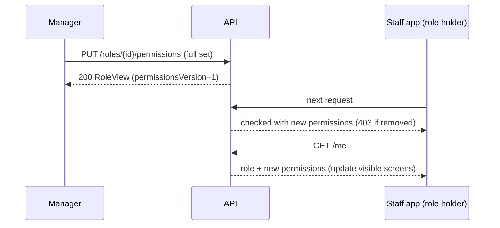

# الأدوار والصلاحيات في الكمبوند — Roles and Permissions

> **التطبيق/الواجهة:** manager dashboard
> **الصلاحيات:** `roles.read` لعرض الأدوار والكتالوج، و`roles.manage` لتعديل صلاحيات دور. في الأدوار الافتراضية يملك الاثنين دور `manager` فقط.
> **المصادر:** ADR 0010 · `src/core/access/` (`permissions.ts`، `default-roles.ts`، `access-catalog.ts`، `roles.service.ts`، `permissions.guard.ts`)

## الفكرة باختصار
كل حساب في الكمبوند له **دور واحد** فقط، والدور يحدد الصلاحيات (permissions). الصلاحيات قائمة ثابتة في الكود. كل كمبوند جديد يأخذ نسخة خاصة به من الأدوار الافتراضية. يستطيع المدير إضافة صلاحيات إلى دور أو حذفها منه في كمبونده فقط، ويسري التغيير على كل أصحاب الدور من طلبهم التالي. لا يوجد إنشاء أدوار جديدة ولا حذف أدوار. هذا الملف هو المرجع لمعرفة **من يرى أي شاشة**.

## الأدوار ومين بيعمل إيه
| الدور | ماذا يستطيع في هذه الميزة |
|---|---|
| من يملك `roles.read` (افتراضيًا `manager`) | عرض قائمة الأدوار وتفاصيل دور وكتالوج الصلاحيات |
| من يملك `roles.manage` (افتراضيًا `manager`) | استبدال صلاحيات أي دور في الكمبوند، ضمن حدود نوع الدور وحماية الإغلاق |
| أي حساب | يعرف دوره وصلاحياته الحالية من `GET /me` (`role` و`permissions`) بلا أي صلاحية |

## الشاشات اللي الفيتشر محتاجها
- **قائمة الأدوار**: كل أدوار الكمبوند، مع نوع كل دور (`kind`) وعدد صلاحياته.
- **تفاصيل الدور / محرر الصلاحيات**: قائمة بكل الصلاحيات المسموح بها لنوع هذا الدور، وأمام كل صلاحية checkbox. الصلاحيات المحمية في دور `manager` مقفولة.
- **حوار تأكيد الحفظ**: يوضح أن التغيير يسري فورًا على كل أصحاب الدور، ويوضح الآثار الجانبية لإزالة صلاحيات مثل `tickets.work` أو `requests.handle` (انظر القواعد).
- **إخفاء وإظهار الشاشات في كل التطبيقات** حسب `permissions` في `GET /me` (ليست شاشة، لكنها قاعدة تصميم عامة).

## الفلو خطوة بخطوة

### 1) عرض الأدوار
1. المدير يفتح "الأدوار" → `GET /roles`.
2. الرد `{data: RoleView[], nextCursor: null}`. القائمة كاملة بلا صفحات، ومرتبة بالـ`key` أبجديًا.
3. كل الأدوار الحالية أدوار نظام (`isSystem: true`) و`name: null`. لذلك **تترجم الواجهة الاسم من `key`** (ADR 0013). الأسماء المقترحة:

| `key` | `kind` | الاسم المقترح |
|---|---|---|
| `manager` | `manager` | مدير الكمبوند |
| `resident` | `resident` | ساكن (مالك أو مستأجر) |
| `family_member` | `family` | فرد من الأسرة |
| `guard` | `staff` | فرد أمن البوابة |
| `technician` | `staff` | فني صيانة |
| `maintenance_supervisor` | `staff` | مشرف صيانة (توزيع البلاغات) |

### 2) عرض تفاصيل دور
1. `GET /roles/{id}` → `RoleView` (فيه `permissions` مرتبة).
2. دور غير موجود → `404 ROLE_NOT_FOUND`.

### 3) جلب الكتالوج لبناء المحرر
1. `GET /permissions` → `{data: [{key, kinds[]}], nextCursor: null}`.
2. `kinds` هي أنواع الأدوار التي **يجوز** أن تأخذ هذه الصلاحية. عند بناء محرر دور، اعرض فقط الصلاحيات التي يحتوي `kinds` فيها على `kind` الدور. الباقي لا يُعرض، أو يُعرض معطلًا مع شرح.
3. الكتالوج لا يحمل أي وصف أو اسم معروض. تضع الواجهة النصوص بنفسها (الجدول في قسم البيانات).

### 4) تعديل صلاحيات دور
1. المدير يغيّر الاختيارات ثم يضغط حفظ → `PUT /roles/{id}/permissions` مع `permissions`: **المجموعة الكاملة** المطلوبة (وليس الفرق). الحد الأقصى 200 عنصر، والتكرار يُحذف تلقائيًا.
2. الفحوص بالترتيب:
   - صلاحية غير موجودة في الكتالوج → `400 UNKNOWN_PERMISSION` و`params.permissions` فيها الأكواد غير المعروفة.
   - الدور غير موجود → `404 ROLE_NOT_FOUND`.
   - صلاحية لا تناسب نوع الدور (مثلًا `roles.manage` لدور `resident`) → `400 PERMISSION_NOT_ASSIGNABLE` و`params.permissions` و`params.kind`.
   - دور `manager` بدون `roles.manage` أو `residents.manage` → `409 ROLE_LOCKOUT` و`params.permissions` فيها المحذوف منهما.
3. إذا لم يتغير شيء: `200` بالدور كما هو، بلا أي تسجيل.
4. إذا تغيّر شيء، في transaction واحدة:
   - تُضاف الصلاحيات وتُحذف، ويزيد `permissionsVersion` للدور.
   - تتفاعل المجالات الأخرى مع الحذف:
     - إزالة `tickets.work` من دور: بلاغات الصيانة المسندة إلى فنيي هذا الدور تُحرر، ويعيد محرك التوزيع المحاولة بعد الحفظ.
     - إزالة `requests.handle` من دور: طلبات الإدارة المسندة إلى أصحاب الدور تعود بلا مسؤول (`reasonCode = role_lost`).
   - يُسجل `role.permissions_replaced` في سجل الكمبوند مع `changes.permissions` (قبل وبعد) و`metadata.roleKey` و`metadata.permissionsVersion`.
5. الرد `200` مع `RoleView` بعد التعديل.
6. **متى يسري التغيير؟** في الطلب التالي لكل صاحب الدور. لا حاجة لإعادة الدخول. الصلاحيات لا تُحفظ في التوكن، بل تُقرأ في كل طلب. لكن التطبيقات المفتوحة لن تخفي الأزرار من نفسها حتى تعيد قراءة `GET /me`. والزر الظاهر يرجع `403 FORBIDDEN` عند الضغط عليه.

### 5) تحديث الكتالوج عند النشر (access:sync، في الخلفية)
1. عند نشر نسخة جديدة من الكود فيها صلاحية جديدة، يشغّل فريق التشغيل `access:sync`.
2. الصلاحية الجديدة تُضاف إلى أدوار النظام التي تحتويها في الإعدادات الافتراضية، **مرة واحدة فقط**. إذا حذفها المدير لاحقًا لا تعود.
3. الأدوار الافتراضية الناقصة في كمبوند قديم تُنشأ بكل صلاحياتها.
4. أي تغيير تسجله المزامنة يظهر في سجل الكمبوند `role.permissions_synced`.
5. إذا عمل السيرفر قبل المزامنة، فالـendpoints التي تحتاج الصلاحية الجديدة ترجع `403` مؤقتًا.

## البيانات اللي بتظهر

**`RoleView`** (القائمة والتفاصيل)
| الحقل | المعنى |
|---|---|
| `id` | معرّف الدور في هذا الكمبوند |
| `key` | المفتاح الثابت (`manager`، `guard`…). تترجم منه الواجهة الاسم |
| `name` | `null` لأدوار النظام (وكل الأدوار الحالية أدوار نظام) |
| `kind` | نوع الحساب الذي يحمل الدور: `manager` / `resident` / `family` / `staff` |
| `isSystem` | `true` لكل الأدوار الحالية |
| `permissions` | أكواد الصلاحيات الحالية، مرتبة |

**`PermissionView`** (الكتالوج): `key` و`kinds[]`.

**`GET /me`**: `role: {id, key, name}` و`permissions[]`. هذه ما سيفحصه الـAPI في الطلب التالي. استخدمها لإظهار الأزرار والشاشات أو إخفائها، مع العلم أن كل route يفحص بنفسه.

### جدول كل الصلاحيات
الأعمدة: الكود، معناه، أنواع الأدوار المسموح لها (`kinds`)، الأدوار الافتراضية التي تملكه، وأهم الشاشات أو الـendpoints التي يفتحها.

| الكود | المعنى | `kinds` المسموح | الأدوار الافتراضية | أهم ما يفتحه |
|---|---|---|---|---|
| `units.read` | رؤية الوحدات (المدير كلها، والساكن والفرد وحداتهم فقط) | manager, resident, family | manager, resident, family_member | `GET /units`، `GET /units/{id}`، `GET /units/{unitId}/household` |
| `units.create` | إنشاء وحدة | manager | manager | `POST /units` |
| `accounts.read` | قائمة كل حسابات الكمبوند وتفاصيلها | manager | manager | `GET /accounts`، `GET /accounts/{id}` |
| `accounts.manage` | إنشاء الحسابات، وتغيير الحالة والتواصل، والتجميد وإعادة التفعيل، ورفع ملفات `document` | manager | manager | `POST /accounts`، `PATCH /accounts/{id}/status`، `/contact`، `/freeze`، `/reactivate` |
| `accounts.erase` | تنفيذ المسح النهائي للحسابات أو إغلاق طلباته، واستقبال تنبيهات طلبات الحذف المحجوزة | manager | manager | `GET /erasures`، `/erasures/{id}/scope`، `/erase`، `/close` |
| `accounts.legal_hold` | وضع حجز قانوني على حساب يمنع مسحه، ورفعه | manager | manager | `GET/POST /accounts/{id}/legal-holds`، `POST /legal-holds/{id}/release` |
| `residents.read` | قائمة السكان وتفاصيلهم، والوحدات التي تحتاج مراجعة، وصلاحيات أفراد الأسرة | manager | manager | `GET /residents`، `GET /residents/{id}`، `GET /units/needing-review` |
| `residents.manage` | إضافة ساكن، والإشغالات، وتغيير الساكن الأساسي، وحالات الوحدة (وفاة، انفصال، إنهاء أسرة، نقل ملكية)، وطلبات التسجيل الذاتي. **محمية في دور manager** | manager | manager | `POST /residents`، `/occupancies`، `/units/{id}/primary`، `/registrations`… |
| `residents.assist` | التصرف نيابة عن ساكن لا يستخدم التطبيق (تفضيلات، موافقات، تصدير، طلب حذف) مع reasonCode | manager | manager | `/accounts/{id}/notification-preferences`، `/consents/*`، `/data-exports`، `/deletion-request` |
| `roles.read` | عرض الأدوار والكتالوج | manager | manager | `GET /roles`، `GET /roles/{id}`، `GET /permissions` |
| `roles.manage` | تعديل صلاحيات الأدوار. **محمية في دور manager** | manager | manager | `PUT /roles/{id}/permissions` |
| `audit.read` | قراءة سجل تدقيق الكمبوند | manager | manager | `GET /audit` |
| `settings.manage` | إعدادات الكمبوند العامة | manager | manager | `GET/PATCH /settings` |
| `household.manage` | إدارة أسرة الوحدة: دعوات، قُصّر، صلاحيات الأفراد، الوضع المغلق، تفعيل الوحدة، تعليمات البوابة، الإجراءات المؤجلة. **الخدمة تشترط أيضًا أن يكون الساكن الأساسي أو مفوّضًا** | resident, family | resident, family_member | `POST /units/{unitId}/household/invites`، `/household/members/{id}/permissions/*`، `PUT /units/{unitId}/gate-instructions` |
| `household.approve` | الموافقة على انضمام فرد أسرة أو رفضه (عند تفعيل الإعداد) | manager | manager | `GET /household/pending`، `/approve`، `/reject` |
| `household.override` | قرارات الإدارة على الأسرة: إزالة فرد أو سحب صلاحياته عند انفصال | manager | manager | `/household/members/{id}/remove-by-management`، `/permissions/revoke-by-management` |
| `household.delegate` | تفويض فرد لإدارة جانب من الوحدة. **الساكن الأساسي فقط (تفحصه الخدمة)** | resident | resident | مسارات التفويض |
| `workers.manage` | تسجيل العمالة المنزلية للوحدة وإدارتها: الأجر، المدفوعات، الإيقاف، إعادة إصدار الكود، الحضور | resident, family | resident, family_member | `GET/POST /units/{unitId}/workers`، `/worker-engagements/{id}/*` |
| `workers.review` | مراجعة تسجيلات العمالة واعتمادها، وتاريخ الميلاد، والصورة، وتسوية الأجور | manager | manager | `GET /worker-engagements`، `/review`، `/workers/{id}/birth-date` |
| `workers.ban` | حظر عامل أو رفع الحظر | manager | manager | `/workers/{id}/ban`، `/unban` |
| `workers.compliance` | مسؤول الامتثال: بلاغات القُصّر وقضاياها، واستقبال تنبيهاتها | manager | manager | `/workers/{id}/report-underage`، `GET /compliance-cases` |
| `workers.incidents` | بطاقات العمال المفقودة أو المصادرة، واستقبال تنبيهاتها | manager | manager | `/worker-engagements/{id}/card-incident`، `GET /card-incidents` |
| `gate.operate` | تشغيل البوابة داخل وردية: التحقق، وتسجيل الدخول والخروج، ومن بالداخل، وطلبات الموافقة | staff | guard | `/gate/shifts`، `POST /gate/verify`، `POST /gate/entries`، `GET /gate/inside` |
| `gate.manage` | إنشاء البوابات وتعديلها | manager | manager | `POST /gates`، `PATCH /gates/{id}` |
| `gate.read` | قائمة البوابات وسجل الدخول والخروج | manager | manager | `GET /gates`، `GET /gate/entries` |
| `visitors.invite` | دعوة زوار (تصاريح زيارة). تحكمها أيضًا capability `visitorsInvite` لكل وحدة | resident, family | resident, family_member | `/units/{unitId}/visitor-passes`، `/visitor-passes/{id}/*` |
| `profile.photo` | رفع الصورة الشخصية التي يراها الحارس عند البوابة | resident, family | resident, family_member | `/me/photo` |
| `tickets.create` | فتح بلاغات صيانة ومتابعتها، والزيارات، والصيانة الوقائية. تحكمها أيضًا capability `tickets` | resident, family | resident, family_member | `/tickets`، `/tickets/preventive`، `/me/units/{unitId}/visits` |
| `tickets.work` | الفني: البلاغات المسندة إليه وتوفره | staff | technician | `/technician/tickets`، `/technician/availability` |
| `tickets.dispatch` | توزيع البلاغات ورؤيتها كلها، وتوفر الفنيين، واستقبال تنبيهات الصيانة | staff, manager | manager, maintenance_supervisor | `/maintenance/tickets`، `/maintenance/technicians` |
| `maintenance.manage` | إعدادات الصيانة: التصنيفات، التخصصات، SLA، التوزيع الآلي، الخدمات الوقائية | manager | manager | `/maintenance/categories`، `/maintenance/settings`، `/maintenance/sla-settings`، `/maintenance/dispatch-settings` |
| `parcels.handle` | الحارس: استلام الطرود وتسليمها داخل وردية | staff | guard | `/gate/parcels` |
| `parcels.manage` | قراءة كل الطرود (بلا أسماء) ومدد الاحتفاظ | manager | manager | `/parcels`، `/parcel-settings` |
| `requests.create` | فتح طلبات للإدارة وحجز مواعيد | resident, family | resident, family_member | `/management-requests`، `/management-appointment-slots` |
| `requests.handle` | الرد على طلبات الإدارة وإسنادها وإغلاقها، وإدارة المواعيد، واستقبال تنبيهاتها | staff, manager | manager | `/management/requests`، `/management/request-assignees` |
| `requests.manage` | موضوعات الطلبات وأوقات الرد وساعات العمل والتقييمات | manager | manager | `/management/request-topics`، `/management/request-settings`، `/management/office-hours` |

ملاحظات على الجدول:
- بعض الشاشات تحتاج **صلاحيتين معًا**: قائمة "من يمكن أن يكون صاحب البلاغ" (`GET /maintenance/units/{unitId}/reporters`) تحتاج `tickets.dispatch` + `residents.read`. وشاشات وحدات طلبات الإدارة (`/management/units/*`) وجزء من `/management/requests` تحتاج `requests.handle` + `residents.read`. إذا أعطى المدير مشرفًا `tickets.dispatch` فقط فلن يرى هذه القوائم.
- بعض الشاشات تكفيها **أي صلاحية من عدة**: مثلًا `GET /ticket-categories` (`tickets.create` أو `tickets.dispatch`)، و`GET /management-request-topics` (`requests.create` أو `requests.handle`)، و`GET /me/requests` (`requests.create` أو `tickets.create`).
- الساكن يتعامل مع طروده عبر capability `parcels` على الوحدة، بلا permission.

## القواعد والقيود
- **دور واحد لكل حساب**، و`kind` الدور = نوع الحساب. لا يمكن تغيير دور حساب بعد إنشائه (لا يوجد endpoint).
- لا يمكن إنشاء دور جديد، ولا حذف دور، ولا إعادة تسميته. الأدوار المخصصة والاستثناءات لكل حساب خارج النطاق (ADR 0010).
- **حدود النوع**: الصلاحية لا تُعطى إلا لدور يوجد نوعه في `kinds`. مثلًا لا يمكن إعطاء أي صلاحية إدارية لدور `resident`، ولا `gate.operate` لدور `manager`.
- **حماية الإغلاق (lockout)**: دور `manager` يجب أن يبقى معه `roles.manage` و`residents.manage` دائمًا. اجعلهما مقفولين في المحرر.
- تعديل دور يؤثر على **كل** الحسابات التي تحمله في هذا الكمبوند فقط.
- تعديلات متزامنة على الدور نفسه تُنفذ واحدة بعد الأخرى. آخر حفظ هو الذي يبقى (لا يوجد فحص للنسخة من جهة العميل).
- التطبيق يقرأ الصلاحيات في كل طلب. إلغاء صلاحية يسري في الطلب التالي، وإضافتها كذلك.
- تغيير الصلاحيات يغيّر أيضًا **من يستقبل تنبيهات الطاقم**. التنبيهات تُرسل لكل حساب نشط يملك الصلاحية المعنية: `tickets.dispatch`، `maintenance.manage`، `parcels.manage`، `requests.handle`، `requests.manage`، `workers.compliance`، `workers.incidents`، `accounts.erase`. إذا لم يبقَ أحد يملكها، لا يصل التنبيه لأحد (وبعض المجالات تحفظه "غير مُسلَّم"). يُفضَّل أن يحذّر المحرر عند إزالة صلاحية من آخر دور يملكها.
- `requests.handle` يجوز لنوع `staff`، لكن لا يوجد دور staff افتراضي يملكه. لكي يرد موظف على طلبات الإدارة، يجب أن يضيفه المدير إلى أحد أدوار staff (وكل موظفي هذا الدور سيحصلون عليه).
- لا يوجد `Idempotency-Key` هنا. `PUT` بطبيعته آمن للتكرار (المجموعة نفسها تعطي النتيجة نفسها).

## الأخطاء اللي الـUI لازم يتعامل معاها
| HTTP + code | متى | رسالة أو سلوك مقترح |
|---|---|---|
| `403 FORBIDDEN` | الحساب لا يملك `roles.read` أو `roles.manage`، أو أي صلاحية مطلوبة لأي شاشة | أخفِ الشاشة أو الزر. وإذا ظهر الخطأ: "ليس لديك صلاحية لهذا الإجراء." ثم أعد قراءة `GET /me` |
| `404 ROLE_NOT_FOUND` | معرّف دور غير صحيح | "الدور غير موجود." |
| `400 UNKNOWN_PERMISSION` | كود غير موجود في الكتالوج (`params.permissions`) | خطأ برمجي غالبًا. أعد تحميل الكتالوج |
| `400 PERMISSION_NOT_ASSIGNABLE` | صلاحية لا تناسب نوع الدور (`params.permissions`، `params.kind`) | "هذه الصلاحية لا تُعطى لهذا النوع من الأدوار." |
| `409 ROLE_LOCKOUT` | محاولة حذف `roles.manage` أو `residents.manage` من دور manager (`params.permissions`) | "لا يمكن إزالة هذه الصلاحية من دور المدير حتى لا يفقد الكمبوند إدارته." |
| `400 VALIDATION_FAILED` | `permissions` ليست مصفوفة نصوص أو تتجاوز 200 عنصر | خطأ برمجي |

## الإشعارات
لا يرسل تعديل الأدوار أي إشعار لأصحاب الدور. الأثر غير المباشر الوحيد هو تغيير من يستقبل تنبيهات الطاقم (انظر القواعد).

## الـEndpoints
| Method + path | من يستدعيه | الغرض | الرد |
|---|---|---|---|
| `GET /roles` | `roles.read` | قائمة أدوار الكمبوند | `200` `{data: RoleView[], nextCursor: null}` |
| `GET /roles/{id}` | `roles.read` | دور واحد بصلاحياته | `200` `RoleView` |
| `PUT /roles/{id}/permissions` | `roles.manage` | استبدال صلاحيات الدور كاملة | `200` `RoleView` |
| `GET /permissions` | `roles.read` | كتالوج الصلاحيات وأنواعها | `200` `{data: PermissionView[], nextCursor: null}` |
| `GET /me` | أي حساب | الدور والصلاحيات الحالية | `200` (فيه `role` و`permissions`) |

## ملاحظات للديزاين وحاجات ناقصة في الباك
- الكتالوج بلا أسماء أو أوصاف معروضة أو تجميع. تحتاج الواجهة نصوصًا ثابتة لكل كود (الجدول أعلاه) وتجميعًا (حسابات، سكان، أسرة، عمالة، بوابة، صيانة، طرود، طلبات، إدارة).
- `RoleView` لا يعرض **عدد الحسابات** التي تحمل الدور، ولا قائمتها. وحتى `GET /accounts` لا يعرض دور كل حساب (انظر `./03-staff-accounts.md`).
- لا يوجد تغيير دور حساب بعد إنشائه. مثلًا: لا يمكن تحويل حارس إلى فني، ويلزم إنشاء حساب جديد.
- لا توجد أدوار مخصصة. إذا أراد المدير "موظف استقبال" يرد على الطلبات فقط، فعليه أن يضيف `requests.handle` لدور staff موجود، فيحصل عليه كل أصحاب ذلك الدور.
- لا يوجد إعادة الدور إلى صلاحياته الافتراضية بضغطة واحدة. تعرف الواجهة القيم الافتراضية من هذا الملف فقط.
- ADR 0010 الأصلي يقول إن `staff` "بلا دور بعد". تحديثات ADR 0032 والكود الحالي فيها ثلاثة أدوار staff (`guard` افتراضي، `technician`، `maintenance_supervisor`).
- لا يوجد في الكود نص لترجمة الـ`key`؛ الترجمة مسؤولية الواجهة (ADR 0013).
