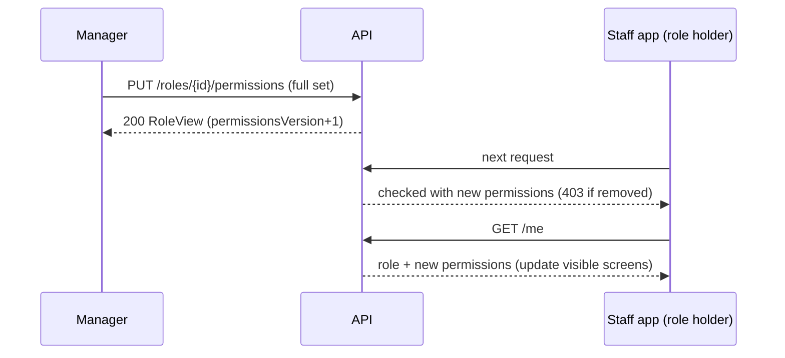

# الأدوار والصلاحيات في الكمبوند — Roles and Permissions

> **التطبيق/الواجهة:** manager dashboard
> **الصلاحيات:** `roles.read` لعرض الأدوار والكتالوج، و`roles.manage` لتعديل صلاحيات دور. في الأدوار الافتراضية يملك الاثنين دور `manager` فقط.
> **المصادر:** ADR 0010 · `src/core/access/` (`permissions.ts`، `default-roles.ts`، `access-catalog.ts`، `roles.service.ts`، `permissions.guard.ts`)

## الفكرة باختصار
كل حساب في الكمبوند له **دور واحد** فقط، والدور يحدد الصلاحيات (permissions). الصلاحيات قائمة ثابتة في الكود. كل كمبوند جديد يأخذ نسخة خاصة به من الأدوار الافتراضية. يستطيع المدير إضافة صلاحيات إلى دور أو حذفها منه في كمبونده فقط، ويسري التغيير على كل أصحاب الدور من طلبهم التالي. لا يوجد إنشاء أدوار جديدة ولا حذف أدوار. هذا الملف هو المرجع لمعرفة **من يرى أي شاشة**.

## الأدوار ومين بيعمل إيه
| الدور | ماذا يستطيع في هذه الميزة |
|---|---|
| من يملك `roles.read` (افتراضيًا `manager`) | عرض قائمة الأدوار وتفاصيل دور وكتالوج الصلاحيات |
| من يملك `roles.manage` (افتراضيًا `manager`) | استبدال صلاحيات أي دور في الكمبوند، ضمن حدود نوع الدور وحماية الإغلاق |
| أي حساب | يعرف دوره وصلاحياته الحالية من `GET /me` (`role` و`permissions`) بلا أي صلاحية |

## الشاشات اللي الفيتشر محتاجها
- **قائمة الأدوار**: كل أدوار الكمبوند، مع نوع كل دور (`kind`) وعدد صلاحياته.
- **تفاصيل الدور / محرر الصلاحيات**: قائمة بكل الصلاحيات المسموح بها لنوع هذا الدور، وأمام كل صلاحية checkbox. الصلاحيات المحمية في دور `manager` مقفولة.
- **حوار تأكيد الحفظ**: يوضح أن التغيير يسري فورًا على كل أصحاب الدور، ويوضح الآثار الجانبية لإزالة صلاحيات مثل `tickets.work` أو `requests.handle` (انظر القواعد).
- **إخفاء وإظهار الشاشات في كل التطبيقات** حسب `permissions` في `GET /me` (ليست شاشة، لكنها قاعدة تصميم عامة).

## الفلو خطوة بخطوة

### 1) عرض الأدوار
1. المدير يفتح "الأدوار" → `GET /roles`.
2. الرد `{data: RoleView[], nextCursor: null}`. القائمة كاملة بلا صفحات، ومرتبة بالـ`key` أبجديًا.
3. كل الأدوار الحالية أدوار نظام (`isSystem: true`) و`name: null`. لذلك **تترجم الواجهة الاسم من `key`** (ADR 0013). الأسماء المقترحة:

| `key` | `kind` | الاسم المقترح |
|---|---|---|
| `manager` | `manager` | مدير الكمبوند |
| `resident` | `resident` | ساكن (مالك أو مستأجر) |
| `family_member` | `family` | فرد من الأسرة |
| `guard` | `staff` | فرد أمن البوابة |
| `technician` | `staff` | فني صيانة |
| `maintenance_supervisor` | `staff` | مشرف صيانة (توزيع البلاغات) |
| `security_supervisor` | `staff` | مشرف الأمن (الجدول والمهام والدوريات وغرفة التحكم) |
| `accountant` | `staff` | محاسب |
| `collector` | `staff` | محصّل ميداني |
| `unit_proxy` | `proxy` | وكيل الوحدة (عن المالك) |

### 2) عرض تفاصيل دور
1. `GET /roles/{id}` → `RoleView` (فيه `permissions` مرتبة).
2. دور غير موجود → `404 ROLE_NOT_FOUND`.

### 3) جلب الكتالوج لبناء المحرر
1. `GET /permissions` → `{data: [{key, kinds[]}], nextCursor: null}`.
2. `kinds` هي أنواع الأدوار التي **يجوز** أن تأخذ هذه الصلاحية. عند بناء محرر دور، اعرض فقط الصلاحيات التي يحتوي `kinds` فيها على `kind` الدور. الباقي لا يُعرض، أو يُعرض معطلًا مع شرح.
3. الكتالوج لا يحمل أي وصف أو اسم معروض. تضع الواجهة النصوص بنفسها (الجدول في قسم البيانات).

### 4) تعديل صلاحيات دور
1. المدير يغيّر الاختيارات ثم يضغط حفظ → `PUT /roles/{id}/permissions` مع `permissions`: **المجموعة الكاملة** المطلوبة (وليس الفرق). الحد الأقصى 200 عنصر، والتكرار يُحذف تلقائيًا.
2. الفحوص بالترتيب:
   - صلاحية غير موجودة في الكتالوج → `400 UNKNOWN_PERMISSION` و`params.permissions` فيها الأكواد غير المعروفة.
   - الدور غير موجود → `404 ROLE_NOT_FOUND`.
   - صلاحية لا تناسب نوع الدور (مثلًا `roles.manage` لدور `resident`) → `400 PERMISSION_NOT_ASSIGNABLE` و`params.permissions` و`params.kind`.
   - دور `manager` بدون `roles.manage` أو `residents.manage` → `409 ROLE_LOCKOUT` و`params.permissions` فيها المحذوف منهما.
3. إذا لم يتغير شيء: `200` بالدور كما هو، بلا أي تسجيل.
4. إذا تغيّر شيء، في transaction واحدة:
   - تُضاف الصلاحيات وتُحذف، ويزيد `permissionsVersion` للدور.
   - تتفاعل المجالات الأخرى مع الحذف:
     - إزالة `tickets.work` من دور: بلاغات الصيانة المسندة إلى فنيي هذا الدور تُحرر، ويعيد محرك التوزيع المحاولة بعد الحفظ.
     - إزالة `requests.handle` من دور: طلبات الإدارة المسندة إلى أصحاب الدور تعود بلا مسؤول (`reasonCode = role_lost`).
   - يُسجل `role.permissions_replaced` في سجل الكمبوند مع `changes.permissions` (قبل وبعد) و`metadata.roleKey` و`metadata.permissionsVersion`.
5. الرد `200` مع `RoleView` بعد التعديل.
6. **متى يسري التغيير؟** في الطلب التالي لكل صاحب الدور. لا حاجة لإعادة الدخول. الصلاحيات لا تُحفظ في التوكن، بل تُقرأ في كل طلب. لكن التطبيقات المفتوحة لن تخفي الأزرار من نفسها حتى تعيد قراءة `GET /me`. والزر الظاهر يرجع `403 FORBIDDEN` عند الضغط عليه.

### 5) تحديث الكتالوج عند النشر (access:sync، في الخلفية)
1. عند نشر نسخة جديدة من الكود فيها صلاحية جديدة، يشغّل فريق التشغيل `access:sync`.
2. الصلاحية الجديدة تُضاف إلى أدوار النظام التي تحتويها في الإعدادات الافتراضية، **مرة واحدة فقط**. إذا حذفها المدير لاحقًا لا تعود.
3. الأدوار الافتراضية الناقصة في كمبوند قديم تُنشأ بكل صلاحياتها.
4. أي تغيير تسجله المزامنة يظهر في سجل الكمبوند `role.permissions_synced`.
5. إذا عمل السيرفر قبل المزامنة، فالـendpoints التي تحتاج الصلاحية الجديدة ترجع `403` مؤقتًا.

## البيانات اللي بتظهر

**`RoleView`** (القائمة والتفاصيل)
| الحقل | المعنى |
|---|---|
| `id` | معرّف الدور في هذا الكمبوند |
| `key` | المفتاح الثابت (`manager`، `guard`…). تترجم منه الواجهة الاسم |
| `name` | `null` لأدوار النظام (وكل الأدوار الحالية أدوار نظام) |
| `kind` | نوع الحساب الذي يحمل الدور: `manager` / `resident` / `family` / `staff` / `proxy` |
| `isSystem` | `true` لكل الأدوار الحالية |
| `permissions` | أكواد الصلاحيات الحالية، مرتبة |

**`PermissionView`** (الكتالوج): `key` و`kinds[]`.

**`GET /me`**: `role: {id, key, name}` و`permissions[]`. هذه ما سيفحصه الـAPI في الطلب التالي. استخدمها لإظهار الأزرار والشاشات أو إخفائها، مع العلم أن كل route يفحص بنفسه.

### جدول كل الصلاحيات
الأعمدة: الكود، معناه، أنواع الأدوار المسموح لها (`kinds`)، الأدوار الافتراضية التي تملكه، وأهم الشاشات أو الـendpoints التي يفتحها.

| الكود | المعنى | `kinds` المسموح | الأدوار الافتراضية | أهم ما يفتحه |
|---|---|---|---|---|
| `units.read` | رؤية الوحدات (المدير كلها، والساكن والفرد وحداتهم فقط) | manager, resident, family, proxy | manager, resident, family_member, unit_proxy | `GET /units`، `GET /units/{id}`، `GET /units/{unitId}/household` |
| `units.create` | إنشاء وحدة | manager | manager | `POST /units` |
| `units.manage` | سجل الوحدات (ADR 0072): تعديل مبنى الوحدة ودورها ونوعها ومساحتها (مش الكود)، والمباني، وفلتر الحالة ونوع الإشغال، والـCSV، واستيراد شيتات الوحدات والسكان | manager | manager | `PATCH /units/{id}`، `GET/POST /buildings`، `DELETE /buildings/{id}`، `GET /staff/units/export`، `/staff/unit-imports…` |
| `units.directory` | قائمة كل وحدات الكمبوند لدور موظف: الكود والمبنى والدور فقط، بدون سكانها، ولا تفتح صفحة وحدة | staff | security_supervisor | `GET /units` |
| `accounts.read` | قائمة كل حسابات الكمبوند وتفاصيلها | manager | manager | `GET /accounts`، `GET /accounts/{id}` |
| `accounts.manage` | إنشاء الحسابات، وتغيير الحالة والتواصل، والتجميد وإعادة التفعيل، ورفع ملفات `document` | manager | manager | `POST /accounts`، `PATCH /accounts/{id}/status`، `/contact`، `/freeze`، `/reactivate` |
| `accounts.erase` | تنفيذ المسح النهائي للحسابات أو إغلاق طلباته، واستقبال تنبيهات طلبات الحذف المحجوزة | manager | manager | `GET /erasures`، `/erasures/{id}/scope`، `/erase`، `/close` |
| `accounts.legal_hold` | وضع حجز قانوني على حساب يمنع مسحه، ورفعه | manager | manager | `GET/POST /accounts/{id}/legal-holds`، `POST /legal-holds/{id}/release` |
| `residents.read` | قائمة السكان وتفاصيلهم، والوحدات التي تحتاج مراجعة، وصلاحيات أفراد الأسرة | manager | manager | `GET /residents`، `GET /residents/{id}`، `GET /units/needing-review` |
| `residents.manage` | إضافة ساكن، والإشغالات، وتغيير الساكن الأساسي، وحالات الوحدة (وفاة، انفصال، إنهاء أسرة، نقل ملكية)، وطلبات التسجيل الذاتي. **محمية في دور manager** | manager | manager | `POST /residents`، `/occupancies`، `/units/{id}/primary`، `/registrations`… |
| `unit_documents.manage` | مستندات الوحدة في خزنتها: إضافة وقراءة وحذف (ADR 0062) | manager | manager | `GET/POST /staff/units/{unitId}/documents` |
| `content.manage` | مستندات الكمبوند: اللائحة والحقوق والأدلة، ونسخها (ADR 0062) | manager | manager | `GET /staff/compound-documents`، `POST /staff/compound-documents/versions` |
| `contracts.manage` | عقود الوحدة: تسجيلها وإلغاؤها وطلبات التجديد (ADR 0062) | manager | manager | `/staff/units/{unitId}/contracts`، `/staff/contracts/{id}/void`، `GET /staff/contract-renewals` |
| `deposits.manage` | تسجيل التأمينات التي تحتفظ بها الإدارة (ADR 0062). تسويتها بـ`finance.refund` | manager | manager | `GET /staff/units/{unitId}/deposits`، `POST /staff/deposits` |
| `residents.assist` | التصرف نيابة عن ساكن لا يستخدم التطبيق (تفضيلات، موافقات، تصدير، طلب حذف) مع reasonCode | manager | manager | `/accounts/{id}/notification-preferences`، `/consents/*`، `/data-exports`، `/deletion-request` |
| `roles.read` | عرض الأدوار والكتالوج | manager | manager | `GET /roles`، `GET /roles/{id}`، `GET /permissions` |
| `roles.manage` | تعديل صلاحيات الأدوار. **محمية في دور manager** | manager | manager | `PUT /roles/{id}/permissions` |
| `audit.read` | قراءة سجل تدقيق الكمبوند | manager | manager | `GET /audit` |
| `settings.manage` | إعدادات الكمبوند العامة | manager | manager | `GET/PATCH /settings` |
| `household.manage` | إدارة أسرة الوحدة: دعوات، قُصّر، صلاحيات الأفراد، الوضع المغلق، تفعيل الوحدة، تعليمات البوابة، الإجراءات المؤجلة. **الخدمة تشترط أيضًا أن يكون الساكن الأساسي أو مفوّضًا** | resident, family | resident, family_member | `POST /units/{unitId}/household/invites`، `/household/members/{id}/permissions/*`، `PUT /units/{unitId}/gate-instructions` |
| `household.approve` | الموافقة على انضمام فرد أسرة أو رفضه (عند تفعيل الإعداد) | manager | manager | `GET /household/pending`، `/approve`، `/reject` |
| `household.override` | قرارات الإدارة على الأسرة: إزالة فرد أو سحب صلاحياته عند انفصال | manager | manager | `/household/members/{id}/remove-by-management`، `/permissions/revoke-by-management` |
| `household.delegate` | تفويض فرد لإدارة جانب من الوحدة. **الساكن الأساسي فقط (تفحصه الخدمة)** | resident | resident | مسارات التفويض |
| `workers.manage` | تسجيل العمالة المنزلية للوحدة وإدارتها: الأجر، المدفوعات، الإيقاف، إعادة إصدار الكود، الحضور | resident, family | resident, family_member | `GET/POST /units/{unitId}/workers`، `/worker-engagements/{id}/*` |
| `workers.review` | مراجعة تسجيلات العمالة واعتمادها، وتاريخ الميلاد، والصورة، وتسوية الأجور | manager | manager | `GET /worker-engagements`، `/review`، `/workers/{id}/birth-date` |
| `workers.ban` | حظر عامل أو رفع الحظر | manager | manager | `/workers/{id}/ban`، `/unban` |
| `workers.compliance` | مسؤول الامتثال: بلاغات القُصّر وقضاياها، واستقبال تنبيهاتها | manager | manager | `/workers/{id}/report-underage`، `GET /compliance-cases` |
| `workers.incidents` | بطاقات العمال المفقودة أو المصادرة، واستقبال تنبيهاتها | manager | manager | `/worker-engagements/{id}/card-incident`، `GET /card-incidents` |
| `gate.operate` | تشغيل البوابة داخل وردية: التحقق، وتسجيل الدخول والخروج، ومن بالداخل، وطلبات الموافقة | staff | guard | `/gate/shifts`، `POST /gate/verify`، `POST /gate/entries`، `GET /gate/inside` |
| `gate.manage` | إنشاء البوابات وتعديلها | manager | manager | `POST /gates`، `PATCH /gates/{id}` |
| `gate.read` | قائمة البوابات وسجل الدخول والخروج | manager | manager | `GET /gates`، `GET /gate/entries` |
| `visitors.invite` | دعوة زوار (تصاريح زيارة). تحكمها أيضًا capability `visitorsInvite` لكل وحدة | resident, family, proxy | resident, family_member, unit_proxy | `/units/{unitId}/visitor-passes`، `/visitor-passes/{id}/*` |
| `profile.photo` | رفع الصورة الشخصية التي يراها الحارس عند البوابة | resident, family | resident, family_member | `/me/photo` |
| `profile.contact` | بريد الساكن نفسه، وطلب تغيير الاسم أو الهاتف (ADR 0062) | resident, family | resident, family_member | `POST /me/contact/email`، `GET /me/identity-changes` |
| `tickets.create` | فتح بلاغات صيانة ومتابعتها، والزيارات، والصيانة الوقائية. تحكمها أيضًا capability `tickets` | resident, family, proxy | resident, family_member, unit_proxy | `/tickets`، `/tickets/preventive`، `/me/units/{unitId}/visits` |
| `tickets.work` | الفني: البلاغات المسندة إليه وتوفره | staff | technician | `/technician/tickets`، `/technician/availability` |
| `tickets.dispatch` | توزيع البلاغات ورؤيتها كلها، وتوفر الفنيين، واستقبال تنبيهات الصيانة | staff, manager | manager, maintenance_supervisor | `/maintenance/tickets`، `/maintenance/technicians` |
| `tickets.sensitive` | رؤية البلاغات المعلّمة حساسة بين بلاغات الكمبوند، ورفع العلامة، وسجل من قرأها؛ كل قراءة من الموظفين مُسجّلة (ADR 0081) | staff, manager | manager | `/maintenance/tickets/{id}/sensitivity`، `/maintenance/tickets/{id}/sensitive-reads` |
| `maintenance.manage` | إعدادات الصيانة: التصنيفات، التخصصات، SLA، التوزيع الآلي، الخدمات الوقائية | manager | manager | `/maintenance/categories`، `/maintenance/settings`، `/maintenance/sla-settings`، `/maintenance/dispatch-settings` |
| `assets.read` | سجل الأصول والفحوص (ADR 0064): الفني يقرأ بطاقة الأصل في الموقع ويمسح الوسم ويسجل القراءات | staff, manager | manager, technician, maintenance_supervisor | `GET /maintenance/assets`، `GET /maintenance/checklists`، `POST /technician/scan`، `/technician/assets/{id}/readings` |
| `assets.manage` | إدارة سجل الأصول: الأنواع والأصول والمناطق المشتركة والمستندات وقوائم الفحص وخطط الصيانة والاستيراد (ADR 0064) | staff, manager | manager, maintenance_supervisor | `POST /maintenance/assets`، `/maintenance/asset-types`، `/maintenance/asset-imports`، `/maintenance/checklists` |
| `inspections.perform` | الفني ينفذ الفحوص المسندة إليه (ADR 0064) | staff | technician | `GET /technician/inspections` |
| `inspections.manage` | جولات الفحص والفحوص وتقريرها (ADR 0064) | staff, manager | manager, maintenance_supervisor | `/maintenance/inspection-rounds`، `/maintenance/inspections`، `GET /maintenance/inspection-report` |
| `stock.manage` | مخزن الصيانة: الأصناف والأرصدة والاستلام والتسويات والتحويلات، وطلبات القطع من الفنيين (ADR 0065) | staff, manager | manager, maintenance_supervisor | `/maintenance/stores`، `/maintenance/stock/items`، `/maintenance/part-requests`، `/maintenance/tickets/{id}/parts` |
| `energy.read` | العدادات وقراءاتها والاستهلاك والتنبيهات والانقطاعات (ADR 0066). استهلاك الوحدة يكشف خلوّها، لذلك هي للمشرف والمدير | staff, manager | manager, maintenance_supervisor | `GET /maintenance/meters`، `/maintenance/meters/{id}/consumption`، `GET /maintenance/meter-alerts`، `GET /maintenance/outages` |
| `energy.manage` | إدارة العدادات والتعريفات وإجراءات الترشيد واستيراد القراءات والانقطاعات وإعدادات الطاقة (ADR 0066) | staff, manager | manager, maintenance_supervisor | `POST /maintenance/meters`، `/maintenance/meter-reading-imports`، `POST /maintenance/outages`، `/maintenance/energy/settings` |
| `meters.record` | الفني يسجل قراءة عداد، ولا يرى منه إلا آخر قراءة والمدى المتوقع (ADR 0066) | staff | technician, maintenance_supervisor | `GET /technician/meters/{id}`، `POST /technician/meters/{id}/readings` |
| `readiness.manage` | برامج الجاهزية (موسم، مناسبة، طوارئ) وبنودها وحملات الفحص ومراجعات العقود (ADR 0067). صاحب البند يُنهي بنده بلا صلاحية | staff, manager | manager, maintenance_supervisor | `/maintenance/readiness/programs` |
| `safety.manage` | السلامة الميدانية: المخاطر التي تحتاج تصريح عمل، وقرارات التصاريح، وتعليمات السلامة (ADR 0067) | staff, manager | manager, maintenance_supervisor | `/maintenance/work-permits`، `/maintenance/categories/{id}/safety-instructions` |
| `parcels.handle` | الحارس: استلام الطرود وتسليمها داخل وردية | staff | guard | `/gate/parcels` |
| `parcels.manage` | قراءة كل الطرود (بلا أسماء) ومدد الاحتفاظ | manager | manager | `/parcels`، `/parcel-settings` |
| `requests.create` | فتح طلبات للإدارة وحجز مواعيد | resident, family, proxy | resident, family_member, unit_proxy | `/management-requests`، `/management-appointment-slots` |
| `requests.handle` | الرد على طلبات الإدارة وإسنادها وإغلاقها، وإدارة المواعيد، واستقبال تنبيهاتها | staff, manager | manager | `/management/requests`، `/management/request-assignees` |
| `requests.manage` | موضوعات الطلبات وأوقات الرد وساعات العمل والتقييمات | manager | manager | `/management/request-topics`، `/management/request-settings`، `/management/office-hours` |
| `community.read` | قراءة ما يُنشر للساكن: الإعلانات والفعاليات والاستطلاعات والموجز اليومي، والرد على الفعاليات والتصويت (ADR 0040) | resident, family, proxy | resident, family_member, unit_proxy | `GET /announcements`، `GET /events`، `GET /me/daily-brief` |
| `suggestions.create` | إرسال اقتراحات للإدارة ومتابعتها (ADR 0040) | resident, family | resident, family_member | `/suggestions`، `GET /suggestion-topics` |
| `community.publish` | كتابة الإعلانات والأعمال والفعاليات والاستطلاعات ومعاينة الجمهور (ADR 0040) | staff, manager | manager | `/community/announcements`، `/community/events`، `/community/polls`، `POST /community/audience/preview` |
| `community.suggestions` | التعامل مع الاقتراحات وموضوعاتها (ADR 0040) | staff, manager | manager | `/community/suggestions`، `/community/suggestion-topics` |
| `neighbours.complain` | الشكوى من وحدة أخرى ومتابعة الشكاوى الخاصة (ADR 0042) | resident, family | resident, family_member | `POST /neighbour-complaints`، `GET /neighbour-complaint-categories` |
| `neighbours.board` | لوحتا المفقودات والإعارة، والمحادثات المقنّعة والحظر (ADR 0042) | resident, family | resident, family_member | `/neighbour-posts`، `/neighbour-conversations`، `/neighbour-blocks` |
| `neighbours.handle` | التعامل مع الشكاوى ومكتب المفقودات والمحادثات المبلّغ عنها (ADR 0042) | staff, manager | manager | `/neighbours/complaints`، `/neighbours/reports`، `/neighbours/posts` |
| `neighbours.manage` | تصنيفات الشكاوى وحدودها ونص الترحيب (ADR 0042) | manager | manager | `/neighbours/complaint-categories`، `/neighbours/settings`، `/neighbours/welcome-template` |
| `facilities.book` | رؤية المرافق والحجز للوحدة، والعضوية في النادي، والمرافقون وقائمة الانتظار. تحكمها capability `bookings` (ADR 0044، 0070) | resident, family | resident, family_member | `GET /facilities/{id}/slots`، `POST /units/{unitId}/bookings`، `GET /club/plans`، `GET /me/facility-bans` |
| `facilities.manage` | إعداد المرافق وقواعدها وساعاتها وأوقات الذروة والإغلاقات، وخطط النادي (ADR 0044) | staff, manager | manager | `/staff/facilities`، `/staff/facilities/{id}/closures`، `/staff/club-plans`، `/staff/facility-settings` |
| `bookings.handle` | التعامل مع الحجوزات: الموافقات وعدم الحضور والإلغاء والإيقافات والحظر من المرافق (ADR 0044) | staff, manager | manager | `/staff/bookings`، `/staff/facilities/{id}/day`، `/staff/booking-suspensions`، `/staff/facility-bans` |
| `club.billing` | عضويات النادي وتسجيل المدفوعات خارج التطبيق وطلبات الخطط (المحاسب، ADR 0044) | staff, manager | manager, accountant | `/staff/club-memberships`، `/staff/club/units`، `POST /staff/club-payments/{id}/reverse` |
| `vehicles.register` | تسجيل مركبات الوحدة، والتظلم من مخالفة. تحكمها capability `vehicles` (ADR 0045) | resident, family | resident, family_member | `/units/{unitId}/vehicles`، `POST /vehicle-fines/{id}/appeal` |
| `parking.report` | الإبلاغ عن ركن خاطئ (ADR 0045) | resident, family | resident, family_member | `POST /parking-reports` |
| `vehicles.manage` | اعتماد المركبات وإصدار الملصقات وأماكن الركن ومناطق الزوار (ADR 0045) | staff, manager | manager | `/staff/vehicles`، `/staff/parking-slots`، `/staff/visitor-parking-areas`، `/staff/vehicle-settings` |
| `fines.issue` | إصدار مخالفات الركن والبت في التظلمات وإلغاؤها (ADR 0045) | staff, manager | manager | `POST /staff/vehicle-fines`، `POST /staff/parking-reports/{id}/convert` |
| `fines.billing` | تسجيل دفع المخالفات في المكتب وعكسه، ومنها مخالفات الأمن (المحاسب، ADR 0045، 0053) | staff, manager | manager, accountant | `POST /staff/vehicle-fines/{id}/payments`، `POST /staff/violations/{id}/payments` |
| `parking_reports.handle` | التعامل مع بلاغات الركن (ADR 0045، 0050) | staff, manager | manager, guard | `GET /staff/parking-reports` |
| `finance.gateway` | حساب Paymob للكمبوند وتشغيل الدفع الإلكتروني أو إيقافه (ADR 0046) | manager | manager | `GET/PUT /staff/finance/gateway` |
| `finance.billing` | خطط الفوترة الدورية (ADR 0046) | staff, manager | manager, accountant | `/staff/billing-plans` |
| `finance.invoice` | إصدار الفواتير وإشعارات الدائن، وخطط التقسيط والنزاعات وشهادات براءة الذمة (ADR 0046، 0048) | staff, manager | manager, accountant | `POST /staff/invoices/{id}/instalment-plan`، `GET /staff/invoice-disputes`، `POST /staff/units/{unitId}/clearances` |
| `finance.payments` | تسجيل المدفوعات في المكتب وعكسها وقائمة كل المدفوعات، وإسناد زيارات التحصيل (ADR 0046، 0069) | staff, manager | manager, accountant | `/staff/payments`، `POST /staff/units/{unitId}/payments`، `/staff/collector-visits`، `/staff/collectors` |
| `emergencies.report` | الإبلاغ عن طارئ ومتابعته، وجهات الاتصال للطوارئ. تحكمها capability `emergency` (ADR 0047) | resident, family | resident, family_member | `POST /emergencies`، `GET /me/emergencies`، `/units/{unitId}/emergency-contacts` |
| `gate_services.request` | طلب خدمة من الأمن: مساعدة، مرافقة، مسار، بلاغ أمني (ADR 0047) | resident, family | resident, family_member | `POST /accessibility-requests`، `POST /escort-requests`، `POST /security-reports`، `GET /me/gate-services` |
| `emergencies.respond` | الاستجابة للطوارئ من خارج البوابة (غرفة تحكم مثلًا). الحارس في وردية يستجيب بـ`gate.operate` (ADR 0047) | staff, manager | — | `GET /gate/emergencies` |
| `emergencies.manage` | متابعة كل الطوارئ، والتنبيه حين لا يرد أحد، والرد عليها أو حسمها (ADR 0047) | manager | manager | `GET /gate/emergencies` |
| `gate_services.handle` | التعامل مع طابور خدمات البوابة (ADR 0047) | staff, manager | manager | `GET /gate/gate-services` |
| `finance.refund` | رد رصيد الوحدة وعكسه، وتسوية التأمينات، بعد التحقق الإضافي (step-up) (ADR 0048) | manager | manager | `POST /staff/units/{unitId}/refunds`، `POST /staff/refunds/{id}/reverse`، `POST /staff/deposits/{id}/settle` |
| `finance.reports` | دفتر الكمبوند والتقارير المالية وتصديرها، ومنها الموازنة مقابل الفعلي (ADR 0048، 0055) | staff, manager | manager, accountant | `/staff/finance/ledger`، `/staff/finance/reports/*` |
| `finance.collect` | المحصّل الميداني: زياراته المسندة إليه، وتسجيل ما حصّله (كدفع في المكتب، بحد الرصيد المفتوح والهامش) أو سبب فشل الزيارة. لا يرى رصيدًا ولا هاتفًا ولا فاتورة (ADR 0069) | staff | collector | `GET /collector/visits`، `POST /collector/visits/{id}/collected`، `/failed` |
| `finance.budget` | الموازنة السنوية ومصروفاتها، وشهر بداية السنة المالية (ADR 0055)؛ والمناقلة بين البنود، وتوزيع البند على الأشهر أو الأرباع، وأسباب الانحراف، والالتزامات (ADR 0089) | staff, manager | manager, accountant | `/staff/finance/budgets`، `/staff/finance/expenses`، `/staff/finance/budget-settings`، `/staff/finance/budget-transfers`، `/staff/finance/budgets/{id}/months`، `/staff/finance/budget-lines/{id}/variance-reasons`، `/staff/finance/variance-settings`، `GET /staff/finance/commitments` |
| `finance.treasury` | الحسابات البنكية والنقدية للمجمع (سجلات، لا دفتر أستاذ): حركاتها والتحويل بينها والتسويات اليدوية، واستيراد كشوف البنك ومطابقتها (ADR 0085) | staff, manager | manager, accountant | `/staff/finance/cash-accounts`، `/staff/finance/cash-movements`، `/staff/finance/cash-transfers`، `/staff/finance/statement-imports`، `/staff/finance/statement-lines` |
| `finance.custody` | تسوية فرق تسليم العهدة، وفتح تحقيق والبت في أي تحقيق؛ لا يسوّي أحد عهدته بنفسه (ADR 0085). تسجيل التسليم وسجل الشيكات بـ`finance.payments` | manager | manager | `POST /staff/finance/custody-handins/{id}/resolve`، `/investigation`، `GET /staff/finance/custody-investigations` |
| `permits.request` | طلب تصاريح الوحدة: أعمال، نقل، خروج مواد، مناسبة، وطلب فحص إنهاء الأعمال (ADR 0049، 0063) | resident, family, proxy | resident, family_member, unit_proxy | `POST /units/{unitId}/permits/works`، `POST /permits/{id}/completion-inspection` |
| `permits.manage` | البت في التصاريح وفحوص الإنهاء، وإعدادات ساعات العمل، وإلغاء حظر عامل أو حارس (ADR 0049) | staff, manager | manager | `/staff/unit-permits`، `/staff/permit-inspections`، `/staff/permit-settings`، `/staff/material-entries` |
| `guard_roster.manage` | جدول الحراس والحضور والإضافي والتبديلات والتسليم، وتنبيهات الأطفال (ADR 0050، 0054) | staff, manager | manager, security_supervisor | `/staff/security/roster*`، `GET /staff/security/child-alerts` |
| `guard_tasks.manage` | مهام الحراس وطلبات الفحص (ADR 0050) | staff, manager | manager, security_supervisor | `/staff/security/tasks`، `/staff/security/inspection-requests` |
| `guard_instructions.manage` | تعليمات للحراس يجب أن يقروا بها (ADR 0050) | staff, manager | manager, security_supervisor | `POST /staff/security/instructions` |
| `guard_reports.read` | التقرير اليومي وتصديره، وتقرير الدوريات وجولاتها (ADR 0050، 0052) | staff, manager | manager, security_supervisor | `GET /staff/security/reports/daily`، `/export`، `GET /staff/security/patrols/report` |
| `found_items.manage` | استلام المفقودات من البوابة وتسجيل استلامها في المكتب (ADR 0050) | staff, manager | manager | `/staff/security/found-items` |
| `governance.read` | الملاك: قراءة المجلس والاستطلاعات والانتخابات والتصويت، والتظلم للمجلس والشكوى من الإدارة. المستأجر لا يرى شيئًا (ADR 0051) | resident | resident | `GET /governance/board`، `GET /governance/elections`، `POST /governance/board-appeals` |
| `governance.board` | عضو المجلس الحالي، مستمدة من المقعد ولا يحملها دور: طرح الاستطلاعات والانتخابات، ونشر القرارات، والبت في الطلبات والتظلمات (ADR 0051، 0055) | — (مستمدة) | — | `/board/approvals`، `/board/appeals`، `/board/motions/{id}/votes` |
| `governance.manage` | سجل المجلس والتعيين والاستبعاد والاعتماد، ومتابعة القرارات والتظلمات المحسومة (ADR 0051، 0055) | manager | manager | `POST /governance/elections`، `POST /governance/polls`، `/staff/governance/board-appeals` |
| `governance.approvals` | رفع حزم القرارات للمجلس ومتابعتها وسحبها (المدير والمحاسب، ADR 0055) | staff, manager | manager, accountant | `POST /staff/governance/approvals` |
| `patrols.manage` | نقاط التفتيش ورموزها والمسارات وجداولها وإلغاء الجولات (ADR 0052) | staff, manager | manager, security_supervisor | `/staff/security/patrols/checkpoints`، `/staff/security/patrols/routes` |
| `incidents.manage` | التحقيق في الحوادث التي يبلغ عنها الحراس وإغلاقها (ADR 0053) | staff, manager | manager, security_supervisor | `/staff/security/incidents` |
| `blocklist.manage` | قائمة الحظر وقائمة المراقبة (ADR 0053) | staff, manager | manager, security_supervisor | `/staff/security/blocklist` |
| `violations.manage` | البت في تظلمات المخالفات الأمنية وإلغاؤها وتقريرها (ADR 0053) | staff, manager | manager, security_supervisor | `GET /staff/violations`، `GET /staff/security/reports/violations` |
| `violations.issue` | إصدار مخالفة أمنية من المكتب. الحارس يصدرها في وردية بـ`gate.operate` (ADR 0053) | staff, manager | manager | `POST /staff/violations` |
| `lockdown.end` | إنهاء إغلاق بدأه حارس: المدير فقط (ADR 0053) | manager | manager | `/staff/security/lockdowns` |
| `gate_exceptions.decide` | الرد على استثناءات الحراس الميدانية؛ يُسأل كل من يملكها وأول رد يُعتمد (ADR 0056) | manager | manager | `/staff/gate/field-exceptions` |
| `control_room.watch` | غرفة التحكم: تنبيهات الحراس وأحداث البوابة، والإقرار بكل حدث مرة، والمواقع بنظرة (ADR 0068) | staff, manager | security_supervisor | `GET /staff/control-room/events` |
| `gate_log.search` | البحث في سجل البوابة باسم الزائر الكامل حرفيًا: المدير فقط، مسجَّل ومحدود المعدل (ADR 0056) | manager | manager | `POST /staff/gate/log-search` |
| `gate_devices.manage` | أجهزة الحراس وصحة مزامنتها والدفعات المحجوزة، وأجهزة إنذار الحارس (ADR 0057، 0068) | staff, manager | manager, security_supervisor | `/staff/gate/devices`، `POST /staff/gate/alarm-devices` |
| `partners.request` | شركاء الخدمات: البحث والمفضلة وطلب خدمة وتقييمها (ADR 0060) | resident, family | resident, family_member | `GET /partners`، `POST /partner-requests`، `GET /partner-categories` |
| `partners.manage` | الشركاء وخدماتهم وأسعارهم وساعاتهم وروابط مكاتبهم، والإيقاف، والطلبات والشكاوى (ADR 0060) | staff, manager | manager | `/staff/partners`، `/staff/partner-requests`، `/staff/partner-complaints`، `/staff/partner-settings` |
| `appeals.decide` | البت في تظلم الساكن من قرار موظف بشأن وحدته، بمدير لم يتخذ القرار (ADR 0059) | manager | manager | `GET /staff/decision-appeals` |
| `market.post` | السوق: عرض شيء للبيع أو الهبة أو الطلب، أو وحدة يبيعها مالك أو يؤجرها، ومتجر صغير، والانضمام إلى العروض الجماعية، والكتابة إلى البائع عبر محادثة الجيران المقنّعة (ADR 0071) | resident, family | resident, family_member | `/market/listings`، `/market/shops`، `GET /me/market/listings`، `/market/group-offers`، `GET /market/offers` |
| `market.handle` | مراجعة الإعلانات والمتاجر، والتعامل مع البلاغات، وإعدادات السوق، وتشغيل العروض الجماعية (ADR 0071) | staff, manager | manager | `/market/review`، `/market/shop-review`، `/market/reports`، `/market/settings`، `/staff/group-offers` |
| `inbox.read` | صندوق القرارات: كل ما ينتظر قرارًا من الأنواع التي يملك صلاحيتها، ومهلاته، والاعتماد الجماعي لما لا يحتاج مدخلات (ADR 0073) | staff, manager | manager, security_supervisor, maintenance_supervisor, accountant | `/staff/inbox`، `/staff/inbox/count`، `/staff/inbox/bulk-approve`، `GET /staff/inbox/settings` |
| `deputies.manage` | تسمية نائب يقرر مكان صاحب الصلاحية حتى 30 يومًا، بصلاحيات من دوره (ليس المالية ولا الحوكمة ولا التظلمات ولا الأدوار)؛ القراءة والإنهاء لا تحتاجان صلاحية (ADR 0073) | manager | manager | `POST /staff/deputies` |
| `vendors.manage` | سجل الموردين (ADR 0077): تسجيل المورد ومستنداته وصلاحيتها، وتقييمه، وإيقافه وإعادته | staff, manager | manager | `POST/PATCH /staff/vendors…`، `/staff/vendors/{id}/suspend`، `/reinstate`، `/documents`، `/evaluations` |
| `purchases.request` | طلب شراء قطعة أو مستلزم أو خدمة غير موجودة، ومتابعة طلباته وإلغاؤها (ADR 0077) | staff, manager | manager, security_supervisor, technician, maintenance_supervisor, accountant | `GET/POST /staff/purchase-requests`، `/staff/purchase-requests/{id}/cancel` |
| `purchases.approve` | اعتماد طلبات الشراء حتى حد المدير وفوقه باعتماد المجلس، ورفضها، وتسجيل الشراء؛ ولا أحد يعتمد طلبه (ADR 0077) | staff, manager | manager | `/staff/purchase-requests/{id}/approve`، `/reject`، `/fulfil` |
| `dashboard.read` | لوحة القيادة التشغيلية والموجزات اليومية: كل قسم لمن يملك صلاحيته (البلاغات للتوزيع، المالية للتقارير المالية، الأمن للحوادث، البوابة لقراءتها، الطاقة لقراءتها، الوحدات لقائمتها) (ADR 0079) | staff, manager | manager, security_supervisor, maintenance_supervisor, accountant | `GET /staff/dashboard`، `/staff/dashboard/needs-you`، `/staff/dashboard/buildings`، `GET /staff/dashboard/settings`، `/staff/briefs` |
| `spaces.manage` | المساحات: تقويم العطلات (العطلة اللي بتوقف الشغل هي يوم إجازة التصاريح)، خريطة الموقع، مخططات الأدوار ومربعات الوحدات، والمساحات المشتركة المفتوحة لطلبات الاستخدام (ADR 0084) | staff, manager | manager | `/staff/holidays`، `/staff/site-map`، `/staff/floor-plans`، `/staff/space-use-areas` |
| `letters.issue` | الخطابات الرسمية: إفادة سكن، عدم ممانعة، إلى من يهمه الأمر؛ الـPDF والإلغاء بسبب (ADR 0080) | manager | manager | `/staff/official-letters…` |
| `correspondence.read` | مراسلات الوحدة: خط زمني واحد لكل ما كتبه سكانها والإدارة لبعض، وكل قراءة بتتسجل (ADR 0080) | manager | manager | `GET /staff/units/{unitId}/correspondence` |
| `compliance.manage` | تقويم الامتثال (ADR 0087): الالتزامات (السلامة من الحريق، المصاعد، التأمين، التراخيص والتصاريح) ومن يتولاها ومواعيدها وتكرارها، وتسجيل الإنجاز وأدلته، وتقرير الحالة، ومهل التنبيه | staff, manager | manager | `/staff/compliance/items…`، `/staff/compliance/occurrences/{id}/complete`، `/evidence`، `/calendar`، `/report`، `/settings` |
| `lockdown.start` | بدء الإغلاق الطارئ من المكتب بالتأكيد المكتوب نفسه الذي يكتبه الحارس (ADR 0087) | manager | manager | `POST /staff/security/lockdowns` |
| `experience.manage` | تجربة السكان والتعافي: إشارات عدم الرضا، تقرير التقييمات، فتح حالات المتابعة والتعافي وإسنادها وإغلاقها، اقتراح التعويض، سجل وعود الخدمة، عتبات الإشارات وقواعد التعويض (ADR 0082) | staff, manager | manager | `/staff/experience/*` |
| `experience.compensate` | البتّ في التعويض: رصيد عبر المالية حتى حد المجلس الملزم، وفوقه بما اعتمده المجلس؛ لا يُفوَّض لنائب (ADR 0082) | manager | manager | `POST /staff/experience/compensations/{id}/decide` |
| `finance.payables` | فواتير الموردين (ADR 0089): تسجيل الفاتورة على عقد أو دفعة من جدوله أو طلب شراء منفَّذ، وطلب دفعة مقدمة أو الإفراج عن المحتجزات، وتسجيل خطابات الضمان، وصرف ما اعتُمد (يكتب المصروف مرة واحدة)، وجدول السداد | staff, manager | manager, accountant | `POST /staff/finance/vendor-invoices`، `/vendor-invoices/{id}/pay`، `/contract-payables/{contractId}/disbursements`، `/guarantees`، `/contract-disbursements/{id}/pay`، `GET /staff/finance/payment-schedule` |
| `finance.payables_approve` | اعتماد فواتير الموردين على بند الموازنة (حد المدير وفوقه باعتماد المجلس)، ورفضها، واعتماد الدفعات المقدمة والإفراج عن المحتجزات، وإعادة خطاب الضمان أو تسييله؛ ولا أحد يعتمد ما سجّله أو طلبه (ADR 0089) | staff, manager | manager | `/staff/finance/vendor-invoices/{id}/approve`، `/reject`، `/contract-disbursements/{id}/approve`، `/reject`، `/vendor-guarantees/{id}/close` |
| `tenders.manage` | المناقصات (ADR 0088): المسودة ومستنداتها، ودعوة الموردين المسجّلين أو إصدار رابط عطاء محدود المدة لمورد غير مسجّل وإلغاؤه، والنشر ومدّ الموعد، والإلغاء، والترسية التي توقّع عقد المجمع مع الفائز (فوق حد المدير باعتماد المجلس للعقد الكبير) | staff, manager | manager | `/staff/tenders…`، `/invitations`، `/award` |
| `tenders.open` | فتح المظاريف بعد الموعد بشخصين مختلفين: الأول يبدأ والثاني يؤكد، ولا ينوب عنه نائب أبداً (ADR 0088) | staff, manager | manager, accountant | `POST /staff/tenders/{id}/opening` |
| `tickets.contract_work` | مقاول المورد (ADR 0088): البلاغات المحالة إلى شركته التي استلمها، يعمل عليها من مسارات الفني نفسها ويرى ما يراه الفني فقط | contractor | contractor | `/contractor/dispatches…`، `/technician/tickets…` |
| `tenders.bid` | تقديم عطاء شركته المختوم على المناقصات المدعوة إليها وسحبه قبل الموعد (ADR 0088) | contractor | contractor | `/contractor/tenders…` |
| `vendor_invoices.submit` | إرسال فواتير شركته إلى المجمع عبر قناة المقاول، على عقودها فقط، ثم تعتمدها الإدارة كأي فاتورة (ADR 0088) | contractor | contractor | `/contractor/invoices`، `GET /contractor/contracts` |

ملاحظات على الجدول:
- بعض الشاشات تحتاج **صلاحيتين معًا**: قائمة "من يمكن أن يكون صاحب البلاغ" (`GET /maintenance/units/{unitId}/reporters`) تحتاج `tickets.dispatch` + `residents.read`. وشاشات وحدات طلبات الإدارة (`/management/units/*`) وجزء من `/management/requests` تحتاج `requests.handle` + `residents.read`. إذا أعطى المدير مشرفًا `tickets.dispatch` فقط فلن يرى هذه القوائم.
- بعض الشاشات تكفيها **أي صلاحية من عدة**: مثلًا `GET /ticket-categories` (`tickets.create` أو `tickets.dispatch`)، و`GET /management-request-topics` (`requests.create` أو `requests.handle`)، و`GET /me/requests` (`requests.create` أو `tickets.create`).
- الساكن يتعامل مع طروده عبر capability `parcels` على الوحدة، بلا permission.

## القواعد والقيود
- **دور واحد لكل حساب**، و`kind` الدور = نوع الحساب. لا يمكن تغيير دور حساب بعد إنشائه (لا يوجد endpoint).
- لا يمكن إنشاء دور جديد، ولا حذف دور، ولا إعادة تسميته. الأدوار المخصصة والاستثناءات لكل حساب خارج النطاق (ADR 0010).
- **حدود النوع**: الصلاحية لا تُعطى إلا لدور يوجد نوعه في `kinds`. مثلًا لا يمكن إعطاء أي صلاحية إدارية لدور `resident`، ولا `gate.operate` لدور `manager`.
- **حماية الإغلاق (lockout)**: دور `manager` يجب أن يبقى معه `roles.manage` و`residents.manage` دائمًا. اجعلهما مقفولين في المحرر.
- تعديل دور يؤثر على **كل** الحسابات التي تحمله في هذا الكمبوند فقط.
- تعديلات متزامنة على الدور نفسه تُنفذ واحدة بعد الأخرى. آخر حفظ هو الذي يبقى (لا يوجد فحص للنسخة من جهة العميل).
- التطبيق يقرأ الصلاحيات في كل طلب. إلغاء صلاحية يسري في الطلب التالي، وإضافتها كذلك.
- تغيير الصلاحيات يغيّر أيضًا **من يستقبل تنبيهات الطاقم**. التنبيهات تُرسل لكل حساب نشط يملك الصلاحية المعنية: `tickets.dispatch`، `maintenance.manage`، `parcels.manage`، `requests.handle`، `requests.manage`، `workers.compliance`، `workers.incidents`، `accounts.erase`. إذا لم يبقَ أحد يملكها، لا يصل التنبيه لأحد (وبعض المجالات تحفظه "غير مُسلَّم"). يُفضَّل أن يحذّر المحرر عند إزالة صلاحية من آخر دور يملكها.
- `requests.handle` يجوز لنوع `staff`، لكن لا يوجد دور staff افتراضي يملكه. لكي يرد موظف على طلبات الإدارة، يجب أن يضيفه المدير إلى أحد أدوار staff (وكل موظفي هذا الدور سيحصلون عليه).
- لا يوجد `Idempotency-Key` هنا. `PUT` بطبيعته آمن للتكرار (المجموعة نفسها تعطي النتيجة نفسها).

## الأخطاء اللي الـUI لازم يتعامل معاها
| HTTP + code | متى | رسالة أو سلوك مقترح |
|---|---|---|
| `403 FORBIDDEN` | الحساب لا يملك `roles.read` أو `roles.manage`، أو أي صلاحية مطلوبة لأي شاشة | أخفِ الشاشة أو الزر. وإذا ظهر الخطأ: "ليس لديك صلاحية لهذا الإجراء." ثم أعد قراءة `GET /me` |
| `404 ROLE_NOT_FOUND` | معرّف دور غير صحيح | "الدور غير موجود." |
| `400 UNKNOWN_PERMISSION` | كود غير موجود في الكتالوج (`params.permissions`) | خطأ برمجي غالبًا. أعد تحميل الكتالوج |
| `400 PERMISSION_NOT_ASSIGNABLE` | صلاحية لا تناسب نوع الدور (`params.permissions`، `params.kind`) | "هذه الصلاحية لا تُعطى لهذا النوع من الأدوار." |
| `409 ROLE_LOCKOUT` | محاولة حذف `roles.manage` أو `residents.manage` من دور manager (`params.permissions`) | "لا يمكن إزالة هذه الصلاحية من دور المدير حتى لا يفقد الكمبوند إدارته." |
| `400 VALIDATION_FAILED` | `permissions` ليست مصفوفة نصوص أو تتجاوز 200 عنصر | خطأ برمجي |

## الإشعارات
لا يرسل تعديل الأدوار أي إشعار لأصحاب الدور. الأثر غير المباشر الوحيد هو تغيير من يستقبل تنبيهات الطاقم (انظر القواعد).

## الـEndpoints
| Method + path | من يستدعيه | الغرض | الرد |
|---|---|---|---|
| `GET /roles` | `roles.read` | قائمة أدوار الكمبوند | `200` `{data: RoleView[], nextCursor: null}` |
| `GET /roles/{id}` | `roles.read` | دور واحد بصلاحياته | `200` `RoleView` |
| `PUT /roles/{id}/permissions` | `roles.manage` | استبدال صلاحيات الدور كاملة | `200` `RoleView` |
| `GET /permissions` | `roles.read` | كتالوج الصلاحيات وأنواعها | `200` `{data: PermissionView[], nextCursor: null}` |
| `GET /me` | أي حساب | الدور والصلاحيات الحالية | `200` (فيه `role` و`permissions`) |

## ملاحظات للديزاين وحاجات ناقصة في الباك
- الكتالوج بلا أسماء أو أوصاف معروضة أو تجميع. تحتاج الواجهة نصوصًا ثابتة لكل كود (الجدول أعلاه، بترتيب `permissions.ts`) وتجميعًا (حسابات، سكان، أسرة، عمالة، بوابة، صيانة، أصول وطاقة، مجتمع وجيران، مرافق، مركبات، مالية، تصاريح، أمن، حوكمة، شركاء).
- `RoleView` لا يعرض **عدد الحسابات** التي تحمل الدور، ولا قائمتها. وحتى `GET /accounts` لا يعرض دور كل حساب (انظر `./03-staff-accounts.md`).
- لا يوجد تغيير دور حساب بعد إنشائه. مثلًا: لا يمكن تحويل حارس إلى فني، ويلزم إنشاء حساب جديد.
- لا توجد أدوار مخصصة. إذا أراد المدير "موظف استقبال" يرد على الطلبات فقط، فعليه أن يضيف `requests.handle` لدور staff موجود، فيحصل عليه كل أصحاب ذلك الدور.
- لا يوجد إعادة الدور إلى صلاحياته الافتراضية بضغطة واحدة. تعرف الواجهة القيم الافتراضية من هذا الملف فقط.
- ADR 0010 الأصلي يقول إن `staff` "بلا دور بعد". الكود الحالي فيه ستة أدوار staff: `guard` (الافتراضي)، `technician` و`maintenance_supervisor` (ADR 0032)، `security_supervisor`، `accountant` (ADR 0044)، `collector` (ADR 0069). المرجع `src/core/access/default-roles.ts`.
- لا يوجد في الكود نص لترجمة الـ`key`؛ الترجمة مسؤولية الواجهة (ADR 0013).
