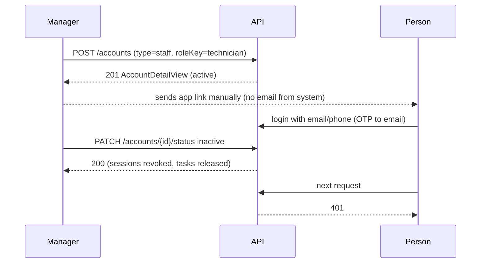
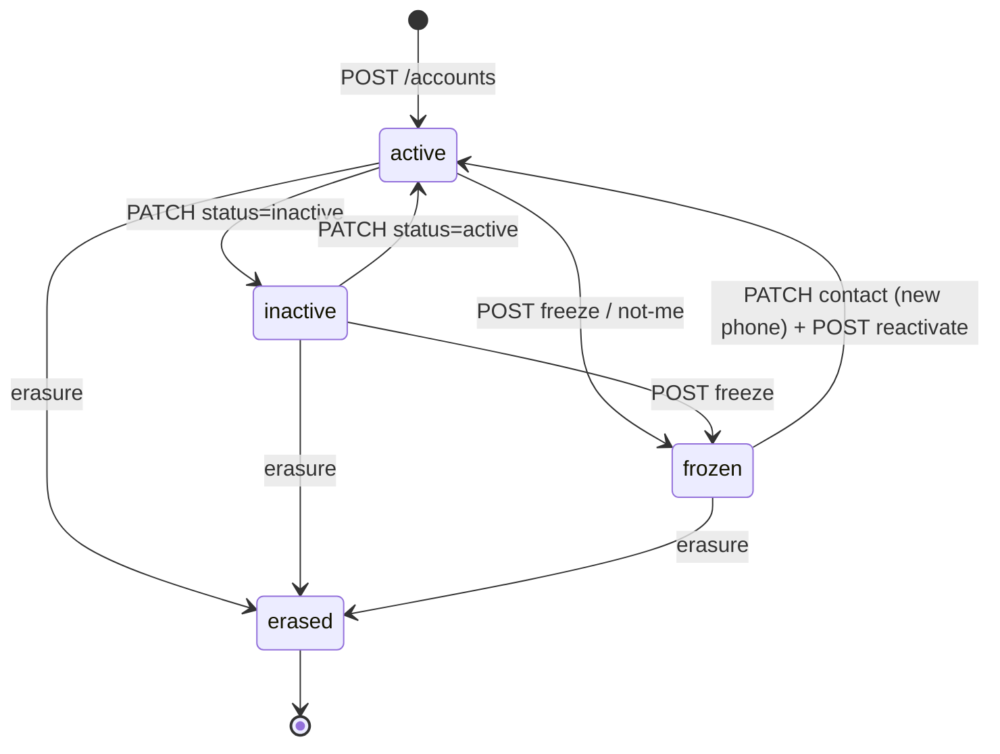

# حسابات الطاقم والمستخدمين من لوحة المدير — Staff and Accounts Management

> **التطبيق/الواجهة:** manager dashboard
> **الصلاحيات:** `accounts.read` (القائمة والتفاصيل) و`accounts.manage` (الإنشاء، والحالة، وبيانات التواصل، والتجميد، وإعادة التفعيل). في الأدوار الافتراضية يملكهما دور `manager` فقط.
> **المصادر:** ADR 0002 · ADR 0003 · ADR 0018 · ADR 0023 · `src/core/accounts/` (`accounts.controller.ts`، `accounts.service.ts`، `account-writer.ts`، `account-emails.ts`، `dto/`، `views/`)

## الفكرة باختصار
المدير ينشئ حسابات الأشخاص الذين يعملون في الكمبوند أو يديرونه: حراس البوابة، والفنيون، ومشرفو الصيانة، ومديرون آخرون. ومن الشاشة نفسها يرى كل حسابات الكمبوند (بما فيها السكان وأفراد الأسر)، ويعطّل حسابًا أو يعيد تفعيله، ويغيّر بريده أو هاتفه. لا يوجد تسجيل ذاتي للطاقم: الحساب يُنشئه المدير، ثم يدخل صاحبه بكود OTP يصل إلى بريده.

## الأدوار ومين بيعمل إيه
| الدور | ماذا يستطيع |
|---|---|
| المدير (`accounts.read`) | قائمة كل الحسابات وتفاصيل أي حساب |
| المدير (`accounts.manage`) | إنشاء حساب بأي نوع، وتفعيل أو تعطيل أي حساب عدا حسابه، وتغيير البريد والهاتف، وتجميد حساب وإعادة تفعيله |
| السوبر أدمن | ينشئ المديرين ويفعّلهم أو يعطّلهم من لوحته (`./01-super-admin-platform.md`) |
| الشخص صاحب الحساب | لا يتدخل في الإنشاء. يدخل التطبيق بعد أن يبلغه المدير |

## الشاشات اللي الفيتشر محتاجها
- **قائمة الحسابات**: الاسم، النوع، الهاتف، البريد، الحالة، تاريخ الإنشاء، مع تحميل الصفحات.
- **نموذج إنشاء حساب**: النوع، والدور (لنوع staff)، والاسم، ووثيقة الهوية، والهاتف، والبريد.
- **تفاصيل الحساب**: البيانات مع رقم الوثيقة مقنّعًا، وأزرار الإجراءات حسب الحالة.
- **حوار تعطيل الحساب**: يوضح أن كل جلساته ستنتهي فورًا، وما يُلغى معه (انظر الفلو 4).
- **حوار إعادة تفعيل حساب معطّل**.
- **نموذج تغيير بيانات التواصل** (هاتف و/أو بريد).
- **حوار تجميد الحساب ("الرقم ليس له")** و**إعادة التفعيل بعد التجميد**: مشروحان في `../03-community/04-frozen-accounts-and-erasure.md`.
- **عرض الحساب الممسوح**: "مستخدم محذوف" بلا أي بيانات.

## الفلو خطوة بخطوة

### 1) قائمة الحسابات
1. `GET /accounts?cursor=&limit=` (`limit` من 1 إلى 100، والافتراضي 20).
2. الترتيب: الأحدث إنشاءً أولًا.
3. القائمة تشمل **كل** حسابات الكمبوند بكل أنواعها (`manager`، `staff`، `resident`، `family`) وكل حالاتها. لا يوجد فلتر بالنوع أو الحالة ولا بحث.
4. الحساب الممسوح يظهر `{ id, erased: true }` فقط.

### 2) تفاصيل حساب
1. `GET /accounts/{id}` → `AccountDetailView`.
2. حساب غير موجود في هذا الكمبوند → `404 ACCOUNT_NOT_FOUND`.
3. الأزرار المقترحة حسب `status`:

| الحالة | الأزرار |
|---|---|
| `active` | تعطيل، تغيير التواصل، تجميد |
| `inactive` | تفعيل، تغيير التواصل، تجميد |
| `frozen` | تغيير الهاتف (إجباري أولًا)، ثم إعادة التفعيل |
| `erased` | لا شيء |

لا تُظهر أزرار التعطيل أو التجميد على حساب المدير نفسه.

### 3) إنشاء حساب
1. المدير يملأ النموذج → `POST /accounts`:
   - `type` (إجباري): `staff` أو `manager` (ويمكن تقنيًا `resident` أو `family`، انظر الملاحظات).
   - `roleKey` (اختياري، من 1 إلى 64): دور من أدوار الكمبوند **من نفس النوع**. لنوع `staff` القيم الافتراضية المتاحة: `guard` (الافتراضي إذا لم يُرسل)، و`technician`، و`maintenance_supervisor`. للأنواع الأخرى يُستخدم الدور الافتراضي لنوعها (`manager`، `resident`، `family_member`). اعرض قائمة الأدوار من `GET /roles` مفلترة بـ`kind` = النوع المختار.
   - `fullName` (إجباري، من 2 إلى 200).
   - `idDocumentType` (إجباري): `national_id` أو `passport`.
   - `idDocumentNumber` (إجباري، من 1 إلى 40): 14 رقمًا للرقم القومي (يُتحقق منه ويُستخرج منه تاريخ الميلاد)، أو من 5 إلى 20 حرفًا أو رقمًا للجواز.
   - `nationality`: إجباري للجواز (كود ISO من حرفين). مع الرقم القومي: `EG` أو فارغ.
   - `birthDate` (`YYYY-MM-DD`): إجباري للجواز، ويُتجاهل مع الرقم القومي.
   - `phone` (إجباري): رقم مصري محلي أو دولي يبدأ بـ `+`، ويُخزن بصيغة E.164.
   - `email` (إجباري): يُخزن بحروف صغيرة.
   - لغة الحساب (`preferredLocale`) لا تُرسل هنا، وتكون `ar` دائمًا.
2. في transaction واحدة يُنشأ الحساب بالحالة `active`، ومعه بيانات الدخول (البريد والهاتف)، ويُسجل `account.created` في سجل الكمبوند. إما أن يستطيع الشخص الدخول، أو لا يوجد الحساب أصلًا.
3. عند النجاح: `201` مع `AccountDetailView`. انتقل إلى تفاصيل الحساب.
4. **ماذا يصل الشخص؟ لا شيء.** لا بريد ترحيب ولا رسالة ولا إشعار. يجب أن يرسل المدير رابط التطبيق للشخص بنفسه (ADR 0003). عند الدخول يكتب الشخص بريده أو هاتفه، فيصله كود OTP على بريده (انظر ملف تسجيل الدخول و`../README.md`).
5. **الدور نهائي:** لا يمكن تغيير دور الحساب بعد إنشائه. لذلك يجب أن يوضح النموذج أن اختيار "حارس" أو "فني" أو "مشرف صيانة" لا يمكن تعديله لاحقًا.

### 4) تفعيل حساب أو تعطيله
1. المدير يختار → `PATCH /accounts/{id}/status` مع `status`: `active` أو `inactive` فقط.
2. لا يستطيع المدير تغيير حالة حسابه → `409 CANNOT_CHANGE_OWN_STATUS`.
3. حساب ممسوح أو غير موجود → `404 ACCOUNT_NOT_FOUND`.
4. حساب `frozen` إلى `active` → `409 ACCOUNT_FROZEN`. الحساب المجمد يعود فقط بمسار إعادة التفعيل (الفلو 6).
5. إرسال الحالة الحالية نفسها: `200` بلا تغيير.
6. عند `inactive`، في نفس الـtransaction:
   - تُلغى **كل جلسات** الحساب فورًا، فيخرج من التطبيق في طلبه التالي، ولا يستطيع الدخول مرة أخرى.
   - تُحذف أجهزة الـpush الخاصة به.
   - تتفاعل المجالات الأخرى:
     - الحارس: وردية البوابة المفتوحة تُغلق.
     - الفني: بلاغات الصيانة المسندة إليه تُحرر وتعود للتوزيع.
     - من يرد على طلبات الإدارة: الطلبات المسندة إليه تعود بلا مسؤول.
     - الساكن أو فرد الأسرة: تصاريح الزوار التي أصدرها تُلغى، ومفاتيح دخول الـQR تُلغى، والتفويضات منه أو إليه تنتهي (مع بريد للأطراف)، ومفوضو استلام الطرود الذين عيّنهم ينتهون، وموافقات دخول الفني للوحدة في غيابه تُنسى.
   - يُسجل `account.status_changed` مع `metadata.sessionsRevoked`، والحدث الأمني `session.revoked` بالسبب `account_deactivated`.
7. عند `active` (من `inactive`): يستطيع الشخص الدخول مرة أخرى. **لا يعود شيء مما أُلغي** (الوردية، والبلاغات، والتصاريح، والتفويضات).
8. الرد: `200` مع `AccountDetailView`.

### 5) تغيير بيانات التواصل (البريد أو الهاتف)
1. المدير يعدّل → `PATCH /accounts/{id}/contact` مع `phone` و/أو `email` (كلاهما اختياري. ما لا يُرسل يبقى كما هو).
2. الاستخدام الأساسي: الخطوة الأولى لاستعادة حساب مجمد (هاتف جديد). لكنه يعمل على أي حساب.
3. القواعد:
   - الهاتف الذي أُزيل من هذا الحساب عند تجميده **لا يعود إليه أبدًا** → `409 PHONE_RELEASED`.
   - البريد أو الهاتف مستخدم لحساب آخر من **نفس النوع** في الكمبوند → `409 DUPLICATE_RESOURCE` (`fields`: `email` أو `phone` بالكود `DUPLICATE_VALUE`).
   - قيمة غير صالحة → `400 VALIDATION_FAILED` (`INVALID_EMAIL` أو `INVALID_PHONE`).
   - الحساب المجمد بلا هاتف: يُسمح بتغيير البريد وحده.
4. إذا لم يتغير شيء: `200` بالحساب كما هو.
5. إذا تغيّر شيء: تُستبدل بيانات الدخول، و**تتوقف فورًا كل أكواد OTP المرسلة سابقًا** لهذا الحساب ولم تُستخدم. **الجلسات المفتوحة لا تُلغى.** ويُسجل `account.contact_changed` والقيم نفسها مخفية (`{changed: true}`).
6. لا يُرسل بريد إلى العنوان القديم أو الجديد.

### 6) التجميد وإعادة التفعيل (باختصار)
1. التجميد: `POST /accounts/{id}/freeze` مع `reasonCode: phone_reassigned` و`reason` (ملاحظة داخلية تُحفظ ولا تُرسل للشخص ولا تظهر في أي view، 1000 حرف على الأكثر). يُزال الهاتف من الحساب، وتنتهي كل الجلسات والأكواد، ويصل الشخص بريد. لا يستطيع المدير تجميد حسابه.
2. الاستعادة: تغيير الهاتف إلى رقم جديد (الفلو 5)، ثم `POST /accounts/{id}/reactivate`.
3. كل التفاصيل والأخطاء والحالات في `../03-community/04-frozen-accounts-and-erasure.md`.

## الحالات (Statuses)
| الحالة | المعنى | من يدخلها ويخرجها |
|---|---|---|
| `active` | الحساب يعمل ويستطيع الدخول | عند الإنشاء. أو المدير من `inactive`. أو إعادة التفعيل من `frozen` |
| `inactive` | معطّل: لا دخول، وكل الجلسات ملغاة | المدير (أو السوبر أدمن للمديرين) عبر `PATCH .../status` |
| `frozen` | مجمد لأن الهاتف ذهب لشخص آخر (أو لأن صاحبه قال "ليس أنا" عن دخول مريب): لا دخول، والهاتف قد يكون `null` | التجميد. يخرج فقط بإعادة التفعيل بعد هاتف جديد |
| `erased` | ممسوح نهائيًا: الصف باقٍ لكن كل البيانات الشخصية `null`. نهائي | مسار المسح ذو الخطوات الثلاث فقط (`../03-community/04-frozen-accounts-and-erasure.md`) |

## البيانات اللي بتظهر

**قائمة الحسابات (`AccountListItemView`)**
| الحقل | ملاحظة |
|---|---|
| `id` | |
| `type` | `manager` / `staff` / `resident` / `family` |
| `fullName` | |
| `phone` | `null` إذا كان الحساب `frozen` |
| `email` | |
| `status` | `active` / `inactive` / `frozen` |
| `createdAt` | |
| `erased: true` | على الحساب الممسوح فقط، ومعه `id` بلا أي حقل آخر |

لا تحمل القائمة وثيقة الهوية ولا تاريخ الميلاد ولا **الدور**.

**تفاصيل الحساب (`AccountDetailView`)**: حقول القائمة نفسها، ومعها:
| الحقل | ملاحظة |
|---|---|
| `idDocumentType` | `national_id` أو `passport` |
| `idDocumentNumberMasked` | آخر 4 خانات فقط، مثل `••••1234`. الرقم الكامل لا يُرجع أبدًا |
| `nationality` | كود من حرفين (`EG` للرقم القومي) |
| `birthDate` | `YYYY-MM-DD` |

لا يعرض الرد الدور، ولا اللغة المفضلة، ولا الصورة الشخصية.

## القواعد والقيود
- **حساب منفصل لكل صفة** (ADR 0002): الشخص نفسه قد يكون له حساب ساكن وحساب staff في الكمبوند نفسه، ببريد وهاتف واحد. الصلاحيات لا تنتقل بين الحسابين، وعند الدخول يختار الشخص الحساب.
- **التفرد:** البريد فريد لكل (كمبوند + نوع حساب)، والهاتف كذلك. يمكن تكرار البريد أو الهاتف بين نوعين مختلفين، أو بين كمبوندين. رقم الهوية **غير فريد** ولا يُفحص تكراره.
- الدور يجب أن يكون من نوع الحساب نفسه. `roleKey` لدور من نوع آخر أو غير موجود → `404 ROLE_NOT_FOUND`.
- الدور لا يتغير بعد الإنشاء.
- لا يستطيع المدير تعطيل حسابه أو تجميده.
- `PATCH .../status` يقبل `active` و`inactive` فقط. للتجميد والمسح مساراتهما.
- التعطيل يُنهي الجلسات فورًا. تغيير التواصل لا يُنهيها.
- لا يوجد `Idempotency-Key` على هذه الـendpoints. إذا فشل الإنشاء بسبب الشبكة، فإعادة الإرسال قد ترجع `409 DUPLICATE_RESOURCE` (والحساب أُنشئ في المرة الأولى). اعرض القائمة.
- القوائم cursor-paged (انظر `../README.md`).

## الأخطاء اللي الـUI لازم يتعامل معاها
| HTTP + code | متى | رسالة أو سلوك مقترح |
|---|---|---|
| `400 VALIDATION_FAILED` | حقل ناقص أو غير صالح. `fields[].code` من: `INVALID_LENGTH`، `INVALID_EMAIL`، `INVALID_PHONE`، `INVALID_NATIONAL_ID`، `INVALID_PASSPORT_NUMBER`، `INVALID_NATIONALITY`، `BIRTH_DATE_REQUIRED`، `INVALID_BIRTH_DATE`، أو قيمة enum غير مسموحة لـ`type`/`idDocumentType`/`status` | اعرض الخطأ تحت الحقل |
| `409 DUPLICATE_RESOURCE` | البريد أو الهاتف مسجل لحساب آخر من النوع نفسه (`fields`) | "هذا البريد/الرقم مسجل لحساب آخر من النوع نفسه في الكمبوند." |
| `404 ROLE_NOT_FOUND` | `roleKey` غير موجود أو من نوع آخر | "الدور المختار غير متاح لهذا النوع من الحسابات." |
| `409 NO_ROLE_FOR_ACCOUNT_TYPE` | لا يوجد دور افتراضي لهذا النوع في الكمبوند (حالة نادرة) | "لا يوجد دور لهذا النوع. تواصل مع الدعم." |
| `404 ACCOUNT_NOT_FOUND` | حساب غير موجود، أو ممسوح (عند تغيير الحالة) | "الحساب غير موجود." |
| `409 CANNOT_CHANGE_OWN_STATUS` | المدير يحاول تعطيل حسابه أو تجميده | "لا يمكنك تغيير حالة حسابك." |
| `409 ACCOUNT_FROZEN` | تفعيل حساب مجمد بتغيير الحالة | "الحساب مجمد. سجّل رقمًا جديدًا ثم أعد التفعيل." |
| `409 PHONE_RELEASED` | محاولة إعادة الهاتف الذي أُزيل عند التجميد | "هذا الرقم أُزيل من الحساب ولا يمكن إعادته. أدخل رقمًا آخر." |
| `403 FORBIDDEN` | لا يملك `accounts.read` أو `accounts.manage` | أخفِ الشاشة أو الزر |

أخطاء التجميد وإعادة التفعيل (`ACCOUNT_NOT_FROZEN`، `ACCOUNT_PHONE_MUST_CHANGE`، `INVALID_REASON_CODE`…) في `../03-community/04-frozen-accounts-and-erasure.md`.

## الإشعارات
| الحدث | النوع | من يستقبل | push؟ | عند الضغط |
|---|---|---|---|---|
| إنشاء حساب | لا شيء | — | لا | — |
| تعطيل حساب أو تفعيله | لا شيء لصاحب الحساب | — | لا | — |
| تغيير البريد أو الهاتف | لا شيء | — | لا | — |
| تعطيل ساكن له تفويضات | بريد للأطراف بانتهاء التفويض (من مجال الأسرة) | المفوِّض أو المفوَّض | لا | — |
| تجميد حساب | بريد `account.frozen` (حرج) | صاحب الحساب على بريده | لا (الجلسات منتهية) | — |
| إعادة التفعيل بعد التجميد | بريد `account.reactivated` | صاحب الحساب | لا | — |

## الـEndpoints
| Method + path | من يستدعيه | الغرض | الرد |
|---|---|---|---|
| `GET /accounts` | `accounts.read` | قائمة كل الحسابات | `200` `{data: (AccountListItemView \| {id, erased})[], nextCursor}` |
| `GET /accounts/{id}` | `accounts.read` | تفاصيل حساب | `200` `AccountDetailView` أو `{id, erased: true}` |
| `POST /accounts` | `accounts.manage` | إنشاء حساب | `201` `AccountDetailView` |
| `PATCH /accounts/{id}/status` | `accounts.manage` | تفعيل أو تعطيل | `200` `AccountDetailView` |
| `PATCH /accounts/{id}/contact` | `accounts.manage` | تغيير الهاتف و/أو البريد | `200` `AccountDetailView` |
| `POST /accounts/{id}/freeze` | `accounts.manage` | تجميد (انظر الملف المرجعي) | `200` `AccountDetailView` |
| `POST /accounts/{id}/reactivate` | `accounts.manage` | إعادة التفعيل بعد التجميد | `200` `AccountDetailView` |
| `GET /roles` | `roles.read` | لملء قائمة الأدوار في نموذج الإنشاء | `200` (انظر `./02-roles-and-permissions.md`) |

## ملاحظات للديزاين وحاجات ناقصة في الباك
- **الدور لا يظهر** في القائمة ولا في التفاصيل. لا تستطيع الواجهة أن تكتب "حارس" أو "فني" بجانب الحساب. أقرب بديل: `GET /maintenance/technicians` للفنيين.
- لا يوجد فلتر بالنوع أو الحالة أو الدور، ولا بحث بالاسم. شاشة "الطاقم" تحتاج فلتر `type=staff` على الأقل.
- لا يوجد بريد ترحيب أو دعوة عند إنشاء الحساب (ADR 0003). يجب أن يذكّر التصميمُ المديرَ بإرسال رابط التطبيق.
- لا يوجد تغيير دور حساب، ولا تعديل الاسم أو وثيقة الهوية بعد الإنشاء. إذا أخطأ المدير في الاسم فلا يوجد endpoint لتصحيحه.
- لا يمكن ضبط لغة الحساب (`preferredLocale`) عند الإنشاء من هذه الشاشة، فهي `ar` دائمًا. (السوبر أدمن يستطيع ضبطها للمديرين.)
- `POST /accounts` يقبل أيضًا `type: resident` و`family`، لكن هذا الحساب لا يرتبط بوحدة. السكان يُضافون من شاشة السكان (`residents.manage`)، وأفراد الأسرة من دعوات الأسرة. الأفضل أن تعرض هذه الشاشة `staff` و`manager` فقط.
- `PATCH .../status` لا يمنع صراحة نقل حساب من `frozen` إلى `inactive`. حساب مجمد بلا هاتف سيصطدم بقيد في قاعدة البيانات (خطأ غير مُصنّف غالبًا)، وحساب مجمد سُجل له هاتف جديد يمكن أن يمر `frozen → inactive → active` بدون `reactivate`. هذا يخالف ADR 0023 ("فقط reactivate يعيد فتحه"). لذلك لا تعرض الواجهة تغيير الحالة على حساب `frozen`.
- لا يُرسل إشعار لصاحب الحساب عند تعطيله أو عند تغيير بريده أو هاتفه.
- في ADR 0003 الحقول الإجبارية "الاسم، الرقم القومي، الهاتف، البريد". الكود الحالي يقبل الجواز أيضًا (ADR 0018).
