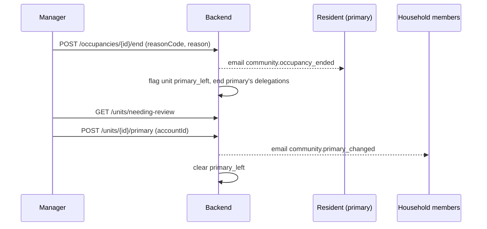
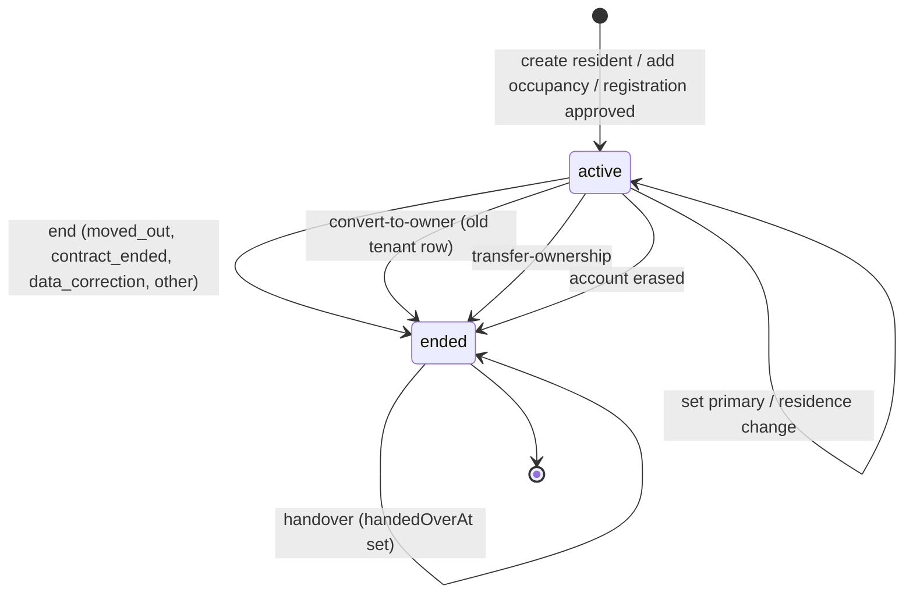

# الوحدات والسكان والإشغال — Units, residents and occupancy

> **التطبيق/الواجهة:** manager dashboard (الوحدات، السكان، الإشغالات) · resident app (كارت الوحدة، بطاقة التفعيل، الوضع المغلق، الـcapabilities) · family member (كارت الوحدة والـcapabilities)
> **الصلاحيات:** `units.read` (manager, resident, family_member) · `units.create` (manager) · `residents.read` و`residents.manage` (manager) · `household.manage` (resident, family_member — لكن الكود يشترط فوقها أن المتصل هو الساكن الرئيسي للوحدة) · وفي التطبيقات: flags من `GET /me/units/{unitId}/capabilities`
> **المصادر:** ADR 0012 · ADR 0020 · ADR 0037 · `src/community/units/` · `src/community/residents/` (`residents.controller.ts`, `occupancies.controller.ts`, `unit-actions.controller.ts`, `me-units.controller.ts`, `residents.service.ts`) · `src/community/capabilities/`

كل المسارات تحت `/api/v1`. القوائم والأسباب والأخطاء بالشكل الموحد (راجع README).

## الفكرة باختصار
- المدير يعرّف وحدات الكمبوند، ويسجّل السكان، ويربط كل ساكن بوحدة أو أكثر عن طريق **إشغال** (occupancy).
- صفة الشخص (مالك/مستأجر، ساكن/مؤجِّر) مسجّلة على الإشغال نفسه، مش على الحساب. نفس الشخص ممكن يكون مالك وحدة ومستأجر وحدة تانية.
- لكل وحدة **ساكن رئيسي** (primary) واحد بالكثير، لازم يكون ساكن فعلاً في الوحدة. هو اللي يدير الأسرة ويقفل الوحدة ويكمّل بياناتها.
- الإشغال لا يُحذف أبداً: ينتهي (`ended`) ويبقى في السجل.
- التطبيقات تعرض أو تخفي كل ميزة على الوحدة حسب **الـcapabilities** اللي يرجّعها الباك لكل وحدة.

## الأدوار ومين بيعمل إيه

| الدور | يقدر يعمل إيه |
|---|---|
| المدير (`manager`) | ينشئ وحدات ويشوف كل وحدات الكمبوند؛ ينشئ سكان بإشغالاتهم؛ يضيف إشغال؛ يعدّل الهاتف/الإيميل؛ يعيّن الساكن الرئيسي؛ ينهي إشغال بسبب؛ يسجّل تسليم المفاتيح؛ يحوّل مستأجر لمالك؛ يغيّر هل المالك ساكن أم مؤجِّر. يشوف في تفاصيل الوحدة الساكنين الحاليين وعلامات المراجعة. |
| الساكن الرئيسي (primary) | يشوف وحداته (`/me/units`) مع ملخص الأسرة؛ يكمّل بيانات الوحدة الناقصة (بطاقة التفعيل)؛ لو هو **مالك ساكن** يقدر يشغّل/يقفل الوضع المغلق. |
| ساكن غير رئيسي (مالك أو مستأجر) | يشوف وحداته وصلاحياته (capabilities) فقط. |
| مالك مؤجِّر (landlord, `resides=false`) | يشوف الوحدة، لا يشوف الأسرة ولا الزوار ولا العمال؛ يُعرض له مالية المستأجر (flag فقط). لا يكون primary أبداً. |
| فرد أسرة بحساب (family) | يشوف الوحدة في `/me/units` بصفة `member`، وصلاحياته حسب ما منحه له الساكن الرئيسي. |
| ساكن سابق (إشغال منتهي) | الـcapabilities تعطيه أرشيف للعرض فقط + زر الطوارئ لحد تسجيل التسليم. لكن لا يوجد endpoint يعرض له وحداته السابقة (انظر الحاجات الناقصة). |

## الشاشات اللي الفيتشر محتاجها
**لوحة المدير**
- قائمة الوحدات (paged، الأحدث أولاً).
- نموذج إنشاء وحدة (الكود، المبنى، الدور).
- تفاصيل الوحدة: بياناتها، هل هي مغلقة، الساكنين الحاليين (الرئيسي أولاً)، وعلامات المراجعة المفتوحة.
- قائمة السكان (paged).
- نموذج إنشاء ساكن + وحداته (قائمة وحدات بصفة لكل وحدة).
- تفاصيل ساكن: البيانات (المستند مخفي جزئياً) وكل إشغالاته (الحالية والمنتهية).
- نموذج تعديل الهاتف/الإيميل.
- نموذج إضافة إشغال لساكن موجود.
- حوار "تعيين كساكن رئيسي" من قائمة ساكني الوحدة.
- حوار إنهاء إشغال مع سبب (كود + نص يصل للساكن).
- زر/حوار "تسجيل تسليم المفاتيح" على إشغال منتهي.
- حوار تحويل مستأجر إلى مالك (مع اختيار: يسكن / يؤجّر).
- مفتاح "المالك ساكن / مؤجِّر" على إشغال مالك.

**تطبيق الساكن / فرد الأسرة**
- كارت "وحداتي" (قائمة الوحدات: الكود، المبنى، الدور، النوع، المساحة، الحالة، الصفة، هل أنا الرئيسي، ملخص الأسرة للرئيسي).
- شاشة "بيانات الوحدة" (Unit details).
- بطاقة التفعيل (Activation card) للرئيسي: خطوة لكل معلومة ناقصة (نوع الوحدة، المساحة، المبنى).
- مفتاح "الوضع المغلق" (للمالك الساكن الرئيسي فقط) + كارت الوحدة المغلقة.
- كل شاشات الوحدة تقرأ الـcapabilities لتقرر ماذا تعرض.

## الفلو خطوة بخطوة

### 1) إنشاء وحدة (مدير)
1. المدير يفتح "وحدة جديدة" → `POST /units` (`units.create`).
2. الحقول:
   - `code` إجباري، 1–32 حرف، فريد داخل الكمبوند (مثال `B2-104`).
   - `building` اختياري، 1–64 حرف.
   - `floor` اختياري، رقم صحيح من -5 إلى 200.
3. النتيجة `201` بـ`{id, code, building, floor, createdAt}`.
4. كود مكرر → `409 DUPLICATE_RESOURCE`. اعرض الخطأ على حقل الكود.
5. ملاحظة: نوع الوحدة والمساحة لا يُدخلان هنا؛ يأتيان من التسجيل الذاتي أو من بطاقة تفعيل الساكن الرئيسي. لا يوجد endpoint لتعديل الوحدة أو حذفها.

### 2) قائمة الوحدات (مدير، ويعمل أيضاً للساكن والأسرة)
1. `GET /units?cursor=&limit=` (`units.read`).
2. المدير يرى كل وحدات الكمبوند. الساكن يرى فقط الوحدات اللي له فيها إشغال نشط، وفرد الأسرة الوحدات اللي هو عضو نشط فيها.
3. الترتيب: الأحدث إنشاءً أولاً. لا يوجد بحث أو فلتر أو ترتيب بالكود.

### 3) تفاصيل الوحدة (مدير)
1. `GET /units/{id}` (`units.read`).
2. الكل يأخذ: `id, code, building, floor, unitType, areaSqm, closed, createdAt`.
3. المدير فقط يأخذ زيادة: `reviewReasons`، `reviewFlags` (`id, reason, flaggedAt`، الأقدم أولاً)، و`occupants` (الساكنين الحاليين، الرئيسي أولاً ثم الأقدم).
4. من هنا تُفتح أفعال: تعيين رئيسي، إنهاء إشغال، تحويل، ساكن/مؤجِّر، وأفعال المراجعة (راجع `03-unit-review-and-life-events.md`).
5. وحدة غير موجودة أو لا يحق للمتصل رؤيتها → `404 UNIT_NOT_FOUND` (لا يقال أبداً "ممنوع").

### 4) إنشاء ساكن مع وحداته (مدير)
1. `POST /residents` (`residents.manage`).
2. الحقول:
   - `fullName` إجباري 2–200.
   - `phone` إجباري (رقم صالح)، `email` إجباري.
   - مستند الهوية: `idDocumentType` (`national_id` أو `passport`)، `idDocumentNumber`، و`nationality` + `birthDate` إجباريان للجواز (للرقم القومي تُستنتج من الرقم).
   - `preferredLocale` اختياري (`ar`/`en`).
   - `units`: قائمة **لا تقل عن عنصر واحد**، كل عنصر: `unitId`، `occupancyType` (`owner`/`tenant`)، و`resides` اختياري (للمالك فقط؛ `false` = مؤجِّر). المستأجر دائماً ساكن، وإرسال `resides=false` لمستأجر = خطأ.
   - نفس الوحدة مرتين في القائمة = خطأ `DUPLICATE_VALUE` على `units.{i}.unitId`.
3. كل شيء يُنشأ مرة واحدة: الحساب + بيانات الدخول + الإشغالات. لو وحدة غير موجودة → `404 UNIT_NOT_FOUND` ولا يُنشأ شيء.
4. **قاعدة الرئيسي التلقائي:** أول ساكن *يسكن فعلاً* في وحدة ليس فيها أي ساكن مقيم نشط يصبح الرئيسي تلقائياً. المؤجِّر لا يصبح رئيسياً أبداً.
5. النتيجة `201` بتفاصيل الساكن (نفس شكل شاشة التفاصيل).

### 5) قائمة السكان وتفاصيل ساكن (مدير)
1. القائمة: `GET /residents` (`residents.read`) — الأحدث أولاً. كل عنصر: الاسم، الهاتف، الإيميل، الحالة، ووحداته **النشطة** (`unitCode`، `occupancyType`، `isPrimary`).
2. التفاصيل: `GET /residents/{id}` (`residents.read`) — البيانات + المستند مقنّع + كل الإشغالات (النشطة والمنتهية، الأقدم أولاً).
3. حساب محذوف (erased) يرجع `{ id, erased: true }` فقط: اعرضه "مستخدم محذوف" بدون أي بيانات.
4. حساب مجمّد (frozen) يرجع `phone: null` (الرقم اتشال). اعرض حالة "مجمّد" (راجع `04-frozen-accounts-and-erasure.md`).

### 6) تعديل الهاتف أو الإيميل (مدير)
1. `PATCH /residents/{id}/contact` (`residents.manage`) بـ`phone` و/أو `email` (الاتنين اختياريين).
2. أي كود OTP مُرسل للعنوان القديم يتوقف فوراً. الجلسات المفتوحة تبقى.
3. رقم سبق أن اتشال من نفس الحساب بسبب تجميد → `409 PHONE_RELEASED` (لا يرجع أبداً لنفس الحساب).
4. النتيجة `200` بتفاصيل الساكن.

### 7) إضافة إشغال لساكن موجود (مدير)
1. `POST /residents/{id}/occupancies` (`residents.manage`) بـ`unitId`، `occupancyType`، `resides` اختياري.
2. لو الساكن عنده إشغال نشط في نفس الوحدة → `409 OCCUPANCY_ALREADY_ACTIVE`.
3. ساكن غير موجود أو محذوف → `404 ACCOUNT_NOT_FOUND`. وحدة غير موجودة → `404 UNIT_NOT_FOUND`.
4. نفس قاعدة الرئيسي التلقائي.
5. النتيجة `201` بالإشغال الجديد.

### 8) تعيين الساكن الرئيسي (مدير)
1. من تفاصيل الوحدة، المدير يختار أحد الساكنين → `POST /units/{id}/primary` بـ`{ accountId }` (`residents.manage`).
2. الشروط: الشخص له إشغال **نشط** في الوحدة (وإلا `404 OCCUPANCY_NOT_FOUND`)، و**ساكن فيها** (`resides=true`، وإلا `409 PRIMARY_MUST_RESIDE`).
3. ما يحدث:
   - الرئيسي السابق (لو موجود) يبقى ساكناً عادياً، وكل التفويضات (delegations) اللي أعطاها في الوحدة تنتهي.
   - كل أفراد الأسرة اللي لهم حساب يصلهم إيميل `community.primary_changed` باسم الرئيسي الجديد. صلاحياتهم تبقى كما هي لحد ما الرئيسي الجديد يراجعها (راجع `03-unit-review-and-life-events.md`).
   - تُغلق علامات المراجعة `primary_left` و`primary_frozen` و`primary_deceased` لو مفتوحة.
4. لو الشخص هو الرئيسي بالفعل: لا تغيير، لكن العلامات السابقة تُغلق أيضاً.
5. النتيجة `200` بالإشغال (`isPrimary: true`).

### 9) إنهاء إشغال (مدير)
1. `POST /occupancies/{id}/end` (`residents.manage`) بـ`{ reasonCode, reason }`.
   - `reasonCode` من: `moved_out`، `contract_ended`، `data_correction`، `other`.
   - `reason` نص إجباري (حتى 1000 حرف) **يصل للساكن** في الإيميل.
2. الإشغال يصبح `ended` مع `endedAt` و`endReason`. الوصول للوحدة يتوقف من الطلب التالي.
3. الساكن يصله إيميل `community.occupancy_ended` بالنص.
4. لو كان هو **الرئيسي**: الوحدة تُعلَّم للمراجعة `primary_left`، وتفويضاته في الوحدة تنتهي. **لا أحد يُرقّى تلقائياً**، وأفراد الأسرة يبقون كما هم. المدير بعد ذلك يقرر (تعيين رئيسي جديد أو إنهاء الأسرة).
5. أشياء مرتبطة بالسكن (مثل QR الدخول) يُعاد فحصها تلقائياً.
6. إشغال غير نشط أو غير موجود → `404 OCCUPANCY_NOT_FOUND`.
7. النتيجة `200` بالإشغال المنتهي.

### 10) تسجيل تسليم المفاتيح (مدير)
1. على إشغال **منتهي** لم يُسجَّل تسليمه → `POST /occupancies/{id}/handover` (`residents.manage`)، بدون body.
2. يُضبط `handedOverAt`. أثره: زر الطوارئ للوحدة يختفي من أرشيف الساكن السابق (`emergency=false`).
3. الساكن السابق يصله إيميل `community.handed_over`.
4. إشغال نشط أو سبق تسليمه → `404 OCCUPANCY_NOT_FOUND`.

### 11) تحويل مستأجر إلى مالك (مدير)
1. `POST /occupancies/{id}/convert-to-owner` (`residents.manage`) بـ`resides` اختياري (الافتراضي `true`؛ `false` = يصبح مؤجِّراً).
2. يعمل على إشغال **مستأجر نشط** فقط؛ غير ذلك → `409 OCCUPANCY_NOT_CONVERTIBLE`.
3. لو المستأجر هو الرئيسي و`resides=false` → `409 PRIMARY_MUST_RESIDE` (انقل الرئيسية أولاً).
4. التاريخ يُحفظ في صفين: إشغال المستأجر ينتهي بـ`converted_to_owner`، ويبدأ إشغال مالك جديد يحمل نفس صفة الرئيسي. **لا تُفتح علامة مراجعة**.
5. الشخص يصله إيميل `community.capacity_changed` (مالك ساكن / مالك مؤجِّر).
6. النتيجة `200` بالإشغال **الجديد** (id جديد). الشاشة يجب أن تعيد القراءة.

### 12) المالك ساكن أم مؤجِّر (مدير)
1. `POST /occupancies/{id}/residence` بـ`{ resides: true|false }` (`residents.manage`).
2. على إشغال **مالك نشط** فقط؛ مستأجر → `400 VALIDATION_FAILED` (`FIELD_NOT_ALLOWED` على `resides`).
3. الرئيسي لا يمكن جعله مؤجِّراً → `409 PRIMARY_MUST_RESIDE`.
4. نفس القيمة الحالية = لا شيء يتغير (`200`).
5. التغيير يصل للشخص بإيميل `community.capacity_changed`، وتتغير الـcapabilities (المؤجِّر لا يرى الأسرة).

### 13) كارت "وحداتي" (ساكن / فرد أسرة)
1. `GET /me/units` — بدون صلاحية خاصة، أي حساب داخل الكمبوند. قائمة محدودة (ليست paged).
2. الترتيب: إشغالات المتصل النشطة أولاً (الأقدم أولاً)، ثم عضوياته النشطة في أسر.
3. كل عنصر: `unitId, code, building, floor, unitType, areaSqm, status, capacity, resides, isPrimary` و`household` للرئيسي فقط (`memberCount`, `pendingInvites`).
4. `areaSqm` بالمتر المربع (نص بخانتين عشريتين)؛ التصميم يعرض قدم مربع → التطبيق يحوّل.
5. بعد ذلك يطلب التطبيق `GET /me/units/{unitId}/capabilities` لكل وحدة يعرضها (انظر الفلو 16).

### 14) بطاقة التفعيل: إكمال بيانات الوحدة (الساكن الرئيسي)
1. `GET /units/{id}/activation` (`household.manage` + يجب أن يكون الرئيسي) → `{ missing: [...] }` من `unitType`، `areaSqm`، `building` (بالترتيب ده، فقط الناقص).
2. قائمة فاضية = لا تعرض البطاقة. البطاقة **لا تمنع** أي شيء؛ هي اختيارية.
3. لكل خطوة: `POST /units/{id}/details` بـ`{ step, value }` (`value` نص 1–64):
   - `unitType`: واحد من `apartment, villa, townhouse, duplex, penthouse, studio, commercial, other`.
   - `areaSqm`: رقم موجب حتى 6 خانات + خانتين عشريتين (مثل `120.5`).
   - `building`: نص حتى 50 حرف.
4. النتيجة `204`. أعد قراءة `activation` لعرض الخطوة التالية.
5. لو المعلومة موجودة بالفعل (المدير أو غيره أدخلها) → `409 UNIT_DETAIL_ALREADY_SET` مع `params.field`. **قيمة الوحدة الموجودة تكسب دائماً**؛ لا يوجد تعديل لقيمة موجودة.
6. غير الرئيسي → `403 NOT_PRIMARY_RESIDENT`؛ وحدة لا يراها → `404 UNIT_NOT_FOUND`.

### 15) الوضع المغلق (المالك الساكن الرئيسي)
1. `POST /units/{id}/closed-mode` بـ`{ closed: true|false }` (`household.manage`).
2. مسموح فقط لمن له إشغال **مالك نشط ورئيسي** في الوحدة؛ غير ذلك (مستأجر رئيسي مثلاً) → `403 NOT_PRIMARY_RESIDENT`.
3. نفس الحالة الحالية = لا شيء (`204`).
4. الأثر: `status` في `/me/units` يصبح `closed`، و`closed` في تفاصيل الوحدة `true`، وflag `closedUnitCard` يصبح `true` لكل مالك نشط في الوحدة. لا يوجد إشعار لأحد.

### 16) الـcapabilities: ماذا أظهر على هذه الوحدة؟
1. `GET /me/units/{unitId}/capabilities` — أي حساب. وحدة ليس للمتصل فيها مكان → `404 UNIT_NOT_FOUND`.
2. الباك يحدد "مكان" المتصل في الوحدة بهذا الترتيب: إشغال نشط ← وإلا عضوية أسرة نشطة ← وإلا آخر إشغال منتهي (الأرشيف).
3. ثم يطبّق حالة الوحدة (مغلقة؟ علامات مراجعة مفتوحة؟).
4. النتيجة object فيه **كل** الـflags (جدول الـcapabilities تحت). أعد طلبها بعد أي تغيير في الإشغال أو الأسرة أو حالة الوحدة.

## الحالات (Statuses)

**حالة الإشغال `OccupancyStatus`**

| القيمة | المعنى | مين يحركها |
|---|---|---|
| `active` | الشخص له مكان حالي في الوحدة | يبدأ عند إنشاء ساكن، إضافة إشغال، اعتماد تسجيل ذاتي، تحويل لمالك (صف جديد)، نقل ملكية (صف جديد) |
| `ended` | انتهى؛ يبقى للسجل والأرشيف | المدير (إنهاء)، التحويل لمالك، نقل الملكية، حذف الحساب |

**سبب الانتهاء `endReason`:** `moved_out`، `contract_ended`، `data_correction`، `other` (من المدير) · `converted_to_owner` (تحويل) · `ownership_transferred` (نقل ملكية) · `account_erased` (حذف الحساب) · `household_ended` (موجودة في الـenum؛ الكود الحالي لا يكتبها على إشغال).

**داخل `ended`:** `handedOverAt` فاضي = زر الطوارئ ما زال ظاهراً في الأرشيف؛ مضبوط = اختفى.

**حالة الوحدة في كارت الساكن:** `active` أو `closed` (الوضع المغلق).

**الصفة (Capacity)** — مخزنة على الإشغال:

| الصفة | كيف تُخزن | `capacity` في `/me/units` |
|---|---|---|
| مالك ساكن | `occupancyType=owner`, `resides=true` | `owner` |
| مالك مؤجِّر (landlord) | `occupancyType=owner`, `resides=false` | `owner` (+ `resides=false`) |
| مستأجر | `occupancyType=tenant`, دائماً `resides=true` | `tenant` |
| ساكن وحدة مغلقة | إشغال مالك في وحدة `closed` | `owner` + `status=closed` |
| مالك عدة وحدات | ليست صفة: عدة إشغالات، لكل منها capabilities مستقلة | — |
| فرد أسرة | عضوية أسرة، ليس إشغالاً | `member` |

## جدول الـcapabilities (لكل flag)
التطبيقات تبني الشاشة على هذه القيم ولا تعيد حساب القواعد. "ساكن مقيم" = إشغال نشط بـ`resides=true` (مالك ساكن أو مستأجر). "فرد بالغ" = عضو أسرة نشط، بالغ، له حساب. القيم كلها `boolean` ما عدا `financeCapPerOperation`.

| Flag | المعنى (ماذا تُظهر) | متى يكون `true` |
|---|---|---|
| `emergency` | زر الطوارئ للوحدة | أي إشغال نشط؛ أي عضو أسرة نشط (حتى القاصر)؛ إشغال منتهي **قبل** تسجيل التسليم. |
| `conductGuide` | دليل التصرف/الإرشادات | أي إشغال نشط؛ أي عضو أسرة نشط (حتى القاصر). |
| `contactPrimary` | "تواصل مع الساكن الرئيسي" | إشغال نشط **ليس** الرئيسي؛ أي عضو أسرة نشط. الرئيسي نفسه `false`. |
| `unitView` | عرض صفحة الوحدة | أي إشغال نشط (حتى المؤجِّر)؛ فرد بالغ. القاصر `false`. |
| `householdView` | عرض أفراد الأسرة | ساكن مقيم؛ فرد بالغ. المؤجِّر `false`. |
| `householdManage` | إدارة الأسرة (دعوات، صلاحيات، تفويض…) | الرئيسي فقط. يصبح `false` لو الوحدة تحت مراجعة وفاة (`primary_deceased`). |
| `visitorsInvite` | دعوة زوار / إنشاء تصاريح | ساكن مقيم؛ فرد بالغ لديه منحة `visitors_invite`. |
| `visitorsNotify` | يستقبل "زائر عند البوابة" | ساكن مقيم؛ أي فرد بالغ. |
| `bookings` | الحجوزات | ساكن مقيم؛ فرد بالغ لديه منحة `bookings`. |
| `tickets` | بلاغات الصيانة | ساكن مقيم؛ فرد بالغ لديه منحة `tickets`. |
| `unitSecurity` | إعدادات أمان الوحدة | ساكن مقيم؛ فرد بالغ لديه منحة `unit_security`. |
| `gateEntry` | يحمل QR دخول متجدد للوحدة | ساكن مقيم؛ أي فرد بالغ. لا تأخذه أي مراجعة. |
| `visitConsent` | يسمح للفني بالدخول والبيت فاضي | ساكن مقيم؛ أي فرد بالغ (والباك يشترط حساباً نشطاً عند التنفيذ). |
| `parcels` | يستقبل الطرود ويستلم/يرفض/يفوّض | ساكن مقيم؛ أي فرد بالغ. |
| `financeView` | عرض الأمور المالية | أي إشغال نشط (حتى المؤجِّر)؛ فرد بالغ لديه منحة `finance`. `false` تحت مراجعة وفاة. |
| `financePay` | الدفع | نفس `financeView`. |
| `financeCapPerOperation` | سقف الدفع للعملية (نص عشري) | قيمة سقف منحة `finance` للعضو؛ `null` للساكنين (بلا سقف)، ولمن لا يملك المالية، وتحت مراجعة وفاة. |
| `landlordTenantFinance` | المؤجِّر يرى مالية مستأجره فقط | مالك مؤجِّر. `false` تحت مراجعة وفاة. |
| `governanceVote` | التصويت | أي إشغال **مالك** نشط (ساكن أو مؤجِّر). |
| `governanceBudget` | الميزانية | نفس `governanceVote`. |
| `governanceCandidacy` | الترشح | نفس `governanceVote`. |
| `ownershipCard` | كارت "الملكية" للمستأجر | إشغال **مستأجر** نشط. |
| `closedUnitCard` | كارت الوحدة المغلقة (معاينات، وكيل) | إشغال مالك نشط **و**الوحدة في الوضع المغلق. |
| `endLease` | قرار إنهاء الإيجار | الرئيسي. |
| `transferOwnership` | قرار نقل الملكية | الرئيسي **و**مالك. |
| `removeOccupant` | قرار إزالة ساكن | الرئيسي. |
| `activityVisibleToPrimary` | نشاط هذا العضو ظاهر للرئيسي ("نشاطي") | فرد بالغ. يصبح `false` تحت علامة `separation`. |
| `archiveView` | أرشيف للعرض فقط بعد المغادرة | إشغال منتهي فقط (ولا يوجد للشخص مكان نشط في الوحدة). |
| `warrantyClaims` | مطالبات الضمان المفتوحة تستمر | أي إشغال نشط؛ وأيضاً إشغال منتهي. |
| `documentsUpload` | رفع مستندات | أي إشغال نشط. |

حالات تجعل **كل** الـflags `false`: عضو أسرة حالته ليست `active`. القاصر أو العضو بلا حساب يأخذ فقط `emergency` و`conductGuide` و`contactPrimary`.

## البيانات اللي بتظهر

**قائمة الوحدات / الوحدة المنشأة (`UnitView`):** `id`, `code`, `building`, `floor`, `createdAt`.

**تفاصيل الوحدة (`UnitDetailView`):**
- للجميع: `id`, `code`, `building`, `floor`, `unitType` (أو `null`), `areaSqm` (نص `"120.50"` أو `null`), `closed`, `createdAt`.
- للمدير فقط: `reviewReasons[]`، `reviewFlags[]` (`id`, `reason`, `flaggedAt`)، `occupants[]`: `occupancyId`, `account` (`{id, fullName}`، أو `{id, erased: true}` للمحذوف — الحالة لا تُرجع)، `occupancyType`, `resides`, `isPrimary`, `startedAt`. **لا تظهر** ملاحظات علامات المراجعة أبداً. الإشغالات المنتهية لا تظهر هنا.

**قائمة السكان (`ResidentListItemView`):** `id`, `fullName`, `phone`, `email`, `status`, `units[]` (النشطة فقط: `unitId`, `unitCode`, `occupancyType`, `isPrimary`). **لا** مستند ولا تاريخ ميلاد.

**تفاصيل ساكن (`ResidentDetailView`):** `id`, `fullName`, `idDocumentType`, `idDocumentNumberMasked` (مثل `••••1234` — الرقم الكامل لا يُرجع أبداً), `nationality`, `birthDate`, `phone` (`null` لو مجمّد), `email`, `status`, `preferredLocale`, `occupancies[]`.

**الإشغال (`OccupancyResponse`):** `id`, `unitId`, `unitCode`, `occupancyType`, `resides`, `isPrimary`, `status`, `startedAt`, `endedAt`, `endReason`, `handedOverAt`. نص سبب الإنهاء (`reason`) **لا يرجع** في أي view؛ يصل للساكن بالإيميل فقط.

**الحساب المحذوف:** `{ id, erased: true }` في القوائم والتفاصيل.

**`/me/units` (`MyUnitView`):** راجع الفلو 13. `household` يظهر للرئيسي فقط.

**`/units/{id}/activation`:** `{ missing: ("unitType"|"areaSqm"|"building")[] }`.

## القواعد والقيود
- وحدة: `code` 1–32 وفريد في الكمبوند؛ `building` 1–64؛ `floor` من -5 إلى 200.
- إنشاء ساكن يحتاج وحدة واحدة على الأقل، بدون تكرار وحدة.
- إشغال نشط واحد بالكثير لكل (وحدة، شخص).
- رئيسي واحد بالكثير لكل وحدة، ولازم يكون `resides=true`. أول ساكن مقيم في وحدة بلا ساكنين مقيمين يصبح رئيسياً تلقائياً. المؤجِّر لا يكون رئيسياً.
- المستأجر دائماً ساكن.
- مغادرة الرئيسي لا ترقّي أحداً؛ تفتح مراجعة `primary_left`.
- إنهاء إشغال يحتاج `reasonCode` من القائمة + `reason` نص (≤1000) يصل للساكن. الكود فقط يُحفظ في الـaudit.
- التحويل لمالك يحفظ التاريخ في صفين ولا يفتح مراجعة.
- بطاقة التفعيل تملأ الفاضي فقط، خطوة خطوة؛ القيمة الموجودة تكسب.
- الوضع المغلق: للمالك الساكن الرئيسي فقط.
- الساكن يقرأ وحداته من `/me/units` (لا يحتاج `GET /units/{id}`).
- أي وحدة لا يحق للمتصل رؤيتها = `404 UNIT_NOT_FOUND` وليس `403`.
- الأفعال تُرجع الإشغال المحدَّث أو `204`؛ أعد قراءة الوحدة/الساكن بعدها.

## الأخطاء اللي الـUI لازم يتعامل معاها

| HTTP + الكود | متى | رسالة/سلوك مقترح |
|---|---|---|
| `400 VALIDATION_FAILED` | حقل ناقص/غلط (`fields[]`)، `resides=false` لمستأجر، وحدة مكررة، قيمة تفعيل غير صالحة، `residence` على مستأجر | اعرض الخطأ تحت الحقل المذكور في `fields` |
| `400 REASON_REQUIRED` | إنهاء إشغال بدون كود أو نص | "اختر سبباً واكتب توضيحاً للساكن" |
| `400 VALIDATION_FAILED` + `INVALID_REASON_CODE` | كود سبب خارج القائمة (`params.allowed`) | أعد عرض القائمة المسموحة |
| `404 UNIT_NOT_FOUND` | وحدة غير موجودة أو غير مرئية للمتصل | "الوحدة غير موجودة" |
| `404 ACCOUNT_NOT_FOUND` | ساكن غير موجود/محذوف | "الساكن غير موجود" |
| `404 OCCUPANCY_NOT_FOUND` | إشغال ليس في الحالة المطلوبة (نشط للإنهاء/التحويل/الرئيسي؛ منتهي وغير مسلَّم للتسليم) | أعد تحميل الشاشة؛ "تغيّرت الحالة" |
| `409 DUPLICATE_RESOURCE` | كود وحدة مكرر | "كود الوحدة مستخدم" |
| `409 OCCUPANCY_ALREADY_ACTIVE` | الساكن له إشغال نشط في نفس الوحدة | "هذا الساكن مسجل بالفعل في الوحدة" |
| `409 PRIMARY_MUST_RESIDE` | رئيسي لا يسكن، أو جعل الرئيسي مؤجِّراً | "الساكن الرئيسي لازم يكون مقيم؛ عيّن رئيسي آخر أولاً" |
| `409 OCCUPANCY_NOT_CONVERTIBLE` | تحويل إشغال ليس مستأجراً | أخفِ الزر لغير المستأجر |
| `409 UNIT_DETAIL_ALREADY_SET` | المعلومة موجودة (`params.field`) | تخطَّ الخطوة وأعد قراءة `activation` |
| `409 PHONE_RELEASED` | رقم اتشال سابقاً من نفس الحساب | "هذا الرقم لا يمكن إرجاعه لهذا الحساب" |
| `403 NOT_PRIMARY_RESIDENT` | تفعيل/وضع مغلق من غير الرئيسي (أو رئيسي غير مالك للوضع المغلق) | أخفِ هذه الأفعال لغير الرئيسي |
| `403 FORBIDDEN` | الدور لا يملك الصلاحية | أخفِ الشاشة |

## الإشعارات
كل إشعارات هذا الجزء **إيميل فقط** (community notices عبر الـoutbox)، لا يوجد لها إشعار في الـinbox ولا push. لو الحساب بلا إيميل (محذوف) يُسجَّل الإشعار "غير قابل للتسليم".

| الحدث | المفتاح | المستلم | Push؟ | عند الضغط |
|---|---|---|---|---|
| إنهاء إشغال | `community.occupancy_ended` (بنص السبب) | صاحب الإشغال | لا (إيميل، غير حرج) | — |
| تحويل لمالك / تغيير ساكن↔مؤجِّر | `community.capacity_changed` | صاحب الإشغال | لا | — |
| تسجيل التسليم | `community.handed_over` | الساكن السابق | لا | — |
| تعيين رئيسي جديد | `community.primary_changed` (باسم الرئيسي) | أفراد الأسرة النشطون أصحاب الحسابات | لا | — |

إنشاء وحدة، إنشاء ساكن، إضافة إشغال، تعيين بيانات التفعيل، الوضع المغلق: لا إشعار.

## الـEndpoints

| Method + Path | مين | الغرض | النجاح |
|---|---|---|---|
| `GET /units` | `units.read` | قائمة الوحدات المرئية | `200 {data: UnitView[], nextCursor}` |
| `POST /units` | `units.create` | إنشاء وحدة | `201 UnitView` |
| `GET /units/{id}` | `units.read` | تفاصيل وحدة (+بيانات إدارية للمدير) | `200 UnitDetailView` |
| `POST /units/{id}/primary` | `residents.manage` | تعيين الرئيسي | `200 OccupancyResponse` |
| `POST /units/{id}/closed-mode` | `household.manage` (مالك ساكن رئيسي) | تشغيل/إيقاف الوضع المغلق | `204` |
| `GET /units/{id}/activation` | `household.manage` (الرئيسي) | البيانات الناقصة | `200 {missing[]}` |
| `POST /units/{id}/details` | `household.manage` (الرئيسي) | ملء معلومة ناقصة | `204` |
| `GET /residents` | `residents.read` | قائمة السكان | `200 {data, nextCursor}` |
| `POST /residents` | `residents.manage` | إنشاء ساكن بإشغالاته | `201 ResidentDetailView` |
| `GET /residents/{id}` | `residents.read` | تفاصيل ساكن | `200 ResidentDetailView` أو `{id, erased}` |
| `PATCH /residents/{id}/contact` | `residents.manage` | تعديل الهاتف/الإيميل | `200 ResidentDetailView` |
| `POST /residents/{id}/occupancies` | `residents.manage` | إضافة إشغال | `201 OccupancyResponse` |
| `POST /occupancies/{id}/end` | `residents.manage` | إنهاء إشغال بسبب | `200 OccupancyResponse` |
| `POST /occupancies/{id}/handover` | `residents.manage` | تسجيل التسليم | `200 OccupancyResponse` |
| `POST /occupancies/{id}/convert-to-owner` | `residents.manage` | مستأجر → مالك | `200 OccupancyResponse` (الإشغال الجديد) |
| `POST /occupancies/{id}/residence` | `residents.manage` | مالك ساكن/مؤجِّر | `200 OccupancyResponse` |
| `GET /me/units` | أي حساب | وحداتي وعضوياتي | `200 {data: MyUnitView[]}` |
| `GET /me/units/{unitId}/capabilities` | أي حساب له مكان في الوحدة | flags إظهار/إخفاء الميزات | `200 CapabilitiesView` |
| `GET /me/units/{unitId}/permissions` | فرد أسرة | صلاحياتي في الأسرة | راجع `05-household-and-invites.md` |

## ملاحظات للديزاين وحاجات ناقصة في الباك
- لا يوجد تعديل أو حذف وحدة، ولا بحث/فلتر/ترتيب بالكود في `GET /units` و`GET /residents` (v0-notes تتوقع أن المدير سيحتاج ترتيباً بالكود وبحثاً).
- لا يوجد endpoint لتاريخ إشغالات **الوحدة** (المنتهية): تفاصيل الوحدة تعرض الساكنين الحاليين فقط؛ التاريخ متاح فقط من صفحة كل ساكن.
- الساكن السابق: الـcapabilities تدعم الأرشيف (`archiveView`، `warrantyClaims`، `emergency` لحد التسليم)، لكن `GET /me/units` يعرض الإشغالات **النشطة** فقط، ولا يوجد endpoint يعرض للساكن وحداته السابقة. شاشة الأرشيف غير ممكنة حالياً إلا لو التطبيق يعرف `unitId` مسبقاً.
- تعديل نوع الوحدة أو مساحتها بعد ضبطها غير مدعوم (أيقونات القلم في التصميم): سؤال مفتوح في ADR 0037 (من يكسب؟).
- flags بلا ميزة في الباك حتى الآن (عرض فقط): المالية (`financeView`, `financePay`, `financeCapPerOperation`, `landlordTenantFinance`)، الحوكمة (`governance*`)، `bookings`، `documentsUpload`، `warrantyClaims`، `unitSecurity`، `activityVisibleToPrimary`، `endLease`، `removeOccupant`. قرارات `endLease`/`removeOccupant`/`transferOwnership` تظهر كـflags للرئيسي، لكن التنفيذ الفعلي اليوم عند المدير فقط (إنهاء إشغال، نقل ملكية).
- ADR 0020 يذكر subject "تسجيل معلّق" يعطي `emergency` و`documentsUpload`، لكن الـendpoint لا يصل لهذه الحالة أبداً (المسجّل ليس له حساب قبل الاعتماد).
- قيمة `household_ended` موجودة في `OccupancyEndReason` لكن لا يكتبها أي فلو؛ إنهاء الأسرة لا يمس الإشغالات.
- الوضع المغلق لا يرسل إشعاراً لأحد، ولا يوجد شاشة "معاينات/وكيل" في الباك؛ `closedUnitCard` flag فقط.
- إنشاء ساكن من المدير لا يفحص إن كان الهاتف/الإيميل مستخدماً في حساب آخر (بعكس مراجعة التسجيل الذاتي التي تُظهر `phone_in_use`/`email_in_use`).
- v0-notes تقول إن الساكن لا يقرأ `GET /units/{id}`؛ الكود يسمح له تقنياً (دور الساكن يملك `units.read`)، لكن الشاشة المقصودة هي `/me/units`.
