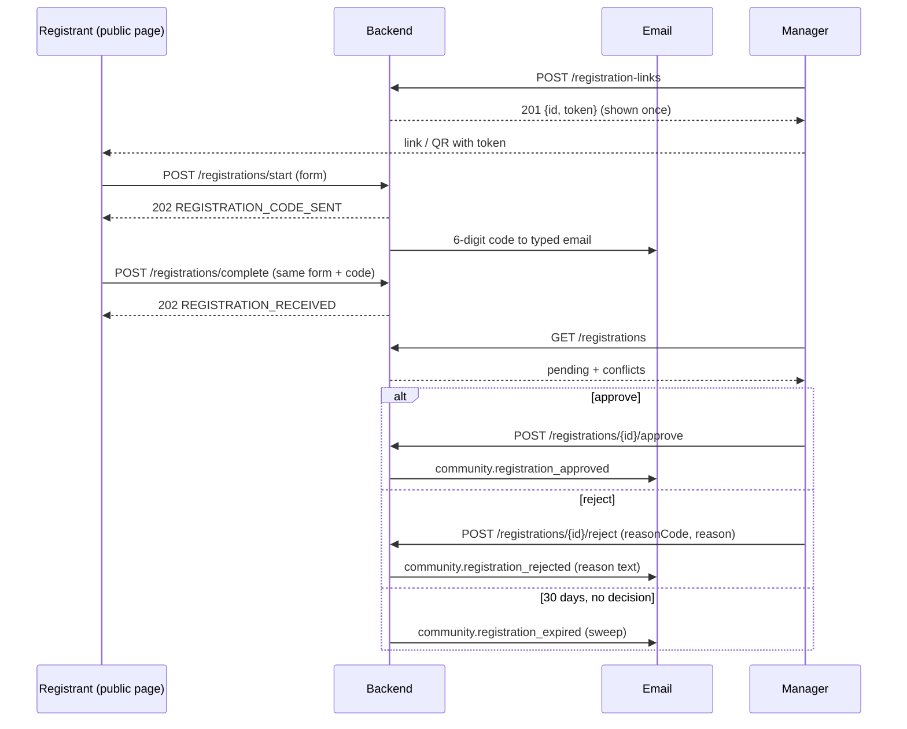
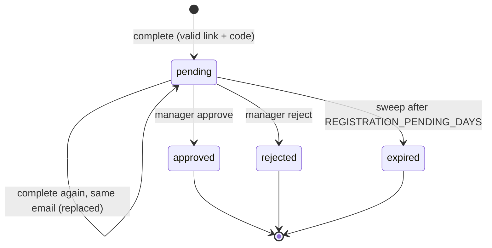
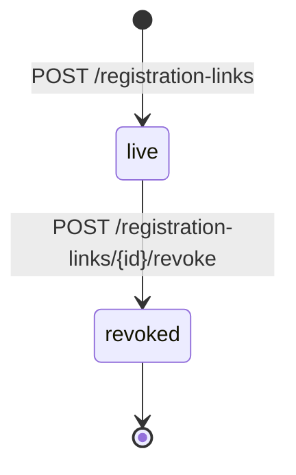

# التسجيل الذاتي للسكان — Resident self-registration

> **التطبيق/الواجهة:** public web page (no login) — نموذج التسجيل وإدخال الكود · manager dashboard — روابط التسجيل وطابور المراجعة
> **الصلاحيات:** المسجّل: بدون تسجيل دخول (`@Public`). المدير: `residents.manage` (دور `manager` الافتراضي) لكل endpoints الروابط والمراجعة.
> **المصادر:** ADR 0024 · `src/community/residents/registration.service.ts` · `registrations.controller.ts` · `registration-public.controller.ts` · `dto/registration.dto.ts` · `views/registration*.ts`

كل المسارات تحت `/api/v1`. القوائم والأسباب والأخطاء بالشكل الموحد (راجع README).

## الفكرة باختصار
- الساكن الجديد يسجّل نفسه من رابط يخص الكمبوند (مثلاً QR على البوابة): اسمه، كود وحدته، هاتفه، إيميله، مستند هويته، وصفته (مالك/مستأجر).
- يُرسَل له كود من 6 أرقام على **الإيميل**؛ بعد إدخاله يتحول التسجيل إلى **طلب** ينتظر المدير. لا يُنشأ حساب ولا جلسة قبل الاعتماد.
- المدير يرى الطلبات مع "التعارضات" المحسوبة لحظياً (وحدة غير موجودة، هاتف مستخدم…)، ثم يعتمد (فيُنشأ الحساب والإشغال) أو يرفض بسبب.
- الطلب الذي لا يقرر فيه أحد ينتهي تلقائياً بعد `REGISTRATION_PENDING_DAYS` (30 يوماً افتراضياً) وتُمسح بياناته.
- لحماية الخصوصية: المسجّل يحصل على **نفس الرد دائماً** مهما كان الرابط أو الوحدة أو الهاتف.

## الأدوار ومين بيعمل إيه

| الدور | يقدر يعمل إيه |
|---|---|
| المسجّل (بدون حساب) | يبدأ التسجيل ويستلم كوداً على إيميله، يكمل التسجيل بالكود، ويستلم إيميل القرار. يقدر يعيد التسجيل بنفس الإيميل ليستبدل طلبه المعلّق. |
| المدير (`residents.manage`) | ينشئ روابط تسجيل ويلغيها ويعرضها؛ يرى طابور الطلبات المعلقة بتعارضاتها؛ يعتمد (مع تصحيح الوحدة أو ربطه بحساب موجود) أو يرفض بسبب. |
| النظام (sweep) | ينهي الطلبات المعلقة القديمة ويبلغ صاحبها. |

## الشاشات اللي الفيتشر محتاجها
**صفحة عامة (بدون دخول)**
- نموذج التسجيل: الاسم، كود الوحدة، الهاتف، الإيميل، نوع المستند ورقمه (+ الجنسية وتاريخ الميلاد للجواز)، الصفة (مالك/مستأجر) و"أسكن في الوحدة؟" للمالك، اللغة، وبيانات اختيارية للوحدة (النوع، المساحة، المبنى).
- شاشة إدخال الكود (6 أرقام) مع "أعد الإرسال".
- شاشة "تم استلام طلبك" (ثابتة، نفس الرسالة للجميع).

**لوحة المدير**
- قائمة روابط التسجيل (النشطة والملغاة) + زر "رابط جديد".
- حوار عرض الرابط الجديد **مرة واحدة** (نسخ / QR).
- حوار تأكيد إلغاء رابط.
- طابور طلبات التسجيل (الأقدم أولاً) مع شارات التعارض.
- تفاصيل/حوار اعتماد طلب: اختيار الوحدة الصحيحة لو الكود خاطئ، وخيار "ربط بالحساب الموجود لنفس الشخص".
- حوار رفض مع سبب (كود + نص يصل للمسجّل).

## الفلو خطوة بخطوة

### 1) إنشاء رابط تسجيل (مدير)
1. المدير يضغط "رابط جديد" → `POST /registration-links` (بدون body).
2. الرد `201`: `{ id, token, createdAt }`. **`token` يظهر مرة واحدة فقط** (الرد `no-store`، والباك يحفظ الـhash فقط). الشاشة يجب أن تعرضه فوراً للنسخ أو كـQR، مع تنبيه أنه لن يظهر مرة أخرى.
3. الروابط القديمة النشطة تظل تعمل؛ يمكن وجود أكثر من رابط نشط.
4. الباك لا يحدد شكل الـURL؛ الواجهة تبني رابط الصفحة العامة وتضع فيه الـ`token`.
5. لا يوجد رابط نشط = التسجيل الذاتي مقفول عملياً (الطلبات تختفي بصمت، انظر الفلو 4).

### 2) عرض وإلغاء الروابط (مدير)
1. `GET /registration-links` — الأحدث أولاً، النشطة والملغاة. كل عنصر: `id`, `createdAt`, `revokedAt` (`null` = نشط). لا يُرجع الـtoken أبداً.
2. إلغاء: `POST /registration-links/{id}/revoke` → `204`. الرابط يتوقف فوراً، والروابط الأخرى تبقى.
3. رابط ملغى بالفعل أو غير موجود → `404 REGISTRATION_LINK_NOT_FOUND`.

### 3) بدء التسجيل (المسجّل) — `POST /registrations/start`
1. المسجّل يفتح الرابط ويملأ النموذج. التطبيق يرسل `Accept-Language` (لغة إيميل الكود).
2. الحقول (كلها تُفحص مرة واحدة وتُرجع كل الأخطاء معاً):
   - `linkToken` إجباري (من الرابط).
   - `fullName` إجباري 2–200.
   - `unitCode` إجباري، حتى 50 حرف، كما يعرفه الساكن.
   - `phone` رقم صالح؛ `email` صالح (**الكود يُرسل له**).
   - `idDocumentType`: `national_id` أو `passport`؛ `idDocumentNumber`. للجواز: `nationality` (كود دولة من حرفين) و`birthDate` إجباريان. للرقم القومي: الجنسية `EG` أو فارغة، وتاريخ الميلاد يُستنتج.
   - `occupancyType`: `owner` أو `tenant`؛ `resides` اختياري للمالك (`false` = يؤجّر الوحدة). المستأجر مع `resides=false` = خطأ.
   - `preferredLocale` اختياري `ar`/`en` (الافتراضي `ar`).
   - اختياري (بيانات التفعيل): `unitType` (`apartment, villa, townhouse, duplex, penthouse, studio, commercial, other`)، `areaSqm` (رقم موجب حتى 6 خانات + خانتين عشريتين)، `building`.
3. لو الشكل سليم: الرد **دائماً** `202 { code: "REGISTRATION_CODE_SENT" }` — حتى لو الرابط غير صالح أو الوحدة غير موجودة.
4. في الخلفية يُرسل كود من 6 أرقام لإيميل المسجّل (صلاحيته `OTP_TTL_SECONDS` = 300 ثانية افتراضياً). أي كود سابق لنفس الطلب يبطل.
5. الكود مربوط بالرابط + الإيميل + **كل بيانات النموذج بالضبط**. الشاشة يجب أن **تقفل** البيانات بين البدء والإكمال؛ لو المستخدم عدّل أي حقل يجب إعادة `start`.
6. "أعد الإرسال" = استدعاء `start` مرة أخرى بنفس البيانات (خاضع لحدود المعدل).

### 4) إكمال التسجيل بالكود (المسجّل) — `POST /registrations/complete`
1. نفس الـbody بالضبط + `code` (6 أرقام، وإلا `400 VALIDATION_FAILED`).
2. كود خاطئ أو منتهي أو بيانات مختلفة عن `start` → `401 OTP_INVALID`. كل محاولة خاطئة تستهلك محاولة (حد `OTP_MAX_ATTEMPTS` = 5)؛ بعدها يجب البدء من جديد.
3. كود صحيح → الرد **دائماً** `202 { code: "REGISTRATION_RECEIVED" }`:
   - لو الرابط صالح والكمبوند نشط: يُحفظ طلب `pending` (أو يُستبدل الطلب المعلّق لنفس الإيميل في نفس الكمبوند — بنفس `createdAt` الأصلي).
   - لو الرابط ملغى/غير موجود/الكمبوند غير نشط: **لا يُحفظ شيء**، ويُسجل حدث أمني في الخلفية فقط. المسجّل لا يعرف.
4. الصفحة تعرض: "استلمنا طلبك، ستراجعه الإدارة وسيصلك إيميل بالقرار". لا تعرض أبداً "لم نجد الوحدة" أو أي تفاصيل.
5. في هذه المرحلة لا يُقرأ أي شيء عن الوحدة أو الحسابات؛ كل الفروق تظهر للمدير فقط.

### 5) طابور المراجعة (مدير) — `GET /registrations`
1. الطلبات المعلقة فقط، **الأقدم أولاً**، paged.
2. كل طلب: `id`, `fullName`, `phone`, `email`, `unitCode` (كما كتبه), `unitId` (`null` لو لا توجد وحدة بهذا الكود), `occupancyType`, `resides`, `createdAt`, و`conflicts[]`.
3. التعارضات تُحسب **وقت القراءة** (قد تتغير بين تحميل وآخر):

| التعارض | المعنى | هل يمنع الاعتماد؟ |
|---|---|---|
| `unit_not_found` | لا توجد وحدة بهذا الكود | نعم — إلا لو المدير اختار `unitId` صحيح عند الاعتماد |
| `unit_has_primary` | الوحدة لها ساكن رئيسي حالياً | لا (تنبيه؛ المسجّل لن يصبح رئيسياً) |
| `unit_has_residing_occupants` | في الوحدة ساكنون مقيمون | لا (تنبيه؛ لن يصبح رئيسياً) |
| `phone_in_use` | الهاتف مستخدم في حساب ساكن آخر (بإيميل مختلف) | نعم |
| `email_in_use` | الإيميل مستخدم في حساب ساكن آخر (بهاتف مختلف) | نعم |
| `same_person_existing_account` | يوجد حساب ساكن بنفس الهاتف **و**الإيميل | نعم — إلا لو المدير اختار "ربط بالحساب الموجود" |
| `duplicate_pending_for_unit` | طلب معلّق آخر لنفس كود الوحدة | لا (تنبيه) |

4. لا يظهر رقم المستند ولا تاريخ الميلاد في الطابور.

### 6) اعتماد طلب (مدير) — `POST /registrations/{id}/approve`
1. الـbody (كله اختياري):
   - `unitId`: لتصحيح وحدة كتبها المسجّل خطأ (يتجاهل `unitCode`).
   - `linkToExistingAccount: true`: يضيف الوحدة لحساب الساكن الموجود لنفس الشخص (نفس الهاتف **و**الإيميل) بدل إنشاء حساب جديد.
2. الباك يعيد الفحص تحت قفل الوحدة:
   - لا وحدة → `409 REGISTRATION_CONFLICT` مع `params.conflicts: ["unit_not_found"]`.
   - هاتف/إيميل لحساب آخر → `409 REGISTRATION_CONFLICT` مع `phone_in_use` و/أو `email_in_use`.
   - نفس الشخص موجود ولم يُطلب الربط → `409 REGISTRATION_CONFLICT` مع `same_person_existing_account`. الشاشة تعرض خيار الربط وتعيد المحاولة.
   - الحساب الموجود له إشغال نشط في نفس الوحدة → `409 OCCUPANCY_ALREADY_ACTIVE`.
3. عند النجاح، في نفس العملية:
   - يُنشأ حساب ساكن (أو يُستخدم الموجود) + إشغال بالصفة المطلوبة. يصبح **رئيسياً** فقط لو الوحدة ليس فيها أي ساكن مقيم وهو مقيم.
   - بيانات التفعيل (النوع/المساحة/المبنى) تُكتب على الوحدة **فقط للحقول الفارغة**.
   - يُرسل إيميل `community.registration_approved` ("يمكنك الدخول الآن بإيميلك أو هاتفك").
   - الطلب يصبح `approved` وتُمسح بياناته الشخصية منه.
4. الرد `200 { accountId, occupancyId }`. الشاشة تزيل الطلب من الطابور ويمكنها فتح صفحة الساكن.
5. طلب لم يعد معلقاً → `404 REGISTRATION_NOT_FOUND`.

### 7) رفض طلب (مدير) — `POST /registrations/{id}/reject`
1. `{ reasonCode, reason }` — الاثنان إجباريان.
   - `reasonCode` من: `not_a_resident`, `unit_mismatch`, `duplicate`, `documents_missing`, `other`.
   - `reason` نص حتى 1000 حرف **يصل للمسجّل كما هو** في الإيميل. لا يُذكر له التعارض أبداً.
2. إيميل `community.registration_rejected` + الطلب يصبح `rejected` وتُمسح بياناته الشخصية.
3. الرد `204`. طلب لم يعد معلقاً → `404 REGISTRATION_NOT_FOUND`.
4. المسجّل المرفوض يقدر يسجّل من جديد (طلب جديد).

### 8) انتهاء الطلب تلقائياً (النظام)
1. الـsweep يعمل كل `SWEEP_INTERVAL_MS` (ساعة افتراضياً).
2. أي طلب `pending` عمره أكبر من `REGISTRATION_PENDING_DAYS` (30 يوماً افتراضياً) **من أول إرسال** (الاستبدال لا يمدّ المدة) → يصبح `expired` وتُمسح بياناته.
3. المسجّل يصله إيميل `community.registration_expired` ("يمكنك التسجيل من جديد أو التواصل مع الإدارة").
4. الطلب يختفي من الطابور.

## الحالات (Statuses)

**حالة الطلب `RegistrationStatus`**

| القيمة | المعنى | مين يحركها |
|---|---|---|
| `pending` | ينتظر قرار المدير؛ البيانات الشخصية محفوظة | المسجّل عند `complete` (أو يستبدلها بإعادة التسجيل بنفس الإيميل) |
| `approved` | اعتُمد؛ أُنشئ الحساب والإشغال | المدير |
| `rejected` | رُفض بسبب | المدير |
| `expired` | مرت المدة دون قرار | النظام (sweep) |

بعد أي قرار تُمسح البيانات الشخصية من الطلب (الاسم، الهاتف، الإيميل، المستند، الجنسية، الميلاد).

**الرابط:** نشط (`revokedAt = null`) أو ملغى (`revokedAt` مضبوط). لا يرجع الملغى نشطاً.

## البيانات اللي بتظهر
- **قائمة الروابط:** `id`, `createdAt`, `revokedAt`. الـtoken لا يظهر.
- **رابط جديد:** `id`, `token` (**مرة واحدة**), `createdAt`.
- **ردود الصفحة العامة:** فقط `{ code: "REGISTRATION_CODE_SENT" }` أو `{ code: "REGISTRATION_RECEIVED" }` أو أخطاء الشكل/الكود/المعدل. لا شيء آخر.
- **طابور المراجعة:** راجع الفلو 5. **لا يظهر** رقم المستند ولا تاريخ الميلاد ولا الجنسية ولا بيانات التفعيل المقترحة (النوع/المساحة/المبنى) — مع أنها مخزنة.
- **نتيجة الاعتماد:** `accountId`, `occupancyId`.

## القواعد والقيود
- لا حساب ولا جلسة قبل الاعتماد. المسجّل لا يستطيع متابعة حالة طلبه من التطبيق؛ يعرف القرار بالإيميل فقط.
- نفس الرد ونفس الكود HTTP لكل مدخل سليم الشكل (لمنع كشف وجود وحدات أو أشخاص). لا تبنِ أي رسالة على "الوحدة غير موجودة".
- الكود دائماً على **الإيميل** (لا SMS). صلاحيته 300 ثانية افتراضياً، و5 محاولات.
- بيانات `complete` يجب أن تطابق `start` حرفياً؛ أي اختلاف = `OTP_INVALID`.
- حدود المعدل لكل مرحلة (`start` و`complete` منفصلتان)، في نافذة `OTP_RATE_LIMIT_WINDOW_SECONDS` (900 ثانية): 20 لكل IP و5 لكل إيميل افتراضياً → `429 RATE_LIMITED`.
- طلب معلّق واحد لكل إيميل في الكمبوند؛ إعادة التسجيل بنفس الإيميل تستبدله.
- أكثر من رابط نشط مسموح. كمبوند غير نشط = الروابط لا تعمل (بصمت).
- الاعتماد يعيد الفحص؛ التعارضات المانعة فقط: `unit_not_found`, `phone_in_use`, `email_in_use`, `same_person_existing_account` (بدون ربط).
- بيانات التفعيل من المسجّل لا تكتب فوق ما تعرفه الوحدة.
- الرفض يحتاج كود من القائمة + نص يصل للمسجّل.
- الانتهاء بعد `REGISTRATION_PENDING_DAYS` (30) من أول إرسال.

## الأخطاء اللي الـUI لازم يتعامل معاها

| HTTP + الكود | متى | رسالة/سلوك مقترح |
|---|---|---|
| `400 VALIDATION_FAILED` | شكل النموذج غلط؛ `fields[]` فيها كل الأخطاء معاً (`INVALID_LENGTH` للاسم، `FIELD_REQUIRED` لكود الوحدة/الرابط، `INVALID_PHONE`, `INVALID_EMAIL`, `INVALID_NATIONAL_ID`, `INVALID_PASSPORT_NUMBER`, `INVALID_NATIONALITY`, `BIRTH_DATE_REQUIRED`, `INVALID_BIRTH_DATE`, `INVALID_VALUE`, `INVALID_NUMBER` للمساحة)؛ أو كود ليس 6 أرقام | اعرض كل خطأ تحت حقله |
| `401 OTP_INVALID` | كود خاطئ/منتهي أو البيانات تغيّرت عن `start` | "الكود غير صحيح أو انتهت صلاحيته" + "أعد الإرسال" |
| `429 RATE_LIMITED` | محاولات كثيرة من نفس الـIP أو الإيميل | "محاولات كثيرة، حاول بعد قليل" |
| `404 REGISTRATION_LINK_NOT_FOUND` | إلغاء رابط ملغى أو غير موجود | أعد تحميل القائمة |
| `404 REGISTRATION_NOT_FOUND` | اعتماد/رفض طلب لم يعد معلقاً | "تم التعامل مع الطلب بالفعل" + إعادة تحميل |
| `409 REGISTRATION_CONFLICT` | تعارض مانع عند الاعتماد (`params.conflicts`) | اعرض التعارضات؛ اعرض اختيار الوحدة أو خيار الربط حسب الحالة |
| `409 OCCUPANCY_ALREADY_ACTIVE` | الحساب الموجود يشغل الوحدة بالفعل | "هذا الشخص مسجل في الوحدة بالفعل؛ ارفض الطلب كمكرر" |
| `400 REASON_REQUIRED` | رفض بدون كود أو نص | "اختر سبباً واكتب رسالة للمسجّل" |
| `400 VALIDATION_FAILED` + `INVALID_REASON_CODE` | كود رفض خارج القائمة | أعد عرض القائمة |
| `403 FORBIDDEN` | المدير لا يملك `residents.manage` | أخفِ الشاشة |

## الإشعارات
لا يوجد إشعار داخل التطبيق ولا push في هذا الفلو (المسجّل ليس له حساب). كل شيء إيميل:

| الحدث | المفتاح | المستلم | Push؟ | عند الضغط |
|---|---|---|---|---|
| بدء التسجيل | إيميل كود التحقق (purpose `registration`) | الإيميل المكتوب | لا | — (يُكتب الكود في الصفحة) |
| اعتماد | `community.registration_approved` | المسجّل | لا (فئة `account_security`، غير حرج) | — (يفتح التطبيق ويسجل دخول) |
| رفض | `community.registration_rejected` + نص السبب | المسجّل | لا | — |
| انتهاء المدة | `community.registration_expired` | المسجّل | لا | — |

المدير **لا يصله أي إشعار** بوصول طلب جديد.

## الـEndpoints

| Method + Path | مين | الغرض | النجاح |
|---|---|---|---|
| `GET /registration-links` | `residents.manage` | قائمة الروابط | `200 {data: [{id, createdAt, revokedAt}], nextCursor}` |
| `POST /registration-links` | `residents.manage` | رابط جديد (token مرة واحدة) | `201 {id, token, createdAt}` |
| `POST /registration-links/{id}/revoke` | `residents.manage` | إلغاء رابط | `204` |
| `POST /registrations/start` | عام | إرسال الكود | `202 {code: "REGISTRATION_CODE_SENT"}` |
| `POST /registrations/complete` | عام | إكمال بالكود | `202 {code: "REGISTRATION_RECEIVED"}` |
| `GET /registrations` | `residents.manage` | الطلبات المعلقة + التعارضات | `200 {data: PendingRegistrationView[], nextCursor}` |
| `POST /registrations/{id}/approve` | `residents.manage` | اعتماد | `200 {accountId, occupancyId}` |
| `POST /registrations/{id}/reject` | `residents.manage` | رفض بسبب | `204` |

## ملاحظات للديزاين وحاجات ناقصة في الباك
- لا يوجد endpoint يُرجع تفاصيل الطلب الكاملة للمدير: رقم المستند/الجنسية/الميلاد وبيانات التفعيل المقترحة (النوع، المساحة، المبنى) مخزنة لكن لا تظهر في الطابور. المدير يعتمد دون رؤية المستند.
- لا يوجد endpoint عام يتحقق من الرابط أو يعرض اسم الكمبوند قبل التسجيل (مقصود: صلاحية الرابط لا تُكشف). الصفحة لا تستطيع أن تقول "الرابط غير صالح".
- الباك لا يحدد صيغة رابط الصفحة العامة (لا `PUBLIC_APP_URL` هنا)؛ الواجهة تحدد شكل الـURL/QR.
- يوجد في الـservice دالة لإلغاء **كل** الروابط مرة واحدة ("إيقاف التسجيل")، لكنها غير مكشوفة كـendpoint.
- لا إشعار للمدير بطلب جديد، ولا عدّاد للطلبات المعلقة.
- لا يوجد عرض للطلبات المقررة (approved/rejected/expired) — الطابور معلق فقط.
- "طلب تصحيح" (journey 03) غير منفذ (يحتاج تخزين مستندات، ADR 0009).
- حقل `building` في التسجيل لا يُفحص طوله في الـservice (بينما بطاقة التفعيل تحدده بـ50).
- v0-notes: التعارضات تُحسب صفاً بصف؛ مناسب لطابور مراجعة، يُعاد النظر لو الشاشة تعرض عدداً كبيراً.
- بعد الاعتماد لا يوجد إشعار داخل التطبيق للمسجّل (ليس له جلسة بعد)؛ الإيميل هو الطريق الوحيد.
