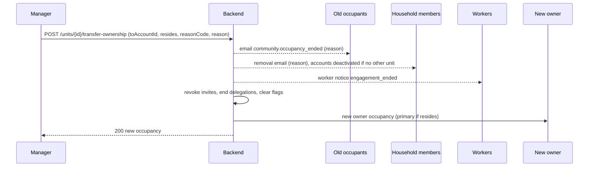
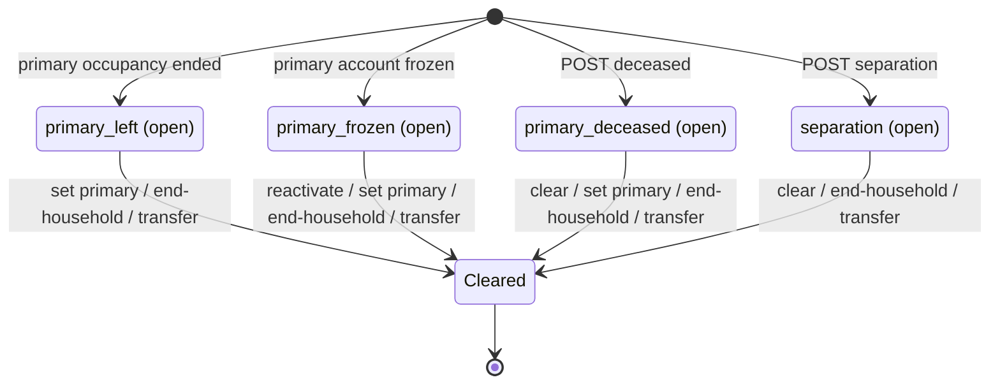

# مراجعة الوحدة وأحداث الحياة — Unit review and life events

> **التطبيق/الواجهة:** manager dashboard (طابور الوحدات تحت المراجعة، الوفاة، الانفصال، إنهاء الأسرة، نقل الملكية، إغلاق العلامات) · resident app (الساكن الرئيسي الجديد: "راجع صلاحيات الأسرة")
> **الصلاحيات:** `residents.read` (قائمة الوحدات تحت المراجعة) و`residents.manage` (باقي أفعال المدير) — كلاهما في دور `manager` · `household.manage` (resident, family_member) لشاشة مراجعة الأسرة، والكود يشترط أن المتصل هو **الساكن الرئيسي** نفسه (المفوَّض لا يكفي)
> **المصادر:** ADR 0021 · `src/community/residents/unit-states.controller.ts` · `src/community/units/review-flags.ts` · `src/community/residents/residents.service.ts` · `src/community/notices/community-notices.ts`

كل المسارات تحت `/api/v1`. القوائم والأسباب والأخطاء بالشكل الموحد (راجع README).

## الفكرة باختصار
- لما بنية الأسرة في وحدة "تنكسر" (الرئيسي غادر، اتجمّد حسابه، توفي، انفصال، الوحدة اتباعت)، الوحدة تأخذ **علامة مراجعة** (review flag) تظهر للمدير.
- لكل وحدة علامة مفتوحة واحدة بالكثير لكل سبب، ويمكن أن تكون عدة أسباب مفتوحة معاً. العلامة تُغلق ولا تُحذف (تبقى كتاريخ).
- بعض العلامات تغيّر ما يقدر أهل الوحدة يعملوه (الوفاة تجمّد المالية وتغييرات الأسرة؛ الانفصال يجعل سحب صلاحيات البالغين قرار إدارة).
- المدير يحل كل علامة بقرار: تعيين رئيسي جديد، إنهاء الأسرة، نقل الملكية، أو إغلاق العلامة يدوياً (للوفاة والانفصال فقط).
- عند تغيير الرئيسي، الرئيسي الجديد يراجع صلاحيات الأفراد ("راجع الآن / لاحقاً").

## الأدوار ومين بيعمل إيه

| الدور | يقدر يعمل إيه |
|---|---|
| المدير (`residents.read`) | يرى طابور الوحدات تحت المراجعة. |
| المدير (`residents.manage`) | يسجّل وفاة أو انفصال؛ يغلق علامة وفاة/انفصال؛ ينهي أسرة الوحدة؛ ينقل الملكية؛ يعيّن رئيساً جديداً (راجع `01-units-and-occupancy.md`). |
| الساكن الرئيسي (`household.manage`) | يرى أفراد الأسرة الذين لم يراجع صلاحياتهم منذ أصبح رئيساً، ويعلّمهم "تمت المراجعة". |
| أهل الوحدة (ساكنون مقيمون + أفراد بحسابات) | يستلمون إيميلات (الوحدة قيد المراجعة، إيقاف عرض النشاط، رئيسي جديد، انتهاء الإشغال، إزالة من الأسرة). |
| النظام | يفتح `primary_left` عند انتهاء إشغال الرئيسي، و`primary_frozen` عند تجميد حسابه، ويغلق `primary_frozen` عند إعادة تفعيله. |

## الشاشات اللي الفيتشر محتاجها
**لوحة المدير**
- "وحدات تحتاج مراجعة": قائمة (عنصر لكل وحدة+سبب)، الأحدث أولاً.
- قسم "علامات المراجعة" داخل تفاصيل الوحدة (من `GET /units/{id}`).
- حوار "تسجيل وفاة" (سبب + ملاحظة داخلية).
- حوار "تسجيل انفصال" (سبب + ملاحظة داخلية).
- حوار "إغلاق العلامة" (كود سبب فقط) — لعلامات الوفاة والانفصال.
- حوار "إنهاء أسرة الوحدة" مع تحذير واضح بالأثر + سبب ونص يصل للأفراد.
- نموذج "نقل الملكية": اختيار المالك الجديد (حساب ساكن نشط)، هل يسكن؟، سبب ونص.
- (من ملف الوحدات) حوار "تعيين رئيسي".

**تطبيق الساكن (الرئيسي)**
- بانر/كارت "راجع صلاحيات أسرتك" + شاشة قائمة الأفراد بزر "تمت المراجعة" لكل فرد أو "الكل".

## الفلو خطوة بخطوة

### 1) طابور الوحدات تحت المراجعة (مدير)
1. `GET /units/needing-review` (`residents.read`) — paged، الأحدث علامةً أولاً.
2. كل عنصر = علامة مفتوحة واحدة: `flagId`, `unitId`, `code`, `reason`, `flaggedAt`, `activeOccupants` (عدد الإشغالات النشطة؛ يساعد في معرفة هل يوجد مرشح لرئيسي جديد).
3. وحدة عليها سببان تظهر مرتين.
4. الضغط يفتح تفاصيل الوحدة `GET /units/{id}` حيث `reviewFlags` (`id`, `reason`, `flaggedAt`) و`occupants`.
5. ملاحظات الوفاة/الانفصال **لا تظهر أبداً** في أي endpoint.

### 2) كيف تُفتح العلامات

| السبب | يُفتح عندما | من يفتحه |
|---|---|---|
| `primary_left` | انتهى إشغال الرئيسي (إنهاء من المدير، أو حذف الحساب) | النظام |
| `primary_frozen` | حساب الرئيسي اتجمّد (من المدير أو "مش أنا") — الرئيسي **يبقى** رئيسياً، وتفويضاته تستمر | النظام |
| `primary_deceased` | المدير سجّل وفاة | المدير |
| `separation` | المدير سجّل انفصالاً أو مغادرة شخص بالغ | المدير |

ملاحظة: تحويل مستأجر لمالك ونقل الملكية **لا يفتحان** `primary_left`.

### 3) تسجيل وفاة (مدير)
1. من تفاصيل الوحدة → `POST /units/{id}/deceased` (`residents.manage`).
2. Body: `reasonCode` من `deceased`, `separation`, `other` + `reason` (نص ≤1000). النص **ملاحظة داخلية**: تُحفظ على العلامة، لا تُرسل لأحد، ولا تدخل الـaudit، ولا يعرضها أي endpoint.
3. الرد `201 { flagId }`. لو علامة وفاة مفتوحة بالفعل: يرجع نفس `flagId` ولا يُرسل إشعار جديد.
4. الأثر:
   - **لا شيء يُغلق أو يُسحب**: الإشغالات والأفراد والعمال كما هم.
   - **كل تغييرات الأسرة مرفوضة للجميع، حتى المدير**: الدعوات، إضافة/إزالة أفراد، التفويضات، منح/سحب الصلاحيات → `403 HOUSEHOLD_UNDER_REVIEW` (راجع `05-household-and-invites.md` و`06-delegation.md` و`07-member-permissions.md`).
   - الـcapabilities: كل المالية `false` (`financeView`, `financePay`, `landlordTenantFinance`، والسقف `null`) و`householdManage=false`. البلاغات والزوار والطوارئ والدخول مستمرة.
   - البالغون (الساكنون المقيمون النشطون + الأفراد أصحاب الحسابات) يستلمون إيميل `community.unit_under_review` — **بدون ذكر السبب**.
5. الحل: تعيين رئيسي جديد (يغلقها تلقائياً)، أو إغلاقها يدوياً (الفلو 5)، أو إنهاء الأسرة/نقل الملكية.
6. ملاحظة: تسجيل الوفاة لا ينهي إشغال المتوفى؛ لو المدير أنهاه بعد ذلك تُفتح أيضاً `primary_left`.

### 4) تسجيل انفصال (مدير)
1. `POST /units/{id}/separation` (`residents.manage`)، نفس الـbody (`reasonCode` من `deceased`, `separation`, `other` + `reason` ملاحظة داخلية).
2. الرد `201 { flagId }` (أو العلامة المفتوحة الموجودة).
3. الأثر:
   - إزالة فرد بالغ أو سحب صلاحية من بالغ بواسطة الرئيسي أو مفوَّض → `403 SEPARATION_MANAGER_DECISION`. المدير يقوم بها من أدوات الإدارة (`household.override`، راجع `05-household-and-invites.md` و`07-member-permissions.md`).
   - `activityVisibleToPrimary=false`: شاشة "نشاطي/نشاط الأفراد" لا تُعرض للرئيسي.
   - الطوارئ والدخول والبلاغات والتواصل مع الإدارة وإشعارات الزوار مستمرة للجميع.
   - البالغون يستلمون إيميل `community.activity_paused`.
4. تعيين رئيسي جديد **لا يغلق** علامة الانفصال؛ تُغلق يدوياً أو بإنهاء الأسرة/نقل الملكية.

### 5) إغلاق علامة يدوياً (مدير)
1. من قائمة `reviewFlags` → `POST /review-flags/{id}/clear` (`residents.manage`).
2. Body: `{ reasonCode }` فقط، من `resolved`, `data_correction`, `other`. (لا نص؛ الإغلاق لا يُبلغ به أحد.) بدون كود → `400 REASON_REQUIRED`.
3. مسموح فقط لـ`primary_deceased` و`separation`. أي علامة أخرى → `409 REVIEW_NEEDS_DECISION` ("عيّن رئيسياً جديداً أو أنهِ الأسرة").
4. علامة غير موجودة أو مغلقة → `404 REVIEW_FLAG_NOT_FOUND`.
5. الرد `204`. القيود المرتبطة بها ترتفع فوراً.

### 6) حل `primary_left` و`primary_frozen`
- **العائلة باقية:** المدير يعيّن رئيساً جديداً من الساكنين المقيمين (`POST /units/{id}/primary`، راجع `01-units-and-occupancy.md`). يغلق `primary_left` و`primary_frozen` و`primary_deceased`.
- **الوحدة تغيّر أهلها:** إنهاء الأسرة (الفلو 7) أو نقل الملكية (الفلو 8).
- **`primary_frozen` فقط:** إعادة تفعيل حساب الرئيسي (`POST /accounts/{id}/reactivate`) تغلقها تلقائياً (راجع `04-frozen-accounts-and-erasure.md`).

### 7) إنهاء أسرة الوحدة (مدير)
1. `POST /units/{id}/end-household` (`residents.manage`).
2. Body: `reasonCode` من `unit_changed_hands`, `household_left`, `other` + `reason` (نص ≤1000) **يصل لكل فرد يُزال**.
3. الأثر، كله في عملية واحدة:
   - **الإشغالات لا تُمس** (الملاك/المستأجرون يبقون).
   - كل أفراد الأسرة (`active` و`pending_approval`) يصبحون `removed`: كل فرد له حساب يستلم إيميل إزالة بالنص؛ تفويضه في الوحدة ينتهي؛ لو لم يعد عضواً نشطاً في أي وحدة أخرى **يُعطَّل حسابه** (`inactive`) وتنتهي جلساته، ويفقد QR الدخول. القاصر بلا حساب: الإشعار يُسجل "غير قابل للتسليم".
   - كل الدعوات المعلقة تُلغى.
   - كل تفويضات الوحدة تنتهي.
   - كل تعاقدات العمال المفتوحة تنتهي (يصل العامل إشعار عامل)، ويُسجل التزام `settle_before_close` لمن صدر له كود (راجع `../04-workers/01-domestic-workers.md`).
   - كل علامات المراجعة الأربع المفتوحة تُغلق.
4. الرد `204`. أعد قراءة الوحدة.

### 8) نقل الملكية (مدير)
1. `POST /units/{id}/transfer-ownership` (`residents.manage`).
2. Body:
   - `toAccountId` (uuid) — حساب **ساكن نشط** (وإلا `404 ACCOUNT_NOT_FOUND`). يمكن أن يكون شخصاً يشغل الوحدة الآن.
   - `resides` اختياري (الافتراضي `true`؛ `false` = المالك الجديد مؤجِّر).
   - `reasonCode` من `unit_changed_hands`, `household_left`, `other` + `reason` نص يصل للساكنين.
3. الأثر:
   - **كل الإشغالات النشطة تنتهي** بـ`ownership_transferred` (النص يُحفظ كملاحظة الإنهاء)، وكل ساكن يستلم `community.occupancy_ended` بالنص. تفويضات الرئيسي القديم تنتهي. **لا** تُفتح `primary_left`.
   - إنهاء الأسرة بالكامل كما في الفلو 7 (أفراد، دعوات، تفويضات، عمال، علامات).
   - إشغال **مالك** جديد للمشتري؛ يصبح رئيسياً لو `resides=true` (الوحدة أصبحت بلا ساكنين).
   - إعادة فحص حقوق الدخول لكل ساكن سابق (من اشترى وهو ساكن يحتفظ بها).
4. الرد `200` بالإشغال الجديد (`OccupancyResponse`).

### 9) مراجعة صلاحيات الأسرة بعد تغيير الرئيسي (الساكن الرئيسي)
1. بعد تعيين رئيسي جديد، أفراد الأسرة يحتفظون بصلاحياتهم كما هي.
2. الرئيسي يفتح الشاشة → `GET /units/{id}/household/to-review` (`household.manage` + يجب أن يكون الرئيسي، وإلا `403 NOT_PRIMARY_RESIDENT`).
3. القائمة: الأفراد النشطون الذين لم تُراجع صلاحياتهم منذ أصبح هو رئيساً (أو لم تُراجع أبداً)، الأقدم أولاً: `memberId`, `fullName`, `relation`, `isMinor`. قائمة فاضية = أخفِ البانر.
4. "راجع الآن": يعدّل الصلاحيات من شاشة صلاحيات الأفراد (راجع `07-member-permissions.md`)، ثم يؤكد → `POST /units/{id}/household/reviewed` بأحد الشكلين فقط:
   - `{ memberIds: [...] }` (حتى 100)، أو
   - `{ all: true }`.
   (الاثنان معاً = `400 VALIDATION_FAILED`.)
5. الرد `200 { reviewed: n }` (عدد من عُلّموا). التعليم لا يغيّر أي صلاحية؛ فقط يخرجهم من القائمة.
6. "لاحقاً" = لا استدعاء؛ القائمة تبقى.
7. المفوَّض بصلاحية `household` لا يستطيع هذه الشاشة (الشرط: الرئيسي نفسه).

## الحالات (Statuses)

**أسباب المراجعة `UnitReviewReason`**

| القيمة | المعنى | يدخل بـ | يخرج بـ |
|---|---|---|---|
| `primary_left` | الرئيسي غادر، ولا رئيسي الآن | انتهاء إشغال الرئيسي | تعيين رئيسي · إنهاء الأسرة · نقل الملكية (إغلاق يدوي مرفوض) |
| `primary_frozen` | حساب الرئيسي مجمّد | تجميد الحساب | إعادة التفعيل · تعيين رئيسي · إنهاء الأسرة · نقل الملكية (إغلاق يدوي مرفوض) |
| `primary_deceased` | وفاة؛ المالية وتغييرات الأسرة متوقفة | المدير | إغلاق يدوي · تعيين رئيسي · إنهاء الأسرة · نقل الملكية |
| `separation` | انفصال؛ سحب صلاحيات البالغين قرار إدارة | المدير | إغلاق يدوي · إنهاء الأسرة · نقل الملكية (تعيين رئيسي لا يغلقها) |

كل علامة: مفتوحة (`clearedAt = null`) ← مغلقة (مع كود الإغلاق: `primary_set`, `household_ended`, `account_reactivated`، أو كود المدير `resolved`/`data_correction`/`other`).

**أثر كل حدث على عناصر الوحدة**

| الحدث | الإشغالات | أفراد الأسرة | الدعوات | التفويضات | العمال | الصلاحيات |
|---|---|---|---|---|---|---|
| انتهاء إشغال الرئيسي | ينتهي إشغاله فقط | كما هم | كما هي | تفويضاته تنتهي | كما هم | كما هي |
| تجميد الرئيسي | كما هي (يبقى رئيسياً) | كما هم (يُبلغ رئيسي الفرد المجمّد لو الفرد هو المجمّد) | كما هي | تستمر | كما هم | كما هي |
| وفاة | كما هي | كما هم | كما هي | كما هي | كما هم | مجمّدة: لا منح ولا سحب؛ المالية متوقفة |
| انفصال | كما هي | كما هم | كما هي | كما هي | كما هم | سحب صلاحية/إزالة بالغ = قرار المدير فقط؛ "نشاطي" متوقف |
| تعيين رئيسي جديد | الرئيسي السابق يبقى ساكناً | كما هم (يُبلغون) | كما هي | تفويضات الرئيسي السابق تنتهي | كما هم | كما هي حتى يراجعها |
| إنهاء الأسرة | **لا تُمس** | كلهم `removed` (+تعطيل الحساب لو لا وحدة أخرى) | تُلغى | كلها تنتهي | كل التعاقدات تنتهي (+`settle_before_close`) | تنتهي بانتهاء العضوية |
| نقل الملكية | كلها تنتهي + إشغال مالك جديد | كلهم `removed` | تُلغى | كلها تنتهي | كلها تنتهي | تنتهي |

## البيانات اللي بتظهر
- **طابور المراجعة (`UnitNeedingReviewView`):** `flagId`, `unitId`, `code`, `reason`, `flaggedAt`, `activeOccupants`. **لا** ملاحظات ولا أسماء.
- **تفاصيل الوحدة (للمدير):** `reviewReasons[]` و`reviewFlags[]` (`id`, `reason`, `flaggedAt`) — الـ`id` هو ما يُرسل لـ`/review-flags/{id}/clear`.
- **وفاة/انفصال:** `{ flagId }` (قد يكون علامة موجودة).
- **نقل الملكية:** الإشغال الجديد (`OccupancyResponse`).
- **مراجعة الأسرة (`MemberToReviewView`):** `memberId`, `fullName`, `relation` (`spouse`, `child`, `parent`, `sibling`, `other`), `isMinor`. لا بيانات اتصال.
- **ما لا يُعرض أبداً:** ملاحظة الوفاة/الانفصال (`note`) وكود السبب المحفوظ على العلامة.
- أهل الوحدة لا يعرفون من الـAPI أن الوحدة تحت مراجعة ولا السبب؛ يرون فقط أثرها على الـcapabilities، وإيميلاً عاماً.

## القواعد والقيود
- علامة مفتوحة واحدة لكل (وحدة، سبب)؛ تكرار التسجيل يرجع نفس العلامة بلا إشعار.
- أسباب `deceased`/`separation` (`reviewFlag`): `deceased`, `separation`, `other` + نص داخلي إجباري ≤1000.
- إغلاق يدوي (`reviewClear`): `resolved`, `data_correction`, `other` — كود فقط، ولوفاة/انفصال فقط.
- إنهاء أسرة ونقل ملكية (`householdEnd`): `unit_changed_hands`, `household_left`, `other` + نص يصل للأشخاص.
- تحت الوفاة: أي تغيير في الأسرة مرفوض لأي شخص (`403 HOUSEHOLD_UNDER_REVIEW`).
- تحت الانفصال: غير المدير لا يسحب صلاحية بالغ ولا يزيل بالغاً (`403 SEPARATION_MANAGER_DECISION`).
- لا ترقية تلقائية لرئيسي جديد أبداً.
- نقل الملكية: المشتري حساب `resident` نشط؛ الإجراء ينهي كل إشغالات الوحدة وأسرتها.
- مراجعة الأسرة للرئيسي فقط؛ `memberIds` حتى 100، أو `all: true`، ليس الاثنين.
- كل الأفعال تأخذ قفل الوحدة؛ نفّذ زراً واحداً في المرة وأعد قراءة الوحدة بعده.

## الأخطاء اللي الـUI لازم يتعامل معاها

| HTTP + الكود | متى | رسالة/سلوك مقترح |
|---|---|---|
| `400 REASON_REQUIRED` | سبب ناقص (كود أو نص) | "اختر سبباً واكتب التوضيح" |
| `400 VALIDATION_FAILED` + `INVALID_REASON_CODE` | كود خارج القائمة (`params.allowed`) | أعد عرض القائمة |
| `400 VALIDATION_FAILED` | `memberIds` و`all` معاً أو لا شيء، أو أكثر من 100 | منع من الواجهة |
| `404 UNIT_NOT_FOUND` | وحدة غير موجودة/غير مرئية | "الوحدة غير موجودة" |
| `404 REVIEW_FLAG_NOT_FOUND` | العلامة أُغلقت أو غير موجودة | أعد تحميل الوحدة |
| `409 REVIEW_NEEDS_DECISION` | إغلاق يدوي لـ`primary_left`/`primary_frozen` | "هذه الحالة تحتاج قراراً: عيّن رئيساً جديداً أو أنهِ الأسرة"؛ لا تعرض زر الإغلاق لهذين السببين |
| `404 ACCOUNT_NOT_FOUND` | المالك الجديد ليس حساب ساكن نشط | "اختر ساكناً نشطاً" |
| `403 NOT_PRIMARY_RESIDENT` | مراجعة الأسرة من غير الرئيسي | أخفِ الشاشة لغير الرئيسي |
| `403 HOUSEHOLD_UNDER_REVIEW` | أي تغيير في الأسرة أثناء مراجعة وفاة (في شاشات الأسرة) | "شؤون الوحدة قيد المراجعة مع الإدارة" |
| `403 SEPARATION_MANAGER_DECISION` | الرئيسي/مفوَّض يزيل بالغاً أو يسحب صلاحيته أثناء انفصال | "هذا القرار للإدارة أثناء المراجعة" |
| `403 FORBIDDEN` | لا يملك الصلاحية | أخفِ الشاشة |

## الإشعارات
كلها **إيميل** (community notices / household emails عبر الـoutbox)، بلا إشعار inbox ولا push.

| الحدث | المفتاح | المستلم | Push؟ | عند الضغط |
|---|---|---|---|---|
| تسجيل وفاة (علامة جديدة) | `community.unit_under_review` (بدون سبب) | الساكنون المقيمون + الأفراد أصحاب الحسابات | لا | — |
| تسجيل انفصال (علامة جديدة) | `community.activity_paused` | نفس المجموعة | لا | — |
| تعيين رئيسي جديد | `community.primary_changed` | أفراد الأسرة أصحاب الحسابات | لا | — |
| إنهاء إشغال (منها نقل الملكية) | `community.occupancy_ended` (بالنص) | كل ساكن انتهى إشغاله | لا | — |
| إنهاء الأسرة / نقل الملكية | `household.member_removed` (بالنص) | كل فرد يُزال (القاصر: غير قابل للتسليم) | لا | — |
| إنهاء تعاقد عامل | إشعار عامل `engagement_ended` | العامل | لا | — |
| تجميد فرد أسرة | `community.member_frozen` | رئيسي الوحدة | لا | — |
| إغلاق علامة / مراجعة الأسرة | لا شيء | — | — | — |

## الـEndpoints

| Method + Path | مين | الغرض | النجاح |
|---|---|---|---|
| `GET /units/needing-review` | `residents.read` | العلامات المفتوحة | `200 {data: UnitNeedingReviewView[], nextCursor}` |
| `GET /units/{id}` | `units.read` | تفاصيل الوحدة + `reviewFlags` (للمدير) | `200 UnitDetailView` |
| `POST /units/{id}/deceased` | `residents.manage` | تسجيل وفاة | `201 {flagId}` |
| `POST /units/{id}/separation` | `residents.manage` | تسجيل انفصال | `201 {flagId}` |
| `POST /review-flags/{id}/clear` | `residents.manage` | إغلاق علامة وفاة/انفصال | `204` |
| `POST /units/{id}/end-household` | `residents.manage` | إنهاء الأسرة | `204` |
| `POST /units/{id}/transfer-ownership` | `residents.manage` | نقل الملكية | `200 OccupancyResponse` |
| `POST /units/{id}/primary` | `residents.manage` | تعيين رئيسي (يحل عدة علامات) | `200 OccupancyResponse` |
| `GET /units/{id}/household/to-review` | `household.manage` (الرئيسي) | أفراد يحتاجون مراجعة | `200 {data: MemberToReviewView[]}` |
| `POST /units/{id}/household/reviewed` | `household.manage` (الرئيسي) | تعليمهم كمراجَعين | `200 {reviewed}` |

## ملاحظات للديزاين وحاجات ناقصة في الباك
- ملاحظة الوفاة/الانفصال (`note`) وكود سببها تُحفظ لكن **لا يوجد endpoint يعرضها** حتى للمدير (ADR 0021 يقول "manager-only"). لا تصمم خانة لعرضها.
- لا يوجد تاريخ للعلامات المغلقة في أي endpoint (محفوظة في قاعدة البيانات فقط).
- إيميل `unit_under_review` يُرسل لكل الساكنين المقيمين النشطين — بما فيهم حساب المتوفى نفسه لو إشغاله ما زال نشطاً.
- نقل الملكية لمالك **مؤجِّر** (`resides=false`) يترك الوحدة بلا رئيسي وبلا علامة مراجعة؛ لن تظهر في الطابور.
- إنهاء الأسرة لا ينهي الإشغالات؛ لو المقصود أن الوحدة تغيّر أهلها بالكامل، فإنهاء إشغالات الساكنين خطوة منفصلة (أو استخدم نقل الملكية).
- لا يوجد إشعار للمدير عند فتح علامة تلقائياً (`primary_left`, `primary_frozen`)؛ الطابور هو المصدر الوحيد.
- `endLease` و`removeOccupant` و`transferOwnership` flags للرئيسي في الـcapabilities، لكن الإجراءات موجودة للمدير فقط.
- الفرد الذي يُزال بإنهاء الأسرة ويُعطَّل حسابه لا يتلقى إشعاراً منفصلاً عن التعطيل غير إيميل الإزالة.
- مراجعة الأسرة: لا يوجد عدّاد في `GET /me/units`؛ التطبيق يستدعي `to-review` ليعرف إن كان البانر لازماً.
