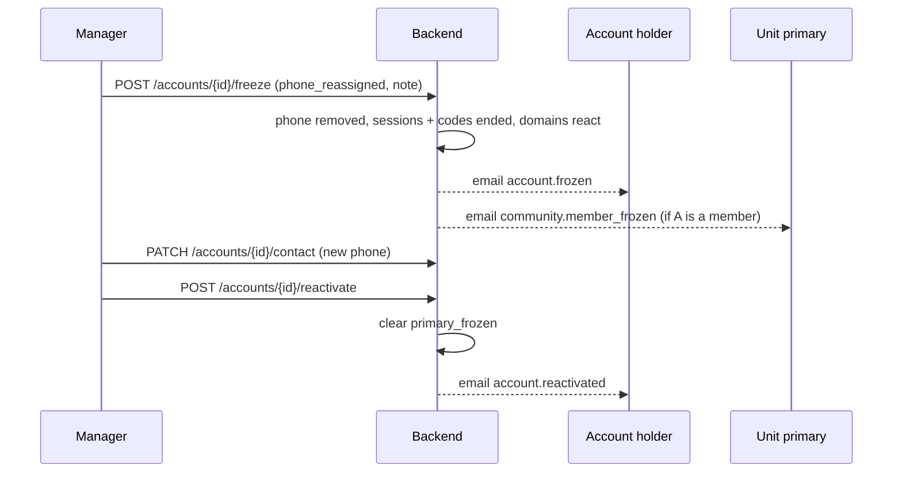
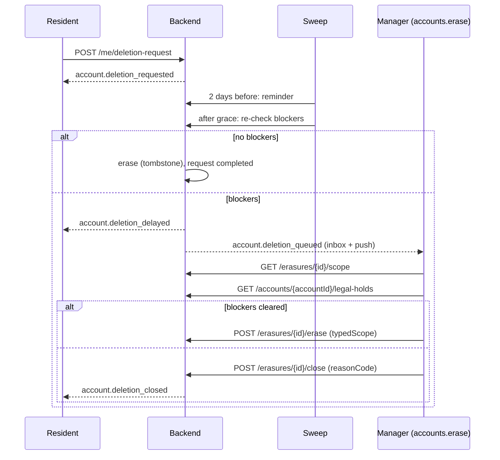
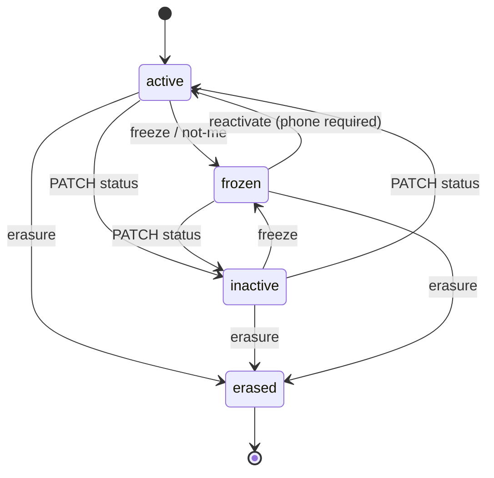
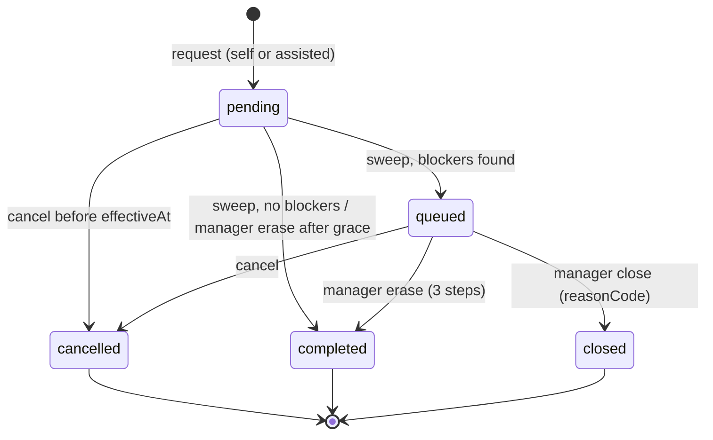

# الحسابات المجمّدة والمسح النهائي — Frozen accounts and erasure

> **التطبيق/الواجهة:** manager dashboard (تجميد/إعادة تفعيل، طابور طلبات الحذف، المسح على 3 خطوات، الحجز القانوني)
> **الصلاحيات:** `accounts.manage` (تجميد، تغيير الهاتف، إعادة التفعيل) · `accounts.read` (عرض الحساب) · `accounts.erase` (طابور الحذف، النطاق، المسح، الإغلاق) · `accounts.legal_hold` (الحجز القانوني) · `residents.assist` (طلب حذف نيابةً عن الشخص) — كلها في دور `manager` الافتراضي
> **المصادر:** ADR 0023 · ADR 0036 · `src/core/accounts/` (`accounts.controller.ts`, `account-writer.ts`, `erasure.controller.ts`, `account-deletion.service.ts`, `account-lifecycle.ts`, `not-me.service.ts`) · `src/community/residents/freeze-hooks.ts` · `erasure-hooks.ts`

كل المسارات تحت `/api/v1`. القوائم والأسباب والأخطاء بالشكل الموحد (راجع README).

## الفكرة باختصار
- **التجميد:** لما رقم هاتف ساكن ينتقل لشخص آخر، المدير يجمّد الحساب: الرقم يُشال من الحساب للأبد، كل الجلسات والأكواد تنتهي، ولا يمكن الدخول. نفس التجميد يحدث لو الشخص نفسه ضغط "مش أنا" على تنبيه دخول غريب (لكن الرقم يبقى).
- **الاسترجاع:** المدير يضع رقماً جديداً (لو الرقم اتشال) ثم يعيد التفعيل.
- **الحذف:** الساكن (أو المدير نيابةً عنه) يطلب الحذف؛ بعد مهلة تراجع (14 يوماً افتراضياً) النظام يمسح الحساب تلقائياً، إلا لو فيه مانع؛ ساعتها الطلب يدخل **طابور المدير** (`queued`).
- المدير ينفّذ المسح على 3 خطوات (النطاق → الحجز القانوني → كتابة عبارة التأكيد) بعد إزالة الموانع، أو يغلق الطلب بلا مسح.
- **المسح = شاهد قبر (tombstone):** الصف يبقى بلا أي بيانات شخصية، والسجلات المالية والتدقيقية تبقى مشيرة لـ"مستخدم محذوف".

## الأدوار ومين بيعمل إيه

| الدور | يقدر يعمل إيه |
|---|---|
| المدير (`accounts.manage`) | يجمّد حساباً (ليس حسابه)؛ يغيّر الهاتف/الإيميل؛ يعيد تفعيل حساب مجمّد. |
| المدير (`accounts.erase`) | يرى طلبات الحذف المفتوحة؛ يرى نطاق المسح؛ ينفذ المسح؛ يغلق طلباً في الطابور. يستلم إشعار "طلب حذف يحتاج مراجعة". |
| المدير (`accounts.legal_hold`) | يرى الحجوزات النشطة على حساب؛ يضع حجزاً؛ يرفعه. |
| المدير (`residents.assist`) | يقدّم أو يلغي طلب حذف نيابةً عن شخص (راجع `../01-account/04-privacy-consents-export-deletion.md`). |
| صاحب الحساب | يطلب الحذف ويتراجع عنه؛ يضغط "مش أنا" (تجميد ذاتي) — راجع `../01-account/04-privacy-consents-export-deletion.md` و`../01-account/01-login.md`. |
| النظام (sweep كل ساعة) | يذكّر قبل الموعد بيومين؛ يمسح الطلبات المستحقة بلا موانع؛ يحوّل المتعطلة للطابور. |

## الشاشات اللي الفيتشر محتاجها
- في صفحة الحساب/الساكن: زر "تجميد (الرقم لم يعد له)" + حوار السبب.
- شارة "مجمّد" وحالة الاسترجاع: (1) "ضع رقماً جديداً" (2) "أعد التفعيل".
- حوار تغيير الهاتف (يرفض الرقم القديم المُزال).
- طابور "طلبات الحذف": المعلّقة (في مهلة التراجع) والمتعطلة (`queued`) مع موانعها، الأكثر تأخراً أولاً.
- معالج المسح على 3 خطوات: (1) النطاق: ما سيُمسح وما سيبقى + العبارة المطلوبة (2) الحجوزات القانونية (3) كتابة العبارة وتأكيد.
- حوار "إغلاق الطلب بدون مسح" مع كود سبب.
- قسم "الحجز القانوني" في صفحة الحساب: قائمة الحجوزات النشطة، "إضافة حجز" (سبب + ملاحظة)، "رفع الحجز" (سبب).

## الفلو خطوة بخطوة

### 1) تجميد حساب لأن الرقم انتقل لشخص آخر (مدير)
1. من صفحة الحساب → `POST /accounts/{id}/freeze` (`accounts.manage`).
2. Body: `reasonCode` = `phone_reassigned` (القيمة الوحيدة) + `reason` نص إجباري ≤1000. النص يُحفظ كملاحظة داخلية على سجل التجميد؛ **لا يُرسل** للشخص.
3. ممنوع تجميد حسابك أنت → `409 CANNOT_CHANGE_OWN_STATUS`. حساب مجمّد بالفعل → `409 ACCOUNT_FROZEN`.
4. ما يحدث في عملية واحدة:
   - الحالة `frozen`، و**الهاتف يُشال من الحساب نفسه** (`phone: null`)، وبصمة الرقم تُحفظ حتى لا يرجع لهذا الحساب أبداً.
   - الدخول بالهاتف يُحذف، والدخول بالإيميل يُقفل؛ كل الجلسات وكل أكواد OTP المعلقة تنتهي.
   - **في المجتمع:** لو هو رئيسي وحدة: يبقى رئيسياً، والوحدة تأخذ علامة `primary_frozen` (تظهر في طابور المراجعة)، وتفويضاته تستمر. لو هو فرد أسرة: رئيسي كل وحدة هو عضو فيها يستلم `community.member_frozen`.
   - **في باقي الدومينات:** QR الدخول ينتهي؛ تصاريح الزوار النشطة التي يستضيفها تُلغى؛ مفوَّضو الطرود الذين فوّضهم ينتهون؛ موافقات دخول الفني تُلغى؛ وردية الحارس (لو حارس) تُغلق؛ تذاكر الفني وطلبات الإدارة المسندة له تعود للطابور؛ أجهزة الـpush تُحذف.
   - إيميل `account.frozen` (حرج) لإيميل الحساب.
5. الرد `200` بتفاصيل الحساب (`status: "frozen"`, `phone: null`).

### 2) التجميد الذاتي "مش أنا" (يصل للمدير كحساب مجمّد)
1. صاحب الحساب يضغط "مش أنا" على تنبيه دخول من جهاز جديد: من التطبيق `POST /me/devices/{id}/not-me` أو من رابط الإيميل `POST /public/not-me` (راجع `../01-account/01-login.md`).
2. نفس آثار التجميد (الجلسات، الأكواد، الدومينات، `primary_frozen`)، لكن السبب `login_not_me` و**الرقم يبقى** على الحساب.
3. إيميل `account.frozen_not_me` (حرج). لو الحساب ليس `active` لا يحدث شيء.
4. عند المدير: الحساب يظهر `frozen` وفيه هاتف. الاسترجاع = إعادة التفعيل مباشرة (لا يلزم رقم جديد).
5. الـAPI لا يقول للمدير **لماذا** الحساب مجمّد (رقم انتقل أم "مش أنا"): وجود `phone` هو المؤشر الوحيد.

### 3) استرجاع الحساب المجمّد (مدير)
1. **خطوة 1 (فقط لو الرقم اتشال):** `PATCH /accounts/{id}/contact` بـ`{ phone }` جديد (`accounts.manage`) — أو `PATCH /residents/{id}/contact` (`residents.manage`).
   - الرقم المُزال سابقاً من نفس الحساب → `409 PHONE_RELEASED` (للأبد).
   - مسموح تعديل الإيميل وحده لحساب مجمّد بلا هاتف.
2. **خطوة 2:** `POST /accounts/{id}/reactivate` (بدون body).
   - غير مجمّد → `409 ACCOUNT_NOT_FROZEN`.
   - بلا هاتف → `409 ACCOUNT_PHONE_MUST_CHANGE` (ارجع للخطوة 1).
3. الأثر: الحالة `active`، الدخول يعمل، علامات `primary_frozen` على وحداته تُغلق، إيميل `account.reactivated`.
4. **لا يرجع تلقائياً** ما انتهى أثناء التجميد: الجلسات (يسجل دخول من جديد)، QR الدخول، تصاريح الزوار الملغاة، مفوَّضو الطرود، موافقات الفنيين، أجهزة الـpush.
5. ملاحظة: `PATCH /accounts/{id}/status` بـ`active` على حساب مجمّد → `409 ACCOUNT_FROZEN`؛ الطريق الوحيد هو `reactivate`.

### 4) كيف يصل طلب الحذف للمدير
1. صاحب الحساب يطلب الحذف (`POST /me/deletion-request` بكلمة التأكيد) أو المدير نيابةً عنه (`POST /accounts/{id}/deletion-request`، `residents.assist`) — التفاصيل في `../01-account/04-privacy-consents-export-deletion.md`.
2. الطلب يُرفض من البداية لو فيه مانع (`409 DELETION_BLOCKED`). وإلا يصبح `pending` مع `effectiveAt` = الآن + `DELETION_GRACE_DAYS` (14 يوماً افتراضياً).
3. أثناء المهلة يظهر في طابور المدير كـ`pending` (و`daysOverdue` سالب). الحساب يعمل عادي، والشخص يقدر يتراجع.
4. قبل الموعد بيومين: تذكير للشخص (inbox + إيميل).
5. بعد المهلة، الـsweep (كل ساعة) يعيد فحص الموانع داخل نفس العملية:
   - **لا موانع:** يمسح الحساب تلقائياً (كنظام) → الطلب `completed` ويختفي من الطابور. المدير لا يفعل شيئاً.
   - **فيه موانع:** الطلب يصبح `queued` مع `blockers`؛ الشخص يستلم `account.deletion_delayed`، وكل من يملك `accounts.erase` يستلم `account.deletion_queued`.
6. الشخص يقدر يلغي الطلب وهو `queued` أيضاً.

**الموانع (`blockers`) وكيف تُزال:**

| المانع | المعنى | ماذا يفعل المدير |
|---|---|---|
| `primary_resident` | الحساب رئيسي وحدة | عيّن رئيسياً آخر أو أنهِ إشغاله (`01-units-and-occupancy.md`) |
| `active_staff_role` | حساب طاقم/مدير نشط | عطّل الحساب (`PATCH /accounts/{id}/status` → `inactive`) |
| `legal_hold` | حجز قانوني نشط | ارفع الحجز (الفلو 8) لو انتهى سببه |
| `open_worker_obligations` | أجر عامل غير مسوّى لعامل سجّله، أو تعاقد مفتوح صدر له كود | سوِّ الالتزام (`../04-workers/02-worker-wages.md`) / أنهِ التعاقد |

### 5) طابور طلبات الحذف (مدير) — `GET /erasures`
1. `accounts.erase`. الطلبات `pending` و`queued` فقط، مرتبة بـ`effectiveAt` تصاعدياً (الأكثر تأخراً أولاً)، paged.
2. كل عنصر: `id`, `accountId`, `status`, `blockers` (للـ`queued` فقط؛ فارغة للـ`pending`), `assisted` (قدّمه المدير؟), `requestedAt`, `effectiveAt`, `daysOverdue` (أيام منذ انتهاء المهلة؛ سالب = ما زال في المهلة), `onLegalHold`.
3. **لا يوجد اسم**: لعرض الاسم استدعِ `GET /accounts/{accountId}` (`accounts.read`).
4. الأفعال المتاحة:
   - `pending` داخل المهلة: عرض النطاق فقط (المسح مرفوض).
   - `pending` بعد المهلة (قبل أن يمر الـsweep) أو `queued` بلا موانع: المسح بالخطوات الثلاث.
   - `queued`: إغلاق بلا مسح.

### 6) المسح على 3 خطوات (مدير)
1. **الخطوة 1 — النطاق:** `GET /erasures/{id}/scope` (`accounts.erase`).
   - يرجع: `requestId`, `accountId`, `scopePhrase` (مثل `ERASE 1a2b3c4d`), و`erased`: `personalFields` (`fullName, phone, email, idDocumentType, idDocumentNumber, nationality, birthDate`), `activeOccupancies`, `activeMemberships`, `workerEngagementsRequested`, `sessions`, `pendingMessages`, `invitesAccepted`؛ و`kept`: `auditEntries` (تبقى مشيرة لمستخدم محذوف).
   - طلب ليس `pending`/`queued` → `404 DELETION_REQUEST_NOT_FOUND`.
2. **الخطوة 2 — الحجوزات:** `GET /accounts/{accountId}/legal-holds` (`accounts.legal_hold`). أي حجز نشط = لا مسح؛ اعرضه واطلب رفعه أولاً (الفلو 8).
3. **الخطوة 3 — التنفيذ:** `POST /erasures/{id}/erase` بـ`{ typedScope }` (1–200 حرف) = العبارة **بالضبط**.
   - الترتيب في الفحص: الطلب موجود ومفتوح → مهلة التراجع انتهت (`409 DELETION_GRACE_NOT_OVER` مع `params.effectiveAt`) → لا حجز قانوني (`409 LEGAL_HOLD_ACTIVE`) → لا موانع أخرى (`409 DELETION_BLOCKED` مع `params.blockers`) → العبارة صحيحة (`400 SCOPE_CONFIRMATION_MISMATCH`).
   - النجاح `204`. الطلب يصبح `completed` والحساب `erased`.
4. **ماذا يحدث عند المسح:**
   - كل الحقول الشخصية `null`، الحالة `erased`؛ بيانات الدخول والجلسات تُحذف؛ أكواد OTP تُلغى؛ الإيميلات المنتظرة له تُفرَّغ؛ الدعوات التي أدخلته تفقد بياناتها الشخصية؛ ملاحظات التجميد تُمسح.
   - **المجتمع:** إشغالاته النشطة تنتهي (`account_erased`)؛ عضوياته في الأسر تنتهي (ورئيسي الوحدة يستلم `household.member_account_deleted` بكود الوحدة فقط)؛ العمال الذين سجّلهم تنتهي تعاقداتهم مع `settle_before_close`؛ تفويضاته تنتهي.
   - **باقي الدومينات:** QR الدخول، تصاريح الزوار، مفوَّضو الطرود، الأجهزة وروابط الإيميل، التفضيلات، الموافقات (تُسحب كنظام)، التصديرات وملفاتها، الصورة، رسائل التذاكر (تُفرَّغ)، وغيرها.
   - آخر إيميل `account.erased` يُرسل لعنوانه قبل حذفه.
   - سجل الـaudit لا يُمس.

### 7) إغلاق طلب في الطابور بدون مسح (مدير)
1. `POST /erasures/{id}/close` (`accounts.erase`) بـ`{ reasonCode }` فقط، من `blockers_unresolved`, `withdrawn`, `other`.
2. يعمل على `queued` فقط؛ غير ذلك → `404 DELETION_REQUEST_NOT_FOUND`. بدون كود → `400 REASON_REQUIRED`.
3. الطلب يصبح `closed`؛ الشخص يستلم `account.deletion_closed` (inbox + إيميل) ويقدر يطلب من جديد.
4. الرد `204`.

### 8) الحجز القانوني (مدير)
1. **عرض:** `GET /accounts/{id}/legal-holds` (`accounts.legal_hold`) — الحجوزات **النشطة فقط**: `id`, `accountId`, `reasonCode`, `placedAt`. حساب غير موجود → `404 ACCOUNT_NOT_FOUND`.
2. **وضع حجز:** `POST /accounts/{id}/legal-holds` بـ`reasonCode` من `litigation`, `regulator_request`, `financial_audit`, `other` + `reason` نص إجباري ≤1000 (ملاحظة داخلية، لا تُعرض ولا تُرسل).
   - حجز نشط واحد بالكثير لكل حساب → ثانٍ = `409 LEGAL_HOLD_ACTIVE`.
   - حساب ممسوح/غير موجود → `404 ACCOUNT_NOT_FOUND`.
   - الشخص يستلم إيميل `account.legal_hold_placed` ("حذف بياناتك معلّق لالتزام قانوني") — **بدون السبب**. يُرسل حتى لو لا يوجد طلب حذف.
   - الرد `201 { id }`.
3. **رفع الحجز:** `POST /legal-holds/{id}/release` بـ`reasonCode` من `resolved`, `other` + `reason` نص (إجباري في الفحص لكنه **لا يُحفظ**). حجز مرفوع/غير موجود → `404 LEGAL_HOLD_NOT_FOUND`. الرد `204`. لا إشعار للشخص.
4. **كيف يمنع الحجز المسح:**
   - طلب حذف جديد → `409 DELETION_BLOCKED` (`legal_hold`).
   - طلب `pending` يصل موعده → يتحول `queued` بمانع `legal_hold`.
   - المسح اليدوي → `409 LEGAL_HOLD_ACTIVE`.
   - وضع الحجز لا يغيّر حالة الطلب الحالي؛ رفعه لا يعيد تشغيل المسح تلقائياً (طلب `queued` يحتاج المدير).

## الحالات (Statuses)

**حالة الحساب `AccountStatus`**

| القيمة | المعنى | مين يحركها |
|---|---|---|
| `active` | يعمل | الإنشاء؛ `reactivate` من `frozen`؛ `PATCH status` من `inactive` |
| `inactive` | معطّل (لا دخول) | `PATCH status`؛ أو تلقائياً لفرد أسرة فقد كل عضوياته |
| `frozen` | مجمّد: لا دخول؛ الهاتف `null` (لو `phone_reassigned`) | المدير (`freeze`) أو صاحب الحساب ("مش أنا") |
| `erased` | ممسوح نهائياً (tombstone) | المسح فقط (يدوي أو الـsweep). نهائي |

**سبب التجميد `AccountFreezeReason`:** `phone_reassigned` (الرقم يُشال) · `login_not_me` (الرقم يبقى). لا يظهر في أي view.

**حالة طلب الحذف `DeletionRequestStatus`**

| القيمة | المعنى | مين يحركها |
|---|---|---|
| `pending` | في مهلة التراجع (أو انتهت ولم يمر الـsweep بعد) | الشخص أو المدير نيابةً عنه |
| `cancelled` | تراجع | الشخص أو المدير نيابةً عنه (قبل `effectiveAt`، أو وهو `queued`) |
| `queued` | انتهت المهلة وفيه موانع؛ عند المدير | الـsweep |
| `completed` | الحساب مُسح | الـsweep أو المدير (`erase`) |
| `closed` | المدير أغلقه بلا مسح | المدير (`close`) |

**الحجز القانوني:** نشط (`releasedAt = null`) ← مرفوع.

## البيانات اللي بتظهر
- **الحساب المجمّد** (`GET /accounts/{id}`, `GET /residents/{id}`): `status: "frozen"`، `phone: null` (لسبب `phone_reassigned`). لا يُعرض سبب التجميد ولا ملاحظته ولا تاريخه.
- **الحساب الممسوح:** في كل القوائم والتفاصيل `{ id, erased: true }` فقط؛ في المراجع `{ id, erased: true }` بدون اسم.
- **طابور الحذف (`PendingErasureView`):** راجع الفلو 5 — ids وتواريخ وأكواد فقط، بلا أسماء.
- **النطاق (`ErasureScopeView`):** أعداد فقط + `scopePhrase`. نص الـ`note` الإنجليزي في الـservice لا يُرسل؛ الواجهة تكتب جملتها ("السجلات المالية والتدقيقية تبقى مشيرة لمستخدم محذوف").
- **الحجز (`LegalHoldResponse`):** `id`, `accountId`, `reasonCode`, `placedAt`. الملاحظة لا تُرجع. الحجوزات المرفوعة لا تُرجع.
- **وضع حجز:** `{ id }`.

## القواعد والقيود
- التجميد: كود واحد `phone_reassigned` + نص ≤1000 (ملاحظة داخلية). لا تجميد للنفس. لا تجميد مزدوج.
- الرقم المُزال لا يرجع لنفس الحساب أبداً (`PHONE_RELEASED`).
- إعادة التفعيل تتطلب هاتفاً على الحساب؛ `PATCH status=active` لا يفتح حساباً مجمّداً.
- مهلة التراجع `DELETION_GRACE_DAYS` = 14 يوماً افتراضياً؛ التذكير قبلها بيومين؛ الـsweep كل `SWEEP_INTERVAL_MS` (ساعة).
- الموانع تُفحص عند الطلب، وعند التنفيذ (الـsweep أو المدير) مرة أخرى تحت قفل الحساب.
- المسح: طلب `pending` بعد المهلة أو `queued`؛ بلا موانع؛ بلا حجز؛ والعبارة `ERASE <أول 8 حروف من accountId>` مكتوبة بالضبط.
- الإغلاق: `queued` فقط؛ كود من `blockers_unresolved`, `withdrawn`, `other` (بدون نص).
- الحجز: واحد نشط لكل حساب؛ أسباب الوضع `litigation`, `regulator_request`, `financial_audit`, `other`؛ أسباب الرفع `resolved`, `other`.
- لا شيء من هذا يُرجع أسماء أو ملاحظات في القوائم؛ شاشة الطابور تحتاج استدعاء `GET /accounts/{id}` لكل عنصر لتعرض الاسم.

## الأخطاء اللي الـUI لازم يتعامل معاها

| HTTP + الكود | متى | رسالة/سلوك مقترح |
|---|---|---|
| `400 REASON_REQUIRED` | سبب ناقص (تجميد، حجز، رفع حجز، إغلاق) | "اختر سبباً" (+ "اكتب ملاحظة" حيث يلزم) |
| `400 VALIDATION_FAILED` + `INVALID_REASON_CODE` | كود خارج القائمة (`params.allowed`) | أعد عرض القائمة |
| `400 SCOPE_CONFIRMATION_MISMATCH` | العبارة المكتوبة لا تطابق `scopePhrase` | "اكتب العبارة كما هي تماماً" |
| `404 ACCOUNT_NOT_FOUND` | حساب غير موجود (أو ممسوح عند وضع حجز) | "الحساب غير موجود" |
| `404 DELETION_REQUEST_NOT_FOUND` | الطلب لم يعد مفتوحاً (أو ليس `queued` عند الإغلاق) | أعد تحميل الطابور |
| `404 LEGAL_HOLD_NOT_FOUND` | الحجز مرفوع أو غير موجود | أعد تحميل الحجوزات |
| `409 CANNOT_CHANGE_OWN_STATUS` | تجميد حسابك | أخفِ الزر على حسابك |
| `409 ACCOUNT_FROZEN` | تجميد حساب مجمّد، أو `PATCH status=active` على مجمّد | "الحساب مجمّد؛ استخدم إعادة التفعيل" |
| `409 ACCOUNT_NOT_FROZEN` | إعادة تفعيل حساب غير مجمّد | أعد تحميل الحساب |
| `409 ACCOUNT_PHONE_MUST_CHANGE` | إعادة تفعيل بلا هاتف | "أضف رقم هاتف جديد أولاً" وافتح حوار الهاتف |
| `409 PHONE_RELEASED` | محاولة إرجاع الرقم المُزال | "هذا الرقم أُزيل من الحساب ولا يمكن إرجاعه" |
| `409 DELETION_GRACE_NOT_OVER` | مسح قبل انتهاء المهلة (`params.effectiveAt`) | "صاحب الحساب يستطيع التراجع حتى {التاريخ}" |
| `409 LEGAL_HOLD_ACTIVE` | مسح مع حجز نشط، أو وضع حجز ثانٍ | "يوجد حجز قانوني نشط" |
| `409 DELETION_BLOCKED` | مسح مع موانع (`params.blockers`) | اعرض كل مانع وطريقة إزالته (الجدول في الفلو 4) |
| `403 FORBIDDEN` | لا يملك الصلاحية | أخفِ الشاشة |

## الإشعارات

| الحدث | `kind` / مفتاح الإيميل | المستلم | Push؟ | عند الضغط |
|---|---|---|---|---|
| تجميد (مدير) | إيميل `account.frozen` | صاحب الحساب | لا (إيميل **حرج**: لا يؤجَّل) | — |
| تجميد ("مش أنا") | إيميل `account.frozen_not_me` | صاحب الحساب | لا (إيميل حرج) | — |
| تجميد فرد أسرة | إيميل `community.member_frozen` | رئيسي كل وحدة هو عضو فيها | لا | — |
| إعادة التفعيل | إيميل `account.reactivated` | صاحب الحساب | لا | — |
| طلب دخل الطابور | `account.deletion_queued` (inbox، عادي، `params.blockers`) | كل من يملك `accounts.erase` | نعم (حسب التفضيلات؛ غير حرج) | عنصر الطلب في طابور الحذف (`targetId` = id الطلب) |
| طلب دخل الطابور | `account.deletion_delayed` (inbox + إيميل، **حرج**) | صاحب الحساب | نعم (حرج) | حالة طلب الحذف في التطبيق |
| إغلاق بلا مسح | `account.deletion_closed` (inbox + إيميل، `params.reason` = الكود) | صاحب الحساب | نعم (غير حرج) | حالة طلب الحذف |
| وضع حجز قانوني | إيميل `account.legal_hold_placed` (بلا سبب) | صاحب الحساب | لا | — |
| المسح | إيميل `account.erased` (الأخير) | صاحب الحساب | لا | — |
| مسح فرد أسرة | `household.member_account_deleted` (inbox، كود الوحدة فقط) | رئيسي الوحدة | نعم (غير حرج) | شاشة الأسرة |
| طلب/تذكير/إلغاء الحذف | `account.deletion_requested` / `account.deletion_reminder` / إيميل الإلغاء | صاحب الحساب | راجع `../01-account/04-privacy-consents-export-deletion.md` | — |
| رفع حجز قانوني | لا شيء | — | — | — |

## الـEndpoints

| Method + Path | مين | الغرض | النجاح |
|---|---|---|---|
| `POST /accounts/{id}/freeze` | `accounts.manage` | تجميد (الرقم انتقل) | `200 AccountDetailView` |
| `PATCH /accounts/{id}/contact` | `accounts.manage` | رقم/إيميل جديد (خطوة 1 للاسترجاع) | `200 AccountDetailView` |
| `POST /accounts/{id}/reactivate` | `accounts.manage` | إعادة التفعيل (خطوة 2) | `200 AccountDetailView` |
| `GET /accounts/{id}` | `accounts.read` | تفاصيل الحساب (للاسم والحالة) | `200 AccountDetailView` أو `{id, erased}` |
| `GET /erasures` | `accounts.erase` | طلبات الحذف المفتوحة | `200 {data: PendingErasureView[], nextCursor}` |
| `GET /erasures/{id}/scope` | `accounts.erase` | الخطوة 1: النطاق والعبارة | `200 ErasureScopeView` |
| `POST /erasures/{id}/erase` | `accounts.erase` | الخطوة 3: المسح | `204` |
| `POST /erasures/{id}/close` | `accounts.erase` | إغلاق طلب `queued` | `204` |
| `GET /accounts/{id}/legal-holds` | `accounts.legal_hold` | الخطوة 2: الحجوزات النشطة | `200 {data: LegalHoldResponse[]}` |
| `POST /accounts/{id}/legal-holds` | `accounts.legal_hold` | وضع حجز | `201 {id}` |
| `POST /legal-holds/{id}/release` | `accounts.legal_hold` | رفع حجز | `204` |
| `GET /accounts/{id}/deletion-request` | `residents.assist` | آخر طلب حذف للحساب | `200` (راجع ملف الخصوصية) |
| `POST /accounts/{id}/deletion-request` (`/cancel`) | `residents.assist` | طلب/إلغاء نيابةً عنه | `201` / `204` |

## ملاحظات للديزاين وحاجات ناقصة في الباك
- الـAPI لا يكشف **سبب** التجميد ولا تاريخه ولا الملاحظة؛ المدير يميّز "رقم انتقل" من "مش أنا" فقط بوجود `phone`.
- نص `reason` في التجميد لا يصل للشخص (يُحفظ كملاحظة داخلية فقط، والإيميل عام).
- إيميل `account.reactivated` يقول "أُعيد التفعيل **برقم هاتف جديد**" حتى في حالة "مش أنا" حيث الرقم لم يتغير.
- إيميل وضع الحجز يعد الشخص "سنُعلمك عند رفع التعليق"، لكن رفع الحجز لا يرسل شيئاً.
- نص `reason` عند رفع الحجز إجباري في الفحص لكنه لا يُحفظ في أي مكان.
- لا يوجد عرض لتاريخ الحجوزات المرفوعة ولا لملاحظاتها.
- طابور الحذف يعرض `accountId` فقط (v0-notes): الشاشة تحتاج طلباً إضافياً لكل عنصر لعرض الاسم؛ لا بحث ولا فلتر بالحالة.
- لا يوجد عرض للطلبات المنتهية (`completed`, `cancelled`, `closed`) في الطابور.
- رفع الحجز أو إزالة موانع أخرى لا يعيد تنفيذ طلب `queued` تلقائياً؛ المدير يجب أن يعود وينفذ الخطوات الثلاث.
- ADR 0023 الأصلي ذكر مهلة 30 يوماً وتقرير "متأخر" (`ERASURE_OVERDUE_DAYS`)؛ ADR 0036 استبدلهما بالمسح التلقائي ومهلة 14 يوماً. الكود يطابق 0036، وقالب إيميل `account.erasure_overdue` ما زال موجوداً بلا استخدام.
- التجميد لا يرفض صراحةً حساباً ممسوحاً (الكود لا يفحص `erased` قبل التجميد)؛ الواجهة يجب ألا تعرض زر التجميد على حساب ممسوح.
- ما ينتهي أثناء التجميد (QR، تصاريح زوار، مفوَّضو طرود، موافقات فنيين) لا يعود بإعادة التفعيل؛ الواجهة قد تحتاج تنبيه الشخص بإعادة إعدادها.
