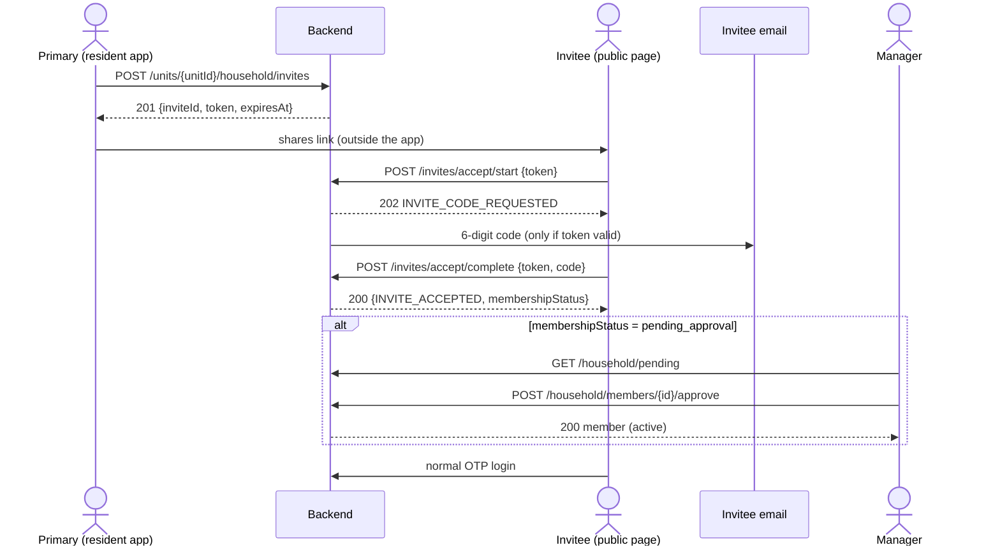
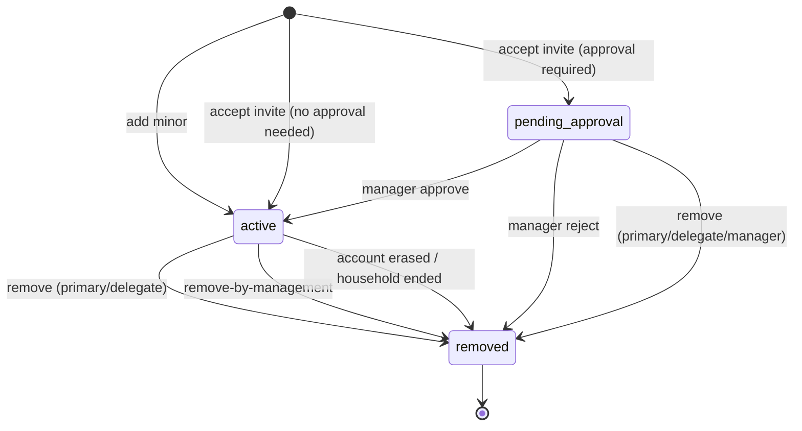
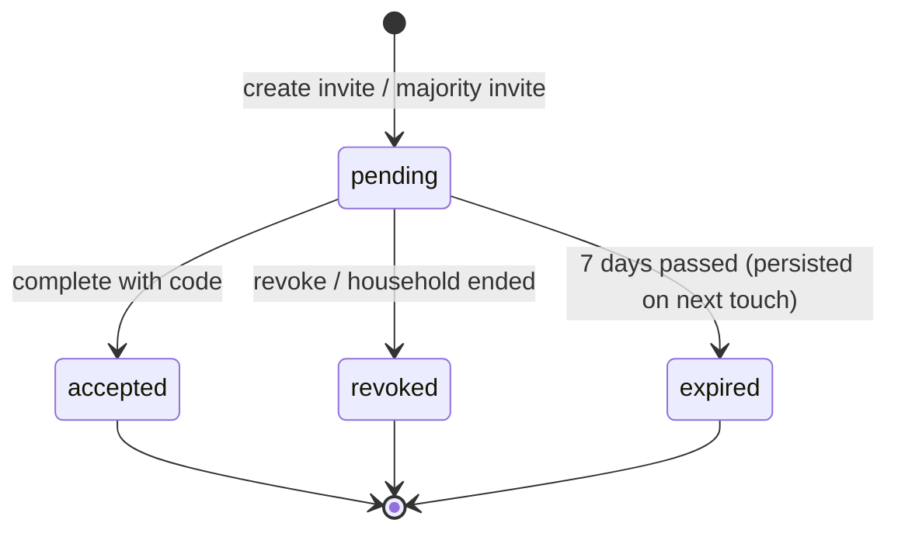

# أسرة الوحدة والدعوات — Household & Invites

> **التطبيق/الواجهة:** resident app (الساكن الرئيسي) · family member (فرد الأسرة / المفوَّض) · public web page (no login) لقبول الدعوة · manager dashboard (الموافقة والإزالة بقرار الإدارة)
> **الصلاحيات:** `units.read` (قراءة الأسرة — في أدوار `resident` و`family_member` و`manager`) · `household.manage` (الدعوة، إضافة قاصر، الإزالة، القُصّر اللي بلغوا 18 — في `resident` و`family_member`، وفوقها لازم يكون المستخدم **الساكن الرئيسي** أو **مفوَّض بنطاق `household`**) · `household.approve` و`household.override` (في دور `manager` فقط) · `residents.read` (دور `manager`: بيخلّي المدير يشوف أكواد صلاحيات كل فرد). الـcapability `householdView` و`householdManage` من `GET /me/units/:unitId/capabilities` لإظهار/إخفاء الأقسام.
> **المصادر:** ADR 0016 · ADR 0021 · `src/community/households/`

## الفكرة باختصار
كل وحدة ليها **ساكن رئيسي** (primary resident) واحد بالكتير من بين شاغلي الوحدة (owner/tenant). الساكن الرئيسي بيدير "أسرة الوحدة": البالغين بيدخلوا **بدعوة فقط** (لازم إيميل)، وبيتعمل لهم حساب من نوع `family` لما يقبلوا. الأطفال (أقل من 18) بيتضافوا **مباشرة من غير حساب**. لما طفل يكمّل 18 السيستم بيبلّغ الساكن الرئيسي، وهو اللي يأكّد بدعوة الطفل لحساب خاص بيه. ممكن الإدارة تشترط موافقتها على أي فرد جديد. أي إزالة لازم يكون ليها سبب، والشخص بيتبلّغ بالإيميل ("never silent").

> الساكن الرئيسي وباقي الشاغلين (occupancies) **مش** جزء من قائمة أفراد الأسرة دي؛ هم في `01-units-and-occupancy.md`. قائمة الأسرة هنا = الأفراد اللي مش شاغلين (زوج/زوجة، أولاد، أهل...).

## الأدوار ومين بيعمل إيه

| الدور | يقدر يعمل إيه |
|---|---|
| الساكن الرئيسي (`resident`، `isPrimary=true`) | يشوف الأسرة كاملة + صلاحيات كل فرد + الدعوات المعلّقة · يدعو بالغ · يلغي دعوة · يضيف قاصر · يشوف القُصّر اللي بلغوا 18 ويدعوهم لحساب خاص (**هو بس**) · يزيل فرد بسبب |
| مفوَّض بنطاق `household` (حساب `family` بالغ) | نفس صلاحيات الساكن الرئيسي في الأسرة **ماعدا**: قائمة `minors-ready` ودعوة البلوغ (للرئيسي فقط)، ومايقدرش يزيل نفسه أو الساكن الرئيسي. كل فعل بيتسجّل `onBehalfOf` الرئيسي. التفاصيل في `06-delegation.md` |
| شاغل تاني ساكن في الوحدة (مش رئيسي) / فرد أسرة عادي | يشوف قائمة الأفراد بس (من غير صلاحياتهم ومن غير الدعوات). أي محاولة إدارة ← `NOT_PRIMARY_RESIDENT` |
| مالك مؤجِّر (owner مش ساكن) | **مايشوفش الأسرة خالص** ← `403 FORBIDDEN` |
| فرد `pending_approval` أو `removed` | مايشوفش الوحدة أصلاً (الوحدة مش ظاهرة له) |
| المدير (`manager`) | يشوف الأسرة (ومع `residents.read` يشوف أكواد صلاحيات كل فرد `grantedPermissions`) · قائمة طلبات الانضمام المعلّقة على مستوى الكمباوند · موافقة / رفض بسبب · إزالة فرد بقرار الإدارة (`household.override`) |
| المدعو (من غير حساب) | يفتح لينك الدعوة → يطلب كود على إيميله → يدخل الكود → يتعمل له حساب |
| السيستم (sweep كل ساعة) | يبلّغ الساكن الرئيسي مرة واحدة يوم ما قاصر يكمّل 18 |

## الشاشات اللي الفيتشر محتاجها
- **شاشة "أسرتي"** (resident/family app): قائمة الأفراد (الاسم، صلة القرابة، قاصر/بالغ، الحالة) + للرئيسي/المفوَّض: صلاحيات كل فرد وقسم "دعوات معلّقة" بتاريخ انتهاء.
- **فورم دعوة فرد بالغ**: الاسم، الموبايل، الإيميل، صلة القرابة، بيانات الهوية.
- **شيت "شارك لينك الدعوة"**: بيظهر مرة واحدة بعد إنشاء الدعوة (التوكن مش بيرجع تاني)، مع تاريخ انتهاء الدعوة وزرار مشاركة.
- **ديالوج إلغاء دعوة** (تأكيد بسيط، من غير سبب).
- **فورم إضافة طفل (قاصر)**: الاسم، صلة القرابة، بيانات الهوية.
- **قائمة "بلغوا سن الرشد"** (للرئيسي فقط) + **فورم دعوة البلوغ** (إيميل + موبايل الشخص) + شيت مشاركة اللينك.
- **ديالوج إزالة فرد**: اختيار سبب من قائمة + نص السبب (بيتبعت للشخص).
- **صفحة ويب عامة لقبول الدعوة** (من غير لوجين): خطوة 1 "ابعتلي الكود"، خطوة 2 إدخال كود من 6 أرقام، خطوة 3 نجاح (ومعاها حالة "في انتظار موافقة الإدارة" لو الكمباوند بيشترط).
- **داشبورد المدير — "طلبات الانضمام"**: قائمة مرتّبة الأقدم أولاً (الوحدة، الاسم، الصلة، وقت الطلب) + زرار موافقة + ديالوج رفض بسبب.
- **داشبورد المدير — إزالة فرد بقرار الإدارة**: ديالوج سبب (من صفحة الوحدة).

## الفلو خطوة بخطوة

### 1) عرض أسرة الوحدة
1. أي حد شايف الوحدة يطلب `GET /units/{unitId}/household`.
2. الرد object (مش list): `members` دايماً، و`invites` للرئيسي أو المفوَّض بس.
3. اللي بيرجع حسب مين بيسأل:
   - **الرئيسي أو مفوَّض `household` ساري**: كل فرد معاه `permissions` (`[{permission, capPerOperation}]`) + `invites` (الدعوات المعلّقة اللي لسه ماانتهتش، مش شامل دعوات البلوغ).
   - **مدير معاه `residents.read`**: كل فرد معاه `grantedPermissions` (أكواد بس، من غير سقف المالية، ومن غير الدعوات).
   - **أي حد تاني شايف الأسرة**: الأفراد بس.
4. الأفراد المعروضين = `active` + `pending_approval`، مرتبين بتاريخ الإضافة (الأقدم أولاً).
5. لو المستخدم مالك مؤجِّر ← `403 FORBIDDEN`. لو الوحدة مش ظاهرة له ← `404 UNIT_NOT_FOUND`.
6. ملخّص سريع للرئيسي موجود في `GET /me/units` (`household.memberCount`, `household.pendingInvites`) — راجع `01-units-and-occupancy.md`.

### 2) دعوة فرد بالغ
1. الرئيسي (أو المفوَّض) يفتح فورم الدعوة ويبعت `POST /units/{unitId}/household/invites`:
   - `fullName` (مطلوب، 2–200 حرف)
   - `phone` (مطلوب، رقم موبايل صالح)
   - `email` (مطلوب — كود القبول بيروح عليه هو بس)
   - `relation` (مطلوب: `spouse` | `child` | `parent` | `sibling` | `other`)
   - بيانات الهوية: `idDocumentType` (`national_id` | `passport`)، `idDocumentNumber` (رقم قومي 14 رقم، أو باسبور 5–20 حرف/رقم)، `nationality` (ISO مثل `EG` — مطلوبة مع الباسبور)، `birthDate` (`YYYY-MM-DD` — مطلوب مع الباسبور، وبيتجاهل مع الرقم القومي لأن تاريخ الميلاد بيتاخد منه).
2. الباك بيتأكد:
   - الشخص بالغ (18+) حسب تاريخ الميلاد، وإلا ← `INVITE_MINOR_NOT_ALLOWED` (الطفل بيتضاف مباشرة، فلو التاريخ طلع قاصر اعرض زرار "أضفه كطفل").
   - المستخدم رئيسي أو مفوَّض.
   - الوحدة مش تحت مراجعة وفاة (`HOUSEHOLD_UNDER_REVIEW`).
   - فيه مكان: (أفراد active + pending + دعوات معلّقة) أقل من حد الكمباوند، وإلا ← `HOUSEHOLD_LIMIT_REACHED` مع `params.max`.
3. الرد `201`: `{inviteId, token, expiresAt}` (header `no-store`).
   - **التوكن بيظهر مرة واحدة بس**، والباك مش بيبعت اللينك لحد. الـUI لازم يبني لينك الدعوة من التوكن ويخلّي المستخدم يشاركه (واتساب/SMS/نسخ).
   - الدعوة صالحة **7 أيام**.
4. الدعوة تظهر في قسم `invites` في شاشة الأسرة (الاسم، الصلة، `expiresAt`).

### 3) إلغاء دعوة
1. الرئيسي/المفوَّض يضغط "إلغاء" على دعوة معلّقة ← `POST /household/invites/{id}/revoke` (من غير body).
2. الرد `204`. اللينك بيبطل فوراً. الـapp يعيد تحميل الأسرة.
3. لو الدعوة اتقبلت أو اتلغت قبل كده أو انتهت ← `404 INVITE_NOT_FOUND` (الدعوة المنتهية بتتسجّل `expired` وقتها).

### 4) قبول الدعوة (صفحة ويب عامة، من غير لوجين)
1. المدعو يفتح اللينك. الصفحة تقرا التوكن من اللينك.
2. يضغط "ابعتلي الكود" ← `POST /invites/accept/start` بـ`{token}` (و`Accept-Language` بيحدد لغة إيميل الكود).
3. الرد **دايماً** `202` `{code: "INVITE_CODE_REQUESTED"}` سواء التوكن سليم أو لا (مقصود، لأسباب أمان). الصفحة تقول: "لو الدعوة صالحة، اتبعت كود على الإيميل المدعو".
   - الكود بيتبعت للإيميل اللي الداعي كتبه **وبس**؛ المدعو مايدخلش إيميل.
   - الكود 6 أرقام، صالح 5 دقايق (افتراضي)، و5 محاولات. طلب كود جديد بيلغي القديم.
4. المدعو يدخل الكود ← `POST /invites/accept/complete` بـ`{token, code}` (`code` = 6 أرقام بالظبط).
5. لو نجح: `200` `{code: "INVITE_ACCEPTED", membershipStatus}`:
   - بيتعمل حساب `family` من بيانات الدعوة (أو بيتعاد استخدام حساب `family` موجود في نفس الكمباوند بنفس الإيميل، ولو كان موقوف بيتفعّل).
   - العضوية: `active`، أو `pending_approval` لو الكمباوند مفعّل "موافقة الإدارة على انضمام الأسرة".
   - الفرد بياخد الصلاحيات الافتراضية: `visitors_invite`, `bookings`, `tickets` (راجع `07-member-permissions.md`).
   - الرد مافيهوش أي IDs ولا توكن دخول. الصفحة تقول "تم، سجّل دخول من التطبيق برقمك أو إيميلك" (لوجين OTP العادي).
   - لو `membershipStatus = pending_approval`: اعرض "طلبك في انتظار موافقة إدارة الكمباوند".
6. أي فشل (توكن غلط/منتهي، كود غلط، دعوة اتلغت) ← نفس الرد `401 OTP_INVALID`. كتير محاولات ← `429 RATE_LIMITED`.

### 5) موافقة الإدارة على عضو جديد (لو مفعّلة)
1. المدير يفتح "طلبات الانضمام" ← `GET /household/pending` (cursor-paged، الأقدم أولاً، على مستوى الكمباوند كله).
2. كل عنصر: `memberId`, `unitId`, `unitCode`, `fullName`, `relation`, `requestedAt`.
3. **موافقة** ← `POST /household/members/{id}/approve` (من غير body) ← `200` بالعضو بعد التفعيل (`status: active`). مفيش إشعار بيتبعت للعضو عند الموافقة.
4. **رفض** ← `POST /household/members/{id}/reject` بـ`{reasonCode, reason}`:
   - `reasonCode` من: `not_verified` | `not_a_member` | `other`.
   - `reason`: النص اللي هيوصل للشخص (حد أقصى 1000 حرف).
   - الرد `204`. العضوية تبقى `removed`، والشخص بيوصله إيميل "لم تتم الموافقة على طلب انضمامك" بالسبب. لو مالوش عضوية active تانية، حسابه بيتوقف وجلساته بتتقفل.
5. الاتنين مرفوضين لو الوحدة تحت مراجعة وفاة (`HOUSEHOLD_UNDER_REVIEW`). لو العضو مش `pending_approval` ← `404 HOUSEHOLD_MEMBER_NOT_FOUND`.

### 6) إضافة طفل (قاصر) من غير حساب
1. الرئيسي/المفوَّض يبعت `POST /units/{unitId}/household/minors`:
   - `fullName` (2–200)، `relation`، وبيانات الهوية (نفس قواعد الدعوة).
2. لو تاريخ الميلاد طلع بالغ ← `MEMBER_NOT_MINOR` (اعرض "البالغين بينضموا بدعوة").
3. نفس فحص حد الأسرة ومراجعة الوفاة.
4. الرد `201`: العضو `{id, fullName, relation, isMinor: true, status: "active", createdAt}` — بيبقى active فوراً (مفيش موافقة إدارة للقُصّر).
5. القاصر مالوش حساب، ومالوش أي صلاحيات (مايقدرش يمسك صلاحية).

### 7) قاصر بيكمّل 18 سنة
1. **تلقائياً (sweep كل ساعة):** يوم عيد ميلاده الـ18 بتوقيت الكمباوند، السيستم بيبعت للساكن الرئيسي إيميل مرة واحدة: "فلان بلغ سن الرشد… ادعه لحساب خاص به لتأكيد ذلك". **الوضع مش بيتغيّر تلقائياً** — العضو بيفضل `isMinor: true`.
   - لو الوحدة مالهاش ساكن رئيسي، الإشعار بيتسجّل "undeliverable".
2. الرئيسي يفتح "بلغوا سن الرشد" ← `GET /units/{unitId}/household/minors-ready` (للرئيسي فقط؛ المفوَّض ← `NOT_PRIMARY_RESIDENT`):
   - القُصّر الـactive اللي عمرهم 18+ النهارده بتوقيت الكمباوند، ومافيش لهم دعوة بلوغ معلّقة. مرتبين بتاريخ الميلاد.
   - القائمة دي مش معتمدة على إيميل الـsweep؛ بتتحسب وقت الطلب.
3. الرئيسي يدخل إيميل وموبايل الشخص ← `POST /household/members/{id}/majority-invite` بـ`{email, phone}`.
   - الاسم وبيانات الهوية بتتاخد من بيانات العضو نفسه.
   - لو لسه ماكملش 18 ← `409 MEMBER_NOT_YET_ADULT`. لو فيه دعوة بلوغ معلّقة ← `409 MAJORITY_INVITE_PENDING`. لو العضو مش قاصر active ← `404`.
   - الرد `201` `{inviteId, token, expiresAt}` — نفس شيت المشاركة (مرة واحدة، 7 أيام).
   - دعوة البلوغ **مابتاخدش مكان إضافي** في حد الأسرة، و**مابتظهرش** في قسم `invites`.
4. الشخص يقبل بنفس صفحة القبول (الخطوة 4). النتيجة:
   - **نفس صف العضو** بيتحوّل لبالغ بحساب (`isMinor: false`)، فتاريخه بيفضل متصل.
   - العضوية `active` على طول (مفيش موافقة إدارة).
   - بياخد الصلاحيات الافتراضية، وبيوصله إيميل "أصبح لك حساب على جوار".

### 8) إزالة فرد (من الأسرة)
1. الرئيسي/المفوَّض يفتح ديالوج الإزالة ← `POST /household/members/{id}/remove` بـ`{reasonCode, reason}`:
   - `reasonCode` من: `moved_out` | `relation_ended` | `misconduct` | `other`.
   - `reason`: نص بيتبعت للشخص (حتى 1000 حرف).
2. ينفع على عضو `active` أو `pending_approval`.
3. ممنوع:
   - المفوَّض يزيل نفسه أو الساكن الرئيسي ← `DELEGATION_NOT_ALLOWED`.
   - إزالة **بالغ** والوحدة عليها علامة "انفصال" (separation) ← `SEPARATION_MANAGER_DECISION` (اعرض "القرار ده للإدارة"). القاصر عادي يتزال.
   - الوحدة تحت مراجعة وفاة ← `HOUSEHOLD_UNDER_REVIEW`.
4. الرد `204`. اللي بيحصل:
   - العضوية `removed`.
   - أي تفويض لنفس الشخص على الوحدة بينتهي (`member_removed`) ويتبعت إيميل للطرفين.
   - لو مالوش عضوية active تانية، حسابه بيتوقف وكل جلساته بتتقفل، وصلاحيات الدخول من البوابة بتتحدّث.
   - الشخص بيوصله إيميل "تمت إزالتك من أسرة وحدة" بالسبب. القاصر (من غير إيميل) بيتسجّل له إشعار "undeliverable".

### 9) إزالة فرد بقرار الإدارة
1. المدير (`household.override`) ← `POST /household/members/{id}/remove-by-management` بـ`{reasonCode, reason}`:
   - `reasonCode` من: `separation` | `data_correction` | `other`.
2. ده الطريق الوحيد لإزالة بالغ أثناء الانفصال، أو أي عضو لما الأسرة مش قادرة تتصرف.
3. مرفوض بس تحت مراجعة الوفاة (`HOUSEHOLD_UNDER_REVIEW`). نفس آثار الإزالة العادية (إيميل، إيقاف حساب، إنهاء تفويض).

### 10) حالات تانية بتأثر على الأسرة (في ملفات تانية)
- تغيير الساكن الرئيسي، "إنهاء الأسرة" لما الوحدة تتنقل لحد تاني (كل العضويات بتنتهي وكل الدعوات المعلّقة بتتلغي)، مراجعة الصلاحيات بعد تغيير الرئيسي: `03-unit-review-and-life-events.md`.
- حذف حساب فرد: الساكن الرئيسي بيوصله إشعار in-app + إيميل بكود الوحدة بس (من غير اسم أو سبب).

## الحالات (Statuses)

**حالة العضوية `HouseholdMemberStatus`:**

| الحالة | المعنى | مين بيحرّكها |
|---|---|---|
| `pending_approval` | قبل الدعوة لكن الكمباوند بيشترط موافقة الإدارة | قبول الدعوة (لو الإعداد مفعّل) |
| `active` | فرد في الأسرة | قبول الدعوة / إضافة قاصر / موافقة المدير |
| `removed` | خرج من الأسرة (إزالة، رفض، حذف حساب، إنهاء الأسرة) | الرئيسي/المفوَّض، المدير، السيستم |

ملاحظة: القاصر اللي بيكمّل 18 ويقبل دعوة البلوغ بيفضل `active` (نفس الصف)، اللي بيتغيّر `isMinor` من `true` لـ`false`.

**حالة الدعوة `HouseholdInviteStatus`:**

| الحالة | المعنى | مين بيحرّكها |
|---|---|---|
| `pending` | مستنية القبول (7 أيام) | الإنشاء |
| `accepted` | المدعو أكّد بالكود | المدعو |
| `revoked` | اتلغت | الرئيسي/المفوَّض، أو إنهاء الأسرة |
| `expired` | عدّت 7 أيام | بتتسجّل أول ما أي عملية تلمس الدعوة (مفيش job). في القراءة الدعوة المنتهية بتختفي من القائمة |

## البيانات اللي بتظهر

**`GET /units/{unitId}/household` → `{members, invites?}`**

| الحقل | المعنى |
|---|---|
| `members[].id` | ID العضوية (مش ID الحساب) — بيستخدم في كل endpoints `household/members/{id}/...` |
| `members[].fullName` | الاسم (للقاصر من العضوية، للبالغ من حسابه). ممكن `null` |
| `members[].relation` | `spouse` / `child` / `parent` / `sibling` / `other` |
| `members[].isMinor` | قاصر من غير حساب |
| `members[].status` | `active` أو `pending_approval` |
| `members[].permissions` | للرئيسي/المفوَّض بس: `[{permission, capPerOperation}]` (السقف للمالية بس، string عشري) |
| `members[].grantedPermissions` | للمدير اللي معاه `residents.read` بس: أكواد الصلاحيات (من غير السقف) |
| `invites[]` | للرئيسي/المفوَّض بس: `{id, fullName, relation, expiresAt}` — مش شامل دعوات البلوغ |

- **عمرها ما بترجع** موبايل أو إيميل أو رقم هوية أو تاريخ ميلاد لأي فرد أو مدعو.
- `invites` بيكون **غايب** (مش `[]`) لو المستخدم مش رئيسي/مفوَّض.

**إنشاء دعوة / دعوة بلوغ → `{inviteId, token, expiresAt}`**: التوكن **بيظهر مرة واحدة**، ومش متخزّن غير كـhash. مفيش endpoint يرجّعه تاني؛ لو اتفقد لازم إلغاء وإنشاء دعوة جديدة.

**عضو (إضافة قاصر / موافقة / minors-ready)**: `{id, fullName, relation, isMinor, status, createdAt}`.

**طلبات الانضمام (مدير)**: `{memberId, unitId, unitCode, fullName, relation, requestedAt}` — من غير بيانات تواصل أو هوية.

**قبول الدعوة**: `start` ← `{code: "INVITE_CODE_REQUESTED"}` دايماً. `complete` ← `{code: "INVITE_ACCEPTED", membershipStatus}` من غير أي IDs.

## القواعد والقيود
- **حد الأسرة**: (أفراد `active` + `pending_approval` + دعوات معلّقة لسه ماانتهتش) < `maxHouseholdMembers` (افتراضي **10**، المدير يغيّره من 1 لـ100 في إعدادات الكمباوند). الشاغلين مش محسوبين. دعوة البلوغ مش محسوبة.
- **موافقة الإدارة**: `familyJoinRequiresApproval` (افتراضي `false`). بيأثّر على الدعوات العادية بس، مش على القُصّر ولا دعوات البلوغ.
- **السن**: البلوغ = 18 سنة. في الدعوة والقاصر بيتحسب بتوقيت مصر؛ في `minors-ready` ودعوة البلوغ والـsweep بتوقيت الكمباوند (`timezone`، افتراضي `Africa/Cairo`).
- **الدعوة**: صالحة 7 أيام، والإيميل مطلوب. الكود بيروح للإيميل المكتوب في الدعوة فقط.
- **كود القبول**: 6 أرقام، 5 دقايق، 5 محاولات، والجديد بيلغي القديم.
- **Rate limits** (افتراضي، كل 15 دقيقة): `start` 20 طلب لكل IP و5 لكل توكن؛ `complete` 20 لكل IP.
- **الأسباب** (`{reasonCode, reason}`، الاتنين مطلوبين، النص ≤ 1000 حرف — راجع README):
  - إزالة بالرئيسي/المفوَّض: `moved_out`, `relation_ended`, `misconduct`, `other`
  - رفض المدير: `not_verified`, `not_a_member`, `other`
  - إزالة بقرار الإدارة: `separation`, `data_correction`, `other`
  - النص بيتبعت للشخص في الإيميل، والكود بس اللي في سجل التدقيق.
- **مراجعة الوفاة** (`primary_deceased`): كل عمليات الأسرة (دعوة، إلغاء دعوة، قاصر، إزالة، موافقة/رفض، دعوة بلوغ) مرفوضة لحد ما الإدارة تحسمها. الـcapability `householdManage = false` وقتها، فاخفي أزرار الإدارة.
- **الانفصال** (`separation`): إزالة بالغ = قرار الإدارة بس.
- **مين يقدر يدير**: الساكن الرئيسي، أو مفوَّض `household` ساري ولسه ماانتهاش. التفويض المنتهي ← `DELEGATION_EXPIRED`.
- **المالك المؤجِّر** مابيشوفش الأسرة اللي ساكنة في وحدته.

## الأخطاء اللي الـUI لازم يتعامل معاها

| HTTP + `code` | إمتى | رسالة / سلوك مقترح |
|---|---|---|
| `400 VALIDATION_FAILED` | حقول غلط (`fields[]`: `INVALID_LENGTH`, `INVALID_EMAIL`, `INVALID_PHONE`, `INVALID_NATIONAL_ID`, `INVALID_PASSPORT_NUMBER`, `INVALID_NATIONALITY`, `BIRTH_DATE_REQUIRED`, `INVALID_BIRTH_DATE`, `INVALID_VALUE`, `INVALID_REASON_CODE`) | أظهر الخطأ تحت الحقل |
| `400 INVITE_MINOR_NOT_ALLOWED` | الدعوة لشخص أقل من 18 | "الأطفال بيتضافوا مباشرة" + زرار "إضافة كطفل" |
| `400 MEMBER_NOT_MINOR` | إضافة قاصر وهو بالغ | "البالغين بينضموا بدعوة" + زرار "دعوة" |
| `400 REASON_REQUIRED` | سبب ناقص (الكود أو النص) | علّم الحقل الناقص |
| `401 OTP_INVALID` | أي فشل في `complete` | "الكود غير صحيح أو منتهي، أو الدعوة لم تعد صالحة" + "إعادة إرسال الكود" |
| `403 FORBIDDEN` | مالك مؤجِّر بيفتح الأسرة / مفيش الصلاحية في الدور | اخفي القسم |
| `403 NOT_PRIMARY_RESIDENT` | مش رئيسي ولا مفوَّض (أو مفوَّض في `minors-ready`/دعوة البلوغ) | "الإجراء ده للساكن الرئيسي فقط" |
| `403 DELEGATION_EXPIRED` | تفويضك انتهى | "انتهى تفويضك لهذه الوحدة" وحدّث الشاشة |
| `403 DELEGATION_NOT_ALLOWED` | المفوَّض بيزيل نفسه أو الرئيسي | اخفي زرار الإزالة على الصفين دول |
| `403 HOUSEHOLD_UNDER_REVIEW` | الوحدة تحت مراجعة وفاة | "شؤون الوحدة قيد المراجعة مع الإدارة" |
| `403 SEPARATION_MANAGER_DECISION` | إزالة بالغ أثناء الانفصال | "القرار ده للإدارة، تواصل معها" |
| `404 UNIT_NOT_FOUND` | الوحدة مش ظاهرة للمستخدم | رجوع |
| `404 INVITE_NOT_FOUND` | إلغاء دعوة اتقبلت/اتلغت/انتهت | حدّث القائمة |
| `404 HOUSEHOLD_MEMBER_NOT_FOUND` | العضو مش في الحالة المطلوبة (اتشال، أو اتوافق عليه بالفعل...) | حدّث القائمة |
| `409 HOUSEHOLD_LIMIT_REACHED` (`params.max`) | الأسرة مليانة | "الأسرة وصلت للحد الأقصى ({max})" — اقترح إلغاء دعوة معلّقة |
| `409 MEMBER_NOT_YET_ADULT` | دعوة بلوغ قبل الـ18 بتوقيت الكمباوند | "لم يبلغ 18 بعد" |
| `409 MAJORITY_INVITE_PENDING` | فيه دعوة بلوغ معلّقة | "فيه دعوة متبعتة بالفعل" |
| `429 RATE_LIMITED` | محاولات كتير في صفحة القبول | "حاول بعد شوية" |

## الإشعارات

كل إشعارات الأسرة هنا **إيميل بس** (outbox)، ماعدا حذف الحساب. مفيش in-app لأغلبها.

| الحدث | النوع (`kind` / template) | مين بيستلم | Push؟ | الضغط يفتح |
|---|---|---|---|---|
| طلب كود القبول | OTP `invite_accept` (إيميل) | الإيميل المدعو | لا | — |
| إزالة فرد (بالرئيسي/المفوَّض/المدير/إنهاء الأسرة) | `household.member_removed` (إيميل بالسبب) | الفرد المُزال (القاصر: undeliverable) | لا | — |
| رفض طلب الانضمام | `household.join_rejected` (إيميل بالسبب) | الشخص المرفوض | لا | — |
| قاصر كمّل 18 (sweep) | `community.majority_reached` (إيميل) | الساكن الرئيسي (+ سجل undeliverable للقاصر) | لا | شاشة "بلغوا سن الرشد" |
| قبول دعوة البلوغ | `community.came_of_age` (إيميل) | الحساب الجديد | لا | — |
| إنهاء تفويض بسبب الإزالة | `household.delegation` (إيميل) | الطرفين | لا | راجع `06-delegation.md` |
| حذف حساب فرد | `household.member_account_deleted` (in-app + إيميل) | الساكن الرئيسي | نعم، عادي (مش critical) — "تم حذف حساب أحد أفراد الأسرة" | شاشة الأسرة (`target: household_member`) |
| موافقة المدير | — | مفيش إشعار | — | — |

## الـEndpoints

| Method + path | مين | الغرض | الرد |
|---|---|---|---|
| `GET /units/{unitId}/household` | أي حد شايف الأسرة (`units.read`) | الأفراد (+ الصلاحيات والدعوات حسب المشاهد) | `200 {members[], invites?[]}` |
| `POST /units/{unitId}/household/invites` | الرئيسي / مفوَّض `household` | دعوة بالغ | `201 {inviteId, token, expiresAt}` |
| `POST /household/invites/{id}/revoke` | الرئيسي / مفوَّض | إلغاء دعوة | `204` |
| `POST /units/{unitId}/household/minors` | الرئيسي / مفوَّض | إضافة قاصر | `201 member` |
| `GET /units/{unitId}/household/minors-ready` | الرئيسي فقط | القُصّر اللي بلغوا 18 | `200 {data: member[], nextCursor: null}` |
| `POST /household/members/{id}/majority-invite` | الرئيسي فقط | دعوة البالغ الجديد لحساب | `201 {inviteId, token, expiresAt}` |
| `POST /household/members/{id}/remove` | الرئيسي / مفوَّض | إزالة فرد بسبب | `204` |
| `GET /household/pending` | مدير (`household.approve`) | طلبات الانضمام | `200 {data[], nextCursor}` |
| `POST /household/members/{id}/approve` | مدير | موافقة | `200 member` |
| `POST /household/members/{id}/reject` | مدير | رفض بسبب | `204` |
| `POST /household/members/{id}/remove-by-management` | مدير (`household.override`) | إزالة بقرار الإدارة | `204` |
| `POST /invites/accept/start` | عام (من غير لوجين) | إرسال كود للإيميل المدعو | `202 {code: INVITE_CODE_REQUESTED}` |
| `POST /invites/accept/complete` | عام | تأكيد الكود وإنشاء الحساب/العضوية | `200 {code: INVITE_ACCEPTED, membershipStatus}` |

## ملاحظات للديزاين وحاجات ناقصة في الباك
- **شكل لينك الدعوة مش متحدد في الباك**: الباك بيرجّع `token` بس ومابيبعتش اللينك. لازم الفرونت يتفق على URL الصفحة العامة (مثلاً `…/invite?token=…`) ويبنيه.
- **الـUI لازم يحفظ اللحظة**: التوكن بيظهر مرة واحدة؛ صمّم شيت مشاركة واضح، و"نسيت أشارك" = إلغاء + دعوة جديدة.
- **دعوة البلوغ مش بتظهر في أي قائمة** (`invites` بيستبعدها، و`minors-ready` بيستبعد العضو اللي عنده دعوة معلّقة). مفيش طريقة لإلغائها أو إعادة إرسالها غير لو الـapp محتفظ بـ`inviteId`. ممكن نحتاج endpoint/حقل يبيّن "دعوة بلوغ معلّقة".
- **مفيش إشعار للعضو عند موافقة المدير**، ومفيش طريقة للعضو `pending_approval` يعرف حالته بعد صفحة القبول (`GET /me/units` بيرجّع العضويات الـactive بس). لو دخل التطبيق هيلاقي مفيش وحدات — محتاج حالة "طلبك قيد المراجعة".
- **قائمة طلبات الانضمام للمدير** فيها الاسم والصلة بس؛ مفيش موبايل/إيميل/هوية/مين دعاه، رغم إن سبب الرفض `not_verified`. التحقق هيبقى خارج النظام أو محتاج endpoint تفاصيل.
- **المدعو مايقدرش يعدّل بياناته** في صفحة القبول: الاسم والموبايل والهوية من اللي كتبه الداعي. الإيميل الغلط = الكود مش هيوصل أبداً (والرد دايماً 202).
- `members[].id` هو ID العضوية؛ **مفيش `accountId`** في الرد (مهم لفيتشر التفويض — راجع `06-delegation.md`).
- مفيش إشعار للساكن الرئيسي لما مدعو يقبل الدعوة (لازم يعيد فتح الشاشة).
- ADR 0016 الأصلي بيقول "minors get no email" بس الكود الحالي بيسجّل إشعار "undeliverable" للقاصر (تحديث 2.2) — مفيش أثر في الـUI.
- v0-notes: الأسرة object مش list، والشاشات تقرر لو الدعوات محتاجة endpoint منفصل.
