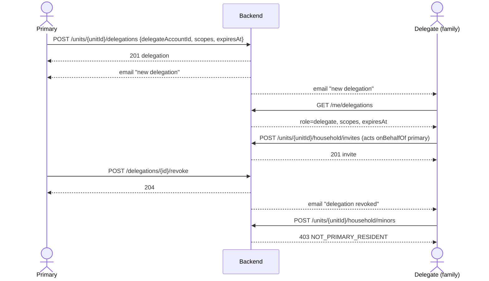
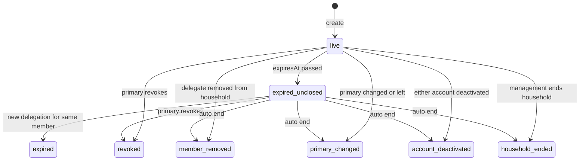

# التفويض — Delegation

> **التطبيق/الواجهة:** resident app (الساكن الرئيسي بينشئ ويلغي) · family member (المفوَّض بيشوف تفويضه ويستخدمه)
> **الصلاحيات:** `household.delegate` (دور `resident` فقط) لـ`/units/{unitId}/delegations` والإلغاء، وفوقها لازم يكون المستخدم **الساكن الرئيسي** للوحدة · `GET /me/delegations` مفتوح لأي حساب داخل الكمباوند (من غير permission) · استخدام التفويض نفسه بيتم من خلال `household.manage` (الأسرة) و`workers.manage` (العمالة) اللي في دور `family_member`.
> **المصادر:** ADR 0016 · `src/community/households/delegations.*` · `household-authority.ts`

## الفكرة باختصار
الساكن الرئيسي يقدر "يفوّض" فرد بالغ من أسرة الوحدة (عنده حساب) إنه يدير حاجات معيّنة بالنيابة عنه **لمدة محددة**. فيه نطاقين بس: إدارة أفراد الأسرة (`household`) وإدارة العمالة المنزلية (`workers`). الفلوس والعقود والتصويت والملكية **عمرها ما بتتفوّض**. التفويض لازم يكون ليه تاريخ انتهاء (سنة بالكتير)، وبينتهي لوحده في حالات معيّنة. الطرفين بيتبلّغوا بالإيميل في كل تغيير.

> التفويض ≠ صلاحيات الأفراد. التفويض = حد **بيدير** الأسرة بالنيابة عن الرئيسي. صلاحيات الأفراد = الفرد **بيستخدم** إيه (زوار، بلاغات…) — راجع `07-member-permissions.md`.

## الأدوار ومين بيعمل إيه

| الدور | يقدر يعمل إيه |
|---|---|
| الساكن الرئيسي | ينشئ تفويض لفرد بالغ · يشوف التفويضات السارية على الوحدة · يلغي تفويض · يشوف التفويضات اللي إداها في `GET /me/delegations` |
| المفوَّض (حساب `family`) | يشوف تفويضه في `GET /me/delegations` · يستخدم النطاق الممنوح (تحت). **مايقدرش** ينشئ أو يلغي أو يشوف قائمة تفويضات الوحدة (`403 FORBIDDEN` لأن دوره مافيهوش `household.delegate`) |
| أي شاغل تاني مش رئيسي | `NOT_PRIMARY_RESIDENT` |
| المدير | مالوش endpoints هنا. تغيير الساكن الرئيسي أو إنهاء الأسرة من ناحيته بينهي التفويضات تلقائياً (`03-unit-review-and-life-events.md`) |
| السيستم | ينهي التفويض تلقائياً (إزالة العضو، تغيير الرئيسي، إيقاف حساب، إنهاء الأسرة) — **مش** عند تاريخ الانتهاء |

### المفوَّض يقدر يعمل إيه بالظبط

| النطاق | مسموح | مش مسموح |
|---|---|---|
| `household` | يشوف الأسرة كاملة بصلاحيات الأفراد والدعوات المعلّقة · يدعو بالغ · يلغي دعوة · يضيف قاصر · يزيل فرد · يشوف صلاحيات فرد · يمنح/يسحب صلاحيات الأفراد (`visitors_invite`, `bookings`, `tickets`, `unit_security`) · سحب الكل | يزيل نفسه أو الساكن الرئيسي (`DELEGATION_NOT_ALLOWED`) · يمنح صلاحية `finance` (`DELEGATION_NOT_ALLOWED`) · قائمة "بلغوا سن الرشد" ودعوة البلوغ (للرئيسي فقط) · الطلبات المؤجلة (deferred actions) · أي تفويض (إنشاء/إلغاء/قائمة) · إزالة بالغ أثناء الانفصال |
| `workers` | إدارة العمالة المنزلية للوحدة بالنيابة عن الرئيسي، ويشوف أجور العمال (فيتشر العمالة المنزلية — ملف منفصل) | أي حاجة في الأسرة (لو مامعهوش `household` كمان) |

- كل فعل بيعمله المفوَّض بيتسجّل في سجل التدقيق `onBehalfOf` الساكن الرئيسي.
- لو التفويض انتهى تاريخه، أي محاولة استخدام ← `403 DELEGATION_EXPIRED`، وشاشة الأسرة بترجع تعرض له الأفراد بس.

## الشاشات اللي الفيتشر محتاجها
- **قائمة "التفويضات"** على صفحة الوحدة (للرئيسي): اسم المفوَّض، النطاقات، ينتهي في، اتعمل في + زرار إلغاء.
- **فورم تفويض جديد**: اختيار فرد بالغ من الأسرة، اختيار نطاق أو اتنين (checkboxes)، تاريخ الانتهاء (date picker بحد أقصى سنة من النهارده). وتوضيح ثابت إن التفويض مابيشملش فلوس/عقود/تصويت/ملكية.
- **ديالوج تأكيد الإلغاء** (من غير سبب).
- **"تفويضاتي"** (`/me/delegations`) للطرفين: كارت لكل تفويض فيه الوحدة، دوري (مفوِّض/مفوَّض)، الطرف التاني، النطاقات، ينتهي في.
- **مؤشّر "أنت مفوَّض"** في شاشة الأسرة/العمالة للمفوَّض (اختياري، من بيانات `/me/delegations`).

## الفلو خطوة بخطوة

### 1) إنشاء تفويض
1. الرئيسي يفتح "تفويض جديد" ويختار فرد.
2. `POST /units/{unitId}/delegations`:
   - `delegateAccountId` (مطلوب، UUID — **ID الحساب**، مش ID العضوية)
   - `scopes` (مطلوب، عنصر واحد على الأقل من `household` | `workers`؛ التكرار بيتشال)
   - `expiresAt` (مطلوب، date-time في المستقبل، بالكتير بعد سنة ميلادية من دلوقتي)
3. الباك بيتأكد:
   - المستخدم هو الساكن الرئيسي (المفوَّض ← `DELEGATION_NOT_ALLOWED`، أي حد تاني ← `NOT_PRIMARY_RESIDENT`).
   - الوحدة مش تحت مراجعة وفاة.
   - المفوَّض عضو `active` في نفس الوحدة، بالغ (18+ حسب تاريخ الميلاد المتسجّل في حسابه)، عنده حساب `active`. غير كده ← `DELEGATE_NOT_ELIGIBLE`.
   - مفيش تفويض ساري لنفس الشخص على نفس الوحدة ← غير كده `409 DUPLICATE_RESOURCE`. (لو فيه واحد قديم منتهي التاريخ، بيتقفل `expired` ويتبعت عنه إيميل، وبعدين الجديد بيتعمل.)
4. الرد `201`: `{id, unitId, delegateAccountId, scopes, expiresAt}`.
5. الطرفين بيوصلهم إيميل "تفويض جديد" بالنطاقات وتاريخ الانتهاء + "لا يشمل التفويض أي أمور مالية أو عقود أو تصويت أو ملكية".

### 2) عرض التفويضات
- **على الوحدة (للرئيسي فقط)**: `GET /units/{unitId}/delegations` ← `{data: [{id, delegate: {id, fullName}, scopes, expiresAt, createdAt}], nextCursor: null}`، السارية بس (مش ملغية ومش منتهية)، الأقدم أولاً.
- **تفويضاتي (لأي حساب)**: `GET /me/delegations` ← اللي المستخدم ماسكها أو إداها، السارية بس:
  `{id, unitId, unitCode, role: "delegate"|"delegator", counterpart: {id, fullName}, scopes, expiresAt}`.

### 3) استخدام التفويض
1. المفوَّض بيستخدم نفس شاشات الأسرة (`05-household-and-invites.md`) وصلاحيات الأفراد (`07-member-permissions.md`) والعمالة، بنفس الـendpoints.
2. مع كل طلب الباك بيتأكد: التفويض مش ملغي، فيه النطاق المطلوب، تاريخه ماانتهاش، واللي فوّضه لسه هو الساكن الرئيسي.
3. لو التاريخ عدّى ← `403 DELEGATION_EXPIRED` (اعرض "انتهى تفويضك" وارجع لعرض القراءة فقط).

### 4) إلغاء تفويض (يدوي)
1. الرئيسي يضغط "إلغاء" ← `POST /delegations/{id}/revoke` (من غير body ومن غير سبب).
2. الرد `204`. الطرفين بيوصلهم إيميل "تم إلغاء تفويض".
3. لو التفويض اتلغى/انتهى تلقائياً قبل كده ← `404 DELEGATION_NOT_FOUND`.
4. مرفوض تحت مراجعة الوفاة (`HOUSEHOLD_UNDER_REVIEW`).

### 5) انتهاء تلقائي (السيستم)
التفويض بيتقفل لوحده (ومع كل حالة إيميل للطرفين بالسبب) لما:
1. عضوية المفوَّض في الوحدة تتشال ← `member_removed`.
2. الساكن الرئيسي يتغيّر أو إشغاله ينتهي ← `primary_changed` (كل التفويضات اللي إداها الرئيسي القديم).
3. حساب أي طرف يتوقف (deactivated) ← `account_deactivated`.
4. الإدارة تنهي أسرة الوحدة ← `household_ended`.
5. **تاريخ الانتهاء**: مفيش job بيقفله. التفويض بيبطل يشتغل لحظة ما التاريخ يعدّي (بيتفحص عند الاستخدام، وبيختفي من القوائم)، لكن مفيش إيميل وقتها. بيتسجّل `expired` بس لو الرئيسي عمل تفويض جديد لنفس الشخص.

## الحالات (Statuses)
مفيش عمود status؛ الحالة بتتحسب من `revokedAt` و`expiresAt` و`endReason`:

| الحالة (مشتقة) | المعنى | مين بيحرّكها |
|---|---|---|
| live | ساري: مش ملغي و`expiresAt` في المستقبل | الإنشاء |
| expired (unclosed) | التاريخ عدّى بس لسه ماتقفلش. مش بيشتغل ومش بيظهر في القوائم | مرور الوقت |
| ended — `revoked` | الرئيسي لغاه | الرئيسي |
| ended — `expired` | اتقفل لأن الرئيسي عمل تفويض جديد لنفس الشخص بعد ما القديم انتهى | السيستم |
| ended — `member_removed` / `primary_changed` / `account_deactivated` / `household_ended` | انتهاء تلقائي | السيستم |

## البيانات اللي بتظهر

**قائمة الوحدة `UnitDelegationView`**

| الحقل | المعنى |
|---|---|
| `id` | ID التفويض (للإلغاء) |
| `delegate.id` / `delegate.fullName` | حساب المفوَّض بالاسم بس. لو الحساب اتمسح: `erased: true` ومفيش اسم |
| `scopes` | `household` و/أو `workers` (مترتبة أبجدياً) |
| `expiresAt` | ينتهي في |
| `createdAt` | اتعمل في |

**تفويضاتي `MyDelegationView`**: `id`, `unitId`, `unitCode`, `role` (`delegate` = أنا المفوَّض، `delegator` = أنا الرئيسي اللي فوّض)، `counterpart` (الطرف التاني بالاسم بس)، `scopes`, `expiresAt`.

- مفيش موبايل أو إيميل للطرف التاني.
- التفويضات المنتهية أو الملغية **مش بترجع** في أي قائمة (مفيش سجل/تاريخ للتفويضات في الـAPI).

## القواعد والقيود
- النطاقات: `household`, `workers` بس. الفلوس، العقود، التصويت/الحوكمة، والملكية مش قابلة للتفويض أبداً.
- `expiresAt` مطلوب، في المستقبل، وبالكتير سنة من دلوقتي (`params.maxMonths: 12` في الخطأ). مفيش تفويض دائم.
- تفويض ساري واحد بالكتير لكل (وحدة، مفوَّض). الرئيسي يقدر يفوّض أكتر من شخص.
- مفيش تعديل: لتغيير النطاقات أو التاريخ = إلغاء + إنشاء جديد.
- المفوَّض لازم يكون: عضو `active`، مش قاصر، بحساب `active`، وتاريخ ميلاد الحساب بيقول 18+.
- المفوَّض مايقدرش يفوّض حد تاني.
- مراجعة الوفاة بتمنع الإنشاء والإلغاء (`HOUSEHOLD_UNDER_REVIEW`).
- الإنشاء والإلغاء والانتهاء التلقائي كلهم بيبعتوا إيميل للطرفين.

## الأخطاء اللي الـUI لازم يتعامل معاها

| HTTP + `code` | إمتى | رسالة / سلوك مقترح |
|---|---|---|
| `400 VALIDATION_FAILED` | `scopes` فاضية/غلط (`INVALID_VALUE` + `allowed`)، `expiresAt` في الماضي أو بعد سنة (`INVALID_VALUE` + `maxMonths: 12`)، `delegateAccountId` مش UUID | أظهر الخطأ تحت الحقل |
| `400 DELEGATE_NOT_ELIGIBLE` | الشخص مش عضو بالغ active بحساب active في الوحدة | "التفويض لفرد بالغ من الأسرة عنده حساب فعّال فقط" |
| `403 FORBIDDEN` | حساب `family` بينادي endpoints التفويض (مفيش `household.delegate`) | اخفي قسم التفويض لغير الرئيسي |
| `403 NOT_PRIMARY_RESIDENT` | مش الساكن الرئيسي | "للساكن الرئيسي فقط" |
| `403 DELEGATION_NOT_ALLOWED` | مفوَّض بيحاول يفوّض/يلغي، أو مفوَّض بيعمل فعل ممنوع (يمنح `finance`، يزيل نفسه أو الرئيسي) | "التفويض مايسمحش بالإجراء ده" |
| `403 DELEGATION_EXPIRED` | المفوَّض بيستخدم تفويض عدّى تاريخه | "انتهى تفويضك لهذه الوحدة" |
| `403 HOUSEHOLD_UNDER_REVIEW` | مراجعة وفاة | "شؤون الوحدة قيد المراجعة مع الإدارة" |
| `404 UNIT_NOT_FOUND` | الوحدة مش ظاهرة | رجوع |
| `404 DELEGATION_NOT_FOUND` | إلغاء تفويض اتقفل قبل كده | حدّث القائمة |
| `409 DUPLICATE_RESOURCE` (`fields: delegateAccountId DUPLICATE_VALUE`) | الشخص عنده تفويض ساري | "الفرد ده مفوَّض بالفعل — ألغِ التفويض الحالي الأول لو عايز تغيّره" |

## الإشعارات

| الحدث | النوع (`kind` / template) | مين بيستلم | Push؟ | الضغط يفتح |
|---|---|---|---|---|
| إنشاء تفويض | `household.delegation` (إيميل، `created`) | الرئيسي + المفوَّض | لا (إيميل بس، مفيش in-app) | — |
| إلغاء تفويض | `household.delegation` (`revoked`) | الطرفين | لا | — |
| انتهاء تلقائي | `household.delegation` (`ended` + السبب: `expired`, `member_removed`, `primary_changed`, `account_deactivated`, `household_ended`) | الطرفين | لا | — |

لو أي طرف مالوش إيميل (حساب اتمسح) الإشعار بيتسجّل "undeliverable".

## الـEndpoints

| Method + path | مين | الغرض | الرد |
|---|---|---|---|
| `GET /units/{unitId}/delegations` | الرئيسي (`household.delegate`) | التفويضات السارية على الوحدة | `200 {data: UnitDelegationView[], nextCursor: null}` |
| `POST /units/{unitId}/delegations` | الرئيسي | إنشاء تفويض | `201 {id, unitId, delegateAccountId, scopes, expiresAt}` |
| `POST /delegations/{id}/revoke` | الرئيسي | إلغاء | `204` |
| `GET /me/delegations` | أي حساب | تفويضاتي (ماسكها أو إديتها) | `200 {data: MyDelegationView[], nextCursor: null}` |

## ملاحظات للديزاين وحاجات ناقصة في الباك
- **ناقص أساسي — مفيش طريقة يجيب بيها الرئيسي `delegateAccountId`**: `POST /units/{unitId}/delegations` محتاج ID **الحساب**، لكن `GET /units/{unitId}/household` بيرجّع `members[].id` (ID العضوية) ومافيهوش `accountId`. ولا `household/to-review` بيرجّعه. فورم "اختيار فرد" مش هيقدر يكمّل من غير إضافة `accountId` للأفراد البالغين في رد الأسرة (أو إن الـendpoint يقبل `memberId`).
- **مفيش إيميل عند انتهاء التاريخ**: ADR 0016 بيقول "الطرفين بيتبلّغوا في كل انتهاء"، لكن الانتهاء بالتاريخ مش بيتقفل بـjob، فمفيش إشعار لحظة الانتهاء. ممكن الـUI يعرض "ينتهي خلال X أيام" من `expiresAt`.
- **مفيش تاريخ/سجل للتفويضات** في الـAPI (المنتهية والملغية مش بترجع).
- **مفيش تعديل** للنطاقات أو التاريخ؛ الديزاين يعرض "إلغاء وإنشاء جديد".
- الـcapability `householdManage` بتوصف حقوق الرئيسي بس ("delegates are checked separately")، يعني المفوَّض هيشوفها `false`. الـapp محتاج يعتمد على `GET /me/delegations` عشان يظهر أزرار الإدارة للمفوَّض.
- ADR 0016 بيقول "a delegate asking gets `DELEGATION_NOT_ALLOWED`"، لكن عملياً المفوَّض حساب `family` ودوره مافيهوش `household.delegate`، فالـguard بيرفض الأول بـ`403 FORBIDDEN`.
- مفوَّض `household` يقدر **يسحب** صلاحية `finance` من فرد (الكود بيمنع المنح بس، مش السحب).
