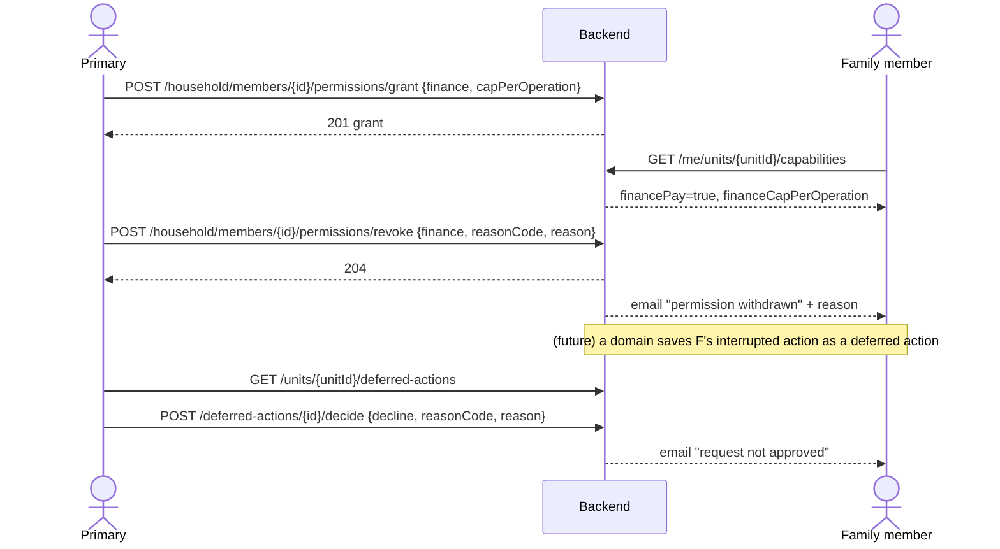
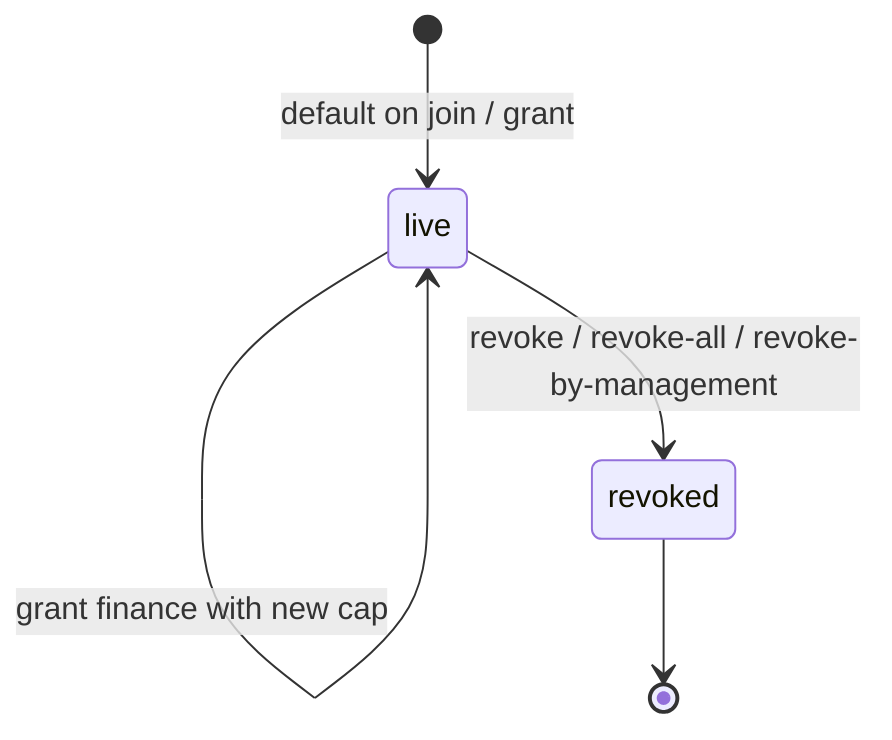
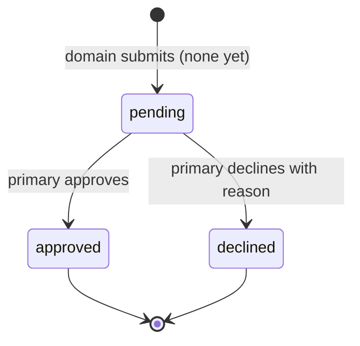

# صلاحيات أفراد الأسرة — Member Permissions

> **التطبيق/الواجهة:** resident app (الساكن الرئيسي بيمنح ويسحب) · family member (المفوَّض بيمنح ويسحب؛ والفرد بيشوف "صلاحياتي") · manager dashboard (سحب بقرار الإدارة)
> **الصلاحيات:** `household.manage` (دور `resident` و`family_member`، وفوقها لازم يكون الساكن الرئيسي أو مفوَّض `household` — والطلبات المؤجلة للرئيسي فقط) · `household.override` (دور `manager`) للسحب بقرار الإدارة · `GET /me/units/{unitId}/permissions` من غير permission (للفرد نفسه). النتيجة النهائية للـapp بتظهر في capability flags من `GET /me/units/{unitId}/capabilities` (`visitorsInvite`, `bookings`, `tickets`, `unitSecurity`, `financeView`, `financePay`, `financeCapPerOperation`).
> **المصادر:** ADR 0021 · `src/community/households/member-permissions.*` · `src/community/capabilities/capabilities.ts`

## الفكرة باختصار
كل فرد بالغ في أسرة الوحدة (عنده حساب) بيمسك مجموعة صلاحيات بتحدد هو **يستخدم** إيه في الوحدة: دعوة زوار، حجوزات، بلاغات صيانة، مدفوعات (بسقف لكل عملية)، أجهزة حماية الوحدة. لما الفرد ينضم بياخد 3 صلاحيات افتراضية. الساكن الرئيسي (أو المفوَّض) يمنح ويسحب، والمالية للرئيسي بس. أي سحب لازم يكون بسبب، والفرد بيتبلّغ. فيه حاجات أساسية (طوارئ، دليل التصرف، التواصل مع الرئيسي) عمرها ما بتتسحب.

> ده مختلف عن التفويض (`06-delegation.md`): التفويض = إدارة الأسرة بالنيابة عن الرئيسي. الشاغلين (owner/tenant) مالهمش صلاحيات أفراد؛ قدراتهم من الإشغال نفسه (`01-units-and-occupancy.md`).

## الأدوار ومين بيعمل إيه

| الدور | يقدر يعمل إيه |
|---|---|
| الساكن الرئيسي | يشوف صلاحيات أي فرد · يمنح أي صلاحية (بما فيها `finance` بسقف) · يغيّر سقف المالية · يسحب صلاحية / يسحب الكل بسبب · يشوف ويقرر في الطلبات المؤجلة (deferred actions) |
| مفوَّض `household` | زي الرئيسي **ماعدا**: منح `finance` (`DELEGATION_NOT_ALLOWED`) والطلبات المؤجلة (`NOT_PRIMARY_RESIDENT`) |
| فرد الأسرة (حساب `family`) | يشوف "صلاحياتي" على الوحدة (`GET /me/units/{unitId}/permissions`) |
| القاصر (من غير حساب) | مالوش أي صلاحيات ولا ينفع يتمنح (`MEMBER_HAS_NO_ACCOUNT`). عنده الأساسيات بس |
| المدير (`household.override`) | يسحب صلاحية معيّنة أو `all` من أي فرد بسبب (مثلاً أثناء الانفصال). يشوف أكواد صلاحيات كل فرد في `GET /units/{unitId}/household` (`grantedPermissions`) لو معاه `residents.read` |
| السيستم | بيمنح الصلاحيات الافتراضية عند قبول الدعوة أو دعوة البلوغ |

## الشاشات اللي الفيتشر محتاجها
- **صلاحيات فرد** (من شاشة الأسرة، للرئيسي/المفوَّض): قائمة toggles للصلاحيات الخمسة، مع سقف المالية جنب `finance`، وتاريخ المنح.
- **شيت منح المالية**: إدخال "الحد الأقصى للعملية الواحدة" (للرئيسي فقط؛ مخفي للمفوَّض).
- **ديالوج سحب صلاحية**: سبب من قائمة + نص السبب (بيتبعت للفرد).
- **ديالوج "سحب كل الصلاحيات"**: نفس السبب، مع توضيح إن الأساسيات بتفضل.
- **"صلاحياتي"** (family app): الصلاحيات الممنوحة، الأساسيات اللي مابتتسحبش، واللي بيديره الرئيسي فقط.
- **"طلبات بانتظار قرارك"** (للرئيسي): قائمة الطلبات المؤجلة + أزرار موافقة / رفض بسبب. *(حالياً هتفضل فاضية — شوف تحت.)*
- **داشبورد المدير — ديالوج سحب بقرار الإدارة**: اختيار صلاحية من اللي الفرد ماسكها (`grantedPermissions`) أو "الكل"، + سبب.

## الفلو خطوة بخطوة

### 1) الصلاحيات الافتراضية (تلقائي)
1. لما بالغ يقبل دعوة الأسرة (أو قاصر يقبل دعوة البلوغ) — `05-household-and-invites.md` — السيستم بيمنحه: `visitors_invite`, `bookings`, `tickets`.
2. `finance` و`unit_security` **مش** افتراضية؛ لازم تتمنح يدوي.
3. العضو `pending_approval` بيبقى متسجّل له الصلاحيات دي، لكن مالوش أي قدرات فعلية لحد ما المدير يوافق.

### 2) عرض صلاحيات فرد (رئيسي/مفوَّض)
1. من شاشة الأسرة: `members[].permissions` بيرجع بالفعل للرئيسي/المفوَّض (من غير `grantedAt`).
2. للتفاصيل: `GET /household/members/{id}/permissions` (`{id}` = ID العضوية) ← `{memberId, grants: [{permission, capPerOperation, grantedAt}]}`.
3. العضو لازم يكون `active`، وإلا ← `404 HOUSEHOLD_MEMBER_NOT_FOUND`.

### 3) منح صلاحية
1. الرئيسي/المفوَّض يفعّل toggle ← `POST /household/members/{id}/permissions/grant`:
   - `permission` (مطلوب): `visitors_invite` | `bookings` | `tickets` | `finance` | `unit_security`
   - `capPerOperation`: **مطلوب مع `finance` بس** (رقم موجب، رقمين عشريين بالكتير، حتى `9999999999.99`، string أو number). مع أي صلاحية تانية ممنوع (`FIELD_NOT_ALLOWED`).
2. الباك بيتأكد:
   - العضو `active` وعنده حساب ومش قاصر، وإلا ← `409 MEMBER_HAS_NO_ACCOUNT`.
   - `finance` من مفوَّض ← `403 DELEGATION_NOT_ALLOWED`.
   - الوحدة مش تحت مراجعة وفاة (`HOUSEHOLD_UNDER_REVIEW`).
3. الرد `201` `{permission, capPerOperation, grantedAt}`:
   - لو الصلاحية ممنوحة بالفعل بنفس السقف ← نفس المنح بيرجع (مفيش تغيير).
   - لو `finance` ممنوحة بسقف مختلف ← السقف بيتحدّث (ده طريقة "تعديل السقف").
4. مفيش إشعار للفرد عند المنح. الـapp يعيد تحميل شاشة الأسرة.

### 4) سحب صلاحية / سحب الكل
1. **صلاحية واحدة** ← `POST /household/members/{id}/permissions/revoke` بـ`{permission, reasonCode, reason}`.
2. **الكل** ← `POST /household/members/{id}/permissions/revoke-all` بـ`{reasonCode, reason}`.
3. `reasonCode` من: `misuse` | `no_longer_needed` | `security` | `other`. `reason` نص بيتبعت للفرد (≤ 1000 حرف).
4. الباك بيتأكد:
   - الرئيسي أو مفوَّض `household` (المفوَّض يقدر يسحب أي صلاحية بما فيها `finance`).
   - الوحدة مش تحت مراجعة وفاة.
   - لو الوحدة عليها "انفصال" والعضو بالغ ← `403 SEPARATION_MANAGER_DECISION` (القرار للإدارة).
   - سحب صلاحية واحدة الفرد مش ماسكها ← `403 MEMBER_PERMISSION_MISSING` (`params.permission`).
   - سحب الكل والفرد مش ماسك حاجة ← `204` عادي ومن غير إشعار.
5. الرد `204`. الفرد بيوصله إيميل "سُحبت صلاحية …" بالسبب، و"تبقى لك دائماً الطوارئ ودليل التصرف والتواصل مع الساكن الرئيسي".
6. الأثر فوري: الـcapability المقابلة بتبقى `false` على طول.

### 5) سحب بقرار الإدارة
1. المدير يفتح الوحدة → الأسرة (فيها `grantedPermissions` لكل فرد) → "سحب صلاحية".
2. `POST /household/members/{id}/permissions/revoke-by-management` بـ`{permission, reasonCode, reason}`:
   - `permission`: كود صلاحية **أو** `all`.
   - نفس قائمة الأسباب (`misuse`, `no_longer_needed`, `security`, `other`).
3. مرفوض بس تحت مراجعة الوفاة (`HOUSEHOLD_UNDER_REVIEW`). مش مقصور على الانفصال.
4. صلاحية مش ممسوكة ← `MEMBER_PERMISSION_MISSING`. الرد `204` والفرد بيتبلّغ بنفس الإيميل.

### 6) "صلاحياتي" (الفرد نفسه)
1. الفرد يفتح "صلاحياتي" للوحدة ← `GET /me/units/{unitId}/permissions`.
2. الرد:
   - `memberId`
   - `grants`: `[{permission, capPerOperation, grantedAt}]`
   - `baseline`: `["emergency", "conduct_guide", "contact_primary"]` — دايماً، مابتتسحبش.
   - `managedByPrimary`: `["bills_and_payments", "contracts_and_documents", "adding_members", "unit_details", "voting_and_governance"]` — حاجات الرئيسي بس اللي بيديرها، للعرض.
3. متاح للعضو الـ`active` بس. الشاغل (resident) أو العضو المعلّق/المُزال ← `404 UNIT_NOT_FOUND`.
4. لإظهار/إخفاء الفيتشرز فعلياً في الـapp استخدم `GET /me/units/{unitId}/capabilities` (بيجمع الصلاحيات + حالة الوحدة، مثلاً مراجعة الوفاة بتقفل المالية حتى لو ممنوحة).

### 7) الطلبات المؤجلة (Deferred actions)
**الفكرة:** لو فرد كان بيعمل إجراء في دومين تاني (مثلاً دفع) والصلاحية اتسحبت منه في النص، الدومين يحفظ مدخلاته ويبعتها للرئيسي كـ"طلب" بدل ما شغله يضيع. الرئيسي يوافق أو يرفض.

> **حالياً مفيش أي دومين بيبعت طلبات مؤجلة** (الدالة `submitDeferredAction` موجودة بس محدش بيناديها). يعني القائمة دايماً فاضية، وده متوثّق في v0-notes.

1. السيستم (لما دومين يستخدمها): يحفظ الطلب `pending` ويبعت للرئيسي إيميل "أرسل فلان إجراءً يحتاج صلاحية … وهو بانتظار قرارك".
2. الرئيسي يفتح القائمة ← `GET /units/{unitId}/deferred-actions` (الرئيسي فقط، الـ`pending` بس، الأقدم أولاً):
   `{data: [{id, memberId, permission, createdAt}], nextCursor: null}` — **من غير محتوى الطلب (`payload`)**.
3. القرار ← `POST /deferred-actions/{id}/decide`:
   - `decision`: `approve` | `decline`.
   - مع `decline`: `reasonCode` (`not_needed` | `too_expensive` | `other`) + `reason` مطلوبين. مع `approve` بيتجاهلوا.
4. الرد `204`.
   - `approve`: الحالة بتبقى `approved` بس. **تنفيذ الإجراء مسؤولية الدومين صاحبه** (ومفيش دومين حالياً)، ومفيش إشعار للفرد.
   - `decline`: `declined`، والفرد بيوصله إيميل "لم يوافق الساكن الرئيسي على طلبك…" بالسبب.
5. طلب مش `pending` ← `404 DEFERRED_ACTION_NOT_FOUND`.

## الحالات (Statuses)

**المنح (grant):** مفيش status؛ المنح يا إما **live** (`revokedAt` فاضي) يا إما **revoked** (بيتحفظ، مابيتمسحش). منح واحد live لكل (فرد، صلاحية).

(المنح من جديد بعد السحب = صف جديد live.)

**الطلب المؤجل `DeferredActionStatus`:**

| الحالة | المعنى | مين بيحرّكها |
|---|---|---|
| `pending` | مستني قرار الرئيسي | دومين (مفيش حالياً) |
| `approved` | الرئيسي وافق | الرئيسي |
| `declined` | الرئيسي رفض بسبب | الرئيسي |
| `withdrawn` | موجود في الـenum بس **مفيش كود بيحطّه** | — |

## البيانات اللي بتظهر

### أكواد الصلاحيات

| الكود | الاسم بالعربي (من الإيميلات) | بيفتح إيه في الـapp النهارده | افتراضي؟ |
|---|---|---|---|
| `visitors_invite` | دعوة الزوار | capability `visitorsInvite`: إنشاء تصاريح زوار، والرد على طلبات موافقة البوابة لما زائر يوصل، واستقبال طلبات الموافقة دي | نعم |
| `bookings` | الحجوزات | capability `bookings` — **مفيش دومين حجوزات لسه**، فمفيش أثر فعلي | نعم |
| `tickets` | البلاغات | capability `tickets`: فتح بلاغات صيانة للوحدة (وللمناطق المشتركة)، والظهور كـ"مُبلِّغ" ممكن الإدارة تفتح بلاغ باسمه | نعم |
| `finance` | العمليات المالية | `financeView` + `financePay` + `financeCapPerOperation` (السقف لكل عملية). **مفيش دومين مالية لسه**. للرئيسي فقط يمنحها، وعمرها ما تتمنح لقاصر | لا |
| `unit_security` | أجهزة حماية الوحدة | capability `unitSecurity` — **مفيش دومين ليها لسه** | لا |

**حاجات الفرد البالغ النشط بيبقى عنده دايماً من غير ما تتمنح** (من `capabilities.ts`): الطوارئ، دليل التصرف، التواصل مع الرئيسي، عرض الوحدة والأسرة، إشعار وصول زائر (`visitorsNotify`)، الدخول من البوابة بـQR (`gateEntry`)، السماح للفني بالدخول (`visitConsent`)، الطرود (`parcels`). والقاصر عنده الطوارئ ودليل التصرف والتواصل مع الرئيسي بس.

### الحقول
- **منح** `{permission, capPerOperation, grantedAt}`: `capPerOperation` string عشري (مثلاً `"500.00"`) للمالية، و`null` لغيرها.
- **صلاحيات فرد** `{memberId, grants[]}`.
- **صلاحياتي** `{memberId, grants[], baseline[], managedByPrimary[]}`.
- **في شاشة الأسرة**: الرئيسي/المفوَّض بيشوف `permissions: [{permission, capPerOperation}]`؛ المدير بيشوف `grantedPermissions: [code]` بس، **من غير السقف**.
- **طلب مؤجل** `{id, memberId, permission, createdAt}`: من غير اسم الفرد (اربطه بـ`members[].id` من شاشة الأسرة) ومن غير المحتوى.
- سبب السحب: النص بيروح للفرد في الإيميل بس؛ مفيش endpoint بيرجّع تاريخ السحب أو أسبابه.

## القواعد والقيود
- الصلاحيات الافتراضية للبالغ الجديد: `visitors_invite`, `bookings`, `tickets`.
- منح واحد live لكل (فرد، صلاحية). منح نفس الصلاحية تاني = لا شيء، أو تحديث السقف للمالية.
- `finance`: سقف مطلوب (> 0، رقمين عشريين، ≤ `9999999999.99`)، الرئيسي بس، ومستحيل لقاصر (حتى قاعدة البيانات بتمنعه).
- القاصر / العضو من غير حساب مايمسكش أي صلاحية.
- عمليات الصلاحيات على العضو `active` بس.
- الأسباب (`{reasonCode, reason}` الاتنين مطلوبين — راجع README):
  - سحب: `misuse`, `no_longer_needed`, `security`, `other`
  - رفض طلب مؤجل: `not_needed`, `too_expensive`, `other`
- **مراجعة الوفاة** (`primary_deceased`): مفيش منح ولا سحب من أي حد (حتى المدير)، والمالية بتقف كلها (`financeView/financePay = false`).
- **الانفصال** (`separation`): سحب صلاحية من بالغ = قرار الإدارة بس (`revoke-by-management`). المنح مسموح عادي.
- **تغيير الساكن الرئيسي**: الأفراد بيحتفظوا بصلاحياتهم لحد ما الرئيسي الجديد يراجعها — راجع `03-unit-review-and-life-events.md`.
- الطلبات المؤجلة: للرئيسي فقط (مش المفوَّض).

## الأخطاء اللي الـUI لازم يتعامل معاها

| HTTP + `code` | إمتى | رسالة / سلوك مقترح |
|---|---|---|
| `400 VALIDATION_FAILED` | `permission` غلط (`INVALID_VALUE` + `allowed`)؛ `capPerOperation`: `FIELD_REQUIRED` (مالية من غير سقف) / `INVALID_NUMBER` / `FIELD_NOT_ALLOWED` (سقف مع صلاحية تانية)؛ `INVALID_REASON_CODE`؛ `decision` غلط | أظهر الخطأ تحت الحقل |
| `400 REASON_REQUIRED` | سحب أو رفض من غير كود/نص السبب | علّم الحقل الناقص |
| `403 FORBIDDEN` | الدور مافيهوش الـpermission | اخفي الأزرار |
| `403 NOT_PRIMARY_RESIDENT` | مش رئيسي ولا مفوَّض؛ أو مفوَّض في الطلبات المؤجلة | "للساكن الرئيسي فقط" |
| `403 DELEGATION_NOT_ALLOWED` | مفوَّض بيمنح `finance` | اخفي/عطّل toggle المالية للمفوَّض |
| `403 DELEGATION_EXPIRED` | التفويض انتهى | "انتهى تفويضك" |
| `403 HOUSEHOLD_UNDER_REVIEW` | مراجعة وفاة | "الصلاحيات متوقفة مؤقتاً أثناء مراجعة الإدارة" |
| `403 SEPARATION_MANAGER_DECISION` | سحب من بالغ أثناء الانفصال | "القرار ده للإدارة" |
| `403 MEMBER_PERMISSION_MISSING` (`params.permission`) | سحب صلاحية الفرد مش ماسكها | حدّث الشاشة |
| `404 HOUSEHOLD_MEMBER_NOT_FOUND` | العضو مش `active` | حدّث الشاشة |
| `404 UNIT_NOT_FOUND` | "صلاحياتي" لحد مش عضو active، أو وحدة مش ظاهرة | رجوع |
| `404 DEFERRED_ACTION_NOT_FOUND` | الطلب اتقرر قبل كده | حدّث القائمة |
| `409 MEMBER_HAS_NO_ACCOUNT` | منح لقاصر/عضو من غير حساب | اخفي قسم الصلاحيات للقُصّر |

(`FINANCE_CAP_EXCEEDED` موجود في `assertAllowed` للدومينات اللي جاية، ومحدش بيستخدمه حالياً.)

## الإشعارات

كلها **إيميل بس** (outbox)، مفيش in-app ولا push.

| الحدث | النوع (template) | مين بيستلم | Push؟ | الضغط يفتح |
|---|---|---|---|---|
| سحب صلاحية / الكل / بقرار الإدارة | `community.permission_revoked` (بالصلاحيات المسحوبة والسبب) | الفرد | لا | — |
| طلب مؤجل جديد | `community.deferred_action_submitted` | الساكن الرئيسي | لا | (مفيش دومين حالياً) |
| رفض طلب مؤجل | `community.deferred_action_declined` (بالسبب) | الفرد | لا | — |
| منح صلاحية / موافقة على طلب | — | مفيش إشعار | — | — |

## الـEndpoints

| Method + path | مين | الغرض | الرد |
|---|---|---|---|
| `GET /household/members/{id}/permissions` | الرئيسي / مفوَّض `household` | صلاحيات فرد | `200 {memberId, grants[]}` |
| `POST /household/members/{id}/permissions/grant` | الرئيسي / مفوَّض (المالية للرئيسي) | منح / تعديل سقف المالية | `201 {permission, capPerOperation, grantedAt}` |
| `POST /household/members/{id}/permissions/revoke` | الرئيسي / مفوَّض | سحب صلاحية بسبب | `204` |
| `POST /household/members/{id}/permissions/revoke-all` | الرئيسي / مفوَّض | سحب كل الممنوح بسبب | `204` |
| `POST /household/members/{id}/permissions/revoke-by-management` | مدير (`household.override`) | سحب صلاحية أو `all` بقرار الإدارة | `204` |
| `GET /me/units/{unitId}/permissions` | الفرد نفسه | صلاحياتي + الأساسيات | `200 {memberId, grants[], baseline[], managedByPrimary[]}` |
| `GET /units/{unitId}/deferred-actions` | الرئيسي فقط | الطلبات المؤجلة المعلّقة | `200 {data: [{id, memberId, permission, createdAt}], nextCursor: null}` |
| `POST /deferred-actions/{id}/decide` | الرئيسي فقط | موافقة / رفض بسبب | `204` |

## ملاحظات للديزاين وحاجات ناقصة في الباك
- **الطلبات المؤجلة مش شغالة فعلياً**: مفيش دومين بينادي `submitDeferredAction`، والقائمة دايماً فاضية. والرد مافيهوش `payload` (v0-notes: "the decision screen will say what it shows"). الموافقة مابتنفّذش حاجة. الحالة `withdrawn` مالهاش كود.
- **3 من 5 صلاحيات مالهاش أثر النهارده**: `bookings` و`finance` و`unit_security` بيتخزنوا وبيظهروا في الـcapabilities، لكن مفيش دومين حجوزات أو مالية أو حماية وحدة. `assertAllowed` (السقف و`FINANCE_CAP_EXCEEDED`) مش مستخدم. ممكن الديزاين يعرضهم كـ"قريباً" أو يخفيهم.
- **مفيش إشعار عند المنح** أو تعديل السقف أو الموافقة على طلب مؤجل؛ الفرد يعرف من "صلاحياتي" بس.
- **مفيش سجل** للصلاحيات المسحوبة وأسبابها في الـAPI (للفرد أو للرئيسي).
- **الطلب المؤجل بيرجع `memberId` بس** من غير اسم؛ الـapp لازم يربطه بقائمة الأسرة.
- **المدير مابيشوفش سقف المالية** (`grantedPermissions` أكواد بس) — مقصود (ADR 0021 B2).
- مفوَّض `household` يقدر يسحب `finance` رغم إنه مايقدرش يمنحها (الكود بيمنع المنح بس).
- ADR 0021 بيقول السحب بقرار الإدارة "أثناء الانفصال"، والكود مش بيقصره عليه (متوثّق في تحديث B2).
- `baseline` و`managedByPrimary` أكواد ثابتة بالإنجليزي؛ الـapp مسؤول عن ترجمتها للعرض.
