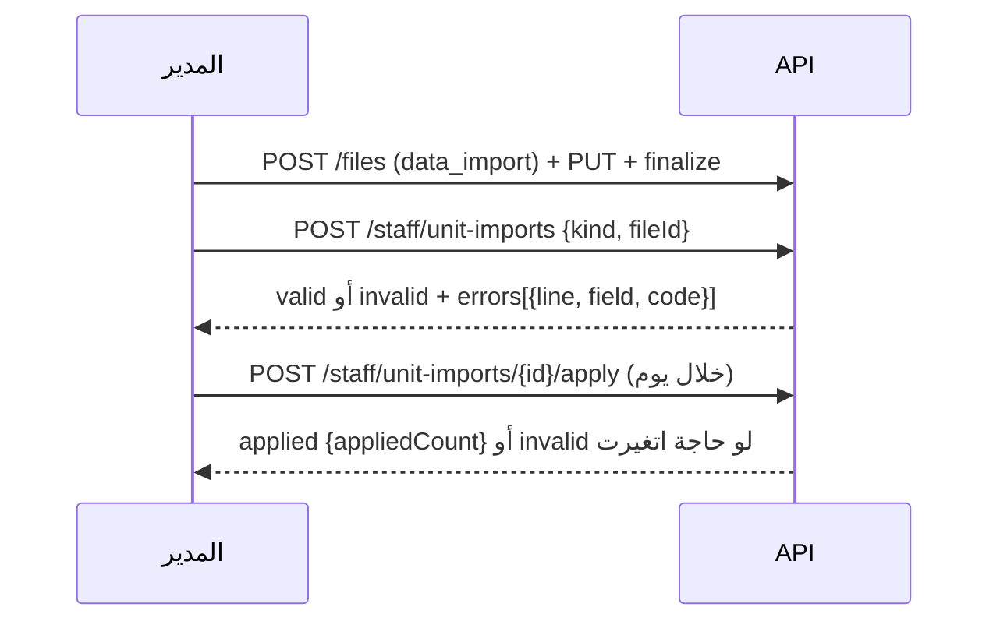
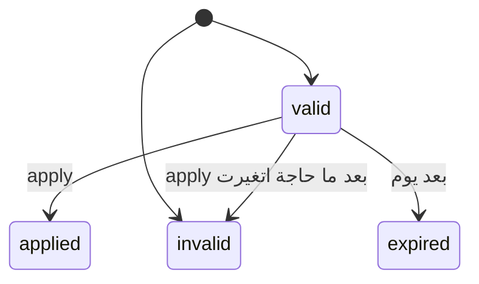

# سجل الوحدات — المباني، تعديل الوحدة، الفلاتر والـCSV، تاريخ الإشغال، الاستيراد، والبحث

## 1. الفكرة باختصار

المدير بيمسك سجل الوحدات من الداشبورد (ADR 0072): المباني بقت جدول حقيقي، الوحدة بتتعدل (المبنى والدور والنوع والمساحة، أبدًا مش الكود)، قايمة الوحدات بتتبحث وتتفلتر وتطلع CSV، كارت الوحدة فيه تاريخ الإشغال كله والعمالة، وفيه استيراد شيت وحدات أو سكان، وبحث في الشريط العلوي.

## 2. الأدوار

| الدور | بيعمل إيه |
|---|---|
| المدير (`units.manage`) | يضيف ويحذف المباني، يعدّل الوحدة، يفلتر بالحالة ونوع الإشغال، ينزّل الـCSV، يستورد الشيتات |
| المدير (`residents.read`) | يشوف تاريخ إشغال الوحدة |
| المدير (`workers.review`) | يشوف عمالة الوحدة |
| مشرف الأمن (`units.directory`) | يبحث في الوحدات بالكود والمبنى بس، من غير أي ناس |
| أي حد من الستاف | البحث في الشريط العلوي، كل نوع بصلاحية قايمته |

## 3. الشاشات

- **الوحدات:** بحث بجزء من الكود؛ فلتر المبنى والحالة (للمدير)؛ زرار CSV؛ تاب "المباني"؛ زرار "استيراد".
- **المباني:** قايمة بالاسم وعدد الوحدات؛ إضافة مبنى؛ حذف مبنى فاضي بس.
- **صفحة الوحدة:** زرار "تعديل الوحدة"؛ كارت "تاريخ الإشغال"؛ كارت "العمالة".
- **الاستيراد:** اختيار نوع الشيت (وحدات / سكان)، رفع الملف، النتيجة (صالح / فيه مشاكل بالسطر والعمود)، زرار التطبيق.
- **البحث:** خانة في الشريط العلوي (`/` بيفتحها)، النتايج متقسّمة بالنوع.

## 4. الفلو

### الاستيراد

## 5. الحالات

## 6. البيانات اللي بتظهر

- الوحدة: `code`, `building`, `buildingId`, `floor`, `unitType`, `areaSqm`.
- المبنى: `name`, `units` (عدد الوحدات).
- تاريخ الإشغال: مين، بصفته إيه، ساكن ولا لأ، من إمتى لإمتى، وسبب الانتهاء.
- الـCSV: أعداد بس (ملاك، مستأجرين، ساكنين)، أبدًا أسامي.

## 7. القواعد

- المبنى **ما بيتغيرش اسمه**: لو الاسم غلط، أضيف الصح وانقل الوحدات واحذف القديم.
- المبنى بيتحذف بس لو مفيش وحدة فيه.
- كود الوحدة ما بيتعدلش.
- فلتر الحالة ونوع الإشغال للمدير بس.
- شيت الوحدات: لحد 2000 سطر. شيت السكان: لحد 300 سطر، سطر لكل شخص ووحدة.
- السكان المستوردين **مش بيوصلهم أي إيميل**.
- شيت السكان بيتمسح أول ما يتطبق أو يطلع فيه مشاكل أو يعدّي عليه يوم.

## 8. الأخطاء

| الكود | معناه |
|---|---|
| `BUILDING_NAME_TAKEN` | فيه مبنى بنفس الاسم |
| `BUILDING_IN_USE` | فيه وحدات في المبنى (`params.units`) |
| `BUILDING_NOT_FOUND` | المبنى مش موجود |
| `UNIT_IMPORT_NOT_VALID` | الاستيراد اتطبق قبل كده أو فيه مشاكل أو عدّى عليه يوم (`params.status`) |
| `UNIT_IMPORT_UNREADABLE` | الملف مش CSV سليم |
| `FIELD_NOT_ALLOWED` | تعديل الكود، أو فلتر الحالة من غير صلاحية |

## 9. الإشعارات

مفيش.

## 10. الـEndpoints

`GET/POST /buildings`، `DELETE /buildings/{id}`، `PATCH /units/{id}`، `GET /units?q&buildingId&status&occupancyType`، `GET /staff/units/export`، `GET /staff/units/{unitId}/occupancy-history`، `GET /worker-engagements?unitId=`، `POST/GET /staff/unit-imports`، `GET /staff/unit-imports/{id}`، `POST /staff/unit-imports/{id}/apply`، `GET /staff/search?q=`.

## 11. ملاحظات وحاجات ناقصة

- مفيش تغيير اسم مبنى لسه (الاسم متخزن في الجماهير ومناطق خدمة الشركاء والحوكمة).
- مفيش بحث محفوظ في الشريط العلوي لسه.
- منتقي الوحدة (unit picker) لسه بيعرض أول 100 وحدة.
