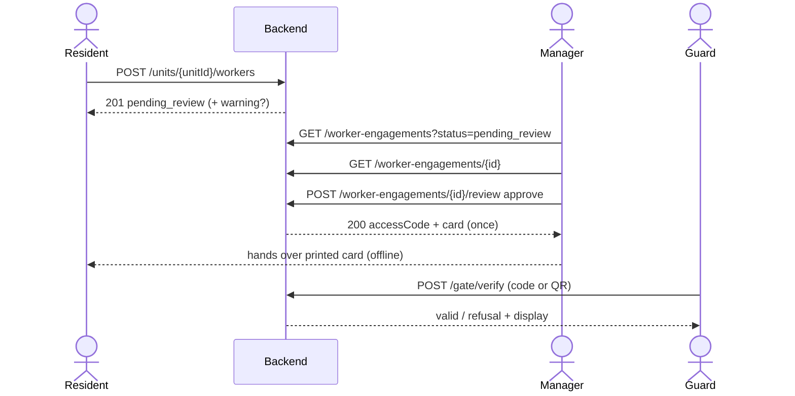
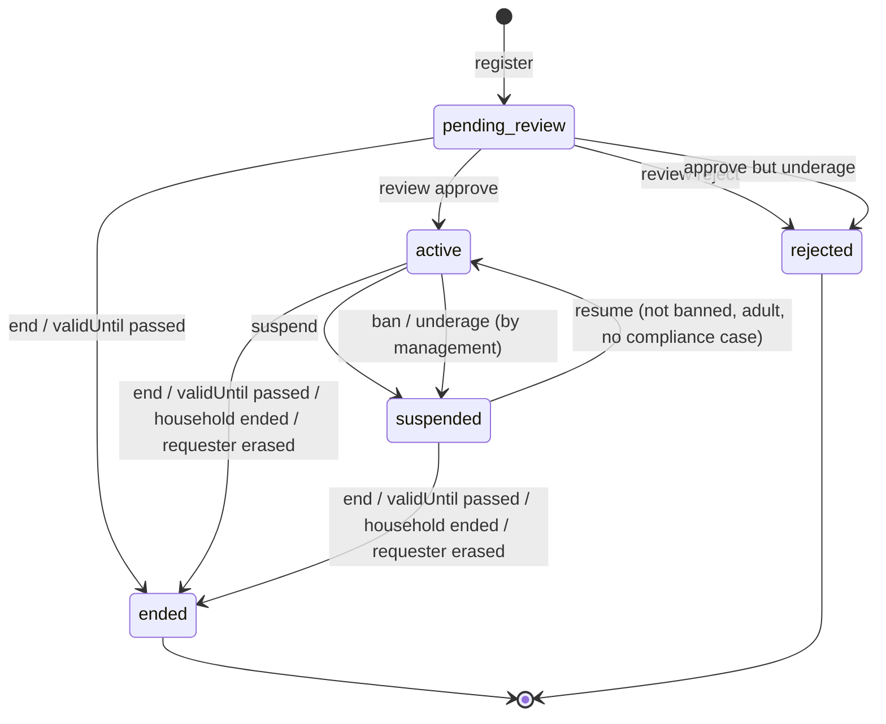

# العمالة المنزلية — Domestic workers

> **التطبيق/الواجهة:** resident app (الساكن وفرد الأسرة) + manager dashboard
> **الصلاحيات:** `workers.manage` (الأدوار `resident` و`family_member`) · `workers.review` و`workers.ban` و`workers.compliance` و`workers.incidents` (الدور `manager`). فوق `workers.manage` الباك بيشترط كمان إن الشخص ساكن في الوحدة أو الساكن الرئيسي أو مفوَّض بنطاق `workers` (التفاصيل تحت).
> **المصادر:** ADR 0017 · ADR 0018 · ADR 0029 · ADR 0030 · ADR 0037 · `src/community/workers/` · `src/core/common/identity-document.ts` · `src/core/common/egyptian-national-id.ts`

## الفكرة باختصار
الساكن يسجّل عامل (شغالة، سواق، مربية، عامل مقيم، عامل مؤقت) على وحدته. العامل **ملوش حساب ولا بيعمل login**؛ الكمبوند بيعرفه مرة واحدة بالرقم القومي أو الباسبور، وكل وحدة بيشتغل فيها اسمها **engagement** (ارتباط عمل).
التسجيل بيروح للإدارة تراجعه. لما المدير يوافق، بيطلع **كود دخول 8 أرقام + بيانات كارت مطبوع فيه QR** مرة واحدة بس. العامل بيدخل البوابة بالكود أو الكارت طول ما الارتباط `active` وفي مواعيده.
أي إيقاف أو استئناف أو إنهاء بيتسجل له إشعار للعامل (مش بيحصل "في صمت"). الإدارة تقدر تحظر عامل من الكمبوند كله.

## الأدوار ومين بيعمل إيه

| الدور | يقدر يعمل إيه |
|---|---|
| ساكن مقيم في الوحدة (أي إشغال `active` و`resides`، مش لازم الرئيسي) | يسجّل عامل للوحدة، يشوف قائمة عمال الوحدة وتفاصيل كل واحد. يوقف/يستأنف/ينهي/يعيد إصدار كود **للارتباطات اللي هو طلبها** طول ما هو ساكن. |
| الساكن الرئيسي (primary) | كل ما سبق، وعلى **كل** ارتباطات الوحدة. |
| مفوَّض بنطاق `workers` (تفويض ساري) | زي الساكن الرئيسي بالظبط (يتسجّل في الأوديت إنه بالنيابة عنه). |
| فرد أسرة (`family`) من غير تفويض | يشوف قائمة العمال وتفاصيلهم (من غير الأجر). **مايقدرش يسجّل** عامل. لو هو اللي طلب الارتباط (بتفويض سابق) يقدر يتصرف فيه. |
| مالك مؤجِّر (owner_landlord، مش ساكن) | **مايشوفش** عمال الوحدة خالص (`FORBIDDEN`) ولا يسجّل. |
| مدير بـ `workers.review` | طابور المراجعة، تفاصيل الارتباط (فيها المستند مقنّع وتاريخ الميلاد والصورة)، موافقة/رفض، توثيق تاريخ ميلاد عامل الباسبور، تعيين صورة العامل، إيقاف/استئناف/إنهاء/إعادة إصدار كود لأي ارتباط. |
| مدير بـ `workers.ban` | حظر عامل من الكمبوند ورفع الحظر. |
| مدير بـ `workers.compliance` | الإبلاغ عن عامل قاصر وملفات الامتثال — راجع [`03-compliance-and-card-incidents.md`](./03-compliance-and-card-incidents.md). |
| مدير بـ `workers.incidents` | بلاغات فقد/مصادرة الكارت — راجع [`03-compliance-and-card-incidents.md`](./03-compliance-and-card-incidents.md). |
| الحارس | بيتحقق من كود/QR العامل على البوابة — راجع [`../05-gate/02-gate-verify-and-entries.md`](../05-gate/02-gate-verify-and-entries.md). |

## الشاشات اللي الفيتشر محتاجها

**تطبيق الساكن**
- **قائمة عمال الوحدة:** كل ارتباطات الوحدة ما عدا المرفوضة، الأحدث أولاً، مع الحالة وشارة "موقوف من الإدارة".
- **صفحة العامل (تفاصيل ارتباط):** الاسم، النوع، المواعيد، الحالة، تاريخ الانتهاء، وللجانب المسؤول عن الأجر: الأجر الشهري وآخر شهر مدفوع (راجع [`02-worker-wages.md`](./02-worker-wages.md))، وآخر حضور (راجع [`03-compliance-and-card-incidents.md`](./03-compliance-and-card-incidents.md#الحضور-attendance)).
- **فورم تسجيل عامل** (خطوات مقترحة): البيانات الأساسية ← المستند (رقم قومي أو باسبور) ← النوع والمواعيد ← الصورة واللغة ← مراجعة وإرسال.
- **محرر المواعيد:** اختيار أيام الأسبوع + فترة أو أكتر (من/إلى)، مع توضيح إن "إلى" قبل "من" معناها فترة ليلية بتعدّي نص الليل.
- **رسالة نجاح التسجيل** + تنبيه غير مانع لو فيه تعارض مواعيد مع وحدة تانية.
- **حوار إيقاف** (سبب من قائمة + نص)، **حوار إنهاء** (سبب من قائمة + نص)، **زر استئناف**.
- **حوار إعادة إصدار الكود** (سبب: فقد / كود مكشوف / أخرى) ← **شاشة عرض الكود والكارت مرة واحدة** (مع زر طباعة/حفظ).

**داشبورد المدير**
- **طابور المراجعة / قائمة الارتباطات:** فلتر بالحالة، فيه كود الوحدة واسم العامل ونوع المستند وهل تاريخ الميلاد موثَّق.
- **تفاصيل الارتباط للمراجعة:** بيانات العامل كاملة (المستند مقنّع)، الصورة، من طلب التسجيل، الالتزامات المالية المفتوحة.
- **حوار الموافقة:** لعامل الباسبور checkbox "راجعت تاريخ الميلاد على الباسبور" + حقل تصحيح اختياري.
- **حوار الرفض:** سبب من قائمة + نص.
- **شاشة الكود والكارت بعد الموافقة** (تظهر مرة واحدة فقط).
- **حوار تصحيح تاريخ الميلاد** (لعامل الباسبور فقط).
- **رفع/تغيير صورة العامل.**
- **حوار حظر عامل** (سبب + نص) و**زر رفع الحظر**.
- **معاينة/طباعة الكارت** من بيانات `card`.

## الفلو خطوة بخطوة

### 1) الساكن يسجّل عامل للوحدة
1. (اختياري) الصورة: التطبيق يرفع صورة العامل بالغرض `worker_photo` (JPEG/PNG/WebP، حد أقصى 5MB) بالمسار العادي للرفع (راجع README)، وياخد `fileId` بعد الـfinalize.
2. الساكن يملأ الفورم ويبعت `POST /units/{unitId}/workers`:

| الحقل | مطلوب؟ | القواعد |
|---|---|---|
| `fullName` | نعم | 2–200 حرف بعد الـtrim. |
| `phone` | نعم | رقم مصري أو دولي بـ`+`. |
| `idDocumentType` | نعم | `national_id` أو `passport`. |
| `idDocumentNumber` | نعم | رقم قومي: 14 رقم (مقبول أرقام عربية ومسافات وشرطات؛ الباك بيطلع منه تاريخ الميلاد والمحافظة). باسبور: 5–20 حرف/رقم إنجليزي كبير (الباك بيشيل المسافات ويكبّر الحروف). |
| `nationality` | للباسبور فقط | كود دولة ISO من حرفين (مثلاً `PH`، و`XK` مقبول). للرقم القومي: فاضي أو `EG` بس. |
| `birthDate` | للباسبور فقط | `YYYY-MM-DD`، تاريخ حقيقي، مش في المستقبل، عمر ≤ 120. **بيتجاهل** مع الرقم القومي. |
| `capacity` | نعم | `live_in` (مقيم) · `hourly` (بالساعة) · `driver` (سواق) · `nanny` (مربية) · `temporary` (مؤقت). |
| `schedule` | لكل الأنواع ما عدا `live_in` | `{ days: [0..6], windows: [{from:"HH:MM", to:"HH:MM"}] }` — 0 = الأحد … 6 = السبت. لازم يوم واحد على الأقل وفترة واحدة على الأقل. الوقت بصيغة 24 ساعة. `from == to` مرفوض. لو `to` قبل `from` = فترة ليلية بتكمّل لليوم اللي بعده. لـ`live_in` لازم يكون فاضي أو مش مبعوت (المقيم موجود دايماً). |
| `validUntil` | لـ`temporary` إجباري، اختياري للباقي | تاريخ ووقت في المستقبل. بعده الارتباط بيعتبر منتهي تلقائياً (لأي نوع اتحطله التاريخ). |
| `photoFileId` | لا | `fileId` لصورة `worker_photo` خلصت رفع وتخص المتصل نفسه. |
| `preferredLanguage` | لا | `ar` (افتراضي) أو `en` — لغة الكارت المطبوع. |

3. الباك بيعمل الآتي بالترتيب:
   - يتحقق من كل الحقول ويرجع كل الأخطاء مرة واحدة (`VALIDATION_FAILED` مع `fields`).
   - **السن:** لو العامل أقل من 18 سنة (من الرقم القومي أو من التاريخ اللي اتكتب للباسبور) ← `WORKER_UNDERAGE`. **مفيش أي استثناء.**
   - يتأكد إن المتصل له حق التسجيل (ساكن مقيم، أو رئيسي، أو مفوَّض `workers`).
   - **لو العامل معروف للكمبوند قبل كده** (نفس الرقم القومي، أو نفس الجنسية + رقم الباسبور): بيستخدم السجل القديم **زي ما هو**. الاسم والتليفون واللغة اللي اتكتبوا دلوقتي **بيتجاهلوا**، والصورة الجديدة بتتحذف لو عنده صورة. الرد مش بيقول أي حاجة عن ده.
   - لو العامل محظور ← `WORKER_BLOCKED_BY_MANAGEMENT`.
   - لو تاريخ الميلاد المتخزن عنده (ممكن يكون اتصحح قبل كده) أقل من 18 ← `WORKER_UNDERAGE`.
   - يشيك تعارض المواعيد مع ارتباطات العامل `active` في **وحدات تانية** (المقيم بيتعارض مع أي حاجة؛ الفترات اللي بتلمس بعض عند نفس الدقيقة مش تعارض).
4. الرد `201`: `{ engagementId, status: "pending_review", warnings: [] }`. لو فيه تعارض: `warnings: [{ code: "WORKER_SCHEDULE_CONFLICT" }]` — **تحذير بس، التسجيل تم**. الرد مش بيقول أي وحدة ولا كام ارتباط.
5. الشاشة التالية: رسالة "تم إرسال الطلب للإدارة للمراجعة"، ولو فيه تحذير: "العامل لديه مواعيد عمل متداخلة في مكان آخر داخل الكمبوند" (من غير تفاصيل). العامل يظهر في القائمة بحالة `pending_review`.

> لا يوجد `Idempotency-Key` على التسجيل؛ الضغط مرتين يعمل ارتباطين. الـUI يقفل الزرار أثناء الإرسال.

### 2) الساكن يشوف عمال الوحدة
1. `GET /units/{unitId}/workers` (مقسّمة بصفحات `cursor`/`limit`) ← قائمة بدون المرفوض.
2. الضغط على عامل ← `GET /units/{unitId}/workers/{id}`.
3. الحقول `monthlyWage` و`lastPaidPeriod` بتظهر **بس** للجانب المسؤول عن الأجر (الرئيسي، المفوَّض `workers`، اللي طلب الارتباط ده). لباقي الأسرة الحقل **مش موجود أصلاً** (مش `null`) ← اخفِ بلوك الأجر.
4. الحالة اللي بتيجي هي "الحالة الفعلية": ارتباط له `validUntil` عدّى بيرجع `ended` حتى لو لسه متسجل مفتوح.

### 3) مراجعة الإدارة (موافقة أو رفض)
1. المدير يفتح الطابور: `GET /worker-engagements?status=pending_review` (من غير `status` = كل الارتباطات بكل حالاتها، الأحدث أولاً).
2. يفتح ارتباط: `GET /worker-engagements/{id}` ← بيانات العامل كاملة مع رقم المستند **مقنّع** (`••••1234`) وتاريخ الميلاد والصورة (رابط مؤقت) ومين طلب التسجيل و`openWageObligations`.
3. يقرر: `POST /worker-engagements/{id}/review`:
   - **رفض:** `{ decision: "reject", reasonCode, reason }` — `reasonCode` من: `documents_invalid` · `not_verified` · `other`، و`reason` نص إلزامي (≤1000 حرف). الحالة تبقى `rejected`، والرد `200` بـ `accessCode: null, card: null`. الارتباط بيختفي من قائمة الساكن.
   - **موافقة:** `{ decision: "approve" }`، ولعامل الباسبور (لو تاريخ ميلاده مش موثَّق قبل كده، أو لو المدير بيصححه دلوقتي): لازم `birthDateConfirmed: true`، واختياري `birthDate` لتصحيح التاريخ في نفس الخطوة. من غيرها ← `BIRTH_DATE_CONFIRMATION_REQUIRED`. عامل الرقم القومي مش محتاج توثيق.
4. نتيجة الموافقة:
   - لو العامل محظور ← `WORKER_BLOCKED_BY_MANAGEMENT` (لازم يرفع الحظر الأول أو يرفض).
   - لو التاريخ (بعد التصحيح) أقل من 18: الارتباط ده **بيترفض** تلقائياً، وكل ارتباطات العامل النشطة التانية **بتتوقف من الإدارة**، وبيتفتح ملف امتثال، وبيتسجل التزام أجر `pay_in_full`. التغييرات دي **بتتحفظ**، وبعدين الطلب يرجع خطأ `WORKER_UNDERAGE`. ← الـUI يعرض الخطأ ويعيد تحميل التفاصيل (هتلاقي الحالة `rejected`).
   - غير كده: الحالة `active`، والرد `200` فيه `accessCode` (8 أرقام) و`card` — **مرة واحدة بس** (الرد `no-store`، ومفيش GET يرجّعهم تاني).
5. الشاشة التالية: شاشة "الكود والكارت" مع زر طباعة، وتحذير واضح إنها مش هتظهر تاني.

> ملاحظة مهمة للديزاين: الكود والكارت بيرجعوا **للمدير اللي وافق**، مش للساكن، والساكن **مابيوصلوش إشعار** بالموافقة أو الرفض (شوف "حاجات ناقصة").

### 4) الكود والكارت المطبوع
- الكود: 8 أرقام، مالوش صلاحية زمنية خاصة بيه؛ بيشتغل طول ما الارتباط `active` ومعداش `validUntil`. الـQR فيه `JWR1.<token>` والكود مشتق منه؛ الاتنين بيتغيروا ويموتوا مع بعض.
- محتوى `card` (لتصميم الكارت، والعناوين يترجمها التطبيق بلغة `preferredLanguage`): `qrPayload` · `code` · `workerName` · `capacity` · `unitCode` · `compoundName` · `schedule` · `validUntil` · `securityPhone` (تليفون طوارئ الكمبوند لو متسجل) · `preferredLanguage` (`ar`/`en`) · `photo` (`{url, expiresAt}` رابط مؤقت أو `null`).
- بيرجع كود+كارت جديد في 4 حالات بس: الموافقة، إعادة الإصدار، بلاغ كارت (فقد/مصادرة)، واستئناف اضطر يغيّر الكود.

### 5) إعادة إصدار الكود (كارت ضاع أو الكود اتكشف)
1. الساكن المسموح له أو المدير: `POST /worker-engagements/{id}/reissue-code` بـ `{ reasonCode }` من: `lost` · `compromised` · `other` (كود بس، من غير نص). **الكود إلزامي فعلياً** رغم إن الـschema بتقول اختياري (غيابه ← `REASON_REQUIRED`).
2. مسموح لو الارتباط `active` أو `suspended`.
3. الكود القديم والـQR القديم بيموتوا فوراً. لو السبب `lost` بيتفتح بلاغ فقد كارت تلقائياً (يظهر للإدارة في [`03-compliance-and-card-incidents.md`](./03-compliance-and-card-incidents.md)).
4. الرد `200`: `{ engagementId, accessCode, card }` مرة واحدة.
5. بيتبعت إيميل "صدر كود جديد" لطالب الارتباط وللساكن الرئيسي (ما عدا اللي عمل العملية)، وإشعار للعامل.
6. الشاشة: عرض الكود والكارت الجديد + "الكارت البديل مجاني".

> الساكن **مايقدرش** يبلّغ عن "مصادرة" كارت؛ ده للإدارة بس.

### 6) إيقاف / استئناف / إنهاء
**إيقاف** — `POST /worker-engagements/{id}/suspend` بـ `{ reasonCode, reason }`:
- `reasonCode` من: `leave` (إجازة) · `absence` (غياب) · `misconduct` (سوء سلوك) · `other`، و`reason` نص إلزامي (≤1000). النص بيتحفظ في إشعار العامل.
- مسموح من `active` بس. الكود **بيفضل محفوظ** لكن مابيشتغلش على البوابة. الرد `204`.

**استئناف** — `POST /worker-engagements/{id}/resume` (من غير body):
- مسموح من `suspended` بس.
- مرفوض لو العامل محظور (`WORKER_BLOCKED_BY_MANAGEMENT`)، أو أقل من 18 (`WORKER_UNDERAGE`)، أو عليه ملف امتثال قاصر مفتوح (`WORKER_COMPLIANCE_HOLD`).
- **نفس الكود القديم بيرجع يشتغل** والرد `200` فيه `accessCode: null, card: null` ← "تم الاستئناف، الكارت الحالي يعمل".
- استثناء: لو الكود القديم اتاخد لارتباط نشط تاني في الفترة دي، أو الارتباط مالوش كود، بيطلع كود جديد ويرجع `accessCode` + `card` مرة واحدة ← لازم الـUI يتعامل مع الحالتين ويعرض شاشة الكارت لو `card` مش `null`.
- بيمسح علامة `suspendedByManagement`.

**إنهاء** — `POST /worker-engagements/{id}/end` بـ `{ reasonCode, reason }`:
- `reasonCode` من: `work_finished` · `moved` · `misconduct` · `other` + نص إلزامي.
- مسموح من `pending_review` أو `active` أو `suspended` (يعني ده كمان طريقة **إلغاء طلب لسه تحت المراجعة**).
- الكود والـQR بيتمسحوا نهائياً. الرد `204`.
- لو الارتباط كان طلع له كود قبل كده، بيتسجل التزام أجر `settle_before_close` لازم الإدارة تقفله (راجع [`02-worker-wages.md`](./02-worker-wages.md)).

### 7) انتهاء العامل المؤقت تلقائياً
- مفيش cron. أي ارتباط مفتوح له `validUntil` عدّى **بيظهر** `ended` في كل القراءات فوراً، والبوابة بترفضه.
- أول عملية كتابة تلمسه (إيقاف، استئناف، إنهاء، إعادة إصدار، أجر…) بتحفظه `ended` بسبب `expired` (الفاعل `system`) وبتعمل إشعار للعامل والتزام أجر لو كان له كود، **وبعدين بترفض العملية المطلوبة** بـ `ENGAGEMENT_NOT_FOUND`. ← الـUI يعيد التحميل.

### 8) توثيق وتصحيح تاريخ ميلاد عامل الباسبور (المدير)
- التوثيق بيحصل جوه الموافقة (الخطوة 3)، **مرة واحدة لكل عامل**، وبيتسجل مين وإمتى (`birthDateVerifiedAt`).
- تصحيح لاحق: `POST /workers/{workerId}/birth-date` بـ `{ birthDate: "YYYY-MM-DD" }` ← `204`.
  - لعامل الباسبور بس؛ للرقم القومي ← `VALIDATION_FAILED` (`birthDate`: `FIELD_NOT_ALLOWED`) لأن التاريخ جاي من الرقم.
  - التصحيح **بيلغي التوثيق** (الموافقة الجاية محتاجة توثيق جديد).
  - لو التاريخ الجديد أقل من 18: كل ارتباطاته النشطة بتتوقف من الإدارة + ملف امتثال + `pay_in_full`. الرد برضه `204` (مفيش خطأ) ← الـUI يعيد تحميل الارتباط.

### 9) صورة العامل
- عند التسجيل: `photoFileId` (اختياري) — بتتاخد بس لو العامل مالوش صورة.
- المدير يعيّن أو يغيّر: يرفع `worker_photo` بنفسه ثم `PUT /workers/{workerId}/photo` بـ `{ fileId }` ← `204`. الصورة القديمة بتتحذف.
- بعد الربط، الملف "بينتقل للعامل": اللي رفعه مايقدرش يقراه ولا يحذفه.
- الصورة بتظهر فقط في: الكارت، تفاصيل المدير `GET /worker-engagements/{id}`، وشاشة الحارس للكود **الصالح** بس. **مش بتظهر للساكن أبداً** في القوائم.
- **الاحتفاظ:** sweep اسمه `workers.photo_retention` بيمسح الصورة لما مايبقاش للعامل أي ارتباط `pending_review`/`active`/`suspended`، ومفيش ارتباط اتغير خلال `WORKER_PHOTO_RETENTION_DAYS` (افتراضي 90 يوم). لو رجع يتسجل تاني محتاج صورة جديدة. العامل المحظور مش استثناء.

### 10) حظر عامل من الكمبوند (المدير)
1. `POST /workers/{workerId}/ban` بـ `{ reasonCode, reason }` — `reasonCode` من: `security` · `misconduct` · `fraud` · `other` + نص إلزامي. ← `204`.
2. كل ارتباطاته `active` في كل الوحدات بتبقى `suspended` مع `suspendedByManagement: true`، وإشعار للعامل لكل ارتباط. الأكواد محفوظة بس مابتشتغلش. الارتباطات `pending_review` بتفضل زي ما هي (لكن الموافقة عليها مرفوضة طول الحظر).
3. الساكن بيشوف بس الحالة والعلامة "موقوف من الإدارة"، **أبداً السبب** ولا الوحدات التانية.
4. طول الحظر: أي تسجيل جديد أو موافقة أو استئناف ← `WORKER_BLOCKED_BY_MANAGEMENT`.
5. رفع الحظر: `POST /workers/{workerId}/unban` ← `204`. **بيرفع الحظر بس**؛ الارتباطات بتفضل `suspended` لحد ما حد يستأنفها (الساكن أو المدير).
6. حظر عامل محظور أصلاً، أو رفع حظر عن عامل مش محظور ← `WORKER_NOT_FOUND`.

### 11) الإبلاغ عن عامل قاصر
`POST /workers/{workerId}/report-underage` (صلاحية `workers.compliance`) — الفلو كامل في [`03-compliance-and-card-incidents.md`](./03-compliance-and-card-incidents.md).

### 12) اللي بيشوفه الحارس
الحارس بيعمل `POST /gate/verify` بالكود أو الـQR. بيشوف اسم العامل ونوعه والوحدة وصورته (لو الكود صالح). أسباب الرفض الخاصة بالعامل: `banned` · `suspended` · `ended` · `expired` · `outside_schedule` (خارج المواعيد — وفي الحالة دي الحارس يقدر يطلب موافقة الأسرة). التفاصيل في [`../05-gate/02-gate-verify-and-entries.md`](../05-gate/02-gate-verify-and-entries.md).

### 13) حالات تلقائية من مكان تاني
- انتهاء أسرة الوحدة (ADR 0021): كل الارتباطات المفتوحة بتنتهي (مع إشعار للعامل والتزام أجر).
- مسح حساب اللي طلب الارتباطات (ADR 0023): كل ارتباطاته المفتوحة بتنتهي بسبب `requester_erased`. وطلب مسح الحساب بيتعطل بـ `open_worker_obligations` طول ما فيه ارتباط مفتوح طلع له كود أو التزام أجر مفتوح.

## الحالات (Statuses)

| الحالة | المعنى | بتدخلها إزاي / بتخرج منها إزاي |
|---|---|---|
| `pending_review` | مستني مراجعة الإدارة | التسجيل. تخرج بالموافقة (`active`)، الرفض أو اكتشاف قاصر (`rejected`)، الإنهاء أو انتهاء `validUntil` (`ended`). |
| `active` | شغال، الكود يفتح البوابة (في المواعيد) | الموافقة أو الاستئناف. تخرج بالإيقاف (ساكن/مدير)، الحظر أو اكتشاف قاصر (`suspended` + `suspendedByManagement`)، الإنهاء أو الانتهاء (`ended`). |
| `suspended` | موقوف، الكود محفوظ لكن مابيشتغلش | الإيقاف أو الحظر أو القاصر. تخرج بالاستئناف (`active`) أو الإنهاء/الانتهاء (`ended`). |
| `ended` | منتهي نهائياً، الكود اتمسح | إنهاء يدوي، `validUntil` عدّى (`expired`، الفاعل `system`)، انتهاء الأسرة، مسح حساب الطالب. نهائية. |
| `rejected` | الإدارة رفضت التسجيل | الرفض، أو الموافقة على قاصر. نهائية، ومش بتظهر للساكن. |

العلامة `suspendedByManagement` (مش حالة منفصلة): `true` لما الإيقاف جه من حظر أو قاصر. **ملاحظة:** لو المدير استخدم زرار الإيقاف العادي، العلامة بتفضل `false`.

## البيانات اللي بتظهر

**قائمة الساكن** `GET /units/{unitId}/workers` (كل عنصر):

| الحقل | المعنى |
|---|---|
| `id` | رقم الارتباط |
| `workerName` | اسم العامل (المتخزن في سجل الكمبوند) |
| `capacity` | النوع |
| `schedule` | `{days, windows}` — فاضي للمقيم |
| `status` | الحالة الفعلية |
| `validUntil` | تاريخ الانتهاء أو `null` |
| `suspendedByManagement` | موقوف من الإدارة (من غير سبب) |
| `monthlyWage` | للجانب المسؤول عن الأجر بس؛ غير كده **مش موجود** |

**صفحة العامل للساكن** `GET /units/{unitId}/workers/{id}`: نفس الحقول + `lastPaidPeriod` (`YYYY-MM`، للجانب المسؤول عن الأجر بس).
**مابيرجعش للساكن أبداً:** رقم المستند، الجنسية، تاريخ الميلاد، التليفون، الصورة، سبب الإيقاف/الرفض/الحظر، الوحدات التانية، عدد الارتباطات التانية، من طلب التسجيل، الكود.

**قائمة المدير** `GET /worker-engagements`: `id` · `unitId` · `unitCode` · `workerId` · `workerName` · `capacity` · `status` · `monthlyWage` (دايماً موجود، `null` لحد ما يتحدد) · `idDocumentType` · `birthDateVerified` · `createdAt`. (من غير تاريخ ميلاد ولا رقم مستند.)

**تفاصيل المدير** `GET /worker-engagements/{id}` (`no-store`):
- الارتباط: `id` · `unitId` · `unitCode` · `capacity` · `schedule` · `validUntil` · `status` · `monthlyWage` · `requestedBy` (`{id, fullName}` أو `{id, erased: true}`) · `createdAt` · `openWageObligations` (مصفوفة من `settle_before_close` / `pay_in_full`).
- `worker`: `id` · `fullName` · `phone` · `idDocumentType` · `idDocumentNumberMasked` (`••••` + آخر 4) · `nationality` · `birthDate` (`YYYY-MM-DD`) · `birthDateVerifiedAt` · `banned` · `photo` (`{url, expiresAt}` رابط قصير العمر أو `null`).
- **مش راجع:** سبب الحالة (`statusReason`)، سبب الحظر، ارتباطات العامل التانية.

**الكود والكارت** (`AccessCodeView`): `engagementId` · `accessCode` (8 أرقام أو `null`) · `card` (أو `null`) — **مرة واحدة**، `no-store`، مفيش GET. رابط الصورة في الكارت مؤقت؛ اطبع/احفظ الصورة فوراً.

## القواعد والقيود
- السن ≥ 18 إجباري في كل مكان (تسجيل، موافقة، استئناف). مفيش override لا لمدير ولا لإعداد.
- العامل سجل واحد في الكمبوند (بالرقم القومي، أو بالجنسية + رقم الباسبور). التسجيل التاني بيستخدم السجل القديم كما هو.
- التعارض في المواعيد مع وحدات تانية = تحذير بس. التعارض جوه نفس الوحدة مش بيتشيك.
- المواعيد بتوقيت الكمبوند (`tenant_settings.timezone`، افتراضي `Africa/Cairo`). الفترة الليلية يوم السبت بتكمل للأحد.
- مفيش حد لعدد الفترات في اليوم، ومفيش تحقق إن الفترات جوه نفس الجدول مش متداخلة.
- مفيش endpoint لتعديل ارتباط (المواعيد، النوع، `validUntil`): التعديل = إنهاء + تسجيل جديد.
- الأسباب: `reasonCode` من القائمة المغلقة + `reason` نص (≤1000) في الإيقاف والإنهاء والرفض والحظر. إعادة الإصدار كود بس.
- عمليات الارتباط كلها "مقفولة" على مستوى الوحدة؛ عمليتين في نفس الوقت بيتنفذوا ورا بعض.
- أي عملية على ارتباط في حالة مش مسموحة (مثلاً استئناف ارتباط `active`) بترجع `ENGAGEMENT_NOT_FOUND` (مش خطأ "حالة غلط") ← الـUI يخفي الأزرار حسب الحالة:

| الحالة | الأزرار المتاحة |
|---|---|
| `pending_review` | إنهاء (إلغاء الطلب) · للمدير: موافقة/رفض |
| `active` | إيقاف · إنهاء · إعادة إصدار كود |
| `suspended` | استئناف · إنهاء · إعادة إصدار كود |
| `ended` / `rejected` | لا شيء (للأجر راجع [`02-worker-wages.md`](./02-worker-wages.md)) |

- الصفحات: cursor-paged (راجع README).
- لا يوجد `Idempotency-Key` في أي endpoint هنا.

## الأخطاء اللي الـUI لازم يتعامل معاها

| HTTP + الكود | إمتى | رسالة/سلوك مقترح |
|---|---|---|
| 400 `VALIDATION_FAILED` | حقول غلط. أكواد الحقول: `fullName` `INVALID_LENGTH` · `phone` `INVALID_PHONE` · `idDocumentNumber` `INVALID_NATIONAL_ID` / `INVALID_PASSPORT_NUMBER` · `nationality` `INVALID_NATIONALITY` · `birthDate` `BIRTH_DATE_REQUIRED` / `INVALID_BIRTH_DATE` / `FIELD_NOT_ALLOWED` · `capacity` `INVALID_VALUE` · `schedule` `FIELD_NOT_ALLOWED` (مواعيد لعامل مقيم) · `schedule.days` `INVALID_VALUE` · `schedule.windows` `INVALID_FORMAT` / `INVALID_SCHEDULE` · `validUntil` `INVALID_VALUE` · `preferredLanguage` `INVALID_VALUE` · `photoFileId`/`fileId` `FILE_NOT_AVAILABLE` · `reasonCode` `INVALID_REASON_CODE` (مع `allowed`) · `reason` `INVALID_LENGTH` | أظهر الخطأ تحت كل حقل. لـ`INVALID_SCHEDULE`: "وقت البداية والنهاية لا يمكن أن يتساويا". لـ`FILE_NOT_AVAILABLE`: "ارفع الصورة مرة أخرى". |
| 400 `WORKER_UNDERAGE` (`params.minAge: 18`) | العامل أقل من 18 (تسجيل/موافقة/استئناف) | "لا يمكن تسجيل عامل أقل من 18 سنة." في الموافقة: أعد تحميل الارتباط (اترفض). |
| 400 `BIRTH_DATE_CONFIRMATION_REQUIRED` | موافقة على عامل باسبور من غير `birthDateConfirmed: true` | "يجب تأكيد تاريخ الميلاد من جواز السفر" + أظهر الـcheckbox. |
| 400 `REASON_REQUIRED` | سبب ناقص (كود أو نص) | علّم الحقل الناقص. |
| 403 `WORKER_BLOCKED_BY_MANAGEMENT` | العامل محظور (تسجيل/موافقة/استئناف) | "هذا العامل محظور من إدارة الكمبوند." من غير تفاصيل. |
| 403 `FORBIDDEN` | مش ساكن مقيم ولا رئيسي ولا مفوَّض (مثلاً فرد أسرة من غير تفويض بيسجّل، أو ساكن بيتصرف في ارتباط طلبه غيره)؛ أو مالك مؤجِّر بيفتح القائمة | "هذا الإجراء متاح لسكان الوحدة أو المفوَّض فقط." |
| 403 `DELEGATION_EXPIRED` | التفويض انتهى | "انتهى تفويضك لهذه الوحدة." |
| 404 `UNIT_NOT_FOUND` | الوحدة مش ظاهرة للمتصل | ارجع للرئيسية. |
| 404 `ENGAGEMENT_NOT_FOUND` | ارتباط مش موجود، أو وحدة تانية، أو مرفوض، أو الحالة مش مسموحة للعملية، أو انتهى تلقائياً حالاً | "تغيّرت حالة العامل" + أعد التحميل. |
| 404 `WORKER_NOT_FOUND` | عامل مش موجود؛ حظر عامل محظور؛ رفع حظر عن غير محظور؛ تغيير صورة لعامل مش موجود | أعد التحميل. |
| 409 `WORKER_COMPLIANCE_HOLD` | استئناف عامل عليه ملف امتثال قاصر مفتوح | "لا يمكن الاستئناف أثناء مراجعة ملف امتثال لهذا العامل." |

## الإشعارات

| الحدث | النوع (`kind`) | المستلم | Push؟ | الضغط يفتح |
|---|---|---|---|---|
| إعادة إصدار كود (أي سبب، بما فيه بلاغ فقد/مصادرة من الإدارة) | إيميل `community.worker_code_reissued` (من غير السبب) | طالب الارتباط + الساكن الرئيسي (ما عدا اللي عمل العملية) | لا (إيميل فقط، غير حرج) | — (إيميل) |
| أي إيقاف/استئناف/إنهاء/إعادة إصدار/حظر/قاصر | إشعار للعامل في `worker_notices`: `engagement_suspended` · `engagement_suspended_by_management` · `engagement_resumed` · `engagement_ended` · `code_reissued` | العامل | لا — بيتسجل بس (`pending`)، **مفيش قناة SMS/WhatsApp بتبعته لسه** | — |
| دخول/خروج العامل من البوابة | `worker.entered` / `worker.exited` (inbox + push) | سكان الوحدة | نعم (غير حرج، نص عام من غير اسم العامل) | الارتباط — راجع [`../05-gate/02-gate-verify-and-entries.md`](../05-gate/02-gate-verify-and-entries.md) |
| ملف امتثال اتفتح / كارت اتصادر | راجع [`03-compliance-and-card-incidents.md`](./03-compliance-and-card-incidents.md) | — | — | — |

**مفيش أي إشعار للساكن** عند: موافقة الإدارة، رفضها، أو إيقاف الإدارة للعامل بسبب حظر/قاصر.

## الـEndpoints

| Method + Path | مين | الغرض | الرد |
|---|---|---|---|
| `GET /units/{unitId}/workers` | ساكن/فرد أسرة (`workers.manage`) | قائمة عمال الوحدة | `200` `{data: EngagementResponse[], nextCursor}` |
| `GET /units/{unitId}/workers/{id}` | ساكن/فرد أسرة | صفحة عامل | `200` `UnitEngagementView` |
| `POST /units/{unitId}/workers` | ساكن مقيم / رئيسي / مفوَّض | تسجيل عامل | `201` `{engagementId, status, warnings[]}` |
| `POST /worker-engagements/{id}/suspend` | المسموح لهم + مدير (`workers.manage` أو `workers.review`) | إيقاف | `204` |
| `POST /worker-engagements/{id}/resume` | نفسه | استئناف | `200` `{engagementId, accessCode|null, card|null}` |
| `POST /worker-engagements/{id}/end` | نفسه | إنهاء | `204` |
| `POST /worker-engagements/{id}/reissue-code` | نفسه | كود وكارت جديد | `200` `{engagementId, accessCode, card}` |
| `GET /worker-engagements` | مدير (`workers.review`) | طابور المراجعة (`?status=`) | `200` `{data: ReviewEngagementView[], nextCursor}` |
| `GET /worker-engagements/{id}` | مدير (`workers.review`) | تفاصيل المراجعة | `200` `EngagementDetailView` (no-store) |
| `POST /worker-engagements/{id}/review` | مدير (`workers.review`) | موافقة/رفض | `200` `{engagementId, accessCode|null, card|null}` |
| `POST /workers/{id}/birth-date` | مدير (`workers.review`) | تصحيح تاريخ ميلاد عامل باسبور | `204` |
| `PUT /workers/{id}/photo` | مدير (`workers.review`) | تعيين/تغيير الصورة | `204` |
| `POST /workers/{id}/ban` | مدير (`workers.ban`) | حظر | `204` |
| `POST /workers/{id}/unban` | مدير (`workers.ban`) | رفع الحظر | `204` |

(الأجر في [`02-worker-wages.md`](./02-worker-wages.md)، والامتثال والبلاغات والحضور في [`03-compliance-and-card-incidents.md`](./03-compliance-and-card-incidents.md).)

## ملاحظات للديزاين وحاجات ناقصة في الباك
- **الساكن مابيعرفش نتيجة المراجعة:** مفيش إشعار موافقة/رفض، والارتباط المرفوض بيختفي من قائمته من غير سبب. الكود والكارت بيرجعوا للمدير بس؛ الساكن لو عايز الكارت لازم يعمل "إعادة إصدار" (وده بيموّت الكارت اللي المدير طبعه). محتاج قرار: مين بيطبع ويسلّم الكارت.
- **مفيش إشعار للساكن** لما الإدارة توقف العامل بسبب حظر أو قاصر؛ بيشوف العلامة بس لما يفتح القائمة.
- إشعارات العامل (`worker_notices`) بتتسجل بس؛ مفيش قناة SMS/WhatsApp بتبعتها، ومفيش endpoint يعرضها.
- مفيش GET لبيانات الكارت (مقصود): الطباعة لازم تحصل في نفس اللحظة. ملف الـPDF للكارت مش متعمل (ADR 0030)، التطبيق يرسمه.
- `docs/api/v0-notes.md` بيقول إن `preferredLanguage` دايماً `ar` لحد ما التسجيل ياخد لغة — **قديم**: التسجيل بياخد `preferredLanguage` فعلاً.
- مفيش endpoint لتعديل ارتباط (مواعيد/نوع/تاريخ انتهاء).
- مفيش قائمة بالعمال (مش الارتباطات) ولا بحث بالاسم/المستند ولا قائمة بالمحظورين؛ المدير بيوصل لـ`workerId` من قائمة الارتباطات بس. و`v0-notes` بيقول إن شاشة المراجعة ممكن تحتاج ارتباطات العامل التانية — مش موجودة.
- فلتر `status` في `GET /worker-engagements` على الحالة **المتخزنة**، لكن العنصر بيرجع الحالة **الفعلية**؛ فلتر `active` ممكن يرجّع عناصر حالتها `ended` (مؤقت انتهى).
- إيقاف المدير بزرار الإيقاف العادي مابيعلّمش `suspendedByManagement`، فالساكن مش هيعرف إن الإدارة هي اللي أوقفت.
- الساكن مابيشوفش صورة العامل خالص (حتى اللي هو رفعها) ولا سبب الإيقاف.
- لما العامل يكون معروف قبل كده، الاسم/التليفون اللي الساكن كتبه بيتجاهل من غير ما يتقاله؛ القائمة هتظهر الاسم القديم.
- ADR 0017 في "Deferred" بيقول إن الفترات الليلية مرفوضة؛ ده اتلغى في تحديث 2.1 والكود بيقبلها.
