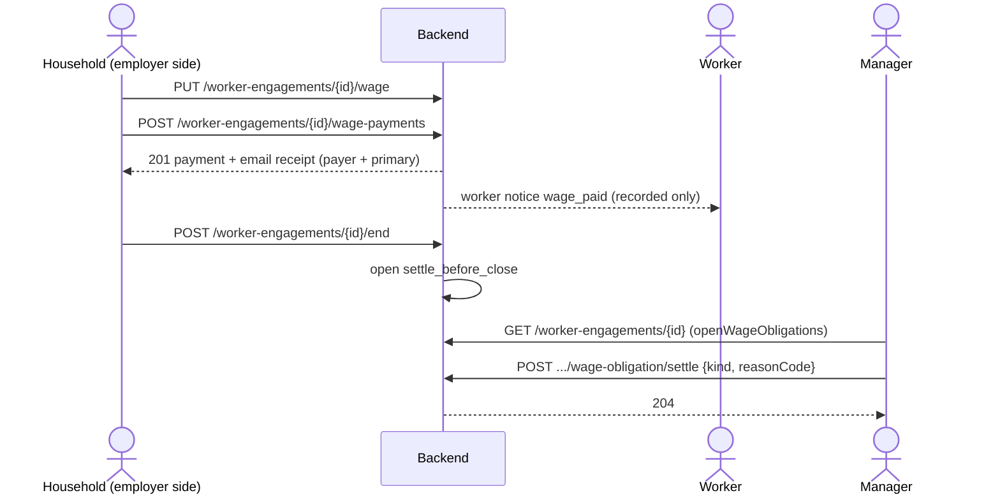
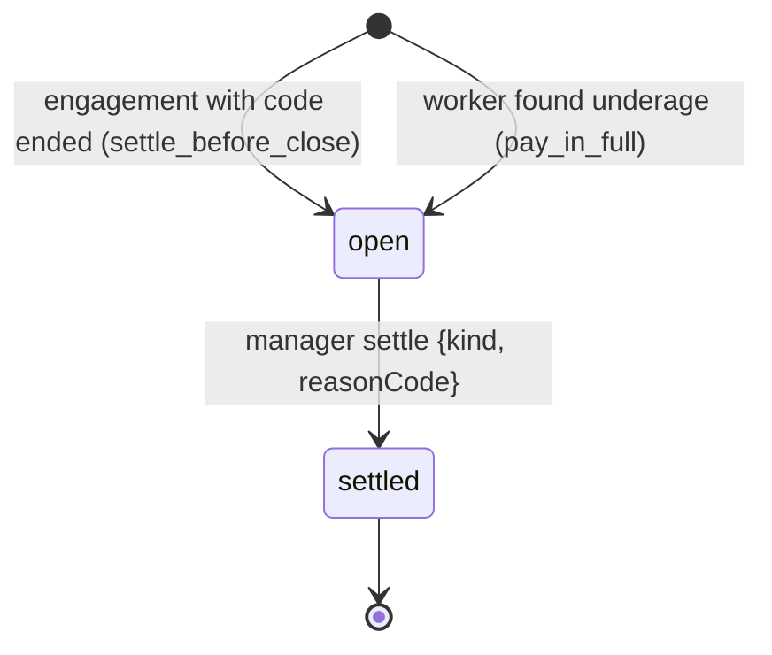

# أجر العامل — Worker wages

> **التطبيق/الواجهة:** resident app (صفحة العامل) + manager dashboard (تسوية التزامات الأجر)
> **الصلاحيات:** `workers.manage` (الأدوار `resident` و`family_member`) لتحديد الأجر وتسجيل الدفع، وبشرط إن المتصل من "جانب صاحب العمل" (تحت) · `workers.review` (الدور `manager`) لقراءة المدفوعات وتسوية الالتزامات
> **المصادر:** ADR 0037 · ADR 0022 · `src/community/workers/worker-wages.service.ts` · `dto/wages.dto.ts` · `views/wage.views.ts`

## الفكرة باختصار
الأسرة بتسجّل الأجر الشهري المتفق عليه مع العامل، وبتسجّل إنها دفعت أجر شهر معيّن. **جوار بيسجّل بس، مش بيحوّل فلوس** (مفيش بوابة دفع).
مع كل دفعة: العامل بيتسجل له إشعار، واللي دفع والساكن الرئيسي بيوصلهم إيصال بالإيميل.
لما ارتباط العامل يخلص (أو يتكشف إنه قاصر) بيتفتح "التزام أجر" على الملف، ومحدش يقفله غير **الإدارة** بسبب من قائمة. الدفعة اللي الأسرة بتسجلها **مش بتقفل** الالتزام.

## الأدوار ومين بيعمل إيه

| الدور | يقدر يعمل إيه |
|---|---|
| **جانب صاحب العمل**: الساكن الرئيسي، أو مفوَّض بنطاق `workers` ساري (على كل ارتباطات الوحدة)، أو اللي طلب الارتباط ده (على ارتباطه بس، وطول ما هو ساكن في الوحدة) | يشوف الأجر وآخر شهر مدفوع، يحدد/يمسح الأجر، يسجّل دفعة شهر، يشوف قائمة المدفوعات. |
| باقي أفراد الأسرة | يشوفوا العامل من غير أي بيانات أجر (الحقول مش موجودة)، ومايقدروش يسجلوا أو يقروا المدفوعات. |
| مالك مؤجِّر | مايشوفش العمال أصلاً. |
| مدير بـ `workers.review` | يشوف `monthlyWage` في قوائمه، يقرا المدفوعات (للمرتبات)، يشوف `openWageObligations`، ويقفل التزام الأجر. **مايقدرش** يحدد أجر ولا يسجل دفعة (أي حساب `manager` أو `staff` مرفوض مهما كانت صلاحياته). |

## الشاشات اللي الفيتشر محتاجها
- **بلوك الأجر في صفحة العامل (الساكن):** الأجر الشهري + آخر شهر مدفوع + زر "دفع الأجر" + "تعديل الأجر". يظهر **فقط** لو حقل `monthlyWage` موجود في الرد.
- **فورم تحديد الأجر:** مبلغ شهري، مع خيار "مسح الأجر".
- **فورم تسجيل دفعة:** الشهر (`YYYY-MM`) + المبلغ (مقترح يتملى بالأجر الشهري، قابل للتعديل).
- **رسالة نجاح الدفع:** "تم تسجيل الدفع. أُرسل إيصال للطرفين." + ملاحظة "جوار يسجّل الدفع فقط ولا يحوّل الأموال".
- **سجل المدفوعات:** قائمة بالشهر والمبلغ والتاريخ ومين دفع.
- **(المدير) بلوك الالتزامات المفتوحة** في تفاصيل الارتباط + **حوار تسوية التزام** (النوع + سبب من قائمة).
- **(المدير) سجل مدفوعات العامل** للمرتبات.

## الفلو خطوة بخطوة

### 1) تحديد أو مسح الأجر الشهري
1. من جانب صاحب العمل: `PUT /worker-engagements/{id}/wage` بـ `{ monthlyWage }`.
   - رقم أو نص، موجب، بحد أقصى خانتين عشريتين، ولا يزيد عن `1000000`. مثال: `"3200.00"`.
   - `null` = مسح الأجر.
   - لازم الحقل يتبعت؛ غيابه أو نص فاضي ← `FIELD_REQUIRED`.
2. مسموح طول ما الارتباط مفتوح: `pending_review` أو `active` أو `suspended`. بعد `ended`/`rejected` ← `ENGAGEMENT_NOT_FOUND`. (لو مؤقت وعدّى `validUntil`، بيتقفل الأول وبعدين يترفض.)
3. الرد `200`: `{ monthlyWage: "3200.00" }` أو `{ monthlyWage: null }`.
4. الشاشة: حدّث البلوك بالقيمة الجديدة.

### 2) تسجيل دفعة شهر
1. من جانب صاحب العمل: `POST /worker-engagements/{id}/wage-payments` بـ:
   - `period`: `YYYY-MM` (إجباري).
   - `amount`: موجب، ≤ خانتين عشريتين، ≤ `1000000` (إجباري فعلياً رغم إن الـschema بتقول اختياري). **مش لازم يساوي الأجر الشهري** (نص شهر أو مكافأة مقبولين).
2. الباك بيتحقق:
   - الارتباط حالته `active` أو `suspended` أو `ended`، **وطلع له كود قبل كده** (يعني العامل كان ممكن يشتغل فعلاً). غير كده (`pending_review` أو `rejected` أو انتهى من غير ما يتوافق عليه) ← `WAGE_NOT_PAYABLE`.
   - الشهر مش بعد الشهر الحالي بتوقيت الكمبوند ← وإلا `WAGE_PERIOD_IN_FUTURE`.
   - الشهر مش قبل شهر إنشاء الارتباط ← وإلا `WAGE_PERIOD_BEFORE_ENGAGEMENT` (مع `params.first` = أول شهر مسموح).
   - الشهر ماتدفعش قبل كده ← وإلا `WAGE_PERIOD_ALREADY_PAID` (مع `params.period`).
3. النتيجة:
   - الدفعة بتتسجل (مش قابلة للتعديل ولا الحذف بعد كده).
   - إشعار للعامل `wage_paid` (الشهر والمبلغ) — بيتسجل بس، مفيش قناة بتبعته لسه.
   - إيميل إيصال `community.wage_paid` لللي دفع وللساكن الرئيسي.
4. الرد `201`: `{ id, engagementId, period, amount, paidAt, paidBy }`.
5. الشاشة: رسالة النجاح، وتحديث "آخر شهر مدفوع" وسجل المدفوعات.

> لأن التسجيل نهائي، اعرض **شاشة تأكيد** قبل الإرسال فيها الشهر والمبلغ بوضوح.

### 3) قائمة المدفوعات
1. `GET /worker-engagements/{id}/wage-payments` (cursor-paged، الأحدث تسجيلاً أولاً).
2. مسموح لجانب صاحب العمل وللمدير. غيرهم من الأسرة ← `FORBIDDEN`.
3. شغالة على أي حالة ارتباط (حتى المنتهي).

### 4) التزامات الأجر وتسويتها (الإدارة)
**إمتى بيتفتح التزام؟** (تلقائي، مفيش endpoint لفتحه):

| النوع (`kind`) | بيتفتح إمتى | المعنى |
|---|---|---|
| `settle_before_close` | ارتباط **طلع له كود قبل كده** انتهى بأي طريقة: إنهاء يدوي، انتهاء `validUntil`، انتهاء أسرة الوحدة، مسح حساب الطالب | ملف العامل مايتقفلش قبل ما الأجر يتسوى. |
| `pay_in_full` | العامل اتكشف إنه قاصر (في الموافقة، أو تصحيح تاريخ الميلاد، أو بلاغ قاصر) — على **كل** ارتباط طلع له كود، حتى المنتهي | الأجر مستحق كامل عن أيام الشغل. |

- التزام واحد مفتوح بس من كل نوع لكل ارتباط؛ ممكن الاتنين يبقوا مفتوحين مع بعض.
- الدفعة المسجلة من الأسرة **مابتقفلش** أي نوع.
- طول ما فيه التزام مفتوح على ارتباط طلبه ساكن، طلب مسح حسابه بيتعطل بالكود `open_worker_obligations`.

**التسوية:**
1. المدير يفتح `GET /worker-engagements/{id}` ويشوف `openWageObligations` (مثلاً `["pay_in_full", "settle_before_close"]`). اعرض زر "تسوية" لكل نوع موجود.
2. (اختياري) يراجع `GET /worker-engagements/{id}/wage-payments`.
3. `POST /worker-engagements/{id}/wage-obligation/settle` بـ `{ kind, reasonCode }`:
   - `kind`: `settle_before_close` (افتراضي لو مااتبعتش) أو `pay_in_full`.
   - `reasonCode` (كود بس، من غير نص):
     - لـ`settle_before_close`: `household_payment_confirmed` (راجعت مدفوعات الأسرة) · `worker_confirmed` (العامل أكد إنه استلم) · `nothing_owed` (مفيش مستحقات).
     - لـ`pay_in_full`: `household_payment_confirmed` · `worker_confirmed` · `referred_to_authorities` (اتحال للجهات المختصة). **`nothing_owed` مش مسموح** هنا.
4. الرد `204`. لو مفيش التزام مفتوح من النوع ده ← `WAGE_OBLIGATION_NOT_OPEN` (مثلاً مدير تاني سبقه) ← أعد تحميل التفاصيل.
5. تسوية `pay_in_full` مالهاش علاقة بقفل ملف الامتثال (راجع [`03-compliance-and-card-incidents.md`](./03-compliance-and-card-incidents.md))؛ كل واحد بيتقفل لوحده.

## الحالات (Statuses)

**التزام الأجر** (مفيش حقل status صريح؛ بيتعرف من `settledAt`):

| الحالة | المعنى | مين بيحرّكها |
|---|---|---|
| open | مفتوح، ظاهر في `openWageObligations` | بيتفتح تلقائياً (انتهاء ارتباط له كود، أو اكتشاف قاصر) |
| settled | اتسوّى بسبب، مش بيظهر تاني | المدير عن طريق `.../wage-obligation/settle` |

**الدفعة:** مالهاش حالات؛ بتتسجل مرة ومش بتتغير.

**متى الأجر/الدفع متاح حسب حالة الارتباط:**

| حالة الارتباط | تحديد الأجر | تسجيل دفعة |
|---|---|---|
| `pending_review` | نعم | لا (`WAGE_NOT_PAYABLE`) |
| `active` | نعم | نعم |
| `suspended` | نعم | نعم |
| `ended` | لا | نعم لو كان طلع له كود |
| `rejected` | لا | لا |

## البيانات اللي بتظهر

**في صفحة العامل للساكن** (`GET /units/{unitId}/workers/{id}`) — لجانب صاحب العمل بس:
- `monthlyWage`: `"3200.00"` أو `null` لو لسه ماتحددش.
- `lastPaidPeriod`: آخر شهر له دفعة (`YYYY-MM`) أو `null`.
- لغير جانب صاحب العمل: الحقلين **مش موجودين** (مش `null`) ← اخفِ البلوك كله.
- في قائمة العمال `GET /units/{unitId}/workers` نفس قاعدة `monthlyWage` (من غير `lastPaidPeriod`).

**الدفعة** (`WagePaymentView`):

| الحقل | المعنى |
|---|---|
| `id` | رقم الدفعة |
| `engagementId` | الارتباط |
| `period` | الشهر `YYYY-MM` |
| `amount` | المبلغ بخانتين عشريتين (نص) بعملة الكمبوند (جنيه مصري) |
| `paidAt` | وقت التسجيل |
| `paidBy` | `{id, fullName}` أو `{id, erased: true}` لو الحساب اتمسح |

**للمدير:** `monthlyWage` موجود دايماً في `GET /worker-engagements` و`GET /worker-engagements/{id}` (`null` لحد ما يتحدد)، و`openWageObligations` في التفاصيل.

**مش بيظهر:** مفيش endpoint يعرض الالتزامات المسوّاة ولا سبب التسوية ولا مين سوّاها. المبلغ مش بيتسجل في الأوديت.

## القواعد والقيود
- المبالغ: أرقام موجبة، خانتين عشريتين بحد أقصى، حد أقصى `1000000`، عملة الكمبوند (مفيش عمود عملة).
- دفعة واحدة بس لكل شهر لكل ارتباط (محمية بقفل وبـ unique index).
- الشهر: من شهر إنشاء الارتباط لحد الشهر الحالي بتوقيت الكمبوند.
- الدفعة نهائية: مفيش تعديل ولا حذف ولا عكس.
- حسابات `manager` و`staff` مرفوضة في تحديد الأجر وتسجيل الدفع؛ وتسوية الالتزام لحساب `manager` بس.
- اللي طلب الارتباط بيفقد حق الأجر على ارتباطه لو بطّل يسكن في الوحدة (الرئيسي/المفوَّض بيفضل له الحق).
- لا يوجد `Idempotency-Key`؛ الضغط مرتين على الدفع بيرجع `WAGE_PERIOD_ALREADY_PAID` في المرة التانية (آمن).
- تسوية الالتزام: `reasonCode` كود بس (من غير `reason` نص).

## الأخطاء اللي الـUI لازم يتعامل معاها

| HTTP + الكود | إمتى | رسالة/سلوك مقترح |
|---|---|---|
| 400 `VALIDATION_FAILED` — `monthlyWage`/`amount`: `FIELD_REQUIRED` | المبلغ ناقص | "أدخل المبلغ." |
| 400 `VALIDATION_FAILED` — `monthlyWage`/`amount`: `INVALID_NUMBER` (`params.max: "1000000.00"`) | صفر، سالب، أكتر من خانتين عشريتين، أو أكبر من مليون | "أدخل مبلغاً صحيحاً حتى 1,000,000 بحد أقصى خانتين عشريتين." |
| 400 `VALIDATION_FAILED` — `period`: صيغة غلط | مش `YYYY-MM` | استخدم month picker يمنعها. |
| 400 `VALIDATION_FAILED` — `period`: `WAGE_PERIOD_IN_FUTURE` | شهر في المستقبل | "لا يمكن تسجيل دفع لشهر لم يبدأ بعد." |
| 400 `VALIDATION_FAILED` — `period`: `WAGE_PERIOD_BEFORE_ENGAGEMENT` (`params.first`) | قبل بداية الارتباط | "أول شهر متاح هو {first}." |
| 400 `VALIDATION_FAILED` — `reasonCode`: `INVALID_REASON_CODE` (`params.allowed`) | كود تسوية مش من قائمة النوع | اعرض القائمة الصحيحة لكل نوع. |
| 400 `VALIDATION_FAILED` — `kind`: قيمة غلط | نوع التزام مش معروف | — |
| 400 `REASON_REQUIRED` | تسوية من غير `reasonCode` | علّم الحقل. |
| 403 `FORBIDDEN` | مدير/موظف بيحاول يحدد أجر أو يدفع؛ فرد أسرة مش من جانب صاحب العمل؛ حساب غير مدير بيسوّي | "هذا الإجراء غير متاح لك." |
| 403 `DELEGATION_EXPIRED` | تفويض `workers` انتهى | "انتهى تفويضك لهذه الوحدة." |
| 404 `UNIT_NOT_FOUND` | الوحدة مش ظاهرة | ارجع للرئيسية. |
| 404 `ENGAGEMENT_NOT_FOUND` | ارتباط مش موجود، أو تحديد أجر على ارتباط مقفول، أو مؤقت انتهى حالاً | "تغيّرت حالة العامل" + أعد التحميل. |
| 409 `WAGE_NOT_PAYABLE` | الارتباط لسه تحت المراجعة أو مرفوض أو ماطلعلوش كود | "لا يمكن تسجيل أجر قبل اعتماد العامل." |
| 409 `WAGE_PERIOD_ALREADY_PAID` (`params.period`) | الشهر ده اتدفع | "تم تسجيل أجر شهر {period} من قبل." |
| 409 `WAGE_OBLIGATION_NOT_OPEN` | مفيش التزام مفتوح من النوع ده | "لا يوجد التزام مفتوح من هذا النوع" + أعد التحميل. |

## الإشعارات

| الحدث | النوع (`kind`) | المستلم | Push؟ | الضغط يفتح |
|---|---|---|---|---|
| تسجيل دفعة | إيميل `community.wage_paid` (الشهر، اسم العامل، الوحدة، المبلغ + "جوار يسجّل الدفع فقط") | اللي دفع + الساكن الرئيسي | لا (إيميل، فئة `household`، غير حرج؛ ساعات الهدوء بتأجله لكن مابيتلغيش) | — |
| تسجيل دفعة | إشعار عامل `wage_paid` (الشهر والمبلغ) | العامل | لا — بيتسجل بس، مفيش قناة SMS لسه | — |
| تحديد الأجر، تسوية التزام، فتح التزام | — | لا أحد | — | — |

## الـEndpoints

| Method + Path | مين | الغرض | الرد |
|---|---|---|---|
| `PUT /worker-engagements/{id}/wage` | جانب صاحب العمل (`workers.manage`) | تحديد/مسح الأجر الشهري | `200` `{monthlyWage}` |
| `POST /worker-engagements/{id}/wage-payments` | جانب صاحب العمل (`workers.manage`) | تسجيل دفعة شهر | `201` `WagePaymentView` |
| `GET /worker-engagements/{id}/wage-payments` | جانب صاحب العمل أو مدير (`workers.manage` أو `workers.review`) | سجل المدفوعات | `200` `{data: WagePaymentView[], nextCursor}` |
| `POST /worker-engagements/{id}/wage-obligation/settle` | مدير (`workers.review`) | تسوية التزام أجر | `204` |
| `GET /units/{unitId}/workers/{id}` | ساكن | فيه `monthlyWage` و`lastPaidPeriod` | راجع [`01-domestic-workers.md`](./01-domestic-workers.md) |
| `GET /worker-engagements/{id}` | مدير | فيه `monthlyWage` و`openWageObligations` | راجع [`01-domestic-workers.md`](./01-domestic-workers.md) |

## ملاحظات للديزاين وحاجات ناقصة في الباك
- **الدفعة الغلط مالهاش تصحيح** (لا تعديل ولا حذف ولا عكس) — سؤال مفتوح في ADR 0037. الديزاين لازم يعتمد على شاشة تأكيد قوية.
- **مفيش قائمة مجمّعة بالالتزامات المفتوحة** على مستوى الكمبوند؛ المدير لازم يفتح كل ارتباط لوحده. شاشة "مرتبات/مستحقات معلّقة" محتاجة endpoint.
- مفيش عرض للالتزامات المسوّاة (السبب، مين، إمتى).
- الساكن **مابيشوفش** إن فيه التزام مفتوح على ارتباطه، رغم إنه بيعطّل مسح حسابه (`open_worker_obligations`). `v0-notes` بيقول للتطبيق يوضّح إن "الأجر لسه محتاج يتسوّى مع الإدارة" بعد الإنهاء — بس مفيش حقل يقول ده.
- مفيش تذكير بالأجر الشهري ولا حالة "شهر متأخر"؛ التطبيق يقدر يستنتج من `lastPaidPeriod` بس.
- إشعار العامل بالدفع بيتسجل بس؛ "الإيصال للطرفين" فعلياً بيوصل للأسرة بس لحد ما قناة SMS تتعمل.
- الـschema بتقول `amount` و`reasonCode` اختياريين، لكن الخدمة بترفض غيابهم — اعتبرهم إجباريين.
- التصدير (ADR 0036): `workers.json` فيه `monthlyWage`، و`wage-payments.json` فيه الدفعات اللي الحساب سجلها بنفسه (لملف تصدير البيانات).
