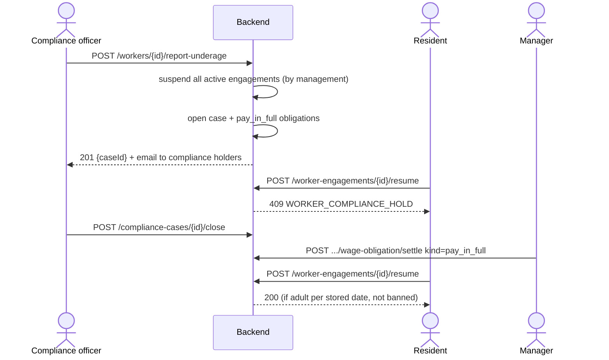
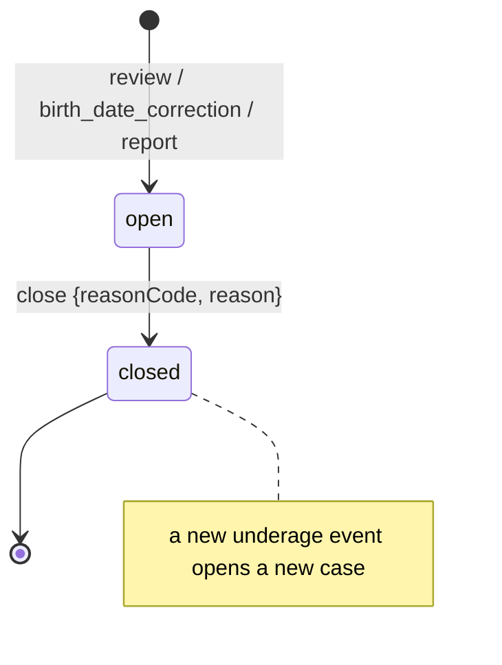
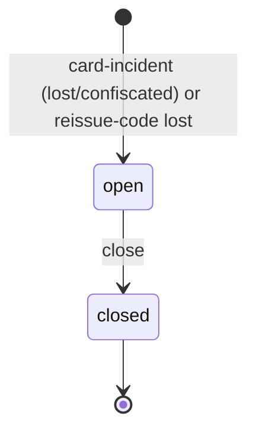

# الامتثال وبلاغات الكارت وحضور العامل — Worker compliance, card incidents & attendance

> **التطبيق/الواجهة:** manager dashboard (الامتثال والبلاغات) + resident app (الحضور، وإعادة إصدار الكود عند الفقد)
> **الصلاحيات:** `workers.compliance` (ملفات الامتثال وبلاغ القاصر) · `workers.incidents` (بلاغات الكارت) — الاتنين في الدور `manager` افتراضياً · الحضور: `workers.manage` (`resident`, `family_member`) أو `workers.review` (`manager`)
> **المصادر:** ADR 0022 · ADR 0017 · ADR 0028 · ADR 0037 · `src/community/workers/` · `src/community/notices/` · `src/gate/attendance/`

## الفكرة باختصار
- **ملف امتثال (قاصر):** لو اتكشف إن عامل أقل من 18 سنة (حتى لو مستنده بيقول غير كده)، كل أكواده بتقف فوراً، بيتفتح ملف لمسؤول الامتثال (مش متساب للساكن)، وأجره مستحق كامل. الملف بيفضل في السجل حتى بعد قفله.
- **بلاغ كارت:** الكارت ضاع أو اتصادر. الإدارة بتسجل البلاغ وبيطلع كود وكارت بديل **مجاناً وفوراً**. المصادرة بتروح للإدارة والأمن بس، **أبداً للساكن** (ممكن يكون هو اللي أخده).
- **الحضور:** أيام وجود العامل في الكمبوند من سجل البوابة (تواريخ وأوقات بس).

## الأدوار ومين بيعمل إيه

| الدور | يقدر يعمل إيه |
|---|---|
| مسؤول الامتثال (`workers.compliance`، حالياً المدير) | يبلّغ عن عامل قاصر، يشوف ملفات الامتثال، يقفل ملف بسبب. بيوصله إيميل لما ملف يتفتح. |
| مدير بـ `workers.review` | ممكن يفتح ملف امتثال بشكل غير مباشر (موافقة على عامل باسبور طلع قاصر، أو تصحيح تاريخ ميلاد لأقل من 18). يسوّي التزام `pay_in_full` (راجع [`02-worker-wages.md`](./02-worker-wages.md)). |
| مدير بـ `workers.incidents` | يسجّل بلاغ فقد/مصادرة ويستلم الكارت البديل، يشوف البلاغات، يقفلها. بيوصله إيميل عند المصادرة. |
| الساكن (المسموح له على الارتباط) | مايقدرش يسجّل بلاغ ولا يشوف البلاغات. لو الكارت ضاع يعمل "إعادة إصدار" بسبب `lost` (وده بيفتح بلاغ فقد تلقائياً) — راجع [`01-domestic-workers.md`](./01-domestic-workers.md#5-إعادة-إصدار-الكود-كارت-ضاع-أو-الكود-اتكشف). يشوف حضور العامل. |
| الحارس | لسه مالوش أي دور في البلاغات (مخطط له مع البوابة). |

## الشاشات اللي الفيتشر محتاجها

**داشبورد المدير**
- **قائمة ملفات الامتثال:** فلتر مفتوح/مقفول، المصدر، تاريخ الفتح والقفل.
- **حوار "الإبلاغ عن عامل قاصر"** (من صفحة الارتباط/العامل): سبب من قائمة + نص + تحذير إن كل أكواد العامل هتقف فوراً.
- **حوار قفل ملف امتثال:** سبب من قائمة + نص.
- **قائمة بلاغات الكارت:** فلتر مفتوح/مقفول، النوع، مين بلّغ (إدارة/ساكن)، التاريخ.
- **حوار تسجيل بلاغ كارت** (من صفحة الارتباط): النوع (فقد/مصادرة) + ملاحظة اختيارية ← **شاشة الكود والكارت البديل** (مرة واحدة).
- **زر قفل بلاغ** (تأكيد بسيط، من غير سبب).

**تطبيق الساكن**
- **بلوك/شاشة الحضور** في صفحة العامل: آخر حضور، وتقويم أو قائمة أيام مع أول دخول وآخر خروج.

## الفلو خطوة بخطوة

### 1) إيه اللي بيفتح ملف امتثال (قاصر)؟
ملف بيتفتح من 3 مصادر (`source`):

| المصدر | إمتى | اللي بيحصل للارتباط الحالي |
|---|---|---|
| `review` | المدير وافق على عامل باسبور وتاريخ ميلاده (بعد التوثيق/التصحيح) أقل من 18 | الارتباط اللي تحت المراجعة بيترفض، والطلب بيرجع `WORKER_UNDERAGE` |
| `birth_date_correction` | `POST /workers/{id}/birth-date` بتاريخ أقل من 18 | الرد `204` عادي |
| `report` | `POST /workers/{id}/report-underage` (البلاغ اليدوي، تحت) | الرد `201` بـ `caseId` |

في الـ3 حالات، نفس التأثير بالظبط:
1. كل ارتباطات العامل `active` (في كل الوحدات) ← `suspended` مع `suspendedByManagement: true`، وإشعار للعامل لكل واحد. (الارتباطات `pending_review` مابتتأثرش.)
2. بيتفتح ملف `underage` — أو بيتساب المفتوح زي ما هو (ملف مفتوح واحد بس لكل عامل).
3. إيميل `community.compliance_case_opened` لكل حاملي `workers.compliance` (برقم الملف بس، من غير بيانات العامل). لو محدش حامل الصلاحية بيتسجل "غير قابل للتسليم".
4. التزام أجر `pay_in_full` على **كل** ارتباط طلع له كود قبل كده (حتى المنتهي).

**التأثير طول ما الملف مفتوح:** أي استئناف لارتباطات العامل مرفوض بـ `WORKER_COMPLIANCE_HOLD` (وبيكسبه `WORKER_UNDERAGE` لو التاريخ المتخزن نفسه أقل من 18).

### 2) الإبلاغ عن عامل قاصر (يدوي)
1. مسؤول الامتثال يفتح حوار البلاغ من ارتباط العامل (محتاج `workerId` — من `GET /worker-engagements` أو التفاصيل).
2. `POST /workers/{workerId}/report-underage` بـ `{ reasonCode, reason }`:
   - `reasonCode` من: `document_review` (مراجعة المستند) · `report_received` (بلاغ وصل) · `other`.
   - `reason` نص إلزامي (≤1000).
3. الرد `201`: `{ caseId }` — لو فيه ملف مفتوح أصلاً بيرجع رقمه هو (والسبب الجديد مش بيتسجل عليه).
4. بيشتغل حتى لو العامل مالوش ارتباطات نشطة.
5. الشاشة: "تم فتح ملف امتثال وإيقاف أكواد العامل" + انتقال للملف في القائمة.

### 3) قائمة ملفات الامتثال
- `GET /compliance-cases?status=open|closed` (من غير `status` = الكل)، cursor-paged، الأحدث فتحاً أولاً.

### 4) قفل ملف امتثال
1. `POST /compliance-cases/{id}/close` بـ `{ reasonCode, reason }`:
   - `reasonCode` من: `resolved` (اتحل) · `unfounded` (البلاغ مالوش أساس) · `other`.
   - `reason` نص إلزامي (≤1000).
2. الرد `204`. ملف مقفول أو مش موجود ← `COMPLIANCE_CASE_NOT_FOUND`.
3. القفل **مابيستأنفش** أي ارتباط تلقائياً؛ حد لازم يعمل استئناف (ولو التاريخ المتخزن أقل من 18 الاستئناف هيفضل مرفوض).
4. القفل **مابيسوّيش** التزام `pay_in_full`؛ ده بيتقفل لوحده من شاشة الأجر.

### 5) تسجيل بلاغ كارت (الإدارة)
1. المدير (`workers.incidents`) من صفحة الارتباط: `POST /worker-engagements/{id}/card-incident` بـ:
   - `type`: `lost` (فقد) أو `confiscated` (مصادرة) — إجباري.
   - `note`: اختياري، 1–500 حرف. **مابيرجعش أبداً من الـAPI** بعد كده.
2. مسموح لو الارتباط `active` أو `suspended`، غير كده ← `ENGAGEMENT_NOT_FOUND`.
3. في نفس العملية: البلاغ بيتسجل (`reportedVia: manager`)، والكود والـQR القدام بيموتوا، وبيطلع كود جديد.
4. الرد `201`: `{ incidentId, engagementId, accessCode, card }` — الكود والكارت **مرة واحدة** (`no-store`). نفس محتوى الكارت الموضح في [`01-domestic-workers.md`](./01-domestic-workers.md#4-الكود-والكارت-المطبوع).
5. الإشعارات:
   - الساكن (طالب الارتباط + الرئيسي) بيوصله إيميل "صدر كود جديد" **من غير السبب ولا الملاحظة**.
   - لو مصادرة: إيميل `community.card_confiscated` لكل حاملي `workers.incidents`.
   - إشعار للعامل `code_reissued` (مسجل بس).
6. الشاشة: عرض الكود والكارت البديل للطباعة + "الكارت البديل مجاني".

**بلاغ فقد من الساكن:** الساكن مابيستخدمش الـendpoint ده؛ بيعمل `POST /worker-engagements/{id}/reissue-code` بـ `reasonCode: "lost"` وده بيفتح بلاغ فقد تلقائياً بـ `reportedVia: resident`. (`compromised` و`other` مابيفتحوش بلاغ.) الساكن مايقدرش يسجل مصادرة بأي طريقة.

### 6) قائمة البلاغات وقفلها
- `GET /card-incidents?status=open|closed` (من غير `status` = الكل)، cursor-paged، الأحدث أولاً.
- `POST /card-incidents/{id}/close` (من غير body) ← `204`. بلاغ مقفول أو مش موجود ← `CARD_INCIDENT_NOT_FOUND`.
- قفل البلاغ ملفّي بس؛ مالوش أي تأثير على الكود.

### الحضور (Attendance)
1. الساكن (طالب الارتباط وهو ساكن، أو الرئيسي، أو مفوَّض `workers`) أو المدير: `GET /worker-engagements/{id}/attendance?from=YYYY-MM-DD&to=YYYY-MM-DD`.
   - `to` افتراضياً = النهارده بتوقيت الكمبوند؛ `from` افتراضياً = 30 يوم لحد `to` (يعني `to` − 29 يوم).
   - أقصى مدى 93 يوم، و`from` لازم ≤ `to`.
2. الرد `200`: أيام فيها دخول، مرتبة تصاعدياً، لكل يوم: أول دخول وآخر خروج، وهل فيه خروج اتقفل من السيستم مش من الحارس.
3. "آخر حضور" في صفحة العامل = آخر عنصر في `days` (الباك مالوش حقل منفصل له).
4. سجل البوابة نفسه (مين دخل، من أي بوابة، الحارس) مش هنا — راجع [`../05-gate/02-gate-verify-and-entries.md`](../05-gate/02-gate-verify-and-entries.md).

## الحالات (Statuses)

**ملف الامتثال**

| الحالة | المعنى | مين بيحرّكها |
|---|---|---|
| `open` | العامل تحت مراجعة قاصر؛ الاستئناف موقوف | بيتفتح من المراجعة، تصحيح التاريخ، أو البلاغ |
| `closed` | اتقفل بسبب، باقي في السجل | مسؤول الامتثال |

**بلاغ الكارت**

| الحالة | المعنى | مين بيحرّكها |
|---|---|---|
| `open` | البلاغ اتسجل والكود اتبدل | تسجيل بلاغ (إدارة) أو إعادة إصدار بسبب `lost` (ساكن أو مدير) |
| `closed` | الملف اتقفل | `workers.incidents` |

## البيانات اللي بتظهر

**ملف امتثال** (`GET /compliance-cases`):

| الحقل | المعنى |
|---|---|
| `id` | رقم الملف (هو اللي في الإيميل) |
| `workerId` | العامل (رقم بس، من غير اسم) |
| `kind` | دايماً `underage` |
| `status` | `open` / `closed` |
| `source` | `review` · `birth_date_correction` · `report` |
| `openedAt` / `closedAt` | التواريخ |

**مش بيرجع:** اسم العامل، سبب/نص البلاغ، سبب القفل ونصه، مين فتح أو قفل.

**بلاغ كارت** (`GET /card-incidents`):

| الحقل | المعنى |
|---|---|
| `id` | رقم البلاغ |
| `engagementId` / `workerId` | الارتباط والعامل (أرقام بس) |
| `type` | `lost` / `confiscated` |
| `reportedVia` | `manager` / `resident` |
| `reportedAt` | وقت البلاغ |
| `status` | `open` / `closed` |

**مش بيرجع أبداً:** `note`. ومش بيرجع: اسم العامل، كود الوحدة، مين بلّغ، `closedAt`.

**الحضور** (`AttendanceView`):

| الحقل | المعنى |
|---|---|
| `engagementId`, `from`, `to` | المدى المستخدم فعلاً |
| `days[].date` | التاريخ المحلي للدخول |
| `days[].firstIn` | أول دخول في اليوم |
| `days[].lastOut` | آخر خروج، أو `null` لو لسه جوه |
| `days[].unconfirmedExit` | خروج اتقفل من السيستم (مش الحارس شافه) |
| `days[].fullDay` | كل زيارات اليوم ليها خروج مؤكَّد |
| `totalDays` | عدد الأيام |

**مش بيرجع:** البوابة، الحارس، طريقة الدخول.

## القواعد والقيود
- ملف امتثال مفتوح واحد بس لكل عامل.
- مفيش override للسن، والقفل مابيرجّعش الأكواد تلقائياً.
- ملف الامتثال مابيمنعش تسجيل ارتباط جديد ولا الموافقة عليه — بيمنع **الاستئناف** بس (شوف الحاجات الناقصة).
- بلاغات الكارت: بديل مجاني دايماً (مفيش رسوم في أي مكان)، والكود القديم بيموت لحظة الحفظ.
- `note` ≤ 500 حرف ومش بترجع.
- الأسباب: `reasonCode` + `reason` نص إلزامي (≤1000) في البلاغ والقفل للامتثال. قفل بلاغ الكارت من غير سبب.
- الحضور: مدى ≤ 93 يوم، صيغة `YYYY-MM-DD`، التواريخ بتوقيت الكمبوند.
- القوائم cursor-paged (راجع README). لا يوجد `Idempotency-Key`.

## الأخطاء اللي الـUI لازم يتعامل معاها

| HTTP + الكود | إمتى | رسالة/سلوك مقترح |
|---|---|---|
| 400 `REASON_REQUIRED` | سبب ناقص في البلاغ/القفل | علّم الحقل الناقص. |
| 400 `VALIDATION_FAILED` — `reasonCode`: `INVALID_REASON_CODE` (`allowed`) | كود مش من القائمة | اعرض القائمة الصحيحة. |
| 400 `VALIDATION_FAILED` — `reason`: `INVALID_LENGTH` | نص > 1000 | عدّاد حروف. |
| 400 `VALIDATION_FAILED` — `type`: `INVALID_VALUE`، `note`: طول | نوع بلاغ غلط أو ملاحظة > 500 | عدّاد حروف. |
| 400 `VALIDATION_FAILED` — `from`/`to`: `INVALID_FORMAT`، `to`: `INVALID_VALUE` (`params.maxDays: 93`) | تاريخ غلط أو مدى أكبر من 93 يوم أو معكوس | "اختر مدى حتى 93 يوماً." |
| 403 `FORBIDDEN` / `DELEGATION_EXPIRED` | ساكن مش مسموح له على الارتباط يفتح الحضور | "غير متاح لك." |
| 404 `WORKER_NOT_FOUND` | بلاغ قاصر لعامل مش موجود | أعد التحميل. |
| 404 `COMPLIANCE_CASE_NOT_FOUND` | قفل ملف مقفول/مش موجود | "الملف مغلق بالفعل" + أعد التحميل. |
| 404 `CARD_INCIDENT_NOT_FOUND` | قفل بلاغ مقفول/مش موجود | "البلاغ مغلق بالفعل" + أعد التحميل. |
| 404 `ENGAGEMENT_NOT_FOUND` | بلاغ كارت لارتباط مش `active`/`suspended` أو انتهى حالاً؛ حضور لارتباط مش موجود | "تغيّرت حالة العامل" + أعد التحميل. |
| 409 `WORKER_COMPLIANCE_HOLD` | استئناف عامل عليه ملف مفتوح (بيظهر في شاشة الارتباط) | "لا يمكن الاستئناف أثناء مراجعة ملف امتثال." |
| 400 `WORKER_UNDERAGE` | موافقة على عامل طلع قاصر (المصدر `review`) | راجع [`01-domestic-workers.md`](./01-domestic-workers.md). |

## الإشعارات

| الحدث | النوع (`kind`) | المستلم | Push؟ | الضغط يفتح |
|---|---|---|---|---|
| فتح ملف امتثال (أي مصدر) | إيميل `community.compliance_case_opened` (رقم الملف، من غير بيانات العامل) | كل حاملي `workers.compliance` | لا (إيميل، غير حرج) | — (الداشبورد: الملف بالـ`caseId`) |
| بلاغ مصادرة | إيميل `community.card_confiscated` (كود الوحدة + رقم البلاغ) | كل حاملي `workers.incidents` | لا (إيميل) | — (الداشبورد: البلاغ) |
| أي بلاغ كارت أو إعادة إصدار | إيميل `community.worker_code_reissued` (من غير سبب) | طالب الارتباط + الرئيسي (ما عدا الفاعل) | لا (إيميل) | — |
| إيقاف بسبب قاصر | إشعار عامل `engagement_suspended_by_management` (`reason: underage`) | العامل | لا — مسجل بس | — |
| قفل ملف / قفل بلاغ | — | لا أحد | — | — |

الساكن **مابيوصلوش** أي إشعار إن العامل اتوقف بسبب قاصر.

## الـEndpoints

| Method + Path | مين | الغرض | الرد |
|---|---|---|---|
| `POST /workers/{id}/report-underage` | `workers.compliance` | بلاغ عامل قاصر | `201` `{caseId}` |
| `GET /compliance-cases` | `workers.compliance` | قائمة الملفات (`?status=open|closed`) | `200` `{data: ComplianceCaseResponse[], nextCursor}` |
| `POST /compliance-cases/{id}/close` | `workers.compliance` | قفل ملف | `204` |
| `POST /worker-engagements/{id}/card-incident` | `workers.incidents` | بلاغ فقد/مصادرة + كود بديل | `201` `{incidentId, engagementId, accessCode, card}` (no-store) |
| `GET /card-incidents` | `workers.incidents` | قائمة البلاغات (`?status=open|closed`) | `200` `{data: CardIncidentResponse[], nextCursor}` |
| `POST /card-incidents/{id}/close` | `workers.incidents` | قفل بلاغ | `204` |
| `GET /worker-engagements/{id}/attendance` | `workers.manage` (جانب الارتباط) أو `workers.review` | أيام الحضور | `200` `AttendanceView` |
| `POST /worker-engagements/{id}/reissue-code` | الساكن/المدير | إعادة إصدار (بـ `lost` يفتح بلاغ) | راجع [`01-domestic-workers.md`](./01-domestic-workers.md) |

## ملاحظات للديزاين وحاجات ناقصة في الباك
- **ملف الامتثال مابيمنعش ارتباط جديد:** عامل اتبلّغ إنه قاصر لكن مستنده بيقول بالغ ممكن يتسجل في وحدة تانية والمدير يوافق عليه (الموافقة والتسجيل مابيشيكوش على الملف المفتوح). ADR 0022 بيقول "يمنع كل استئناف" بس — محتاج قرار.
- مفيش endpoint لتفاصيل ملف امتثال أو بلاغ (السبب، الملاحظة، مين فتح/قفل). القوائم بالأرقام بس (`workerId`) — الشاشة محتاجة اسم العامل وكود الوحدة (v0-notes بيذكر ده كقرار مؤجل للديزاين).
- مفيش فلتر بالعامل أو بالوحدة في القائمتين.
- بلاغ القاصر لعامل عليه ملف مفتوح بيرجع نفس الملف ومابيسجلش السبب الجديد.
- الحارس مالوش دور في البلاغات لسه (ADR 0022: "the guard role with the gate")، وصفحة العامل نفسه مش موجودة.
- قفل بلاغ الكارت مالوش سبب ولا ملاحظة.
- "آخر حضور" مالوش حقل؛ التطبيق بيطلب المدى الافتراضي وياخد آخر يوم (ولو العامل ماجاش آخر 30 يوم هيبان فاضي).
- ADR 0037 بيقول إن السكان "بيقروا الحضور بـ `workers.manage`"؛ فعلياً فرد الأسرة اللي مش طالب الارتباط ولا مفوَّض بياخد `FORBIDDEN`.
