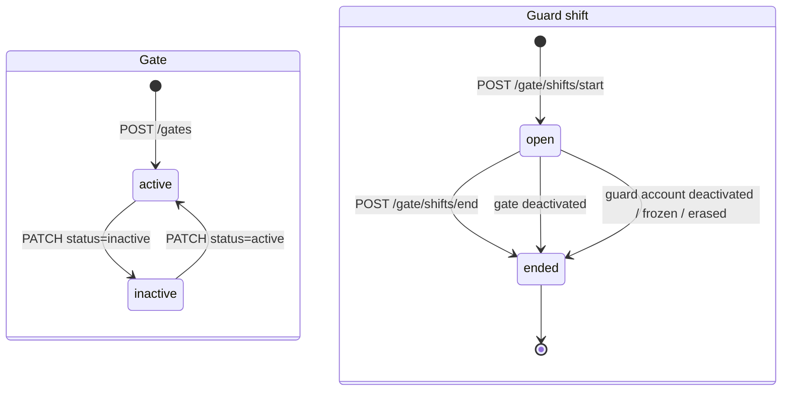

# البوابات وورديات الأمن — Gates and Guard Shifts

> **التطبيق/الواجهة:** manager dashboard (إدارة البوابات) · guard app (بدء وإنهاء الوردية) · resident app + family member (حالة البوابات)
> **الصلاحيات:** `gate.manage` و`gate.read` (دور `manager` الافتراضي) · `gate.operate` (دور `guard` الافتراضي، نوع الحساب `staff`) · `GET /gates/status` بدون صلاحية: نوع الحساب لازم يكون `resident` أو `family`
> **المصادر:** ADR 0028 · `src/gate/gates/` · `src/gate/shifts/`

## الفكرة باختصار
الإدارة بتعرّف بوابات الكمبوند (اسم ونوع)، وتقدر توقف بوابة عن الخدمة. فرد الأمن لازم "يفتح وردية" على بوابة شغالة قبل ما يعمل أي حاجة عند البوابة (يتحقق من كود، يسجل دخول/خروج، يطلب موافقة). الساكن وأفراد أسرته يقدروا يشوفوا أي بوابة مفتوحة دلوقتي.

## الأدوار ومين بيعمل إيه
| الدور | يقدر يعمل إيه |
|---|---|
| المدير (`gate.manage`) | ينشئ بوابة، يعدّل اسمها أو نوعها، يوقفها (`inactive`) أو يرجّعها (`active`). |
| المدير (`gate.read`) | يشوف قائمة كل البوابات بحالتها. |
| فرد الأمن (`gate.operate`) | يشوف البوابات الشغالة، يبدأ وردية على واحدة، يشوف ورديته الحالية، ينهيها. |
| الساكن / فرد الأسرة | يشوف أسماء البوابات وهل كل واحدة مفتوحة (`open`) أو لا. لا يرى مين في الوردية. |

## الشاشات اللي الفيتشر محتاجها
- **(مدير) قائمة البوابات:** الاسم، النوع، الحالة، تاريخ الإنشاء. زر "بوابة جديدة".
- **(مدير) فورم إنشاء/تعديل بوابة:** اسم + نوع، وفي التعديل مفتاح الحالة (شغالة / متوقفة).
- **(مدير) ديالوج تأكيد إيقاف البوابة:** ينبّه إن أي وردية مفتوحة على البوابة دي هتتقفل فورًا.
- **(أمن) شاشة "ابدأ ورديتك":** قائمة البوابات الشغالة للاختيار منها، وزر بدء.
- **(أمن) هيدر/بانر الوردية الحالية:** اسم البوابة ووقت البداية، وزر "إنهاء الوردية" (يظهر في كل شاشات البوابة).
- **(أمن) ديالوج تأكيد إنهاء الوردية.**
- **(ساكن/أسرة) شاشة حالة البوابات:** قائمة بالبوابات وعلامة مفتوحة/مقفولة.

## الفلو خطوة بخطوة

### 1. المدير ينشئ بوابة
1. المدير يفتح "بوابة جديدة" → `POST /gates`.
2. الحقول:
   - `name` (إجباري، نص من 1 لـ 80 حرف، المسافات في الأطراف بتتشال). الاسم لازم يكون فريد في الكمبوند.
   - `kind` (إجباري): `pedestrian` (مشاة) أو `vehicle` (سيارات) أو `mixed` (الاتنين).
3. الرد `201` بالبوابة (`GateView`)، والحالة بتبدأ `active`.
4. لو الاسم مكرر → `409 DUPLICATE_RESOURCE`؛ الفورم يعلّم على حقل الاسم.
5. الشاشة ترجع للقائمة وتضيف البوابة.

### 2. المدير يعدّل أو يوقف بوابة
1. `PATCH /gates/{id}` بأي مجموعة من: `name` (1–80)، `kind`، `status` (`active` | `inactive`).
2. لو التعديل غيّر الحالة من `active` لـ `inactive`: **كل الورديات المفتوحة على البوابة دي بتتقفل في نفس اللحظة** (سبب الإنهاء الداخلي `gate_deactivated`). فرد الأمن مش بيوصله إشعار؛ هيكتشف ده أول ما يجرب أي عملية (هياخد `403 NO_OPEN_SHIFT`).
3. الرجوع لـ `active` مسموح، لكنه لا يفتح أي وردية تلقائيًا.
4. مفيش حذف للبوابة نهائيًا (السجلات مربوطة بيها). "الإيقاف" هو البديل.
5. الرد `200` بالبوابة بعد التعديل. بوابة مش موجودة → `404 GATE_NOT_FOUND`.

### 3. المدير يشوف البوابات
- `GET /gates` → كل البوابات (شغالة ومتوقفة) مرتبة بالاسم. القائمة كاملة في صفحة واحدة (`nextCursor` دايمًا `null`).

### 4. فرد الأمن يبدأ ورديته
1. بعد تسجيل الدخول، التطبيق يسأل `GET /gate/shifts/current`:
   - `200` → فيه وردية مفتوحة؛ ادخل على شاشة البوابة مباشرة.
   - `403 NO_OPEN_SHIFT` → مفيش وردية؛ اعرض شاشة "ابدأ ورديتك".
2. شاشة البدء تجيب `GET /gate/gates` → البوابات **الشغالة فقط** (`id`, `name`, `kind`) مرتبة بالاسم.
3. فرد الأمن يختار بوابة → `POST /gate/shifts/start` بـ `{ gateId }`. يُفضّل إرسال هيدر `Idempotency-Key` (إعادة المحاولة بنفس المفتاح ترجّع نفس الوردية).
4. النتائج:
   - `201` → الوردية (`id`, `gateId`, `gateName`, `startedAt`, `endedAt: null`). افتح شاشة البوابة الرئيسية (التحقق من الكود، "مين جوه"، إلخ).
   - `404 GATE_NOT_FOUND` → البوابة اتوقفت أو مش موجودة؛ حدّث القائمة.
   - `409 SHIFT_ALREADY_OPEN` → عنده وردية مفتوحة فعلًا (مثلًا من جهاز تاني)؛ اعرض الوردية الحالية واطلب إنهاءها لو عايز يغيّر البوابة.
5. **خطوة تلقائية:** لحظة بدء الوردية، لو فيه طرود رفضها السكان ومستنية ترجع من نفس البوابة، فرد الأمن بيوصله إشعار بيها (جزء من فيتشر الطرود، ADR 0035).

### 5. فرد الأمن ينهي ورديته
1. `POST /gate/shifts/end` (بدون body، يُفضّل `Idempotency-Key`).
2. `200` → الوردية بعد الإنهاء (`endedAt` فيه وقت). ارجع لشاشة "ابدأ ورديتك".
3. `403 NO_OPEN_SHIFT` → الوردية اتقفلت بالفعل (مثلًا البوابة اتوقفت)؛ ارجع لشاشة البدء.

### 6. إنهاء الوردية تلقائيًا (بدون فرد الأمن)
الوردية بتتقفل لوحدها في نفس العملية لو:
- المدير وقّف البوابة (`gate_deactivated`).
- حساب فرد الأمن اتعطّل (`account_deactivated`) أو اتجمّد (`account_frozen`) أو اتمسح (`account_erased`).
لا يوجد إشعار لفرد الأمن في أي حالة منهم.

### 7. الساكن يشوف حالة البوابات
1. `GET /gates/status` (مسموح فقط لحساب نوعه `resident` أو `family`؛ أي نوع تاني → `403 FORBIDDEN`).
2. الرد: قائمة بكل البوابات `{ id, name, open }`؛ `open = true` معناها البوابة في الخدمة (`active`). الرد `no-store`، يعني التطبيق يعيد القراءة بدل ما يخزن.
3. البيانات دي **لا تقول** هل فيه فرد أمن موجود دلوقتي ولا لا.

### ما لا يستطيع فرد الأمن فعله بدون وردية مفتوحة
كل العمليات دي ترجع `403 NO_OPEN_SHIFT` من غير وردية:
- `POST /gate/verify` (التحقق من كود أو QR) — راجع `02-gate-verify-and-entries.md`.
- `POST /gate/entries` (تسجيل دخول/خروج).
- `GET /gate/inside` (مين جوه دلوقتي).
- `POST /gate/approval-requests` و`POST /gate/approval-requests/{id}/withdraw` — راجع `03-gate-approval-requests.md`.
- `GET /gate/shifts/current` و`POST /gate/shifts/end`.

المسموح بدون وردية: `GET /gate/gates` (لاختيار البوابة) و`POST /gate/shifts/start`، وكذلك `GET /gate/approval-requests/{id}` (متابعة طلب موافقة).

كل عملية بتتسجل على الوردية والبوابة المفتوحة وقتها: الدخول/الخروج وطلب الموافقة بيتسجلوا على بوابة الوردية، مش على بوابة بيختارها فرد الأمن في كل مرة.

## الحالات (Statuses)

**البوابة (`GateStatus`):**
| القيمة | المعنى | مين يغيّرها |
|---|---|---|
| `active` | البوابة في الخدمة، ينفع تبدأ عليها وردية، وتظهر للساكن `open: true`. | الحالة الافتراضية عند الإنشاء؛ المدير يرجّعها بـ `PATCH`. |
| `inactive` | البوابة متوقفة؛ مش ظاهرة في اختيار الأمن، والورديات المفتوحة عليها اتقفلت. | المدير بـ `PATCH`. |

**الوردية (لا يوجد حقل status؛ الحالة مشتقة من `endedAt`):**
| الحالة | المعنى | مين يغيّرها |
|---|---|---|
| مفتوحة (`endedAt = null`) | فرد الأمن في الخدمة على البوابة دي. وردية واحدة مفتوحة فقط لكل فرد أمن. | فرد الأمن بـ `shifts/start`. |
| منتهية (`endedAt` فيه وقت) | انتهت. | فرد الأمن (`shifts/end`)، أو إيقاف البوابة، أو تعطيل/تجميد/مسح حساب فرد الأمن. |

## البيانات اللي بتظهر

**`GateView` (قائمة المدير وبعد الإنشاء/التعديل):**
| الحقل | المعنى |
|---|---|
| `id` | معرّف البوابة. |
| `name` | اسم البوابة. |
| `kind` | `pedestrian` / `vehicle` / `mixed`. معلومة للعرض فقط؛ لا تغيّر أي سلوك. |
| `status` | `active` / `inactive`. |
| `createdAt` | تاريخ الإنشاء. |

**`GuardGateView` (اختيار البوابة عند فرد الأمن):** `id`, `name`, `kind` فقط، والبوابات الشغالة فقط.

**`GateStatusView` (الساكن/الأسرة):** `id`, `name`, `open` (boolean). لا يظهر النوع ولا الحالة الخام ولا أي معلومة عن فرد الأمن.

**`ShiftView` (الوردية):**
| الحقل | المعنى |
|---|---|
| `id` | معرّف الوردية. |
| `gateId`, `gateName` | البوابة اللي الوردية عليها (اعرض الاسم في الهيدر). |
| `startedAt` | وقت البداية. |
| `endedAt` | `null` وهي مفتوحة؛ وقت الإنهاء بعد `shifts/end`. |

سبب إنهاء الوردية (`endReason`) يتسجل داخليًا لكنه **لا يرجع** في أي رد.

## القواعد والقيود
- اسم البوابة: 1–80 حرف، فريد داخل الكمبوند.
- البوابة لا تُحذف؛ الإيقاف هو البديل.
- إيقاف البوابة يقفل كل الورديات المفتوحة عليها في نفس العملية.
- وردية مفتوحة واحدة فقط لكل فرد أمن. تغيير البوابة = إنهاء الوردية ثم بدء وردية جديدة.
- بدء وردية يحتاج بوابة `active`.
- `POST /gate/shifts/start` و`POST /gate/shifts/end` يقبلوا `Idempotency-Key` (راجع README): إعادة الإرسال بنفس المفتاح خلال 24 ساعة ترجّع نفس الرد.
- `GET /gates/status` لحسابات `resident` و`family` فقط، ولا يحتاج صلاحية.
- حساب الأمن بيتعمل من الإدارة (`POST /accounts` بنوع `staff`، والدور الافتراضي `guard`)، ودخوله بـ OTP على الإيميل لحد ما قناة SMS/WhatsApp تتوفر.

## الأخطاء اللي الـUI لازم يتعامل معاها
| HTTP + الكود | إمتى | رسالة/سلوك مقترح |
|---|---|---|
| `400 VALIDATION_FAILED` | اسم فاضي أو أطول من 80، أو `kind`/`status` قيمة غلط، أو `gateId` مش UUID. | علّم على الحقل: "الاسم مطلوب (حتى 80 حرف)". |
| `409 DUPLICATE_RESOURCE` | اسم بوابة موجود بالفعل في الكمبوند. | "يوجد بوابة بنفس الاسم". |
| `404 GATE_NOT_FOUND` | تعديل بوابة مش موجودة، أو بدء وردية على بوابة متوقفة/مش موجودة. | "البوابة غير متاحة" + تحديث القائمة. |
| `409 SHIFT_ALREADY_OPEN` | بدء وردية وفيه وردية مفتوحة. | "لديك وردية مفتوحة بالفعل" + عرض الوردية الحالية وزر إنهائها. |
| `403 NO_OPEN_SHIFT` | أي عملية بوابة بدون وردية، أو `shifts/current`/`shifts/end` بعد ما الوردية اتقفلت. | ودّي فرد الأمن لشاشة "ابدأ ورديتك" مع رسالة "ورديتك انتهت، ابدأ وردية جديدة". |
| `403 FORBIDDEN` | حساب مش ساكن/أسرة طلب `GET /gates/status`، أو حساب بدون الصلاحية المطلوبة. | لا تعرض الشاشة لهذا النوع من الحسابات. |
| `409 IDEMPOTENCY_CONFLICT` | نفس `Idempotency-Key` اتبعت مع طلب مختلف. | خطأ تقني؛ ولّد مفتاح جديد. |

## الإشعارات
لا يوجد إشعار خاص بالبوابات أو الورديات نفسها. الشيء الوحيد المرتبط: عند بدء وردية، فرد الأمن يستلم إشعارات الطرود المرفوضة المنتظرة على بوابته (فيتشر الطرود، ADR 0035).

## الـEndpoints
| Method + Path | مين | الغرض | الرد |
|---|---|---|---|
| `GET /gates` | مدير (`gate.read`) | كل البوابات | `200` `{ data: GateView[], nextCursor: null }` |
| `POST /gates` | مدير (`gate.manage`) | إنشاء بوابة | `201` `GateView` |
| `PATCH /gates/{id}` | مدير (`gate.manage`) | تعديل الاسم/النوع/الحالة | `200` `GateView` |
| `GET /gates/status` | ساكن / أسرة | أي بوابة مفتوحة | `200` `{ data: [{ id, name, open }], nextCursor: null }` (no-store) |
| `GET /gate/gates` | أمن (`gate.operate`) | البوابات الشغالة لاختيار الوردية | `200` `{ data: [{ id, name, kind }], nextCursor: null }` |
| `POST /gate/shifts/start` | أمن | بدء وردية `{ gateId }` | `201` `ShiftView` |
| `POST /gate/shifts/end` | أمن | إنهاء الوردية | `200` `ShiftView` |
| `GET /gate/shifts/current` | أمن | الوردية الحالية | `200` `ShiftView` أو `403 NO_OPEN_SHIFT` |

## ملاحظات للديزاين وحاجات ناقصة في الباك
- `GET /gate/shifts/current` يرجّع `403 NO_OPEN_SHIFT` (مش `null` أو `404`) لما مفيش وردية؛ التطبيق لازم يعامل الـ403 دي كحالة طبيعية "مفيش وردية" مش كخطأ صلاحيات.
- لا يوجد endpoint للمدير يعرض الورديات (مين في الخدمة الآن على أي بوابة، أو تاريخ الورديات). شاشة "الأمن في الخدمة" مش ممكنة حاليًا.
- المدير لا يقدر ينهي وردية فرد أمن معيّن؛ الطريق الوحيد هو إيقاف البوابة كلها أو تعطيل الحساب.
- فرد الأمن مش بيتبلغ لما ورديته تتقفل تلقائيًا (إيقاف البوابة)؛ هيعرف من أول `403 NO_OPEN_SHIFT`.
- سبب إنهاء الوردية (`endReason`) مخزّن لكن مش راجع في أي view.
- مفيش حذف للبوابة؛ الديزاين يستخدم "إيقاف" فقط.
- `kind` للعرض فقط؛ لا يوجد منطق مختلف لبوابة السيارات (مثلًا رقم لوحة).
- `GET /gates/status` لا يعرض أوقات تشغيل أو سبب الإيقاف؛ فقط مفتوحة/مقفولة.
