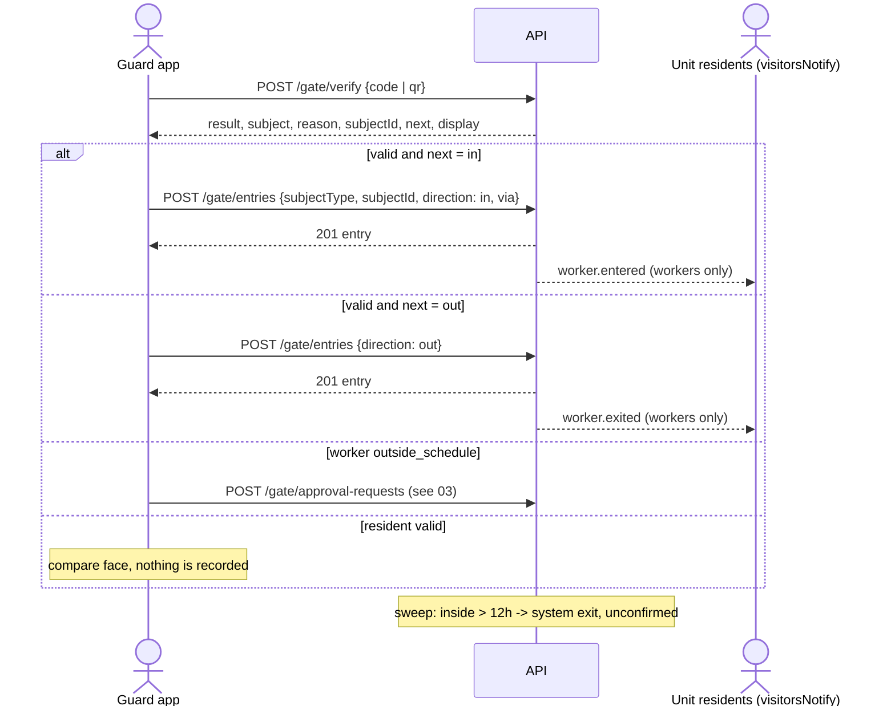
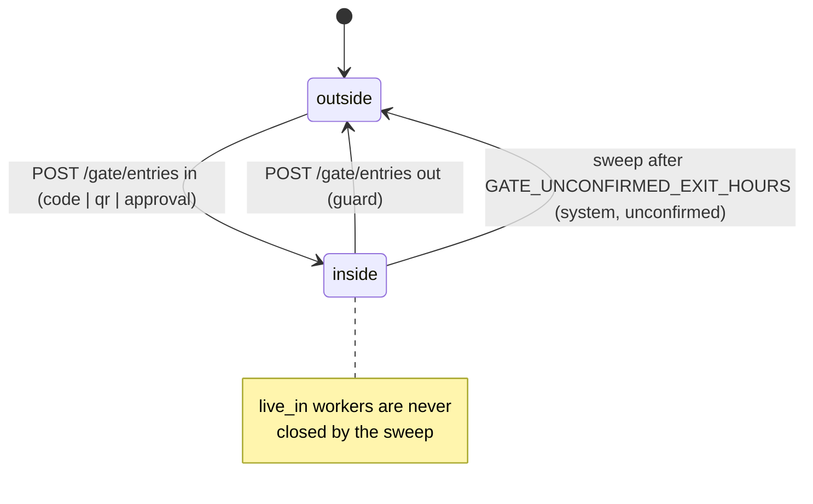

# التحقق عند البوابة وسجل الدخول والخروج — Gate Verify and Entries

> **التطبيق/الواجهة:** guard app (التحقق والتسجيل و"مين جوه") · manager dashboard (سجل البوابة) · resident app + family member (حضور العامل وإشعارات دخوله وخروجه)
> **الصلاحيات:** `gate.operate` (دور `guard`) لـ `verify` و`entries` و`inside`، وكلها داخل وردية مفتوحة · `gate.read` (دور `manager`) لـ `GET /gate/entries` · حضور العامل: `workers.manage` (أدوار `resident` و`family_member`) أو `workers.review` (دور `manager`) + سلطة على العامل (راجع تحت) · إشعارات العامل تروح لأصحاب capability `visitorsNotify` على الوحدة
> **المصادر:** ADR 0028 · ADR 0030 · ADR 0031 · `src/gate/entries/` · `src/gate/entry/resident-verifier.ts` · `src/gate/entry/entry-secrets.ts` · `src/gate/attendance/` · `src/community/gate-port.ts`

## الفكرة باختصار
فرد الأمن بيكتب كود أو يمسح QR، والسيستم يقول له "مين ده، ومسموح له يدخل دلوقتي ولا لا". لو مسموح، بيسجل الدخول (أو الخروج). السجل ده ثابت لا يتعدل ولا يتمسح، والمدير بيقرأه. الساكن بيوصله إشعار لما العامل بتاعه يدخل أو يخرج، ويقدر يشوف أيام حضوره. السكان نفسهم بيتحقق منهم بـ QR متغير لكن **دخولهم لا يتسجل** نهائيًا.

## الأدوار ومين بيعمل إيه
| الدور | يقدر يعمل إيه |
|---|---|
| فرد الأمن (`gate.operate` + وردية مفتوحة) | يتحقق من كود زائر (6 أرقام) أو كود عامل (8 أرقام) أو QR (تصريح زائر، كارت عامل، أو QR الساكن). يسجل دخول/خروج زائر أو عامل أو صاحب طلب موافقة. يشوف قائمة "مين جوه". |
| المدير (`gate.read`) | يقرأ سجل البوابة كامل مع فلاتر. |
| المدير (`workers.review`) | يشوف حضور أي عامل. |
| الساكن / فرد الأسرة (`workers.manage`) | يشوف حضور العامل لو هو اللي طلبه، أو هو الساكن الأساسي (primary)، أو عنده تفويض `workers` على الوحدة. |
| أصحاب `visitorsNotify` على الوحدة (الساكنين الفعليين وأفراد الأسرة النشطين بحساب) | يستلموا إشعار دخول وخروج العامل. |
| الساكن صاحب QR الدخول | يعرض الـQR من موبايله؛ التحقق لا يكتب أي سجل. |

## الشاشات اللي الفيتشر محتاجها
- **(أمن) شاشة التحقق:** خانة كتابة كود + زر "مسح QR".
- **(أمن) كارت نتيجة التحقق:** ثلاث أشكال (زائر / عامل / ساكن) + شكل "مرفوض" مع السبب + شكل "كود غير معروف".
- **(أمن) زر "تسجيل دخول" / "تسجيل خروج"** على كارت النتيجة الصالحة (حسب `next`).
- **(أمن) زر "اطلب موافقة الوحدة"** يظهر لعامل خارج مواعيده — راجع `03-gate-approval-requests.md`.
- **(أمن) قائمة "مين جوه دلوقتي"** مع زر "تسجيل خروج" لكل صف.
- **(أمن) مؤشر "تسجيل بدون إنترنت"** وطابور إرسال (لأن التسجيل يقبل وقت حدوث حتى 24 ساعة للخلف).
- **(مدير) سجل البوابة:** جدول مع فلاتر (البوابة، الوحدة، النوع، الاتجاه، من/إلى تاريخ) وتمييز الخروج غير المؤكد والتأخير الكبير بين وقت الحدوث ووقت التسجيل.
- **(ساكن) شاشة حضور العامل:** قائمة أيام مع أول دخول وآخر خروج، واختيار فترة.
- **(ساكن) إشعار "وصل العامل" / "غادر العامل".**

## الفلو خطوة بخطوة

### 1. التحقق من كود أو QR (`POST /gate/verify`)
1. فرد الأمن يكتب الكود أو يمسح QR → `POST /gate/verify`.
2. الـbody: **واحد بس** من:
   - `code`: نص (1–32). 6 أرقام = تصريح زائر، 8 أرقام = عامل. أي شكل تاني = "كود غير معروف". المسافات في الأطراف بتتشال.
   - `qr`: نص (1–256) كما قرأته الكاميرا. `JWR1.<token>` = تصريح زائر أو كارت عامل، `JWR2.<credentialId>.<step>.<mac>` = QR الساكن المتغير. أي حاجة تانية = "كود غير معروف".
   - لا شيء → `400` (`code` مطلوب). الاتنين مع بعض → `400` (`qr` غير مسموح).
3. الترتيب على السيرفر:
   1. لازم وردية مفتوحة، وإلا `403 NO_OPEN_SHIFT` (فرد أمن خارج الخدمة لا يعرف أي شيء عن أي كود).
   2. حد المحاولات: `GATE_VERIFY_RATE_LIMIT_PER_MINUTE` (افتراضي 30) في الدقيقة **لكل فرد أمن**، والكود والـQR بيتحسبوا من نفس الرصيد. بعدها `429 RATE_LIMITED`.
   3. البحث في الكمبوند الحالي فقط. كود كمبوند تاني = نفس رد الكود غير المعروف بالظبط.
4. **التحقق لا يكتب أي سجل** (غير عداد حد المحاولات)، فلا يحتاج `Idempotency-Key`. الرد `no-store` (فيه روابط صور قصيرة العمر).
5. الشاشة تعرض النتيجة حسب الجداول تحت، ثم:
   - `result = valid` و`next = in` → زر "تسجيل دخول".
   - `result = valid` و`next = out` → الشخص جوه بالفعل → زر "تسجيل خروج".
   - `subject = resident` و`valid` → قارن الوش بالصورة؛ **مفيش زر تسجيل** (`next` و`subjectId` = `null`).
   - `subject = worker` و`reason = outside_schedule` → زر "اطلب موافقة الوحدة" باستخدام `subjectId` (معرّف التعاقد).
   - غير ذلك `invalid` → اعرض السبب ولا تسمح بالتسجيل.

**قاعدة مهمة:** لو الشخص (زائر أو عامل) **جوه بالفعل**، التحقق يرجّع `valid` و`next = out` حتى لو التصريح اتلغى أو انتهى أو العامل اتحظر: أي حد جوه مسموح له يخرج دائمًا.

### 2. نتائج التحقق حسب نوع الشخص

**كود/QR غير معروف (أو مشوّه، أو من كمبوند تاني، أو QR ساكن بتوقيع غلط):**
`result: invalid`, `subject: null`, `reason: unknown_code`, `subjectId: null`, `next: null`, `display: null`.

**زائر (`subject: visitor`) — تفاصيل التصريح في `04-visitor-passes.md`:**
| `reason` | المعنى | ترتيب الفحص |
|---|---|---|
| `null` (`valid`) | مسموح دلوقتي. | — |
| `used` | تصريح لمرة واحدة واستُخدم. | 1 |
| `cancelled` | التصريح اتلغى. | 2 |
| `expired` | انتهت صلاحيته (حالة أو تاريخ). | 3 و6 |
| `host_inactive` | صاحب الدعوة لم يعد له حق الدعوة على الوحدة (اتنقل، اتعطّل...). | 4 |
| `not_yet_valid` | لسه ما بدأش. | 5 |
| `outside_schedule` | تصريح متكرر وده مش في المواعيد الأسبوعية (بتوقيت الكمبوند). | 7 |

**عامل (`subject: worker`) — تفاصيل العامل في `../04-workers/01-domestic-workers.md`:**
| `reason` | المعنى | `subjectId` |
|---|---|---|
| `null` (`valid`) | مسموح دلوقتي. | معرّف التعاقد |
| `banned` | العامل محظور من الإدارة. | `null` |
| `suspended` | التعاقد موقوف. | `null` |
| `ended` | التعاقد مش نشط (منتهي، مرفوض، أو لسه تحت المراجعة). | `null` |
| `expired` | عدّى تاريخ نهاية التعاقد. | `null` |
| `outside_schedule` | خارج مواعيد العامل الأسبوعية. العامل المقيم (`live_in`) ليس له مواعيد، فلا يأخذ هذا السبب. | **معرّف التعاقد** (علشان تطلب موافقة) |

**ساكن (`subject: resident`) — تفاصيل الـQR في `06-resident-entry-qr.md`:**
| `reason` | المعنى |
|---|---|
| `null` (`valid`) | ساكن حالي؛ قارن الوش بالصورة. |
| `expired_qr` | الـQR حقيقي لكن قديم (أكتر من خطوة 30 ثانية قبل/بعد الوقت الحالي). غالبًا ساعة الموبايل مظبوطة غلط أو لقطة شاشة. |
| `account_inactive` | حساب الساكن مش نشط. |
| `revoked` | الجهاز ده اتلغى. |
| `not_resident` | لم يعد يسكن في أي وحدة (لا يملك `gateEntry` على أي وحدة). |

ترتيب فحص الساكن: التوقيع أولًا (توقيع غلط = `unknown_code` بدون أي قراءة من قاعدة البيانات)، ثم الوقت (`expired_qr`)، ثم الحساب، ثم الإلغاء، ثم السكن. أي نتيجة `invalid` للساكن ترجع `display: null`.

### 3. محتوى `display` حسب النوع
| الحقل | زائر | عامل | ساكن (valid) |
|---|---|---|---|
| `unitCode` | كود الوحدة | كود الوحدة | `null` |
| `passKind` | `one_time` / `recurring` | `null` | `null` |
| `partySize` | عدد الأفراد (1–50) | `null` | `null` |
| `workerName` | `null` | اسم العامل | `null` |
| `capacity` | `null` | `live_in` / `hourly` / `driver` / `nanny` / `temporary` | `null` |
| `photo` | `null` دائمًا | `{ url, expiresAt }` صورة العامل **فقط لو النتيجة `valid`**، وإلا `null` | `null` |
| `firstName` | `null` | `null` | أول كلمة من الاسم فقط |
| `unitCodes` | `null` | `null` | أكواد كل الوحدات اللي ساكن فيها دلوقتي (مرتبة) |
| `photoUrl` | `null` | `null` | رابط صورة الساكن (قصير العمر)، أو `null` لو مالوش صورة → اطلب بطاقة |

- للزائر والعامل، `display` بيرجع **حتى لو النتيجة `invalid`** (مثلًا عامل محظور يظهر اسمه وكوده بدون صورة). لكود غير معروف ولأي ساكن `invalid`: `display = null`.
- فرد الأمن **لا يرى أبدًا**: اسم الزائر أو تليفونه، اسم الساكن الكامل، أي ساكن مرتبط بزائر أو عامل، أو أي مستند.

### 4. تسجيل دخول أو خروج (`POST /gate/entries`)
1. بعد نتيجة صالحة، فرد الأمن يضغط "تسجيل دخول/خروج" → `POST /gate/entries`.
2. الحقول:
   - `subjectType` (إجباري): `visitor_pass` (زائر بتصريح) أو `worker_engagement` (عامل) أو `gate_request` (شخص دخل على موافقة، راجع `03-gate-approval-requests.md`).
   - `subjectId` (إجباري): الـ`subjectId` اللي رجع من التحقق، أو معرّف طلب الموافقة، أو من قائمة "مين جوه".
   - `direction` (إجباري): `in` أو `out`.
   - `via` (اختياري، افتراضي `code`): `code` لو كتب الكود، `qr` لو مسح. يأثر فقط على دخول بتصريح أو كود عامل.
   - `occurredAt` (اختياري): وقت الحدوث الفعلي. من **24 ساعة للخلف** لحد **5 دقائق للأمام**. لو مش مبعوت = الآن.
   - `id` (اختياري): UUIDv7 يولّده التطبيق. لو اتبعت تاني بنفس القيم يرجّع نفس السجل بدون تكرار.
   - هيدر `Idempotency-Key` (اختياري ومفضّل).
3. السيرفر:
   - يتأكد من الوردية المفتوحة، ويسجل السجل على **بوابة الوردية**.
   - **دخول (`in`):** لو الشخص جوه بالفعل → `409 ALREADY_INSIDE`. بعدين يعيد الفحص **في لحظة `occurredAt`** (مش لحظة الإرسال) بنفس قواعد التحقق؛ لو مرفوض → `409 GATE_ENTRY_REFUSED` و`params.reason` فيه السبب. تصريح المرة الواحدة يتحول `used` بهذا الدخول ويموت كوده والـQR بتاعه.
   - **دخول على موافقة (`gate_request`):** راجع ملف الموافقات؛ الطريقة تتسجل `approval`.
   - **خروج (`out`):** لازم يكون جوه، وإلا `409 NOT_INSIDE`. وقت الخروج لا يمكن يكون قبل وقت آخر دخول (`400 VALIDATION_FAILED`). لا يوجد أي فحص للتصريح أو الحظر عند الخروج.
4. `201` بالسجل (`EntryView`). الشاشة تعرض "تم تسجيل الدخول/الخروج" وترجع لشاشة التحقق.
5. **خطوة تلقائية:** لو الشخص عامل، كل أصحاب `visitorsNotify` على وحدته يوصلهم إشعار `worker.entered` أو `worker.exited` (فيه اسم البوابة وكود الوحدة واسم العامل).

**طريقة التسجيل (`method`) في السجل:**
| القيمة | إمتى |
|---|---|
| `code` | دخول بكود مكتوب (تصريح أو عامل). |
| `qr` | دخول بـQR ممسوح (`via: qr`). |
| `approval` | دخول على موافقة الوحدة. |
| `guard` | أي خروج سجّله فرد الأمن. |
| `system` | خروج تلقائي غير مؤكد (تحت). |

### 5. التسجيل بدون إنترنت (offline)
1. التطبيق يحفظ العملية محليًا مع `id` (UUIDv7) و`occurredAt` = وقت الحدوث الحقيقي.
2. لما النت يرجع يبعت `POST /gate/entries` بنفس القيم. السيرفر يعيد الفحص في وقت الحدوث.
3. لو عدّى أكتر من 24 ساعة → `400 VALIDATION_FAILED` على `occurredAt` (`params: { maxHoursBack: 24, maxMinutesAhead: 5 }`)؛ لا يمكن تسجيله.
4. لو اتبعت نفس `id` لعملية مختلفة (شخص أو اتجاه مختلف) → `409 IDEMPOTENCY_CONFLICT`.
5. ملاحظة: `POST /gate/verify` نفسه يحتاج نت؛ مفيش تحقق offline.

### 6. "مين جوه دلوقتي" (`GET /gate/inside`)
1. فرد الأمن (بوردية مفتوحة) يفتح القائمة → `GET /gate/inside?cursor&limit`.
2. القائمة: كل شخص آخر سجل له `in` (من **كل البوابات**، مش بوابته بس)، الأحدث دخولًا أولًا، مقسمة صفحات.
3. كل صف: نوع الشخص، كود الوحدة، النوع (`one_time`/`recurring` للتصريح، أو نوع العامل، أو نوع طلب الموافقة)، عدد الأفراد، بوابة الدخول، وقت الدخول.
4. الاستخدام: تسجيل خروج حد دخل وخرج من غير ما يوري الكود → `POST /gate/entries` بـ `subjectType`/`subjectId` من الصف و`direction: out`.
5. السكان لا يظهروا هنا أبدًا (دخولهم لا يتسجل).

### 7. الخروج التلقائي غير المؤكد (sweep)
1. مهمة خلفية `gate.unconfirmed_exits` بتشتغل مع دورة المهام الخلفية (`SWEEP_INTERVAL_MS`، افتراضي كل ساعة).
2. أي شخص آخر سجل له `in` وعدّى عليه أكتر من `GATE_UNCONFIRMED_EXIT_HOURS` (افتراضي **12 ساعة**) بياخد خروج آلي: `direction: out`, `method: system`, `unconfirmed: true`, بدون فرد أمن ولا وردية، ووقت الحدوث = وقت تشغيل المهمة (مش وقت الخروج الحقيقي).
3. **العامل المقيم (`live_in`) لا يتقفل له خروج أبدًا** (ساكن هناك).
4. لو فرد الأمن سجل الخروج قبلها، المهمة لا تعمل شيئًا.
5. لا يوجد إشعار للخروج الآلي (لا لأمن ولا لساكن).

### 8. سجل البوابة للمدير (`GET /gate/entries`)
1. المدير يفتح السجل → `GET /gate/entries` مع فلاتر اختيارية:
   - `gateId`، `unitId`، `subjectType` (`visitor_pass`/`worker_engagement`/`gate_request`)، `direction` (`in`/`out`)، `from` و`to` (تاريخ ووقت، على `occurredAt`، شاملين).
   - `cursor` و`limit` (افتراضي 50، أقصى 100).
2. الترتيب: الأحدث `occurredAt` أولًا.
3. الصف يحتوي البوابة (`gateId` فقط)، الوردية، فرد الأمن (الاسم، أو `null` للخروج الآلي، أو `erased: true` لو اتمسح)، كود الوحدة، الاتجاه، الطريقة، `unconfirmed`، `occurredAt` و`recordedAt`.
4. المطلوب في الديزاين: إظهار الفرق الكبير بين `occurredAt` و`recordedAt` (تسجيل متأخر/offline)، وتمييز `unconfirmed: true`.
5. السجل لا يُعدَّل ولا يُحذف. التصحيح = سجل جديد.

### 9. حضور العامل (`GET /worker-engagements/{id}/attendance`)
1. الساكن (أو المدير) يفتح "حضور العامل" → `GET /worker-engagements/{id}/attendance?from=YYYY-MM-DD&to=YYYY-MM-DD`.
2. الافتراضي: `to` = النهارده بتوقيت الكمبوند، `from` = 29 يوم قبل `to` (30 يوم). أقصى مدى **93 يوم**؛ `from` بعد `to` أو مدى أكبر → `400 VALIDATION_FAILED` على `to` (`params.maxDays: 93`). صيغة تاريخ غلط → `400` على الحقل.
3. مين يقدر: المدير (`workers.review`)؛ الساكن/الأسرة (`workers.manage`) لو هو اللي طلب العامل (والساكن لازم لسه ساكن)، أو الساكن الأساسي للوحدة، أو مفوَّض `workers` بتفويض ساري. غير ذلك `403`.
4. الرد: قائمة أيام فيها حضور فقط (الأيام بدون دخول لا تظهر):
   - `date`: اليوم بتوقيت الكمبوند (يوم الدخول).
   - `firstIn`: أول دخول في اليوم.
   - `lastOut`: آخر خروج لزيارات اليوم ده (ممكن يقع في اليوم التالي)، أو `null` لو لسه جوه.
   - `unconfirmedExit`: فيه خروج اتقفل آليًا (مش فرد أمن شافه).
   - `fullDay`: كل زيارات اليوم ليها خروج مؤكد.
   - و`totalDays` = عدد الأيام.
5. لا يظهر البوابة ولا فرد الأمن؛ تواريخ وأوقات فقط.

## الحالات (Statuses)
السجل نفسه ليس له حالات (لا يتغير). الحالة المهمة هي "الشخص جوه ولا برا"، مشتقة من آخر سجل له:

| الحالة | المعنى | مين يغيّرها |
|---|---|---|
| برا (outside) | مفيش سجلات، أو آخر سجل `out`. | — |
| جوه (inside) | آخر سجل `in`. يظهر في `GET /gate/inside` و`verify` يرجّع `next: out`. | فرد الأمن بـ `POST /gate/entries direction=in`. |
| خرج (مؤكد) | `out` بطريقة `guard`. | فرد الأمن. |
| خرج (غير مؤكد) | `out` بطريقة `system` و`unconfirmed: true`. | المهمة الخلفية بعد 12 ساعة (إلا العامل المقيم). |

نتيجة التحقق: `valid` / `invalid` (مع `reason`، الجداول فوق).

## البيانات اللي بتظهر

**`VerifyView`:** `result`, `subject`, `reason`, `subjectId`, `next`, `display` (التفاصيل في الفلو 2 و3).
- `display.photo` (عامل) = `{ url, expiresAt }` رابط مؤقت. `display.photoUrl` (ساكن) = نص رابط مؤقت. لا تخزنهم؛ اعرضهم فورًا.

**`EntryView` (رد التسجيل):** `id`, `subjectType`, `subjectId`, `unitCode`, `direction`, `method`, `occurredAt`, `recordedAt`.

**`InsideView` (مين جوه):**
| الحقل | المعنى |
|---|---|
| `subjectType`, `subjectId` | استخدمهم لتسجيل الخروج. |
| `unitCode` | الوحدة. |
| `kind` | `one_time`/`recurring` (تصريح)، أو نوع العامل، أو نوع طلب الموافقة (`uninvited_visitor`/`delivery`). |
| `partySize` | عدد الأفراد (العامل = 1). |
| `gateName` | بوابة الدخول. |
| `enteredAt` | وقت الدخول. |
لا يوجد أي اسم (لا زائر ولا عامل).

**`EntryListView` (سجل المدير):**
| الحقل | المعنى |
|---|---|
| `id` | معرّف السجل. |
| `gateId` | البوابة (الاسم من `GET /gates`). |
| `shiftId` | الوردية، أو `null` للخروج الآلي. |
| `guard` | `{ id, fullName }`، أو `{ id, erased: true }` لحساب ممسوح، أو `null` للخروج الآلي. |
| `subjectType`, `subjectId` | مين. |
| `unitId`, `unitCode` | الوحدة. |
| `direction` | `in` / `out`. |
| `method` | `code` / `qr` / `approval` / `guard` / `system`. |
| `unconfirmed` | `true` للخروج الآلي. |
| `occurredAt` | وقت الحدوث (ممكن يكون متأخر لحد 24 ساعة عن التسجيل). |
| `recordedAt` | وقت وصوله للسيرفر. |
لا اسم زائر، ولا تليفون، ولا كود، ولا اسم عامل.

**`AttendanceView`:** `engagementId`, `from`, `to`, `days[]` (`date`, `firstIn`, `lastOut`, `unconfirmedExit`, `fullDay`), `totalDays`.

**خصوصية:** فحص QR الساكن **لا يكتب أي شيء**: لا سجل دخول، لا audit، لا إشعار، لا "آخر استخدام". السيستم يؤكد الهوية ولا يتتبع حركة السكان.

## القواعد والقيود
- كل عمليات الأمن (`verify`, `entries`, `inside`) تحتاج وردية مفتوحة (`01-gates-and-guard-shifts.md`).
- كود الزائر 6 أرقام، كود العامل 8 أرقام. QR: `JWR1.` أو `JWR2.`.
- حد التحقق: 30 في الدقيقة لكل فرد أمن (`GATE_VERIFY_RATE_LIMIT_PER_MINUTE`)، رصيد واحد للكود والـQR.
- QR الساكن يتغير كل 30 ثانية؛ مقبول الخطوة الحالية ±1 (حوالي 90 ثانية كحد أقصى).
- `occurredAt`: حتى 24 ساعة للخلف و5 دقائق للأمام. الدخول يُفحص في وقت الحدوث.
- الخروج لا يمكن يسبق آخر دخول، ولا يمكن خروج لحد مش جوه، ولا دخول لحد جوه.
- تصريح المرة الواحدة يُستهلك بأول دخول؛ بعد الخروج لا يدخل به تاني (`used`).
- أي شخص جوه مسموح له يخرج دائمًا مهما حصل لتصريحه.
- الخروج الآلي بعد 12 ساعة (`GATE_UNCONFIRMED_EXIT_HOURS`) إلا العامل المقيم.
- عمليات نفس الشخص متسلسلة (قفل على التصريح/التعاقد/الطلب)، فمفيش دخولين متزامنين.
- `POST /gate/entries`: `Idempotency-Key` + `id` من التطبيق (راجع README). `POST /gate/verify` لا يأخذ `Idempotency-Key`.
- الحضور: أقصى 93 يوم في الطلب، الافتراضي آخر 30 يوم، والتواريخ بتوقيت الكمبوند.

## الأخطاء اللي الـUI لازم يتعامل معاها
| HTTP + الكود | إمتى | رسالة/سلوك مقترح |
|---|---|---|
| `403 NO_OPEN_SHIFT` | `verify` أو `entries` أو `inside` بدون وردية. | ودّي لشاشة "ابدأ ورديتك". |
| `429 RATE_LIMITED` | أكتر من 30 تحقق في الدقيقة. | "محاولات كثيرة، انتظر دقيقة" + تعطيل الزر مؤقتًا. |
| `400 VALIDATION_FAILED` | `verify`: لا `code` ولا `qr` أو الاتنين. `entries`: `occurredAt` خارج النافذة (`params.maxHoursBack`/`maxMinutesAhead`)، أو خروج قبل الدخول، أو حقول ناقصة/غلط. الحضور: تاريخ غلط أو مدى > 93 يوم. | علّم على الحقل؛ لعملية offline قديمة: "لا يمكن تسجيلها بعد 24 ساعة". |
| `404 GATE_SUBJECT_NOT_FOUND` | `subjectId` مش موجود في الكمبوند. | "غير موجود"؛ ارجع للتحقق. |
| `409 ALREADY_INSIDE` | تسجيل دخول لحد جوه. | "مسجّل دخوله بالفعل، سجّل خروجه أولًا". |
| `409 NOT_INSIDE` | تسجيل خروج لحد مش جوه (مثلًا اتقفل له خروج آلي). | "لا يوجد دخول مفتوح له"؛ اسمح له بالخروج بدون تسجيل. |
| `409 GATE_ENTRY_REFUSED` | الدخول مرفوض في وقت الحدوث؛ `params.reason` = أحد أسباب التحقق (`used`, `cancelled`, `expired`, `host_inactive`, `not_yet_valid`, `outside_schedule`, `banned`, `suspended`, `ended`) أو للموافقات `not_approved`/`expired`/`used`. | اعرض السبب بنفس نصوص كارت التحقق؛ لا تسمح بالدخول. |
| `409 IDEMPOTENCY_CONFLICT` | نفس `id` أو نفس `Idempotency-Key` لعملية مختلفة. | خطأ تقني؛ ولّد `id` جديد. |
| `404 GATE_REQUEST_NOT_FOUND` | دخول على طلب موافقة اختفى. | "طلب الموافقة غير موجود". |
| `404 ENGAGEMENT_NOT_FOUND` | حضور لعامل غير موجود. | "العامل غير موجود". |
| `403 FORBIDDEN` / `403 DELEGATION_EXPIRED` | الحضور لحد مالوش سلطة على العامل، أو تفويض منتهي. | "ليس لديك صلاحية متابعة هذا العامل". |
| `404 UNIT_NOT_FOUND` | الحضور: الوحدة مش ظاهرة للمستخدم. | "غير متاح". |

ملاحظة: نتيجة التحقق المرفوضة **ليست خطأ HTTP**؛ هي `200` بـ `result: invalid` و`reason`.

## الإشعارات
| الحدث | `kind` | مين يستلم | Push؟ | الضغط يفتح |
|---|---|---|---|---|
| عامل دخل | `worker.entered` | كل الحسابات النشطة اللي عندها `visitorsNotify` على الوحدة | عادي (غير critical، فئة `gate_visitors`). النص: "وصل العامل — دخل العامل من {gateName} إلى الوحدة {unitCode}." | صفحة العامل/التعاقد (`targetId` = معرّف التعاقد)، ومنها الحضور. |
| عامل خرج | `worker.exited` | نفس المستلمين | عادي. النص: "غادر العامل — خرج العامل من {gateName}." | صفحة العامل/التعاقد. |

لا إشعار لدخول/خروج الزوار، ولا للخروج الآلي، ولا لفحص QR الساكن.

## الـEndpoints
| Method + Path | مين | الغرض | الرد |
|---|---|---|---|
| `POST /gate/verify` | أمن (`gate.operate`، وردية) | التحقق من كود أو QR | `200` `VerifyView` (no-store) |
| `POST /gate/entries` | أمن (`gate.operate`، وردية) | تسجيل دخول/خروج | `201` `EntryView` |
| `GET /gate/inside` | أمن (`gate.operate`، وردية) | مين جوه دلوقتي | `200` `{ data: InsideView[], nextCursor }` |
| `GET /gate/entries` | مدير (`gate.read`) | سجل البوابة بالفلاتر | `200` `{ data: EntryListView[], nextCursor }` |
| `GET /worker-engagements/{id}/attendance` | ساكن/أسرة (`workers.manage`) أو مدير (`workers.review`) | أيام حضور العامل | `200` `AttendanceView` |

## ملاحظات للديزاين وحاجات ناقصة في الباك
- `display` كائن واحد مسطّح للزائر والعامل والساكن (الحقول اللي مش تبع النوع = `null`)؛ v0-notes بتقول شاشة الأمن ممكن تحتاج 3 أشكال منفصلة. صورة العامل في `photo` (كائن `{url, expiresAt}`) وصورة الساكن في `photoUrl` (نص)، شكلين مختلفين لنفس الغرض.
- v0-notes: `verify` بياخد `code` أو `qr` في نفس الـroute؛ ممكن يتعمل route منفصل للـQR لما المسح يبقى له حالات خطأ خاصة.
- `GET /gate/inside` مقسم صفحات بوقت الدخول؛ v0-notes بتقترح قناة push بدل التحديث اليدوي.
- قائمة "مين جوه" وسجل المدير بدون أي اسم (حتى اسم العامل اللي الأمن بيشوفه في التحقق)، وسجل المدير فيه `gateId` بس من غير اسم البوابة؛ الديزاين لازم يجيب أسماء البوابات من `GET /gates`.
- لا يوجد في سجل المدير نوع التصريح أو عدد الأفراد أو اسم العامل؛ لو الشاشة محتاجاهم لازم endpoint أو حقول إضافية.
- الخروج الآلي وقته = وقت تشغيل المهمة (كل ساعة افتراضيًا)، يعني بين 12 و13 ساعة تقريبًا بعد الدخول، ولا يعكس وقت الخروج الحقيقي.
- بعد خروج آلي، لو الشخص فعلًا لسه جوه وخرج، تسجيل خروجه يرجع `409 NOT_INSIDE`؛ مفيش طريقة "تأكيد" الخروج الآلي.
- لا يوجد تحقق offline؛ الـoffline فقط لتسجيل الدخول/الخروج بعد تحقق سابق.
- الساكن لا يرى سجل دخول/خروج زواره؛ فقط إشعارات وحضور العمال.
- إشعارات دخول/خروج العامل تروح لكل الساكنين في الوحدة؛ تفضيلات كل حساب تيجي مع الديزاين (ADR 0027).
- أي ميزة "مين جوه" للسكان تحتاج قرار منتج ومدة احتفاظ (ADR 0031)؛ غير موجودة.
