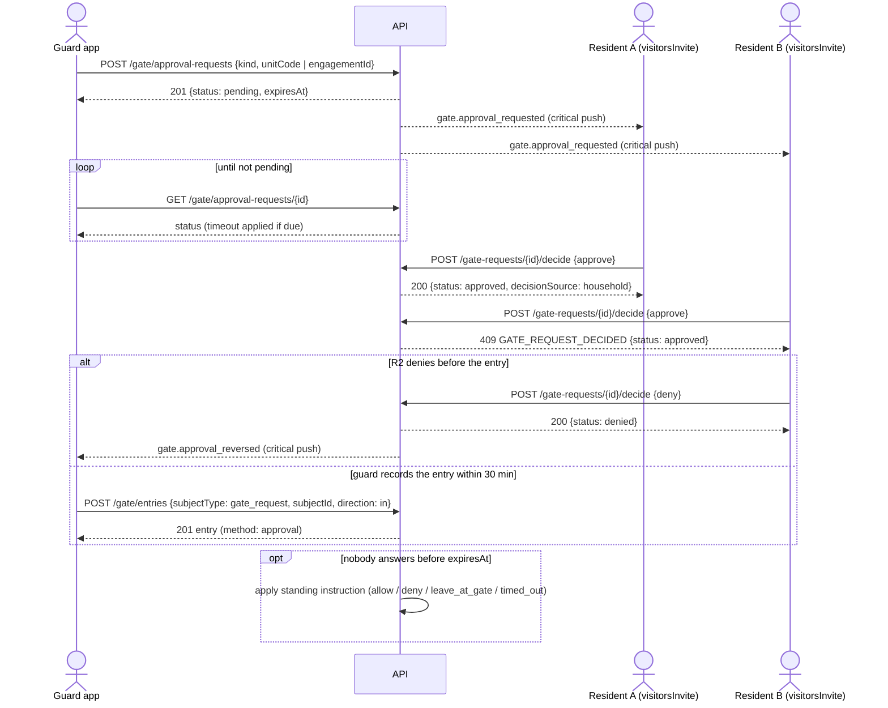
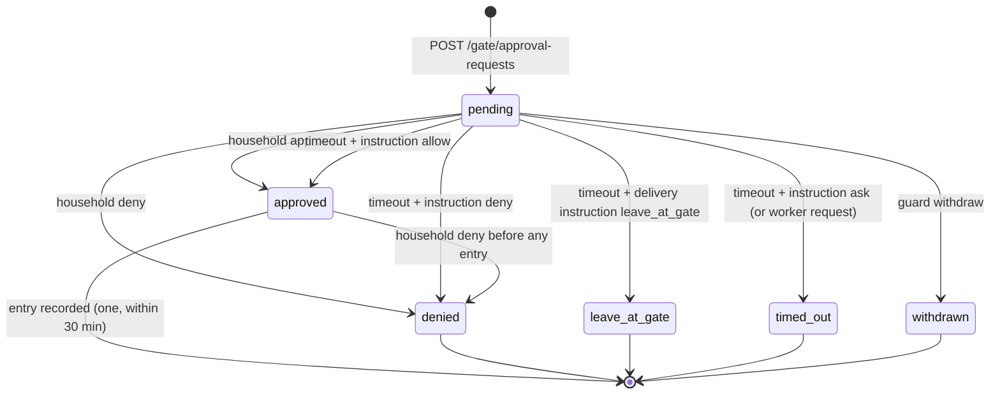

# طلبات الموافقة عند البوابة والتعليمات الدائمة — Gate Approval Requests and Standing Instructions

> **التطبيق/الواجهة:** guard app (إنشاء الطلب ومتابعته وسحبه) · resident app + family member (الرد على الطلب، وضبط التعليمات الدائمة)
> **الصلاحيات:** الأمن: `gate.operate` (دور `guard`) داخل وردية مفتوحة · الرد على الطلب: لا يحتاج صلاحية، الـcapability `visitorsInvite` على الوحدة هي اللي بتقرر (من `GET /me/units/:unitId/capabilities`) · التعليمات الدائمة: `household.manage` (أدوار `resident` و`family_member`) + لازم يكون الساكن الأساسي (primary) أو مفوَّض بنطاق `household` · مدة الانتظار: إعداد الكمبوند `gateRequestTimeoutSeconds` (المدير بـ `settings.manage`)
> **المصادر:** ADR 0028 · `src/gate/approvals/` · `src/gate/visitors/instructions.service.ts` · `src/gate/visitors/visitors.controller.ts`

## الفكرة باختصار
لما حد يوصل البوابة من غير تصريح (زائر مش معزوم أو دليفري) أو عامل جه برا مواعيده، فرد الأمن يبعت "طلب موافقة" للوحدة. كل اللي ليهم حق دعوة الزوار في الوحدة يوصلهم إشعار عاجل، وأول رد هو اللي بيتنفذ. لو محدش رد في الوقت المحدد (افتراضي 3 دقائق)، السيستم ينفذ "التعليمات الدائمة" اللي الوحدة حطاها مسبقًا (اسمح / ارفض / سيب الدليفري عند البوابة / اسألني).

## الأدوار ومين بيعمل إيه
| الدور | يقدر يعمل إيه |
|---|---|
| فرد الأمن (`gate.operate` + وردية) | ينشئ طلب لزائر أو دليفري (بكود الوحدة) أو لعامل خارج مواعيده (بمعرّف التعاقد). يتابع الطلب. يسحبه وهو لسه منتظر. يسجل الدخول لو اتوافق عليه. |
| أي حساب نشط عنده `visitorsInvite` على الوحدة | يستلم الطلب (إشعار عاجل)، يشوفه في قائمته، ويوافق أو يرفض. ده يشمل: الساكن الفعلي (مالك ساكن أو مستأجر) وفرد الأسرة اللي عنده حساب واتديله صلاحية `visitors_invite`. لا يشمل المالك اللي مش ساكن (landlord). |
| الساكن الأساسي أو مفوَّض `household` (+ `household.manage`) | يقرأ ويضبط التعليمات الدائمة للوحدة. |
| المدير (`settings.manage`) | يحدد مدة الانتظار `gateRequestTimeoutSeconds` (من 30 لـ 1800 ثانية، افتراضي 180). |

## الشاشات اللي الفيتشر محتاجها
- **(أمن) فورم "اطلب موافقة":** اختيار النوع (زائر / دليفري)، كود الوحدة، عدد الأفراد، اسم الزائر (اختياري). لعامل خارج مواعيده يتفتح من كارت التحقق مباشرة بدون فورم.
- **(أمن) شاشة انتظار الرد:** عدّاد تنازلي لحد `expiresAt`، الحالة الحالية (تتحدث بالـpolling)، زر "سحب الطلب".
- **(أمن) شاشة النتيجة:** "اتوافق — سجّل الدخول" (زر تسجيل دخول) / "مرفوض" / "سيب الدليفري عند البوابة" / "محدش رد" / "مسحوب"، مع توضيح لو القرار جه من الوحدة أو من التعليمات الدائمة.
- **(أمن) تنبيه عاجل "تم سحب الموافقة — لا تسمح بالدخول".**
- **(ساكن) إشعار عاجل → شاشة الطلب:** نوع الطلب، الوحدة، البوابة، عدد الأفراد، اسم الزائر أو العامل، الوقت المتبقي، زرين "سماح" و"رفض".
- **(ساكن) قائمة الطلبات المنتظرة** (لو عنده أكتر من طلب/وحدة).
- **(ساكن) رسالة "حد تاني في الوحدة رد بالفعل" / "انتهى الوقت".**
- **(ساكن) زر "رفض" بعد الموافقة** (سحب الموافقة طالما الشخص لسه ما دخلش).
- **(ساكن الأساسي) شاشة "تعليمات البوابة الدائمة":** اختيار واحد لـ"زائر غير مدعو" (اسألني / اسمح / ارفض) وواحد لـ"دليفري" (اسألني / اسمح / سيبه عند البوابة / ارفض).

## الفلو خطوة بخطوة

### 1. فرد الأمن ينشئ طلب لزائر أو دليفري
1. زائر بدون تصريح أو دليفري → فرد الأمن يفتح "اطلب موافقة" → `POST /gate/approval-requests`.
2. الحقول:
   - `kind` (إجباري): `uninvited_visitor` أو `delivery`.
   - `unitCode` (إجباري هنا، 1–64): كود الوحدة كما قاله الزائر (لازم يطابق كود وحدة موجودة بالظبط بعد شيل المسافات).
   - `partySize` (اختياري، 1–50، افتراضي 1).
   - `visitorName` (اختياري، 1–200): الاسم كما قاله الزائر. **يظهر للوحدة فقط**؛ فرد الأمن لن يراه تاني. يتمسح بعد 30 يوم.
   - `engagementId` **ممنوع** هنا (`FIELD_NOT_ALLOWED`).
   - هيدر `Idempotency-Key` (مفضّل).
3. السيرفر:
   - يتأكد من الوردية، ويربط الطلب ببوابة الوردية.
   - `expiresAt` = الآن + `gateRequestTimeoutSeconds` (افتراضي 180 ثانية).
   - يبعت إشعار عاجل `gate.approval_requested` لكل الحسابات النشطة اللي عندها `visitorsInvite` على الوحدة.
4. `201` بالطلب (`GuardRequestResponse`، `status: pending`). افتح شاشة الانتظار.
5. وحدة مش موجودة → `404 UNIT_NOT_FOUND`؛ اطلب من فرد الأمن يتأكد من الكود.

### 2. فرد الأمن ينشئ طلب لعامل خارج مواعيده
1. `POST /gate/verify` رجّع `subject: worker`, `reason: outside_schedule` ومعه `subjectId` (معرّف التعاقد) — راجع `02-gate-verify-and-entries.md`.
2. فرد الأمن يضغط "اطلب موافقة الوحدة" → `POST /gate/approval-requests` بـ `{ kind: "worker_off_schedule", engagementId }`.
   - `unitCode` و`visitorName` و`partySize` **ممنوعين** هنا (`FIELD_NOT_ALLOWED`)؛ `engagementId` إجباري.
3. السيرفر يعيد فحص العامل الآن:
   - مسموح يدخل أصلًا (رجع في مواعيده) → `409 GATE_REQUEST_NOT_NEEDED`؛ سجّل الدخول عادي.
   - مرفوض لسبب غير المواعيد (`banned`, `suspended`, `ended`, `expired`) → `409 GATE_ENTRY_REFUSED` و`params.reason`؛ لا يمكن طلب موافقة (الوحدة تقدر تتنازل عن المواعيد بس).
   - تعاقد غير موجود → `404 ENGAGEMENT_NOT_FOUND`.
4. غير ذلك: نفس خطوات الإنشاء (`201`، إشعار عاجل فيه اسم العامل، `partySize` = 1).

### 3. الوحدة تستلم الطلب وترد
1. الساكن يوصله push عاجل: "زائر عند البوابة — يوجد من ينتظر عند {gateName} للوحدة {unitCode}. افتح التطبيق للرد." (يوصل مهما كانت إعدادات الإشعارات أو ساعات الهدوء).
2. الضغط يفتح الطلب. التطبيق يجيب `GET /me/gate-requests`: كل الطلبات **المنتظرة واللي وقتها لسه ما خلصش** في كل الوحدات اللي له فيها `visitorsInvite`، الأقدم أولًا، صفحة واحدة.
3. الساكن يضغط "سماح" أو "رفض" → `POST /gate-requests/{id}/decide` بـ `{ decision: "approve" | "deny" }`.
4. النتائج:
   - `200` `{ id, status, decisionSource }`: `status` = `approved` أو `denied`، `decisionSource = household`. اعرض "تم إرسال ردك" واشيل الطلب من القائمة.
   - `409 GATE_REQUEST_DECIDED` و`params.status`: حد تاني رد قبله، أو الوقت خلص والتعليمات الدائمة اتنفذت، أو فرد الأمن سحب الطلب. اعرض الحالة النهائية (مثلًا "تمت الموافقة من فرد آخر في الوحدة" / "انتهى الوقت").
   - `404 GATE_REQUEST_NOT_FOUND`: الطلب مش موجود، **أو** المستخدم ماعندوش `visitorsInvite` على الوحدة (نفس الرد).
5. لا يوجد إشعار لباقي أفراد الوحدة إن حد رد؛ الطلب بيختفي من `GET /me/gate-requests` عندهم عند إعادة القراءة.

### 4. قاعدة "أول رد يكسب" و"الرفض يكسب قبل الدخول"
- كل الردود على نفس الطلب متسلسلة (قفل على الطلب). أول رد على طلب `pending` هو اللي بيتنفذ.
- رد تاني بنفس القرار أو بقرار "سماح" بعد قرار نهائي → `409 GATE_REQUEST_DECIDED`.
- **استثناء: "رفض" بعد "سماح"** (من أي حد في الوحدة، أو حتى بعد سماح جه من التعليمات الدائمة): مسموح **طالما محدش دخل على الموافقة دي لسه**. الحالة تتحول `denied`، وفرد الأمن اللي عمل الطلب يوصله إشعار عاجل `gate.approval_reversed`: "تم سحب الموافقة — سحبت الوحدة {unitCode} موافقتها. لا تسمح بالدخول."
- لو الدخول اتسجل قبل الرفض → الرفض يرجع `409 GATE_REQUEST_DECIDED` (`params.status: approved`).
- لو الرفض وصل قبل تسجيل الدخول → تسجيل الدخول يرجع `409 GATE_ENTRY_REFUSED` (`reason: not_approved`).

### 5. فرد الأمن يتابع الرد (polling)
1. شاشة الانتظار تسأل كل شوية `GET /gate/approval-requests/{id}`.
2. كل قراءة **تطبّق انتهاء الوقت لو حان**، فالحالة اللي بترجع دايمًا محدثة.
3. حسب `status`:
   - `pending` → كمّل الانتظار (العدّاد على `expiresAt`).
   - `approved` → زر "تسجيل دخول" (الفلو 7). لو `decisionSource = standing_instruction` اكتب "مسموح حسب تعليمات الوحدة".
   - `denied` → "مرفوض" (من الوحدة أو من التعليمات حسب `decisionSource`).
   - `leave_at_gate` → "سيب الدليفري عند البوابة" (دليفري فقط).
   - `timed_out` → "محدش رد" (التعليمات = اسألني، أو عامل).
   - `withdrawn` → "الطلب اتسحب".
4. فرد الأمن **لا يعرف أبدًا مين في الوحدة رد**، ولا يرى اسم الزائر اللي كتبه.

### 6. فرد الأمن يسحب الطلب
1. الزائر مشي قبل الرد → "سحب الطلب" → `POST /gate/approval-requests/{id}/withdraw` (يحتاج وردية؛ `Idempotency-Key` مفضّل).
2. ممكن فقط والطلب `pending` (بعد تطبيق انتهاء الوقت). `200` بالطلب `status: withdrawn`, `decisionSource: guard`.
3. لو اتقرر بالفعل → `409 GATE_REQUEST_DECIDED` و`params.status`؛ اعرض الحالة الفعلية.
4. لا يمكن سحب طلب بعد الموافقة؛ الموافقة غير المستخدمة تموت لوحدها بعد 30 دقيقة.
5. الساكن مش بيوصله إشعار بالسحب؛ الطلب يختفي من قائمته.

### 7. تسجيل الدخول على الموافقة
1. `POST /gate/entries` بـ `{ subjectType: "gate_request", subjectId: <request id>, direction: "in" }` (+ `occurredAt` و`id` اختياري كالعادة).
2. شروط القبول:
   - الحالة `approved` ووقت الدخول بعد وقت القرار، وإلا `GATE_ENTRY_REFUSED` (`not_approved`) — ده يشمل `denied`, `leave_at_gate`, `timed_out`, `withdrawn`, `pending`.
   - خلال **30 دقيقة** من وقت القرار، وإلا `GATE_ENTRY_REFUSED` (`expired`).
   - **دخول واحد فقط** لكل موافقة، وإلا `GATE_ENTRY_REFUSED` (`used`).
   - للعامل: يعاد فحصه، والموافقة تتنازل عن المواعيد بس؛ لو اتحظر أو اتوقف في النص → `GATE_ENTRY_REFUSED` بالسبب.
3. الطريقة في السجل = `approval`.
4. **زائر/دليفري:** السجل باسم الطلب (`subjectType: gate_request`)، والخروج بعدين بنفس `subjectType`/`subjectId` (أو من "مين جوه").
5. **عامل:** السجل باسم العامل نفسه (`subjectType: worker_engagement`، معرّف التعاقد) ومربوط بالطلب، فحضوره و"مين جوه" يفضلوا على العامل؛ والوحدة يوصلها `worker.entered` عادي. الخروج بمعرّف التعاقد.

### 8. انتهاء الوقت وتطبيق التعليمات الدائمة (تلقائي)
1. لما `expiresAt` يعدي والطلب لسه `pending`، السيستم يطبق تعليمات الوحدة:
   | نوع الطلب | التعليمات | النتيجة (`status`) | `decisionSource` |
   |---|---|---|---|
   | `uninvited_visitor` | `ask` | `timed_out` | `timeout` |
   | `uninvited_visitor` | `allow` | `approved` | `standing_instruction` |
   | `uninvited_visitor` | `deny` | `denied` | `standing_instruction` |
   | `delivery` | `ask` | `timed_out` | `timeout` |
   | `delivery` | `allow` | `approved` | `standing_instruction` |
   | `delivery` | `leave_at_gate` | `leave_at_gate` | `standing_instruction` |
   | `delivery` | `deny` | `denied` | `standing_instruction` |
   | `worker_off_schedule` | (لا توجد تعليمات للعمال) | `timed_out` | `timeout` |
2. **متى يحصل ده فعلًا:** عند أي قراءة من الأمن (`GET /gate/approval-requests/{id}`)، أو أي رد من الوحدة، أو أي محاولة دخول على الطلب، وكمان مهمة خلفية `gate.request_timeouts` (مع دورة المهام الخلفية، افتراضي كل ساعة). يعني عمليًا اللحظة اللي الأمن بيعمل فيها polling بعد `expiresAt`.
3. وقت القرار (`decidedAt`) = لحظة التطبيق؛ ومنها تبدأ الـ30 دقيقة للدخول لو `approved`.
4. لا يوجد إشعار لأي حد بنتيجة انتهاء الوقت؛ الأمن يعرف من الـpolling.
5. لو التعليمات `allow` ونُفذت، أي حد في الوحدة لسه يقدر يبعت `deny` على نفس الطلب (لو معاه الـid، مثلًا من الإشعار) قبل ما الشخص يدخل، فيتعكس القرار (الفلو 4). الطلب لا يظهر في `GET /me/gate-requests` بعد انتهاء وقته.
6. لو الوحدة مافيهاش أي حد عنده `visitorsInvite`، الطلب يتعمل عادي، محدش يتبلغ، وينتهي بالتعليمات.

### 9. ضبط التعليمات الدائمة للوحدة
1. الساكن الأساسي (أو مفوَّض `household`) يفتح "تعليمات البوابة" → `GET /units/{unitId}/gate-instructions`.
   - لو ماحدش ضبطها قبل كده: `{ uninvitedVisitor: "ask", delivery: "ask", updatedAt: null }`.
2. يختار ويحفظ → `PUT /units/{unitId}/gate-instructions` بالحقلين **الاتنين إجباري**:
   - `uninvitedVisitor`: `ask` | `allow` | `deny`.
   - `delivery`: `ask` | `allow` | `leave_at_gate` | `deny`.
3. `200` بالتعليمات بعد الحفظ (`updatedAt` = وقت الحفظ).
4. التعليمات بتأثر **فقط** على الطلبات اللي وقتها خلص من غير رد؛ لا تمنع الإشعار ولا تخلي الأمن يدخّل حد من غير طلب.
5. الأخطاء: مش الساكن الأساسي ومش مفوَّض → `403 NOT_PRIMARY_RESIDENT`؛ تفويض منتهي → `403 DELEGATION_EXPIRED`؛ وحدة مش ظاهرة → `404 UNIT_NOT_FOUND`.

**إزاي الأمن بيشوف التعليمات:** مش بيشوفها خالص قبل الطلب. بيعرف أثرها بس بعد انتهاء الوقت: `status` (`approved`/`denied`/`leave_at_gate`) مع `decisionSource: standing_instruction`، أو `timed_out` مع `decisionSource: timeout` لو التعليمات "اسألني".

## الحالات (Statuses)
| الحالة (`GateRequestStatus`) | المعنى | مين يدخلها |
|---|---|---|
| `pending` | منتظر رد الوحدة. | فرد الأمن عند الإنشاء. |
| `approved` | مسموح بدخول واحد خلال 30 دقيقة من القرار. | الوحدة (`household`)، أو التعليمات `allow` عند انتهاء الوقت (`standing_instruction`). |
| `denied` | مرفوض. | الوحدة (`household`)، أو التعليمات `deny` (`standing_instruction`)، أو رفض بعد سماح لم يُستخدم (عكس القرار). |
| `leave_at_gate` | الدليفري يتساب عند البوابة (لا دخول). | التعليمات `leave_at_gate` لطلب `delivery` فقط. |
| `timed_out` | محدش رد والتعليمات "اسألني" (أو طلب عامل). | انتهاء الوقت (`timeout`). |
| `withdrawn` | فرد الأمن سحب الطلب. | فرد الأمن (`guard`). |

`decisionSource`: `household` / `standing_instruction` / `timeout` / `guard`، أو `null` وهو `pending`.

## البيانات اللي بتظهر

**للأمن — `GuardRequestResponse` (الإنشاء، المتابعة، السحب):**
| الحقل | المعنى |
|---|---|
| `id` | معرّف الطلب (يستخدم في المتابعة والدخول). |
| `kind` | `uninvited_visitor` / `delivery` / `worker_off_schedule`. |
| `unitCode` | الوحدة. |
| `partySize` | عدد الأفراد. |
| `status` | الحالة. |
| `decisionSource` | مصدر القرار أو `null`. |
| `expiresAt` | آخر وقت للرد (للعدّاد). |
| `createdAt` | وقت الإنشاء. |
لا يرجع أبدًا: مين رد، أي ساكن، اسم الزائر، اسم العامل.

**للوحدة — `HostRequestResponse` (`GET /me/gate-requests`):**
| الحقل | المعنى |
|---|---|
| `id` | معرّف الطلب (للرد). |
| `kind` | نوع الطلب. |
| `unitId`, `unitCode` | الوحدة (مهم لو الساكن له أكتر من وحدة). |
| `gateName` | البوابة اللي الشخص واقف عندها. |
| `partySize` | عدد الأفراد. |
| `visitorName` | الاسم كما كتبه الأمن، أو `null`. يختفي بعد 30 يوم. |
| `workerName` | اسم العامل لطلب `worker_off_schedule`، أو `null`. |
| `expiresAt` | آخر وقت للرد. |
| `createdAt` | وقت الطلب. |
لا يرجع أبدًا: فرد الأمن.

**نتيجة الرد — `DecisionResponse`:** `id`, `status`, `decisionSource`.

**التعليمات — `GateInstructionsView`:** `uninvitedVisitor`, `delivery`, `updatedAt` (`null` = لم تُضبط، والافتراضي "اسألني" للاتنين).

## القواعد والقيود
- الأمن لازم وردية مفتوحة للإنشاء والسحب (`01-gates-and-guard-shifts.md`). المتابعة (`GET`) لا تحتاج وردية.
- `partySize` 1–50، `visitorName` 1–200، `unitCode` 1–64.
- الحقول حسب النوع: زائر/دليفري = `unitCode` إجباري و`engagementId` ممنوع؛ عامل = `engagementId` إجباري و`unitCode`/`visitorName`/`partySize` ممنوعين.
- طلب العامل فقط لو سبب الرفض الوحيد `outside_schedule`.
- مدة الانتظار `gateRequestTimeoutSeconds`: افتراضي 180 ثانية، المدير يغيرها بين 30 و1800.
- الموافقة: دخول واحد، خلال 30 دقيقة من القرار، ولا يقبل `occurredAt` قبل وقت القرار.
- أول رد يكسب؛ "رفض" يقدر يعكس "سماح" لم يُستخدم.
- من يرد: أي حساب نشط عنده `visitorsInvite` على الوحدة؛ لا يوجد فحص صلاحية `visitors.invite` على مسارات الرد.
- التعليمات الدائمة: الساكن الأساسي أو مفوَّض `household`، مع صلاحية `household.manage`. الحقلين إجباريين في كل حفظ.
- اسم الزائر يتخزن 30 يوم فقط، ويتشال من الإشعارات القديمة لما يتمسح.
- `Idempotency-Key` على `POST /gate/approval-requests` و`/withdraw` (راجع README). `decide` لا يأخذه: إعادة الإرسال ترجع `409 GATE_REQUEST_DECIDED`؛ لو `params.status` = نفس قرارك، اعتبرها نجاح.

## الأخطاء اللي الـUI لازم يتعامل معاها
| HTTP + الكود | إمتى | رسالة/سلوك مقترح |
|---|---|---|
| `400 VALIDATION_FAILED` | حقل ناقص (`FIELD_REQUIRED`) أو ممنوع (`FIELD_NOT_ALLOWED`) حسب النوع، أو قيمة خارج الحدود، أو `decision`/تعليمات بقيمة غلط. | علّم على الحقل. |
| `403 NO_OPEN_SHIFT` | إنشاء أو سحب بدون وردية. | ودّي لشاشة بدء الوردية. |
| `404 UNIT_NOT_FOUND` | كود وحدة غلط في الطلب، أو وحدة مش ظاهرة في التعليمات. | "لا توجد وحدة بهذا الكود". |
| `404 ENGAGEMENT_NOT_FOUND` | معرّف تعاقد غير موجود. | "العامل غير موجود". |
| `409 GATE_REQUEST_NOT_NEEDED` | عامل مسموح له يدخل دلوقتي. | "العامل في مواعيده، سجّل دخوله مباشرة". |
| `409 GATE_ENTRY_REFUSED` | عامل محظور/موقوف/منتهي (`params.reason`) عند الإنشاء؛ أو دخول على طلب غير موافق (`not_approved`) أو موافقة قديمة (`expired`) أو مستخدمة (`used`). | اعرض السبب؛ لا تسمح بالدخول. |
| `404 GATE_REQUEST_NOT_FOUND` | طلب غير موجود، أو الساكن مالوش `visitorsInvite` على وحدته. | "الطلب غير متاح". |
| `409 GATE_REQUEST_DECIDED` | رد أو سحب على طلب اتقرر (`params.status` = الحالة الحالية). | اعرض الحالة: "رد فرد آخر من الوحدة" / "انتهى الوقت" / "تم سحب الطلب". |
| `403 NOT_PRIMARY_RESIDENT` | التعليمات من حد مش الأساسي ومش مفوَّض. | "الساكن الأساسي فقط يمكنه تعديل التعليمات". |
| `403 DELEGATION_EXPIRED` | تفويض `household` منتهي. | "انتهى تفويضك لهذه الوحدة". |
| `409 IDEMPOTENCY_CONFLICT` | نفس المفتاح لطلب مختلف. | خطأ تقني؛ مفتاح جديد. |

## الإشعارات
| الحدث | `kind` | مين يستلم | Push؟ | الضغط يفتح |
|---|---|---|---|---|
| الأمن أنشأ طلب | `gate.approval_requested` | كل الحسابات النشطة اللي عندها `visitorsInvite` على الوحدة | **عاجل (critical)** يوصل دائمًا. "زائر عند البوابة — يوجد من ينتظر عند {gateName} للوحدة {unitCode}. افتح التطبيق للرد." الإشعار في الـinbox فيه كمان `requestKind`, `partySize`, و`visitorName`/`workerName` لو موجودين. | شاشة الطلب (`targetId` = معرّف الطلب) بزرين سماح/رفض. |
| الوحدة رفضت بعد ما وافقت (قبل الدخول) | `gate.approval_reversed` | فرد الأمن اللي عمل الطلب فقط | **عاجل (critical)**. "تم سحب الموافقة — سحبت الوحدة {unitCode} موافقتها. لا تسمح بالدخول." | شاشة الطلب عند الأمن (`status: denied`). |
| دخول عامل على موافقة | `worker.entered` | أصحاب `visitorsNotify` | عادي | راجع `02-gate-verify-and-entries.md`. |

لا إشعار لـ: رفض أول (الأمن يعرف بالـpolling)، موافقة، انتهاء الوقت، سحب الأمن، أو رد فرد آخر في الوحدة.

## الـEndpoints
| Method + Path | مين | الغرض | الرد |
|---|---|---|---|
| `POST /gate/approval-requests` | أمن (`gate.operate`، وردية) | إنشاء طلب | `201` `GuardRequestResponse` |
| `GET /gate/approval-requests/{id}` | أمن (`gate.operate`) | متابعة الطلب (يطبق انتهاء الوقت) | `200` `GuardRequestResponse` |
| `POST /gate/approval-requests/{id}/withdraw` | أمن (`gate.operate`، وردية) | سحب طلب منتظر | `200` `GuardRequestResponse` |
| `GET /me/gate-requests` | ساكن/أسرة (`visitorsInvite`) | الطلبات المنتظرة لوحداتي | `200` `{ data: HostRequestResponse[], nextCursor: null }` |
| `POST /gate-requests/{id}/decide` | ساكن/أسرة (`visitorsInvite`) | سماح أو رفض `{ decision }` | `200` `{ id, status, decisionSource }` |
| `GET /units/{unitId}/gate-instructions` | الساكن الأساسي / مفوَّض `household` (`household.manage`) | قراءة التعليمات | `200` `GateInstructionsView` |
| `PUT /units/{unitId}/gate-instructions` | نفس اللي فوق | حفظ التعليمات | `200` `GateInstructionsView` |
| `POST /gate/entries` | أمن | الدخول على الموافقة (`subjectType: gate_request`) | `201` `EntryView` — راجع `02-gate-verify-and-entries.md` |

## ملاحظات للديزاين وحاجات ناقصة في الباك
- ADR 0028 بيقول لما الرفض يسبق الدخول "الأمن يتبلغ فورًا بشكل عاجل"؛ الكود بيبعت إشعار للأمن **بس** في حالة رفض بعد موافقة. الرفض الأول أو أي نتيجة تانية، الأمن يعرفها بالـpolling فقط.
- إشعار عكس الموافقة يروح لفرد الأمن اللي عمل الطلب فقط، حتى لو ورديته خلصت وفرد أمن تاني على البوابة.
- `GET /gate/approval-requests/{id}` لا يحتاج وردية ولا يقيد بالبوابة أو بصاحب الطلب؛ وأي فرد أمن بوردية مفتوحة يقدر يسحب أي طلب.
- لا يوجد عند الأمن قائمة "طلباتي المفتوحة"؛ لازم التطبيق يحتفظ بالـid محليًا.
- v0-notes: `GET /me/gate-requests` صفحة واحدة (bounded)، وممكن يحتاج قناة push بدل polling.
- الساكن مالوش تاريخ للطلبات (اللي اترد عليها أو انتهت)؛ القائمة فيها المنتظر فقط. ولا يتبلغ لما فرد تاني يرد أو الوقت يخلص.
- الأمن لا يقدر يقرأ التعليمات الدائمة للوحدة قبل الطلب؛ يعرف أثرها بعد انتهاء الوقت فقط.
- لا توجد تعليمات دائمة للعمال خارج المواعيد؛ النتيجة دايمًا `timed_out`.
- `leave_at_gate` مجرد حالة؛ مش مربوطة بفيتشر الطرود (لا يتعمل طرد تلقائيًا).
- مسارات الرد لا تفحص صلاحية `visitors.invite`، الـcapability فقط. لو المدير شال الصلاحية من دور، الحساب لسه يقدر يرد.
- انتهاء الوقت بيتطبق فعليًا عند القراءة أو الرد أو الدخول؛ المهمة الخلفية كل ساعة افتراضيًا. فمثلًا الطلب يفضل `pending` في قاعدة البيانات لحد أول polling بعد `expiresAt`.
- الطلب بكود الوحدة لازم يطابق الكود بالظبط؛ مفيش بحث أو اقتراحات للأكواد عند الأمن.
