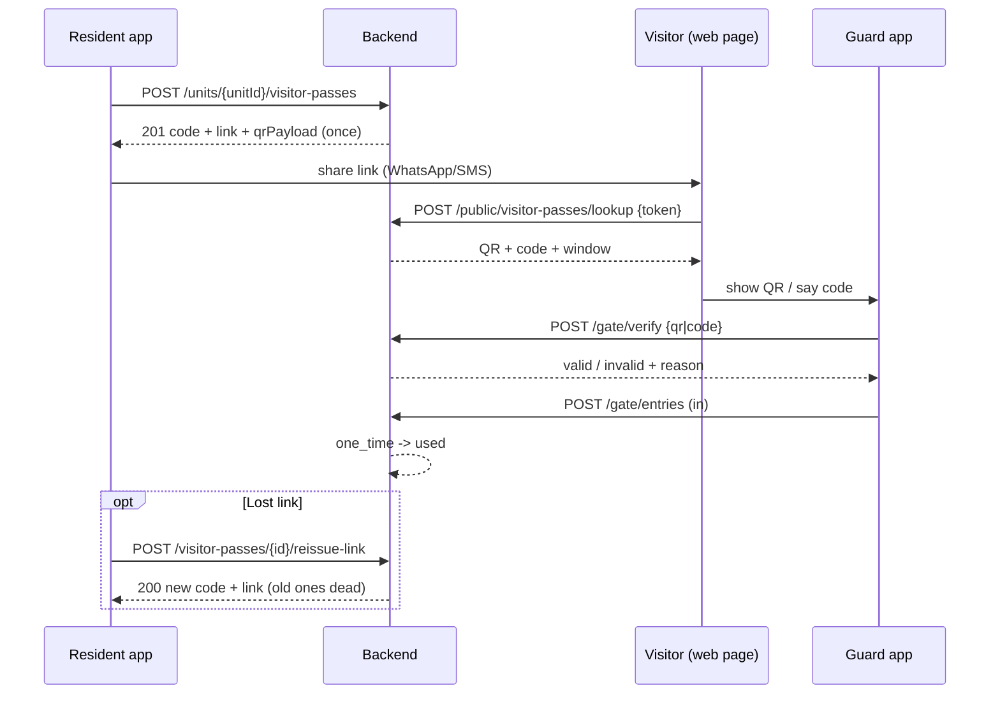
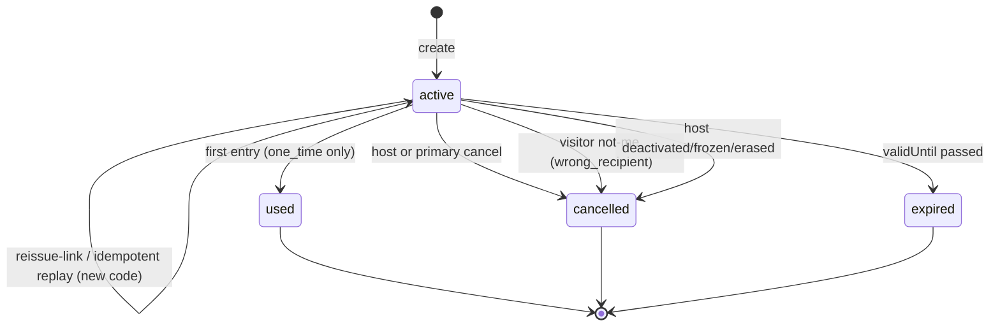

# تصاريح الزوار — Visitor Passes

> **التطبيق/الواجهة:** resident app · family member
> **الصلاحيات:** `visitors.invite` (موجودة افتراضيًا في دوري `resident` و`family_member`) + الـcapability `visitorsInvite` على الوحدة من `GET /me/units/:unitId/capabilities` (هي اللي بتقرر فعليًا)
> **المصادر:** ADR 0028 · ADR 0030 · `src/gate/visitors/` (`visitors.controller.ts`, `visitor-passes.service.ts`, `visitor-data.sweep.ts`, `dto/visitors.dto.ts`, `views/visitor.views.ts`) · `src/gate/entries/subjects.ts`

## الفكرة باختصار
الساكن بيعمل "تصريح زيارة" لوحدته قبل ما الزائر يوصل. السيرفر بيرجّع **مرة واحدة بس**: كود من 6 أرقام، ولينك يتبعت للزائر، ومحتوى QR. الزائر بيفتح اللينك على صفحة ويب من غير تسجيل دخول (راجع `05-visitor-public-page.md`)، ويوري الحارس الـQR أو يقوله الكود.
فيه نوعين: تصريح لمرة واحدة (`one_time`) بيتقفل أول ما الزائر يدخل، وتصريح متكرر (`recurring`) بجدول أسبوعي.
لو الساكن ضيّع اللينك، بيعمل "إعادة إصدار" لنفس التصريح بدل ما يلغيه ويعمل واحد جديد.

## الأدوار ومين بيعمل إيه

| الدور | يقدر يعمل إيه |
|---|---|
| ساكن مقيم في الوحدة (مالك مقيم أو مستأجر، primary أو لا) | ينشئ تصاريح، يشوف تصاريحه هو بس، يلغي/يعيد إصدار تصاريحه |
| الـprimary في الوحدة | زي اللي فوق + **يشوف كل تصاريح الوحدة** ويلغي/يعيد إصدار أي تصريح فيها. اسم الزائر بيظهر له في تصاريحه هو بس |
| فرد أسرة (member) بالغ وعنده حساب ومعاه الـgrant `visitors_invite` | ينشئ تصاريح، يشوف تصاريحه، يلغي/يعيد إصدار تصاريحه |
| مالك غير مقيم (landlord)، قاصر، عضو pending أو removed، إشغال منتهي | ولا حاجة (`visitorsInvite = false`) |
| الحارس | بيتحقق من الكود/الـQR عند البوابة ويسجل الدخول — راجع `02-gate-verify-and-entries.md` |
| النظام | بيقفل التصاريح المنتهية، وبيلغي تصاريح الساكن لو حسابه اتعطل/اتجمد/اتمسح، وبيمسح بيانات الزائر بعد 30 يوم |

## الشاشات اللي الفيتشر محتاجها
- **قائمة تصاريح الوحدة**: كل التصاريح (نشطة وقديمة) بالأحدث أولًا، مع شارة الحالة، وعلامة "تصريحي" (`mine`) للـprimary.
- **فورم إنشاء تصريح**: اختيار النوع، عدد الأفراد، فترة الصلاحية، الجدول الأسبوعي (للمتكرر بس)، اسم وتليفون الزائر (اختياري).
- **شاشة "تم إنشاء التصريح" (عرض مرة واحدة)**: الكود والـQR وزرار مشاركة اللينك (واتساب/SMS/نسخ)، مع تحذير واضح إن الكود مش هيظهر تاني.
- **تفاصيل التصريح** (من بيانات القائمة نفسها، مفيش endpoint تفاصيل): النوع، الفترة، الجدول، الحالة، اسم الزائر لو موجود.
- **ديالوج إلغاء** مع اختيار سبب من قائمة مغلقة.
- **تأكيد إعادة إصدار اللينك**: يوضح إن اللينك والكود القدام هيبطلوا فورًا، وبعدها نفس شاشة "عرض مرة واحدة".
- **حالة "وصلت للحد الأقصى"**: لما الوحدة توصل لعدد التصاريح النشطة المسموح.

## الفلو خطوة بخطوة

### 1) قبل ما تفتح الشاشة: هل المستخدم يقدر يدعو؟
1. التطبيق يقرأ `GET /me/units/:unitId/capabilities` ويشوف `visitorsInvite`.
2. لو `false`: اخفي زرار "دعوة زائر" (أو اعرضه disabled مع شرح إن الـprimary لازم يديله صلاحية الدعوة، لو هو member).

### 2) إنشاء تصريح — `POST /units/{unitId}/visitor-passes`
1. الساكن يختار **النوع** `kind`:
   - `one_time`: زيارة واحدة. أقصى مدة بين `validFrom` و`validUntil` = **7 أيام**.
   - `recurring`: زيارات متكررة بجدول أسبوعي. أقصى مدة = **180 يوم**.
2. يدخل الحقول:

| الحقل | إجباري؟ | النوع والقيود |
|---|---|---|
| `kind` | نعم | `one_time` أو `recurring` |
| `partySize` | نعم | رقم صحيح من 1 لـ 50 (عدد الأفراد اللي هيدخلوا بالتصريح) |
| `validFrom` | نعم | تاريخ ووقت (ISO). مينفعش يكون قبل دلوقتي بأكتر من 5 دقايق |
| `validUntil` | نعم | لازم يكون بعد `validFrom`، والفرق ≤ 7 أيام (`one_time`) أو ≤ 180 يوم (`recurring`) |
| `schedule` | إجباري للـ`recurring`، **ممنوع** للـ`one_time` | `{ days: [0..6], windows: [{from:"HH:mm", to:"HH:mm"}] }` — 0 = الأحد. لازم يوم واحد على الأقل وفترة واحدة على الأقل. الوقت بصيغة 24 ساعة. `from` = `to` مرفوض. لو `to` قبل `from` تبقى فترة بتعدي نص الليل لليوم اللي بعده (مثلا 22:00 → 06:00). الجدول بيتقري بتوقيت الكمباوند |
| `visitorName` | لا | نص 1–200 حرف. بيظهر للساكن اللي عمل التصريح بس، وبيتمسح بعد 30 يوم من نهاية التصريح |
| `visitorPhone` | لا | رقم موبايل صالح (بيتحول لصيغة E.164). **مبيرجعش أبدًا** في أي response بعد الإنشاء |

3. يُفضَّل إرسال header `Idempotency-Key` (راجع README).
4. السيرفر بيتأكد إن المستخدم عنده `visitorsInvite` على الوحدة، وإن عدد التصاريح النشطة (اللي لسه ما انتهتش) في **الوحدة كلها** (من كل الساكنين) أقل من إعداد الكمباوند `maxActiveVisitorPasses` (الافتراضي 50، المدير يقدر يغيره من 1 لـ 500).
5. الرد `201` بـ`IssuedPassView`: `id`, `code` (6 أرقام), `link` (`https://<app>/v#<token>`), `qrPayload` (`JWR1.<token>`), و`kind`, `partySize`, `validFrom`, `validUntil`, `schedule`, `status` (`active`).
6. الشاشة التالية: **"شارك التصريح"** — اعرض الكود كبير والـQR (ارسمه من `qrPayload`)، وزرار مشاركة `link`. وضّح إن ده آخر مرة الكود هيظهر. الرد عليه `Cache-Control: no-store`، فالتطبيق **ميخزنهوش** في cache.
7. **لو حصل retry بنفس `Idempotency-Key`**: بيرجع **نفس التصريح بكود ولينك جداد**، والقدام بيموتوا. لو التصريح وقتها مبقاش `active` بيرجع `code` و`link` و`qrPayload` = `null`.

### 3) قائمة التصاريح — `GET /units/{unitId}/visitor-passes`
1. Cursor-paged (`cursor`, `limit`) — راجع README. مترتبة بالأحدث إنشاءً.
2. الساكن العادي بيشوف تصاريحه هو بس. الـprimary بيشوف كل تصاريح الوحدة، و`mine` بتقول أنهي منها بتاعته.
3. القائمة بترجع **كل الحالات** (`active`, `used`, `cancelled`, `expired`) ومفيش فلتر بالحالة؛ التطبيق يقسمها (مثلا "نشطة" و"السابقة") من عنده.
4. **مفيش** كود ولا لينك ولا QR في القائمة.

### 4) إلغاء تصريح — `POST /visitor-passes/{id}/cancel`
1. متاح للي عمل التصريح (طالما لسه ليه مكان في الوحدة) أو للـprimary.
2. الساكن يختار سبب: `reasonCode` من القائمة `visitorPassCancel`: `not_needed`, `plans_changed`, `other`. **السبب إجباري** رغم إن الحقل optional في الـDTO.
3. الرد `204`. التطبيق يعيد قراءة القائمة.
4. لو التصريح ملغي أصلًا → `204` برضه (مفيش خطأ).
5. لو `used` أو `expired` → `409 VISITOR_PASS_NOT_ACTIVE`.
6. بعد الإلغاء: الكود والـQR بيموتوا فورًا، وصفحة الزائر لو اتفتحت هتقول "ملغي" (`statusReason: host_cancelled`).

### 5) إعادة إصدار اللينك — `POST /visitor-passes/{id}/reissue-link`
1. الساكن ضيّع اللينك/الكود. متاح لصاحب التصريح أو الـprimary، و**لتصريح `active` بس**.
2. يُفضَّل `Idempotency-Key`.
3. الرد `200` بنفس شكل `IssuedPassView`: **كود جديد + لينك جديد + QR جديد** لنفس التصريح. القدام بيبطلوا لحظيًا، واللينك القديم يرجع 404 في صفحة الزائر.
4. أي حالة تانية (ملغي، مستخدم، منتهي، أو مش من حقك) → `404 VISITOR_PASS_NOT_FOUND`.
5. retry بنفس الـkey بيعمل إعادة إصدار تاني (كود تالت)، لأن السيرفر مبيخزنش السر.

### 6) عند البوابة (ملخص)
1. الحارس يكتب الكود أو يعمل scan للـQR → `POST /gate/verify` ثم `POST /gate/entries`. التفاصيل في `02-gate-verify-and-entries.md`.
2. التصريح بيتقبل بس لو: الحالة `active`، وصاحبه لسه عنده `visitorsInvite` على الوحدة، والوقت بين `validFrom` و`validUntil`، وللـ`recurring` الوقت جوه الجدول (بتوقيت الكمباوند).
3. أسباب الرفض اللي الحارس بيشوفها: `used`, `cancelled`, `expired`, `host_inactive`, `not_yet_valid`, `outside_schedule`.
4. `one_time`: أول تسجيل دخول (`in`) بيحوّله لـ`used` والكود والـQR بيموتوا. `recurring` مبيبقاش `used` أبدًا؛ بيفضل شغال لحد `validUntil`.

### 7) خطوات تلقائية (النظام)
1. **انتهاء الصلاحية**: أول ما `validUntil` يعدي، أي قراءة بتعرض الحالة `expired` فورًا. الـsweep `gate.visitor_data` (كل ساعة افتراضيًا) بيكتبها في الداتابيز ويمسح الكود.
2. **الساكن مشي**: لو حساب صاحب التصريح اتعطل (deactivated) أو اتجمد (frozen) أو اتمسح (erased)، كل تصاريحه النشطة بتتلغي (السبب الداخلي `host_inactive`). صفحة الزائر بتقول `host_cancelled`.
3. **صاحب التصريح فقد صلاحية الدعوة** بس حسابه شغال (مثلا اتشال منه grant `visitors_invite` أو بطل مقيم): التصريح **بيفضل `active`** في القائمة، لكن البوابة بترفضه بـ`host_inactive`.
4. **مسح بيانات الزائر**: بعد **30 يوم من `validUntil`** الـsweep بيمسح `visitorName` و`visitorPhone`، وبيمسح اسم الزائر من الإشعارات القديمة، واللينك نفسه بيبطل يفتح (404). التصريح وسجل الدخول بيفضلوا.

## الحالات (Statuses)

| الحالة | المعنى | مين بيدخّلها / بيطلّعها |
|---|---|---|
| `active` | التصريح شغال (ممكن يكون لسه ما بدأش أو برا الجدول، البوابة بتقرر) | بيبدأ بيها عند الإنشاء |
| `used` | تصريح `one_time` واتستخدم في دخول | الحارس بتسجيل أول `in` (لـ`one_time` بس) |
| `cancelled` | اتلغى | صاحب التصريح أو الـprimary (`not_needed`/`plans_changed`/`other`)، أو الزائر من صفحته "مش أنا" (`wrong_recipient`)، أو النظام لما حساب صاحب التصريح يتقفل (`host_inactive`) |
| `expired` | عدّى `validUntil` | تلقائي: بيظهر فورًا في القراءة، والـsweep بيثبته |

حالات نهائية: `used`, `cancelled`, `expired` — مفيش رجوع منها، ومفيش تعديل لأي تصريح.

## البيانات اللي بتظهر

### شاشة "تم الإنشاء" / "تمت إعادة الإصدار" (`IssuedPassView`) — مرة واحدة، `no-store`
| الحقل | المعنى |
|---|---|
| `id` | معرف التصريح |
| `code` | 6 أرقام يقولها الزائر للحارس. **يظهر هنا بس**. `null` في replay لتصريح مبقاش نشط |
| `link` | `https://<PUBLIC_APP_URL>/v#<token>` — ده اللي يتبعت للزائر. السر في الجزء بعد `#` |
| `qrPayload` | `JWR1.<token>` — التطبيق يرسمه QR لو الساكن عايز يوريه بنفسه |
| `kind`, `partySize`, `validFrom`, `validUntil`, `schedule`, `status` | بيانات التصريح |

### القائمة (`PassView`)
| الحقل | المعنى |
|---|---|
| `id`, `kind`, `partySize`, `validFrom`, `validUntil`, `schedule` | بيانات التصريح |
| `status` | `active` / `used` / `cancelled` / `expired` (الـ`expired` محسوب لحظيًا) |
| `mine` | `true` لو المستخدم هو اللي عمل التصريح |
| `visitorName` | اسم الزائر — **في تصاريحك إنت بس**؛ للـprimary على تصاريح غيره بيرجع `null`. وبيبقى `null` بعد ما البيانات تتمسح (30 يوم بعد النهاية) |
| `createdAt` | وقت الإنشاء |

**مبيرجعش أبدًا في القائمة:** الكود، اللينك، الـQR، تليفون الزائر، سبب الإلغاء، مين ألغى، وقت الاستخدام، مين عمل التصريح (للـprimary غير `mine`).

## القواعد والقيود
- النوع `one_time`: مدة ≤ 7 أيام، بيتقفل بأول دخول. `recurring`: مدة ≤ 180 يوم، جدول أسبوعي إجباري.
- `validFrom` مينفعش يكون أقدم من 5 دقايق قبل دلوقتي. `validUntil` > `validFrom`.
- `partySize` من 1 لـ 50. `visitorName` من 1 لـ 200 حرف.
- الجدول: `days` أرقام 0–6 (0 = الأحد)، `windows` بصيغة `HH:mm` (00:00–23:59)، `from` ≠ `to`، والفترة اللي `to` فيها قبل `from` بتكمل لليوم اللي بعده. الجدول بتوقيت الكمباوند (`timezone` في إعدادات الكمباوند)، مش توقيت الموبايل.
- الحد الأقصى للتصاريح النشطة **للوحدة كلها**: `maxActiveVisitorPasses` (افتراضي 50). بيتحسب من التصاريح `active` اللي `validUntil` بتاعها لسه ما جاش.
- الكود 6 أرقام وفريد بين التصاريح النشطة في الكمباوند.
- الكود واللينك والـQR بيظهروا **مرة واحدة**؛ مفيش GET يرجّعهم. الحل الوحيد لو ضاعوا: `reissue-link`.
- التصريح "تابع لصاحبه": لو صاحبه فقد صلاحية الدعوة، البوابة بترفضه (`host_inactive`)؛ ولو حسابه اتقفل، التصريح بيتلغي.
- الإلغاء محتاج `reasonCode` من: `not_needed`, `plans_changed`, `other` (راجع README لشكل الأسباب).
- `Idempotency-Key` اختياري على الإنشاء وإعادة الإصدار؛ الـreplay **دايمًا بيطلع كود جديد** وبيموّت القديم.
- بيانات الزائر (الاسم والتليفون) بتتمسح بعد 30 يوم من `validUntil`؛ اللينك كمان بيبطل بعدها.
- مفيش تعديل لتصريح بعد إنشائه (لا مدة ولا عدد ولا جدول): الإلغاء وإنشاء جديد هو الطريق.

## الأخطاء اللي الـUI لازم يتعامل معاها

| HTTP + الكود | إمتى | رسالة / سلوك مقترح |
|---|---|---|
| `400 VALIDATION_FAILED` (`fields`) | `validFrom` قديم، `validUntil` غلط أو أطول من المسموح (`params.maxDays`)، `schedule` ناقص للمتكرر (`FIELD_REQUIRED`) أو مبعوت للمرة الواحدة (`FIELD_NOT_ALLOWED`)، `schedule.days`/`schedule.windows` غلط، `visitorPhone` غير صالح (`INVALID_PHONE`)، `partySize` أو `kind` غلط | علّم الحقل الغلط تحت الفورم. مثال: "مدة التصريح لازم تكون {maxDays} أيام بحد أقصى" |
| `400 REASON_REQUIRED` | إلغاء من غير `reasonCode` | "اختار سبب الإلغاء" |
| `400 VALIDATION_FAILED` (`reasonCode` = `INVALID_REASON_CODE`) | سبب مش من القائمة | خطأ برمجي؛ اعرض القائمة الصحيحة |
| `403 FORBIDDEN` | المستخدم مقيم في الوحدة بس معندوش `visitorsInvite`، أو دوره معندوش `visitors.invite` | "مش مسموح لك تدعو زوار للوحدة دي. اطلب الصلاحية من صاحب الوحدة" |
| `404 UNIT_NOT_FOUND` | المستخدم ملوش مكان في الوحدة | ارجع لاختيار الوحدة |
| `404 VISITOR_PASS_NOT_FOUND` | إلغاء/إعادة إصدار لتصريح مش موجود أو مش من حقك، أو إعادة إصدار لتصريح مش `active` | "التصريح ده مبقاش متاح" وأعد تحميل القائمة |
| `409 VISITOR_PASS_LIMIT_REACHED` (`params.max`) | الوحدة وصلت للحد الأقصى للتصاريح النشطة | "وصلت للحد الأقصى ({max}) من التصاريح النشطة. ألغِ تصريح قديم الأول" |
| `409 VISITOR_PASS_NOT_ACTIVE` (`params.status`) | إلغاء تصريح `used` أو `expired` | "التصريح ده {اتستخدم/انتهى} ومينفعش يتلغي" وحدّث الحالة |
| `409 IDEMPOTENCY_CONFLICT` | نفس الـ`Idempotency-Key` مع بيانات مختلفة | خطأ برمجي: ولّد key جديد لكل محاولة إنشاء جديدة |

## الإشعارات

| الحدث | `kind` | المستلم | Push؟ | الضغط يفتح |
|---|---|---|---|---|
| الزائر ضغط "مش أنا" في صفحته فاتلغى التصريح | `visitor_pass.not_me` (params: `unitCode` بس) | صاحب التصريح (host) | أيوه، عادي (مش critical، category `gate_visitors`، بيتأثر بتفضيلات المستخدم) | قائمة التصاريح / التصريح (`targetId` = id التصريح) |

مفيش إشعار عند الإنشاء، أو الإلغاء من الساكن، أو دخول الزائر، أو انتهاء الصلاحية.

## الـEndpoints

| Method + Path | مين | الغرض | الرد |
|---|---|---|---|
| `POST /units/{unitId}/visitor-passes` | ساكن/فرد أسرة بـ`visitorsInvite` | إنشاء تصريح | `201` `IssuedPassView` (no-store) |
| `GET /units/{unitId}/visitor-passes` | نفس الشيء | القائمة (تصاريحي، أو كل الوحدة للـprimary) | `200` `{data: PassView[], nextCursor}` |
| `POST /visitor-passes/{id}/cancel` | صاحب التصريح أو الـprimary | إلغاء بسبب | `204` |
| `POST /visitor-passes/{id}/reissue-link` | صاحب التصريح أو الـprimary | كود/لينك/QR جداد لنفس التصريح | `200` `IssuedPassView` (no-store) |
| `GET /me/units/{unitId}/capabilities` | الساكن | معرفة `visitorsInvite` | `200` |

## ملاحظات للديزاين وحاجات ناقصة في الباك
- **مفيش `GET /visitor-passes/{id}`**: شاشة التفاصيل لازم تتبني من عنصر القائمة.
- **سبب الإلغاء مش راجع في القائمة**: الساكن مش هيعرف من القائمة إن التصريح اتلغى لأن الزائر قال "مش أنا" أو لأن النظام ألغاه؛ بيعرف من الإشعار بس.
- **مفيش إشعار للساكن لما الزائر يدخل** فعليًا؛ ولا `usedAt` في الـview.
- **تليفون الزائر بيتخزن ومبيستخدمش في أي حتة** (مفيش إرسال SMS/واتساب من السيرفر، ومبيرجعش). المشاركة بتحصل من موبايل الساكن.
- **تصريح صاحبه فقد صلاحية الدعوة** بيفضل `active` في القائمة وفي صفحة الزائر، لكن البوابة بترفضه (`host_inactive`). الشاشة مش هتعرف تفرق.
- مفيش فلتر بالحالة في القائمة، ومفيش ترتيب غير الأحدث.
- الـprimary بيشوف تصاريح غيره **من غير اسم صاحبها ولا اسم الزائر** — الديزاين لازم يعرضها كـ"تصريح لفرد آخر في الوحدة".
- الـprimary اللي مش مقيم (landlord) معندوش `visitorsInvite`، فمش هيقدر يشوف القائمة، رغم إن الكود بيسمحله يلغي أو يعيد إصدار لو معاه الـid.
- الـADR بيذكر إن الـreplay بيموّت الكود الأول؛ لو التطبيق عمل retry تلقائي بعد timeout، الكود اللي اتعرض قبل كده (لو اتعرض) بيبطل — الأفضل ميعرضش الكود غير بعد رد ناجح نهائي.
- إعدادات `gate-instructions` (`GET/PUT /units/{unitId}/gate-instructions`) موجودة في نفس الـcontroller لكنها تخص الزوار غير المدعوين والديليفري، مش التصاريح.
