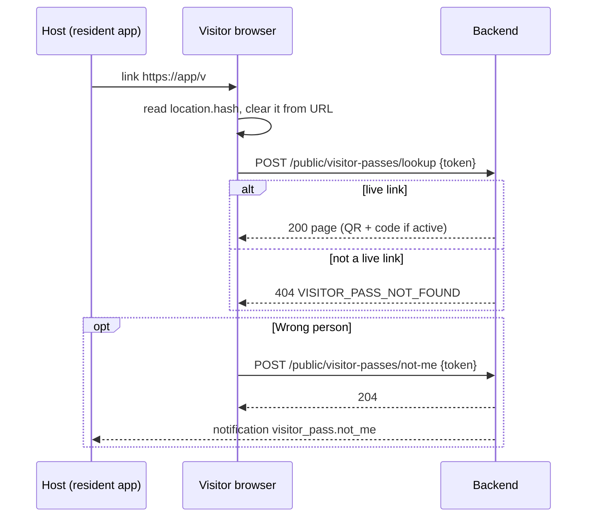
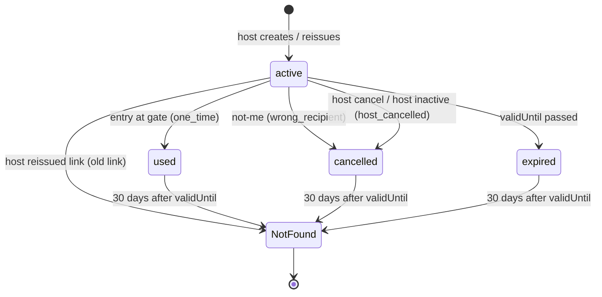

# صفحة الزائر العامة — Visitor Public Page

> **التطبيق/الواجهة:** public web page (no login)
> **الصلاحيات:** مفيش. "اللينك نفسه هو التحقق": أي حد معاه اللينك يفتح الصفحة.
> **المصادر:** ADR 0030 · `docs/api/v0-notes.md` · `src/gate/visitors/visitor-page.controller.ts`, `visitor-page.service.ts`, `dto/visitor-page.dto.ts`, `views/visitor-page.views.ts`

## الفكرة باختصار
الساكن بيبعت للزائر لينك بالشكل `https://<PUBLIC_APP_URL>/v#<token>`. الزائر يفتحه على الموبايل من غير حساب ولا تسجيل دخول، ويلاقي كل اللي محتاجه: الـQR والكود اللي يوريهم للحارس، فترة الصلاحية، اسم الكمباوند ورقم الوحدة، وإرشادات الوصول ورقم الطوارئ.
لو اللينك وصل لشخص غلط، يقدر يضغط "مش أنا" فيتلغي التصريح ويتبعت إشعار للساكن.

## الأدوار ومين بيعمل إيه

| الدور | يقدر يعمل إيه |
|---|---|
| أي حد معاه اللينك (الزائر) | يشوف الصفحة؛ يضغط "مش أنا" لإلغاء التصريح طالما هو نشط |
| الساكن صاحب التصريح | بيستقبل إشعار لو الزائر ضغط "مش أنا"؛ إدارة التصريح نفسه في `04-visitor-passes.md` |
| الحارس | بيعمل scan للـQR أو يكتب الكود — راجع `02-gate-verify-and-entries.md` |

## الشاشات اللي الفيتشر محتاجها
- **Loading**: بيقرأ التوكن من الـfragment ويبعته.
- **التصريح النشط**: الـQR كبير + الكود 6 أرقام + الكمباوند والوحدة + عدد الأفراد + فترة الصلاحية (والجدول للمتكرر) بتوقيت الكمباوند + إرشادات الوصول + رقم الطوارئ (زرار اتصال) + لينك صغير "مش أنا".
- **ديالوج تأكيد "مش أنا"**: يشرح إن التصريح هيتلغي نهائيًا.
- **بعد "مش أنا"**: رسالة شكر/تأكيد إن التصريح اتلغى.
- **التصريح مستخدم** (`used`)، **منتهي** (`expired`)، **ملغي** (`cancelled` مع سبب): نفس بيانات الكمباوند والوحدة، من غير QR ولا كود.
- **اللينك مش شغال** (404): رسالة عامة واحدة.
- **محاولات كتير** (429): "حاول بعد دقيقة".

## الفلو خطوة بخطوة

### 1) فتح الصفحة — `POST /public/visitor-passes/lookup`
1. الزائر بيفتح `https://<PUBLIC_APP_URL>/v#<token>`. الجزء بعد `#` (الـfragment) **عمر المتصفح ما بيبعته للسيرفر**، فمش هيظهر في logs أو referrer.
2. الصفحة تقرأ التوكن من `location.hash` (من غير الـ`#`).
3. الصفحة تبعت `POST /api/v1/public/visitor-passes/lookup` بالـbody `{ "token": "<token>" }`. التوكن **في الـbody بس**، أبدًا في URL أو query.
4. الردود:
   - `200` → اعرض الصفحة حسب `status` (تحت).
   - `404 VISITOR_PASS_NOT_FOUND` → "اللينك ده مش شغال". نفس الرد لكل الحالات: توكن غلط، شكله غلط، اتعمله إعادة إصدار (لينك قديم)، عدى عليه أكتر من 30 يوم بعد نهاية التصريح، توكن عامل وليس زائر، كمباوند موقوف.
   - `429 RATE_LIMITED` → "محاولات كتير، حاول تاني بعد شوية".
   - `400 VALIDATION_FAILED` → توكن فاضي أو أطول من 256 حرف: اعرضها زي اللينك مش شغال.
5. حسب `status`:
   - `active`: اعرض `qrPayload` كـQR (الصفحة هي اللي ترسمه)، و`code` كبير وواضح. اعرض الفترة `validFrom`–`validUntil` و`schedule` بتوقيت `timeZone`.
   - `used`: "التصريح ده اتستخدم خلاص" (تصريح مرة واحدة ودخل بيه حد).
   - `expired`: "انتهت صلاحية التصريح".
   - `cancelled` + `statusReason`:
     - `host_cancelled`: "صاحب الدعوة ألغى التصريح" (ده بيغطي كمان حالة إن صاحب الدعوة ساب الكمباوند أو حسابه اتقفل).
     - `wrong_recipient`: "تم إلغاء التصريح بناءً على طلبك" (حد ضغط "مش أنا" قبل كده).
   - في كل الحالات غير `active`: `code` و`qrPayload` = `null`.
6. ملاحظة: `active` معناها إن التصريح لسه شغال، **مش** إنه صالح دلوقتي حالًا. ممكن يكون لسه ما بدأش (`validFrom` في المستقبل) أو برا الجدول. الصفحة تحسب ده بنفسها من `validFrom` و`schedule` و`timeZone` وتعرض "صالح من..." أو "مواعيد الدخول: ...".

### 2) "مش أنا" — `POST /public/visitor-passes/not-me`
1. الزائر يضغط "الرسالة دي مش ليا".
2. ديالوج تأكيد: "هيتلغي التصريح ومش هتقدر تدخل بيه. صاحب الدعوة هيتبلغ".
3. الصفحة تبعت `POST /api/v1/public/visitor-passes/not-me` بالـbody `{ "token": "<token>" }`. **مفيش أي سؤال تاني** للزائر.
4. الردود:
   - `204` → التصريح اتلغى (السبب `wrong_recipient`)، وصاحبه وصله إشعار. اعرض رسالة تأكيد. لو الصفحة عملت lookup تاني هتلاقي `cancelled` + `wrong_recipient`.
   - `404 VISITOR_PASS_NOT_FOUND` → التصريح مبقاش نشط (مستخدم/منتهي/ملغي، أو "مش أنا" اتضغطت قبل كده) أو اللينك مش شغال. أعد الـlookup وأعرض الحالة الجديدة.
   - `429 RATE_LIMITED` → حاول تاني بعد شوية.
5. العملية مش بترجع: مفيش "تراجع".

## الحالات (Statuses)
الصفحة بتعرض حالة التصريح نفسها (اللي بيتحكم فيها `04-visitor-passes.md`):

| الحالة | المعنى للزائر | إيه اللي بيغيرها |
|---|---|---|
| `active` | التصريح شغال، الـQR والكود ظاهرين | الإنشاء أو إعادة الإصدار |
| `used` | تصريح مرة واحدة واتستخدم | أول دخول عند البوابة |
| `cancelled` + `host_cancelled` | صاحب الدعوة ألغاه (أو حسابه اتقفل) | الساكن / الـprimary / النظام |
| `cancelled` + `wrong_recipient` | اتلغى من "مش أنا" | الزائر من الصفحة دي |
| `expired` | عدت `validUntil` | الوقت |
| (404) | اللينك مش موجود أو اتبدل أو عدى عليه 30 يوم بعد النهاية | إعادة إصدار اللينك، أو الـsweep بعد 30 يوم |

## البيانات اللي بتظهر

### رد `lookup` (`VisitorPageView`)
| الحقل | المعنى |
|---|---|
| `compoundName` | اسم الكمباوند |
| `unitCode` | رقم/كود الوحدة اللي رايح لها |
| `kind` | `one_time` أو `recurring` |
| `partySize` | عدد الأفراد المسموح |
| `validFrom`, `validUntil` | فترة الصلاحية (ISO؛ اعرضها بتوقيت `timeZone`) |
| `timeZone` | توقيت الكمباوند (مثلا `Africa/Cairo`). الجدول بيتقري بيه |
| `schedule` | `{days, windows}` للمتكرر، `null` للمرة الواحدة. `days`: 0 = الأحد. فترة `to` قبل `from` بتكمل لليوم اللي بعده |
| `status` | `active` / `used` / `cancelled` / `expired` |
| `statusReason` | للملغي بس: `host_cancelled` أو `wrong_recipient`؛ غير كده `null` |
| `code` | 6 أرقام يقولها للحارس — **وهو `active` بس** |
| `qrPayload` | `JWR1.<token>` يترسم QR — **وهو `active` بس** |
| `visitorDirections` | إرشادات الكمباوند للزوار (نص 1–2000 حرف من إعدادات المدير) أو `null` |
| `emergencyPhone` | رقم طوارئ الكمباوند بصيغة E.164 أو `null` |

**مبيرجعش أبدًا:** اسم أو تليفون أو حساب صاحب الدعوة، أي ساكن تاني، الحارس، اسم أو تليفون الزائر نفسه، أي حاجة عن الأمان (مثلا ليه اتلغى بالظبط غير السببين دول).

كل الردود (حتى 404 و429) بتيجي بـ`Cache-Control: no-store` و`Referrer-Policy: no-referrer` و`X-Robots-Tag: noindex`.

## القواعد والقيود
- **قواعد الأمان للصفحة (عقد على الويب):**
  - اقرأ التوكن من `location.hash` بس، وابعته في body الـPOST بس. **ممنوع** يتحط في path أو query أو analytics أو error reports أو logs.
  - بعد القراية امسحه من شريط العنوان بـ`history.replaceState` عشان ميفضلش في الـhistory أو ظاهر على الشاشة (نفس قاعدة صفحات الإيميل في v0-notes).
  - متخزنهوش في `localStorage`. (الزائر لو قفل الصفحة يفتحها تاني من اللينك الأصلي.)
  - الصفحة نفسها تتقدم بـ`Cache-Control: no-store` و`Referrer-Policy: no-referrer` و`<meta name="robots" content="noindex">`، ومن غير سكربتات طرف تالت.
  - **متقولش أبدًا** إذا كان اللينك كان موجود قبل كده ولا لا: كل 404 رسالة واحدة.
- **Rate limit** (مشترك بين `lookup` و`not-me`): لكل IP `VISITOR_PAGE_RATE_LIMIT_PER_IP` (افتراضي 60 طلب/دقيقة)، ولكل لينك `VISITOR_PAGE_RATE_LIMIT_PER_TOKEN` (افتراضي 20 طلب/دقيقة). الزيادة → `429 RATE_LIMITED`. يعني الصفحة **متعملش polling سريع**؛ لو عايز تحدّث الحالة، حدّث كل دقيقة على الأقل أو بزرار.
- التوكن 43 حرف base64url؛ أي حاجة تانية 404 (أو 400 لو فاضي أو > 256).
- الكود والـQR بيتحسبوا من التوكن نفسه؛ أي حد معاه اللينك يقدر يعرضهم. لو الساكن عمل إعادة إصدار، اللينك القديم يبقى 404 فورًا.
- اللينك بيفضل يفتح (بحالة `used`/`expired`/`cancelled`) لحد 30 يوم بعد `validUntil`، وبعدها 404.
- `not-me` بيشتغل على تصريح `active` بس؛ مرة واحدة. أي مرة بعدها 404.
- "مش أنا" مبيطلبش أي بيانات من الزائر.

## الأخطاء اللي الـUI لازم يتعامل معاها

| HTTP + الكود | إمتى | رسالة / سلوك مقترح |
|---|---|---|
| `404 VISITOR_PASS_NOT_FOUND` | lookup: اللينك مش شغال لأي سبب. not-me: نفس الشيء أو التصريح مبقاش `active` | lookup: "اللينك ده مش شغال. اطلب من صاحب الدعوة يبعتلك لينك جديد". not-me: أعد الـlookup واعرض الحالة |
| `429 RATE_LIMITED` | زيادة عن حد الـIP أو حد اللينك في الدقيقة | "محاولات كتير. استنى دقيقة وحاول تاني" |
| `400 VALIDATION_FAILED` | `token` مش مبعوت أو فاضي أو > 256 حرف | اعرضها زي "اللينك مش شغال" |

## الإشعارات

| الحدث | `kind` | المستلم | Push؟ | الضغط يفتح |
|---|---|---|---|---|
| "مش أنا" | `visitor_pass.not_me` (`unitCode` بس، مفيش أي حاجة عن مين) | صاحب التصريح | أيوه، عادي (normal، category `gate_visitors`) — النص: "أفاد مستلم رابط التصريح للوحدة {unitCode} بأنه ليس المقصود، فتم إلغاء التصريح." | التصريح في تطبيق الساكن |

الزائر نفسه مبيستقبلش أي إشعار (ملوش حساب).

## الـEndpoints

| Method + Path | مين | الغرض | الرد |
|---|---|---|---|
| `POST /public/visitor-passes/lookup` (`/api/v1/...`) | الصفحة العامة | عرض التصريح من التوكن | `200` `VisitorPageView` |
| `POST /public/visitor-passes/not-me` | الصفحة العامة | "مش أنا": إلغاء التصريح | `204` |

الاتنين body: `{ "token": string (1–256) }`.

## ملاحظات للديزاين وحاجات ناقصة في الباك
- الصفحة على الويب (`/v`) **مش جزء من الباك**؛ فريق الويب لازم يبنيها بالعقد اللي فوق.
- مفيش حقل "صالح دلوقتي؟" ولا "الفترة الجاية": الصفحة لازم تحسب من `validFrom`/`validUntil`/`schedule`/`timeZone`.
- لو صاحب التصريح فقد صلاحية الدعوة بس حسابه شغال، الصفحة هتفضل تعرض `active` مع QR شغال، لكن الحارس هيرفضه (`host_inactive`). مفيش طريقة للصفحة تعرف.
- مفيش إشعار لحظي للصفحة (لا websocket ولا push): أي تغيير (إلغاء، استخدام) بيظهر بعد reload/lookup جديد، مع مراعاة الـrate limit.
- الـADR بيقول الصفحة بتعرض "اسم الكمباوند ورقم الوحدة والإرشادات" بس — مفيش اسم أو لوجو الكمباوند كصورة، ولا خريطة/لوكيشن (لو الديزاين محتاجها لازم تتضاف كإعداد).
- لغة الصفحة: الرد مفيهوش نصوص مترجمة غير `visitorDirections` (نص حر بلغة المدير)؛ الصفحة بتختار لغتها بنفسها.
