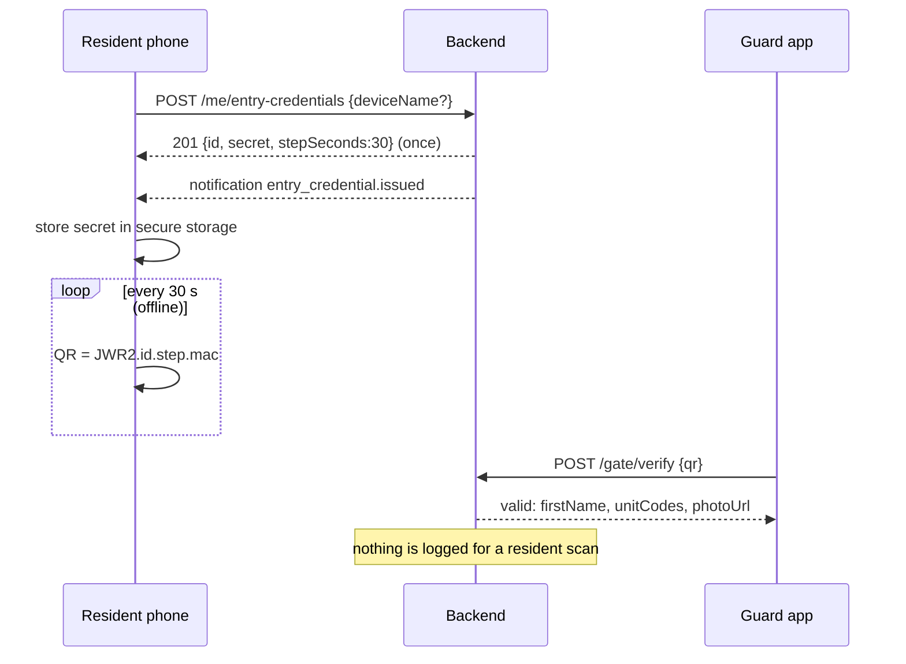
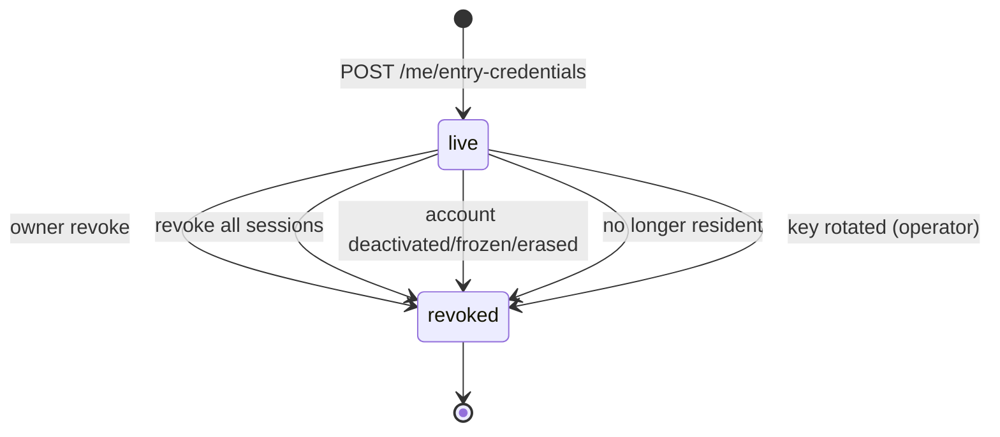

# QR دخول الساكن — Resident Entry QR

> **التطبيق/الواجهة:** resident app · family member
> **الصلاحيات:** مفيش permission على الـendpoints. اللي بيقرر هو الـcapability `gateEntry` على وحدة واحدة على الأقل (من `GET /me/units/:unitId/capabilities`). رفع الصورة الشخصية محتاج `profile.photo` (موجودة افتراضيًا في `resident` و`family_member`).
> **المصادر:** ADR 0031 · `src/gate/entry/` (`entry-credentials.controller.ts`, `entry-credentials.service.ts`, `entry-secrets.ts`, `resident-verifier.ts`, `dto/`, `views/`) · `src/core/files/me-photo.controller.ts`

## الفكرة باختصار
الساكن عنده QR شخصي في التطبيق يقول بيه للحارس "أنا ساكن هنا". الموبايل بيتسجل مرة واحدة ويستلم "سر" بيتحفظ جوه الموبايل. بعد كده الموبايل بيحسب الـQR بنفسه **كل 30 ثانية** و**من غير إنترنت**.
الحارس بيعمل scan، فيشوف الاسم الأول وأكواد الوحدات و**صورة الساكن** عشان يقارن الوش.
السيستم **مبيسجلش أي حركة دخول أو خروج** للساكن: الـscan بيأكد الهوية بس، ومبيتكتبش في أي سجل.

## الأدوار ومين بيعمل إيه

| الدور | يقدر يعمل إيه |
|---|---|
| ساكن مقيم (مالك مقيم أو مستأجر) | يسجل لحد 3 موبايلات، يشوفهم، يلغي أي واحد، يرفع صورته |
| فرد أسرة بالغ عنده حساب (عضو `active`) | نفس الشيء — مش محتاج أي grant من الـprimary |
| مالك غير مقيم (landlord)، عضو pending/removed، قاصر (ملوش حساب)، إشغال منتهي | ملوش QR (`gateEntry = false`) → `403 NOT_A_RESIDENT` |
| الحارس | بيعمل scan عن طريق `POST /gate/verify` — راجع `02-gate-verify-and-entries.md` |
| المدير | **ملوش أي شاشة** للـQR ده: مبيشوفش الموبايلات ولا يقدر يلغيها، ولا يشوف صورة الساكن |
| النظام | بيلغي كل موبايلات الحساب لما يتقفل أو يمشي من الكمباوند |

## الشاشات اللي الفيتشر محتاجها
- **شاشة "QR الدخول"**: QR كبير بيتغير كل 30 ثانية + عداد تنازلي صغير للتغيير الجاي + اسم/صورة الساكن (من `GET /me`). تشتغل أوفلاين.
- **Onboarding / تفعيل على الموبايل ده**: زرار "فعّل QR الدخول على الموبايل ده" + حقل اختياري لاسم الجهاز.
- **قائمة "موبايلاتي"**: كل موبايل متسجل (اسم الجهاز + تاريخ التسجيل)، وعلامة "الموبايل ده"، وزرار إلغاء لكل واحد.
- **ديالوج تأكيد الإلغاء**.
- **حالة "وصلت للحد الأقصى (3)"**: تعرض القائمة وتطلب إلغاء واحد الأول.
- **الصورة الشخصية**: رفع/تغيير/حذف (الحارس هيشوفها عند الـscan). تنبيه لو مفيش صورة: "الحارس هيطلب منك بطاقة".
- **حالة "الـQR ده اتلغى"**: لو الموبايل اكتشف إن الـcredential بتاعه مبقاش في القائمة.

## الفلو خطوة بخطوة

### 1) هل المستخدم يقدر ياخد QR؟
1. التطبيق يقرأ `GET /me/units/:unitId/capabilities` لكل وحدة ويشوف `gateEntry`.
2. لو مفيش ولا وحدة فيها `gateEntry = true`: اخفي الفيتشر. (لو حاول يسجل هياخد `403 NOT_A_RESIDENT`.)

### 2) تسجيل الموبايل — `POST /me/entry-credentials`
1. الساكن يضغط "فعّل على الموبايل ده". ممكن يكتب اسم للجهاز `deviceName` (اختياري، 1–60 حرف، مثلا "موبايل منى"). التطبيق ممكن يقترح اسم الموديل.
2. يُفضَّل جدًا إرسال `Idempotency-Key`: لو الرد ضاع وعمل retry بنفس الـkey، بيرجع **نفس** الـcredential ونفس السر، فمبيضيعش خانة من الـ3.
3. السيرفر بيتأكد: الجلسة والحساب لسه شغالين، المستخدم مقيم (`gateEntry`) في وحدة واحدة على الأقل، وعدد الموبايلات الشغالة أقل من 3.
4. الرد `201` (`no-store`): `{ id, secret, stepSeconds: 30 }`.
   - `secret`: **بيظهر مرة واحدة بس**. التطبيق يحفظه فورًا في الـsecure storage (Keychain/Keystore) مع الـ`id`. السيرفر مش هيقدر يرجّعه تاني.
5. السيرفر بيبعت للمستخدم إشعار `entry_credential.issued` ("تم تسجيل هاتف لرمز الدخول...") — ده حماية لو حد سرق الحساب وسجّل موبايل.
6. الشاشة التالية: شاشة الـQR مباشرة.

### 3) عرض الـQR (على الموبايل، أوفلاين)
1. التطبيق بيحسب كل 30 ثانية:
   - `step = floor(unixSeconds / 30)`
   - `mac` = أول 16 byte من `HMAC-SHA256(secret, "<id>.<step>")` بـbase64url (22 حرف)
   - محتوى الـQR: `JWR2.<id>.<step>.<mac>`
2. **للديزاين**: الـQR بيتغير كل 30 ثانية لوحده؛ اعرض عداد أو progress دائري يوضح إمتى هيتغير. مفيش أي طلب للسيرفر، فالشاشة تشتغل في الجراج أو عند البوابة من غير شبكة.
3. ساعة الموبايل لازم تكون مظبوطة (السيرفر بيقبل الخطوة الحالية ± خطوة واحدة، يعني حوالي دقيقة ونص). سكرين شوت للـQR بيبطل بعد حوالي 90 ثانية.
4. الصيغة الكاملة وقيم اختبار (test vectors) في ADR 0031.

### 4) عند البوابة
1. الحارس بيعمل scan → `POST /gate/verify {qr: "JWR2..."}` (تفاصيل شاشة الحارس في `02-gate-verify-and-entries.md`).
2. لو صالح، الحارس بيشوف: `firstName` (الكلمة الأولى من الاسم بس)، `unitCodes` (الوحدات اللي الساكن مقيم فيها دلوقتي)، و`photoUrl` (لينك مؤقت لصورة الساكن، أو `null` لو مفيش صورة → الحارس يطلب بطاقة).
3. أسباب الرفض: `expired_qr` (الخطوة قديمة/ساعة الموبايل غلط)، `account_inactive` (الحساب متجمد/متعطل/ممسوح)، `revoked` (الموبايل اتلغى)، `not_resident` (مبقاش مقيم). QR مزور أو غلط بيرجع زي "كود مش معروف" بالظبط.
4. **مفيش تسجيل دخول/خروج**: الـscan مبيكتبش `gate_entries`، ولا audit، ولا إشعار، ولا "آخر استخدام". الحارس مبيسجلش entry للساكن.
5. نفس الـQR بيُستخدم كمان لاستلام الطرود (`residentQr` في `07-parcels.md`).

### 5) قائمة الموبايلات — `GET /me/entry-credentials`
1. بترجع الموبايلات الشغالة بس (مش الملغية)، الأقدم أولًا، بحد أقصى 3. `nextCursor` دايمًا `null`.
2. كل عنصر: `id`, `deviceName`, `createdAt`. مفيش "آخر استخدام" ولا نوع الجهاز.
3. التطبيق يقارن الـ`id` المحفوظ عنده بالقائمة عشان يعلّم "الموبايل ده". لو الـ`id` بتاعه مش موجود → الـcredential اتلغى: امسح السر المحلي واعرض "فعّل تاني".

### 6) إلغاء موبايل — `POST /me/entry-credentials/{id}/revoke`
1. الساكن يختار موبايل من القائمة → ديالوج تأكيد ("الموبايل ده مش هيقدر يفتح البوابة").
2. الرد `204`. اسم الجهاز بيتمسح مع الإلغاء.
3. إلغاء موبايل ملغي قبل كده → `204` (آمن للـretry).
4. `id` مش بتاعك أو مش موجود → `404 ENTRY_CREDENTIAL_NOT_FOUND`.
5. لو الساكن ألغى الموبايل اللي هو ماسكه: امسح السر المحلي.

### 7) الصورة الشخصية (اللي الحارس بيشوفها)
1. رفع الملف: `POST /files/uploads` بـpurpose `resident_photo` (JPEG/PNG/WebP، حد أقصى 5MB) → PUT على الـURL → `POST /files/{id}/finalize` (راجع README).
2. `PUT /me/photo {fileId}` → `204`. بتستبدل الصورة القديمة (والقديمة بتتمسح).
3. `DELETE /me/photo` → `204`.
4. الساكن بيشوف صورته من `photoUrl` في `GET /me` (لينك مؤقت، `no-store` — متكاشهوش، أعد قراءته).
5. مين بيشوف الصورة: الساكن نفسه، والحارس عند scan صالح بس. مش باقي السكان، ولا المدير، ولا أي قائمة.

### 8) إلغاء تلقائي (النظام)
كل موبايلات الحساب بتتلغي في نفس اللحظة لما:

| السبب | `revokeReason` |
|---|---|
| الساكن ألغاه بنفسه | `owner` |
| "تسجيل خروج من كل الأجهزة" | `sessions_revoked` |
| الحساب اتعطل | `account_deactivated` |
| الحساب اتجمد | `account_frozen` |
| الحساب اتمسح | `account_erased` (عمليًا بيبان `account_deactivated` لأن المسح بيعطل الأول) |
| مبقاش مقيم في أي وحدة (انتهاء إشغال، `resides` اتقفل، بيع، انتهاء عضوية) | `not_resident` |
| تغيير المفتاح السري للسيرفر (يدوي من الـoperator) | `key_rotated` |

ساكن مقيم في وحدتين ومشي من واحدة بيحتفظ بالـQR. الـ`revokeReason` **مبيرجعش** للتطبيق.

## الحالات (Statuses)
الـcredential ملوش enum حالة؛ ليه حالتين بس: **شغال** (`revokedAt = null`) و**ملغي** (`revokedAt` + `revokeReason`). الـAPI بيرجع الشغالين بس.

| الحالة | المعنى | مين بيغيرها |
|---|---|---|
| live | الموبايل يقدر يعرض QR صالح | التسجيل |
| revoked | الـQR بتاعه بيترفض (`revoked`) | الساكن أو النظام (الجدول فوق) |

## البيانات اللي بتظهر

### رد التسجيل (`IssuedEntryCredentialView`) — مرة واحدة، `no-store`
| الحقل | المعنى |
|---|---|
| `id` | معرف الـcredential (بيظهر في كل QR، مش سر) |
| `secret` | 32 byte بـbase64url. **سر، مرة واحدة بس**، يتحفظ في secure storage ومبيتبعتش لأي حتة |
| `stepSeconds` | 30 |

### القائمة (`EntryCredentialView`)
| الحقل | المعنى |
|---|---|
| `id` | معرف الموبايل |
| `deviceName` | الاسم اللي الساكن كتبه، أو `null` |
| `createdAt` | تاريخ التسجيل |

**مبيرجعش أبدًا:** السر بعد أول مرة، أي "آخر استخدام"، أي سجل دخول، سبب الإلغاء، الموبايلات الملغية.

### اللي الحارس بيشوفه (للعلم)
`firstName` (الكلمة الأولى بس)، `unitCodes`، `photoUrl` (مؤقت). مش الاسم الكامل ولا التليفون ولا الإيميل ولا أي مستند.

## القواعد والقيود
- حد أقصى **3 موبايلات شغالة** لكل حساب (`ENTRY_CREDENTIAL_LIMIT`).
- `deviceName` اختياري، 1–60 حرف، بيتمسح عند الإلغاء، ومبيظهرش في الإشعار ولا الـaudit.
- الـQR بيتغير كل 30 ثانية؛ السيرفر بيقبل الخطوة الحالية ± 1.
- الشرط `gateEntry` بيتراجع **عند كل scan**، مش عند التسجيل بس.
- `Idempotency-Key` على التسجيل: الـretry بيرجع نفس الـ`id` والسر.
- الإلغاء آمن للتكرار.
- الـQR الشخصي مش بيسجل حركة؛ أي فيتشر "مين جوه" للسكان محتاج قرار منتج.
- الصورة: `resident_photo`، JPEG/PNG/WebP، ≤ 5MB.

## الأخطاء اللي الـUI لازم يتعامل معاها

| HTTP + الكود | إمتى | رسالة / سلوك مقترح |
|---|---|---|
| `403 NOT_A_RESIDENT` | التسجيل والمستخدم مش مقيم في أي وحدة (أو مشي وهو بيسجل) | "QR الدخول متاح للسكان المقيمين بس" |
| `409 ENTRY_CREDENTIAL_LIMIT_REACHED` (`params.limit` = 3) | عنده 3 موبايلات شغالة | "عندك {limit} موبايلات متسجلة. ألغِ واحد الأول" + افتح القائمة |
| `400 VALIDATION_FAILED` | `deviceName` مبعوت كنص فاضي أو أطول من 60 حرف (مسافات بس بتتقبل وبتتحفظ `null`) | "اسم الجهاز لازم يكون من 1 لـ 60 حرف" |
| `401 UNAUTHENTICATED` | الجلسة اتلغت أو الحساب اتقفل أثناء التسجيل | رجّع لتسجيل الدخول |
| `404 ENTRY_CREDENTIAL_NOT_FOUND` | إلغاء `id` مش موجود أو مش بتاعك | أعد تحميل القائمة |
| `409 IDEMPOTENCY_CONFLICT` | نفس الـkey لطلب مختلف | خطأ برمجي: key جديد لكل محاولة جديدة |
| `400 VALIDATION_FAILED` على `fileId` (`FILE_NOT_AVAILABLE`) | `PUT /me/photo` بملف مش بتاعك أو مش finalized أو purpose غلط | "الصورة مش جاهزة، ارفعها تاني" |
| `403 FORBIDDEN` | `PUT/DELETE /me/photo` من حساب معندوش `profile.photo` | اخفي خيار الصورة |

رد الحارس `expired_qr` مش بيوصل للساكن، لكن التطبيق يقدر يعرض نصيحة ثابتة: "لو الحارس قال الكود منتهي، اتأكد إن ساعة الموبايل مظبوطة (تلقائي)".

## الإشعارات

| الحدث | `kind` | المستلم | Push؟ | الضغط يفتح |
|---|---|---|---|---|
| موبايل جديد اتسجل للـQR | `entry_credential.issued` (من غير params، من غير اسم الجهاز) | صاحب الحساب نفسه | أيوه، **critical** في التوصيل (category `account_security`؛ مبيتكتمش بالتفضيلات أو ساعات الهدوء)، بس أولويته في الـinbox `normal`. النص: "تم تسجيل هاتف لرمز الدخول الخاص بك. إذا لم تكن أنت من فعل ذلك، ألغِه من التطبيق." | قائمة "موبايلاتي" (`targetId` = id الـcredential) |

مفيش إشعار عند الإلغاء، ولا عند أي scan.

## الـEndpoints

| Method + Path | مين | الغرض | الرد |
|---|---|---|---|
| `POST /me/entry-credentials` | ساكن/فرد أسرة بـ`gateEntry` | تسجيل الموبايل | `201` `{id, secret, stepSeconds}` (no-store) |
| `GET /me/entry-credentials` | نفس الشيء | قائمة الموبايلات الشغالة | `200` `{data: [{id, deviceName, createdAt}], nextCursor: null}` |
| `POST /me/entry-credentials/{id}/revoke` | صاحب الموبايل | إلغاء | `204` |
| `PUT /me/photo` | `profile.photo` | تعيين/تغيير الصورة | `204` |
| `DELETE /me/photo` | `profile.photo` | حذف الصورة | `204` |
| `GET /me` | أي حساب | `photoUrl` (مؤقت، no-store) | `200` |
| `POST /gate/verify` | الحارس | scan الـQR | راجع `02-gate-verify-and-entries.md` |

## ملاحظات للديزاين وحاجات ناقصة في الباك
- **مفيش endpoint يقول للموبايل "إنت لسه شغال؟"** غير قائمة الموبايلات؛ التطبيق يقارن الـ`id` المحفوظ بالقائمة (مثلا عند فتح الشاشة وهو أونلاين).
- **لو التطبيق اتمسح أو السر ضاع**، الـcredential القديم بيفضل شاغل خانة لحد ما الساكن يلغيه من موبايل تاني أو يعمل "خروج من كل الأجهزة".
- **المدير مالوش شاشة** يشوف أو يلغي موبايلات ساكن (مثلا موبايل اتسرق والساكن مش قادر يدخل). مذكور كـOpen في ADR 0031.
- **ساكن من غير smartphone** ملوش طريقة دخول بالـQR (Open في ADR 0031).
- الـADR بيقول سبب مسح الحساب بيبان `account_deactivated` والكود فيه hook لـ`account_erased` كـfallback؛ مفيش فرق للـUI لأن السبب مبيرجعش.
- `entry_credential.issued` في الكود `priority: normal` لكن `critical: true` في التوصيل؛ الـADR بيقول "normal priority" بس.
- مفيش `GET /me/entry-credentials/{id}`، ومفيش تعديل لاسم الجهاز.
- الحارس بيشوف `display` واحد مشترك للزوار والعمال والسكان (v0-notes): شاشة الحارس ممكن تحتاج 3 أشكال.
- الصورة مالهاش retention للحسابات المتعطلة/المتجمدة؛ بتتمسح مع مسح الحساب بس.
