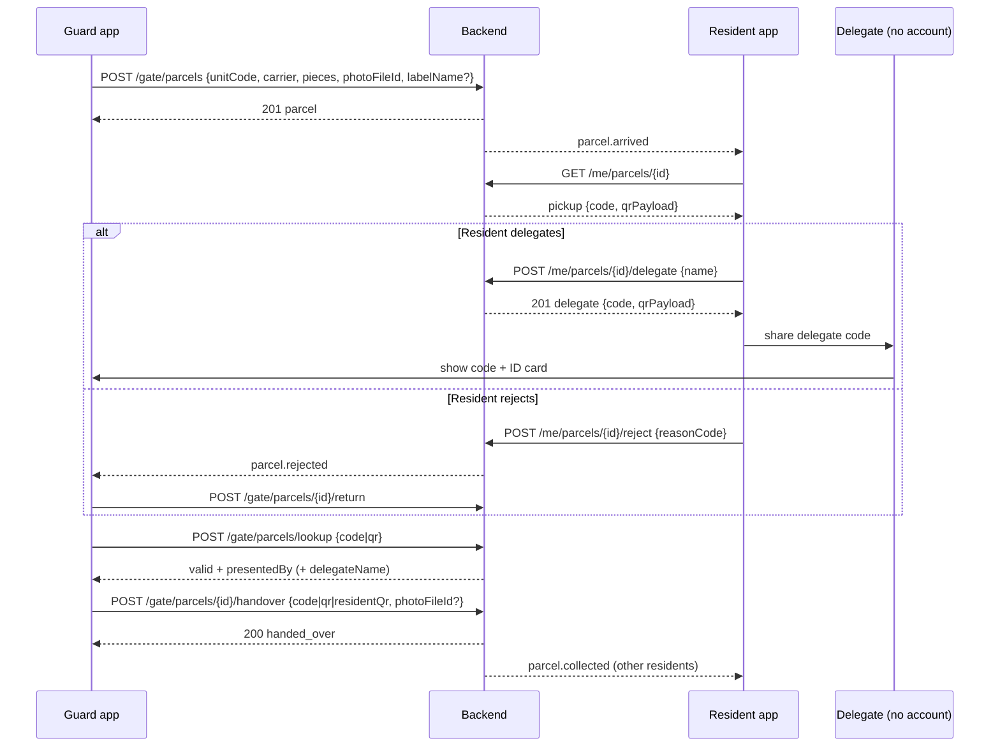
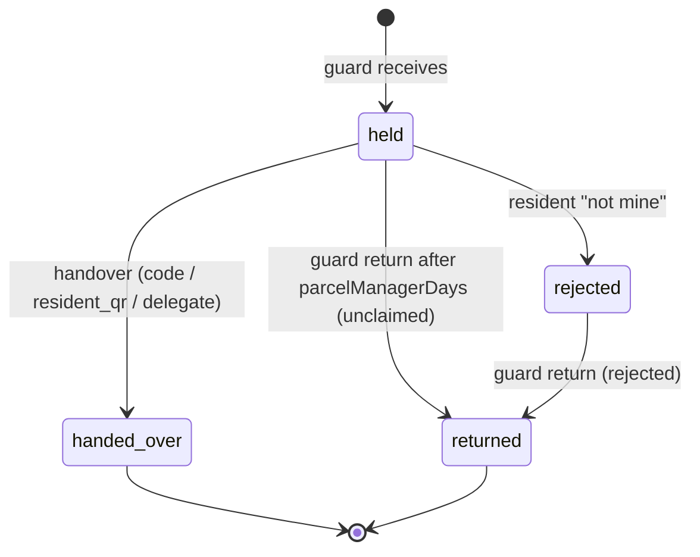

# الطرود — Parcels

> **التطبيق/الواجهة:** guard app · resident app · family member · manager dashboard
> **الصلاحيات:** الحارس: `parcels.handle` (دور `guard` افتراضيًا) + شيفت مفتوح. المدير: `parcels.manage` (دور `manager` افتراضيًا). السكان: من غير permission — الـcapability `parcels` على وحدة الطرد (من `GET /me/units/:unitId/capabilities`) هي اللي بتقرر.
> **المصادر:** ADR 0035 · `src/gate/parcels/` (`gate-parcels.controller.ts`, `resident-parcels.controller.ts`, `manager-parcels.controller.ts`, `parcels.service.ts`, `parcel-handover.service.ts`, `resident-parcels.service.ts`, `parcel-core.ts`, `parcel-tokens.ts`, `parcel-settings.service.ts`, `parcel-sweeps.ts`, `dto/`, `views/`)

## الفكرة باختصار
مندوب الشحن بيسيب الطرد عند البوابة. الحارس بيسجله في ثواني (الوحدة، شركة الشحن، عدد القطع، صورة)، وسكان الوحدة بيوصلهم إشعار.
الساكن بيشوف في التطبيق **كود استلام 6 أرقام وQR** للطرد. وقت الاستلام الحارس بيعمل scan للكود/الـQR، أو للـQR الشخصي للساكن، أو لكود "مندوب" الساكن فوّضه يستلم بداله.
الساكن يقدر يرفض الطرد ("مش بتاعي")، فالحارس يرجّعه لشركة الشحن. ولو الطرد فضل مدة طويلة، السكان والمدير بيتفكروا، والحارس يقدر يرجّعه بعد المدة اللي المدير حددها.

## الأدوار ومين بيعمل إيه

| الدور | يقدر يعمل إيه |
|---|---|
| الحارس (في شيفت مفتوح) | يستلم طرد ويسجله، يشوف قائمة الطرود وتفاصيلها وصورها، يتحقق من كود (`lookup`)، يسلّم الطرد، يرجّعه لشركة الشحن. **عمره ما بيشوف** اسم ساكن، ولا الاسم المكتوب على الليبل، ولا كود الاستلام. اسم المندوب بيظهر له بس بعد كود مندوب صحيح |
| ساكن مقيم (مالك مقيم/مستأجر) أو فرد أسرة بالغ بحساب نشط في الوحدة | يشوف طرود الوحدة (مع الاسم على الليبل والصور والكود)، يرفض طرد، يفوّض مندوب، يلغي المندوب (حتى لو حد تاني من الوحدة اللي فوّضه) |
| مالك غير مقيم، قاصر، عضو pending/removed، إشغال منتهي، حساب متجمد | ولا حاجة (`parcels = false`) |
| المدير | يشوف كل طرود الكمباوند (رقم الوحدة والحالة والأوقات والتاريخ) **من غير** أسماء أو صور أو أكواد، ويظبط مدد الاحتفاظ |
| المندوب (شخص من برا) | ملوش حساب؛ بيوري الحارس الكود/الـQR اللي الساكن بعتهوله + بطاقته |
| النظام | تذكير السكان، إبلاغ المدير، إبلاغ الحراس بالطرود المرفوضة، إنهاء المندوب لو اللي فوّضه مشي، مسح البيانات الشخصية بعد 30 يوم |

## الشاشات اللي الفيتشر محتاجها

**تطبيق الحارس**
- **قائمة الطرود**: افتراضيًا اللي محتاج شغل (`held` + `rejected`)، مع فلتر بالحالة وبكود الوحدة.
- **فورم استلام طرد**: كود الوحدة، شركة الشحن (قائمة)، عدد القطع، كاميرا لصورة الطرد (إجباري)، الاسم المكتوب على الليبل (اختياري).
- **تفاصيل طرد**: الصورة، صورة التسليم، التاريخ (events)، أزرار "تسليم" و"إرجاع".
- **شاشة التسليم**: scan/كتابة الكود، أو scan للـQR الشخصي للساكن؛ نتيجة الـlookup (ومنها اسم المندوب للمقارنة بالبطاقة)؛ صورة تسليم اختيارية؛ تأكيد.
- **تأكيد الإرجاع** لشركة الشحن.
- **حالة "مقفول مؤقتًا"** بعد 5 أكواد غلط.

**تطبيق الساكن**
- **قائمة "طرودي"**: كل طرود وحداتي، بالأحدث، مع فلتر بالحالة.
- **تفاصيل الطرد**: الصورة، شركة الشحن، عدد القطع، وقت الوصول، الاسم على الليبل، **كود الاستلام + QR** (وهو `held`)، المندوب لو موجود.
- **فورم "فوّض حد يستلم"**: اسم المندوب بس، وبعدها شاشة مشاركة كود/QR المندوب.
- **ديالوج إلغاء المندوب**.
- **ديالوج "مش بتاعي"** مع اختيار سبب.

**داشبورد المدير**
- **قائمة طرود الكمباوند** مع فلاتر (حالة، وحدة، شركة شحن) وأعمدة "أيام الانتظار"، "اتفكّر"، "اتبلغ المدير"، "مالوش حد يستلمه".
- **تفاصيل طرد** مع التاريخ (events).
- **إعدادات الطرود**: أيام التذكير وأيام إبلاغ المدير.

## الفلو خطوة بخطوة

### 1) الحارس يستلم الطرد — `POST /gate/parcels`
1. الحارس لازم يكون في شيفت مفتوح (وإلا `403 NO_OPEN_SHIFT`). الطرد بيتسجل على بوابة الشيفت.
2. يصوّر الطرد ويرفع الصورة: `POST /files/uploads` بـpurpose `parcel_photo` (صورة، ≤ 5MB) → PUT → `POST /files/{id}/finalize` (راجع README). **التعليمات للحارس: صوّر الطرد مش الليبل** (الصورة بتظهر للسكان وللحارس).
3. يدخل:

| الحقل | إجباري؟ | القيود |
|---|---|---|
| `unitCode` | نعم | 1–64 حرف؛ لازم الوحدة تكون موجودة |
| `carrier` | نعم | واحدة من: `aramex`, `dhl`, `fedex`, `ups`, `bosta`, `mylerz`, `egypt_post`, `amazon`, `noon`, `jumia`, `talabat`, `other` |
| `pieces` | نعم | 1–20 |
| `photoFileId` | نعم | ملف `parcel_photo` بتاع الحارس نفسه ومتعمله finalize |
| `labelName` | لا | 1–80 حرف — الاسم المكتوب على الليبل. السكان بس اللي بيشوفوه؛ الحارس والمدير لأ |

4. يُفضَّل `Idempotency-Key`: الـretry بيرجع نفس الطرد.
5. السيرفر بيدي الطرد **رقم متسلسل** في الكمباوند (`number`) وكود استلام (مخفي عن الحارس)، ويبلغ السكان.
6. الرد `201` بـ`GateParcelView`. اعرض للحارس "تم تسجيل الطرد رقم {number}" (يكتبه على الطرد مثلا).
7. **لو الوحدة مفيهاش حد يقدر يستلم** (فاضية، أو كل اللي فيها مش مؤهلين): الطرد بيتسجل عادي، **والحارس مبيعرفش** (عشان ميتكشفش إن الوحدة فاضية)، والمدير بيوصله إشعار `parcel.unclaimable` فورًا ومرة واحدة.

### 2) السكان يتبلغوا ويشوفوا الطرد — `GET /me/parcels`, `GET /me/parcels/{id}`
1. كل ساكن مؤهل في الوحدة بيوصله `parcel.arrived` (شركة الشحن، عدد القطع، الوقت، الوحدة). **الإشعار مفيهوش كود**.
2. الضغط على الإشعار يفتح `GET /me/parcels/{id}`.
3. التفاصيل فيها `pickup: {code, qrPayload}` طول ما الطرد `held`. **الكود ده ينفع يتقرا أي عدد مرات** (مش مرة واحدة زي تصاريح الزوار)؛ الردود `no-store` فمتكاشهاش.
4. الساكن يروح البوابة ويوري الكود أو الـQR (اللي التطبيق بيرسمه من `qrPayload` = `JWP1.<token>`)، أو يوري الـQR الشخصي بتاعه (راجع `06-resident-entry-qr.md`).

### 3) تفويض مندوب — `POST /me/parcels/{id}/delegate`
1. الساكن يضغط "حد تاني هيستلم" ويكتب **اسم المندوب** `name` (1–80 حرف، **من غير تليفون**).
2. يُفضَّل `Idempotency-Key` (الـretry بيرجع نفس الكود).
3. شروط: الطرد `held`، ومفيش مندوب شغال عليه (مندوب واحد بس لكل طرد).
4. الرد `201` بـ`ResidentParcelView` كامل، فيه `delegate: {name, authorizedAt, code, qrPayload}`.
5. الشاشة التالية: "شارك كود المندوب" — الساكن يبعت الكود أو صورة الـQR للمندوب بنفسه (السيرفر مبيبعتش حاجة). وضّح إن المندوب لازم يجيب بطاقته لأن الحارس هيقارن الاسم.
6. كود الساكن الأصلي (`pickup`) **بيفضل شغال** مع كود المندوب؛ أي واحد فيهم يستلم.
7. الكود ده كمان ينفع يتقرا تاني من تفاصيل الطرد طول ما المندوب شغال.

### 4) إلغاء المندوب — `POST /me/parcels/{id}/delegate/revoke`
1. أي ساكن مؤهل في الوحدة يقدر يلغي (مش لازم اللي فوّضه).
2. الطرد لازم يكون `held` (وإلا `409 PARCEL_STATE_CONFLICT`). لو مفيش مندوب → `204` بدون تغيير.
3. الرد `204`. كود المندوب بيموت فورًا، واسمه بيتمسح، و`delegate` يرجع `null`. الساكن يقدر يفوّض حد جديد.
4. **تلقائي**: لو الساكن اللي فوّض مبقاش مؤهل على الوحدة (مشي، اتشال من الأسرة، حسابه اتعطل/اتجمد/اتمسح)، المندوب بيتلغي لوحده (السبب `authorizer_left`، والـevent بيتسجل بـ`actorSide: system`). مفيش إشعار بده.

### 5) "مش بتاعي" — `POST /me/parcels/{id}/reject`
1. الساكن يختار سبب `reasonCode` من `parcelReject`: `not_ours`, `not_expected`, `other` (إجباري).
2. يُفضَّل `Idempotency-Key`.
3. الطرد لازم يكون `held`. يتحول لـ`rejected`، وكل الأكواد (الساكن والمندوب) بتموت.
4. الرد `200` بـ`ResidentParcelView` المحدث.
5. الحراس اللي في شيفت مفتوح على **بوابة الطرد** بيوصلهم `parcel.rejected` ("رفض الساكن الطرد رقم {parcelNumber}. يرجى إعادته."). وأي حارس **يبدأ شيفت** على نفس البوابة بعد كده بيوصله نفس الإشعار مرة واحدة لكل طرد مرفوض لسه ما رجعش.
6. **مفيش تراجع** عن الرفض من التطبيق.

### 6) التسليم عند البوابة — `POST /gate/parcels/lookup` ثم `POST /gate/parcels/{id}/handover`
**طريقة أ: كود الطرد أو كود المندوب**
1. الحارس يكتب الـ6 أرقام أو يعمل scan للـQR (`JWP1...`) → `POST /gate/parcels/lookup` بـ`{code}` **أو** `{qr}` (واحد بس).
2. الرد دايمًا `200`:
   - `result: valid` + `parcel` (زي ما الحارس بيشوفه) + `presentedBy` (`holder` = كود الساكن، `delegate` = كود المندوب) + `delegateName` (لكود المندوب بس).
   - `result: invalid` وكل الباقي `null` — نفس الرد لكود غلط، شكله غلط، منتهي، من كمباوند تاني، أو طرد مش `held`. **وبيتحسب محاولة غلط.**
3. لو `delegate`: اعرض للحارس **اسم المندوب كبير** ونبّهه يقارنه بالبطاقة.
4. الحارس يتأكد من الطرد (رقم/صورة)، وممكن يصوّر لحظة التسليم (`parcel_photo`، اختياري).
5. `POST /gate/parcels/{id}/handover` بنفس `{code}` أو `{qr}` + `photoFileId` اختياري. يُفضَّل `Idempotency-Key`.
6. السيرفر بيتحقق من كل حاجة تاني تحت lock. الرد `200` بـ`HandedOverParcelView` (`status: handed_over` + `delegateName` لو مندوب).

**طريقة ب: الـQR الشخصي للساكن (`JWR2`)**
1. الحارس يدور على الطرد في القائمة (مثلا `GET /gate/parcels?unitCode=...`، الساكن بيقوله رقم وحدته) ويفتحه.
2. يعمل scan للـQR الشخصي → `POST /gate/parcels/{id}/handover` بـ`{residentQr: "JWR2..."}` (+ صورة اختيارية). **`lookup` مبيقبلش `residentQr`.**
3. السيرفر بيتأكد إن الـQR حقيقي وحالي، وإن صاحبه مؤهل على وحدة **الطرد ده**. التسليم بيتسجل على الطرد بس (مين استلم)؛ **مفيش تسجيل دخول للبوابة** ولا أي حركة.
4. لو الـQR قديم (ساعة الموبايل) → `403 PARCEL_QR_EXPIRED`: "اطلب منه يفتح الـQR من جديد".

**في الحالتين:**
- كل القطع بتتسلم مرة واحدة (مفيش تسليم جزئي).
- كل الأكواد بتموت بعد التسليم.
- باقي سكان الوحدة بيوصلهم `parcel.collected` (من غير اسم مين استلم، بس الطريقة `method`). اللي استلم بالـQR الشخصي مبيوصلوش؛ لو التسليم بكود الساكن أو المندوب، كل السكان بيوصلهم.
- **الحماية من التخمين**: 5 محاولات غلط (lookup أو handover) خلال 10 دقايق بتقفل الحارس عن الأكواد لحد ما الـ10 دقايق تخلص (من أول غلطة) → `429 RATE_LIMITED`. وكمان حد 30 محاولة في الدقيقة للحارس (`PARCEL_CODE_RATE_LIMIT_PER_MINUTE`). الـQR الشخصي المزور بيتحسب غلط؛ الـQR الحقيقي القديم (`PARCEL_QR_EXPIRED`) مبيتحسبش.

### 7) الإرجاع لشركة الشحن — `POST /gate/parcels/{id}/return`
1. الحارس (في شيفت مفتوح، أي بوابة) يضغط "إرجاع لشركة الشحن". مفيش body. يُفضَّل `Idempotency-Key`.
2. الحالات المسموحة:
   - `rejected` → `returned` (السبب `rejected` بيتحدد تلقائيًا).
   - `held` → `returned` **بس بعد `parcelManagerDays`** من وقت الاستلام (السبب `unclaimed`). قبلها → `409 PARCEL_NOT_YET_RETURNABLE` مع `params.days`.
   - غير كده → `409 PARCEL_STATE_CONFLICT`.
3. الرد `200` بـ`GateParcelView`. الأكواد بتموت.
4. السكان **مبيوصلهمش إشعار** بالإرجاع (بيشوفوا الحالة في القائمة).

### 8) خطوات تلقائية (sweeps، كل ساعة افتراضيًا)
1. **تذكير السكان** (`gate.parcel_reminders`): طرد `held` بقاله `parcelReminderDays` (افتراضي 3) → `parcel.reminder` لسكان الوحدة المؤهلين، **مرة واحدة**.
2. **إبلاغ المدير**: طرد `held` بقاله `parcelManagerDays` (افتراضي 14) → `parcel.held_long` لكل اللي معاهم `parcels.manage`، **مرة واحدة**. من اللحظة دي الحارس يقدر يرجّعه.
3. الكمباوند الموقوف (suspended) مبيتبعتلوش تذكيرات.
4. **مفيش إرجاع تلقائي**: الطرد بيفضل `held` لحد ما الحارس يرجّعه يدويًا.
5. **مسح البيانات الشخصية** (`gate.parcel_retention`): بعد 30 يوم من التسليم أو الإرجاع، بيتمسح: الاسم على الليبل، اسم المندوب، الصورتين، ومين استلم. الطرد وتاريخه بيفضلوا (و`hasPhoto` يبقى `false`). الطرد المرفوض بيفضل ببياناته لحد ما يرجع. بيشتغل حتى لو الكمباوند موقوف.

### 9) المدير — `GET /parcels`, `GET /parcels/{id}`, `GET/PATCH /parcel-settings`
1. القائمة: كل طرود الكمباوند (من غير فلتر حالة افتراضي)، فلاتر `status`, `unitCode`, `carrier`، cursor-paged بالأحدث. كود وحدة مش موجود → قائمة فاضية.
2. التفاصيل: نفس الحقول + `events`.
3. الإعدادات: `parcelReminderDays` (1–30، افتراضي 3) و`parcelManagerDays` (2–90، افتراضي 14). PATCH بيغير اللي مبعوت بس. لازم التذكير < إبلاغ المدير.

## الحالات (Statuses)

| الحالة | المعنى | مين بيدخّلها / بيطلّعها |
|---|---|---|
| `held` | الطرد عند البوابة مستني | الحارس عند الاستلام |
| `handed_over` | اتسلم (بكود الساكن، أو QR الساكن الشخصي، أو كود المندوب) | الحارس بالتسليم — حالة نهائية |
| `rejected` | الساكن قال "مش بتاعي"؛ مستني الحارس يرجعه | الساكن |
| `returned` | رجع لشركة الشحن (`returnReason`: `rejected` أو `unclaimed`) | الحارس — حالة نهائية |

أي انتقال تاني → `409 PARCEL_STATE_CONFLICT` مع `params.status` (الحالة الحالية).

حالة المندوب (جوه الطرد `held`): مفيش مندوب → فيه مندوب (`delegate_authorized`) → اتلغى (`delegate_revoked`: `revoked` من ساكن أو `authorizer_left` من النظام) → ممكن يتفوض واحد جديد.

### أنواع الأحداث (`events`)
| `kind` | `actorSide` | ملاحظات |
|---|---|---|
| `received` | `guard` | |
| `delegate_authorized` | `resident` | |
| `delegate_revoked` | `resident` أو `system` | `reasonCode`: `revoked` أو `authorizer_left` |
| `handed_over` | `guard` | `method`: `code`, `resident_qr`, `delegate` |
| `rejected` | `resident` | `reasonCode`: `not_ours`, `not_expected`, `other` |
| `returned` | `guard` | `reasonCode`: `rejected` أو `unclaimed` |

## البيانات اللي بتظهر

### الحارس — القائمة و`lookup` و`return` (`GateParcelView`)
| الحقل | المعنى |
|---|---|
| `id` | معرف الطرد |
| `number` | رقم الطرد المتسلسل في الكمباوند (الرقم القصير اللي الحارس والمدير بيستخدموه) |
| `unitCode`, `carrier`, `pieces`, `status` | |
| `receivedAt`, `handedOverAt`, `rejectedAt`, `returnedAt` | الأوقات |
| `hasPhoto` | `false` بعد مسح الصورة (30 يوم بعد الإقفال) |

### الحارس — التفاصيل (`GateParcelDetailView`, `no-store`)
زي اللي فوق + `photo` و`handoverPhoto` (كل واحدة `{url, expiresAt}` لينك مؤقت أو `null`) + `events`.

### الحارس — رد `lookup` (`ParcelLookupView`, `no-store`)
`result` (`valid`/`invalid`)، `parcel`، `presentedBy` (`holder`/`delegate`)، `delegateName` (لكود مندوب صحيح بس).

### الحارس — رد `handover` (`HandedOverParcelView`, `no-store`)
`GateParcelView` + `delegateName` (لو المندوب هو اللي استلم).

**الحارس مبيشوفش أبدًا:** اسم أي ساكن، `labelName`، كود الاستلام، id أي حساب، اسم المندوب في القائمة أو التفاصيل.

### الساكن (`ResidentParcelView`, دايمًا `no-store`)
| الحقل | المعنى |
|---|---|
| `id`, `number`, `unitCode`, `carrier`, `pieces`, `status` | |
| `receivedAt`, `handedOverAt`, `rejectedAt`, `returnedAt` | الأوقات |
| `handedOverMethod` | `code` / `resident_qr` / `delegate` — **مش** مين بالظبط |
| `rejectReason` | سبب الرفض |
| `labelName` | الاسم على الليبل؛ بيتمسح بعد 30 يوم من الإقفال |
| `photo`, `handoverPhoto` | `{url, expiresAt}` مؤقت أو `null` |
| `pickup` | `{code, qrPayload}` — **وهو `held` بس**. بيرجع `null` كمان لو مفتاح السيرفر اتغير (الكود "اتعلق")، وساعتها الاستلام بالـQR الشخصي بس |
| `delegate` | `{name, authorizedAt, code, qrPayload}`: المندوب الشغال (بكوده)، أو بعد التسليم المندوب اللي كان مفوّض وقتها (`code` = `null`، والاسم لحد الـ30 يوم) — **حتى لو الساكن نفسه هو اللي استلم**، فاعتمد على `handedOverMethod` عشان تعرف مين استلم فعلًا. مندوب اتلغى أو طرد اترفض/رجع → `null` |

`returnReason` مش موجود في view الساكن.

### المدير (`ManagerParcelView` / `ManagerParcelDetailView`)
| الحقل | المعنى |
|---|---|
| `id`, `number`, `unitCode`, `carrier`, `pieces`, `status` | |
| `receivedAt`, `handedOverAt`, `rejectedAt`, `rejectReason`, `returnedAt`, `returnReason` | |
| `heldDays` | أيام صحيحة من الاستلام لحد دلوقتي، أو لحد التسليم/الإرجاع |
| `reminded` | السكان اتفكروا |
| `heldLongNotified` | المدير اتبلغ |
| `unclaimable` | مكانش فيه حد يستلمه وقت الوصول |
| `events` | في التفاصيل بس |

**المدير مبيشوفش أبدًا:** `labelName`، اسم المندوب، الصور، الأكواد، مين استلم.

### الإعدادات (`ParcelSettingsResponse`)
`parcelReminderDays`, `parcelManagerDays`.

## القواعد والقيود
- الحارس لازم يكون في **شيفت مفتوح** لكل حاجة في `/gate/parcels` (حتى القراية). الـshift بيتشيك قبل أي حاجة تانية.
- الحارس بيشوف طرود الكمباوند كلها (مش بوابته بس)، والقائمة افتراضيًا `held` + `rejected`.
- `pieces` 1–20، `labelName` ≤ 80، اسم المندوب 1–80 (بعد trim)، صور `parcel_photo` ≤ 5MB.
- مندوب واحد شغال بس لكل طرد؛ من غير تليفون.
- الطلب بتاع `lookup` لازم فيه `code` **أو** `qr` (واحد بس). `handover` لازم فيه واحد بس من `code` / `qr` / `residentQr`. ولا واحد → `FIELD_REQUIRED` على `code`؛ أكتر من واحد → `FIELD_NOT_ALLOWED` على الزيادة.
- الكود 6 أرقام بالظبط؛ أي شكل تاني بيتحسب كود غلط.
- كود طرد تاني (حتى لو صحيح) في `handover` على طرد غير طرده = `PARCEL_CODE_INVALID`.
- القفل: 5 محاولات غلط في 10 دقايق (نافذة ثابتة من أول غلطة) + 30 محاولة/دقيقة للحارس. الرسالة `429 RATE_LIMITED` في الحالتين.
- الساكن بيشوف طرود **كل الوحدات** اللي هو مؤهل فيها، **بما فيها طرود قديمة قبل ما يسكن** (طالما الوحدة واحدة).
- الساكن الغير مؤهل على الطرد بياخد `404 PARCEL_NOT_FOUND` (مش 403).
- الرفض محتاج `reasonCode` من `not_ours`, `not_expected`, `other`.
- الإرجاع: `rejected` في أي وقت؛ `held` بعد `parcelManagerDays` بس.
- الإعدادات: `parcelReminderDays` 1–30، `parcelManagerDays` 2–90، والتذكير لازم يكون أقل من أيام المدير.
- `Idempotency-Key` على: الاستلام، التسليم، الإرجاع، الرفض، التفويض. الـretry بيرجع الطرد زي ما هو دلوقتي (والتفويض بيرجع نفس كود المندوب).
- البيانات الشخصية (الاسم على الليبل، اسم المندوب، الصور، مين استلم) بتتمسح بعد 30 يوم من التسليم/الإرجاع.

## الأخطاء اللي الـUI لازم يتعامل معاها

| HTTP + الكود | إمتى | رسالة / سلوك مقترح |
|---|---|---|
| `403 NO_OPEN_SHIFT` | أي endpoint للحارس من غير شيفت مفتوح | "ابدأ الشيفت الأول" ووديه لشاشة الشيفت |
| `404 UNIT_NOT_FOUND` | استلام طرد بكود وحدة مش موجود | "رقم الوحدة غلط" على حقل الوحدة |
| `400 VALIDATION_FAILED` (`photoFileId` = `FILE_NOT_AVAILABLE`) | الصورة مش متعملها finalize، أو مش بتاعة الحارس، أو purpose غلط، أو اتستخدمت قبل كده | "الصورة مرفوعتش. صوّر تاني" |
| `400 VALIDATION_FAILED` (حقول) | `carrier`/`pieces`/`labelName` غلط؛ `code`/`qr`/`residentQr` ناقص أو زيادة؛ اسم المندوب فاضي أو طويل (`INVALID_LENGTH`)؛ إعدادات خارج المدى أو التذكير ≥ أيام المدير (`INVALID_NUMBER` على `parcelReminderDays` مع `params.max`) | علّم الحقل |
| `400 REASON_REQUIRED` | رفض من غير `reasonCode` | "اختار السبب" |
| `400 VALIDATION_FAILED` (`reasonCode` = `INVALID_REASON_CODE`) | سبب مش من القائمة | خطأ برمجي |
| `404 PARCEL_NOT_FOUND` | id طرد مش موجود؛ أو للساكن: طرد مش لوحدة هو مؤهل فيها | "الطرد ده مش متاح" وأعد تحميل القائمة |
| `403 PARCEL_CODE_INVALID` | `handover` بكود/QR غلط أو منتهي أو لطرد تاني، أو QR شخصي مزور، أو صاحب الـQR مش مؤهل على وحدة الطرد | "الكود ده مش بيفتح الطرد ده" — وبتتحسب محاولة غلط |
| `403 PARCEL_QR_EXPIRED` | QR شخصي حقيقي بس قديم | "الـQR قديم. اطلب منه يحدّث الـQR (أو يظبط ساعة الموبايل)" |
| `409 PARCEL_STATE_CONFLICT` (`params.status`) | تسليم/رفض/تفويض/إلغاء مندوب على طرد مش `held`، أو إرجاع طرد `handed_over`/`returned`، أو حد سبق (تسليمين في نفس الوقت) | "حالة الطرد اتغيرت ({status})" وأعد التحميل |
| `409 PARCEL_DELEGATE_EXISTS` | تفويض وفيه مندوب شغال | "فيه مندوب بالفعل. ألغيه الأول" |
| `409 PARCEL_NOT_YET_RETURNABLE` (`params.days`) | إرجاع طرد `held` قبل `parcelManagerDays` | "مينفعش يرجع قبل {days} يوم من استلامه" |
| `429 RATE_LIMITED` | 5 أكواد غلط في 10 دقايق، أو أكتر من 30 محاولة/دقيقة | "محاولات غلط كتير. استنى شوية وجرب تاني" واقفل إدخال الكود مؤقتًا |
| `409 IDEMPOTENCY_CONFLICT` | نفس الـkey لطلب مختلف | خطأ برمجي |
| `401 UNAUTHENTICATED` | الساكن حسابه اتقفل أثناء الطلب | رجّع لتسجيل الدخول |
| `403 FORBIDDEN` | الحساب معندوش `parcels.handle` / `parcels.manage` | اخفي الشاشة |

**ملاحظة:** `lookup` بالكود الغلط **مش** error — بيرجع `200` بـ`result: invalid`. اعرضه كـ"كود غير صحيح".

## الإشعارات
كلهم أولوية `normal`، مش critical، category `parcels` (بيتأثروا بتفضيلات المستخدم وساعات الهدوء). مفيش أسماء ولا أكواد في أي إشعار.

| الحدث | `kind` (params) | المستلم | Push؟ | الضغط يفتح |
|---|---|---|---|---|
| طرد وصل | `parcel.arrived` (`carrier`, `pieces`, `receivedAt`, `unitCode`) | كل السكان المؤهلين في الوحدة | أيوه: "يوجد طرد للوحدة {unitCode} عند البوابة." | تفاصيل الطرد عند الساكن |
| طرد لوحدة مفيهاش حد مؤهل | `parcel.unclaimable` (`parcelNumber`, `unitCode`, `carrier`) | كل اللي معاهم `parcels.manage` (مرة واحدة) | أيوه | تفاصيل الطرد في الداشبورد |
| اتسلم | `parcel.collected` (`carrier`, `pieces`, `unitCode`, `method`) | **باقي** سكان الوحدة (اللي استلم بالـQR الشخصي مستثنى) | أيوه: "تم تسليم طرد خاص بالوحدة {unitCode}." | تفاصيل الطرد |
| تذكير | `parcel.reminder` (`carrier`, `pieces`, `days`, `unitCode`) | سكان الوحدة المؤهلين، مرة واحدة بعد `parcelReminderDays` | أيوه | تفاصيل الطرد |
| طرد طوّل | `parcel.held_long` (`parcelNumber`, `unitCode`, `carrier`, `days`) | المديرين، مرة واحدة بعد `parcelManagerDays` | أيوه | تفاصيل الطرد في الداشبورد |
| الساكن رفض | `parcel.rejected` (`parcelNumber`, `carrier`) | الحراس في شيفت على بوابة الطرد + كل حارس يبدأ شيفت عليها بعد كده (مرة لكل طرد) | أيوه: "رفض الساكن الطرد رقم {parcelNumber}. يرجى إعادته." | تفاصيل الطرد عند الحارس |

مفيش إشعار لـ: التفويض أو إلغاء المندوب، الإرجاع، انتهاء المندوب تلقائيًا.

## الـEndpoints

| Method + Path | مين | الغرض | الرد |
|---|---|---|---|
| `POST /gate/parcels` | الحارس | استلام طرد | `201` `GateParcelView` |
| `GET /gate/parcels?status=&unitCode=&cursor=&limit=` | الحارس | القائمة (افتراضي `held`+`rejected`) | `200` `{data: GateParcelView[], nextCursor}` |
| `GET /gate/parcels/{id}` | الحارس | التفاصيل بالصور والتاريخ | `200` `GateParcelDetailView` (no-store) |
| `POST /gate/parcels/lookup` | الحارس | إيه الكود ده؟ | `200` `ParcelLookupView` (no-store) |
| `POST /gate/parcels/{id}/handover` | الحارس | تسليم | `200` `HandedOverParcelView` (no-store) |
| `POST /gate/parcels/{id}/return` | الحارس | إرجاع لشركة الشحن | `200` `GateParcelView` |
| `GET /me/parcels?status=&cursor=&limit=` | الساكن المؤهل | طرودي | `200` `{data: ResidentParcelView[], nextCursor}` (no-store) |
| `GET /me/parcels/{id}` | الساكن المؤهل | تفاصيل + الكود | `200` `ResidentParcelView` (no-store) |
| `POST /me/parcels/{id}/reject` | الساكن المؤهل | "مش بتاعي" | `200` `ResidentParcelView` (no-store) |
| `POST /me/parcels/{id}/delegate` | الساكن المؤهل | تفويض مندوب | `201` `ResidentParcelView` (no-store) |
| `POST /me/parcels/{id}/delegate/revoke` | أي ساكن مؤهل في الوحدة | إلغاء المندوب | `204` |
| `GET /parcels?status=&unitCode=&carrier=&cursor=&limit=` | المدير | كل الطرود | `200` `{data: ManagerParcelView[], nextCursor}` |
| `GET /parcels/{id}` | المدير | التفاصيل + التاريخ | `200` `ManagerParcelDetailView` |
| `GET /parcel-settings` | المدير | الإعدادات | `200` `ParcelSettingsResponse` |
| `PATCH /parcel-settings` | المدير | تعديل الإعدادات | `200` `ParcelSettingsResponse` |

## ملاحظات للديزاين وحاجات ناقصة في الباك
- **مفيش إرجاع تلقائي**: الطرد اللي محدش استلمه بيفضل `held` لحد ما حارس يرجّعه يدويًا بعد `parcelManagerDays`. الحارس محتاج شاشة/فلتر "قابل للإرجاع" — مفيش فلتر جاهز؛ ممكن يتحسب من `receivedAt` + الإعداد، بس الحارس مبيقدرش يقرأ `/parcel-settings` (محتاجة `parcels.manage`).
- **`lookup` مبيقبلش الـQR الشخصي**: لو الساكن جه بالـQR بتاعه، الحارس لازم يدور على الطرد بنفسه بكود الوحدة. مفيش endpoint "هات طرود الساكن ده من الـQR بتاعه".
- **مفيش تسليم أكتر من طرد مرة واحدة** (bulk) ولا تسليم جزئي ولا استلام bulk (Deferred في ADR 0035).
- **السكان مبيتبلغوش بالإرجاع** لشركة الشحن، ولا بإلغاء المندوب التلقائي (`authorizer_left`).
- **الساكن الجديد بيشوف طرود الوحدة القديمة** (بتاعة السكان اللي قبله) لحد ما بياناتها تتمسح؛ الاسم على الليبل بيفضل ظاهر لحد 30 يوم بعد الإقفال.
- **مفيش تراجع عن "مش بتاعي"**، ولا تعديل لبيانات الطرد بعد التسجيل (وحدة غلط، عدد قطع غلط)؛ الحل الوحيد إن الساكن يرفضه.
- **قائمة الحارس بتعرض طرود كل البوابات**، والإرجاع ممكن من أي بوابة، لكن إشعار `parcel.rejected` بيروح لحراس بوابة الطرد بس.
- **ADR 0035 بيقول "Deferred: push"** لكن الكود فيه نصوص push لكل أنواع إشعارات الطرود (اتضافت مع ADR 0041)، فالـpush شغال حسب التفضيلات.
- **تغيير `PARCEL_TOKEN_KEY`** بيخلي `pickup` = `null` للطرود المحتجزة، والاستلام يبقى بالـQR الشخصي بس أو الإرجاع (أداة re-key مؤجلة في الـADR). التطبيق لازم يعرض حالة "الكود مش متاح، استخدم QR الدخول بتاعك".
- الساكن مبيشوفش مين بالظبط من الأسرة استلم (بس `handedOverMethod`)، وده مقصود.
- لو الحارس مش في شيفت، كل الشاشات بترجع `NO_OPEN_SHIFT` (حتى القراية).
- مفيش `returnReason` في view الساكن (الحالة `returned` بس).
