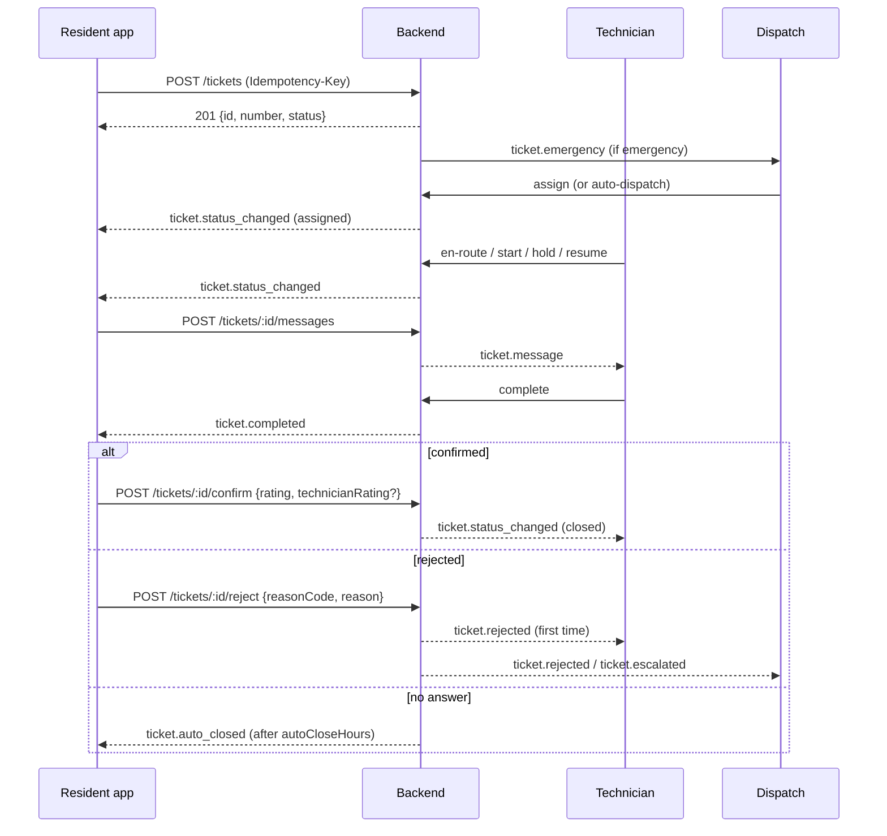
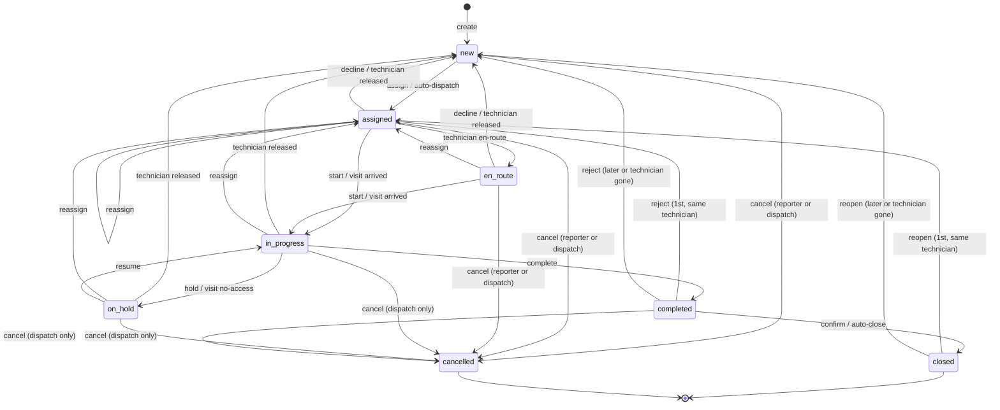

# بلاغات الصيانة للساكن — Resident Maintenance Tickets

> **التطبيق/الواجهة:** resident app + family member (نفس الشاشات، الصلاحية تفرق)
> **الصلاحيات:** `tickets.create` (عند الأدوار `resident` و `family_member`) + الـcapability `tickets` على الوحدة من `GET /me/units/:unitId/capabilities` (لازم تكون `true` عشان أي كتابة).
> **المصادر:** ADR 0032 · ADR 0034 · ADR 0038 · `src/maintenance/tickets/` · `src/maintenance/sla/sla-overdue.ts` · `src/maintenance/categories/`

## الفكرة باختصار
الساكن يفتح بلاغ صيانة لحاجة بايظة في وحدته أو في مكان عام في الكمبوند، ويتابعه لحد ما يتصلّح.
البلاغ بياخد رقم زي `MT-000123`، ويمشي في حالات (جديد ← اتسند لفني ← الفني في الطريق ← شغال ← خلص).
لما الفني يقول "خلصت"، الساكن يأكد ويقيّم (الخدمة + الفني)، أو يرفض الشغل فيرجع البلاغ تاني.
لو المجمع مفعّل الـSLA، الساكن بيشوف المواعيد المتوقعة، وعلامة "متأخر"، وزرار "طلب تصعيد".
التواصل مع الفني بيتم جوه البلاغ (thread رسائل) مش بالتليفون.

## الأدوار ومين بيعمل إيه

| الدور | يشوف | يعمل |
|---|---|---|
| صاحب البلاغ (`reporter`) أو اللي فتحه (`createdBy`) — وعنده `tickets` على الوحدة دلوقتي | البلاغ كامل | كل حاجة: صور، رسائل، إلغاء، تأكيد/رفض، إعادة فتح، تصعيد |
| الساكن الأساسي للوحدة (primary) ومش هو صاحب البلاغ | كل بلاغات الوحدة | رسائل + تصعيد بس. الإلغاء والتأكيد والرفض وإعادة الفتح وإضافة الصور = `403 TICKET_ACTION_NOT_ALLOWED` |
| فرد أسرة بالغ عنده صلاحية `tickets` | البلاغات اللي هو فتحها بس (مش بلاغات باقي الأسرة) | زي صاحب البلاغ على بلاغاته |
| فرد أسرة بالغ من غير صلاحية `tickets` | ولا بلاغ | ما يقدرش يفتح بلاغ (`403 TICKETS_NOT_ALLOWED`). لكنه يوصل لمواعيد الزيارات (راجع `02-visits-scheduling.md`) |
| المالك اللي مش ساكن (landlord) | لو هو الـprimary بيشوف بلاغات الوحدة | ولا أي كتابة (`tickets` عنده `false`) |
| حد ساب الوحدة / اتسحبت منه `tickets` | البلاغ نفسه وحالته | ولا أي كتابة. الرسائل والصور يشوفها **لحد لحظة ما ساب** بس، ومش بيوصله أي إشعار |
| الإدارة (dispatch) | — | ممكن تفتح بلاغ باسم الساكن (`onBehalf: true`). راجع `04-dispatch-dashboard.md` |

ملاحظة: صاحب البلاغ = اللي المشكلة بتاعته. لو الإدارة فتحت البلاغ باسمه، هو الـreporter والإدارة هي الـcreator، والساكن بيشوف `onBehalf: true` من غير ما يعرف مين.

## الشاشات اللي الفيتشر محتاجها
- **قائمة بلاغاتي:** كل البلاغات اللي أشوفها، الأحدث أولاً، بفلتر حالة ووحدة، وعليها شارة "متأخر" وزرار "طلب تصعيد".
- **بلاغ جديد (فورم):** وحدة أو مكان عام، الفئة، الغرفة، الأولوية، الوصف، صور.
- **تفاصيل البلاغ:** الحالة، الفني (الاسم الأول)، الصور، الـSLA، الأزرار حسب الحالة، رابط للرسائل والزيارات.
- **الرسائل (chat thread)** للبلاغ.
- **إضافة صورة** (bottom sheet) للبلاغ المفتوح.
- **ديالوج إلغاء البلاغ** مع اختيار سبب.
- **شاشة "تم الإصلاح؟"**: تأكيد مع تقييمين (الخدمة + الفني) وتعليق اختياري، أو رفض.
- **ديالوج الرفض** مع سبب + ملاحظة مكتوبة.
- **ديالوج إعادة الفتح** (للبلاغ المقفول خلال المهلة) مع سبب + ملاحظة.
- **تأكيد التصعيد** (ديالوج بسيط بدون حقول).
- **الزيارات** للبلاغ: شاشة منفصلة، راجع `02-visits-scheduling.md`.

## الفلو خطوة بخطوة

### 1) تحميل الفئات
1. التطبيق يطلب `GET /ticket-categories`.
2. بيرجع الفئات المفعّلة بس، مرتبة بالـ`key`. كل فئة: `id`, `key`, `nameAr`, `nameEn`, `defaultPriority`, `commonAreaAllowed`.
3. الفئات الافتراضية في أي كمبوند جديد: `plumbing` (سباكة)، `electrical` (كهرباء)، `ac` (تكييف)، `carpentry` (نجارة)، `general` (أعمال عامة) — كلها `normal` وكلها مسموحة للأماكن العامة. المدير يقدر يغيّرها (راجع `06-maintenance-setup.md`).
4. لو اختار "مكان عام"، اعرض بس الفئات اللي `commonAreaAllowed: true`.

### 2) فتح بلاغ جديد — `POST /tickets`
1. قبل الفورم: اتأكد إن `tickets: true` على الوحدة من `GET /me/units/:unitId/capabilities`. لو `false` اخفي زرار "بلاغ جديد".
2. الساكن يختار **المكان**، واحد من الاتنين بس:
   - `unitId`: وحدته. لازم يكون عنده `tickets` عليها.
   - `commonArea`: نص قصير (1–120 حرف) زي "الممر الدور التالت" أو "حمام السباحة". يكفي يكون عنده `tickets` على أي وحدة.
   - الاتنين مع بعض = `400` (`FIELD_NOT_ALLOWED` على `commonArea`). ولا واحد = `400` (`FIELD_REQUIRED` على `unitId`).
3. **الغرفة** `unitLocation` (اختياري، للوحدة بس): `kitchen`, `bathroom`, `living_room`, `bedroom`, `balcony`, `other`. مع مكان عام = `400 FIELD_NOT_ALLOWED`. مفيش endpoint يغيّرها بعد كده؛ لو غلط يتقال في رسالة.
4. **الفئة** `categoryId` (إجباري). فئة مش مفعّلة أو مش موجودة = `404 TICKET_CATEGORY_NOT_FOUND`. فئة مش مسموحة للمكان العام = `400 CATEGORY_NOT_FOR_COMMON_AREA`.
5. **الأولوية** `priority` (اختياري): `normal` / `urgent` / `emergency`. لو ما اختارش، بتاخد `defaultPriority` بتاع الفئة. اقترح تعرض الافتراضي محدد مسبقاً.
   - `emergency` بيبعت إشعار **critical** فوراً لكل الـdispatchers. الأفضل الديزاين يعرض تحذير/تأكيد قبل اختيار "طارئ".
6. **الوصف** `description` (إجباري، 1–2000 حرف، المسافات بس = مرفوض).
7. **الصور** `photoFileIds` (اختياري): ارفع كل صورة الأول بفلو الملفات (راجع README) بالـpurpose `ticket_photo` (JPEG/PNG/WebP، أقصى 5MB)، وبعدين ابعت الـids هنا.
   - أقصى عدد = `maxReportPhotos` بتاع المجمع (افتراضي 5). أكتر = `409 TICKET_PHOTO_LIMIT_REACHED` (`params.max`). والـDTO نفسه يرفض أكتر من 10 (`400`).
   - صورة مش بتاعته أو مش finalized = `400` (`FILE_NOT_AVAILABLE` على `photoFileIds.N`).
8. ابعت هيدر `Idempotency-Key` (راجع README): لو الشبكة وقعت وعِدت الطلب بنفس المفتاح، مش هيتفتح بلاغ مكرر.
9. الرد `201`: `{ id, number, status, priority, createdAt }` (من غير الوصف).
10. بعد الإنشاء:
    - لو التوزيع الأوتوماتيك شغال، ممكن البلاغ يتسند لفني فوراً، فالـ`status` في الرد ممكن يبقى `assigned` مش `new`.
    - لو لأ، بيفضل `new` في الطابور لحد ما الإدارة تسنده.
11. الشاشة التالية: تفاصيل البلاغ (`GET /tickets/:id`).

**مفيش حد أقصى لعدد البلاغات المفتوحة لكل وحدة** في الكود.

### 3) قائمة بلاغاتي — `GET /tickets`
1. فلاتر اختيارية: `status` (قيمة واحدة)، `unitId`. Cursor paging (راجع README). الترتيب: الأحدث إنشاءً أولاً.
2. القائمة فيها: البلاغات اللي فتحتها، اللي أنا صاحبها، وكل بلاغات الوحدات اللي أنا الـprimary بتاعها دلوقتي.
3. كل صف فيه `sla` و `escalatedAt` و `canEscalate`، فتقدر تعرض شارة "متأخر" وزرار التصعيد من القائمة على طول.
4. القائمة مافيهاش صور ولا وصف.
5. (فيه كمان قائمة "كل طلباتي" اللي بتدمج البلاغات مع طلبات الإدارة `GET /me/requests`، مرتبة بآخر نشاط — دي في ملف طلبات الإدارة.)

### 4) تفاصيل البلاغ — `GET /tickets/:id`
1. الرد no-store لأن فيه روابط صور مؤقتة (presigned).
2. بلاغ مش موجود أو مش من حقي أشوفه = `404 TICKET_NOT_FOUND` (نفس الرد في كل الحالات).
3. الأزرار تتحدد بالحالة (شوف جدول "القواعد"):
   - `new` / `assigned` / `en_route`: "إلغاء البلاغ".
   - `new` → `on_hold`: "إضافة صورة".
   - `completed`: "تأكيد الإصلاح" و "الشغل ما خلصش" + عداد `autoCloseAt`.
   - `closed`: "إعادة فتح" لحد `reopenUntil`.
   - أي حالة غير `closed`/`cancelled`: "الرسائل" مفتوحة للكتابة.
   - `canEscalate: true`: "طلب تصعيد".
4. لو `kind: 'preventive'` (فحص دوري): الوصف ممكن يبقى `''` — اعرض اسم الخدمة `preventiveService.nameAr` بداله (راجع `03-preventive-maintenance.md`).

### 5) الرسائل — `GET` / `POST /tickets/:id/messages`
1. القراءة: `GET /tickets/:id/messages`، الأقدم أولاً (زي الشات)، cursor paging. أي حد بيشوف البلاغ يقرا، حتى لو مش معاه `tickets` (بس اللي ساب الوحدة يشوف الرسائل لحد لحظة خروجه).
2. الرسائل الداخلية بين الفني والإدارة (`internal`) **عمرها ما بتظهر** للساكن.
3. الكتابة: `POST /tickets/:id/messages` بـ `{ body }` (1–2000 حرف بعد الـtrim). مسموح في أي حالة غير `closed` و `cancelled`.
   - يكتب: صاحب البلاغ، اللي فتحه، الـprimary — بشرط `tickets` على الوحدة دلوقتي.
   - إرسال `internal` من الساكن = `400 FIELD_NOT_ALLOWED`.
   - ابعت `Idempotency-Key`. الرد `201 { id, createdAt }`، وبعدين أعد قراءة الـthread.
4. ملاحظة الرفض/إعادة الفتح بتظهر هنا كرسالة من الساكن نفسه (مش حقل في البلاغ).
5. كل اللي يقدر يقرا الرسالة بيوصله إشعار `ticket.message` (من غير نص الرسالة).

### 6) إضافة صورة — `POST /tickets/:id/photos`
1. ارفع الصورة بفلو الملفات (`ticket_photo`) وابعت `{ fileId }`.
2. مسموح لصاحب البلاغ أو اللي فتحه بس، وهو عنده `tickets`، والبلاغ في `new`, `assigned`, `en_route`, `in_progress`, `on_hold`.
3. العدد الكلي لصور البلاغ (من الساكن) ≤ `maxReportPhotos`، وإلا `409 TICKET_PHOTO_LIMIT_REACHED`. اعرض "باقي لك X صور".
4. الرد `201 { id, kind: 'report', cycle, createdAt }`. الصور **ما بتتمسحش** أبداً.

### 7) إلغاء البلاغ — `POST /tickets/:id/cancel`
1. يظهر بس لصاحب البلاغ/اللي فتحه، والحالة `new` أو `assigned` أو `en_route` (قبل ما الشغل يبدأ).
2. ديالوج اختيار سبب `reasonCode` (إجباري، من غير نص): `duplicate`, `resolved_without_visit`, `reporter_request`, `invalid`, `other`.
3. الرد `204`. البلاغ يبقى `cancelled`. الفني (لو فيه) يتبلّغ. أي زيارة نشطة بتتلغي تلقائياً.
4. السبب بيتراجع **قبل** البلاغ: سبب ناقص/غلط = `400` مهما كان البلاغ.

### 8) الفني خلص: تأكيد أو رفض
لما الفني يعمل "complete"، البلاغ يبقى `completed` و `confirmationStatus: 'pending'`، وصاحب البلاغ يوصله `ticket.completed` ("يرجى التأكيد").

**أ) التأكيد — `POST /tickets/:id/confirm`**
1. الحقول:
   - `rating` (إجباري، رقم صحيح 1–5): تقييم **الخدمة**.
   - `technicianRating` (اختياري، 1–5): تقييم **الفني** اللي عمل الشغل ("الفني — أحمد"). اسم الفني من `technician.firstName`.
   - `comment` (اختياري، 1–1000): للإدارة.
2. الرد `204`. البلاغ يبقى `closed` و `confirmationStatus: 'confirmed'`.
3. التقييمات والتعليق بتروح للإدارة بس. **الفني ما بيشوفش** أي تقييم ولا تعليق.

**ب) الرفض — `POST /tickets/:id/reject`**
1. الحقول (الاتنين إجباري): `reasonCode` من `not_fixed`, `poor_quality`, `damage_caused`, `incomplete`, `other` + `reason` (نص، أقصى 1000).
2. الرد `204`. الملاحظة بتتحط كرسالة من الساكن في الـthread.
3. **أول مرة** (مفيش رفض/إعادة فتح قبل كده): البلاغ يرجع `assigned` لنفس الفني لو لسه متاح.
4. **غير كده** (الفني مش متاح، أو دي تاني مرة أو أكتر): يرجع `new` في الطابور. من تاني مرة بيتبعت للإدارة كـ"تصعيد" (`ticket.escalated`).
5. `cycle` و `rejectionCount` بيزيدوا 1.

**ج) القفل التلقائي**
- لو محدش أكد ولا رفض خلال `autoCloseHours` (افتراضي 72 ساعة) من `completedAt`، sweep في الخلفية بيقفل البلاغ: `closed` و `confirmationStatus: 'auto_closed'`، وصاحب البلاغ يوصله `ticket.auto_closed`.
- اعرض العداد من `autoCloseAt`.
- لحد ما الـsweep يشتغل فعلاً، التأكيد أو الرفض المتأخر لسه مقبول. بعد القفل = `409 TICKET_INVALID_TRANSITION`.

### 9) إعادة فتح بلاغ مقفول — `POST /tickets/:id/reopen`
1. يظهر لصاحب البلاغ/اللي فتحه لما الحالة `closed`، ولحد `reopenUntil` (= `closedAt` + `reopenDays`، افتراضي 7 أيام).
2. الحقول (الاتنين إجباري): `reasonCode` من `problem_returned`, `not_fixed`, `other` + `reason` (نص ≤1000).
3. بعد المهلة = `409 TICKET_REOPEN_WINDOW_PASSED` (`params.reopenDays`) → اعرض "افتح بلاغ جديد".
4. نفس مسار الرفض بالظبط (يرجع للفني أول مرة، وبعد كده للطابور كتصعيد). إعادة الفتح بتبدأ دورة SLA جديدة، فممكن يتصعّد تاني.
5. مفيش حد أقصى لعدد مرات إعادة الفتح؛ الفرق إن من تاني مرة بيروح للإدارة كتصعيد.

### 10) طلب تصعيد بلاغ متأخر — `POST /tickets/:id/escalate`
1. اعرض الزرار **بس** لو `canEscalate: true`. ما تحسبش القواعد في التطبيق (فيه شرط ما يتعرفش غير من السيرفر).
2. بدون body. ابعت `Idempotency-Key`.
3. السيرفر يتحقق بالترتيب:
   1. إن المستخدم يشوف البلاغ وعنده `tickets` دلوقتي (أي حد بيشوفه، مش لازم صاحبه) — وإلا `403 TICKETS_NOT_ALLOWED`.
   2. البلاغ مفتوح: `new`, `assigned`, `en_route`, `in_progress`, أو `on_hold` بشرط السبب **مش** `awaiting_resident` — وإلا `409 TICKET_INVALID_TRANSITION`.
   3. فيه التزام متأخر (`sla.overdue`) — وإلا `409 TICKET_NOT_OVERDUE` (ودي كمان لو الـSLA مقفول أو البلاغ دوري).
   4. ما اتصعّدش قبل كده في دورة الـSLA دي — وإلا `409 TICKET_ALREADY_ESCALATED`.
4. الرد `204`. الإدارة والمدير يوصلهم إشعار. **ولا حاجة تانية بتتغير** (لا الأولوية ولا الفني ولا الحالة).
5. بعد النجاح: أعد القراءة → `escalatedAt` بقى فيه وقت و `canEscalate: false`. اعرض "تم طلب التصعيد في …".
6. لو عِدت الطلب من غير مفتاح وجالك `TICKET_ALREADY_ESCALATED` = المحاولة الأولى نجحت.

## الحالات (Statuses)

### حالة البلاغ `status`

| القيمة | المعنى للساكن | مين بيدخّله / بيطلّعه |
|---|---|---|
| `new` | اتبعت، مستني يتسند لفني | الإنشاء؛ أو رجوع بعد رفض/إعادة فتح/اعتذار الفني/الفني بقى مش متاح. يطلع بالإسناد أو الإلغاء |
| `assigned` | اتسند لفني | الإدارة أو التوزيع الأوتوماتيك؛ أو رفض أول مرة يرجّعه لنفس الفني |
| `en_route` | الفني في الطريق (اختياري، مش كل تطبيق فني بيبعته) | الفني من `assigned` |
| `in_progress` | الشغل شغال | الفني "start"، أو وصول الفني لزيارة، أو "resume" |
| `on_hold` | متوقف مؤقتاً، ومعاه `holdReason` | الفني "hold"، أو زيارة "nobody let me in" (`awaiting_resident`) |
| `completed` | الفني قال خلص، مستني تأكيدك | الفني "complete" |
| `closed` | مقفول | تأكيد الساكن، أو القفل التلقائي |
| `cancelled` | ملغي | الساكن (قبل بدء الشغل) أو الإدارة (أي وقت قبل القفل) |

أسباب التوقف `holdReason`: `awaiting_resident` (مستني رد/موعد منك)، `awaiting_parts` (مستني قطع غيار)، `other`.

حالة التأكيد `confirmationStatus`: `null` قبل أول إنجاز · `pending` وهو `completed` · `confirmed` أو `auto_closed` وهو `closed` · `rejected` بعد رفض أو إعادة فتح لحد الإنجاز اللي بعده.

ملاحظة للـprogress bar ("اتبعت · اتسند · في الطريق · شغال · خلص"): خطوة `en_route` ممكن ما تحصلش أصلاً (الفني يبدأ على طول من `assigned`).

## البيانات اللي بتظهر

### صف في القائمة (`ResidentTicketView`)
| الحقل | المعنى |
|---|---|
| `id`, `number` | الرقم للعرض `MT-000123` |
| `unitId`, `unitCode` | الوحدة؛ `null` لو مكان عام |
| `commonArea` | اسم المكان العام (نص حر)؛ `null` لو وحدة |
| `unitLocation` | الغرفة أو `null` |
| `category` | `{ id, key, nameAr, nameEn }` |
| `kind` | `repair` (إصلاح) أو `preventive` (فحص دوري) |
| `preventiveService`, `requestedStartsAt`, `requestedEndsAt` | للبلاغ الدوري بس؛ `null` للإصلاح |
| `priority` | `normal` / `urgent` / `emergency` |
| `status`, `holdReason`, `confirmationStatus` | شوف "الحالات" |
| `reportedByMe` | أنا صاحب البلاغ؟ (مفيد لإخفاء أزرار الإلغاء/التأكيد عن الـprimary) |
| `sla` | `null` لو المجمع مش مفعّل الـSLA أو البلاغ دوري. غير كده: `responseDueAt` (موعد أول رد، طول ما الساعة شغالة)، `resolutionDueAt` (موعد الحل)، `paused` (الساعة متوقفة: مستنيك، أو قطع غيار، أو تأكيدك)، `overdue` (متأخر فعلاً) |
| `escalatedAt` | وقت تصعيد الدورة الحالية أو `null` |
| `canEscalate` | أعرض زرار التصعيد؟ |
| `createdAt`, `updatedAt` | |

### التفاصيل (`ResidentTicketDetailView`) = كل اللي فوق +
| الحقل | المعنى |
|---|---|
| `description` | الوصف؛ `''` لفحص دوري من غير ملاحظة |
| `cycle` | رقم الدورة (بيزيد مع كل رفض/إعادة فتح) |
| `reporter` | صاحب البلاغ **بالاسم الأول بس** `{ id, firstName }` (أو `{ id, erased: true }`) |
| `onBehalf` | الإدارة فتحته باسمه — من غير ما نقول مين |
| `technician` | الفني **بالاسم الأول بس** أو `null` |
| `photos[]` | `{ id, kind, cycle, url, expiresAt }` — `kind`: `report` (صور الساكن)، `before` / `after` (صور الفني). الـ`url` مؤقت لحد `expiresAt`؛ بعدها أعد قراءة البلاغ |
| `completedAt`, `closedAt` | |
| `autoCloseAt` | وهو `completed`: إمتى يتقفل لوحده |
| `reopenUntil` | وهو `closed`: آخر وقت لإعادة الفتح |

### الرسالة (`ResidentMessageView`)
`{ id, sender: { id, firstName } , senderKind: 'resident'|'staff'|'manager', body, deleted, createdAt }`.
- مفيش حقل `mine`؛ قارن `sender.id` بالـid بتاعك عشان تعرض الفقاعة يمين/شمال.
- `body: null` و `deleted: true` = صاحبها اتمسح حسابه (erasure).

### المخفي / اللي عمره ما بيظهر للساكن
- رقم تليفون أو إيميل أي حد. (`reporterPhone` بيظهر **للفني بس**، وبشرط إن الساكن موافق على الـconsent `ticket_phone_share` من `POST /me/consents/grant`، والبلاغ في إيد الفني (`assigned`/`en_route`/`in_progress`/`on_hold`)، والساكن لسه عنده `tickets` على الوحدة. الإدارة كمان ما بتشوفهوش.)
- الرسائل الداخلية `internal`.
- التقييمات والتعليقات بعد ما تتبعت (مفيش endpoint يرجعها للساكن).
- سجل الحالات بالأوقات (`/history`) — للإدارة بس.
- مين في الإدارة فتح البلاغ باسمه.

## القواعد والقيود

| القاعدة | التفاصيل |
|---|---|
| المكان | وحدة **أو** مكان عام، مش الاتنين. المكان العام 1–120 حرف |
| الوصف | 1–2000 حرف (إجباري للإصلاح) |
| الرسالة | 1–2000 حرف |
| تعليق التأكيد | 1–1000 حرف |
| نص سبب الرفض/إعادة الفتح | إجباري، ≤1000 حرف |
| صور الساكن | ≤ `maxReportPhotos` (افتراضي 5) للبلاغ كله، JPEG/PNG/WebP ≤5MB |
| صور الفني | 10 لكل دورة (before + after) — للعلم بس |
| القفل التلقائي | `autoCloseHours` افتراضي 72 ساعة |
| مهلة إعادة الفتح | `reopenDays` افتراضي 7 أيام من `closedAt` |
| حد البلاغات المفتوحة للوحدة | **مفيش** |
| التصعيد | مرة واحدة لكل دورة SLA؛ إعادة الفتح بتبدأ دورة جديدة. الرفض **ما بيبدأش** دورة SLA جديدة |
| Idempotency | `POST /tickets`، `POST /tickets/:id/messages`، `POST /tickets/:id/escalate` (المفتاح صالح 24 ساعة؛ نفس المفتاح بطلب مختلف = `409 IDEMPOTENCY_CONFLICT`) |

**مين يعمل إيه في أي حالة (للساكن):**

| الأكشن | الحالات المسموحة | مين |
|---|---|---|
| إلغاء | `new`, `assigned`, `en_route` | صاحب البلاغ / اللي فتحه |
| إضافة صورة | `new`, `assigned`, `en_route`, `in_progress`, `on_hold` | صاحب البلاغ / اللي فتحه |
| رسالة | كل الحالات ما عدا `closed`, `cancelled` | أي حد بيشوف البلاغ ومعاه `tickets` |
| تأكيد / رفض | `completed` | صاحب البلاغ / اللي فتحه |
| إعادة فتح | `closed` خلال المهلة | صاحب البلاغ / اللي فتحه |
| تصعيد | `canEscalate: true` | أي حد بيشوف البلاغ ومعاه `tickets` |

كل كتابة محتاجة `tickets` على وحدة البلاغ **دلوقتي** (أو على أي وحدة لو مكان عام). القراءة لأ.

**أسباب (`reasonCode`):**
- `ticketCancel`: `duplicate`, `resolved_without_visit`, `reporter_request`, `invalid`, `other`
- `ticketReject`: `not_fixed`, `poor_quality`, `damage_caused`, `incomplete`, `other`
- `ticketReopen`: `problem_returned`, `not_fixed`, `other`

**"متأخر" (`sla.overdue`)** = التزام في دورة الـSLA الحالية فات ميعاده ولسه ما اتنفذش:
- الرد (response): لحد ما الفني يبقى `en_route` أو `in_progress` أو يقترح زيارة.
- الحل (resolution): لحد ما الفني يقول "خلصت".
- الساعة المتوقفة (`paused`) عمرها ما بتبقى متأخرة. البلاغ `completed`/`closed`/`cancelled` عمره ما بيبقى متأخر.
- اعرض "متأخر" من `sla.overdue` بس، ما تحسبهاش من المواعيد.

**الـSLA:** مقفول افتراضياً في كل مجمع (`sla: null`). بيتوقف (`paused`) في `on_hold` بسبب `awaiting_resident` أو `awaiting_parts`، وفي `completed`. الأهداف الافتراضية (لكل فئة × أولوية، المدير يغيّرها — راجع `06-maintenance-setup.md`): طارئ: رد 60 دقيقة / حل 24 ساعة؛ عاجل: 4 ساعات / 72 ساعة؛ عادي: 24 ساعة / 7 أيام. الساعة 24/7.

## الأخطاء اللي الـUI لازم يتعامل معاها

| HTTP + الكود | إمتى | رسالة/سلوك مقترح |
|---|---|---|
| `400 VALIDATION_FAILED` + `FIELD_REQUIRED` على `unitId` | ما اختارش وحدة ولا مكان عام | "اختر الوحدة أو المكان" |
| `400 VALIDATION_FAILED` + `FIELD_NOT_ALLOWED` | وحدة + مكان عام، أو `unitLocation` مع مكان عام، أو حقل زيادة | امنعها في الفورم |
| `400 VALIDATION_FAILED` + `INVALID_LENGTH` | وصف/مكان/رسالة/تعليق فاضي أو طويل (`params.min/max`) | عداد حروف |
| `400 VALIDATION_FAILED` + `CATEGORY_NOT_FOR_COMMON_AREA` | فئة مش للأماكن العامة | فلتر الفئات |
| `400 VALIDATION_FAILED` + `FILE_NOT_AVAILABLE` | صورة مش مرفوعة صح أو مش بتاعته | "الصورة لم تُرفع، أعد المحاولة" |
| `400 REASON_REQUIRED` | سبب ناقص (كود أو نص) | علّم الحقل |
| `400 VALIDATION_FAILED` + `INVALID_REASON_CODE` (`params.allowed`) | كود سبب مش في القائمة | — |
| `403 TICKETS_NOT_ALLOWED` | مالوش `tickets` على الوحدة (أو ساب) | "ليس لديك صلاحية البلاغات لهذه الوحدة" واخفي الأزرار |
| `403 TICKET_ACTION_NOT_ALLOWED` | الـprimary بيحاول يلغي/يأكد/يرفض/يعيد فتح/يضيف صورة لبلاغ مش بتاعه | "هذا الإجراء لصاحب البلاغ فقط" |
| `404 TICKET_NOT_FOUND` | البلاغ مش موجود أو مش من حقه | ارجع للقائمة |
| `404 TICKET_CATEGORY_NOT_FOUND` | الفئة اتلغت | أعد تحميل الفئات |
| `404 UNIT_NOT_FOUND` | وحدة مالوش علاقة بيها | — |
| `409 TICKET_INVALID_TRANSITION` (`params.status`) | الأكشن مش مسموح في الحالة الحالية (مثلاً أكد بعد القفل التلقائي) | "تغيّرت حالة البلاغ" + أعد القراءة |
| `409 TICKET_PHOTO_LIMIT_REACHED` (`params.max`) | وصل الحد الأقصى للصور | "الحد الأقصى X صور" |
| `409 TICKET_REOPEN_WINDOW_PASSED` (`params.reopenDays`) | فاتت مهلة إعادة الفتح | "انتهت مهلة إعادة الفتح، افتح بلاغاً جديداً" + زرار بلاغ جديد |
| `409 TICKET_NOT_OVERDUE` | تصعيد لبلاغ مش متأخر | أعد القراءة (الزرار المفروض يختفي) |
| `409 TICKET_ALREADY_ESCALATED` | اتصعّد قبل كده في الدورة دي | "تم طلب التصعيد مسبقاً" |
| `409 IDEMPOTENCY_CONFLICT` | نفس المفتاح لطلب مختلف | ولّد مفتاح جديد |

## الإشعارات

كل الأنواع دي `priority: normal` و **مش critical** بالنسبة للساكن؛ البوش بيتبعت حسب تفضيلات المستخدم في فئة `maintenance`. الـ`targetId` = id البلاغ، فالضغط يفتح تفاصيل البلاغ. المعاملات: رقم البلاغ وكود الوحدة (مش للمكان العام) وأكواد بس — **عمرها ما بتحمل نص**.

| الحدث | `kind` | مين يستلم | يفتح |
|---|---|---|---|
| البلاغ اتسند لفني (يدوي/أوتوماتيك/إعادة إسناد) | `ticket.status_changed` (`status: assigned`) | صاحب البلاغ | تفاصيل البلاغ |
| الفني في الطريق / بدأ / وقف (`holdReason`) / كمّل | `ticket.status_changed` (`status`, `holdReason?`) | صاحب البلاغ | تفاصيل البلاغ |
| الإدارة لغت البلاغ | `ticket.status_changed` (`status: cancelled`) | صاحب البلاغ + الفني (مش اللي لغى) | تفاصيل البلاغ |
| الفني خلص | `ticket.completed` | صاحب البلاغ | شاشة التأكيد/الرفض |
| اتقفل تلقائياً | `ticket.auto_closed` | صاحب البلاغ | تفاصيل البلاغ (زرار إعادة فتح) |
| رسالة جديدة | `ticket.message` | صاحب البلاغ، اللي فتحه، الـprimary، الفني، كل الـdispatchers (ما عدا الكاتب) | الرسائل |
| الإدارة فتحت بلاغ باسمه | `ticket.opened_on_behalf` | صاحب البلاغ | تفاصيل البلاغ |
| إشعارات الزيارات | `ticket.visit_*` | راجع `02-visits-scheduling.md` | |

إشعارات للإدارة/الفني بسبب أفعال الساكن (للعلم): `ticket.emergency` (critical، عند فتح بلاغ طارئ)، `ticket.rejected` / `ticket.reopened` / `ticket.escalated`، `ticket.resident_escalated` و `ticket.resident_escalated_emergency` (critical) عند التصعيد، `ticket.status_changed (closed)` للفني عند التأكيد.

قواعد مهمة:
- صاحب البلاغ اللي ساب الوحدة أو اتسحبت منه `tickets` **ما بيوصلوش** أي إشعار `ticket.*`.
- الـprimary اللي مش صاحب البلاغ بيوصله `ticket.message` بس، **مش** تغييرات الحالة.
- الإلغاء من صاحب البلاغ نفسه ما بيبعتلوش إشعار (هو اللي عمله).

## الـEndpoints

| Method + Path | مين | الغرض | الرد |
|---|---|---|---|
| `GET /ticket-categories` | `tickets.create` | الفئات المفعّلة | `200 {data:[CategoryOption], nextCursor:null}` |
| `POST /tickets` | `tickets.create` + `tickets` | فتح بلاغ (Idempotency) | `201 {id, number, status, priority, createdAt}` |
| `GET /tickets?status=&unitId=&cursor=&limit=` | `tickets.create` | قائمة بلاغاتي | `200 {data:[ResidentTicketView], nextCursor}` |
| `GET /tickets/:id` | `tickets.create` | التفاصيل (no-store) | `200 ResidentTicketDetailView` |
| `POST /tickets/:id/photos` | صاحب البلاغ | إضافة صورة `{fileId}` | `201 {id, kind, cycle, createdAt}` |
| `POST /tickets/:id/cancel` | صاحب البلاغ | إلغاء `{reasonCode}` | `204` |
| `POST /tickets/:id/confirm` | صاحب البلاغ | تأكيد `{rating, technicianRating?, comment?}` | `204` |
| `POST /tickets/:id/reject` | صاحب البلاغ | رفض `{reasonCode, reason}` | `204` |
| `POST /tickets/:id/reopen` | صاحب البلاغ | إعادة فتح `{reasonCode, reason}` | `204` |
| `POST /tickets/:id/escalate` | أي حد بيشوفه + `tickets` | تصعيد (بدون body، Idempotency) | `204` |
| `GET /tickets/:id/messages` | أي حد بيشوفه | الـthread | `200 {data:[ResidentMessageView], nextCursor}` |
| `POST /tickets/:id/messages` | أي حد بيشوفه + `tickets` | رسالة `{body}` (Idempotency) | `201 {id, createdAt}` |
| `GET /me/units/:unitId/capabilities` | الساكن | هل `tickets` متاحة | `200 Capabilities` |
| `POST /me/consents/grant` | الساكن | موافقة مشاركة التليفون مع الفني (`ticket_phone_share`) | راجع ملف الموافقات |

الزيارات (`/tickets/:id/visits…`, `/tickets/:id/visit-slots`) في `02-visits-scheduling.md`. الفحص الدوري (`/tickets/preventive`, `/preventive-services`, `/preventive-slots`) في `03-preventive-maintenance.md`.

## ملاحظات للديزاين وحاجات ناقصة في الباك
- أكشنز البلاغ بترد `204`؛ التطبيق لازم يعيد قراءة البلاغ بعد كل أكشن (v0-notes).
- **مفيش endpoint لسجل الحالات للساكن.** الـprogress line في الديزاين ("اتبعت · اتسند · في الطريق · شغال · خلص" بوقت لكل خطوة) مش متاح: الساكن عنده `createdAt`, `completedAt`, `closedAt`, `updatedAt` بس. `GET /maintenance/tickets/:id/history` للإدارة بس.
- رقم البلاغ `MT-000123` مش قابل للبحث بعد.
- القائمة مافيهاش صور (thumbnail)؛ الصور في التفاصيل بس.
- الصور ما بتتمسحش أبداً في v0 (حتى لو الساكن رفع صورة غلط).
- **الفني ما بيشوفش متوسط تقييمه** — ADR 0038 بيقول ده المسموح الوحيد، بس مفيش endpoint بيحسبه.
- الـprimary اللي مش صاحب البلاغ بيشوف كل بلاغات الوحدة بس ما بيوصلوش تغييرات الحالة (بس الرسائل). ممكن الديزاين يحتاج قرار هنا.
- مفيش حد أقصى لعدد البلاغات المفتوحة للوحدة، ولا لعدد مرات إعادة الفتح.
- الإدارة ما بتشوفش تليفون الساكن حتى في الطوارئ — قرار ديزاين مفتوح (v0-notes).
- ملاحظة الرفض/إعادة الفتح بتظهر كرسالة في الـthread، مش حقل في البلاغ؛ الديزاين لازم يوضح ده.
- الـ`unitLocation` ما يتغيرش بعد الإنشاء.
- "متأخر" وأوقات الاستحقاق بتظهر بس لو المدير فعّل الـSLA؛ صمّم حالة `sla: null` (من غير عدادات).
- إن الفني اعتذر أو بقى مش متاح والبلاغ رجع `new` — الساكن ما بيوصلوش إشعار بده، بس الحالة بتتغير.
