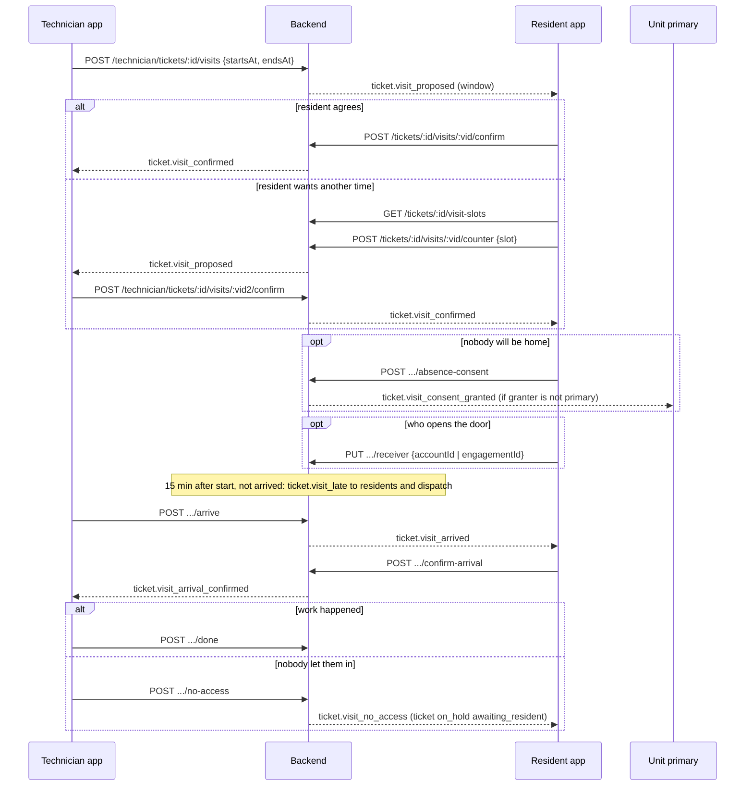
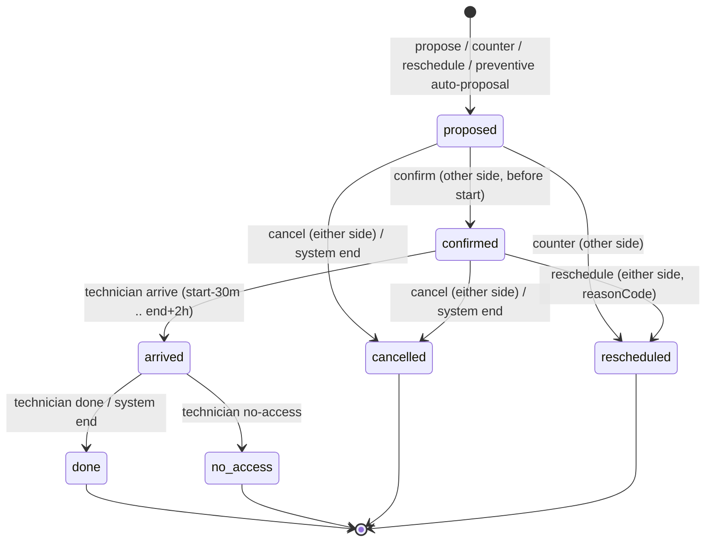

# مواعيد زيارة الفني — Visits Scheduling

> **التطبيق/الواجهة:** resident app + family member (الجزء الأساسي هنا) · technician app · manager dashboard (dispatch) — الثلاث جهات في ملف واحد
> **الصلاحيات:** الساكن: `tickets.create` (أدوار `resident`, `family_member`) + الوصول للزيارات (شرحه تحت) + الـcapability `visitConsent` على الوحدة للموافقة على الدخول. الفني: `tickets.work` (دور `technician`)، وعلى البلاغات المسندة له بس. الإدارة: `tickets.dispatch` (`manager`, `maintenance_supervisor`).
> **المصادر:** ADR 0034 · ADR 0038 · `src/maintenance/visits/` (`visits.controller.ts`, `visits.service.ts`, `visit-rules.ts`, `visit-slots.ts`, `visit-consent.service.ts`, `visit-lifecycle.ts`, `visit-access.ts`, `views/visit.views.ts`)

## الفكرة باختصار
لما بلاغ وحدة يكون في إيد فني، الطرفين بيتفقوا على **موعد زيارة** (نافذة وقت من–إلى، أقصاها 4 ساعات).
الفني (أو الإدارة نيابة عنه) يقترح، والسكان يأكدوا أو يقترحوا وقت تاني. الموعد المؤكد ممكن يتأجل أو يتلغي من أي طرف.
بعد التأكيد، أي بالغ ساكن في الوحدة يقدر يسمح للفني **يدخل والبيت فاضي** (خطوة منفصلة عن التأكيد)، ويحدد **مين هيفتح للفني** (فرد من الأسرة أو عاملة/عامل منزلي).
عند الباب: الفني يعلّم "وصلت"، والسكان يقدروا يأكدوا إنه هو فعلاً. بعدها "خلصت الزيارة" أو "محدش فتح".
الزيارات للوحدات بس، مش للأماكن العامة.

## الأدوار ومين بيعمل إيه

| الدور | يعمل |
|---|---|
| الفني (`tickets.work`) — البلاغ مسند له دلوقتي | يقترح موعد، يأكد/يقترح بديل لاقتراح السكان، يأجل، يلغي، "وصلت"، "خلصت"، "محدش فتح". يشوف زياراته هو بس. تفاصيل شاشاته في `05-technician-app.md` |
| الإدارة (`tickets.dispatch`) | نفس أكشنز الفني نيابة عنه (اقتراح، تأكيد، بديل، تأجيل، إلغاء) — **ما عدا** الوصول/الإنهاء/محدش فتح. تشوف كل الزيارات وسجل الأحداث. راجع `04-dispatch-dashboard.md` |
| أي بالغ ساكن في الوحدة بحساب نشط (`visitConsent`) — ساكن مقيم (مالك أو مستأجر) أو فرد أسرة بالغ نشط | يوصل لزيارات **كل** بلاغات الوحدة (من غير ما يشوف البلاغ نفسه): يأكد، يقترح بديل، يأجل، يلغي، يأكد الوصول، يسمح بالدخول والبيت فاضي ويسحب السماح، يحدد/يشيل اللي هيفتح |
| اللي بيشوف البلاغ (صاحبه/فاتحه/الـprimary) ومعاه `tickets` على الوحدة | نفس أكشنز الطرف السكني، **ما عدا** السماح بالدخول (محتاج `visitConsent`). عملياً تقريباً نفس الناس |
| الساكن الأساسي (primary) | زي أي بالغ ساكن + بيوصله إشعار لما حد تاني يسمح بالدخول والبيت فاضي |
| حد بيشوف البلاغ بس ما بقاش معاه `tickets` ولا ساكن (مثلاً ساب الوحدة) | ولا حاجة: `403 TICKETS_NOT_ALLOWED`. بيشوف البلاغ، عمره ما بيشوف مواعيده |
| landlord، حارس، فني تاني، قاصر | ولا حاجة |

"الطرف السكني" (`resident` side) = كل اللي فوق من السكان. الإدارة بتشتغل على "طرف الفني" (`technician` side).

## الشاشات اللي الفيتشر محتاجها
**تطبيق الساكن**
- **زيارات البلاغ** (من تفاصيل البلاغ): الزيارة النشطة فوق + سجل الزيارات القديمة.
- **كارت اقتراح موعد** من الفني: "تأكيد" / "اقترح وقت تاني".
- **شاشة "تغيير موعد الزيارة"**: أيام + "الأوقات المتاحة" (slots) — تُستخدم للاقتراح البديل وللتأجيل.
- **ديالوج التأجيل** (موعد مؤكد) مع سبب.
- **ديالوج إلغاء الزيارة** مع سبب.
- **خطوة "السماح بالدخول والبيت فاضي"** — شاشة/خطوة منفصلة بعد التأكيد، مع زرار سحب السماح.
- **اختيار مين هيفتح للفني**: فرد من الأسرة أو عامل منزلي.
- **بانر "الفني عند الباب — تأكيد الوصول"**.
- **زيارات وحدتي القادمة** (`/me/units/:unitId/visits`): لكل البالغين الساكنين، حتى اللي ما بيشوفوش البلاغ.

**تطبيق الفني** (تفاصيل في `05-technician-app.md`): اقتراح موعد، الرد على اقتراح السكان، "وصلت" (ويعرض هل مسموح يدخل والبيت فاضي + اسم اللي هيفتح)، "خلصت"، "محدش فتح".

**لوحة الإدارة** (تفاصيل في `04-dispatch-dashboard.md`): زيارات البلاغ بالأسماء الكاملة، الاقتراح نيابة عن الفني، سجل أحداث الزيارة.

## الفلو خطوة بخطوة

### 0) متى تظهر الزيارات أصلاً
1. البلاغ لازم يكون لوحدة (مش مكان عام) — غير كده كل endpoints الزيارات = `409 VISIT_NOT_FOR_COMMON_AREA`.
2. أي كتابة على زيارة محتاجة البلاغ في إيد فني: `assigned`, `en_route`, `in_progress`, `on_hold`. غير كده = `409 TICKET_INVALID_TRANSITION`. (القراءة مسموحة في أي حالة.)
3. **زيارة نشطة واحدة بس** لكل بلاغ في نفس الوقت (نشطة = `proposed`, `confirmed`, `arrived`).

### 1) الفني يقترح موعد
1. الفني: `POST /technician/tickets/:id/visits`، أو الإدارة نيابة عنه: `POST /maintenance/tickets/:id/visits`.
2. Body: `{ startsAt, endsAt }` (ISO date-time). القواعد (بساعة السيرفر/الداتابيز):
   - البداية بعد 15 دقيقة على الأقل من دلوقتي → وإلا `VISIT_TOO_SOON` (`params.minutes: 15`).
   - البداية خلال 30 يوم → وإلا `VISIT_TOO_FAR` (`params.days: 30`).
   - النهاية بعد البداية → وإلا `VISIT_ENDS_BEFORE_START`.
   - المدة ≤ 4 ساعات → وإلا `VISIT_TOO_LONG` (`params.hours: 4`).
   - كلها `400 VALIDATION_FAILED` بـfield errors على `startsAt`/`endsAt`.
   - اقتراح الفني **مش ملزم** بساعات الزيارة بتاعة المجمع.
3. لو فيه زيارة نشطة = `409 VISIT_ALREADY_ACTIVE`.
4. الرد `201 { id, status: 'proposed', startsAt, endsAt }`.
5. اقتراح من طرف الفني = **أول رد** على البلاغ في حساب الـSLA (لو لسه ما اتحسبش).
6. السكان (كل البالغين الساكنين + صاحب البلاغ لو لسه معاه `tickets`) يوصلهم `ticket.visit_proposed`. لو الإدارة اقترحت، الفني كمان يتبلّغ.

### 2) السكان يردّوا على الاقتراح
الساكن يفتح زيارات البلاغ `GET /tickets/:id/visits` → يلاقي زيارة `proposed` و `proposedBySide: 'technician'`.

**أ) تأكيد — `POST /tickets/:id/visits/:visitId/confirm`** (بدون body)
1. لازم الاقتراح من الطرف التاني (طرف واحد ما يأكدش اقتراحه) → وإلا `403 VISIT_SAME_SIDE`.
2. لازم ميعاد البداية لسه ما جاش → وإلا `409 VISIT_WINDOW_PASSED`. في الحالة دي اعرض "اقترح وقت تاني" أو "إلغاء" بدل "تأكيد".
3. الرد `204`. الزيارة `confirmed`. الفني يتبلّغ `ticket.visit_confirmed`.
4. التأكيد **لا يعني** السماح بالدخول والبيت فاضي. اعرض بعده خطوة منفصلة (رقم 4).

**ب) اقتراح وقت تاني — `POST /tickets/:id/visits/:visitId/counter`**
1. الساكن يفتح "تغيير موعد الزيارة" → التطبيق يطلب `GET /tickets/:id/visit-slots?from=YYYY-MM-DD&days=N`:
   - `from` يوم بتوقيت المجمع (افتراضي النهارده)، `days` من 1 لـ14 (افتراضي 7). للصفحة اللي بعدها غيّر `from`.
   - الرد قائمة `{ startsAt, endsAt }` مرتبة، كل slot جوه ساعات الزيارة (افتراضي 08:00–18:00، كل ساعة)، بعد 15 دقيقة على الأقل وخلال 30 يوم، ومش متعارضة مع زيارات الفني النشطة **التانية**.
   - الـslot الناقص ما بيقولش ليه (خصوصية). وده قراءة بس، **مش حجز**.
2. Body: `{ startsAt, endsAt }` (ابعت الـslot زي ما جه). نفس قواعد النافذة فوق.
3. لازم الاقتراح من الطرف التاني → وإلا `403 VISIT_SAME_SIDE`.
4. الرد `201 { id, status: 'proposed', startsAt, endsAt }` لزيارة **جديدة** (`proposedBySide: 'resident'`، و`previousVisitId` = القديمة). القديمة بقت `rescheduled`.
5. الفني يتبلّغ `ticket.visit_proposed`، ويأكد أو يقترح بديل (نفس الفلو معكوس).

### 3) الفني يرد على اقتراح السكان
1. الفني: `POST /technician/tickets/:id/visits/:visitId/confirm` أو `/counter` (أو الإدارة: `/maintenance/tickets/:id/visits/:visitId/confirm|counter`).
2. نفس القواعد: الطرف التاني بس، و`VISIT_WINDOW_PASSED` لو البداية عدّت.
3. لو أكد: السكان يتبلّغوا `ticket.visit_confirmed`.
4. ممكن يتكرر counter ↔ counter لحد ما حد يأكد. مفيش حد أقصى.

### 4) السماح بالدخول والبيت فاضي (خطوة لوحدها)
1. يظهر بس على زيارة `confirmed` (قبل الوصول)، ولأي بالغ ساكن في الوحدة بحساب نشط (`visitConsent: true` في capabilities).
2. السماح: `POST /tickets/:id/visits/:visitId/absence-consent` (بدون body) → `204`.
   - لو كان مسموح أصلاً، بيرجع `204` من غير تغيير.
   - مش ساكن بالغ = `403 VISIT_CONSENT_NOT_ALLOWED`.
   - الزيارة مش `confirmed` = `409 VISIT_INVALID_TRANSITION`.
   - لو اللي سمح مش الـprimary، الـprimary يوصله `ticket.visit_consent_granted` ويقدر يسحب السماح.
3. سحب السماح: `DELETE /tickets/:id/visits/:visitId/absence-consent` → `204`. أي بالغ ساكن، **لحد ما الفني يوصل** (بعد الوصول = `409 VISIT_INVALID_TRANSITION`). لو مش مسموح أصلاً، `204` من غير تغيير.
4. السماح **لزيارة واحدة بس** وعمره ما بيتنقل:
   - لو الزيارة اتأجلت أو اتلغت، السماح بيضيع (لازم يتدّي تاني على الموعد الجديد).
   - لو اللي سمح ساب الوحدة أو اتقفل حسابه، السماح بيتلغي تلقائياً.
5. اعرض في الشاشة مين سمح (`absenceEntry.grantedBy.firstName`، و`mine` لو أنا) وإمتى.
6. السماح يسمح بالدخول بس، مش ضمان: الفني ممكن يعلّم "محدش فتح" حتى مع السماح (مفيش تسليم مفاتيح في النظام).

### 5) مين هيفتح للفني (الـreceiver)
1. على زيارة `confirmed` بس (قبل الوصول).
2. تحديد: `PUT /tickets/:id/visits/:visitId/receiver` بواحد بس من:
   - `{ accountId }`: بالغ ساكن في الوحدة بحساب نشط (kind `household`). مصدر القائمة: أفراد الأسرة من `GET /units/:unitId/household` (اعرض البالغين بحسابات بس). غير مؤهل = `400` (`RECEIVER_NOT_ELIGIBLE` على `accountId`).
   - `{ engagementId }`: عامل منزلي نشط للوحدة (kind `worker`). مصدر القائمة: `GET /units/:unitId/workers`. غير مؤهل (انتهى/موقوف/محظور) = `400` (`RECEIVER_NOT_ELIGIBLE` على `engagementId`).
   - الاتنين مع بعض أو ولا واحد = `400`.
3. الرد `204`. التحديد التاني بيستبدل الأول.
4. شيل: `DELETE /tickets/:id/visits/:visitId/receiver` → `204` (لو مفيش، `204` برضه).
5. الـreceiver بيضيع لو الزيارة اتأجلت/اتلغت، أو الفرد ساب/اتقفل حسابه. العامل بيتشيك وقت كل قراءة: لو مبقاش مؤهل، يظهر `receiver: null`.
6. الفني بيشوف **الاسم الأول ونوعه بس** (`household`/`worker`).

### 6) التأجيل والإلغاء
**تأجيل موعد مؤكد — `POST /tickets/:id/visits/:visitId/reschedule`** (والفني/الإدارة بنفس الشكل)
1. على `confirmed` بس، ومن **أي** طرف.
2. Body: `{ startsAt, endsAt, reasonCode }`. `reasonCode` إجباري من `visitChange`: `schedule_conflict`, `resident_request`, `technician_request`, `parts_unavailable`, `other`. استخدم شاشة الـslots.
3. الرد `201` لزيارة جديدة `proposed` من طرف اللي أجّل. القديمة `rescheduled` بالسبب، والسماح والـreceiver بيضيعوا.
4. الطرف التاني يتبلّغ `ticket.visit_proposed` ولازم يأكد من جديد.

**إلغاء — `POST /tickets/:id/visits/:visitId/cancel`**
1. على `proposed` أو `confirmed`، من أي طرف. Body: `{ reasonCode }` من `visitChange`.
2. الرد `204`. الزيارة `cancelled`، والسماح والـreceiver بيضيعوا.
3. لو الساكن لغى: الفني يتبلّغ. لو الفني لغى: السكان. لو الإدارة: السكان والفني.
4. بعد الإلغاء مفيش زيارة نشطة. **السكان ما يقدروش يقترحوا زيارة جديدة من الصفر** — لازم الفني (أو الإدارة) يقترح.

### 7) عند الباب
1. **الفني "وصلت"** — `POST /technician/tickets/:id/visits/:visitId/arrive`:
   - على `confirmed` بس، وفي الفترة من 30 دقيقة قبل البداية لحد ساعتين بعد النهاية → وإلا `409 VISIT_OUTSIDE_ARRIVAL_WINDOW`.
   - الزيارة `arrived`. لو البلاغ `assigned` أو `en_route` بيبقى `in_progress` تلقائياً (وصاحب البلاغ يوصله `ticket.status_changed`).
   - السكان يوصلهم `ticket.visit_arrived` ("الفني عند الباب").
   - الرد `200` = زيارة الفني، وفيها `absenceEntryApproved` و `receiver` **وقت الوصول** (ده اللي الفني يعتمد عليه).
2. **السكان "تأكيد الوصول"** — `POST /tickets/:id/visits/:visitId/confirm-arrival` (بدون body):
   - اعرض الزرار لما `status: 'arrived'` و `arrivalConfirmedAt: null`.
   - مرة واحدة: التانية = `409 VISIT_ARRIVAL_ALREADY_CONFIRMED`. قبل الوصول أو بعد الإنهاء = `409 VISIT_INVALID_TRANSITION`.
   - `204`. الفني يتبلّغ `ticket.visit_arrival_confirmed`. **ولا حاجة تانية بتتغير** — ده إقرار، مش شرط؛ الفني مش مستنيه.
   - لو "ده مش الفني بتاعنا": مش مدعوم في النظام؛ السكان يكلموا البوابة.
3. **الفني "خلصت الزيارة"** — `POST /technician/tickets/:id/visits/:visitId/done`: من `arrived` → `done`. البلاغ ما بيتغيرش (الفني لسه لازم يعمل "complete" للبلاغ). مفيش إشعار.
4. **الفني "محدش فتح"** — `POST /technician/tickets/:id/visits/:visitId/no-access`: من `arrived` → `no_access`.
   - لو البلاغ `in_progress` بيبقى `on_hold` بسبب `awaiting_resident` (والـSLA بيتوقف). لو كان `on_hold` أصلاً بيفضل زي ما هو.
   - السكان يوصلهم `ticket.visit_no_access` ("اختاروا موعد جديد").
   - بعدها لازم الفني (أو الإدارة) يقترح زيارة جديدة.

### 8) خطوات تلقائية في الخلفية
1. **تأخر الفني:** كل دقيقة، أي زيارة `confirmed` ما اتعلّمش فيها وصول بعد 15 دقيقة من بدايتها → إشعار `ticket.visit_late` **مرة واحدة** للسكان والإدارة. الحالة ما بتتغيرش.
2. **تغيير الفني** (اعتذار، إعادة إسناد، الفني بقى مش متاح): الزيارة النشطة بتتلغي (`cancelled`, side `system`, سبب `technician_changed`)، والسكان يتبلّغوا `ticket.visit_cancelled`.
3. **البلاغ اتلغى / اتقفل:** الزيارة النشطة بتتلغي (`ticket_cancelled` / `ticket_closed`).
4. **الفني عمل "complete" للبلاغ:** زيارة `proposed`/`confirmed` بتتلغي (`ticket_completed`)؛ زيارة `arrived` بتبقى `done`.
5. في كل الحالات اللي فوق: لو الزيارة كانت `arrived` بتبقى `done` بدل ما تتلغي.
6. **اقتراح مر ميعاده ومحدش رد:** ما بيخلصش لوحده. بيفضل الزيارة النشطة لحد ما حد يقترح بديل أو يلغي (التأكيد ممنوع `VISIT_WINDOW_PASSED`).
7. **بلاغ دوري:** لما فني يستلمه، الموعد اللي الساكن طلبه بيتقترح أوتوماتيك على الفني من طرف السكان. راجع `03-preventive-maintenance.md`.

### 9) زيارات وحدتي القادمة — `GET /me/units/:unitId/visits`
1. لأي بالغ ساكن في الوحدة (`visitConsent`) — حتى لو مش شايف البلاغات.
2. بترجع الزيارات **النشطة بس** (`proposed`, `confirmed`, `arrived`) لكل بلاغات الوحدة، مرتبة بالبداية (الأقرب أولاً). مش paged.
3. كل زيارة معاها رقم البلاغ وحالته وفئته — **من غير** وصف البلاغ أو صوره أو رسائله.
4. من هنا الساكن يقدر يعمل كل أكشنز الزيارة على `/tickets/:ticketId/visits/:visitId/...` (الوصول مسموح له).
5. مالوش مكان في الوحدة = `404 UNIT_NOT_FOUND`. مش ساكن بالغ = `403 VISITS_NOT_ALLOWED`.

### 10) سجل أحداث الزيارة (الإدارة بس)
`GET /maintenance/tickets/:id/visit-events`: كل حدث بالترتيب (`kind`, `actorSide`, `actor` بالاسم الكامل أو `null` للنظام، `reasonCode`, `at`). **من غير أوقات النافذة**. الأنواع: `proposed`, `countered`, `confirmed`, `rescheduled`, `cancelled`, `consent_granted`, `consent_revoked`, `consent_voided`, `receiver_set`, `receiver_cleared`, `arrived`, `arrival_confirmed`, `done`, `no_access`, `late_notified`. الساكن ما عندوش السجل ده؛ عنده الأوقات على الزيارة نفسها.

## الحالات (Statuses)

### حالة الزيارة `status`

| القيمة | المعنى | مين بيدخّلها / بيطلّعها |
|---|---|---|
| `proposed` | موعد مقترح مستني الطرف التاني | اقتراح الفني/الإدارة، أو بديل (counter)، أو تأجيل، أو اقتراح تلقائي للبلاغ الدوري. تطلع بتأكيد/بديل/إلغاء |
| `confirmed` | الطرفين اتفقوا | تأكيد من الطرف التاني. تطلع بوصول/تأجيل/إلغاء |
| `arrived` | الفني عند الباب | الفني "وصلت". تطلع بـ"خلصت" أو "محدش فتح" أو تلقائياً `done` |
| `done` | الزيارة حصلت وخلصت | الفني، أو النظام لما البلاغ يخلص/يتلغي/يتقفل/يتغير فنيه وهو `arrived`. نهائية |
| `no_access` | الفني وصل ومحدش فتح | الفني. نهائية |
| `cancelled` | اتلغت | أي طرف (بسبب)، أو النظام (`technician_changed`, `ticket_cancelled`, `ticket_closed`, `ticket_completed`). نهائية |
| `rescheduled` | اتستبدلت بزيارة جديدة | بديل (counter) لاقتراح، أو تأجيل لموعد مؤكد. نهائية؛ الجديدة فيها `previousVisitId` |

`proposedBySide` / `cancelledBySide`: `technician` (الفني أو الإدارة)، `resident` (السكان)، `system`.

### تأثير الزيارة على البلاغ والـSLA

| حدث الزيارة | البلاغ | الـSLA |
|---|---|---|
| اقتراح من طرف الفني/الإدارة | ما يتغيرش | يحسب كـ"رد" (response met) لو أول رد |
| اقتراح من السكان (بديل/تأجيل/تلقائي للدوري) | ما يتغيرش | لا شيء |
| وصول الفني | `assigned`/`en_route` → `in_progress` | `in_progress` كمان "رد" |
| "خلصت الزيارة" | ما يتغيرش | لا شيء |
| "محدش فتح" | `in_progress` → `on_hold` (`awaiting_resident`) | الساعتين يتوقفوا (`paused`) لحد ما الفني يكمّل (resume) أو يتغير الفني |
| تأخر الفني 15 دقيقة | ما يتغيرش | لا شيء (إشعار بس) |

البلاغ وهو `on_hold` بسبب `awaiting_resident` **ما ينفعش يتصعّد** من الساكن. وصول الفني لزيارة جديدة **ما بيرجّعش** البلاغ من `on_hold` لـ`in_progress` لوحده — الفني لازم يعمل resume.

## البيانات اللي بتظهر

### زيارة البلاغ للساكن (`GET /tickets/:id/visits` → `ResidentVisitView`)
القائمة: كل زيارات البلاغ، الأحدث أولاً، مش paged، no-store.

| الحقل | المعنى |
|---|---|
| `id`, `status`, `startsAt`, `endsAt` | الموعد |
| `proposedBySide` | مين اقترح: لو `resident` يبقى الزرار المتاح للسكان "إلغاء" بس (ما ينفعش يأكدوا اقتراحهم) |
| `technician` | الفني بالاسم الأول `{ id, firstName }` |
| `absenceEntry` | `{ approved, grantedBy: { id, firstName, mine } | null, grantedAt }` |
| `receiver` | `{ kind: 'household'|'worker', id, firstName }` أو `null` (`id` = حساب الفرد أو الـengagement بتاع العامل) |
| `arrivalConfirmedAt`, `arrivalConfirmedBy` (`{ id, firstName, mine }`) | تأكيد الوصول |
| `previousVisitId` | الزيارة اللي اتستبدلت بالزيارة دي |
| `confirmedAt`, `arrivedAt`, `finishedAt`, `cancelledAt` | الأوقات |
| `cancelReasonCode`, `cancelledBySide` | سبب وطرف الإلغاء/التأجيل (للـcounter السبب `null`) |

### زيارات وحدتي (`GET /me/units/:unitId/visits` → `UnitVisitView`)
نفس الحقول الأساسية فوق (من غير `previousVisitId` والأوقات التانية)، زائد: `ticketId`, `ticketNumber` (`MT-000123`), `ticketStatus`, `category` (`{ id, key, nameAr, nameEn }`).

### الـslots (`VisitSlotView`)
`{ startsAt, endsAt }` بس.

### زيارة الفني (`TechnicianVisitView`) — للعلم
`id, status, startsAt, endsAt, proposedBySide, absenceEntryApproved, receiver: { kind, firstName } | null, arrivedAt, arrivalConfirmedAt, finishedAt, cancelledAt, cancelReasonCode, cancelledBySide`. **ما بيشوفش** مين سمح بالدخول، ولا id الـreceiver، ولا مين أكد الوصول. بيشوف زياراته هو بس.

### الإدارة (`DispatchVisitView`) — للعلم
كل اللي فوق بالأسماء الكاملة + `cycle`, `proposedBy`, `confirmedBy`, `cancelledBy`, `lateNotifiedAt`. من غير تليفونات.

### الخصوصية
- كل قراءات الزيارات **no-store** (الموعد بيقول البيت هيبقى فاضي إمتى).
- إشعارات الزيارات فيها رقم البلاغ والنافذة بس — **من غير كود الوحدة** (عكس باقي إشعارات البلاغ).
- السماح والـreceiver والموعد عمرهم ما بيتسجلوا في الـaudit ولا في الإشعارات.
- صاحب البلاغ اللي ساب الوحدة ما بيشوفش ولا بيتبلّغ بأي زيارة.

## القواعد والقيود

| القاعدة | القيمة |
|---|---|
| أقل وقت قبل البداية | 15 دقيقة (`VISIT_TOO_SOON`) — بساعة السيرفر؛ موبايل ساعته مش مظبوطة ممكن يشوف الخطأ ده |
| أبعد بداية | 30 يوم (`VISIT_TOO_FAR`) |
| أقصى مدة | 4 ساعات (`VISIT_TOO_LONG`) |
| زيارات نشطة للبلاغ | واحدة (`VISIT_ALREADY_ACTIVE`) |
| فترة تعليم الوصول | من 30 دقيقة قبل البداية لحد ساعتين بعد النهاية |
| تأخر الفني | 15 دقيقة بعد البداية → إشعار مرة واحدة |
| التأكيد | قبل البداية بس (`VISIT_WINDOW_PASSED`)؛ والطرف التاني بس (`VISIT_SAME_SIDE`) |
| الـslots | `days` 1–14 (افتراضي 7)، `from` بصيغة `YYYY-MM-DD` (يوم حقيقي)، داخل ساعات الزيارة |
| ساعات الزيارة | من إعدادات المجمع: `visitHoursStart`/`visitHoursEnd`/`visitSlotMinutes` (افتراضي 08:00–18:00، slot ساعة). راجع `06-maintenance-setup.md`. مفيش أيام إجازة ولا ساعات عمل للفني |
| أسباب التأجيل/الإلغاء (`visitChange`) | `schedule_conflict`, `resident_request`, `technician_request`, `parts_unavailable`, `other` — إجباري |
| أسباب النظام (`visitSystem`) — للعرض بس | `technician_changed`, `ticket_cancelled`, `ticket_closed`, `ticket_completed`, `granter_left` |
| السماح بالدخول | على `confirmed` بس، من بالغ ساكن، يتسحب لحد الوصول، لزيارة واحدة |
| الـreceiver | على `confirmed` بس؛ بالغ ساكن بحساب نشط أو عامل نشط للوحدة |
| ردود الأكشنز | الاقتراح/البديل/التأجيل `201` بالزيارة الجديدة؛ الوصول `200`؛ الباقي `204` — أعد قراءة القائمة |

**الأزرار حسب الحالة (تطبيق الساكن):**

| حالة الزيارة | `proposedBySide` | الأزرار |
|---|---|---|
| `proposed` | `technician` | تأكيد (لو البداية لسه ما جتش)، اقترح وقت تاني، إلغاء |
| `proposed` | `resident` | إلغاء بس (مستنيين الفني) |
| `confirmed` | — | تأجيل، إلغاء، السماح/سحب السماح بالدخول، تحديد/شيل اللي هيفتح |
| `arrived` | — | تأكيد الوصول (لو `arrivalConfirmedAt: null`) |
| `done`, `no_access`, `cancelled`, `rescheduled` | — | عرض بس |

## الأخطاء اللي الـUI لازم يتعامل معاها

| HTTP + الكود | إمتى | رسالة/سلوك مقترح |
|---|---|---|
| `400 VALIDATION_FAILED` + `VISIT_TOO_SOON` / `VISIT_TOO_FAR` / `VISIT_ENDS_BEFORE_START` / `VISIT_TOO_LONG` | نافذة غلط | "اختر موعداً بعد 15 دقيقة على الأقل وخلال 30 يوماً، ومدته 4 ساعات كحد أقصى" + أعد تحميل الـslots |
| `400 VALIDATION_FAILED` + `INVALID_FORMAT` على `from` | يوم غلط في الـslots | — |
| `400 VALIDATION_FAILED` + `RECEIVER_NOT_ELIGIBLE` | الفرد/العامل مش مؤهل يفتح | "هذا الشخص لا يمكنه استقبال الفني" |
| `400 REASON_REQUIRED` / `INVALID_REASON_CODE` | سبب ناقص/غلط في التأجيل أو الإلغاء | علّم الحقل |
| `403 TICKETS_NOT_ALLOWED` | بيشوف البلاغ بس مش ساكن ولا معاه `tickets` | اخفي الزيارات |
| `403 VISIT_SAME_SIDE` | بيأكد أو يقترح بديل لاقتراح طرفه | اخفي الأزرار لما `proposedBySide = resident` |
| `403 VISIT_CONSENT_NOT_ALLOWED` | مش بالغ ساكن بيحاول يسمح/يسحب | "فقط البالغون المقيمون يمكنهم السماح بالدخول" |
| `403 VISITS_NOT_ALLOWED` | `/me/units/:id/visits` لحد مش ساكن بالغ | اخفي الشاشة |
| `404 TICKET_NOT_FOUND` | بلاغ مش من حقه | — |
| `404 VISIT_NOT_FOUND` | زيارة مش للبلاغ ده | أعد القراءة |
| `404 UNIT_NOT_FOUND` | وحدة مالوش فيها مكان | — |
| `409 VISIT_NOT_FOR_COMMON_AREA` | بلاغ مكان عام | ما تعرضش قسم الزيارات أصلاً لما `unitId = null` |
| `409 TICKET_INVALID_TRANSITION` | البلاغ مش في إيد فني (`new`, `completed`…) | "لا يمكن ترتيب زيارة الآن" |
| `409 VISIT_ALREADY_ACTIVE` | فيه زيارة نشطة (الفني/الإدارة) | أعد القراءة |
| `409 VISIT_INVALID_TRANSITION` (`params.status`) | الأكشن مش مسموح في حالة الزيارة (مثلاً سحب السماح بعد الوصول) | "تغيّرت حالة الزيارة" + أعد القراءة |
| `409 VISIT_WINDOW_PASSED` | تأكيد اقتراح بدايته عدّت | "انتهى وقت هذا الموعد، اقترح موعداً آخر" + افتح شاشة الـslots |
| `409 VISIT_ARRIVAL_ALREADY_CONFIRMED` | تأكيد وصول تاني (حد تاني في البيت أكد) | "تم التأكيد مسبقاً" |
| `409 VISIT_OUTSIDE_ARRIVAL_WINDOW` | (الفني) "وصلت" بره الفترة | راجع `05-technician-app.md` |

## الإشعارات

كلها `priority: normal`، **مش critical**، فئة `maintenance` (البوش حسب التفضيلات). المعاملات: `ticketNumber`, `startsAt`, `endsAt` بس. الـ`targetId` = id البلاغ.
**الضغط:** للساكن افتح `GET /tickets/:id/visits` (شاشة زيارات البلاغ)، مش تفاصيل البلاغ — لأن بالغ ساكن مش صاحب البلاغ هيوصله الإشعار وما يقدرش يفتح البلاغ نفسه (`TICKET_NOT_FOUND`)، لكنه يقدر يفتح زياراته.
"السكان" = كل البالغين الساكنين في الوحدة بحسابات نشطة + صاحب البلاغ لو لسه معاه `tickets` عليها. الفاعل نفسه ما بيتبلّغش.

| الحدث | `kind` | مين يستلم |
|---|---|---|
| الفني/الإدارة اقترح (أو بديل أو تأجيل من طرف الفني) | `ticket.visit_proposed` | السكان (+ الفني لو الإدارة اللي اقترحت) |
| السكان اقترحوا بديل/أجّلوا، أو اقتراح تلقائي للدوري | `ticket.visit_proposed` | الفني |
| السكان أكدوا اقتراح الفني | `ticket.visit_confirmed` | الفني |
| الفني/الإدارة أكد اقتراح السكان | `ticket.visit_confirmed` | السكان |
| الساكن لغى | `ticket.visit_cancelled` | الفني |
| الفني لغى | `ticket.visit_cancelled` | السكان |
| الإدارة لغت | `ticket.visit_cancelled` | السكان + الفني |
| النظام لغى (تغيير فني، إلغاء/قفل/إنجاز البلاغ) | `ticket.visit_cancelled` | السكان |
| الفني وصل | `ticket.visit_arrived` | السكان |
| السكان أكدوا الوصول | `ticket.visit_arrival_confirmed` | الفني |
| محدش فتح | `ticket.visit_no_access` | السكان (+ `ticket.status_changed` بـ`on_hold` لصاحب البلاغ) |
| الفني متأخر 15 دقيقة | `ticket.visit_late` | السكان + كل الـdispatchers |
| حد غير الـprimary سمح بالدخول | `ticket.visit_consent_granted` | الـprimary |

نصوص البوش (عربي): "اقتراح موعد زيارة — تم اقتراح موعد زيارة للبلاغ رقم {ticketNumber}. افتح التطبيق للرد."، "تم تأكيد الزيارة"، "تم إلغاء الزيارة"، "وصل الفني — الفني الخاص بالبلاغ رقم {ticketNumber} عند الباب."، "تم تأكيد الوصول". (النص الكامل في `core/push/push-texts.ts`.) سحب السماح، الـreceiver، و"خلصت الزيارة" ما بيبعتوش إشعار.

## الـEndpoints

**الساكن** (`tickets.create` + الوصول للزيارات)

| Method + Path | الغرض | الرد |
|---|---|---|
| `GET /tickets/:id/visits` | زيارات البلاغ (no-store) | `200 {data:[ResidentVisitView], nextCursor:null}` |
| `GET /tickets/:id/visit-slots?from=&days=` | الأوقات المتاحة للبديل/التأجيل (no-store) | `200 {data:[{startsAt,endsAt}], nextCursor:null}` |
| `POST /tickets/:id/visits/:visitId/confirm` | تأكيد اقتراح الفني | `204` |
| `POST /tickets/:id/visits/:visitId/counter` | وقت بديل `{startsAt, endsAt}` | `201 {id, status, startsAt, endsAt}` |
| `POST /tickets/:id/visits/:visitId/reschedule` | تأجيل موعد مؤكد `{startsAt, endsAt, reasonCode}` | `201 {id, status, startsAt, endsAt}` |
| `POST /tickets/:id/visits/:visitId/cancel` | إلغاء `{reasonCode}` | `204` |
| `POST /tickets/:id/visits/:visitId/confirm-arrival` | تأكيد إن الفني وصل | `204` |
| `POST /tickets/:id/visits/:visitId/absence-consent` | السماح بالدخول والبيت فاضي | `204` |
| `DELETE /tickets/:id/visits/:visitId/absence-consent` | سحب السماح | `204` |
| `PUT /tickets/:id/visits/:visitId/receiver` | مين هيفتح `{accountId}` أو `{engagementId}` | `204` |
| `DELETE /tickets/:id/visits/:visitId/receiver` | شيل اللي هيفتح | `204` |
| `GET /me/units/:unitId/visits` | زيارات الوحدة النشطة (no-store، `visitConsent`) | `200 {data:[UnitVisitView], nextCursor:null}` |

**الفني** (`tickets.work`، البلاغ مسند له)

| Method + Path | الغرض | الرد |
|---|---|---|
| `GET /technician/tickets/:id/visits` | زياراته (no-store) | `200 {data:[TechnicianVisitView]}` |
| `POST /technician/tickets/:id/visits` | اقتراح `{startsAt, endsAt}` | `201` |
| `POST /technician/tickets/:id/visits/:visitId/confirm` | تأكيد اقتراح السكان | `204` |
| `POST /technician/tickets/:id/visits/:visitId/counter` | بديل | `201` |
| `POST /technician/tickets/:id/visits/:visitId/reschedule` | تأجيل (بسبب) | `201` |
| `POST /technician/tickets/:id/visits/:visitId/cancel` | إلغاء (بسبب) | `204` |
| `POST /technician/tickets/:id/visits/:visitId/arrive` | وصلت (no-store) | `200 TechnicianVisitView` |
| `POST /technician/tickets/:id/visits/:visitId/done` | خلصت الزيارة | `204` |
| `POST /technician/tickets/:id/visits/:visitId/no-access` | محدش فتح | `204` |

**الإدارة** (`tickets.dispatch`)

| Method + Path | الغرض | الرد |
|---|---|---|
| `GET /maintenance/tickets/:id/visits` | كل الزيارات (no-store) | `200 {data:[DispatchVisitView]}` |
| `GET /maintenance/tickets/:id/visit-events` | سجل الأحداث | `200 {data:[VisitEventView]}` |
| `POST /maintenance/tickets/:id/visits` | اقتراح نيابة عن الفني | `201` |
| `POST /maintenance/tickets/:id/visits/:visitId/{confirm,counter,reschedule,cancel}` | نيابة عن الفني | `204` / `201` |

## ملاحظات للديزاين وحاجات ناقصة في الباك
- السماح بالدخول والبيت فاضي لازم يتعرض **كخطوة لوحدها بعد التأكيد**، مش جزء منه، مع إظهار مين سمح (v0-notes).
- **السكان ما يقدروش يبدأوا اقتراح زيارة من الصفر** (مفيش `POST /tickets/:id/visits` للساكن). لو الزيارة اتلغت أو "محدش فتح"، لازم يستنوا الفني/الإدارة يقترحوا (أو يكتبوا رسالة).
- الـslots قراءة مش حجز: ممكن الوقت يتاخد قبل ما الساكن يبعت؛ الفني بيرد عادي. مفيش أيام إجازة ولا ساعات عمل الفني ولا وقت مواصلات.
- الـslots متاحة للزيارات اللي البلاغ بتاعها في إيد فني بس.
- اقتراح عدّى ميعاده **ما بيخلصش لوحده** (مفيش sweep)؛ الديزاين لازم يعرض حالة "الموعد فات — اقترح غيره".
- مفيش "اعتراض على الوصول" (ده مش الفني بتاعنا) — السكان يكلموا البوابة.
- مفيش تتبع مكان الفني ولا تسليم مفاتيح.
- مفيش تذكير قبل الزيارة (ADR 0034 أجّله).
- العامل المنزلي كـreceiver بيتشيك وقت القراءة بس؛ لو انتهى عقده بيظهر `receiver: null` من غير إشعار.
- بعد "محدش فتح" البلاغ بيفضل `on_hold` (`awaiting_resident`) لحد ما الفني يعمل resume؛ وصول الفني لزيارة جديدة ما بيرجّعهوش `in_progress` لوحده، والساكن ما يقدرش يصعّده في الحالة دي.
- "خلصت الزيارة" ما بيبعتش إشعار للسكان.
- مصادر قائمة الـreceiver (`GET /units/:unitId/household`, `GET /units/:unitId/workers`) من موديول المجتمع وليها صلاحياتها؛ الديزاين لازم يفلتر البالغين بحسابات ويعامل `RECEIVER_NOT_ELIGIBLE`.
- الـcapability `visitConsent` هي اللي تحدد ظهور زرار "السماح بالدخول" — اقرأها من `GET /me/units/:unitId/capabilities`.
