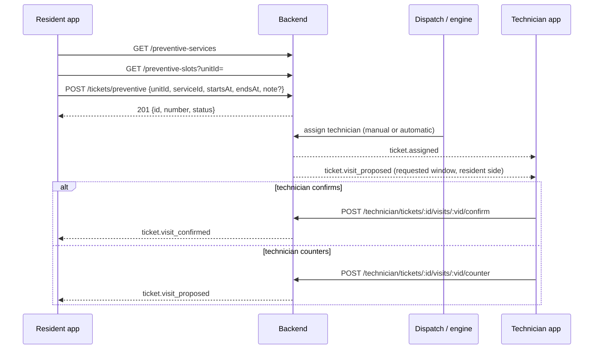
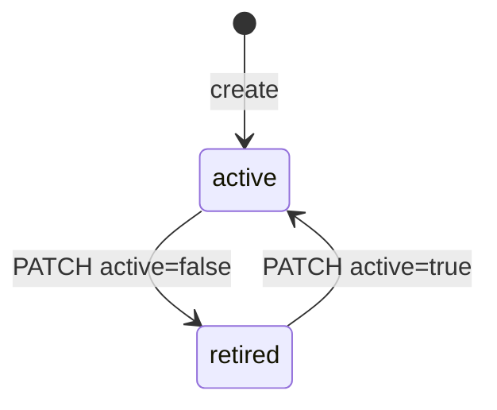

# الصيانة الوقائية (الفحص الدوري) — Preventive Maintenance

> **التطبيق/الواجهة:** resident app + family member (حجز الفحص) · manager dashboard (إدارة قائمة الخدمات)
> **الصلاحيات:** الحجز: `tickets.create` (أدوار `resident`, `family_member`) + الـcapability `tickets` على الوحدة من `GET /me/units/:unitId/capabilities`. إدارة الخدمات: `maintenance.manage` (دور `manager`).
> **المصادر:** ADR 0038 · `src/maintenance/preventive/` · `tickets.service.ts` (`createPreventive`) · `visits/visit-lifecycle.ts` (`proposeRequested`)

## الفكرة باختصار
الساكن يقدر يحجز **فحص دوري** لوحدته (صيانة تكييف، فحص سخان، فحص سباكة، فحص كهرباء…) بدل ما يستنى حاجة تبوظ.
بيختار الخدمة، ويوم، ووقت من "الأوقات المتاحة"، وملاحظة اختيارية، ويضغط "طلب".
الطلب بيتسجل كبلاغ عادي من نوع `preventive`، تحت فئة الخدمة، بأولوية `normal`، ومن غير SLA.
لما فني يستلم البلاغ، الموعد اللي الساكن اختاره بيتقترح عليه أوتوماتيك كزيارة، والفني يأكد أو يقترح وقت تاني.
المدير بيدير قائمة الخدمات (أسماء بالعربي والإنجليزي، الفئة، الترتيب، تفعيل/إيقاف).

## الأدوار ومين بيعمل إيه

| الدور | يعمل |
|---|---|
| ساكن / فرد أسرة معاه `tickets` على الوحدة | يشوف الخدمات المتاحة، يشوف الأوقات، يحجز فحص. بعد الحجز البلاغ زي أي بلاغ (رسائل، صور، إلغاء، تأكيد، تقييم) — راجع `01-resident-tickets.md` |
| بالغ ساكن من غير `tickets` | ما يحجزش (`403 TICKETS_NOT_ALLOWED`)، بس يوصل للزيارة لما تتعمل (راجع `02-visits-scheduling.md`) |
| المدير (`maintenance.manage`) | يعرض كل الخدمات (حتى الموقوفة)، يضيف، يعدّل الأسماء/الفئة/الترتيب، يوقف/يرجّع خدمة |
| الإدارة (`tickets.dispatch`) | تسند البلاغ الدوري لفني زي أي بلاغ. راجع `04-dispatch-dashboard.md` |
| الفني | يستلم الاقتراح التلقائي للموعد ويأكده أو يقترح بديل. راجع `05-technician-app.md` |

## الشاشات اللي الفيتشر محتاجها
**تطبيق الساكن**
- **"طلب صيانة وقائية" — خطوة "إيه؟"**: قائمة الخدمات.
- **خطوة "إمتى؟"**: أيام + "الأوقات المتاحة".
- **خطوة "تفاصيل" (اختياري)**: الغرفة + ملاحظة.
- **تأكيد/ملخص الطلب** وزرار "طلب".
- **تفاصيل البلاغ الدوري**: نفس شاشة تفاصيل البلاغ مع عرض اسم الخدمة والموعد المطلوب (راجع `01-resident-tickets.md`).

**لوحة المدير**
- **قائمة الخدمات الوقائية**: كل الخدمات بترتيبها، وحالة مفعّلة/موقوفة.
- **فورم إضافة خدمة**.
- **فورم تعديل خدمة** (من غير تعديل الـkey) مع مفتاح تفعيل/إيقاف.

## الفلو خطوة بخطوة

### 1) الساكن يختار الخدمة — `GET /preventive-services`
1. قبل ما تعرض المدخل: `tickets: true` على الوحدة.
2. `GET /preventive-services` بيرجع الخدمات **المفعّلة اللي فئتها مفعّلة كمان**، مرتبة بـ`position` ثم `key`.
3. كل خدمة: `id`, `key`, `nameAr`, `nameEn` (أسماء كتبها المجمع؛ اعرض حسب لغة المستخدم).
4. الافتراضي في أي مجمع جديد: `ac_service` "صيانة التكييف" (فئة `ac`)، `water_heater` "فحص السخان" (`plumbing`)، `plumbing_check` "فحص السباكة" (`plumbing`)، `electrical_check` "فحص الكهرباء" (`electrical`).
5. قائمة فاضية = المدير وقّف كل الخدمات → اخفي المدخل أو اعرض حالة فاضية.

### 2) الساكن يختار الوقت — `GET /preventive-slots?unitId=…&from=…&days=…`
1. `unitId` إجباري. `from` يوم `YYYY-MM-DD` بتوقيت المجمع (افتراضي النهارده). `days` من 1 لـ14 (افتراضي 7). للأسبوع اللي بعده غيّر `from`.
2. الرد: قائمة `{ startsAt, endsAt }` مرتبة = ساعات الزيارة بتاعة المجمع (افتراضي 08:00–18:00، slot ساعة) مقسمة، بعد 15 دقيقة على الأقل من دلوقتي وخلال 30 يوم.
3. **مفيش فني لسه**، فمفيش أوقات "مشغولة" — كل الأوقات في ساعات الزيارة بتظهر. ودي قراءة مش حجز.
4. no-store.
5. مالوش مكان في الوحدة = `404 UNIT_NOT_FOUND`. مالوش `tickets` = `403 TICKETS_NOT_ALLOWED`.

### 3) الساكن يبعت الطلب — `POST /tickets/preventive`
1. Body:
   - `unitId` (إجباري).
   - `serviceId` (إجباري) من خطوة 1.
   - `startsAt`, `endsAt` (إجباري): ابعت الـslot **زي ما جه بالظبط**.
   - `note` (اختياري، 1–2000 حرف): بيبقى وصف البلاغ. لو مفيش ملاحظة **ما تبعتش الحقل** (نص فاضي `""` = `400`).
   - `unitLocation` (اختياري): `kitchen`, `bathroom`, `living_room`, `bedroom`, `balcony`, `other`.
   - مفيش أولوية (دايماً `normal`) ولا صور هنا. الصور تتضاف بعدين بـ`POST /tickets/:id/photos`.
2. هيدر `Idempotency-Key` (راجع README).
3. السيرفر يتحقق:
   - الوحدة: نفس شروط `POST /tickets` (`UNIT_NOT_FOUND` / `TICKETS_NOT_ALLOWED`).
   - الخدمة مفعّلة وفئتها مفعّلة → وإلا `404 PREVENTIVE_SERVICE_NOT_FOUND`.
   - النافذة: نفس قواعد الزيارة (بعد 15 دقيقة، خلال 30 يوم، النهاية بعد البداية، ≤ 4 ساعات) → `400 VALIDATION_FAILED` بـ`VISIT_TOO_SOON` / `VISIT_TOO_FAR` / `VISIT_ENDS_BEFORE_START` / `VISIT_TOO_LONG`.
   - **وكمان** جوه ساعات الزيارة وفي يوم واحد بتوقيت المجمع → وإلا `400` (`VISIT_OUTSIDE_HOURS` على `startsAt`).
4. الرد `201 { id, number, status, priority: 'normal', createdAt }` (من غير الملاحظة).
5. البلاغ اتعمل: `kind: 'preventive'`، فئة الخدمة، `preventiveService`، `requestedStartsAt`/`requestedEndsAt` = الوقت المختار. الحاجات دي **ما تتغيرش أبداً** بعد كده.
6. لو التوزيع الأوتوماتيك شغال، ممكن يتسند لفني فوراً (`status: 'assigned'` في الرد).
7. الشاشة التالية: تفاصيل البلاغ.

### 4) لما فني يستلم البلاغ — اقتراح تلقائي للموعد
يحصل لوحده (في نفس عملية الإسناد: يدوي، أوتوماتيك، أو إعادة إسناد):
1. الموعد المطلوب بيتقترح على الفني كزيارة `proposed`، **من طرف السكان** (`proposedBySide: 'resident'`)، والمقترح المسجل = صاحب البلاغ. سجل الأحداث بيقول إن النظام هو اللي عمله (سبب `preventive_request`).
2. الفني يوصله `ticket.assigned` وبعده `ticket.visit_proposed`.
3. الفني يأكد (السكان يوصلهم `ticket.visit_confirmed`) أو يقترح وقت تاني (السكان يوصلهم `ticket.visit_proposed`، وبعدها نفس فلو `02-visits-scheduling.md`).
4. **الاقتراح التلقائي ما بيحصلش** في الحالات دي (والفني يقترح بنفسه زي أي بلاغ):
   - الموعد المطلوب فاضل عليه أقل من 15 دقيقة (أو عدّى) وقت الإسناد.
   - صاحب البلاغ حسابه مش نشط أو مبقاش معاه `tickets` على الوحدة.
   - البلاغ كان له قبل كده أي زيارة غير الاقتراح التلقائي اللي اتلغى بسبب تغيير الفني (يعني: لو حد أكده، أو ألغاه، أو اقترح بديل، أو اتعملت زيارة تانية — الطلب الأصلي بقى تاريخ).
5. لو الفني اتغير قبل ما يأكد، الاقتراح التلقائي بيتلغى (`technician_changed`) وبيتقترح من جديد على الفني الجديد (لو الشروط لسه متحققة).
6. للسكان: الزيارة دي بتظهر `proposedBySide: 'resident'`، فهم **ما يقدروش يأكدوها ولا يقترحوا بديل** (`403 VISIT_SAME_SIDE`) — الزرار الوحيد "إلغاء". الديزاين يعرضها كـ"مستني الفني يأكد الموعد اللي طلبته".
7. اقتراح ما اترددش عليه وعدّى ميعاده بيفضل نشط؛ الفني لازم يقترح بديل أو يلغي.

### 5) باقي عمر البلاغ
زي أي بلاغ (راجع `01-resident-tickets.md`): الفني يشتغل ويخلّص، الساكن يأكد ويقيّم (الخدمة + الفني) أو يرفض، القفل التلقائي، إعادة الفتح، الرسائل، الإلغاء قبل بدء الشغل.
الفرق:
- **مفيش SLA**: `sla: null` دايماً، عمره ما بيبقى "متأخر"، و`canEscalate: false` دايماً.
- `description` ممكن يبقى `''` → اعرض اسم الخدمة بدله.
- الإدارة ممكن تغيّر الفئة أو الأولوية بعدين زي أي بلاغ.

### 6) المدير يدير الخدمات
**أ) القائمة — `GET /maintenance/preventive-services`**
كل الخدمات (المفعّلة والموقوفة)، مرتبة بـ`position` ثم `key`. مش paged (عدد صغير).

**ب) إضافة — `POST /maintenance/preventive-services`**
1. الحقول:
   - `key` (إجباري): كود ثابت، حروف إنجليزي صغيرة وأرقام و`_`، يبدأ بحرف، 2–40 حرف (`^[a-z][a-z0-9_]{1,39}$`) مثل `water_heater`. **ما يتغيرش أبداً** بعد الإنشاء. مكرر = `409 DUPLICATE_RESOURCE` على `key`.
   - `nameAr`, `nameEn` (إجباري، 1–80 حرف كل واحد).
   - `categoryId` (إجباري): فئة **مفعّلة** في المجمع؛ فنيين الفئة دي هما اللي بيعملوا الفحص. غير كده = `400` (`CATEGORY_NOT_AVAILABLE` على `categoryId`). الفئات من `GET /maintenance/categories` (راجع `06-maintenance-setup.md`).
   - `position` (اختياري، 0–1000): الترتيب، الأصغر الأول. لو مش موجود: بعد آخر خدمة (أكبر position + 1، بحد أقصى 1000).
2. الرد `201 PreventiveServiceView`. بيتسجل في الـaudit (`preventive_service.created`) من غير نص الأسماء.

**ج) تعديل / إيقاف — `PATCH /maintenance/preventive-services/:id`**
1. كل الحقول اختيارية: `nameAr`, `nameEn`, `categoryId`, `position`, `active`.
2. `key` مش مسموح يتبعت (`400 FIELD_NOT_ALLOWED`).
3. فئة **جديدة** لازم تكون مفعّلة (`CATEGORY_NOT_AVAILABLE`)؛ الفئة الحالية لو اتوقفت مسموح تفضل.
4. `active: false` = إيقاف الخدمة: ما بتظهرش للسكان ولا تتطلب تاني. **مفيش حذف.** `active: true` يرجّعها.
5. البلاغات القديمة بتفضل تعرض اسم الخدمة حتى لو اتوقفت.
6. خدمة لو فئتها اتوقفت بتختفي من عند السكان حتى لو هي نفسها مفعّلة.
7. خدمة مش موجودة = `404 PREVENTIVE_SERVICE_NOT_FOUND`. الرد `200 PreventiveServiceView`.

## الحالات (Statuses)
البلاغ الدوري بيمشي في نفس حالات البلاغ العادي بالظبط (`new`, `assigned`, `en_route`, `in_progress`, `on_hold`, `completed`, `closed`, `cancelled`) — الجدول والرسم في `01-resident-tickets.md`. والزيارة في `02-visits-scheduling.md`.

الخدمة الوقائية نفسها ليها حالتين بس:

| `active` | المعنى | مين يغيّرها |
|---|---|---|
| `true` | تظهر للسكان (لو فئتها مفعّلة) | المدير |
| `false` | موقوفة، ما تتطلبش | المدير |

## البيانات اللي بتظهر

### خدمة للساكن (`PreventiveServiceOptionView`)
`{ id, key, nameAr, nameEn }`.

### خدمة للمدير (`PreventiveServiceView`)
`{ id, key, nameAr, nameEn, categoryId, position, active, createdAt, updatedAt }`. (اسم الفئة مش راجع؛ اربطه من قائمة الفئات بالـ`categoryId`.)

### Slot
`{ startsAt, endsAt }`.

### البلاغ الدوري (في كل views البلاغ: الساكن والفني والإدارة)
| الحقل | المعنى |
|---|---|
| `kind` | `preventive` |
| `preventiveService` | `{ id, key, nameAr, nameEn }` (حتى لو الخدمة اتوقفت) |
| `requestedStartsAt`, `requestedEndsAt` | الموعد اللي الساكن طلبه (ثابت) |
| `priority` | `normal` |
| `description` | الملاحظة أو `''` |
| `sla` | `null` دايماً |
| `canEscalate` | `false` دايماً |

الموعد المطلوب عمره ما بيظهر في الإشعارات (غير إشعار الزيارة اللي فيه النافذة بس) ولا في الـaudit.

## القواعد والقيود

| القاعدة | القيمة |
|---|---|
| النافذة | بعد 15 دقيقة على الأقل، خلال 30 يوم، ≤ 4 ساعات |
| ساعات الزيارة | الطلب لازم يكون جوه `visitHoursStart`–`visitHoursEnd` وفي يوم واحد بتوقيت المجمع (افتراضي 08:00–18:00). راجع `06-maintenance-setup.md` |
| الـslots | `days` 1–14 (افتراضي 7)، `slot` = `visitSlotMinutes` (افتراضي 60) |
| الملاحظة | اختيارية، 1–2000 حرف لو موجودة |
| الأولوية | `normal` دايماً |
| الـSLA | مفيش للبلاغ الدوري |
| الحقول الثابتة | `kind`, الخدمة، `requestedStartsAt`, `requestedEndsAt` ما يتغيروش أبداً |
| اسم الخدمة | 1–80 حرف لكل لغة |
| `key` | `^[a-z][a-z0-9_]{1,39}$`، فريد، ما يتغيرش |
| `position` | 0–1000؛ الترتيب `position` ثم `key` (ممكن يتكرر) |
| الحذف | مفيش؛ إيقاف بـ`active: false` |
| Idempotency | `POST /tickets/preventive` |

## الأخطاء اللي الـUI لازم يتعامل معاها

| HTTP + الكود | إمتى | رسالة/سلوك مقترح |
|---|---|---|
| `400 VALIDATION_FAILED` + `VISIT_OUTSIDE_HOURS` | الوقت بره ساعات الزيارة أو بيعدّي يومين | "اختر وقتاً من الأوقات المتاحة" + أعد تحميل الـslots |
| `400 VALIDATION_FAILED` + `VISIT_TOO_SOON` / `VISIT_TOO_FAR` / `VISIT_ENDS_BEFORE_START` / `VISIT_TOO_LONG` | النافذة مش صالحة (مثلاً الـslot بقى قريب أوي) | نفس الرسالة + أعد تحميل الـslots |
| `400 VALIDATION_FAILED` + `INVALID_LENGTH` | ملاحظة فاضية أو أطول من 2000، أو اسم خدمة طويل | عداد حروف؛ ما تبعتش `note` فاضية |
| `400 VALIDATION_FAILED` + `INVALID_FORMAT` على `from` | يوم غلط | — |
| `400 VALIDATION_FAILED` + `CATEGORY_NOT_AVAILABLE` | (المدير) فئة مش مفعّلة | "اختر فئة مفعّلة" |
| `400 VALIDATION_FAILED` + `FIELD_NOT_ALLOWED` | (المدير) بعت `key` في التعديل، أو حقل زيادة | اقفل حقل الـkey في التعديل |
| `403 TICKETS_NOT_ALLOWED` | مالوش `tickets` على الوحدة | اخفي المدخل |
| `404 UNIT_NOT_FOUND` | وحدة مالوش فيها مكان | — |
| `404 PREVENTIVE_SERVICE_NOT_FOUND` | الخدمة (أو فئتها) اتوقفت بين التحميل والطلب، أو id غلط | "هذه الخدمة لم تعد متاحة" + أعد تحميل القائمة |
| `409 DUPLICATE_RESOURCE` على `key` | (المدير) كود مكرر | "هذا الكود مستخدم" |
| `409 IDEMPOTENCY_CONFLICT` | نفس المفتاح لطلب مختلف | ولّد مفتاح جديد |

## الإشعارات

| الحدث | `kind` | مين يستلم | push / critical | يفتح |
|---|---|---|---|---|
| الطلب اتسند لفني | `ticket.status_changed` (`assigned`) | صاحب البلاغ | push حسب التفضيلات، مش critical | تفاصيل البلاغ |
| الفني استلم البلاغ | `ticket.assigned` | الفني | critical | بلاغ الفني |
| الموعد المطلوب اتقترح على الفني | `ticket.visit_proposed` | الفني | مش critical | زيارات البلاغ (الفني) |
| الفني أكد الموعد | `ticket.visit_confirmed` | السكان | مش critical | زيارات البلاغ |
| الفني اقترح وقت تاني | `ticket.visit_proposed` | السكان | مش critical | زيارات البلاغ |
| باقي عمر البلاغ والزيارة | زي `01-resident-tickets.md` و `02-visits-scheduling.md` | | | |

مفيش إشعار خاص بإنشاء الطلب الدوري (ولا للإدارة — مش طارئ). إدارة الخدمات ما بتبعتش إشعارات.

## الـEndpoints

| Method + Path | مين | الغرض | الرد |
|---|---|---|---|
| `GET /preventive-services` | `tickets.create` | الخدمات المتاحة للحجز | `200 {data:[{id,key,nameAr,nameEn}], nextCursor:null}` |
| `GET /preventive-slots?unitId=&from=&days=` | `tickets.create` + `tickets` | الأوقات المتاحة (no-store) | `200 {data:[{startsAt,endsAt}], nextCursor:null}` |
| `POST /tickets/preventive` | `tickets.create` + `tickets` | حجز فحص (Idempotency) | `201 {id, number, status, priority, createdAt}` |
| `GET /maintenance/preventive-services` | `maintenance.manage` | كل الخدمات | `200 {data:[PreventiveServiceView], nextCursor:null}` |
| `POST /maintenance/preventive-services` | `maintenance.manage` | إضافة خدمة | `201 PreventiveServiceView` |
| `PATCH /maintenance/preventive-services/:id` | `maintenance.manage` | تعديل/إيقاف/تفعيل | `200 PreventiveServiceView` |

بعد الإنشاء: `GET /tickets/:id` و `GET /tickets/:id/visits` من `01-resident-tickets.md` و `02-visits-scheduling.md`.

## ملاحظات للديزاين وحاجات ناقصة في الباك
- `description` بيبقى `''` لبلاغ دوري من غير ملاحظة: اعرض اسم الخدمة بداله (v0-notes).
- الـslots مش حجز ومفيش فيها انشغال الفنيين (مفيش فني لسه). ممكن الفني ما يقدرش ييجي في الوقت المطلوب ويقترح بديل.
- بعد الحجز وقبل ما فني يستلم، **مفيش زيارة** — الموعد المطلوب بيظهر بس في `requestedStartsAt`/`requestedEndsAt`. الديزاين يعرضه كـ"الموعد المطلوب (في انتظار فني)".
- الساكن ما يقدرش يغيّر الموعد المطلوب بعد الحجز (الحقول ثابتة). عشان يغيّره: يستنى الاقتراح التلقائي ويلغيه، أو يكتب رسالة، أو يلغي البلاغ ويحجز من جديد. وبعد ما يلغي الاقتراح التلقائي، الطلب الأصلي بيبقى تاريخ والفني لازم يقترح بنفسه.
- الاقتراح التلقائي بيظهر للسكان كاقتراح منهم (`proposedBySide: 'resident'`)؛ الأزرار المتاحة "إلغاء" بس. الديزاين يوضح إنه مستني تأكيد الفني.
- لو الإسناد اتأخر لحد ما الموعد المطلوب قرب (أقل من 15 دقيقة) أو عدّى، مفيش اقتراح تلقائي ومفيش إشعار للساكن بده.
- مفيش جدولة متكررة (مثلاً "كل 6 شهور") ولا تذكير بالفحص الجاي — كل طلب لوحده.
- مفيش endpoint لإعادة ترتيب الخدمات دفعة واحدة؛ الترتيب بتعديل `position` لكل خدمة.
- رد خدمة المدير فيه `categoryId` بس من غير اسم الفئة.
- الأسماء بيكتبها المجمع (مش مترجمة من النظام)؛ لازم الفورم يطلب الاتنين.
