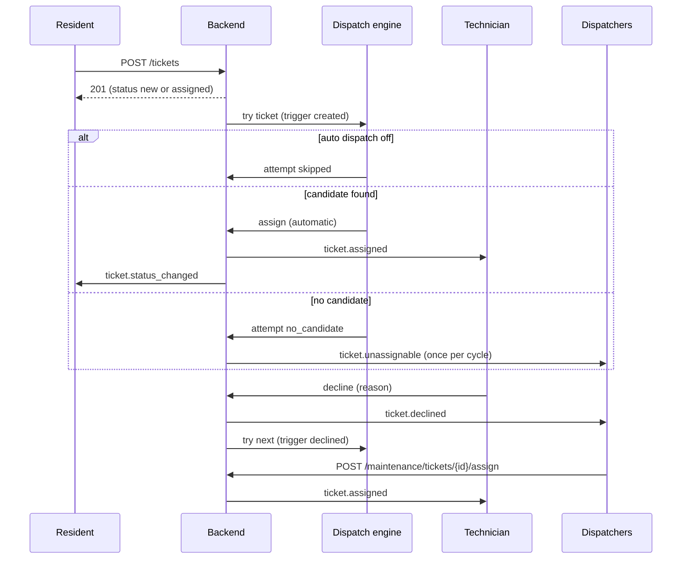
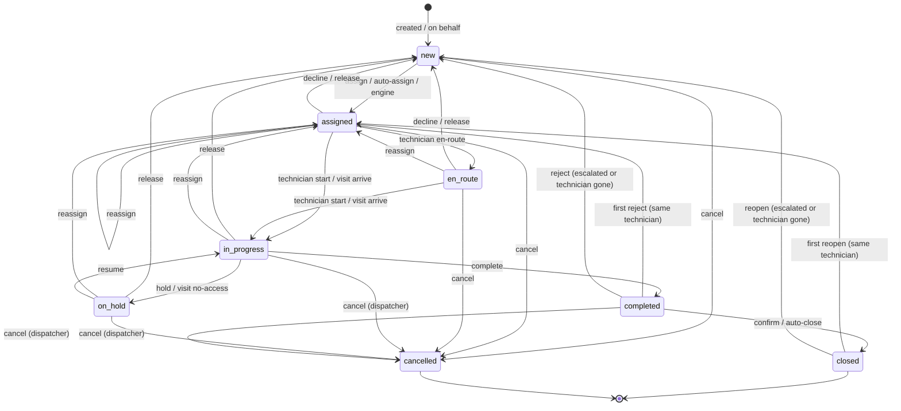
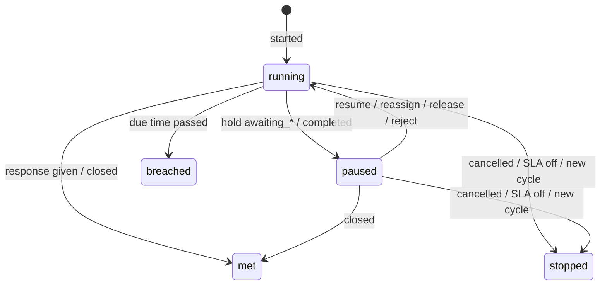

# لوحة توزيع البلاغات (مشرف الصيانة) — Dispatch dashboard

> **التطبيق/الواجهة:** manager dashboard (شاشات مشرف الصيانة والمدير)
> **الصلاحيات:** `tickets.dispatch` (الأدوار الافتراضية: `maintenance_supervisor` و`manager`). فتح بلاغ باسم ساكن في وحدة يحتاج كمان `residents.read` (موجودة عند `manager` بس افتراضيًا). قايمة التخصصات تتقري بـ`tickets.dispatch` أو `maintenance.manage`.
> **المصادر:** ADR 0032 · ADR 0033 · ADR 0034 · ADR 0038 · `src/maintenance/tickets/` · `src/maintenance/dispatch/` · `src/maintenance/sla/`

## الفكرة باختصار
مشرف الصيانة (أو المدير) شايف **كل بلاغات الكمبوند**. بيوزّع البلاغات اللي في الطابور (`new`) على الفنيين يدويًا، أو بيشغّل محرك التوزيع التلقائي على بلاغ معيّن، أو بيسيب المحرك يشتغل لوحده لو المدير فاعله. بيقدر يعيد الإسناد، يغيّر الأولوية أو التصنيف، يلغي، يكتب رسائل (منها رسائل داخلية للستاف بس)، ويتابع الـSLA والتأخير وتصعيدات السكان. وبيقدر يفتح بلاغ بالنيابة عن ساكن اتصل أو جه المكتب.

## الأدوار ومين بيعمل إيه

| الدور | بيعمل إيه في الفيتشر ده |
|---|---|
| `maintenance_supervisor` (staff) | كل شاشات التوزيع: القايمة، التفاصيل، إسناد/إعادة إسناد/تلقائي، أولوية، تصنيف، إلغاء، رسائل، زيارات بالنيابة عن الفني، تخصصات الفنيين وإتاحتهم. **مايقدرش** يجيب قايمة سكان الوحدة لفتح بلاغ باسمهم (معندوش `residents.read`)، ومايقدرش يشوف إعدادات التوزيع أو الـSLA أو `/maintenance/categories` (دي `maintenance.manage`). |
| `manager` | كل اللي فوق + فتح بلاغ باسم ساكن في وحدة (عنده `residents.read`) + شاشات الإعداد (راجع `06-maintenance-setup.md`). |
| الفني (`tickets.work`) | مش بيشوف الشاشة دي. بيستقبل البلاغات اللي بتتسند له (راجع `05-technician-app.md`). |
| الساكن (`tickets.create`) | بيفتح البلاغ ويأكد/يرفض/يصعّد (راجع `01-resident-tickets.md`). |
| النظام | محرك التوزيع، الـsweeps (توزيع كل ساعة، خرق SLA كل دقيقة، إغلاق تلقائي كل ساعة، تأخر زيارة كل دقيقة)، وإرجاع بلاغات فني اتوقف حسابه. |

## الشاشات اللي الفيتشر محتاجها
- **قايمة البلاغات (Tickets list):** كل بلاغات الكمبوند، الأحدث أولًا، بفلاتر (حالة، أولوية، غير مُسند، فني، وحدة، تصنيف، مفتوح، متأخر، مُصعَّد). مقترح تبويبات جاهزة: "الطابور"، "المفتوح"، "المتأخر"، "تصعيدات السكان"، "الطوارئ".
- **تفاصيل البلاغ (Ticket detail):** البيانات، الصور، التقييمات، الـSLA، التصعيدات، وأزرار الأكشنز حسب الحالة. بتبويبات: السجل، الإسنادات، محاولات التوزيع، أحداث الـSLA، الزيارات، الرسائل.
- **Sheet اختيار فني (Technician picker):** قايمة الفنيين بحملهم وتخصصاتهم وإتاحتهم، للإسناد وإعادة الإسناد.
- **زرار "إسناد تلقائي" + Dialog بالنتيجة:** اتسند لمين، أو "مافيش فني مناسب".
- **Dialog إعادة إسناد:** فني جديد + سبب.
- **Dialog تغيير الأولوية:** أولوية + سبب.
- **Dialog تغيير التصنيف:** تصنيف + سبب.
- **Dialog إلغاء:** سبب.
- **فورم فتح بلاغ نيابة عن ساكن:** وحدة أو منطقة مشتركة → صاحب البلاغ → تصنيف/أولوية/وصف/مكان في الوحدة.
- **محادثة البلاغ (Thread):** رسائل الكل، مع سويتش "داخلي (للستاف بس)".
- **لوحة "ليه البلاغ ده ماتسندش؟":** من محاولات التوزيع.
- **Timeline الـSLA:** من أحداث الـSLA.
- **لوحة الزيارات:** راجع `02-visits-scheduling.md`.
- **شاشة الفريق (الفنيين):** القايمة وتعديل التخصصات والإتاحة موجودة في `06-maintenance-setup.md`.

## الفلو خطوة بخطوة

### 1. قايمة البلاغات والفلاتر
1. المشرف يفتح القايمة → `GET /maintenance/tickets`.
2. الفلاتر (كلها اختيارية، وبتتجمع مع بعض بـAND):

   | الفلتر | القيم | المعنى |
   |---|---|---|
   | `status` | قيمة واحدة من `TicketStatus` | حالة واحدة بالظبط. |
   | `open` | `true`/`false` | `true` = كل الحالات ما عدا `closed` و`cancelled` (يعني `new`, `assigned`, `en_route`, `in_progress`, `on_hold`, `completed`). `false` = مافيش فلتر. بيشتغل حتى والـSLA مقفول. مع `status` لازم الاتنين يتحققوا (`open=true&status=closed` = فاضية). |
   | `priority` | `normal` / `urgent` / `emergency` | |
   | `unassigned` | `true` | بلاغات من غير فني. **خلي بالك:** ده بيرجّع كمان بلاغات اتلغت وهي في الطابور. "الطابور" الحقيقي = `unassigned=true&status=new`. |
   | `technicianId` | uuid | بلاغات فني معيّن (اللي معاه دلوقتي). |
   | `unitId` | uuid | بلاغات وحدة. |
   | `categoryId` | uuid | بلاغات تصنيف. |
   | `overdue` | `true` | بلاغات `sla.overdue = true` (متأخرة ولسه الالتزام ماتحققش). **فاضية دايمًا والـSLA مقفول.** دايمًا من البلاغات المفتوحة بس. |
   | `escalated` | `true` | بلاغات **ساكن صعّدها** في دورة الـSLA الحالية (`escalatedAt` مش null). فاضية والـSLA مقفول. ممكن ترجّع بلاغ خلص؛ لشاشة "محتاج اهتمام" ابعت معاها `open=true`. |
   | `cursor`, `limit` | | الصفحات (افتراضي 50، أقصى 100). راجع README. |

3. الترتيب ثابت: الأحدث إنشاءً أولًا. مافيش بحث برقم البلاغ (`MT-000123`) ولا ترتيب تاني.
4. كل صف فيه `sla` و`escalatedAt` محسوبين لحظة القراءة (راجع "البيانات اللي بتظهر").
5. الفلاتر بتتنفذ في قاعدة البيانات، فالصفحة دايمًا مليانة والـcursor صح حتى مع `overdue`/`escalated`.

### 2. تفاصيل البلاغ
1. → `GET /maintenance/tickets/{id}` (no-store، لأن فيه روابط صور مؤقتة).
2. بيرجع كل حقول الصف + الوصف، صاحب البلاغ (`reporter`) ومين فتحه (`createdBy`) بالاسم الكامل، الصور، التقييمات (`feedback`)، أوقات الإكمال/الإغلاق/الإلغاء، وكل تصعيدات السكان (`escalations`).
3. **مافيش موبايل ولا إيميل لأي حد** في الشاشة دي (حتى في الطوارئ). لو محتاج تكلم الساكن: الرسائل.
4. لو `onBehalf`: بيان إن `createdBy` مختلف عن `reporter`.
5. الأزرار المتاحة تتحدد من الحالة (جدول "القواعد"). الـ API مابيرجعش قايمة أكشنز؛ الـUI يستنتجها من `status`. لو اتضغط زرار والحالة اتغيرت في النص: 409 `TICKET_INVALID_TRANSITION` → أعد تحميل البلاغ.
6. الأكشنز كلها بترجع 204 (ما عدا الإسناد التلقائي)؛ بعدها اعمل re-fetch للتفاصيل.

### 3. فتح بلاغ نيابة عن ساكن
1. المستخدم يختار: **وحدة** أو **منطقة مشتركة** (نص حر 1–120 حرف، زي "الممر الدور التالت"). لازم واحد بس منهم.
2. **لو وحدة:** → `GET /maintenance/units/{unitId}/reporters` (محتاج `tickets.dispatch` + `residents.read`).
   - بيرجع `{ id, fullName }` لكل اللي ينفع يبقى صاحب البلاغ: سكان الوحدة (المالك أو المستأجر الساكن فعلًا) وأفراد الأسرة اللي عندهم حساب وصلاحية `tickets`. مالك مش ساكن (landlord) مش هيظهر.
   - مرتبة بالاسم، من غير صفحات (`nextCursor` = null).
   - وحدة مش موجودة → 404 `UNIT_NOT_FOUND`.
   - المشرف (staff) هياخد 403 لأنه معندوش `residents.read`؛ عمليًا الفتح بالنيابة لوحدة شغل المدير.
3. **لو منطقة مشتركة:** مافيش endpoint بقايمة؛ أي ساكن/فرد أسرة نشط عنده `tickets` على أي وحدة مقبول كصاحب بلاغ. الـUI محتاج طريقة يختار بيها الشخص (راجع "حاجات ناقصة").
4. التصنيفات المتاحة → `GET /ticket-categories` (النشطة بس، مع `defaultPriority` و`commonAreaAllowed`). للمنطقة المشتركة اعرض بس اللي `commonAreaAllowed = true`.
5. → `POST /maintenance/tickets` (ابعت `Idempotency-Key`):
   - `reporterAccountId` (مطلوب)
   - `unitId` **أو** `commonArea`
   - `unitLocation` (اختياري، مع الوحدة بس): `kitchen`, `bathroom`, `living_room`, `bedroom`, `balcony`, `other`
   - `categoryId` (مطلوب، تصنيف نشط)
   - `priority` (اختياري؛ لو مش موجود = `defaultPriority` بتاع التصنيف)
   - `description` (مطلوب، 1–2000 حرف)
   - **مافيش صور** في الطلب ده.
6. الرد 201: `{ id, number, status, priority, createdAt }`. لو المحرك اشتغل ولقى فني، `status` هيبقى `assigned` على طول.
7. اللي بيحصل:
   - البلاغ بيتسجل باسم صاحب البلاغ، ويتعمل audit (`ticket.created_on_behalf`).
   - صاحب البلاغ بيوصله `ticket.opened_on_behalf`.
   - لو الأولوية `emergency`: كل اللي معاهم `tickets.dispatch` (ما عدا اللي فتحه) بيوصلهم `ticket.emergency` (حرِج).
   - بعد الحفظ، محرك التوزيع بيجرب البلاغ (لو التوزيع التلقائي شغال). الفشل هنا مابيبوّظش الإنشاء؛ البلاغ بيستنى في الطابور.
8. بعد النجاح: افتح تفاصيل البلاغ.

### 4. الإسناد اليدوي (من الطابور)
1. متاح لما `status = new` بس.
2. افتح الـpicker → `GET /maintenance/technicians` (كل حساب ستاف نشط عنده `tickets.work`، مرتبين بالاسم). لكل فني: `openTickets`، `workload`، `specialties`، `availability`.
3. اقتراح للـUI: علّم الفني اللي `availability.state = unavailable`، أو مالوش تخصص يناسب التصنيف، أو اللي رفض البلاغ ده قبل كده (من `GET .../assignments` نوع `declined`). **الباك مابيمنعش أي واحد من دول في الإسناد اليدوي** (بيتأكد بس إنه ستاف نشط عنده `tickets.work`).
4. → `POST /maintenance/tickets/{id}/assign` بـ`{ technicianId }` → 204.
5. اللي بيحصل: الحالة `assigned`، صف إسناد نوعه `manual`، الفني بيوصله `ticket.assigned` (حرِج، بيوصل دايمًا)، صاحب البلاغ بيوصله `ticket.status_changed` (`status: assigned`).
6. لو البلاغ تذكرة وقائية (`kind = preventive`): بيتعمل اقتراح زيارة تلقائي للفني بالميعاد اللي الساكن طلبه (راجع `03-preventive-maintenance.md`).
7. أخطاء: فني مش مؤهل → 404 `TECHNICIAN_NOT_FOUND`. البلاغ مش `new` (حد سبقك) → 409 `TICKET_INVALID_TRANSITION`.

### 5. الإسناد التلقائي من الزرار (auto-assign)
1. متاح لما `status = new` بس. **بيشتغل حتى لو التوزيع التلقائي مقفول في الإعدادات** (ده طلب مقصود من المشرف، وطريقة لتجربة المحرك بلاغ بلاغ).
2. → `POST /maintenance/tickets/{id}/auto-assign` → 200:
   - `{ outcome: "assigned", technician: { id, fullName } }` → اعرض "اتسند لـ..." وأعد تحميل البلاغ.
   - `{ outcome: "no_candidate", technician: null }` → **ده رد عادي مش خطأ.** اعرض "مافيش فني مناسب دلوقتي" مع لينك لمحاولات التوزيع. البلاغ بيفضل في الطابور.
3. لو المحرك مشغول (قفل التوزيع متاخد أكتر من 3 ثواني): 503 `DISPATCH_BUSY` → "النظام مشغول، جرّب تاني بعد لحظة" وزرار إعادة المحاولة.
4. اللي بيتسجل: محاولة توزيع بـ`trigger = manual`، ولو اتسند: إسناد نوعه `automatic` من غير اسم المنفّذ (`by = null`). نفس الإشعارات بتاعة الإسناد اليدوي.
5. لو `no_candidate`: المشرفين بيوصلهم `ticket.unassignable` (أو `ticket.unassignable_emergency` للطوارئ) **مرة واحدة بس لكل بلاغ ودورة**؛ تكرار الزرار مش هيبعت تاني.

### 6. إعادة الإسناد
1. متاح لما الحالة `assigned` أو `en_route` أو `in_progress` أو `on_hold`.
2. اختار فني (نفس الـpicker) + سبب من `ticketReassign`: `technician_unavailable`, `workload`, `specialty`, `other`.
3. → `POST /maintenance/tickets/{id}/reassign` بـ`{ technicianId, reasonCode }` → 204.
4. اللي بيحصل:
   - الحالة ترجع `assigned` (الفني الجديد يبدأ من الأول)، وسبب الإيقاف (`holdReason`) بيتمسح.
   - الفني القديم يفقد البلاغ فورًا ويوصله `ticket.unassigned`. الجديد يوصله `ticket.assigned`.
   - صاحب البلاغ يوصله `ticket.status_changed` بس لو الحالة كانت مش `assigned`.
   - أي زيارة نشطة بتتلغي (`technician_changed`)، والسكان بيتبلغوا.
   - لو كان `on_hold` بسبب يوقف الـSLA، الساعات بتكمل.
5. أخطاء: نفس الفني الحالي → 400 `VALIDATION_FAILED` (`technicianId`: `SAME_AS_CURRENT`). سبب ناقص → 400 `REASON_REQUIRED`. سبب مش في القايمة → 400 `VALIDATION_FAILED` (`INVALID_REASON_CODE` ومعاه `params.allowed`).

### 7. تغيير الأولوية
1. متاح في أي حالة ما عدا `closed` و`cancelled`.
2. أولوية جديدة + سبب من `ticketPriority`: `reassessed`, `safety_risk`, `reporter_request`, `other`.
3. → `POST /maintenance/tickets/{id}/priority` بـ`{ priority, reasonCode }` → 204.
4. اللي بيحصل: audit (`ticket.priority_changed`)، الفني (لو موجود) يوصله `ticket.priority_changed`، ساعات الـSLA الشغالة بتاخد الهدف الجديد (`retargeted`) محسوب من نفس البداية؛ ولو بالهدف الجديد الوقت فات، الساعة بتتخرق فورًا.
5. لو الجديدة `emergency`: كل المشرفين (ما عدا اللي غيّر) يوصلهم `ticket.emergency` (حرِج).
6. **صاحب البلاغ مابيوصلوش إشعار**، بس بيشوف الأولوية الجديدة.
7. نفس الأولوية الحالية → `SAME_AS_CURRENT` على `priority`.

### 8. تغيير التصنيف
1. متاح في أي حالة ما عدا `closed` و`cancelled`.
2. التصنيفات من `GET /ticket-categories` (النشطة). لو البلاغ منطقة مشتركة: اللي `commonAreaAllowed` بس.
3. سبب من `ticketCategory`: `misclassified`, `reassessed`, `other`.
4. → `POST /maintenance/tickets/{id}/category` بـ`{ categoryId, reasonCode }` → 204.
5. اللي بيحصل:
   - **الفني بيفضل زي ما هو** ويوصله `ticket.category_changed`. لو شايف إنه محتاج حد تاني: أعد الإسناد بنفسك.
   - **المحرك مابيشتغلش.**
   - الـSLA بياخد أهداف التصنيف الجديد (`retargeted`).
   - audit (`ticket.category_changed`).
6. أخطاء: تصنيف مش موجود أو موقوف → 404 `TICKET_CATEGORY_NOT_FOUND`. مايسمحش بالمنطقة المشتركة → 400 (`categoryId`: `CATEGORY_NOT_FOR_COMMON_AREA`). نفس التصنيف → `SAME_AS_CURRENT`.

### 9. الإلغاء
1. متاح في أي حالة ما عدا `closed` و`cancelled` (حتى `completed`).
2. سبب من `ticketCancel`: `duplicate`, `resolved_without_visit`, `reporter_request`, `invalid`, `other`. السبب بيتراجع **قبل** البحث عن البلاغ.
3. → `POST /maintenance/tickets/{id}/cancel` بـ`{ reasonCode }` → 204.
4. اللي بيحصل: الحالة `cancelled`؛ لو كان مستني تأكيد (`pending`) بيتشال؛ audit (`ticket.cancelled`)؛ الفني وصاحب البلاغ يوصلهم `ticket.status_changed` (`status: cancelled`)، والمشرفين لأ؛ الزيارة النشطة تتلغي؛ ساعات الـSLA تقف (`stopped`).
5. Dialog تأكيد لأنه نهائي (مافيش رجوع من `cancelled`).

### 10. السجل، الإسنادات، ومحاولات التوزيع
- **سجل الحالات** → `GET /maintenance/tickets/{id}/history`: كل تغيير حالة (من، إلى، مين — `null` = النظام، السبب، الدورة، الوقت)، الأقدم أولًا، من غير صفحات.
- **الإسنادات** → `GET /maintenance/tickets/{id}/assignments`: نوع (`manual`, `reassignment`, `declined`, `automatic`, `released`)، من مين، لمين، مين عمل (`null` = النظام)، السبب، الدورة، الوقت.
  - `declined`: الفني رفض (السبب من `ticketDecline`).
  - `released` بسبب `escalated`: رفض/إعادة فتح تاني أو أكتر رجّعه للطابور.
  - `released` بسبب `technician_unavailable`: الفني اتوقف/اتجمّد/اتمسح/فقد صلاحية `tickets.work`، أو ماقدرش ياخد البلاغ تاني بعد أول رفض.
- **محاولات التوزيع ("ليه ماتسندش؟")** → `GET /maintenance/tickets/{id}/dispatch-attempts`: كل مرة المحرك اشتغل على البلاغ:
  - `trigger`: `created` (إنشاء)، `declined` (فني رفض)، `available` (فني بقى متاح)، `manual` (زرار المشرف)، `sweep` (الفحص كل ساعة)، `role_lost` (فني فقد الصلاحية)، `released` (البلاغ رجع للطابور)، `enabled` (المدير شغّل التوزيع التلقائي).
  - `outcome`: `assigned` (اتسند لـ`technician`)، `no_candidate` (مافيش حد مناسب)، `skipped` (ماعملش حاجة، و`reasonCode = auto_dispatch_disabled` لأن التوزيع التلقائي مقفول).
  - `candidateCount`: عدد الفنيين اللي كان ينفع ياخدوه.
  - `notified`: المحاولة دي هي اللي بلّغت المشرفين إن البلاغ مالوش فني.
  - اقتراح عرض: آخر محاولة كعنوان ("آخر محاولة: مافيش فني مناسب — من ساعتين") والباقي في قايمة.

### 11. أحداث الـSLA
→ `GET /maintenance/tickets/{id}/sla-events` (كل الدورات، الأقدم أولًا): `clock` (`response` أو `resolution`)، `cycle` (دورة الـSLA)، `seq`، `kind`، `at`، `targetMinutes`، `reasonCode`.
- `started`: الساعة بدأت.
- `paused`: وقفت (`awaiting_resident`, `awaiting_parts`, `awaiting_confirmation`).
- `resumed`: كملت (`left_hold`, `rejected`).
- `met`: الالتزام اتحقق. `breached`: اتخرق (وقته = بالظبط وقت الاستحقاق). `stopped`: وقفت من غير حكم (`ticket_cancelled`, `sla_disabled`, `new_cycle`).
- `retargeted`: الهدف اتغير (`priority_changed`, `category_changed`).
- بلاغ وقائي مالوش أحداث SLA خالص. والـSLA مقفول = مافيش أحداث جديدة.

### 12. الزيارات
- المشرف بيشوف كل زيارات البلاغ (`GET /maintenance/tickets/{id}/visits`) وسجلها (`GET .../visit-events`، من غير أوقات المواعيد)، وبيقدر يقترح/يأكد/يقترح بديل/يعيد الجدولة/يلغي **بالنيابة عن الفني**.
- مايقدرش يعمل "وصلت" أو "تم" أو "مافيش حد فتح" — دي للفني بس.
- لو زيارة مؤكدة ماوصلهاش الفني بعد 15 دقيقة من بدايتها: المشرفين يوصلهم `ticket.visit_late` (مرة واحدة).
- التفاصيل الكاملة في `02-visits-scheduling.md`.

### 13. الرسائل
1. → `GET /maintenance/tickets/{id}/messages` (الأقدم أولًا، بصفحات): كل الرسائل **بما فيها الداخلية**. المرسل بالاسم الكامل، ونوعه `senderKind` (`resident`, `staff`, `manager`).
2. → `POST /maintenance/tickets/{id}/messages` بـ`{ body, internal? }` (ابعت `Idempotency-Key`) → 201 `{ id, createdAt }`.
   - `body`: 1–2000 حرف (بعد شيل المسافات لازم يفضل حاجة).
   - `internal: true` = للستاف بس (الفني والمشرفين)؛ الساكن عمره ما يشوفها. اعرض سويتش واضح وتمييز لوني للرسائل الداخلية.
3. ممنوع على بلاغ `closed` أو `cancelled` → 409 `TICKET_INVALID_TRANSITION`.
4. ملاحظة الرفض أو إعادة الفتح بتاعة الساكن بتظهر **كرسالة منه** في المحادثة، مش كحقل في البلاغ.
5. الرسالة اللي صاحبها اتمسح حسابه: `body = null` و`deleted = true` والمرسل `{ id, erased: true }`.

### 14. محرك التوزيع التلقائي (شرح للديزاينر)

**إمتى بيشتغل؟**

| المحفّز (`trigger`) | إمتى | لو التوزيع التلقائي مقفول |
|---|---|---|
| `created` | بعد إنشاء أي بلاغ (من الساكن أو بالنيابة) | بيسجل محاولة `skipped` |
| `declined` | بعد ما فني يرفض بلاغ | `skipped` |
| `released` | بلاغ رجع للطابور لأن فنيه اتوقف/اتجمّد/اتمسح، أو أول رفض والفني مش قادر ياخده | `skipped` |
| `role_lost` | دور الفني فقد `tickets.work` | `skipped` |
| `available` | فني بقى `available` (هو أو المشرف): بيجرب لحد 20 بلاغ في الطابور ينفعوا للفني ده (طوارئ ثم عاجل ثم عادي، الأقدم أولًا). كل بلاغ بياخد أنسب فني، مش لازم اللي رجع | مابيعملش حاجة |
| `sweep` | كل ساعة (افتراضيًا)، لحد 100 بلاغ في الكمبوند: الطوارئ أولًا، ثم اللي اتجربت من أطول وقت، ثم الأقدم | مابيعملش حاجة |
| `enabled` | المدير شغّل التوزيع التلقائي: مرور واحد على لحد 50 بلاغ فورًا (والباقي للـsweep) | — |
| `manual` | زرار "إسناد تلقائي" من المشرف | **بيشتغل عادي** |

ملاحظات:
- الكمبوند الموقوف (suspended) مابيتوزعش فيه حاجة من الـsweep.
- **التصعيد مش شغل المحرك:** رفض/إعادة فتح للمرة التانية بيرجّع البلاغ للطابور ويبلّغ المشرفين، والمحرك مابيجربوش من نفسه (ممكن الـsweep يمسكه بعدين لو التوزيع شغال، لأنه بقى `new`).
- تغيير التصنيف مابيشغلش المحرك. وتغيير تخصصات فني أو تصنيف كمان مابيشغلوش (بيستنوا الـsweep).

**مين ينفع ياخد البلاغ (المرشحين)؟** كله لازم يتحقق:
1. حساب ستاف **نشط** دوره فيه `tickets.work`.
2. حالته `available`. (الفني اللي عمره ما حدد إتاحته = `unavailable`.)
3. عنده تخصص **نشط** من التخصصات المطلوبة للتصنيف. لو التصنيف مالوش تخصصات (أو كلها موقوفة) → أي فني.
4. **عمره ما رفض البلاغ ده** في أي دورة.

**مين يكسب؟**
1. الأقل حِمل (`workload`).
2. لو متساويين: اللي آخر بلاغ اتسند له من أقدم وقت (اللي عمره ما اتسند له يكسب).
3. لو متساويين: أصغر id.

**الحِمل (workload):** مجموع بلاغات الفني اللي في إيده (`assigned`, `en_route`, `in_progress`, `on_hold`) = وزن الحالة × مضاعف الأولوية. الافتراضي: `assigned` = 1، `in_progress` و`en_route` = 2، `on_hold` = 0؛ عادي ×1، عاجل ×1.5، طوارئ ×3. البلاغ `completed` مابيتحسبش (مستني الساكن مش الفني). مثال: فني معاه بلاغ عاجل شغال فيه وبلاغ عادي مُسند = 2×1.5 + 1×1 = 4 نقط.

**بعد الاختيار:** المحرك بيعيد التأكد من الفني لحظة الإسناد؛ لو اتغير (اتوقف، بقى مش متاح) بياخد اللي بعده.

**النتيجة:**
- اتسند: نفس إشعارات الإسناد اليدوي (`ticket.assigned` للفني، `ticket.status_changed` لصاحب البلاغ)، وصف إسناد `automatic` من غير منفّذ.
- مافيش حد: البلاغ يفضل `new`، والمشرفين يوصلهم `ticket.unassignable` / `ticket.unassignable_emergency` **مرة واحدة لكل بلاغ ودورة** مهما اتكررت المحاولات.
- مشغول (القفل متاخد): البلاغ يفضل في الطابور للـsweep. مافيش رسالة للمستخدم إلا في زرار `auto-assign` (503).

**الرفض (decline):** الفني بيرفض قبل ما يبدأ → البلاغ يرجع `new`، المشرفين يوصلهم `ticket.declined`، والمحرك يجرب الفني اللي بعده (عمره ما يرجعه للي رفض). المشرف يقدر يسنده يدويًا للي رفض لو عايز.

**إرجاع بلاغات فني (release):**
- إيقاف حساب الفني أو تجميده أو مسحه، أو فقد دوره `tickets.work` → إتاحته تبقى `unavailable` بسبب نظام (`account_deactivated`, `account_frozen`, `account_erased`, `permission_lost`)، وكل بلاغاته اللي في إيده ترجع `new` (`released` / `technician_unavailable`)، والمشرفين يوصلهم `ticket.technician_unavailable` لكل بلاغ، والمحرك يجرب البلاغات دي فورًا بعد الحفظ.
- البلاغات `completed` و`closed` بتفضل باسمه.
- الـsweep كل ساعة كمان بيلاقي أي حد ماسك بلاغات وهو مش مؤهل ويرجعها (حتى لو التوزيع التلقائي مقفول).
- إعادة تفعيل الحساب **مابترجعش** الإتاحة؛ الفني لازم يعمل نفسه `available` تاني.

### 15. التصعيد ومتابعة التأخير (3 حاجات مختلفة)
1. **تصعيد بالرفض المتكرر (ADR 0032):** أول رفض أو إعادة فتح → البلاغ يرجع لنفس الفني (لو لسه ستاف نشط عنده `tickets.work`) والمشرفين يوصلهم `ticket.rejected`/`ticket.reopened`. التاني وما بعده → البلاغ يرجع `new` من غير فني، والمشرفين يوصلهم `ticket.escalated`. **مافيش فلتر ليه في القايمة**؛ الـUI يقدر يميّزه بـ`rejectionCount >= 2` و`status = new` و`confirmationStatus = rejected`.
2. **خرق الـSLA (ADR 0034):** كل دقيقة، أي ساعة عدّى وقتها بتتخرق، والمشرفين والمديرين (`tickets.dispatch` و`maintenance.manage`) يوصلهم `ticket.sla_breached` أو `ticket.sla_breached_emergency` (حرِج) بـ`clock` (`response`/`resolution`). يظهر في القايمة بفلتر `overdue=true`.
3. **تصعيد الساكن (ADR 0038):** ساكن بلاغه متأخر يضغط "طلب تصعيد" (مرة واحدة لكل دورة SLA) → المشرفين والمديرين يوصلهم `ticket.resident_escalated` أو `ticket.resident_escalated_emergency` (حرِج). **مابيغيرش أي حاجة في البلاغ** (لا أولوية ولا فني ولا حالة). يظهر بفلتر `escalated=true`، وفي التفاصيل `escalatedAt` و`escalations` (مين ومتى ودورة الـSLA).
   - لو التصعيد خرق ساعة في نفس اللحظة، المشرفين هيوصلهم إشعارين مع بعض (خرق + تصعيد) — ده مقصود.
- **مافيش endpoint للمشرف يقول "اتعاملت مع التصعيد"**؛ الرد بيكون بأكشن عادي (إعادة إسناد، أولوية، رسالة).

### 16. شغل الخلفية اللي بيأثر على اللوحة

| الشغل | كل قد إيه | بيعمل إيه |
|---|---|---|
| `maintenance.dispatch` | كل ساعة (افتراضي `SWEEP_INTERVAL_MS`) | يرجّع بلاغات الفنيين غير المؤهلين، ثم يوزّع لحد 100 بلاغ لكل كمبوند فيه التوزيع التلقائي شغال. |
| `maintenance.sla_breach` | كل دقيقة | يخرق الساعات المتأخرة ويبلّغ، ويكمّل تشغيل/إيقاف الساعات بعد تغيير سويتش الـSLA. |
| `maintenance.auto_close` | كل ساعة | يقفل البلاغات `completed` اللي محدش رد عليها خلال `autoCloseHours` (`closed` / `auto_closed`)، ويبلّغ صاحب البلاغ. |
| `maintenance.visit_late` | كل دقيقة | زيارة مؤكدة ماوصلهاش الفني بعد 15 دقيقة → `ticket.visit_late` للسكان والمشرفين. |

## الحالات (Statuses)

### حالة البلاغ `status`

| القيمة | المعنى | مين بيدخّله / بيطلّعه |
|---|---|---|
| `new` | في الطابور، مستني فني | يدخل: الإنشاء، رفض الفني، release، رفض/إعادة فتح (لو مارجعش للفني). يطلع: إسناد يدوي/تلقائي، إلغاء. |
| `assigned` | مُسند لفني ولسه مابدأش | يدخل: إسناد، إعادة إسناد، أول رفض/إعادة فتح لنفس الفني. يطلع: الفني (في الطريق/ابدأ/رفض)، وصول زيارة، إعادة إسناد، release، إلغاء. |
| `en_route` | الفني في الطريق (اختياري) | الفني. يطلع زي `assigned`. |
| `in_progress` | الشغل شغال | الفني (ابدأ/استكمل) أو وصول زيارة. |
| `on_hold` | متوقف، ومعاه `holdReason`: `awaiting_resident` (مستني الساكن)، `awaiting_parts` (مستني قطع)، `other` | الفني، أو "مافيش حد فتح" في زيارة (`awaiting_resident`). |
| `completed` | الفني قال خلص، ومستني تأكيد الساكن (`confirmationStatus = pending`) | الفني. يطلع: تأكيد، رفض، إغلاق تلقائي، إلغاء من المشرف. |
| `closed` | اتقفل (`confirmed` أو `auto_closed`) | الساكن أو النظام. يطلع بس بإعادة فتح من الساكن خلال `reopenDays`. |
| `cancelled` | اتلغى (نهائي) | الساكن (قبل البدء) أو المشرف (أي وقت قبل الإغلاق). |

### حالة التأكيد `confirmationStatus`
`null` قبل أول إكمال · `pending` وهو `completed` · `confirmed` أو `auto_closed` لما يتقفل · `rejected` بعد رفض أو إعادة فتح لحد الإكمال الجاي.

### ساعة الـSLA (`responseState` / `resolutionState`)

| القيمة | المعنى |
|---|---|
| `running` | شغالة، ولها `dueAt` |
| `paused` | واقفة (مستني الساكن أو القطع، أو مستني التأكيد للـresolution) |
| `met` | الالتزام اتحقق |
| `breached` | اتخرق (نهائي) |
| `stopped` | وقفت من غير حكم (إلغاء، قفل الـSLA، دورة جديدة) |

- **الرد (response)** يتحقق بأول: `en_route`، أو `in_progress`، أو اقتراح زيارة من ناحية الفني. الإسناد لوحده مش رد.
- **الحل (resolution)** يقف عند `completed` (وقت انتظار الساكن مابيتحسبش)، ويكمل لو الساكن رفض، ويتحقق عند الإغلاق.
- الإيقاف بسبب `other` **مابيوقفش** الساعات.
- إعادة الفتح بتبدأ دورة SLA جديدة؛ الرفض لأ.

## البيانات اللي بتظهر

### صف في القايمة (`DispatchTicketView`)

| الحقل | المعنى |
|---|---|
| `id`, `number` | رقم البلاغ بالشكل `MT-000123`. |
| `unit` | `{ id, code }` أو null لو منطقة مشتركة. |
| `commonArea` | اسم المنطقة المشتركة (نص حر) أو null. |
| `unitLocation` | الغرفة أو null. |
| `category` | `{ id, key, nameAr, nameEn }`. |
| `kind` | `repair` أو `preventive`. |
| `preventiveService`, `requestedStartsAt`, `requestedEndsAt` | للوقائي بس (وإلا null). |
| `priority`, `status`, `holdReason`, `confirmationStatus` | |
| `technician` | `{ id, fullName }` أو `{ id, erased: true }` أو null. |
| `cycle` | رقم الدورة (بيزيد مع كل رفض أو إعادة فتح). |
| `rejectionCount` | عدد مرات الرفض + إعادة الفتح. |
| `createdAt`, `updatedAt` | |
| `sla` | null لو الـSLA مقفول أو البلاغ مالوش ساعات (زي الوقائي). وإلا: `responseDueAt` و`resolutionDueAt` (لو الساعة شغالة)، `paused`، `overdue`، `responseState`، `resolutionState`. |
| `escalatedAt` | وقت تصعيد الساكن في دورة الـSLA الحالية، أو null. |

- مافيش صور ولا وصف في القايمة.
- `sla.overdue` = فيه التزام متأخر **ولسه ماتحققش** (الرد لحد ما الفني يرد، الحل لحد ما يخلص). محسوب بساعة قاعدة البيانات لحظة القراءة؛ ماتحسبوش في الـUI من `dueAt`.
- اقتراح عرض: عدّاد "فاضل X" من `responseDueAt`/`resolutionDueAt`، وبادج "متأخر" من `overdue`، وبادج "مُصعَّد" من `escalatedAt`.

### التفاصيل (`DispatchTicketDetailView`) = الصف +

| الحقل | المعنى |
|---|---|
| `description` | الوصف (`''` لبلاغ وقائي من غير ملاحظة → اعرض اسم الخدمة بداله). |
| `reporter`, `createdBy` | `{ id, fullName }` (أو `erased`). |
| `photos[]` | `{ id, kind: report/before/after, cycle, url, expiresAt }`. الـ`url` مؤقت لحد `expiresAt`؛ بعدها أعد تحميل التفاصيل. |
| `feedback[]` | لكل دورة وحكم: `kind` (`confirmed`/`rejected`/`reopened`)، `rating` (1–5، للتأكيد بس، تقييم الخدمة)، `technicianRating` (1–5 اختياري) و`ratedTechnician` (الفني اللي اتقيّم)، `reasonCode` (للرفض/إعادة الفتح)، `comment` (تعليق التأكيد؛ null لو صاحبه اتمسح)، `author`، `createdAt`. **دي للمشرف بس؛ الفني عمره ما يشوفها.** |
| `completedAt`, `closedAt`, `cancelledAt` | |
| `escalations[]` | كل تصعيدات السكان: `slaCycle`، `by` (الاسم الكامل)، `at`. |

### صفوف تانية
- **سجل الحالات:** `fromStatus`, `toStatus`, `actor` (null = النظام)، `reasonCode` (لـ`on_hold` = سبب الإيقاف)، `cycle`, `at`.
- **الإسنادات:** `type`, `from`, `to`, `by` (null = النظام)، `reasonCode`, `cycle`, `at`.
- **محاولات التوزيع:** `trigger`, `outcome`, `cycle`, `candidateCount`, `technician`, `reasonCode` (لـ`skipped` بس)، `notified`, `at`.
- **أحداث الـSLA:** `clock`, `cycle`, `seq`, `kind`, `at`, `targetMinutes`, `reasonCode`.
- **رسالة:** `id`, `sender` (`{ id, fullName }` أو `erased`)، `senderKind`, `body` (null لو اتمسح)، `deleted`, `internal`, `createdAt`.
- **فني في الـpicker:** `id`, `fullName`, `openTickets` (عدد اللي في إيده)، `specialties[]` (`{ id, key }` بس — الأسماء من `GET /maintenance/specialties`)، `availability` (`{ state, since }`)، `workload` (نقط، رقمين عشريين).
- **صاحب بلاغ محتمل:** `{ id, fullName }` بس.

### اللي عمره ما بيظهر للمشرف
موبايل أو إيميل أي حد، تاريخ إتاحة الفني (مين غيّرها وليه)، ونص سبب الرفض كحقل (بيظهر كرسالة بس).

## القواعد والقيود

### الأكشنز المسموحة حسب الحالة (من ناحية المشرف)

| الأكشن | `new` | `assigned` / `en_route` | `in_progress` | `on_hold` | `completed` | `closed` | `cancelled` |
|---|---|---|---|---|---|---|---|
| إسناد / إسناد تلقائي | ✓ | | | | | | |
| إعادة إسناد | | ✓ | ✓ | ✓ | | | |
| تغيير أولوية / تصنيف | ✓ | ✓ | ✓ | ✓ | ✓ | | |
| إلغاء | ✓ | ✓ | ✓ | ✓ | ✓ | | |
| رسالة | ✓ | ✓ | ✓ | ✓ | ✓ | | |
| زيارات (بالنيابة عن الفني) | | ✓ | ✓ | ✓ | | | |

### الأسباب (closed lists)

| الأكشن | الحقل | القيم |
|---|---|---|
| إعادة إسناد | `reasonCode` (`ticketReassign`) | `technician_unavailable`, `workload`, `specialty`, `other` |
| أولوية | `reasonCode` (`ticketPriority`) | `reassessed`, `safety_risk`, `reporter_request`, `other` |
| تصنيف | `reasonCode` (`ticketCategory`) | `misclassified`, `reassessed`, `other` |
| إلغاء | `reasonCode` (`ticketCancel`) | `duplicate`, `resolved_without_visit`, `reporter_request`, `invalid`, `other` |

كلها كود بس من غير نص حر. نصوص العرض بالعربي في الـUI.

### قواعد تانية
- **الإسناد اليدوي مابيتأكدش** من الإتاحة أو التخصص أو إن الفني رفض قبل كده؛ الـUI لازم يوضّح ده للمشرف.
- **اتنين مشرفين في نفس اللحظة:** واحد بس بينجح، التاني 409 `TICKET_INVALID_TRANSITION`.
- الأولوية `emergency` (عند الإنشاء أو بالتغيير) → إشعار حرِج لكل المشرفين ما عدا اللي عمل الأكشن.
- إعادة الإسناد بترجّع الحالة `assigned` دايمًا (حتى لو كان `in_progress`).
- البلاغ المنطقة المشتركة مالوش زيارات.
- الصفحات: افتراضي 50، أقصى 100. السجل والإسنادات والمحاولات وأحداث الـSLA والـpicker وقايمة أصحاب البلاغ **من غير صفحات**.
- `Idempotency-Key`: على إنشاء البلاغ بالنيابة وعلى الرسائل. الرد المحفوظ مافيهوش نص.
- الأطوال: الوصف 1–2000، المنطقة المشتركة 1–120، الرسالة 1–2000.
- الـSLA بيقيس 24/7 (مافيش ساعات عمل)، وبيقيس الإصلاح بس (الوقائي مالوش ساعات).
- كل مشرف بيوصله إشعار بكل رسالة على كل بلاغ (مافيش تفضيلات لكل بلاغ).

## الأخطاء اللي الـUI لازم يتعامل معاها

| HTTP + `code` | إمتى | رسالة / سلوك مقترح |
|---|---|---|
| 404 `TICKET_NOT_FOUND` | id غلط أو بلاغ كمبوند تاني | "البلاغ غير موجود" وارجع للقايمة. |
| 409 `TICKET_INVALID_TRANSITION` (`params.status`) | الأكشن مش مسموح في الحالة الحالية (غالبًا حد سبقك) | "حالة البلاغ اتغيرت" وأعد التحميل. |
| 404 `TECHNICIAN_NOT_FOUND` | الفني مش ستاف نشط عنده `tickets.work` | "الفني غير متاح للإسناد" وحدّث الـpicker. |
| 503 `DISPATCH_BUSY` | زرار الإسناد التلقائي والمحرك مشغول | "النظام مشغول، حاول بعد لحظة" + إعادة محاولة. |
| 400 `REASON_REQUIRED` | سبب ناقص | علّم حقل السبب. |
| 400 `VALIDATION_FAILED` → `INVALID_REASON_CODE` | سبب مش من القايمة | (bug في الـUI) استخدم `params.allowed`. |
| 400 `VALIDATION_FAILED` → `SAME_AS_CURRENT` | نفس الفني/الأولوية/التصنيف | "مافيش تغيير". |
| 404 `TICKET_CATEGORY_NOT_FOUND` | تصنيف مش موجود أو موقوف | "التصنيف غير متاح" وحدّث القايمة. |
| 400 `VALIDATION_FAILED` → `CATEGORY_NOT_FOR_COMMON_AREA` | تصنيف مايسمحش بالمنطقة المشتركة | فلتر التصنيفات. |
| 400 `VALIDATION_FAILED` → `REPORTER_NOT_ELIGIBLE` | صاحب البلاغ مش مسموح له يفتح بلاغ هنا | "الشخص ده لا يمكنه فتح بلاغ لهذه الوحدة". |
| 400 `VALIDATION_FAILED` → `FIELD_REQUIRED` (`unitId`) / `FIELD_NOT_ALLOWED` (`commonArea` مع `unitId`، أو `unitLocation` مع منطقة مشتركة) / `INVALID_LENGTH` (`description`, `commonArea`, `body`) | فورم غلط | علّم الحقل. |
| 404 `UNIT_NOT_FOUND` | وحدة مش موجودة (إنشاء أو قايمة أصحاب البلاغ) | "الوحدة غير موجودة". |
| 403 `FORBIDDEN` | معندكش الصلاحية (مثلًا المشرف وقايمة أصحاب البلاغ) | اخفي الزرار لو الدور معروف. |
| 401 `UNAUTHENTICATED` | إرسال رسالة وحسابك مش نشط | تسجيل خروج. |
| أخطاء الزيارات | | راجع `02-visits-scheduling.md`. |

## الإشعارات

### اللي بيوصل للمشرفين (كل اللي معاهم `tickets.dispatch`)

| الحدث | `kind` | مين | push | الضغط يفتح |
|---|---|---|---|---|
| بلاغ طوارئ (إنشاء أو رفع أولوية) | `ticket.emergency` | كل المشرفين ما عدا المنفّذ | حرِج (دايمًا) | تفاصيل البلاغ |
| فني رفض | `ticket.declined` | كل المشرفين | حسب التفضيلات | تفاصيل البلاغ |
| فني اتوقف/فقد الصلاحية وبلاغه رجع | `ticket.technician_unavailable` | كل المشرفين | حسب التفضيلات | تفاصيل البلاغ |
| أول رفض من الساكن | `ticket.rejected` (`rejectionCount`) | المشرفين + الفني اللي رجع له | حسب التفضيلات | تفاصيل البلاغ (الرسائل) |
| أول إعادة فتح | `ticket.reopened` | المشرفين + الفني | حسب التفضيلات | تفاصيل البلاغ |
| رفض/إعادة فتح تاني (تصعيد للطابور) | `ticket.escalated` | كل المشرفين | حسب التفضيلات | تفاصيل البلاغ |
| مافيش فني مناسب | `ticket.unassignable` / `ticket.unassignable_emergency` | كل المشرفين، مرة لكل بلاغ ودورة | عادي / حرِج | محاولات التوزيع |
| خرق SLA | `ticket.sla_breached` / `ticket.sla_breached_emergency` (`clock`) | `tickets.dispatch` + `maintenance.manage` | عادي / حرِج | تبويب الـSLA |
| تصعيد ساكن | `ticket.resident_escalated` / `ticket.resident_escalated_emergency` | `tickets.dispatch` + `maintenance.manage` | عادي / حرِج | تفاصيل البلاغ |
| رسالة جديدة (داخلية أو لأ) | `ticket.message` | كل المشرفين ما عدا الكاتب | حسب التفضيلات | الرسائل |
| زيارة اتأخرت | `ticket.visit_late` | السكان + المشرفين | حسب التفضيلات | الزيارات |

"حسب التفضيلات" = تصنيف `maintenance` في تفضيلات الإشعارات. الحرِج بيوصل دايمًا. الإشعار فيه رقم البلاغ وكود الوحدة (ما عدا المنطقة المشتركة، وما عدا إشعارات الـSLA والتصعيد والزيارات اللي فيها الرقم بس).

### اللي أكشنز المشرف بتبعته لغيره

| أكشن المشرف | `kind` | مين |
|---|---|---|
| إسناد / إسناد تلقائي | `ticket.assigned` (حرِج) + `ticket.status_changed` | الفني + صاحب البلاغ |
| إعادة إسناد | `ticket.assigned` + `ticket.unassigned` + (`ticket.status_changed` لو الحالة اتغيرت) | الجديد + القديم + صاحب البلاغ |
| أولوية | `ticket.priority_changed` | الفني بس |
| تصنيف | `ticket.category_changed` | الفني بس |
| إلغاء | `ticket.status_changed` (`cancelled`) | الفني + صاحب البلاغ |
| فتح بالنيابة | `ticket.opened_on_behalf` | صاحب البلاغ |
| رسالة | `ticket.message` | الفني والمشرفين، + (لو مش داخلية) صاحب البلاغ ومين فتحه والساكن الأساسي للوحدة |

## الـEndpoints

| Method + path | مين | الغرض | الرد |
|---|---|---|---|
| `GET /maintenance/tickets` | `tickets.dispatch` | قايمة البلاغات بالفلاتر | 200 `{ data: DispatchTicketView[], nextCursor }` |
| `POST /maintenance/tickets` | `tickets.dispatch` | فتح بلاغ نيابة عن ساكن (Idempotency) | 201 `{ id, number, status, priority, createdAt }` |
| `GET /maintenance/tickets/{id}` | `tickets.dispatch` | التفاصيل (no-store) | 200 `DispatchTicketDetailView` |
| `GET /maintenance/tickets/{id}/history` | `tickets.dispatch` | سجل الحالات | 200 `{ data, nextCursor: null }` |
| `GET /maintenance/tickets/{id}/assignments` | `tickets.dispatch` | سجل الإسنادات | 200 list |
| `GET /maintenance/tickets/{id}/dispatch-attempts` | `tickets.dispatch` | محاولات المحرك | 200 list |
| `GET /maintenance/tickets/{id}/sla-events` | `tickets.dispatch` | أحداث الـSLA | 200 list |
| `POST /maintenance/tickets/{id}/assign` | `tickets.dispatch` | إسناد يدوي `{ technicianId }` | 204 |
| `POST /maintenance/tickets/{id}/auto-assign` | `tickets.dispatch` | تشغيل المحرك الآن | 200 `{ outcome, technician }` / 503 |
| `POST /maintenance/tickets/{id}/reassign` | `tickets.dispatch` | `{ technicianId, reasonCode }` | 204 |
| `POST /maintenance/tickets/{id}/priority` | `tickets.dispatch` | `{ priority, reasonCode }` | 204 |
| `POST /maintenance/tickets/{id}/category` | `tickets.dispatch` | `{ categoryId, reasonCode }` | 204 |
| `POST /maintenance/tickets/{id}/cancel` | `tickets.dispatch` | `{ reasonCode }` | 204 |
| `GET /maintenance/tickets/{id}/messages` | `tickets.dispatch` | المحادثة بالداخلي | 200 `{ data, nextCursor }` |
| `POST /maintenance/tickets/{id}/messages` | `tickets.dispatch` | `{ body, internal? }` (Idempotency) | 201 `{ id, createdAt }` |
| `GET /maintenance/units/{unitId}/reporters` | `tickets.dispatch` + `residents.read` | مين ينفع يبقى صاحب البلاغ | 200 `{ data: [{ id, fullName }] }` |
| `GET /maintenance/technicians` | `tickets.dispatch` | الفنيين للـpicker | 200 list (راجع `06-maintenance-setup.md`) |
| `GET /ticket-categories` | `tickets.create` أو `tickets.dispatch` | التصنيفات النشطة | 200 list |
| `GET /maintenance/specialties` | `tickets.dispatch` أو `maintenance.manage` | أسماء التخصصات | 200 list |
| `GET`/`POST /maintenance/tickets/{id}/visits…`, `GET …/visit-events` | `tickets.dispatch` | الزيارات | راجع `02-visits-scheduling.md` |

## ملاحظات للديزاين وحاجات ناقصة في الباك
- **مافيش بحث برقم البلاغ** ولا بنص؛ الترتيب ثابت (الأحدث أولًا) (v0-notes).
- **مافيش فلتر للتصعيد بالرفض المتكرر** (`ticket.escalated`)؛ فلتر `escalated=true` خاص بتصعيد الساكن بس. الـUI يستنتجه من `rejectionCount` و`status`.
- **مافيش "تم التعامل مع التصعيد"** ولا مسؤول عن التصعيد.
- **مافيش عدّادات** (عدد الطابور، عدد المتأخر...) لـdashboard؛ لازم تتجاب من القايمة بفلاتر وصفحات.
- **الفتح بالنيابة مافيهوش صور**: الـDTO مافيهوش `photoFileIds`، ومسار إضافة صور البلاغ للساكن بس.
- **فتح بلاغ منطقة مشتركة بالنيابة** مالوش endpoint يجيب قايمة الأشخاص المسموح بيهم.
- **المشرف (staff) مايقدرش يفتح بلاغ لوحدة بالنيابة** لأنه محتاج `residents.read` (صلاحية مدير). قرار مفتوح.
- **المشرف مابيشوفش موبايل صاحب البلاغ حتى في الطوارئ** — قرار ديزاين مفتوح في v0-notes.
- **الإسناد اليدوي مابيمنعش** فني `unavailable` أو مالوش التخصص أو رفض البلاغ قبل كده؛ لازم تحذير في الـUI.
- **الإسناد التلقائي من الزرار** بيتسجل كإسناد `automatic` من غير اسم المشرف اللي ضغط (المحاولة بس فيها `trigger = manual`).
- تغيير تخصصات فني أو تصنيف **مابيشغلش المحرك**؛ البلاغات بتستنى الـsweep (ساعة) أو زرار الإسناد التلقائي. ممكن زرار "وزّع الطابور" بيلف على البلاغات (v0-notes).
- `ticket.message` بيوصل لكل المشرفين على كل رسالة؛ تفضيلات لكل حساب لسه.
- الـADR بيقول المشرف يشوف إتاحة الفني "(state, since, reason, who)"؛ الكود بيرجع `state` و`since` بس، ومافيش endpoint لتاريخ الإتاحة.
- مافيش ساعات عمل للـSLA، ولا تحذير قبل الخرق.
