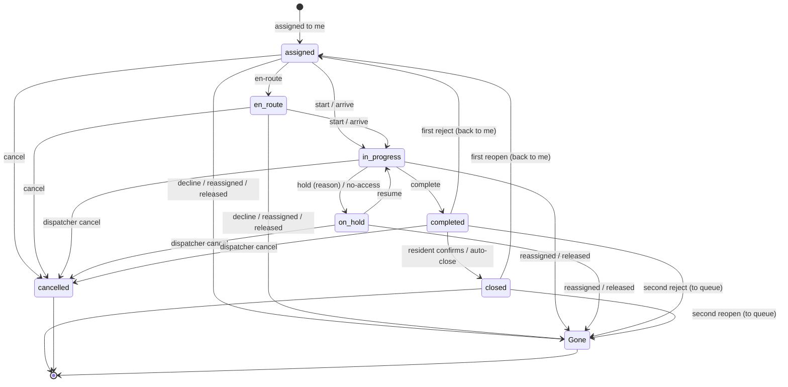

# تطبيق الفني — Technician app

> **التطبيق/الواجهة:** technician app
> **الصلاحيات:** `tickets.work` (الدور الافتراضي `technician`، حساب نوعه staff بيتعمل بـ`POST /accounts` مع `roleKey: technician`)
> **المصادر:** ADR 0032 · ADR 0033 · ADR 0034 · ADR 0038 · `src/maintenance/tickets/technician-tickets.controller.ts` · `src/maintenance/tickets/work.service.ts` · `src/maintenance/dispatch/availability.*`

## الفكرة باختصار
الفني بيشوف **البلاغات المُسندة له دلوقتي بس**، ويمشّي الشغل: "في الطريق" (اختياري) → "ابدأ" → "إيقاف مؤقت" بسبب / "استكمال" → "تم". قبل ما يبدأ يقدر "يعتذر" عن البلاغ بسبب فيرجع للطابور. بيضيف صور قبل/بعد، بيكلم الساكن والمشرف من محادثة البلاغ، بيرتب الزيارات، وبيحدد هو متاح لاستقبال بلاغات جديدة ولا لأ. الفني عمره ما يشوف تقييمات أو تعليقات السكان، ولا موبايل حد إلا لو الساكن وافق.

## الأدوار ومين بيعمل إيه

| الدور | بيعمل إيه |
|---|---|
| الفني (`tickets.work`) | يشوف بلاغاته، يغيّر حالتها، يعتذر، يضيف صور، يكتب رسائل (منها داخلية للستاف)، يدير الزيارات من ناحيته، يحدد إتاحته. |
| المشرف/المدير (`tickets.dispatch`) | بيسند ويعيد الإسناد ويغير الأولوية/التصنيف ويلغي، وبيقدر يحدد إتاحة الفني (راجع `04-dispatch-dashboard.md` و`06-maintenance-setup.md`). |
| الساكن | بيأكد/يرفض الشغل، بيرد على الزيارات (راجع `01-resident-tickets.md` و`02-visits-scheduling.md`). |
| النظام | المحرك بيسند للفني لو هو `available`؛ إيقاف الحساب أو فقد الصلاحية بيرجّع بلاغاته للطابور. |

## الشاشات اللي الفيتشر محتاجها
- **سويتش الإتاحة (Available / Unavailable):** في الهوم أو البروفايل، مع "من إمتى".
- **قايمة بلاغاتي:** بفلتر حالة، ومقترح تبويبات: "جديد عليّا" (`assigned`)، "شغال" (`en_route`/`in_progress`/`on_hold`)، "مستني الساكن" (`completed`)، "منتهي" (`closed`/`cancelled`).
- **تفاصيل البلاغ:** المكان، التصنيف، الأولوية، الوصف، الصور، اسم صاحب البلاغ الأول، والموبايل لو متاح، وأزرار الحالة.
- **Sheet إيقاف مؤقت:** اختيار السبب.
- **Dialog الاعتذار عن البلاغ:** اختيار السبب + تأكيد إنه هيختفي من عندك.
- **إضافة صورة:** قبل/بعد (رفع الملف ثم ربطه).
- **تأكيد "تم الشغل":** مقترح شاشة ملخص تفكّر بصور "بعد" قبل الضغط.
- **المحادثة:** مع سويتش "داخلي (للستاف بس)".
- **زيارات البلاغ:** اقتراح ميعاد، تأكيد/اقتراح بديل، إعادة جدولة، إلغاء، "وصلت"، "تم"، "مافيش حد فتح" (التفاصيل في `02-visits-scheduling.md`).

## الفلو خطوة بخطوة

### 1. الإتاحة (هل أنا متاح أستقبل بلاغات؟)
1. أول ما يفتح التطبيق → `GET /technician/availability` → `{ state, since }`.
   - **الفني اللي عمره ما حدد = `unavailable`** و`since = null`. يعني المحرك مش هيسند له حاجة لحد ما يفعّل نفسه. اعرض رسالة ترحيب واضحة: "فعّل الإتاحة عشان تستقبل بلاغات".
2. يغيّر → `POST /technician/availability` بـ`{ state: "available" | "unavailable" }` → 200 `{ state, since }`. من غير سبب.
   - نفس الحالة الحالية = مافيش تغيير (بيرجع الحالة زي ما هي).
3. لو بقى `available` (وكان مش متاح): المحرك بيجرب لحد 20 بلاغ في الطابور ينفعوا له (تخصصاته، ومش رافضهم قبل كده)، الطوارئ أولًا. **ده بيحصل بس لو المدير مشغّل التوزيع التلقائي.** كل بلاغ بيروح للأقل حِمل، مش شرط يكون هو. أي بلاغ يتسند له يوصله `ticket.assigned`.
4. لو بقى `unavailable`: **البلاغات اللي في إيده بتفضل معاه**؛ بس مش هياخد جديد من المحرك. (المشرف لسه يقدر يسند له يدويًا.)
5. المشرف كمان يقدر يغيّر إتاحته (مثلًا `unavailable` بسبب `sick`). الفني مابيوصلوش إشعار بكده؛ هيشوف الحالة الجديدة لما يقرا.
6. لو حسابه اتوقف أو اتجمد أو دوره فقد `tickets.work`: الإتاحة تبقى `unavailable` تلقائيًا، وبلاغاته المفتوحة ترجع للطابور. لما يرجع، لازم يفعّل نفسه تاني.

### 2. قايمة بلاغاتي
1. → `GET /technician/tickets` (اختياري `status`، و`cursor`/`limit`) → `{ data, nextCursor }`، الأحدث إنشاءً أولًا.
2. بتشمل كل بلاغ **مسجل باسمه دلوقتي** في أي حالة: المفتوح، و`completed` و`closed` (بيفضلوا باسمه)، و`cancelled` لو اتلغى وهو معاه.
3. **مش بتشمل:** بلاغ اعتذر عنه، أو اتسند لحد تاني، أو رجع للطابور. أي واحد من دول = `TICKET_NOT_FOUND` لو فتحه من إشعار قديم → اعرض "البلاغ لم يعد مسندًا إليك" وارجع للقايمة.
4. الصف: رقم البلاغ، كود الوحدة أو اسم المنطقة المشتركة، الغرفة، التصنيف، النوع (إصلاح/وقائي)، الأولوية، الحالة، سبب الإيقاف، وقت الإسناد، وقت الإنشاء. **مافيش SLA ولا عدّاد وقت** عند الفني.

### 3. تفاصيل البلاغ
1. → `GET /technician/tickets/{id}` (no-store).
2. فيه زيادة على الصف: الوصف، `cycle`، `rejectionCount`، `confirmationStatus`، `reporterFirstName`، `reporterPhone`، `photos`.
3. **قواعد `reporterPhone`:** بيرجع رقم بس لو **كل** دول متحققين لحظة القراءة:
   - أنت فني البلاغ دلوقتي؛
   - الحالة `assigned` أو `en_route` أو `in_progress` أو `on_hold`؛
   - حساب صاحب البلاغ نشط وعنده موبايل؛
   - صاحب البلاغ لسه عنده `tickets` على الوحدة (أو على أي وحدة للمنطقة المشتركة)؛
   - صاحب البلاغ موافق على مشاركة الموبايل (`ticket_phone_share`، بالنسخة الحالية).
   - غير كده `null`. **ممكن يبقى null بين قراءتين** (سحب الموافقة، أو الشغل خلص). لما يكون null: اخفي زرار الاتصال واعرض "تواصل عبر الرسائل".
4. **اللي الفني عمره ما يشوفه:** التقييمات والتعليقات ومين قيّم، تاريخ البلاغ، مين اعتذر قبله، الإيميل، الاسم الكامل لأي حد (الاسم الأول بس)، الـSLA.
5. لو `rejectionCount > 0` و`confirmationStatus = rejected`: البلاغ راجع له بعد رفض الساكن؛ اعرض بانر "الساكن رفض الشغل — شوف الرسائل" (ملاحظة الرفض موجودة كرسالة من الساكن).
6. لو `kind = preventive`: الوصف ممكن يبقى `''`؛ اعرض اسم الخدمة من `preventiveService` والميعاد المطلوب `requestedStartsAt`/`requestedEndsAt`.

### 4. في الطريق (اختياري)
1. متاح لما `status = assigned` بس.
2. → `POST /technician/tickets/{id}/en-route` → 204. الحالة `en_route`.
3. صاحب البلاغ يوصله `ticket.status_changed` (`status: en_route`). وده بيحسب كـ"رد" في الـSLA.
4. مافيش تتبع موقع؛ ده مجرد حالة.

### 5. ابدأ الشغل
1. متاح من `assigned` أو `en_route`.
2. → `POST /technician/tickets/{id}/start` → 204. الحالة `in_progress`.
3. صاحب البلاغ يوصله `ticket.status_changed` (`in_progress`).
4. بديل: زرار "وصلت" في الزيارة بيبدأ البلاغ تلقائيًا (لو كان `assigned` أو `en_route`).

### 6. إيقاف مؤقت واستكمال
1. **إيقاف** متاح من `in_progress` بس. اختار سبب:
   - `awaiting_resident` — مستني الساكن (بيوقف ساعات الـSLA)
   - `awaiting_parts` — مستني قطع غيار (بيوقف ساعات الـSLA)
   - `other` — سبب تاني (**مابيوقفش** الـSLA)
2. → `POST /technician/tickets/{id}/hold` بـ`{ holdReason }` → 204. الحالة `on_hold`.
3. صاحب البلاغ يوصله `ticket.status_changed` (`on_hold` + `holdReason`).
4. **استكمال** متاح من `on_hold` → `POST /technician/tickets/{id}/resume` → 204 → `in_progress`، وصاحب البلاغ يتبلغ.
5. "مافيش حد فتح" في زيارة والبلاغ `in_progress` بيعمله `on_hold` بسبب `awaiting_resident` تلقائيًا.
6. مقترح للـUI: اقترح على الفني يكتب رسالة للساكن يشرح فيها.

### 7. صور قبل/بعد
1. متاحة لما الحالة `in_progress` أو `on_hold` بس (يعني **بعد** "ابدأ"؛ مش قبلها).
2. ارفع الملف الأول (راجع README: `POST /files/uploads` بغرض `ticket_photo` → PUT → finalize). JPEG/PNG/WebP، 5MB.
3. → `POST /technician/tickets/{id}/photos` بـ`{ fileId, kind: "before" | "after" }` → 201 `{ id, kind, cycle, createdAt }`.
4. الحد: **10 صور (قبل + بعد مع بعض) لكل دورة**. بعدها 409 `TICKET_PHOTO_LIMIT_REACHED` (`params.max = 10`). الصور مابتتمسحش.
5. ملف مش بتاعك أو مش finalized أو اتستخدم قبل كده → 400 (`fileId`: `FILE_NOT_AVAILABLE`).

### 8. تم الشغل
1. متاح من `in_progress` بس (لو `on_hold` لازم "استكمال" الأول).
2. → `POST /technician/tickets/{id}/complete` → 204. **مافيش body**: لا ملاحظة ولا صور إجبارية. الصور تتضاف قبلها، والملاحظة تتكتب رسالة.
3. الحالة `completed` و`confirmationStatus = pending`. صاحب البلاغ يوصله `ticket.completed` (اطلب منه يأكد).
4. أي زيارة مقترحة/مؤكدة بتتلغي (`ticket_completed`)، والزيارة اللي الفني "وصل" فيها بتبقى `done`.
5. بعدها:
   - الساكن يأكد → `closed`، والفني يوصله `ticket.status_changed` (`closed`). **من غير التقييم.**
   - الساكن يرفض (أول مرة) → يرجع للفني نفسه `assigned` بدورة جديدة، والفني يوصله `ticket.rejected` (و`rejectionCount`). ملاحظة الرفض في الرسائل.
   - رفض تاني → البلاغ يروح الطابور (تصعيد) ويختفي من عند الفني.
   - محدش رد خلال `autoCloseHours` (72 ساعة افتراضي) → يتقفل تلقائيًا. **الفني مابيوصلوش إشعار بالإغلاق التلقائي.**
   - إعادة فتح من الساكن خلال `reopenDays` → نفس قاعدة الرفض (`ticket.reopened`).

### 9. الاعتذار عن البلاغ (decline)
1. متاح **قبل البدء بس**: `assigned` أو `en_route`. بعد "ابدأ" مافيش اعتذار؛ الفني يكلم المشرف وهو يعيد الإسناد.
2. اختار سبب (`ticketDecline`):
   - `not_my_specialty` — مش تخصصي
   - `unavailable` — مش متاح
   - `needs_parts_or_tools` — محتاج قطع أو عدّة
   - `unsafe` — غير آمن
   - `other` — سبب تاني
3. → `POST /technician/tickets/{id}/decline` بـ`{ reasonCode }` → 204.
4. اللي بيحصل بعدها:
   - البلاغ يرجع `new` من غير فني، و**يختفي من قايمتك فورًا**.
   - كل المشرفين يوصلهم `ticket.declined`.
   - أي زيارة نشطة تتلغي (`technician_changed`).
   - المحرك (لو شغال) يدوّر على فني تاني، و**عمره ما يرجّعه لك** في أي دورة. المشرف بس يقدر يسنده لك يدويًا.
   - **الاعتذار مابيغيرش إتاحتك.** لو سبب الاعتذار `unavailable`، اقترح في الـUI تقفل الإتاحة كمان.
5. Dialog تأكيد: "البلاغ هيرجع للمشرف ومش هتقدر تشوفه تاني".

### 10. الرسائل
1. → `GET /technician/tickets/{id}/messages` (الأقدم أولًا، بصفحات): كل الرسائل بما فيها الداخلية. المرسل `{ firstName }` بس (من غير id)، أو `{ erased: true }`. `mine = true` للرسائل بتاعتك. `senderKind`: `resident` / `staff` / `manager`.
2. → `POST /technician/tickets/{id}/messages` بـ`{ body, internal? }` (ابعت `Idempotency-Key`) → 201 `{ id, createdAt }`.
   - `body` 1–2000 حرف.
   - `internal: true` = للمشرفين بس، الساكن مايشوفهاش. ميّزها بصريًا.
3. ممنوعة على `closed` و`cancelled` (409 `TICKET_INVALID_TRANSITION`). القراءة مسموحة.
4. اللي بيتبلغ برسالتك: المشرفين، و(لو مش داخلية) صاحب البلاغ ومين فتحه والساكن الأساسي للوحدة.

### 11. الزيارات من ناحية الفني
متاحة لما البلاغ `assigned` أو `en_route` أو `in_progress` أو `on_hold`، وللوحدات بس (مش المنطقة المشتركة). زيارة نشطة واحدة بس لكل بلاغ. التفاصيل الكاملة في `02-visits-scheduling.md`. الأزرار:

| الزرار | Endpoint | إمتى يظهر |
|---|---|---|
| عرض الزيارات | `GET /technician/tickets/{id}/visits` | دايمًا (زياراتك بس) |
| اقتراح ميعاد | `POST /technician/tickets/{id}/visits` (`startsAt`, `endsAt`) | مافيش زيارة نشطة. أول اقتراح منك بيحسب "رد" في الـSLA. |
| تأكيد اقتراح السكان | `POST …/visits/{visitId}/confirm` | زيارة `proposed` من ناحية السكان (ومنها الاقتراح التلقائي للبلاغ الوقائي) وميعادها لسه مجاش |
| اقتراح بديل | `POST …/visits/{visitId}/counter` | زيارة `proposed` |
| إعادة جدولة | `POST …/visits/{visitId}/reschedule` (ميعاد + `reasonCode`) | زيارة `confirmed` |
| إلغاء | `POST …/visits/{visitId}/cancel` (`reasonCode`) | `proposed` أو `confirmed` |
| وصلت | `POST …/visits/{visitId}/arrive` | `confirmed`، ومن 30 دقيقة قبل البداية لحد ساعتين بعد النهاية. بيرجع الزيارة وفيها `absenceEntryApproved` (مسموح تدخل والبيت فاضي؟) و`receiver` (الاسم الأول والنوع). بيبدأ البلاغ لو `assigned`/`en_route`. |
| تم | `POST …/visits/{visitId}/done` | `arrived` |
| مافيش حد فتح | `POST …/visits/{visitId}/no-access` | `arrived`. بيعمل البلاغ `on_hold` (`awaiting_resident`) لو كان `in_progress`. |

## الحالات (Statuses)

| الحالة | المعنى عند الفني | مين بيحركها |
|---|---|---|
| `assigned` | بلاغ جديد عليّا، لسه مابدأتش | المشرف/المحرك (إسناد)، أو رفض الساكن الأول |
| `en_route` | أنا في الطريق | الفني |
| `in_progress` | شغال فيه | الفني (ابدأ/استكمل) أو "وصلت" |
| `on_hold` | واقف مؤقتًا (`holdReason`) | الفني أو "مافيش حد فتح" |
| `completed` | خلّصت، مستني الساكن | الفني |
| `closed` | اتقفل | الساكن أو الإغلاق التلقائي |
| `cancelled` | اتلغى | الساكن (قبل البدء) أو المشرف |
| (يختفي) | اعتذرت، أو اتسند لحد تاني، أو رجع للطابور | الفني / المشرف / النظام |

## البيانات اللي بتظهر

### صف القايمة (`TechnicianTicketView`)

| الحقل | المعنى |
|---|---|
| `id`, `number` | `MT-000123` |
| `unitCode` / `commonArea` | واحد منهم بس |
| `unitLocation` | الغرفة (`kitchen`, `bathroom`, `living_room`, `bedroom`, `balcony`, `other`) أو null |
| `category` | `{ id, key, nameAr, nameEn }` |
| `kind`, `preventiveService`, `requestedStartsAt`, `requestedEndsAt` | الوقائي |
| `priority` | `normal` / `urgent` / `emergency` (ميّز الطوارئ بصريًا) |
| `status`, `holdReason` | |
| `assignedAt`, `createdAt` | |

### التفاصيل (`TechnicianTicketDetailView`) = الصف +

| الحقل | المعنى |
|---|---|
| `description` | الوصف (`''` لوقائي من غير ملاحظة) |
| `cycle`, `rejectionCount`, `confirmationStatus` | |
| `reporterFirstName` | الاسم الأول بس، أو null لو اتمسح |
| `reporterPhone` | بالقواعد اللي فوق، أو null |
| `photos[]` | `{ id, kind: report/before/after, cycle, url, expiresAt }`؛ الـurl مؤقت (no-store) |

### مش موجود عند الفني
SLA، تقييمات، تعليقات، تاريخ الحالات، الإسنادات، مين اعتذر، الاسم الكامل أو أي id لأي حد في الرسائل، إيميل، تاريخ إتاحته، حِمله، تخصصاته (`GET /technician/availability` بيرجع الحالة بس). متوسط تقييمه **مش متاح** (مافيش endpoint).

## القواعد والقيود

| الأكشن | من أي حالة |
|---|---|
| في الطريق `en-route` | `assigned` |
| ابدأ `start` | `assigned`, `en_route` |
| إيقاف `hold` | `in_progress` |
| استكمال `resume` | `on_hold` |
| تم `complete` | `in_progress` |
| اعتذار `decline` | `assigned`, `en_route` |
| صور قبل/بعد | `in_progress`, `on_hold` |
| رسالة | كل الحالات ما عدا `closed`, `cancelled` |
| زيارات | `assigned`, `en_route`, `in_progress`, `on_hold` |

- كل أكشن بيتأكد من الحالة بعد ما يقفل البلاغ؛ لو حد سبقك (المشرف أعاد الإسناد مثلًا) هتاخد 409 أو 404.
- `holdReason` إجباري في الإيقاف، و`reasonCode` إجباري في الاعتذار.
- الصور: 10 قبل+بعد لكل دورة (بتتصفر مع كل رفض/إعادة فتح لأن الدورة بتزيد).
- الرسائل: `Idempotency-Key` مدعوم.
- أكشنز الحالة بترجع 204؛ أعد قراءة التفاصيل بعدها.
- الإتاحة: الفني مابيبعتش سبب. لما يفعّل نفسه، بلاغات تتسند له بس لو المدير شغّل التوزيع التلقائي.

## الأخطاء اللي الـUI لازم يتعامل معاها

| HTTP + `code` | إمتى | رسالة / سلوك مقترح |
|---|---|---|
| 404 `TICKET_NOT_FOUND` | البلاغ مش مسند لك (اعتذرت، اتسند لغيرك، رجع للطابور) | "البلاغ لم يعد مسندًا إليك" وارجع للقايمة. |
| 409 `TICKET_INVALID_TRANSITION` (`params.status`) | الأكشن مش مسموح في الحالة دي | "حالة البلاغ اتغيرت" وأعد التحميل. |
| 400 `REASON_REQUIRED` | اعتذار من غير سبب | علّم السبب. |
| 400 `VALIDATION_FAILED` → `INVALID_REASON_CODE` / `INVALID_VALUE` | سبب أو `holdReason` أو `kind` أو `state` قيمة غلط | (bug في الـUI). |
| 409 `TICKET_PHOTO_LIMIT_REACHED` (`params.max`) | وصلت 10 صور في الدورة | "وصلت للحد الأقصى للصور". |
| 400 `VALIDATION_FAILED` → `FILE_NOT_AVAILABLE` (`fileId`) | الملف مش جاهز أو مش بتاعك | ارفع الصورة تاني. |
| 400 `VALIDATION_FAILED` → `INVALID_LENGTH` (`body`) | رسالة فاضية أو أطول من 2000 | |
| 401 `UNAUTHENTICATED` | إرسال رسالة وحسابك مش نشط | تسجيل خروج. |
| 403 `FORBIDDEN` | الدور فقد `tickets.work` | "ليس لديك صلاحية" وتسجيل خروج/تحديث. |
| أخطاء الزيارات (`VISIT_OUTSIDE_ARRIVAL_WINDOW`, `VISIT_ALREADY_ACTIVE`, `VISIT_SAME_SIDE`, `VISIT_WINDOW_PASSED`, `VISIT_NOT_FOR_COMMON_AREA`, `VISIT_INVALID_TRANSITION`) | | راجع `02-visits-scheduling.md`. |

## الإشعارات

| الحدث | `kind` | مين | push | الضغط يفتح |
|---|---|---|---|---|
| بلاغ اتسند لك (يدوي أو تلقائي أو إعادة إسناد) | `ticket.assigned` (`priority`, `categoryKey`) | الفني | **حرِج (دايمًا)** | تفاصيل البلاغ |
| البلاغ اتسند لحد تاني | `ticket.unassigned` | الفني القديم | حسب التفضيلات | القايمة (البلاغ مش هيفتح) |
| الأولوية اتغيرت | `ticket.priority_changed` (`priority`) | الفني | حسب التفضيلات | التفاصيل |
| التصنيف اتغير | `ticket.category_changed` (`categoryKey`) | الفني | حسب التفضيلات | التفاصيل |
| الساكن رفض الشغل (أول مرة) | `ticket.rejected` (`rejectionCount`) | الفني اللي رجع له + المشرفين | حسب التفضيلات | الرسائل |
| الساكن أعاد الفتح (أول مرة) | `ticket.reopened` | الفني + المشرفين | حسب التفضيلات | الرسائل |
| الساكن أكد → اتقفل | `ticket.status_changed` (`closed`) | الفني | حسب التفضيلات | التفاصيل |
| اتلغى | `ticket.status_changed` (`cancelled`) | الفني | حسب التفضيلات | التفاصيل |
| رسالة جديدة | `ticket.message` | الفني (ما عدا لو هو الكاتب) | حسب التفضيلات | الرسائل |
| اقتراح ميعاد من السكان / تأكيد / إلغاء / تأكيد الوصول | `ticket.visit_proposed`, `ticket.visit_confirmed`, `ticket.visit_cancelled`, `ticket.visit_arrival_confirmed` | الفني | حسب التفضيلات | الزيارات |

ملاحظات: الإشعارات فيها رقم البلاغ وكود الوحدة (إشعارات الزيارات فيها الرقم والميعاد بس). الفني **مابيوصلوش** إشعار بالإغلاق التلقائي، ولا بتغيير إتاحته من المشرف، ولا لما الساكن يصعّد. ولما يعتذر، الإشعار بيروح للمشرفين بس.

## الـEndpoints

| Method + path | مين | الغرض | الرد |
|---|---|---|---|
| `GET /technician/availability` | `tickets.work` | إتاحتي | 200 `{ state, since }` |
| `POST /technician/availability` | `tickets.work` | `{ state }` | 200 `{ state, since }` |
| `GET /technician/tickets` | `tickets.work` | بلاغاتي (`status`, `cursor`, `limit`) | 200 `{ data: TechnicianTicketView[], nextCursor }` |
| `GET /technician/tickets/{id}` | `tickets.work` | التفاصيل (no-store) | 200 `TechnicianTicketDetailView` |
| `POST /technician/tickets/{id}/en-route` | `tickets.work` | في الطريق | 204 |
| `POST /technician/tickets/{id}/start` | `tickets.work` | ابدأ | 204 |
| `POST /technician/tickets/{id}/hold` | `tickets.work` | `{ holdReason }` | 204 |
| `POST /technician/tickets/{id}/resume` | `tickets.work` | استكمال | 204 |
| `POST /technician/tickets/{id}/complete` | `tickets.work` | تم | 204 |
| `POST /technician/tickets/{id}/decline` | `tickets.work` | `{ reasonCode }` | 204 |
| `POST /technician/tickets/{id}/photos` | `tickets.work` | `{ fileId, kind }` | 201 `{ id, kind, cycle, createdAt }` |
| `GET /technician/tickets/{id}/messages` | `tickets.work` | المحادثة | 200 `{ data, nextCursor }` |
| `POST /technician/tickets/{id}/messages` | `tickets.work` | `{ body, internal? }` (Idempotency) | 201 `{ id, createdAt }` |
| `GET`/`POST /technician/tickets/{id}/visits…` | `tickets.work` | الزيارات | راجع `02-visits-scheduling.md` |

## ملاحظات للديزاين وحاجات ناقصة في الباك
- **"تم" مالوش body**: مافيش ملاحظة إكمال ولا صور "بعد" إجبارية. لو الديزاين عايز ملخص إكمال أو يجبر على صورة، ده مش موجود في الباك؛ الملاحظة تتكتب رسالة.
- **صور "قبل" مش متاحة قبل "ابدأ"** (`in_progress`/`on_hold` بس).
- **مافيش "قبول" صريح للبلاغ**: الإسناد نفسه هو القبول؛ "في الطريق" أو "ابدأ" هما أول أكشن، والبديل الوحيد هو الاعتذار.
- **متوسط تقييم الفني**: الـADR بيسمح يتعرض له متوسطه وعدده بس، مافيش endpoint بيحسبه.
- **مافيش تتبع موقع** ولا ETA في "في الطريق".
- **مافيش إحصائيات** للفني (عدد المنجز، الحِمل، تخصصاته) — حتى تخصصاته مابيقدرش يقراها.
- **الإتاحة `unavailable` مابترجعش البلاغات المفتوحة**، والرفض الأول للساكن بيرجع البلاغ للفني حتى لو هو `unavailable` (القاعدة بتشوف إنه ستاف نشط عنده `tickets.work` بس).
- الفني مابيتبلغش لما المشرف يغيّر إتاحته، ولا بالإغلاق التلقائي.
- مافيش جدول ساعات عمل للفني ولا أيام إجازة (المواعيد المقترحة على السكان بتتجاهلها).

## في الموقع: الأصول، القوائم، والمهام المخططة (ADR 0064)
> بصلاحية `assets.read` (موجودة عند الفني).

- **مسح تاج:** `POST /technician/scan { code }` → `{ kind: asset, asset: { asset, events, readings } }` أو `{ kind: area, area }`. أي حاجة مش تاج حالي = `404 TAG_NOT_RECOGNIZED`. ٦٠ مسح في الدقيقة.
- **كارت الأصل:** `GET /technician/assets/:id`: الكارت، آخر ٢٠ حدث، وكل قراءة بجنب اللي قبلها (للمقارنة).
- **قراءات بإيدك:** `POST /technician/assets/:id/readings { readings: [{ metricKey, value, unit?, occurredAt }] }` (+ `Idempotency-Key`)؛ `occurredAt` بالـoffset، في آخر ٣٠ يوم ومش في المستقبل. ممكن تفتح صيانة بالاستخدام.
- **عطل لقيته:** `POST /technician/assets/:id/faults { description, priority?, photoFileIds? }` → أمر عمل `origin: field`. لو الأصل جوه وحدة: أهل الوحدة بيشوفوه وبيشوفوا زياراته (عشان تدخل).
- **توصية استبدال:** `POST /technician/assets/:id/replacement-recommendations { reasonCode, note? }` (`replacementReason`): واحدة بس مستنية لكل أصل (`409 REPLACEMENT_RECOMMENDATION_EXISTS`).
- **قائمة الفحص بتاعة أمر العمل:** `GET /technician/tickets/:id/checklist` · `PUT …/checklist/items/:itemId` (وانت شغال أو موقف مؤقت) · `POST …/checklist/submit`. ما ينفعش "تم" والقائمة مفتوحة (`409 CHECKLIST_NOT_SUBMITTED`).
- **الجاي في تخصصي:** `GET /technician/plans/upcoming`: الخطط اللي ميعادها خلال ٣٠ يوم في فئات تخصصاتي، وأوامر العمل المخططة اللي معايا.
- **ترتيب بالأولوية:** `GET /technician/tickets?sort=priority`: الطوارئ ثم العاجل ثم العادي (الأحدث جوه كل واحدة)؛ الـcursor بتاعه خاص بيه.

## القطع، اللي اتعمل، وعرض السعر (ADR 0065)
- **القطع:** يدوّر في الكتالوج (`GET /technician/stock/items?q=`، فيه ولا لأ)، يطلب على البلاغ وهو في إيده، يلغي قبل الصرف، ويرجّع اللي ماستخدمهوش. لما المخزن يحجز بيوصله `part_request.reserved`، ولو رفض `part_request.declined` بالسبب. التفاصيل في [10-stock](10-stock.md).
- **اللي اتعمل:** مع الإتمام `{ actionCode, note? }` — الساكن بيشوف الكود بس.
- **عرض سعر:** لو لقى تكلفة قبل ما يبدأ: `POST /technician/tickets/:id/quote-suggestions`، والتوزيع يبعته للسكان أو يرفضه ([11-costs-and-quotes](11-costs-and-quotes.md)).
- **أدائي:** `GET /technician/stats?from=&to=`.

## العدادات (ADR 0066)
> بصلاحية `meters.record` (موجودة عند الفني) — مش `energy.read`: الفني مابيشوفش استهلاك الوحدات.

- `GET /technician/meters/:id`: كود العداد ونوعه ومكانه، آخر قراءة حية، والمدى المتوقع للنهارده.
- `POST /technician/meters/:id/readings { readOn, value, reset? }` (+ `Idempotency-Key`): يوم الكمبوند، قراءة واحدة في اليوم، والعداد التراكمي مابيرجعش لورا إلا لو `reset`. التفاصيل في [14-energy](14-energy.md).

## السلامة في الموقع (ADR 0067)
> بصلاحية `tickets.work`، على البلاغ اللي في إيده، من غير وردية.

- **تصريح عمل:** `POST /technician/tickets/:id/permits { hazard, precautions, expiresAt }` للمخاطر اللي الفئة أو نوع الأصل محتاجينها؛ الشغل مايبدأش ولا يرجع من الإيقاف من غير تصريح ساري. التفاصيل في [17-field-safety](17-field-safety.md).
- **تعليمات السلامة:** `GET /technician/tickets/:id/safety` و`POST …/safety/acknowledge { instructionId }` قبل البدء.
- **إصابة أو قرب حادثة أو خطر:** `POST /technician/tickets/:id/incidents { type, severity, occurredAt, description, photoFileIds? }` (`injury | near_miss | hazard`، لحد ٥ صور `incident_photo`). المكان مكان البلاغ.
- **SOS:** `POST /technician/tickets/:id/sos { type }` (`medical | fire | security | facilities`): الحرس في الوردية والمستجيبين والإدارة بيتبلغوا؛ واحد مفتوح لكل بلاغ (التكرار = ٢٠٠ بنفسه).
- **طلب إلغاء:** `POST …/sos/cancel-request { reasonCode? }` بيتسجل مرة ويتبلغ للمستجيبين (`emergency.cancel_requested`)، لكن الاستغاثة **بتفضل مفتوحة** لحد ما مستجيب أو الإدارة يقفلوها (`POST /gate/emergencies/:id/resolve`) — اللي تحت ضغط ممكن يتجبر يلغي. الشاشة تقول "اتبعت طلب الإلغاء" مش "اتلغت".
