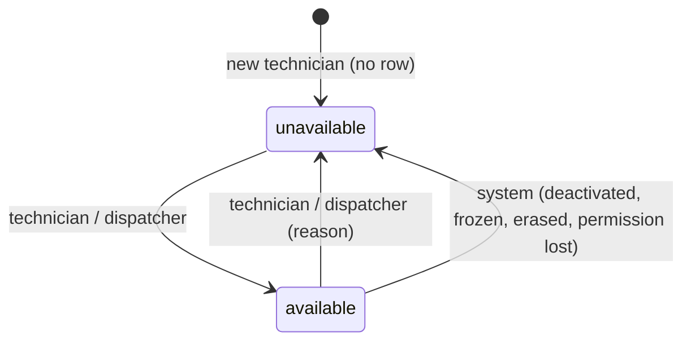
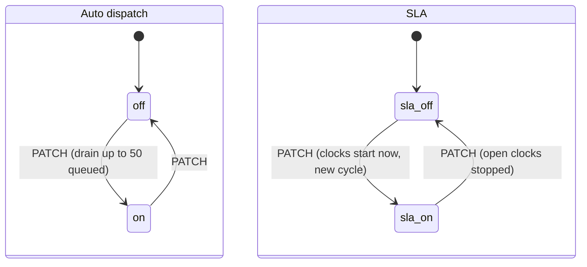

# إعدادات الصيانة — Maintenance setup

> **التطبيق/الواجهة:** manager dashboard
> **الصلاحيات:** `maintenance.manage` (الدور الافتراضي `manager` بس) للتصنيفات وتخصصاتها وأهداف الـSLA، والتخصصات (إنشاء/تعديل)، وإعدادات التوزيع والـSLA والصيانة. `tickets.dispatch` (`maintenance_supervisor` و`manager`) لقايمة الفنيين وتحديد تخصصاتهم وإتاحتهم. قراءة قايمة التخصصات: `tickets.dispatch` **أو** `maintenance.manage`.
> **المصادر:** ADR 0032 · ADR 0033 · ADR 0034 · ADR 0038 · `src/maintenance/categories/` · `src/maintenance/specialties/` · `src/maintenance/dispatch/` · `src/maintenance/sla/` · `src/maintenance/settings/` · `src/maintenance/provisioning.ts`

## الفكرة باختصار
قبل ما الصيانة تشتغل كويس، المدير بيظبط: **التصنيفات** (سباكة، كهرباء...) وأولويتها الافتراضية وأهداف الـSLA بتاعتها والتخصصات اللي تقدر تتعامل معاها؛ **التخصصات** نفسها؛ **الفريق** (تخصصات كل فني وإتاحته — ودي شغل المشرف كمان)؛ **التوزيع التلقائي** (تشغيله وأوزان الحِمل)؛ **الـSLA** (تشغيله)؛ و**إعدادات عامة** (الإغلاق التلقائي، مدة إعادة الفتح، عدد الصور، ساعات الزيارة). كل كمبوند جديد بيبدأ بقيم افتراضية جاهزة، والتوزيع التلقائي والـSLA مقفولين لحد ما المدير يشغلهم.

## الأدوار ومين بيعمل إيه

| الدور | بيعمل إيه |
|---|---|
| `manager` (`maintenance.manage` + `tickets.dispatch`) | كل الشاشات اللي هنا. |
| `maintenance_supervisor` (`tickets.dispatch`) | قايمة الفنيين، تعديل تخصصات الفني، تعديل إتاحة الفني، قراءة التخصصات. **مايقدرش** يعدل التصنيفات أو التخصصات أو الإعدادات، ولا يقرا `/maintenance/categories`. |
| الفني | بيحدد إتاحته بنفسه بس (راجع `05-technician-app.md`). |
| النظام | بيزرع القيم الافتراضية مع إنشاء الكمبوند؛ بيخلي الفني `unavailable` لو حسابه اتوقف أو فقد الصلاحية. |

## الشاشات اللي الفيتشر محتاجها
- **التصنيفات:** قايمة (بما فيها الموقوفة) + فورم إنشاء + فورم تعديل.
- **تفاصيل تصنيف:** الأسماء، الأولوية الافتراضية، يسمح بالمنطقة المشتركة، نشط؛ + محرر "التخصصات المطلوبة" (multi-select)؛ + محرر "أهداف الـSLA" (جدول 3 أولويات × رد/حل).
- **التخصصات:** قايمة + إنشاء + تعديل (اسم، إيقاف).
- **الفريق (الفنيين):** قايمة بالحِمل والتخصصات والإتاحة؛ Sheet "تخصصات الفني" (multi-select)؛ Dialog "تغيير الإتاحة" (مع سبب لما يبقى غير متاح).
- **إعدادات التوزيع:** سويتش التوزيع التلقائي (مع تحذير وتأكيد) + أوزان الحالات ومضاعفات الأولوية (قسم "متقدم").
- **إعدادات الـSLA:** سويتش التشغيل + `enabledAt`.
- **الإعدادات العامة:** الإغلاق التلقائي، أيام إعادة الفتح، عدد صور البلاغ، ساعات الزيارة وطول الـslot.
- **الخدمات الوقائية:** راجع `03-preventive-maintenance.md`.

## الفلو خطوة بخطوة

### 1. التصنيفات
1. **القايمة** → `GET /maintenance/categories` (`maintenance.manage`) → كل التصنيفات مرتبة بالـ`key`، بما فيها الموقوفة، من غير صفحات. كل تصنيف فيه `specialtyIds` و`slaTargets`.
2. **إنشاء** → `POST /maintenance/categories`:
   - `key` (مطلوب): حروف إنجليزي صغيرة وأرقام و`_`، يبدأ بحرف، 2–40 حرف (`^[a-z][a-z0-9_]{1,39}$`). **مايتغيرش بعد الإنشاء** — وضّح ده في الفورم.
   - `nameAr`, `nameEn` (مطلوبين، 1–80 حرف).
   - `defaultPriority` (اختياري، افتراضي `normal`).
   - `commonAreaAllowed` (اختياري، افتراضي `true`).
   - الرد 201 بالتصنيف كامل. التصنيف الجديد **بياخد أهداف الـSLA الافتراضية** تلقائيًا، و**مالوش تخصصات** (يعني أي فني ممكن ياخده لحد ما تحدد).
   - `key` مكرر → 409 `DUPLICATE_RESOURCE` على `key`.
3. **تعديل** → `PATCH /maintenance/categories/{id}`: أي من `nameAr`, `nameEn`, `defaultPriority`, `commonAreaAllowed`, `active` → 200 بالتصنيف.
   - `active: false` = **إيقاف**: مش هيظهر للسكان ولا للمشرف عند فتح بلاغ أو تغيير التصنيف، والبلاغات القديمة بتفضل عليه. الخدمات الوقائية اللي عليه بتختفي من عند السكان. مافيش حذف.
   - `commonAreaAllowed: false` مابيأثرش على بلاغات موجودة.
4. **التخصصات المطلوبة** → `PUT /maintenance/categories/{id}/specialties` بـ`{ specialtyIds: [...] }` → 204.
   - بيستبدل المجموعة كلها. **قايمة فاضية = أي فني ممكن ياخد التصنيف.**
   - التخصصات لازم تكون نشطة (وإلا 400 `SPECIALTY_NOT_AVAILABLE` على `specialtyIds.{i}`). أقصى 50، من غير تكرار.
   - المعنى: الفني لازم يكون عنده **واحد على الأقل** منهم.
   - مابيشغلش المحرك على الطابور؛ التغيير يبان من أول محاولة جاية.
5. **أهداف الـSLA** → `PUT /maintenance/categories/{id}/sla-targets` → 204. لازم تبعت الـ3 أولويات مع بعض:
   ```json
   { "emergency": { "responseMinutes": 60,   "resolutionMinutes": 1440 },
     "urgent":    { "responseMinutes": 240,  "resolutionMinutes": 4320 },
     "normal":    { "responseMinutes": 1440, "resolutionMinutes": 10080 } }
   ```
   - الرد (`responseMinutes`): 5 دقايق لـ7 أيام (10080). = من فتح البلاغ لحد أول "في الطريق"/"ابدأ"/اقتراح زيارة من الفني.
   - الحل (`resolutionMinutes`): 15 دقيقة لـ30 يوم (43200). = من فتح البلاغ لحد "تم"، من غير وقت انتظار الساكن أو القطع.
   - لازم الرد ≤ الحل، وإلا 400 `SLA_RESPONSE_AFTER_RESOLUTION` على `{priority}.responseMinutes`.
   - **الساعات الشغالة بتحتفظ بهدفها القديم**؛ الأهداف الجديدة بتطبق على الساعات اللي هتبدأ بعد كده (أو لما أولوية/تصنيف بلاغ يتغير).
   - الـUI يعرض بالساعات/الأيام ويحوّل لدقايق.

### 2. التخصصات
1. **القايمة** → `GET /maintenance/specialties` (`tickets.dispatch` أو `maintenance.manage`) → كل التخصصات بالـ`key`، بما فيها الموقوفة: `{ id, key, nameAr, nameEn, active }`.
2. **إنشاء** → `POST /maintenance/specialties` بـ`{ key, nameAr, nameEn }` (نفس قواعد الـkey والأسماء بتاعة التصنيف) → 201. `key` مكرر → 409 `DUPLICATE_RESOURCE`.
3. **تعديل** → `PATCH /maintenance/specialties/{id}` بـ`nameAr`, `nameEn`, `active` → 200.
   - `active: false` = التخصص **مابيتحسبش لأي حد**: لا للتصنيف ولا للفني. تصنيف كل تخصصاته موقوفة = تصنيف من غير تخصصات = أي فني. وضّح ده في Dialog التأكيد.
   - مافيش حذف.

### 3. الفريق (الفنيين)
1. **القايمة** → `GET /maintenance/technicians` (`tickets.dispatch`) → كل حساب ستاف **نشط** دوره فيه `tickets.work`، مرتب بالاسم، من غير صفحات. لكل فني:
   - `fullName`
   - `openTickets`: عدد البلاغات اللي في إيده (`assigned`, `en_route`, `in_progress`, `on_hold`)
   - `workload`: الحِمل بالنقط (رقمين عشريين) — وزن الحالة × مضاعف الأولوية
   - `specialties`: `[{ id, key }]` النشطة بس (الأسماء من قايمة التخصصات)
   - `availability`: `{ state, since }` (الفني اللي عمره ما حدد = `unavailable` و`since = null`)
   - الفني الموقوف أو المجمّد مش هيظهر. إنشاء حساب فني من شاشة الحسابات (`POST /accounts` بـ`roleKey: technician`)، مش هنا.
2. **تخصصات الفني** → `PUT /maintenance/technicians/{id}/specialties` بـ`{ specialtyIds: [...] }` (`tickets.dispatch`) → 204.
   - بيستبدل المجموعة كلها؛ فاضية = يمسحها. نشطة بس، أقصى 50، من غير تكرار.
   - فني مالوش تخصصات **مش هياخد أي بلاغ تلقائي** في تصنيف له تخصصات (والتصنيفات الافتراضية كلها ليها تخصص).
   - مابيشغلش المحرك؛ الطابور بيستنى الـsweep أو إن الفني يتغير لـ`available`.
   - audit (`technician.specialties_changed`).
3. **إتاحة الفني** → `POST /maintenance/technicians/{id}/availability` (`tickets.dispatch`) → 200 `{ state, since }`:
   - `{ state: "unavailable", reasonCode }` — السبب **إجباري** من `availabilityChange`: `sick` (مريض)، `leave` (إجازة)، `training` (تدريب)، `other`.
   - `{ state: "available" }` — **من غير سبب**؛ لو بعت سبب → 400 `FIELD_NOT_ALLOWED` على `reasonCode`.
   - نفس الحالة الحالية = مافيش تغيير.
   - لو بقى `available`: المحرك يجرب لحد 20 بلاغ في الطابور ينفعوا له (لو التوزيع التلقائي شغال).
   - لو بقى `unavailable`: **بلاغاته المفتوحة بتفضل معاه**؛ لو عايز ترجعها، أعد إسنادها من لوحة التوزيع.
   - الفني مابيوصلوش إشعار. التغيير بيتسجل في تاريخ append-only مالوش endpoint.

### 4. إعدادات التوزيع التلقائي
1. → `GET /maintenance/dispatch-settings` (`maintenance.manage`):
   `{ autoDispatchEnabled, weightAssigned, weightInProgress, weightOnHold, multiplierNormal, multiplierUrgent, multiplierEmergency }`.
2. → `PATCH /maintenance/dispatch-settings` بأي مجموعة من الحقول → 200 بالإعدادات بعد التغيير.
   - الأوزان: 0–100، رقمين عشريين بالكتير. المضاعفات: 0.1–100، رقمين عشريين. غير كده 400 `INVALID_NUMBER` ومعاه `params` (min/max).
   - `weightInProgress` بيتطبق كمان على `en_route`.
3. **قبل التشغيل (مقترح من v0-notes):** اعرض في الشاشة عدد الفنيين `available` اللي عندهم تخصصات (من `GET /maintenance/technicians`). لو صفر: حذّر إن كل بلاغ جديد هيبقى "مافيش فني مناسب" وكل المشرفين هيتبلغوا.
4. **لما يتشغل (`false` → `true`):**
   - الرد بيرجع على طول، وبعده في الخلفية المحرك بيعدي على **لحد 50 بلاغ** في الطابور (الطوارئ أولًا، ثم اللي اتجرب من أطول وقت، ثم الأقدم) ويسندهم. اعرض "جاري توزيع الطابور..." وأعد تحميل الطابور بعد ثواني.
   - الباقي بيستنى الـsweep (كل ساعة افتراضيًا) أو زرار "إسناد تلقائي" من المشرف.
   - من بعدها المحرك بيشتغل مع كل: إنشاء بلاغ، اعتذار فني، رجوع بلاغ للطابور، فني يبقى متاح، والـsweep. (التفاصيل في `04-dispatch-dashboard.md`.)
5. **لما يتقفل:** الأحداث بتسجل محاولة `skipped` (`auto_dispatch_disabled`)، والـsweep ورجوع الفني متاح مابيعملوش حاجة. زرار "إسناد تلقائي" بتاع المشرف بيفضل شغال.
6. كل تغيير بيتعمل له audit (`maintenance.dispatch_settings_changed`).

### 5. إعدادات الـSLA
1. → `GET /maintenance/sla-settings` (`maintenance.manage`) → `{ slaEnabled, enabledAt, updatedAt }`. `enabledAt` = آخر مرة اتشغل.
2. → `PATCH /maintenance/sla-settings` بـ`{ slaEnabled: true | false }` → 200.
   - نفس القيمة الحالية = مافيش تغيير ولا audit.
3. **لما يتشغل:**
   - `enabledAt` = دلوقتي (ساعة قاعدة البيانات). **مافيش حاجة بتتحسب بأثر رجعي**: البلاغات المفتوحة ساعاتها بتبدأ من لحظة التشغيل.
   - في الخلفية: مرور على البلاغات المفتوحة (دفعات 50 × 40 بحد أقصى) يبدأ ساعاتها، والـsweep كل دقيقة يكمّل الباقي. اعرض "جاري التفعيل" وأعد التحميل بعد ثواني.
   - الرد يبدأ بس لو البلاغ لسه ماحدش رد عليه؛ والحل يبدأ واقف لو البلاغ `on_hold` بسبب يوقف أو `completed`.
   - البلاغات الوقائية مالهاش ساعات خالص.
   - من بعدها: خرق كل دقيقة، وإشعارات `ticket.sla_breached` للمشرفين والمديرين، وفلاتر `overdue`/`escalated` في لوحة التوزيع، وزرار "طلب تصعيد" عند السكان.
4. **لما يتقفل:** الساعات المفتوحة بتقف (`stopped` / `sla_disabled`) بنفس الطريقة في الخلفية، ومافيش تسجيل ولا إشعارات. السكان مابيشوفوش `sla`، والفلاتر بترجع فاضية.
5. **إعادة التشغيل** بتبدأ دورة SLA جديدة (اللي اتساب مفتوح من المرة اللي فاتت بيتقفل).
6. audit (`maintenance.sla_settings_changed`). الأهداف نفسها في محرر التصنيف (فوق).

### 6. الإعدادات العامة
1. → `GET /maintenance/settings` (`maintenance.manage`).
2. → `PATCH /maintenance/settings` بأي مجموعة → 200 بالإعدادات بعد التغيير. audit (`maintenance.settings_changed`).

| الحقل | المعنى | المدى | الافتراضي |
|---|---|---|---|
| `autoCloseHours` | البلاغ `completed` اللي محدش أكده أو رفضه يتقفل لوحده بعد كده | 1–720 ساعة | 72 |
| `reopenDays` | الساكن يقدر يعيد فتح البلاغ المقفول خلال المدة دي | 1–90 يوم | 7 |
| `maxReportPhotos` | عدد صور الساكن على البلاغ | 1–10 | 5 |
| `visitHoursStart` | بداية ساعات الزيارة (دقايق من نص الليل بتوقيت الكمبوند) | 0–1439 | 480 (08:00) |
| `visitHoursEnd` | نهاية ساعات الزيارة | 1–1440 | 1080 (18:00) |
| `visitSlotMinutes` | طول الـslot اللي الساكن بيختاره | 15–240 | 60 |

- كلها أرقام صحيحة؛ غير كده 400 `INVALID_NUMBER` ومعاه `params`.
- ساعات الزيارة لازم تشيل slot واحد على الأقل (`visitHoursEnd - visitHoursStart >= visitSlotMinutes`)، وإلا 400 `VISIT_HOURS_TOO_SHORT` على `visitHoursEnd` و`params.min`. الـUI يعرض اختيار وقت (HH:MM) ويحوّل لدقايق.
- ساعات الزيارة بتأثر على الـslots المعروضة للسكان وعلى طلبات الصيانة الوقائية (راجع `02-visits-scheduling.md` و`03-preventive-maintenance.md`). كل الأيام ليها نفس الساعات.

### 7. القيم الافتراضية لكل كمبوند جديد
بتتعمل تلقائيًا مع إنشاء الكمبوند (والكمبوندات القديمة خدتها من الـmigrations):

| الحاجة | القيمة |
|---|---|
| التصنيفات (5) | `plumbing` سباكة · `electrical` كهرباء · `ac` تكييف · `carpentry` نجارة · `general` أعمال عامة. كلها أولوية افتراضية `normal`، تسمح بالمنطقة المشتركة، نشطة. |
| التخصصات (5) | نفس الـ5 بنفس الـkeys والأسماء. |
| ربط تصنيف ↔ تخصص | كل تصنيف مربوط بالتخصص اللي بنفس اسمه. |
| أهداف الـSLA (لكل تصنيف) | طوارئ: رد 60 دقيقة / حل 24 ساعة · عاجل: رد 4 ساعات / حل 72 ساعة · عادي: رد 24 ساعة / حل 7 أيام. |
| إعدادات التوزيع | `autoDispatchEnabled = false`؛ الأوزان 1 / 2 / 0؛ المضاعفات 1 / 1.5 / 3. |
| إعدادات الـSLA | `slaEnabled = false`. |
| الإعدادات العامة | 72 ساعة / 7 أيام / 5 صور / 08:00–18:00 / 60 دقيقة. |
| الخدمات الوقائية (4) | راجع `03-preventive-maintenance.md`. |
| الفنيين | **مافيش تخصصات ولا إتاحة** لأي فني: لازم المشرف يدي كل فني تخصصاته، والفني يفعّل نفسه. |

**ترتيب الإعداد المقترح (Onboarding checklist):** أنشئ حسابات الفنيين → ادي كل فني تخصصاته → الفنيين يفعّلوا الإتاحة → راجع التصنيفات وأهداف الـSLA → شغّل التوزيع التلقائي → شغّل الـSLA.

## الحالات (Statuses)

### إتاحة الفني

| القيمة | المعنى | مين بيحركها |
|---|---|---|
| `available` | ممكن المحرك يسند له | الفني بنفسه، أو المشرف (من غير سبب) |
| `unavailable` | المحرك مش هيسند له (الافتراضي لأي فني جديد) | الفني، المشرف (بسبب `sick`/`leave`/`training`/`other`)، أو النظام (`account_deactivated`, `account_frozen`, `account_erased`, `permission_lost`) |



### سويتشات الكمبوند



### التصنيف / التخصص
`active: true` (نشط) ⇄ `active: false` (موقوف) بالـPATCH. مافيش حذف.

## البيانات اللي بتظهر

### التصنيف (`CategoryView`)
`id`, `key`, `nameAr`, `nameEn`, `defaultPriority`, `commonAreaAllowed`, `active`, `specialtyIds[]` (فاضية = أي فني)، `slaTargets` (`{ emergency, urgent, normal }` كل واحد `{ responseMinutes, resolutionMinutes }`)، `createdAt`, `updatedAt`.
- الأسماء بيكتبها الكمبوند (مش ترجمة النظام)؛ اعرض `nameAr` أو `nameEn` حسب لغة المستخدم.
- `GET /ticket-categories` (للسكان والمشرف) بيرجع النشطة بس ومن غير `active`/`specialtyIds`/`slaTargets`.

### التخصص (`SpecialtyView`)
`id`, `key`, `nameAr`, `nameEn`, `active`.

### الفني (`TechnicianOptionView`)
`id`, `fullName`, `openTickets`, `specialties[]` (`{ id, key }`)، `availability` (`{ state, since }`)، `workload`.
- **مش موجود:** موبايل، مين غيّر الإتاحة وليه، تاريخ الإتاحة، متوسط التقييم.

### الإعدادات
- التوزيع: `autoDispatchEnabled` + 3 أوزان + 3 مضاعفات (أرقام).
- الـSLA: `slaEnabled`, `enabledAt`, `updatedAt`.
- العامة: الـ6 حقول اللي في الجدول.

## القواعد والقيود
- `key` للتصنيف والتخصص: `^[a-z][a-z0-9_]{1,39}$`، فريد في الكمبوند، **مايتغيرش أبدًا**.
- الأسماء 1–80 حرف (بيتشال منها المسافات في الأول والآخر).
- مافيش حذف لتصنيف أو تخصص؛ الإيقاف بـ`active: false`.
- مجموعات التخصصات (للتصنيف أو الفني) بتتبعت كاملة وبتستبدل القديمة؛ أقصى 50؛ من غير تكرار؛ نشطة بس.
- أهداف الـSLA: الـ3 أولويات مع بعض؛ رد 5–10080 دقيقة؛ حل 15–43200 دقيقة؛ رد ≤ حل؛ أرقام صحيحة.
- تغيير الأهداف مابيأثرش على الساعات الشغالة.
- الإتاحة من المشرف: `unavailable` محتاجة سبب، `available` ممنوع معاها سبب.
- كل التعديلات دي عليها audit (ما عدا الإتاحة، اللي ليها تاريخ خاص بيها).
- التوزيع التلقائي والـSLA مقفولين افتراضيًا في كل كمبوند.
- كل الـlists هنا من غير صفحات (`nextCursor = null`).

## الأخطاء اللي الـUI لازم يتعامل معاها

| HTTP + `code` | إمتى | رسالة / سلوك مقترح |
|---|---|---|
| 409 `DUPLICATE_RESOURCE` (field `key`) | `key` مستخدم قبل كده | "الكود ده مستخدم" على حقل الـkey. |
| 400 `VALIDATION_FAILED` → `INVALID_FORMAT` (`key`) | الـkey مش بالشكل المطلوب | "حروف إنجليزي صغيرة وأرقام و_ فقط". |
| 400 `VALIDATION_FAILED` → `INVALID_LENGTH` | اسم فاضي أو أطول من 80، أو أكتر من 50 تخصص | علّم الحقل. |
| 400 `VALIDATION_FAILED` → `INVALID_VALUE` | قيمة enum غلط أو تخصص مكرر في القايمة | |
| 400 `VALIDATION_FAILED` → `INVALID_UUID` | id بشكل غلط | |
| 404 `TICKET_CATEGORY_NOT_FOUND` | تصنيف مش موجود | ارجع للقايمة. |
| 404 `SPECIALTY_NOT_FOUND` | تعديل تخصص مش موجود | ارجع للقايمة. |
| 400 `VALIDATION_FAILED` → `SPECIALTY_NOT_AVAILABLE` (`specialtyIds.{i}`) | تخصص مش موجود أو موقوف | علّم التخصص وحدّث القايمة. |
| 404 `TECHNICIAN_NOT_FOUND` | الحساب مش ستاف نشط عنده `tickets.work` | "الفني غير موجود أو غير نشط" وحدّث القايمة. |
| 400 `REASON_REQUIRED` | `unavailable` من غير سبب | علّم السبب. |
| 400 `VALIDATION_FAILED` → `INVALID_REASON_CODE` | سبب مش من `availabilityChange` | |
| 400 `VALIDATION_FAILED` → `FIELD_NOT_ALLOWED` (`reasonCode`) | `available` ومعاه سبب | ماتبعتش السبب. |
| 400 `VALIDATION_FAILED` → `INVALID_NUMBER` (`params.min/max`) | رقم برّه المدى أو بكسور زيادة | اعرض المدى المسموح. |
| 400 `VALIDATION_FAILED` → `SLA_RESPONSE_AFTER_RESOLUTION` | هدف الرد أكبر من الحل | علّم الخلية. |
| 400 `VALIDATION_FAILED` → `FIELD_REQUIRED` | أولوية ناقصة في أهداف الـSLA | |
| 400 `VALIDATION_FAILED` → `VISIT_HOURS_TOO_SHORT` (`params.min`) | ساعات الزيارة أقصر من slot | "النهاية لازم تكون بعد X". |
| 403 `FORBIDDEN` | المشرف بيحاول يفتح شاشة إدارة | اخفي الشاشات حسب الصلاحيات. |

## الإشعارات
الشاشات دي مابتبعتش إشعارات مباشرة. آثار جانبية:

| الحدث | `kind` | مين |
|---|---|---|
| تشغيل التوزيع التلقائي → إسناد بلاغات من الطابور | `ticket.assigned` (حرِج) + `ticket.status_changed` | الفنيين + أصحاب البلاغات |
| تشغيل التوزيع ومافيش فني مناسب لبلاغ | `ticket.unassignable` / `ticket.unassignable_emergency` | المشرفين (مرة لكل بلاغ ودورة) |
| فني بقى متاح → إسناد من الطابور | `ticket.assigned` | الفني اللي اتختار |
| تشغيل الـSLA → خرق بعد كده | `ticket.sla_breached` / `_emergency` | `tickets.dispatch` + `maintenance.manage` |

## الـEndpoints

| Method + path | مين | الغرض | الرد |
|---|---|---|---|
| `GET /maintenance/categories` | `maintenance.manage` | كل التصنيفات | 200 `{ data: CategoryView[], nextCursor: null }` |
| `POST /maintenance/categories` | `maintenance.manage` | إنشاء | 201 `CategoryView` |
| `PATCH /maintenance/categories/{id}` | `maintenance.manage` | تعديل/إيقاف | 200 `CategoryView` |
| `PUT /maintenance/categories/{id}/specialties` | `maintenance.manage` | `{ specialtyIds }` | 204 |
| `PUT /maintenance/categories/{id}/sla-targets` | `maintenance.manage` | الـ3 أولويات | 204 |
| `GET /ticket-categories` | `tickets.create` أو `tickets.dispatch` | النشطة (لفتح بلاغ) | 200 list |
| `GET /maintenance/specialties` | `tickets.dispatch` أو `maintenance.manage` | كل التخصصات | 200 list |
| `POST /maintenance/specialties` | `maintenance.manage` | إنشاء | 201 `SpecialtyView` |
| `PATCH /maintenance/specialties/{id}` | `maintenance.manage` | تعديل/إيقاف | 200 `SpecialtyView` |
| `GET /maintenance/technicians` | `tickets.dispatch` | الفريق | 200 list |
| `PUT /maintenance/technicians/{id}/specialties` | `tickets.dispatch` | `{ specialtyIds }` | 204 |
| `POST /maintenance/technicians/{id}/availability` | `tickets.dispatch` | `{ state, reasonCode? }` | 200 `{ state, since }` |
| `GET /maintenance/dispatch-settings` | `maintenance.manage` | | 200 |
| `PATCH /maintenance/dispatch-settings` | `maintenance.manage` | تشغيل/أوزان | 200 |
| `GET /maintenance/sla-settings` | `maintenance.manage` | | 200 `{ slaEnabled, enabledAt, updatedAt }` |
| `PATCH /maintenance/sla-settings` | `maintenance.manage` | `{ slaEnabled }` | 200 |
| `GET /maintenance/settings` | `maintenance.manage` | | 200 |
| `PATCH /maintenance/settings` | `maintenance.manage` | | 200 |

## ملاحظات للديزاين وحاجات ناقصة في الباك
- **المشرف مايقدرش يقرا `/maintenance/categories`**، فشاشة الفريق عنده مش هتعرف أنهي تصنيف محتاج أنهي تخصص (لازم الصلاحية `maintenance.manage`).
- **مافيش "عدد الفنيين المتاحين اللي عندهم تخصصات"** كـendpoint؛ لازم يتحسب من `GET /maintenance/technicians` (v0-notes بتطلب عرضه قبل تشغيل التوزيع).
- **تغيير تخصصات فني أو تصنيف مابيشغلش المحرك** على الطابور؛ البلاغات بتستنى الـsweep (ساعة).
- **تاريخ إتاحة الفني مالوش endpoint**، والـADR بيقول المشرف يشوف "السبب ومين"؛ الكود بيرجع `state` و`since` بس.
- **مافيش ساعات عمل للـSLA** (بيقيس 24/7)، ولا تحذير قبل الخرق.
- **ساعات الزيارة واحدة لكل الأيام**؛ مافيش أيام إجازة ولا ساعات عمل للفني.
- **الأوزان والمضاعفات** شغل متقدم؛ مقترح قسم "متقدم" مقفول افتراضيًا مع شرح للمثال.
- **مافيش معاينة لأثر تشغيل الـSLA/التوزيع** (كام بلاغ هيتأثر)؛ الشغل بيحصل في الخلفية بعد الرد، والشاشة تعيد القراءة.
- مافيش حذف لتصنيف أو تخصص، ولا تغيير لـ`key`.
