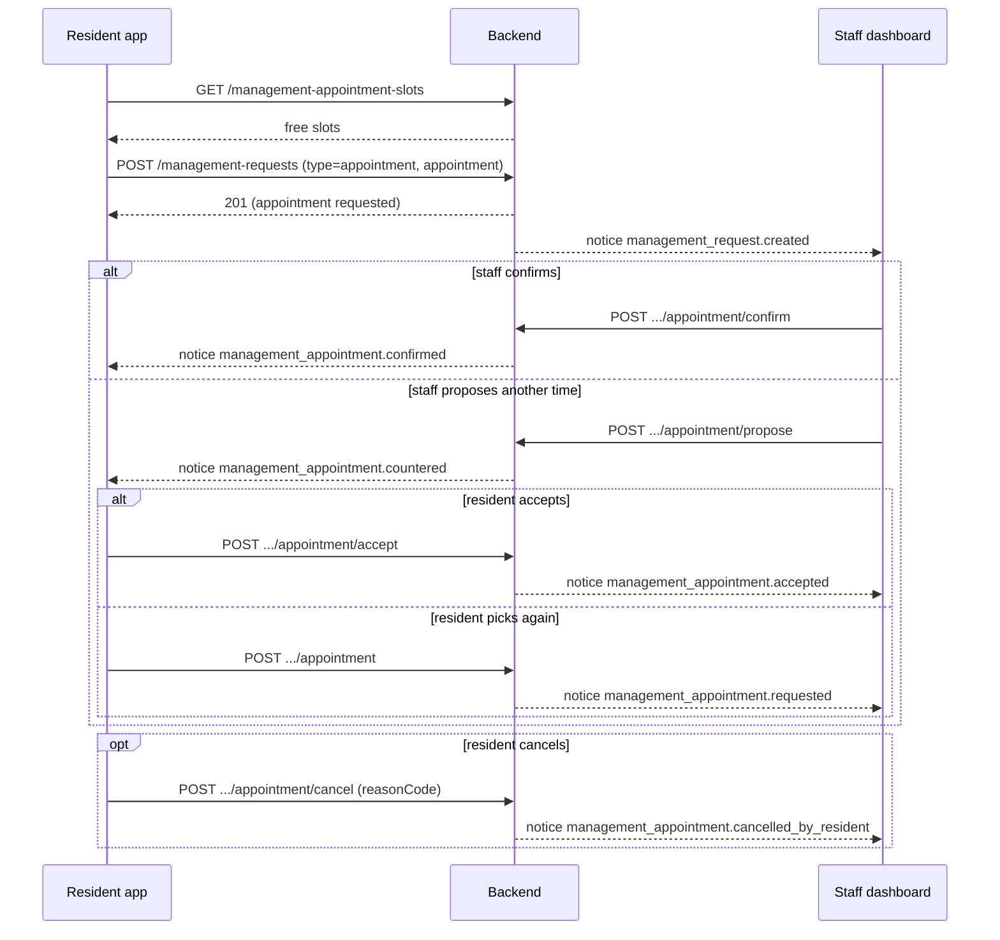
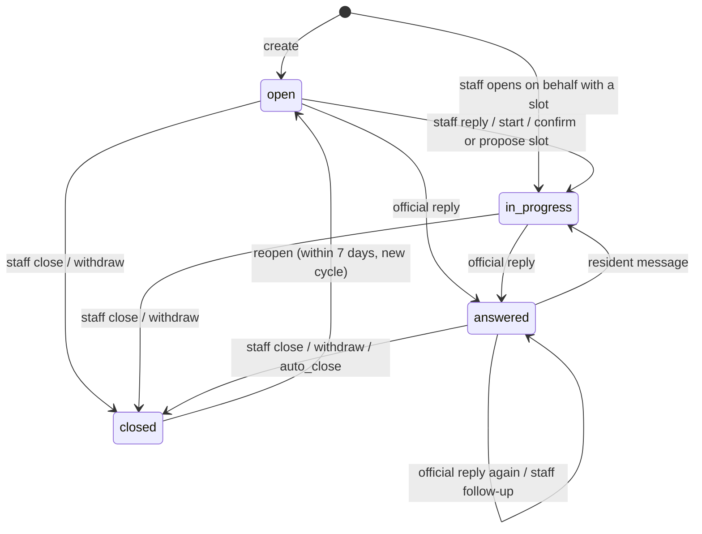
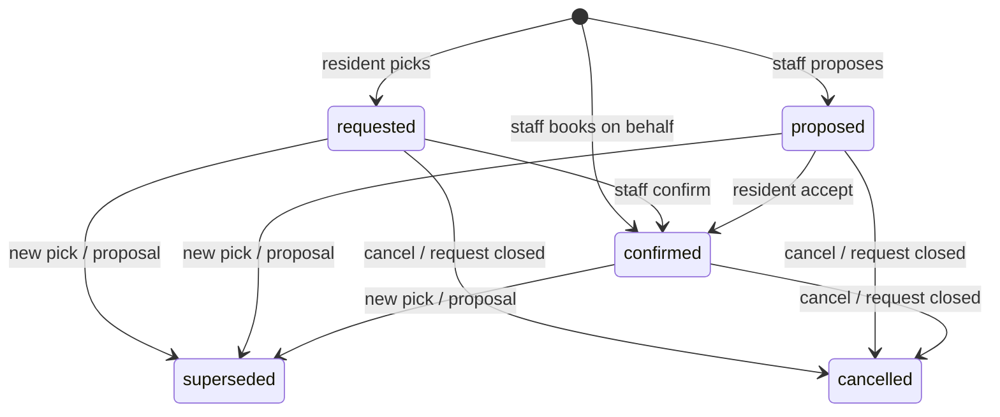

# طلبات الساكن إلى الإدارة — Resident Requests to Management

> **التطبيق/الواجهة:** resident app (الساكن الأساسي، والمالك المؤجِّر لأنه حساب من نوع `resident`) + family member (فرد الأسرة الذي له حساب)
> **الصلاحيات:** `requests.create` (يملكها الدوران الافتراضيان `resident` و`family_member`). قائمة "كل طلباتي" `GET /me/requests` تحتاج `requests.create` **أو** `tickets.create`.
> **المصادر:** ADR 0039 · `src/management/requests/` · `src/management/appointments/` · `src/management/feed/` · `src/management/topics/topics.controller.ts`

## الفكرة باختصار
يستطيع الساكن مراسلة إدارة الكمبوند في أي أمر غير الصيانة: سؤال، أو طلب عام، أو حجز موعد في المكتب. لكل طلب موضوع (topic) من قائمة الكمبوند، ورقم بالشكل `MR-000123`، ومحادثة خاصة بين صاحبه والإدارة. الطلب **ملك كاتبه وحده**: الساكن الأساسي لا يرى طلبات أفراد أسرته، والعكس. بعد إغلاق الطلب يستطيع صاحبه تقييمه، أو إعادة فتحه خلال 7 أيام. توجد أيضًا قائمة واحدة تجمع طلبات الإدارة وتذاكر الصيانة معًا (`GET /me/requests`).

## الأدوار ومين بيعمل إيه
| الدور | ما يستطيع فعله |
|---|---|
| ساكن / فرد أسرة / مالك مؤجِّر (`requests.create`) | يفتح طلبًا، ويقرأ طلباته هو فقط، ويكتب في المحادثة، ويسحب الطلب، ويعيد فتحه، ويقيّمه، ويختار موعدًا ويقبله أو يلغيه |
| فرد آخر في نفس الأسرة | **لا يرى** طلبات غيره، حتى لو كان هو الساكن الأساسي |
| حساب حالته ليست `active` | لا يقرأ ولا يكتب شيئًا (أي عملية كتابة ترجع `401 UNAUTHENTICATED`) |
| الإدارة | ترى كل طلبات الكمبوند وترد عليها. راجع `02-staff-inbox.md` |

## الشاشات اللي الفيتشر محتاجها
- **كل طلباتي (All my requests):** قائمة واحدة تضم طلبات الإدارة وتذاكر الصيانة، والأحدث نشاطًا في الأعلى.
- **طلباتي إلى الإدارة:** قائمة طلبات الإدارة فقط، مع فلتر بالحالة وبالنوع.
- **نموذج طلب جديد:** النوع، والموضوع، والوحدة (اختيارية)، ونص الطلب، والمرفقات. وإذا كان النوع موعدًا: اختيار الوقت وطريقة المقابلة.
- **شاشة اختيار الموعد:** أيام، وتحت كل يوم الأوقات المتاحة.
- **تفاصيل الطلب:** الرقم، والحالة، والموضوع، والوحدة، وموعد الرد المتوقع، والموعد الحالي، والتقييم، وأزرار الإجراءات حسب الحالة.
- **المحادثة:** رسائل الطرفين من الأقدم إلى الأحدث، مع المرفقات، وعلامة "الرد الرسمي".
- **نافذة تأكيد سحب الطلب:** تأكيد فقط، دون سبب.
- **نموذج إعادة الفتح:** رسالة إجبارية تشرح السبب، ومرفقات اختيارية.
- **نموذج التقييم:** نجوم من 1 إلى 5، وتعليق اختياري.
- **نافذة إلغاء الموعد:** اختيار سبب من قائمة ثابتة.
- **بطاقة اقتراح من الإدارة:** "اقترحت الإدارة موعدًا": زر قبول، أو اختيار وقت آخر.

## الفلو خطوة بخطوة

### 1) عرض المواضيع (Topics)
1. يطلب التطبيق `GET /management-request-topics`.
2. ترجع المواضيع **النشطة فقط**، مرتبة أبجديًا حسب `key` (لا يوجد ترتيب يحدده المدير). لكل موضوع: `id`، `key`، `nameAr`، `nameEn`، `targetResponseHours`.
3. القائمة غير مقسمة إلى صفحات (`nextCursor` دائمًا `null`).
4. يمكن عرض عبارة "ترد الإدارة عادةً خلال X ساعة" بجانب كل موضوع، اعتمادًا على `targetResponseHours`.

المواضيع الافتراضية لأي كمبوند جديد: `general` (48 ساعة)، `billing_fees` (48)، `security_gate` (24)، `facilities` (72)، `documents` (72). يستطيع المدير تعديلها. راجع `03-management-settings.md`.

### 2) فتح طلب جديد
1. يختار الساكن **النوع** `type`:
   - `question`: سؤال.
   - `general`: طلب عام.
   - `appointment`: موعد في المكتب، وهو النوع الوحيد الذي له موعد.
   - لا يفرّق الباك بين `question` و`general` في أي سلوك. الفرق في التسمية فقط.
2. يختار **الموضوع** `topicId` من القائمة السابقة. حقل إجباري.
3. يختار **الوحدة** `unitId` (اختياري). يجب أن تكون من وحداته هو (من `GET /me/units`). إذا اختار وحدة لا يراها، أو وحدة غادرها، يرجع `404 UNIT_NOT_FOUND`.
4. يكتب **نص الطلب** `body`: إجباري، من 1 إلى 4000 حرف بعد حذف المسافات من البداية والنهاية. **لا يوجد عنوان ولا وصف منفصل**، وهذا النص يصبح أول رسالة في المحادثة.
5. **المرفقات** `attachmentFileIds` (اختيارية): حتى 5 ملفات. صور (`image/jpeg`، `image/png`، `image/webp`) أو PDF، وكل ملف حتى 10 MiB، بالغرض `request_attachment`. يتم الرفع بالطريقة العامة (راجع README). الملف المكرر في القائمة يُحسب مرة واحدة.
6. إذا كان النوع `appointment` **يجب** إرسال `appointment: { startsAt, mode }` (راجع الفلو 9). وإذا كان النوع غير ذلك **يُمنع** إرساله.
7. يرسل التطبيق `POST /management-requests` مع ترويسة `Idempotency-Key` (يُنصح بها).
8. يرجع `201` بالشكل `{ id, number, status, createdAt }`، والحالة `open`.
9. ما يحدث في الخلفية:
   - يبدأ "عدّاد الرد": `responseDueAt` يساوي وقت الفتح مضافًا إليه `targetResponseHours` للموضوع.
   - إذا كان هناك موعد، يُحجز مكانه بالحالة `requested` (بانتظار الإدارة).
   - يصل إشعار `management_request.created` إلى كل الموظفين الذين يتعاملون مع الطلبات.
10. ينتقل التطبيق إلى شاشة تفاصيل الطلب.

إذا امتلأ الوقت المختار في تلك اللحظة يرجع `409 MANAGEMENT_APPOINTMENT_SLOT_FULL`، و**لا يُفتح الطلب كله**. اعرض الأوقات المتاحة من جديد.

### 3) قائمة طلباتي إلى الإدارة
1. `GET /management-requests?status=&type=&cursor=&limit=`.
2. ترجع طلبات المستخدم **وحده**، والأحدث نشاطًا أولًا (`lastActivityAt`).
3. الفلاتر الاختيارية: `status` (`open` | `in_progress` | `answered` | `closed`) و`type`.
4. ملاحظة: الترتيب بآخر نشاط يتغير. الطلب الذي يتحرك بين صفحتين قد يظهر مرتين أو لا يظهر. القائمة للعرض فقط، لا للعدّ.

### 4) تفاصيل الطلب والمحادثة
1. `GET /management-requests/{id}`: التفاصيل، ومعها الموعد (`appointment`) والتقييم (`rating`).
2. `GET /management-requests/{id}/messages?cursor=&limit=`: الرسائل **من الأقدم إلى الأحدث**، مقسمة إلى صفحات.
3. ملاحظات الإدارة الداخلية (`internal`) **لا ترجع هنا أبدًا**، ولا مرفقاتها، ولا يوجد أي حقل يشير إلى وجودها.
4. يظهر الموظف **باسمه الأول فقط** (`sender.firstName`).
5. الرسالة التي فيها `official: true` هي "الرد الرسمي" للإدارة. يجب تمييزها بصريًا.
6. إذا فتحت الإدارة الطلب نيابة عن الساكن (`openedByManagement: true`)، تكون أول رسالة من الموظف (`senderSide: staff`) لأنه هو من كتبها.

### 5) كتابة رسالة
1. يكتب الساكن `body` (من 1 إلى 4000) ومرفقات اختيارية (حتى 5).
2. `POST /management-requests/{id}/messages` مع `Idempotency-Key`.
3. يرجع `201` بالشكل `{ id, createdAt }` فقط، **دون النص**. أعد قراءة المحادثة.
4. مسموح إذا كان الطلب `open` أو `in_progress` أو `answered`. إذا كان `closed` يرجع `409 MANAGEMENT_REQUEST_INVALID_TRANSITION`، وعلى الساكن إعادة فتح الطلب أولًا (الفلو 7).
5. إذا كان الطلب `answered` فإن رسالة الساكن تعيده إلى `in_progress` (أي "ما زلت أحتاج شيئًا").
6. يصل إلى من يتعامل مع الطلب إشعار `management_request.resident_replied` (المسؤول عن الطلب إن وُجد، وإلا كل الموظفين المعنيين).

### 6) سحب الطلب (Withdraw)
1. يضغط الساكن "سحب الطلب" فتظهر نافذة تأكيد. **لا يوجد سبب للاختيار**.
2. `POST /management-requests/{id}/withdraw`، ويرجع `204`.
3. مسموح إذا كان الطلب `open` أو `in_progress` أو `answered`.
4. يصبح الطلب `closed` مع `closeReason = withdrawn_by_author`.
5. إذا كان هناك موعد قائم فإنه يُلغى تلقائيًا (`cancelReason: request_closed`، `cancelledBy: system`) ويتحرر مكانه.
6. يصل إشعار `management_request.withdrawn` إلى المسؤول عن الطلب فقط (إن وُجد).
7. يمكن إعادة فتح الطلب المسحوب مثل أي طلب مغلق (خلال 7 أيام).

### 7) إعادة فتح طلب مغلق (Reopen)
1. يظهر الزر إذا كان `status = closed` ولم يمرّ `reopenUntil` بعد. قيمة `reopenUntil` تساوي وقت الإغلاق مضافًا إليه 7 أيام بالضبط.
2. يمكن إعادة الفتح **أيًّا كان سبب الإغلاق**: إغلاق من الإدارة، أو سحب من الساكن، أو إغلاق تلقائي.
3. **يجب** أن يكتب الساكن رسالة تشرح السبب (`body` من 1 إلى 4000)، مع مرفقات اختيارية (حتى 5).
4. `POST /management-requests/{id}/reopen`، ويرجع `204`.
5. ما يحدث:
   - تعود الحالة إلى `open`، ويزيد `cycle` بمقدار 1 (دورة جديدة).
   - يبدأ عدّاد الرد من جديد بقيمة `targetResponseHours` **الحالية** للموضوع.
   - يبقى الموظف المسؤول كما هو.
   - الموعد القديم **لا يعود**. إذا كان الطلب موعدًا فعلى الساكن اختيار وقت جديد (الفلو 9).
   - يصل إشعار `management_request.reopened` إلى المسؤول، أو إلى كل الموظفين المعنيين إن لم يوجد مسؤول.
6. إذا مرّت أكثر من 7 أيام يرجع `409 MANAGEMENT_REQUEST_REOPEN_WINDOW_PASSED` (`params.reopenDays = 7`). اعرض رسالة "افتح طلبًا جديدًا".

### 8) التقييم
1. يظهر إذا كان `status = closed` و`rating = null`.
2. يختار الساكن `rating` من 1 إلى 5 (عدد صحيح)، و`comment` اختياري حتى 1000 حرف. التعليق الفارغ أو المكوّن من مسافات فقط يُحفظ `null`.
3. `POST /management-requests/{id}/rating`، ويرجع `201` بالشكل `{ rating, comment, createdAt }`.
4. **مرة واحدة لكل طلب، ولا يمكن تعديله**. حتى لو أُعيد فتح الطلب ثم أُغلق مرة أخرى لا يمكن تقييمه من جديد (`409 MANAGEMENT_REQUEST_ALREADY_RATED`).
5. التقييم لا يمنع إعادة الفتح.
6. التقييم لا يرسل إشعارًا لأحد. في الإدارة لا يرى التقييمات إلا المدير (`requests.manage`).

### 9) المواعيد من جهة الساكن
المواعيد موجودة فقط في الطلبات من نوع `appointment`. أي إجراء موعد على طلب من نوع آخر يرجع `409 MANAGEMENT_REQUEST_NOT_AN_APPOINTMENT`.

**أ. قراءة الأوقات المتاحة**
1. `GET /management-appointment-slots?from=YYYY-MM-DD&days=N`.
   - `from`: أول يوم بتوقيت الكمبوند، والقيمة الافتراضية اليوم. يجب أن يكون تاريخًا حقيقيًا، وإلا يرجع `400` على `from` (`INVALID_FORMAT`).
   - `days`: من 1 إلى 31، والقيمة الافتراضية 7.
2. يرجع `[{ startsAt, endsAt }]`. الساكن **لا يرى** عدد الأماكن المتبقية.
3. هذه الأوقات مقسمة من ساعات عمل المكتب بطول الفترة (الافتراضي 30 دقيقة)، ويُحذف منها:
   - أي وقت يبدأ بعد أقل من ساعة من الآن.
   - أي وقت بعد أكثر من 30 يومًا.
   - الأوقات الممتلئة.
4. هذه قراءة فقط وليست حجزًا. قد يمتلئ الوقت قبل أن يؤكد الساكن.

**ب. اختيار وقت (عند فتح الطلب أو بعده)**
1. يختار الساكن `startsAt` (يجب أن يساوي بداية أحد الأوقات المعروضة **بالضبط**)، و`mode`: `in_person` (حضوري في المكتب) أو `phone` (هاتفي).
2. عند فتح الطلب: يُرسل الاختيار داخل `appointment` في `POST /management-requests`.
3. بعد الفتح: `POST /management-requests/{id}/appointment` بالجسم `{ startsAt, mode }` مع `Idempotency-Key`. يرجع `201` بالشكل `{ id, status, startsAt, endsAt }`.
4. تكون الحالة `requested` (بانتظار تأكيد الإدارة)، ويصل إلى الموظفين إشعار `management_appointment.requested`.
5. إذا كان هناك موعد قائم (`requested` أو `proposed` أو **حتى `confirmed`**)، يتحول القديم إلى `superseded`، ويعود الجديد إلى `requested` بانتظار التأكيد. يجب تنبيه الساكن إلى أن تغيير موعد مؤكد يعيده إلى "بانتظار التأكيد".
6. هذا الإجراء نفسه هو طريقة الرد على اقتراح الإدارة بـ"وقت آخر".

**ج. قبول اقتراح الإدارة**
1. عندما يكون الموعد `proposed` و`proposedBy = staff`، اعرض زر "قبول".
2. `POST /management-requests/{id}/appointment/accept`، ويرجع `204`. يصبح الموعد `confirmed`.
3. إذا لم يكن الموعد `proposed` يرجع `409 MANAGEMENT_APPOINTMENT_INVALID_STATE` (`params.status` فيها الحالة الحالية أو `none`).
4. إذا مرّ وقت الموعد يرجع `409 MANAGEMENT_APPOINTMENT_WINDOW_PASSED`.
5. يصل إلى الموظفين إشعار `management_appointment.accepted`.

**د. إلغاء الموعد**
1. نافذة فيها سبب إجباري `reasonCode` من: `no_longer_needed`، `cannot_attend`، `other`. لا يوجد نص حر.
2. `POST /management-requests/{id}/appointment/cancel`، ويرجع `204`.
3. مسموح على أي موعد قائم (`requested` أو `proposed` أو `confirmed`)، حتى لو مرّ وقته. إذا لم يوجد موعد قائم يرجع `409 MANAGEMENT_APPOINTMENT_INVALID_STATE` (`status: none`).
4. **يبقى الطلب نفسه مفتوحًا**. يستطيع الساكن اختيار وقت جديد أو سحب الطلب.
5. يصل إلى الموظفين إشعار `management_appointment.cancelled_by_resident`.

### 10) قائمة "كل طلباتي" (`GET /me/requests`)
1. `GET /me/requests?cursor=&limit=`. **لا توجد فلاتر**.
2. ترجع مزيجًا من:
   - طلبات الإدارة التي كتبها المستخدم (`type: management`).
   - تذاكر الصيانة التي يستطيع رؤيتها، بنفس قاعدة `GET /tickets` (`type: maintenance`). راجع `../06-maintenance/01-resident-tickets.md`.
3. إذا كان دور المستخدم يملك صلاحية واحدة فقط من الاثنتين، يرجع ذلك المصدر وحده.
4. الترتيب من الأحدث نشاطًا (`lastActivityAt`). عند الضغط على عنصر:
   - `maintenance` يفتح `/tickets/{id}`.
   - `management` يفتح `/management-requests/{id}`.
5. **تنبيه بخصوص الترتيب:** النشاط يرفع العنصر إلى الأعلى، فالعنصر الذي يتغير بين صفحتين قد يتكرر أو يختفي. القائمة للعرض فقط، ولا يُبنى عليها عدّاد.
6. ما يحرّك `lastActivityAt` للتذكرة: تغيّر الحالة أو الدورة، أو رسالة غير داخلية، أو صورة.
7. من فقد صلاحية `tickets` على وحدة (ADR 0032) يظل يرى التذكرة وحالتها، لكن تاريخها وترتيبها يُحسبان بآخر تغيّر في الحالة، لا بآخر رسالة.
8. **لا يوجد نص** في هذه القائمة: لا عنوان ولا معاينة. فقط الرقم والحالة والمفتاح (الموضوع أو التصنيف). يترجم التطبيق `topicKey` أو `categoryKey` إلى اسم.

### 11) خطوات تلقائية (في الخلفية)
- **الإغلاق التلقائي:** الطلب الذي حالته `answered` ولم يرد صاحبه خلال `autoCloseDays` يومًا (الافتراضي 7، ويغيّره المدير) من آخر رد رسمي، يُغلق تلقائيًا (`closeReason: auto_closed`). المهمة الخلفية تعمل كل ساعة تقريبًا، لذلك قد يتأخر الإغلاق حتى ساعة. كل رد رسمي جديد يعيد العد من البداية. يصل إلى الساكن إشعار `management_request.auto_closed`، ويستطيع إعادة الفتح خلال 7 أيام.
- **إغلاق الطلب يلغي الموعد:** أي إغلاق (من الإدارة، أو بالسحب، أو تلقائيًا) يلغي الموعد القائم (`request_closed`، `system`). **لا يُرسل إشعار منفصل** بإلغاء الموعد في هذه الحالة.
- **التصعيد** إلى المدير عند تأخر الرد يحدث في الخلفية، و**لا يراه الساكن**. راجع `02-staff-inbox.md`.

## الحالات (Statuses)

### حالة الطلب `ManagementRequestStatus`
| القيمة | المعنى | ما الذي يُدخله / يُخرجه |
|---|---|---|
| `open` | جديد، لم يتعامل معه أحد في الإدارة بعد | يدخل عند الفتح أو إعادة الفتح. يخرج برد موظف، أو `start`، أو إجراء على الموعد، أو بالإغلاق |
| `in_progress` | الإدارة تعمل عليه | يدخل برد موظف، أو `start`، أو تأكيد/اقتراح موعد، أو برسالة الساكن على طلب `answered` |
| `answered` | أرسلت الإدارة الرد الرسمي | يدخل برد رسمي (`official`). يخرج برسالة من الساكن (يعود `in_progress`) أو بالإغلاق |
| `closed` | مغلق | بإغلاق من الإدارة مع سبب، أو سحب من الساكن، أو إغلاق تلقائي. يخرج بإعادة الفتح خلال 7 أيام |

قيم `closeReason`: من الإدارة (`resolved`، `duplicate`، `not_for_management`، `other`)، أو `withdrawn_by_author`، أو `auto_closed`.

### حالة الموعد `ManagementAppointmentStatus`
| القيمة | المعنى | ما الذي يُدخله / يُخرجه |
|---|---|---|
| `requested` | اختار الساكن وقتًا وينتظر الإدارة | اختيار الساكن. يخرج بالتأكيد، أو باقتراح بديل، أو باختيار جديد، أو بالإلغاء |
| `proposed` | اقترحت الإدارة وقتًا وتنتظر الساكن | اقتراح الإدارة. يخرج بالقبول، أو باختيار جديد، أو بالإلغاء |
| `confirmed` | متفق عليه | تأكيد الإدارة، أو قبول الساكن، أو حجز الموظف عند فتح الطلب نيابة عن الساكن |
| `cancelled` | ملغى | الساكن أو الإدارة مع سبب، أو `system` عند إغلاق الطلب |
| `superseded` | استُبدل باختيار أو اقتراح أحدث | تلقائي |

الموعد الذي مرّ وقته يبقى `confirmed`. لا توجد حالة "حضر" أو "لم يحضر".

## البيانات اللي بتظهر

**عنصر في "طلباتي إلى الإدارة" (`ResidentRequestView`):**
| الحقل | المعنى |
|---|---|
| `id`، `number` | المعرّف، والرقم المعروض `MR-000123` |
| `type`، `status` | النوع والحالة |
| `topic` | `{ id, key, nameAr, nameEn }` |
| `unit` | `{ id, code }`، أو `null` إذا لم يكن الطلب عن وحدة |
| `cycle` | 1 في البداية، ويزيد مع كل إعادة فتح |
| `closeReason`، `closedAt` | سبب الإغلاق ووقته (`null` إذا كان مفتوحًا) |
| `createdAt`، `lastActivityAt` | وقت الفتح، وآخر نشاط (الترتيب به) |
| `openedByManagement` | `true` إذا فتحته الإدارة نيابة عنه |
| `responseDueAt` | **يظهر فقط** أثناء انتظار أول رد (`open` أو `in_progress` ولم يرد أحد بعد): "سترد الإدارة قبل…". وإلا فهو `null` |
| `reopenUntil` | على الطلب المغلق: آخر لحظة لإعادة الفتح. قد يكون قد مرّ، لذا قارنه بالوقت الحالي قبل عرض الزر |

**تفاصيل الطلب:** كل ما سبق، بالإضافة إلى:
- `appointment`: الموعد القائم، أو آخر موعد إن لم يوجد قائم. الحقول: `{ id, status, mode, startsAt, endsAt, proposedBy (resident|staff), confirmedAt, cancelReason, cancelledBy (resident|staff|system) }`. لا توجد أسماء.
- `rating`: `{ rating, comment, createdAt }` أو `null`.

**رسالة (`ResidentRequestMessageView`):**
| الحقل | المعنى |
|---|---|
| `sender` | `{ id, firstName }`، أو `{ id, erased: true }` إذا مُسح الحساب |
| `senderSide` | `resident` أو `staff` |
| `official` | الرد الرسمي |
| `body` | النص، أو `null` إذا مُسح حساب صاحبه (`erased: true`) |
| `attachments` | `[{ id, contentType, url, expiresAt }]`. الرابط `url` مؤقت حتى `expiresAt`، فإذا انتهى أعد قراءة المحادثة. إذا كان `url = null` فالملف غير موجود |
| `createdAt` | وقت الرسالة |

**عنصر "كل طلباتي" (`MyRequestView`):** `type` (`maintenance` أو `management`)، `id`، `number` (`MT-…` أو `MR-…`)، `status` (نص: حالة تذكرة أو حالة طلب)، `lastActivityAt`، `categoryKey` (للتذكرة)، `topicKey` و`requestType` (للطلب)، `unitId`.

**مخفي دائمًا عن الساكن:** ملاحظات الإدارة الداخلية ومرفقاتها، والاسم الكامل للموظف، والمسؤول عن الطلب، والتصعيد، ونص المعاينة (`preview`)، وتقييمات الآخرين. كل الردود `no-store`، فلا تخزّنها مؤقتًا.

## القواعد والقيود
- **الطلب ملك كاتبه وحده.** أي `id` لا يخصه يرجع `404 MANAGEMENT_REQUEST_NOT_FOUND`، وهو نفس رد الطلب غير الموجود.
- النص (`body`): من 1 إلى 4000 حرف بعد حذف المسافات الطرفية. المرفقات: حتى 5 لكل رسالة، صور أو PDF حتى 10 MiB.
- نوع الطلب وموضوعه ووحدته **لا تتغير** بعد الفتح.
- يجب أن يكون الموضوع نشطًا وقت الفتح. إذا أوقفه المدير تبقى الطلبات القديمة عليه كما هي.
- إعادة الفتح: خلال 7 أيام بالضبط من الإغلاق، وبرسالة إجبارية.
- التقييم: مرة واحدة، وعلى طلب `closed` فقط.
- الموعد: يجب أن يكون بداية وقت معروض بالضبط، بعد ساعة على الأقل، وخلال 30 يومًا. للطلب موعد قائم واحد فقط.
- `Idempotency-Key` يُنصح به في: فتح طلب، وكتابة رسالة، واختيار وقت.
- الإجراءات ترجع `204` أو ردًا صغيرًا، فيعيد التطبيق قراءة الطلب (راجع README).
- **لا تُحسب ساعات العمل:** عدّاد الرد بالساعات الفعلية، حتى في العطلات.

## الأخطاء اللي الـUI لازم يتعامل معاها
| HTTP + الكود | متى يحدث | رسالة / سلوك مقترح |
|---|---|---|
| `400 VALIDATION_FAILED` + `INVALID_LENGTH` على `body` | نص فارغ أو أطول من 4000 | "اكتب رسالتك (4000 حرف كحد أقصى)" |
| `400 VALIDATION_FAILED` + `TOPIC_NOT_AVAILABLE` على `topicId` | الموضوع أُوقف أو غير موجود | "هذا الموضوع غير متاح، اختر موضوعًا آخر". أعد تحميل المواضيع |
| `400 VALIDATION_FAILED` + `FIELD_REQUIRED` / `FIELD_NOT_ALLOWED` على `appointment` | نوع موعد دون وقت، أو وقت مع نوع آخر | امنعه في النموذج |
| `400 VALIDATION_FAILED` + `APPOINTMENT_SLOT_NOT_OFFERED` على `startsAt` (أو `appointment.startsAt` عند الفتح) | الوقت ليس من الأوقات المعروضة | "هذا الوقت غير متاح". اعرض الأوقات من جديد |
| `400 VALIDATION_FAILED` + `APPOINTMENT_TOO_SOON` / `APPOINTMENT_TOO_FAR` | أقل من ساعة، أو أكثر من 30 يومًا | "اختر وقتًا بعد ساعة على الأقل وخلال 30 يومًا" |
| `400 VALIDATION_FAILED` + `FILE_NOT_AVAILABLE` على `attachmentFileIds.N` | الملف لا يخصه، أو لم يكتمل رفعه، أو استُخدم من قبل | "مرفق غير صالح، أعد رفعه" |
| `400 VALIDATION_FAILED` + `INVALID_FORMAT` على `from` | تاريخ غير صحيح في طلب الأوقات | خطأ في التطبيق |
| `400 REASON_REQUIRED` / `400 VALIDATION_FAILED` + `INVALID_REASON_CODE` | إلغاء موعد دون سبب أو بسبب غير معروف | اجعل السبب إجباريًا في النافذة |
| `401 UNAUTHENTICATED` | لم يعد الحساب `active` | انتقل إلى شاشة الدخول |
| `403 FORBIDDEN` | الدور لا يملك `requests.create` | أخفِ الفيتشر |
| `404 UNIT_NOT_FOUND` | وحدة ليست من وحداته | "هذه الوحدة غير متاحة لك" |
| `404 MANAGEMENT_REQUEST_NOT_FOUND` | طلب غير موجود أو لا يخصه | "الطلب غير موجود"، وارجع إلى القائمة |
| `409 MANAGEMENT_REQUEST_INVALID_TRANSITION` (`params.status`) | الإجراء غير مسموح في هذه الحالة (رسالة على طلب مغلق، سحب طلب مغلق، تقييم طلب مفتوح…)، أو سبقه شخص آخر | أعد قراءة الطلب واعرض الأزرار الصحيحة |
| `409 MANAGEMENT_REQUEST_REOPEN_WINDOW_PASSED` (`params.reopenDays`) | مرّت أكثر من 7 أيام | "انتهت مهلة إعادة الفتح، افتح طلبًا جديدًا"، مع زر طلب جديد |
| `409 MANAGEMENT_REQUEST_ALREADY_RATED` | سبق تقييمه | أعد قراءة التفاصيل واعرض التقييم الموجود |
| `409 MANAGEMENT_REQUEST_NOT_AN_APPOINTMENT` | إجراء موعد على طلب ليس موعدًا | لا تعرض أزرار المواعيد إلا عند `type = appointment` |
| `409 MANAGEMENT_APPOINTMENT_SLOT_FULL` | امتلأ الوقت بين العرض والحجز | "تم حجز هذا الوقت، اختر وقتًا آخر"، واعرض الأوقات من جديد |
| `409 MANAGEMENT_APPOINTMENT_INVALID_STATE` (`params.status`) | قبول وهو ليس `proposed`، أو إلغاء دون موعد قائم | أعد قراءة التفاصيل |
| `409 MANAGEMENT_APPOINTMENT_WINDOW_PASSED` | قبول موعد مرّ وقته | "مرّ وقت هذا الموعد، اختر وقتًا جديدًا" |
| `409 IDEMPOTENCY_CONFLICT` | استُخدم نفس `Idempotency-Key` مع طلب مختلف | أنشئ مفتاحًا جديدًا |

## الإشعارات
كلها في الفئة `management`، و**لا يوجد بينها نوع critical**. يُسجَّل كل إشعار في صندوق الإشعارات دائمًا، ويُرسل push إذا سمحت تفضيلات المستخدم (الفئة غير مكتومة، وليس وقت الهدوء). المعاملات (params) هي `requestNumber` و`topicKey` فقط، والهدف (target) هو الطلب. لا يُرسل الإشعار لمن قام بالإجراء نفسه.

| الحدث | `kind` | من يستلمه | Push؟ | ماذا يفتح |
|---|---|---|---|---|
| ردّت الإدارة (عادي أو رسمي) | `management_request.replied` | كاتب الطلب | نعم (غير critical) | المحادثة |
| استلمت الإدارة الطلب (`start`) أو أغلقته | `management_request.status_changed` | كاتب الطلب | نعم | تفاصيل الطلب |
| إغلاق تلقائي | `management_request.auto_closed` | كاتب الطلب | نعم | تفاصيل الطلب (مع زر إعادة الفتح) |
| فتحت الإدارة طلبًا باسمه | `management_request.opened_for_you` | كاتب الطلب | نعم | تفاصيل الطلب |
| اقترحت الإدارة وقتًا (لم يكن هناك موعد) | `management_appointment.proposed` | كاتب الطلب | نعم | بطاقة الاقتراح |
| اقترحت الإدارة وقتًا بدل اختياره | `management_appointment.countered` | كاتب الطلب | نعم | بطاقة الاقتراح |
| أكدت الإدارة الموعد | `management_appointment.confirmed` | كاتب الطلب | نعم | تفاصيل الطلب |
| ألغت الإدارة الموعد | `management_appointment.cancelled` | كاتب الطلب | نعم | تفاصيل الطلب |

ملاحظات:
- الرد الرسمي يرسل `replied` فقط، **وليس** `status_changed`.
- الملاحظة الداخلية والتقييم والتصعيد لا ترسل شيئًا للساكن.
- الإشعارات التي تصل إلى الموظفين من إجراءات الساكن موجودة في `02-staff-inbox.md`.

## الـEndpoints
كل المسارات تحت `/api/v1`.

| Method + Path | من يستدعيه | الغرض | الرد |
|---|---|---|---|
| `GET /management-request-topics` | `requests.create` أو `requests.handle` | المواضيع النشطة | `200 {data:[{id,key,nameAr,nameEn,targetResponseHours}], nextCursor:null}` |
| `POST /management-requests` | `requests.create` | فتح طلب (Idempotent) | `201 {id, number, status, createdAt}` |
| `GET /management-requests` | `requests.create` | طلباتي (فلتر `status` و`type`) | `200 {data:[ResidentRequestView], nextCursor}` |
| `GET /management-requests/{id}` | `requests.create` | التفاصيل مع الموعد والتقييم | `200 ResidentRequestDetailView` |
| `GET /management-requests/{id}/messages` | `requests.create` | المحادثة، الأقدم أولًا | `200 {data:[ResidentRequestMessageView], nextCursor}` |
| `POST /management-requests/{id}/messages` | `requests.create` | رسالة (Idempotent) | `201 {id, createdAt}` |
| `POST /management-requests/{id}/withdraw` | `requests.create` | سحب الطلب | `204` |
| `POST /management-requests/{id}/reopen` | `requests.create` | إعادة الفتح برسالة | `204` |
| `POST /management-requests/{id}/rating` | `requests.create` | التقييم | `201 {rating, comment, createdAt}` |
| `GET /management-appointment-slots` | `requests.create` | الأوقات المتاحة (`from`، `days`) | `200 {data:[{startsAt,endsAt}], nextCursor:null}` |
| `POST /management-requests/{id}/appointment` | `requests.create` | اختيار وقت أو تغييره (Idempotent) | `201 {id, status, startsAt, endsAt}` |
| `POST /management-requests/{id}/appointment/accept` | `requests.create` | قبول اقتراح الإدارة | `204` |
| `POST /management-requests/{id}/appointment/cancel` | `requests.create` | إلغاء الموعد (`reasonCode`) | `204` |
| `GET /me/requests` | `requests.create` أو `tickets.create` | كل طلباتي (تذاكر وطلبات) | `200 {data:[MyRequestView], nextCursor}` |
| `GET /me/units` | الساكن | وحداته، لاختيار `unitId` | راجع ملف الوحدات |

## ملاحظات للديزاين وحاجات ناقصة في الباك
- **لا يوجد real-time:** الـADR يضع المحادثة اللحظية خارج النطاق. يحدّث التطبيق المحادثة عند وصول إشعار أو عند السحب للتحديث.
- **لا توجد حالة "مقروء/غير مقروء"** ولا عدّاد رسائل جديدة على الطلب. إذا احتاج التصميم شارة (badge) فهذا يتطلب endpoint جديدًا.
- **لا يوجد عنوان للطلب:** قوائم الساكن تعرض الموضوع والرقم والحالة فقط. نص الطلب ليس في القائمة (حقل `preview` للإدارة فقط).
- **لا فرق في السلوك بين `question` و`general`.** يمكن للتصميم دمجهما أو توضيح الفرق بالنص فقط.
- **ترتيب المواضيع** أبجدي حسب `key`، ولا يوجد حقل ترتيب.
- **المواعيد:** لا توجد حالة "حضر/لم يحضر". الموعد الذي مرّ وقته يبقى `confirmed`، فيعرضه التصميم بأنه "انتهى". تغيير موعد مؤكد يعيده إلى `requested`.
- **إغلاق الطلب يلغي الموعد دون إشعار منفصل.** وضّح ذلك في نافذة تأكيد السحب ("سيُلغى موعدك أيضًا").
- **Push:** يذكر الـADR أن الـpush خارج النطاق، لكن الكود يعرّف نصوص push لكل الأنواع ويرسلها حسب التفضيلات. صمّم على أساس وجود push.
- **"كل طلباتي"** بلا فلاتر وبلا نص. لعرض "بانتظار ردك" يجب حسابها من `status` لكل نوع على حدة.
- **`reopenUntil`** يرجع حتى بعد انتهاء المهلة، فعلى التطبيق مقارنته بالوقت الحالي قبل عرض زر إعادة الفتح.
