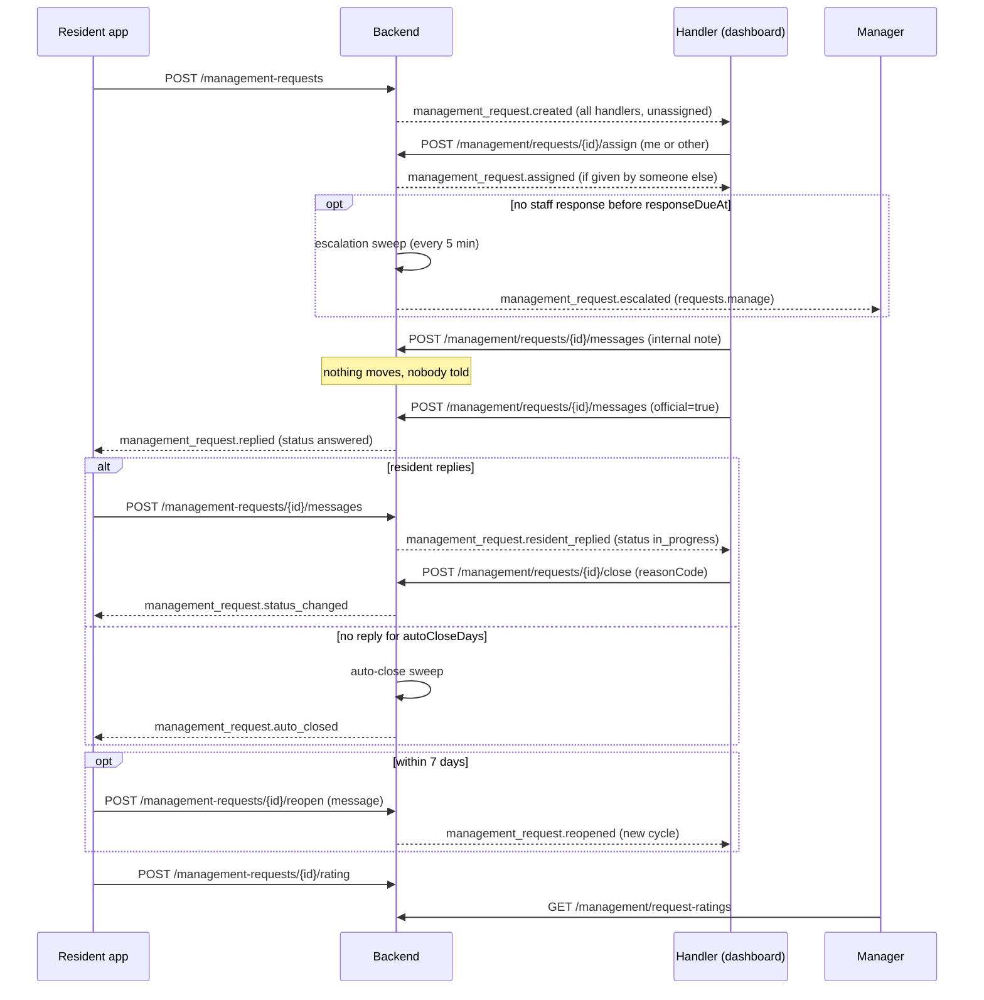
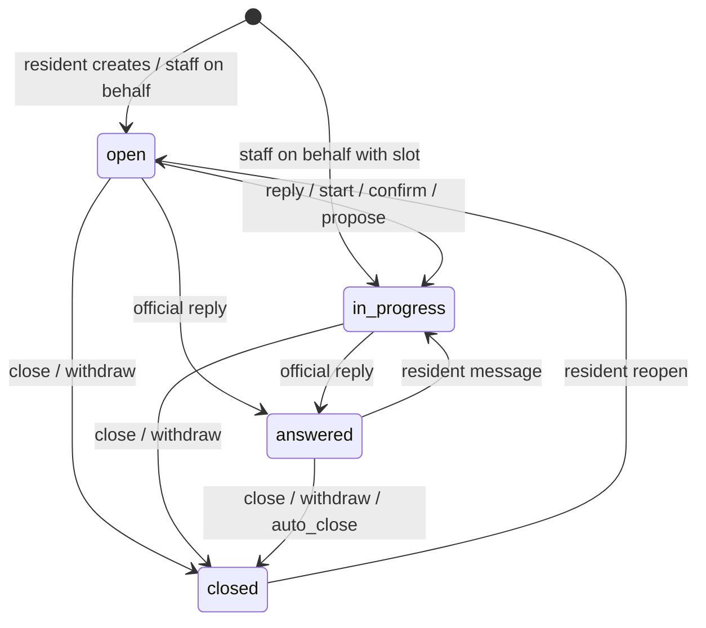

# صندوق طلبات الإدارة للموظفين — Staff Requests Inbox

> **التطبيق/الواجهة:** manager dashboard (المدير، وأي موظف أعطاه المدير صلاحية التعامل مع الطلبات)
> **الصلاحيات:** `requests.handle` للصندوق والرد والمواعيد (متاحة لنوعي الحساب `staff` و`manager`؛ في الأدوار الافتراضية يملكها الدور `manager` فقط، ولا يملكها أي دور موظف افتراضي حتى يمنحها المدير). فتح طلب نيابة عن ساكن يحتاج `requests.handle` **و** `residents.read` (الدور `manager` يملك الاثنتين). التقييمات وإشعارات التصعيد لمن يملك `requests.manage` (نوع `manager` فقط، ويملكها الدور `manager`).
> **المصادر:** ADR 0039 · `src/management/requests/staff-requests.controller.ts` · `escalation.service.ts` · `handler-release.ts` · `request-notices.ts` · `src/management/appointments/`

## الفكرة باختصار
كل طلبات الكمبوند إلى الإدارة تصل إلى صندوق واحد في الداشبورد. الموظف يرى صاحب الطلب باسمه الكامل، ويرى أول 120 حرفًا من نص الطلب (`preview`)، ويستطيع تعيين الطلب لموظف، أو استلامه، أو الرد عليه (ردًّا عاديًا أو رسميًا أو ملاحظة داخلية)، أو إغلاقه مع سبب. لكل دورة من دورات الطلب وقت رد مستهدف، وإذا تأخر الرد يُصعَّد الطلب تلقائيًا إلى المدير. يستطيع الموظف أيضًا فتح طلب نيابة عن ساكن اتصل أو حضر أو أرسل خطابًا، وإدارة مواعيد المكتب.

## الأدوار ومين بيعمل إيه
| الدور | ما يستطيع فعله |
|---|---|
| موظف طلبات (`requests.handle`) | يرى كل الطلبات، ويقرأ المحادثة كاملة مع الملاحظات، ويرد، ويكتب ملاحظة، ويستلم، ويغلق، ويعيّن، ويؤكد المواعيد أو يقترحها أو يلغيها، ويرى أجندة المواعيد |
| موظف طلبات + `residents.read` | ما سبق، بالإضافة إلى فتح طلب نيابة عن ساكن، وقراءة سكان الوحدة |
| مدير (`requests.manage`) | يرى التقييمات، ويستلم إشعارات التصعيد، ويدير الإعدادات (راجع `03-management-settings.md`) |
| موظف بلا `requests.manage` | **لا يرى أي تقييم** في أي مكان |

ملاحظة: الحساب الذي يملك `requests.handle` أو `requests.manage` فقط يستطيع الدخول إلى الداشبورد.

## الشاشات اللي الفيتشر محتاجها
- **صندوق الطلبات (Inbox):** جدول بالطلبات مع فلاتر (الحالة، النوع، الموضوع، المسؤول، مفتوح فقط، متأخر، مُصعَّد).
- **صفحة الطلب:** بيانات الطلب، وصاحبه، والمسؤول، وعدّاد الرد، وسجل التصعيد، والموعد، وأزرار الإجراءات.
- **المحادثة (عرض الموظف):** كل الرسائل بما فيها الملاحظات الداخلية، مع رقم الدورة لكل رسالة.
- **محرر الرد:** نص ومرفقات، مع اختيار: رد عادي / رد رسمي / ملاحظة داخلية.
- **قائمة اختيار المسؤول:** الموظفون المؤهلون، مع خيار "إرجاع إلى غير المعيّن".
- **نافذة الإغلاق:** سبب إجباري من قائمة.
- **نموذج فتح طلب نيابة عن ساكن:** اختيار الوحدة، ثم الساكن، ثم طريقة التواصل، ثم النوع والموضوع والنص والمرفقات، والموعد إن وُجد.
- **أجندة المواعيد:** المواعيد من الأقرب إلى الأبعد، مع فلاتر.
- **منتقي الأوقات (للاقتراح):** الأوقات المتاحة مع عدد الأماكن المتبقية.
- **نافذة إلغاء الموعد:** سبب إجباري من قائمة.
- **صفحة التقييمات (للمدير فقط):** قائمة التقييمات من الأحدث، مع الطلب.

## الفلو خطوة بخطوة

### 1) صندوق الطلبات
1. `GET /management/requests` مع فلاتر اختيارية:
   - `status`: `open` | `in_progress` | `answered` | `closed`.
   - `type`: `question` | `general` | `appointment`.
   - `topicId`: معرّف موضوع.
   - `assignee`: معرّف حساب، أو `me` (طلباتي)، أو `none` (غير المعيّنة).
   - `open=true`: كل ما ليس `closed`.
   - `overdue=true`: المتأخرة فقط (التعريف في الفلو 9).
   - `escalated=true`: ما صُعِّدت دورته الحالية.
   - `cursor`، `limit` (الافتراضي 50، والحد الأقصى 100).
2. الفلاتر المنطقية تعمل بالقيمة `true` فقط. القيمة `false` تعني عدم الفلترة.
3. الترتيب من الأحدث نشاطًا (`lastActivityAt`). الملاحظة الداخلية والتعيين والتصعيد **لا تحرّك** الطلب في الترتيب.
4. كل صف فيه `preview`: أول 120 حرفًا من أول رسالة في الطلب، كما كُتبت. تكون `null` إذا مُسحت تلك الرسالة. هذا الحقل للصندوق فقط، ولا يظهر في صفحة الطلب ولا عند الساكن.
5. اقتراحات للفلاتر الجاهزة: "غير معيّنة" (`assignee=none&open=true`)، و"طلباتي" (`assignee=me&open=true`)، و"متأخرة" (`overdue=true`)، و"مُصعَّدة" (`escalated=true`).

### 2) صفحة الطلب
1. `GET /management/requests/{id}`: كل بيانات الصف (عدا `preview`)، بالإضافة إلى `escalations[]` و`appointment`.
2. `GET /management/requests/{id}/messages?cursor=&limit=`: المحادثة من الأقدم إلى الأحدث، **بما فيها الملاحظات الداخلية** (`internal: true`)، والمرسل باسمه الكامل، ورقم الدورة `cycle` لكل رسالة.
3. **لا يوجد تقييم** في صفحة الطلب. المدير يقرؤه من endpoint منفصل (الفلو 11).
4. إذا فُتح الطلب نيابة عن الساكن، تظهر `openedBy` (الموظف) و`onBehalfReason` (السبب).

### 3) تعيين الطلب (Assign)
1. تُحمَّل قائمة المؤهلين: `GET /management/request-assignees`، وترجع `[{ id, fullName }]` مرتبة بالاسم، دون صفحات. هم كل الحسابات النشطة التي تملك `requests.handle` الآن.
2. يختار الموظف شخصًا (أو نفسه)، أو "إرجاع إلى غير المعيّن".
3. `POST /management/requests/{id}/assign` بالجسم `{ assigneeId: "<uuid>" }` أو `{ assigneeId: null }`، ويرجع `204`.
4. مسموح فقط إذا لم يكن الطلب `closed`.
5. يجب أن يكون الشخص نشطًا ويملك `requests.handle` الآن، وإلا يرجع `400 VALIDATION_FAILED` + `ASSIGNEE_NOT_ELIGIBLE` على `assigneeId`.
6. تعيين نفس الشخص مرة أخرى لا يغيّر شيئًا (`204`).
7. يصل إلى المسؤول الجديد إشعار `management_request.assigned`، **إلا إذا عيّن نفسه**. الإرجاع إلى غير المعيّن لا يرسل إشعارًا.
8. التعيين **لا يُعتبر ردًّا**: لا يوقف عدّاد الرد، ولا يغيّر الحالة.

### 4) الاستلام دون كتابة (Start)
1. زر "استلام" يظهر عندما يكون `status = open`.
2. `POST /management/requests/{id}/start`، ويرجع `204`.
3. تصبح الحالة `in_progress`، ويتوقف عدّاد الرد (يُعتبر ردًّا أول في هذه الدورة).
4. يصل إلى الساكن إشعار `management_request.status_changed`.
5. لا يعيّن الطلب للموظف تلقائيًا. التعيين إجراء منفصل.
6. على أي حالة غير `open` يرجع `409 MANAGEMENT_REQUEST_INVALID_TRANSITION`.

### 5) الرد والملاحظة الداخلية
1. يكتب الموظف `body` (من 1 إلى 4000 حرف بعد حذف المسافات الطرفية) ومرفقات اختيارية (حتى 5، صور أو PDF حتى 10 MiB)، ويختار نوع الرسالة:
   - **رد عادي:** `internal: false`، `official: false`.
   - **رد رسمي:** `official: true`. يُختار عند الإرسال، ولا يتغير بعده.
   - **ملاحظة داخلية:** `internal: true`. لا يراها الساكن أبدًا.
   - لا يمكن الجمع بين `internal: true` و`official: true`، وإلا يرجع `400 VALIDATION_FAILED` + `INVALID_VALUE` على `official`.
2. `POST /management/requests/{id}/messages` مع `Idempotency-Key`. يرجع `201` بالشكل `{ id, createdAt }`.
3. الأثر حسب النوع:

| النوع | مسموح على | أثره على الحالة | العدّاد | إشعار |
|---|---|---|---|---|
| رد عادي | `open`، `in_progress`، `answered` | `open` ← `in_progress`؛ و`answered` يبقى `answered` | أول رد في الدورة يوقف العدّاد | `management_request.replied` للساكن |
| رد رسمي | `open`، `in_progress`، `answered` | ← `answered` (في كل مرة) | يوقف العدّاد إن لم يتوقف؛ ويعيد بدء عدّاد الإغلاق التلقائي | `management_request.replied` للساكن |
| ملاحظة داخلية | كل الحالات **حتى `closed`** | لا شيء | لا شيء | لا أحد |

4. الملاحظة لا تحرّك `lastActivityAt`. هي الشيء الوحيد الذي يمكن إضافته إلى طلب مغلق.
5. الرد (العادي أو الرسمي) على طلب `closed` يرجع `409 MANAGEMENT_REQUEST_INVALID_TRANSITION`. لا يستطيع الموظف إعادة فتح الطلب، فإعادة الفتح للساكن فقط.

### 6) إغلاق الطلب
1. نافذة فيها سبب إجباري `reasonCode` من: `resolved`، `duplicate`، `not_for_management`، `other`. لا يوجد نص حر.
2. `POST /management/requests/{id}/close`، ويرجع `204`.
3. مسموح على `open` و`in_progress` و`answered`.
4. ما يحدث: تصبح الحالة `closed`، ويُلغى الموعد القائم (`request_closed`، `system`) ويتحرر مكانه، ويصل إلى الساكن إشعار `management_request.status_changed`.
5. يستطيع الساكن إعادة فتحه خلال 7 أيام.

### 7) فتح طلب نيابة عن ساكن (On behalf)
1. يختار الموظف الوحدة (من شاشة الوحدات في الداشبورد).
2. `GET /management/units/{unitId}/request-authors`: يرجع `[{ id, fullName }]`، وهم سكان الوحدة وأفراد أسرتها النشطون (من نوع `resident` أو `family`) الذين يرون الوحدة، مرتبين بالاسم. وحدة غير موجودة ترجع `404 UNIT_NOT_FOUND`.
3. يختار الساكن، وطريقة التواصل `reasonCode` من: `resident_phone_call`، `resident_walk_in`، `resident_written_letter`.
4. يملأ باقي الحقول مثل نموذج الساكن: `type`، `topicId`، `unitId` (اختياري، ويجب أن تكون من وحدات هذا الساكن)، `body`، `attachmentFileIds`، و`appointment` (إجباري للنوع `appointment` فقط).
5. `POST /management/requests` مع `Idempotency-Key` بالجسم `{ authorAccountId, reasonCode, type, topicId, unitId?, body, attachmentFileIds?, appointment? }`. يرجع `201` بالشكل `{ id, number, status, createdAt }`.
6. النتيجة:
   - **صاحب الطلب هو الساكن**، ويراه في تطبيقه مع `openedByManagement: true`.
   - أول رسالة مكتوبة باسم الموظف (`senderSide: staff`) لأنه هو من كتبها.
   - **دون موعد:** الحالة `open`، وعدّاد الرد يعمل. كتابة الطلب نفسها لا تُعتبر ردًّا.
   - **مع موعد:** يُحجز الموعد `confirmed` مباشرة (لأن الساكن على الهاتف أو أمام المكتب)، وتصبح الحالة `in_progress`، ويتوقف العدّاد.
   - يصل إلى الساكن إشعار `management_request.opened_for_you`.
   - يصل إلى باقي الموظفين إشعار `management_request.created` (دون من فتح الطلب).
7. أخطاء خاصة: الساكن غير نشط أو ليس من نوع resident/family يرجع `400 VALIDATION_FAILED` + `AUTHOR_NOT_ELIGIBLE` على `authorAccountId`. والوحدة التي ليست من وحداته ترجع `404 UNIT_NOT_FOUND`.

### 8) المواعيد من جهة الموظف
تعمل فقط على طلب من نوع `appointment` وحالته ليست `closed`.

**أ. أجندة المواعيد**
1. `GET /management/appointments` مع فلاتر:
   - `status`: `requested` | `proposed` | `confirmed` | `cancelled` | `superseded`.
   - `live=true`: المواعيد التي تحجز مكانًا (`requested` و`proposed` و`confirmed`).
   - `from`: يبدأ في هذا الوقت أو بعده. `to`: يبدأ قبل هذا الوقت. (كلاهما date-time)
   - `cursor`، `limit`.
2. الترتيب من الأقرب (`startsAt` تصاعديًا). كل صف هو الموعد ومعه الطلب كاملًا (`request` بشكل عرض الموظف).
3. اقتراح للعرض: تبويب "اليوم" (`live=true&from=…&to=…`)، وتبويب "بانتظار التأكيد" (`status=requested`).

**ب. الأوقات المتاحة**
1. `GET /management/appointment-slots?from=YYYY-MM-DD&days=N` (نفس قواعد الساكن)، لكن كل وقت فيه `remaining` (عدد الأماكن المتبقية).

**ج. تأكيد اختيار الساكن**
1. عندما يكون الموعد `requested`: زر "تأكيد".
2. `POST /management/requests/{id}/appointment/confirm`، ويرجع `204`.
3. يصبح `confirmed`. يُعتبر ردًّا: يوقف العدّاد، و`open` تصبح `in_progress`.
4. يصل إلى الساكن إشعار `management_appointment.confirmed`.
5. إذا لم يكن `requested` يرجع `409 MANAGEMENT_APPOINTMENT_INVALID_STATE` (`params.status`). وإذا مرّ وقت الموعد يرجع `409 MANAGEMENT_APPOINTMENT_WINDOW_PASSED`.

**د. اقتراح وقت (أو وقت بديل)**
1. يختار الموظف وقتًا من الأوقات المتاحة، وطريقة المقابلة `mode` (`in_person` | `phone`).
2. `POST /management/requests/{id}/appointment/propose` بالجسم `{ startsAt, mode }` مع `Idempotency-Key`. يرجع `201` بالشكل `{ id, status: proposed, startsAt, endsAt }`.
3. إذا كان هناك موعد قائم (حتى لو `confirmed`) يصبح `superseded`، ويصل إلى الساكن `management_appointment.countered`. وإذا لم يكن هناك موعد قائم يصل إليه `management_appointment.proposed`.
4. يُعتبر ردًّا: يوقف العدّاد، و`open` تصبح `in_progress`.
5. نفس أخطاء اختيار الوقت عند الساكن: `APPOINTMENT_SLOT_NOT_OFFERED` و`APPOINTMENT_TOO_SOON` و`APPOINTMENT_TOO_FAR` على `startsAt`، و`409 MANAGEMENT_APPOINTMENT_SLOT_FULL`.

**هـ. إلغاء الموعد**
1. نافذة فيها سبب إجباري من: `staff_unavailable`، `office_closed`، `other`.
2. `POST /management/requests/{id}/appointment/cancel`، ويرجع `204`.
3. على أي موعد قائم. وإذا لم يوجد يرجع `409 MANAGEMENT_APPOINTMENT_INVALID_STATE` (`status: none`).
4. يبقى الطلب مفتوحًا، ويصل إلى الساكن إشعار `management_appointment.cancelled`.
5. **الإلغاء لا يُعتبر ردًّا** ولا يوقف العدّاد.

### 9) الدورات والتأخر والتصعيد (تلقائي)
1. **الدورة:** تبدأ عند فتح الطلب (`cycle = 1`)، ثم مع كل إعادة فتح (`cycle + 1`).
2. **وقت الرد المستهدف:** `responseDueAt` = بداية الدورة + `targetResponseHours` للموضوع **كما كان عند بداية الدورة**. تغيير الهدف لاحقًا لا يؤثر إلا على الدورات الجديدة.
3. **ما يوقف العدّاد** (`firstResponseAt`): رد عادي، أو رد رسمي، أو `start`، أو تأكيد موعد، أو اقتراح موعد، أو حجز موعد عند الفتح نيابة عن الساكن.
4. **ما لا يوقفه:** الملاحظة الداخلية، والتعيين، ورسالة الساكن، وإلغاء الموعد، وفتح الطلب نيابة عن الساكن دون موعد.
5. **المتأخر** (`overdue: true`): مرّ `responseDueAt`، ولم يرد أحد في الدورة، والحالة `open` أو `in_progress`. الطلبات `answered` و`closed` ليست متأخرة أبدًا. نفس التعريف يُستخدم في الفلتر والعرض والتصعيد.
6. **التصعيد:** مهمة خلفية كل 5 دقائق تبحث عن الطلبات المتأخرة. لكل طلب متأخر لم يُصعَّد في دورته الحالية:
   - يُسجَّل تصعيد (`cycle`، `dueAt`، `escalatedAt`) ويُضبط `escalatedAt` على الطلب.
   - يصل إشعار `management_request.escalated` إلى **كل من يملك `requests.manage`** (المدراء). **لا يُرسل** إلى المسؤول عن الطلب بصفته المسؤول.
   - **مرة واحدة فقط لكل دورة**. لا يغيّر الحالة، ولا المسؤول، ولا ترتيب الصندوق.
7. إعادة فتح الطلب تمسح `escalatedAt`، فيمكن تصعيد الدورة الجديدة مرة أخرى. سجل التصعيدات القديمة يبقى في `escalations[]`.
8. الوقت بالساعات الفعلية، **دون احتساب ساعات العمل أو العطلات**.

### 10) إرجاع الطلبات عند فقدان الموظف للصلاحية (Handler release — تلقائي)
1. عندما يحدث أحد الآتي للمسؤول عن طلبات:
   - إيقاف الحساب (`account_deactivated`).
   - تجميد الحساب (`account_frozen`).
   - مسح الحساب (`account_erased`).
   - فقدان دوره لصلاحية `requests.handle`، سواء بتعديل المدير للدور أو بمزامنة الصلاحيات (`role_lost`).
2. ترجع كل طلباته غير المغلقة إلى "غير المعيّن" في نفس العملية، ويُسجَّل ذلك في سجل التدقيق مع السبب.
3. **لا يُرسل إشعار لأحد** بهذا الإرجاع. بعده، تذهب إشعارات هذه الطلبات إلى كل الموظفين المعنيين (لأنها بلا مسؤول).
4. الطلبات المغلقة تحتفظ باسم من كان يتعامل معها.

### 11) التقييمات (للمدير فقط)
1. `GET /management/request-ratings?cursor=&limit=`: من الأحدث. كل صف فيه `rating`، و`comment`، و`createdAt`، و`request` (الطلب بشكل عرض الموظف).
2. `GET /management/requests/{id}/rating`: يرجع `{ rating: {rating, comment, createdAt} }` أو `{ rating: null }` إذا لم يُقيَّم بعد.
3. يكون `comment` قيمته `null` إذا لم يُكتب تعليق، أو إذا مُسح حساب صاحبه.
4. الموظف الذي لا يملك `requests.manage` يحصل على `403 FORBIDDEN` على هذه المسارات.

### 12) الإغلاق التلقائي (تلقائي)
- الطلب `answered` الذي لم يرد صاحبه خلال `autoCloseDays` يومًا من آخر رد رسمي يُغلق تلقائيًا (`auto_closed`)، ويُلغى موعده القائم. المهمة تعمل كل ساعة تقريبًا. يصل إلى الساكن إشعار `management_request.auto_closed`، ولا يصل شيء للموظفين.

## الحالات (Statuses)
نفس حالات الطلب والموعد ومخططاتهما الموجودة في `01-resident-requests.md` (قسم الحالات). من جهة الموظف:

| القيمة | المعنى للموظف | ما الذي يُدخله / يُخرجه |
|---|---|---|
| `open` | جديد أو أُعيد فتحه، ولم يرد أحد | يخرج بـ`start`، أو رد، أو تأكيد/اقتراح موعد، أو إغلاق، أو سحب |
| `in_progress` | قيد العمل | يدخل برد عادي أو `start` أو موعد، أو برد الساكن على `answered` |
| `answered` | أُرسل الرد الرسمي، وننتظر الساكن | يدخل بالرد الرسمي. يخرج برد الساكن أو بالإغلاق (يدوي/سحب/تلقائي) |
| `closed` | مغلق | الملاحظة الداخلية فقط مسموحة. الساكن وحده يعيد الفتح |

## البيانات اللي بتظهر

**صف الصندوق (`StaffRequestListItemView`) وصفحة الطلب (`StaffRequestDetailView`):**
| الحقل | المعنى |
|---|---|
| `id`، `number` (`MR-000123`)، `type`، `status`، `topic`، `unit` (`{id, code}` أو `null`) | الأساسيات |
| `cycle` | رقم الدورة الحالية |
| `author` | `{ id, fullName }`، أو `{ id, erased: true }` إذا مُسح الحساب |
| `openedBy`، `onBehalfReason` | الموظف الذي فتحه نيابة عن الساكن، وطريقة التواصل (أو `null`) |
| `assignee` | المسؤول، أو `null` (غير معيّن) |
| `responseDueAt` | وقت الرد المستهدف للدورة (يظهر دائمًا للموظف) |
| `firstResponseAt` | أول رد في الدورة (`null` إذا لم يرد أحد) |
| `overdue` | متأخر الآن (محسوب بساعة قاعدة البيانات وقت القراءة) |
| `escalatedAt` | وقت تصعيد الدورة الحالية (`null` إذا لم تُصعَّد) |
| `answeredAt` | وقت آخر رد رسمي (`null` بعد إعادة الفتح) |
| `closeReason`، `closedAt`، `createdAt`، `lastActivityAt` | كما عند الساكن |
| `preview` | **في الصندوق فقط:** أول 120 حرفًا من أول رسالة، أو `null` |
| `escalations[]` | **في الصفحة فقط:** `[{ cycle, dueAt, escalatedAt }]`، واحد على الأكثر لكل دورة، من الأقدم |
| `appointment` | **في الصفحة فقط:** الموعد القائم، أو آخر موعد (نفس شكل الساكن) |

**رسالة (`StaffRequestMessageView`):** `id`، `sender` (`{id, fullName}` أو `{id, erased: true}`)، `senderSide`، `internal`، `official`، `cycle`، `body` (أو `null` إذا مُسح حساب صاحبه)، `erased`، `attachments` (`[{id, contentType, url, expiresAt}]`، روابط مؤقتة)، `createdAt`.

**صف الأجندة (`StaffAppointmentListItemView`):** حقول الموعد (`id`، `status`، `mode`، `startsAt`، `endsAt`، `proposedBy`، `confirmedAt`، `cancelReason`، `cancelledBy`)، و`request` كاملًا بشكل عرض الموظف (دون `preview`).

**ما لا يظهر للموظف:** لا يوجد هاتف ولا بريد ولا مستند للساكن في هذه الشاشات. لا يوجد تقييم في أي عرض للطلب. كل الردود `no-store`.

## القواعد والقيود
- كل الكتابات تقفل الطلب وتتحقق من حالته. إذا سبقك موظف آخر يرجع `409 MANAGEMENT_REQUEST_INVALID_TRANSITION` مع الحالة الحالية، فأعد قراءة الطلب.
- النص من 1 إلى 4000 حرف، والمرفقات حتى 5 (صور أو PDF حتى 10 MiB، بالغرض `request_attachment`).
- لا يمكن الجمع بين رد رسمي وملاحظة داخلية.
- لا يستطيع الموظف تغيير نوع الطلب أو موضوعه أو وحدته، ولا إعادة فتحه.
- التعيين لموظف نشط يملك `requests.handle` الآن فقط، وعلى طلب غير مغلق.
- أسباب الإغلاق: `resolved`، `duplicate`، `not_for_management`، `other`.
- أسباب الفتح نيابة عن الساكن: `resident_phone_call`، `resident_walk_in`، `resident_written_letter`.
- أسباب إلغاء الموعد من الموظف: `staff_unavailable`، `office_closed`، `other`.
- الموعد: بداية وقت معروض بالضبط، بعد ساعة على الأقل، وخلال 30 يومًا، وفي حدود السعة. للطلب موعد قائم واحد.
- `Idempotency-Key` يُنصح به في: فتح طلب نيابة عن ساكن، وكتابة رسالة، واقتراح وقت.
- التصعيد مرة لكل دورة، كل 5 دقائق، بالساعات الفعلية.

## الأخطاء اللي الـUI لازم يتعامل معاها
| HTTP + الكود | متى يحدث | رسالة / سلوك مقترح |
|---|---|---|
| `400 VALIDATION_FAILED` + `INVALID_LENGTH` على `body` | نص فارغ أو أطول من 4000 | "اكتب الرد (4000 حرف كحد أقصى)" |
| `400 VALIDATION_FAILED` + `INVALID_VALUE` على `official` | رد رسمي وملاحظة معًا | امنعه في المحرر (اختيار واحد فقط) |
| `400 VALIDATION_FAILED` + `FILE_NOT_AVAILABLE` على `attachmentFileIds.N` | ملف غير صالح | "أعد رفع المرفق" |
| `400 VALIDATION_FAILED` + `ASSIGNEE_NOT_ELIGIBLE` على `assigneeId` | الموظف غير نشط أو فقد الصلاحية | "لا يمكن التعيين لهذا الموظف"، وأعد تحميل القائمة |
| `400 VALIDATION_FAILED` + `AUTHOR_NOT_ELIGIBLE` على `authorAccountId` | الساكن غير نشط أو ليس resident/family | "لا يمكن فتح طلب لهذا الشخص" |
| `400 VALIDATION_FAILED` + `TOPIC_NOT_AVAILABLE` على `topicId` | موضوع موقوف | أعد تحميل المواضيع |
| `400 VALIDATION_FAILED` + `FIELD_REQUIRED` / `FIELD_NOT_ALLOWED` على `appointment` | النوع والموعد غير متوافقين | امنعه في النموذج |
| `400 VALIDATION_FAILED` + `APPOINTMENT_SLOT_NOT_OFFERED` / `APPOINTMENT_TOO_SOON` / `APPOINTMENT_TOO_FAR` على `startsAt` (أو `appointment.startsAt`) | وقت غير صالح | "اختر وقتًا من القائمة" |
| `400 REASON_REQUIRED` / `400 VALIDATION_FAILED` + `INVALID_REASON_CODE` على `reasonCode` | سبب ناقص أو غير معروف (إغلاق، فتح نيابة، إلغاء موعد) | السبب إجباري في النافذة |
| `401 UNAUTHENTICATED` | حساب الموظف لم يعد نشطًا | الخروج |
| `403 FORBIDDEN` | لا يملك `requests.handle`، أو `residents.read` للفتح نيابة، أو `requests.manage` للتقييمات | أخفِ الإجراء أو الصفحة |
| `404 MANAGEMENT_REQUEST_NOT_FOUND` | طلب غير موجود | ارجع إلى الصندوق |
| `404 UNIT_NOT_FOUND` | وحدة غير موجودة، أو ليست من وحدات الساكن المختار | "الوحدة غير صحيحة لهذا الساكن" |
| `409 MANAGEMENT_REQUEST_INVALID_TRANSITION` (`params.status`) | `start` على غير `open`، أو رد/تعيين/إغلاق/موعد على `closed`، أو سباق مع موظف آخر | أعد قراءة الطلب |
| `409 MANAGEMENT_REQUEST_NOT_AN_APPOINTMENT` | إجراء موعد على طلب ليس موعدًا | أخفِ قسم المواعيد |
| `409 MANAGEMENT_APPOINTMENT_SLOT_FULL` | امتلأ الوقت | "الوقت ممتلئ"، وأعد تحميل الأوقات |
| `409 MANAGEMENT_APPOINTMENT_INVALID_STATE` (`params.status`) | تأكيد موعد ليس `requested`، أو إلغاء دون موعد قائم | أعد قراءة الطلب |
| `409 MANAGEMENT_APPOINTMENT_WINDOW_PASSED` | تأكيد موعد مرّ وقته | "مرّ وقت الموعد، اقترح وقتًا جديدًا" |
| `409 IDEMPOTENCY_CONFLICT` | نفس المفتاح لطلب مختلف | أنشئ مفتاحًا جديدًا |

## الإشعارات
كلها في الفئة `management`، وغير critical، وتُسجَّل في صندوق الإشعارات، وتُرسل push حسب تفضيلات كل موظف. المعاملات `requestNumber` و`topicKey` فقط، والهدف هو الطلب. لا تُرسل لمن قام بالإجراء، ولا لحساب غير نشط.

"الموظفون المعنيون" تعني: المسؤول عن الطلب إن وُجد، وإلا **كل** من يملك `requests.handle` الآن.

| الحدث | `kind` | من يستلمه | Push؟ | ماذا يفتح |
|---|---|---|---|---|
| طلب جديد (من الساكن أو نيابة عنه) | `management_request.created` | الموظفون المعنيون (عند الفتح دائمًا: الكل، عدا من فتحه نيابة) | نعم (غير critical) | صفحة الطلب |
| تعيين طلب لك | `management_request.assigned` | المسؤول الجديد (إلا إذا عيّن نفسه) | نعم | صفحة الطلب |
| تأخر الرد | `management_request.escalated` | كل من يملك `requests.manage` | نعم | صفحة الطلب |
| ردّ الساكن | `management_request.resident_replied` | الموظفون المعنيون | نعم | المحادثة |
| أعاد الساكن فتح الطلب | `management_request.reopened` | الموظفون المعنيون | نعم | صفحة الطلب |
| سحب الساكن الطلب | `management_request.withdrawn` | المسؤول فقط (لا أحد إن لم يوجد مسؤول) | نعم | صفحة الطلب |
| اختار الساكن وقتًا | `management_appointment.requested` | الموظفون المعنيون | نعم | قسم الموعد |
| قبل الساكن الاقتراح | `management_appointment.accepted` | الموظفون المعنيون | نعم | قسم الموعد |
| ألغى الساكن الموعد | `management_appointment.cancelled_by_resident` | الموظفون المعنيون | نعم | قسم الموعد |

ما لا يرسل إشعارًا لأحد: الملاحظة الداخلية، والتقييم، والإرجاع التلقائي إلى غير المعيّن، وإلغاء الموعد بسبب إغلاق الطلب، والإغلاق التلقائي (يصل للساكن فقط).

إشعارات الساكن الناتجة عن إجراءات الموظف موجودة في `01-resident-requests.md`.

## الـEndpoints
كل المسارات تحت `/api/v1`.

| Method + Path | من يستدعيه | الغرض | الرد |
|---|---|---|---|
| `GET /management/requests` | `requests.handle` | الصندوق مع الفلاتر | `200 {data:[StaffRequestListItemView], nextCursor}` |
| `POST /management/requests` | `requests.handle` + `residents.read` | فتح طلب نيابة عن ساكن (Idempotent) | `201 {id, number, status, createdAt}` |
| `GET /management/requests/{id}` | `requests.handle` | صفحة الطلب | `200 StaffRequestDetailView` |
| `POST /management/requests/{id}/assign` | `requests.handle` | تعيين أو إرجاع إلى غير المعيّن | `204` |
| `GET /management/requests/{id}/messages` | `requests.handle` | المحادثة مع الملاحظات | `200 {data:[StaffRequestMessageView], nextCursor}` |
| `POST /management/requests/{id}/messages` | `requests.handle` | رد / رد رسمي / ملاحظة (Idempotent) | `201 {id, createdAt}` |
| `POST /management/requests/{id}/start` | `requests.handle` | استلام دون رسالة | `204` |
| `POST /management/requests/{id}/close` | `requests.handle` | إغلاق مع سبب | `204` |
| `GET /management/request-assignees` | `requests.handle` | من يمكن التعيين له | `200 {data:[{id, fullName}], nextCursor:null}` |
| `GET /management/units/{unitId}/request-authors` | `requests.handle` + `residents.read` | من يمكن فتح طلب له في الوحدة | `200 {data:[{id, fullName}], nextCursor:null}` |
| `GET /management-request-topics` | `requests.handle` | المواضيع النشطة للنموذج | `200 {data:[TopicOptionView], nextCursor:null}` |
| `GET /management/appointments` | `requests.handle` | أجندة المواعيد | `200 {data:[StaffAppointmentListItemView], nextCursor}` |
| `GET /management/appointment-slots` | `requests.handle` | الأوقات المتاحة مع `remaining` | `200 {data:[{startsAt, endsAt, remaining}], nextCursor:null}` |
| `POST /management/requests/{id}/appointment/confirm` | `requests.handle` | تأكيد اختيار الساكن | `204` |
| `POST /management/requests/{id}/appointment/propose` | `requests.handle` | اقتراح وقت أو بديل (Idempotent) | `201 {id, status, startsAt, endsAt}` |
| `POST /management/requests/{id}/appointment/cancel` | `requests.handle` | إلغاء الموعد مع سبب | `204` |
| `GET /management/request-ratings` | `requests.manage` | كل التقييمات، من الأحدث | `200 {data:[RatingListItemView], nextCursor}` |
| `GET /management/requests/{id}/rating` | `requests.manage` | تقييم طلب واحد | `200 {rating: RequestRatingView \| null}` |

## ملاحظات للديزاين وحاجات ناقصة في الباك
- **لا يوجد بحث نصي** في الصندوق (لا برقم الطلب ولا باسم الساكن). الفلاتر المتاحة فقط هي المذكورة.
- **لا توجد عدّادات** (عدد غير المعيّن / المتأخر / المُصعَّد). لعرض أرقام على التبويبات يلزم endpoint جديد. والترتيب المتحرك يجعل العدّ من الصفحات غير دقيق.
- **لا يوجد ترتيب بوقت الرد المستهدف** (الأقرب للتأخر أولًا)؛ الترتيب بآخر نشاط فقط.
- **لا يمكن تغيير موضوع الطلب أو نوعه** بعد الفتح (لا يوجد "إعادة تصنيف").
- **لا يوجد "حضر/لم يحضر"** للمواعيد (مفتوح في الـADR). الموعد المؤكد الذي مرّ وقته يبقى `confirmed`.
- **الإرجاع التلقائي إلى غير المعيّن لا يرسل إشعارًا.** يحسن عرض تنبيه في الداشبورد أو الاعتماد على فلتر `assignee=none`.
- **الفتح نيابة عن ساكن** يبدأ من الوحدة. لا يوجد في هذا الموديول بحث عن الساكن بالاسم دون وحدة.
- **التصعيد يذهب للمدراء فقط** (`requests.manage`)، وليس للمسؤول عن الطلب. ويحدث مرة واحدة لكل دورة دون تذكير لاحق.
- **Push:** الـADR يذكر أن الـpush خارج النطاق، لكن الكود يرسله لكل الأنواع حسب التفضيلات. v0-notes تنبّه إلى أن كل موظف يستلم كل طلب جديد وكل رسالة على طلب غير معيّن؛ والتحكم الوحيد هو كتم الفئة `management`.
- **ساعات العمل لا تُحتسب** في وقت الرد ولا في التصعيد (عطلة نهاية الأسبوع تُحسب).
