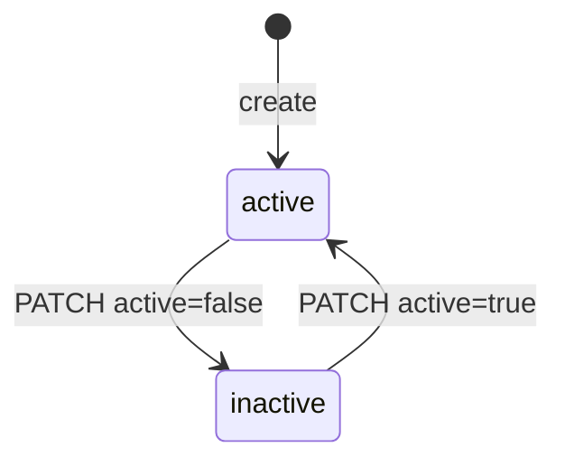

# إعدادات طلبات الإدارة — Management Requests Settings

> **التطبيق/الواجهة:** manager dashboard (صفحة الإعداد "Set-up")
> **الصلاحيات:** `requests.manage` (متاحة لنوع الحساب `manager` فقط، ويملكها الدور الافتراضي `manager`). معاينة الأوقات المتاحة `GET /management/appointment-slots` تحتاج `requests.handle`.
> **المصادر:** ADR 0039 · `src/management/settings/` · `src/management/topics/` · `src/management/appointments/appointment-slots.ts`

## الفكرة باختصار
يضبط المدير من صفحة واحدة كل ما يحكم طلبات الإدارة في الكمبوند: **قائمة المواضيع** ووقت الرد المستهدف لكل موضوع، و**ساعات عمل المكتب** التي تُقسَّم منها أوقات المواعيد، و**الإعدادات العامة**: مدة الإغلاق التلقائي، وطول فترة الموعد، وعدد المواعيد في الفترة الواحدة (السعة). كل كمبوند جديد يبدأ بقيم افتراضية جاهزة.

## الأدوار ومين بيعمل إيه
| الدور | ما يستطيع فعله |
|---|---|
| مدير (`requests.manage`) | يقرأ ويعدّل المواضيع، وساعات العمل، والإعدادات |
| موظف طلبات (`requests.handle`) | يقرأ المواضيع النشطة فقط (`GET /management-request-topics`) ويرى الأوقات المتاحة. لا يعدّل شيئًا |
| ساكن (`requests.create`) | يرى المواضيع النشطة والأوقات المتاحة (دون عدد الأماكن) |

## الشاشات اللي الفيتشر محتاجها
- **قائمة المواضيع:** كل المواضيع، النشطة والموقوفة، مع الاسمين، ووقت الرد المستهدف، والحالة.
- **نموذج موضوع جديد:** المفتاح، والاسم بالعربية، والاسم بالإنجليزية، ووقت الرد المستهدف بالساعات.
- **نموذج تعديل موضوع:** الاسمان، ووقت الرد، وتفعيل/إيقاف. المفتاح للعرض فقط.
- **محرر ساعات العمل:** أيام الأسبوع، ولكل يوم فترة أو أكثر (من/إلى)، مع إمكانية جعل اليوم مغلقًا.
- **نموذج الإعدادات العامة:** أيام الإغلاق التلقائي، وطول الفترة بالدقائق، وسعة الفترة.
- **معاينة الأوقات (اختيارية):** عرض الأوقات المتاحة الناتجة عن الإعدادات الحالية مع عدد الأماكن المتبقية.

## الفلو خطوة بخطوة

### 1) قائمة المواضيع
1. `GET /management/request-topics`: كل المواضيع **بما فيها الموقوفة**، مرتبة أبجديًا حسب `key`. القائمة غير مقسمة إلى صفحات.
2. كل موضوع: `id`، `key`، `nameAr`، `nameEn`، `targetResponseHours`، `active`، `createdAt`، `updatedAt`.
3. **لا يوجد حقل ترتيب.** ما يراه الساكن مرتب حسب `key` أيضًا، ولا يستطيع المدير تغيير الترتيب.

المواضيع الافتراضية لكل كمبوند جديد (ولكل كمبوند قائم عبر الـmigration):

| `key` | `nameAr` | `nameEn` | `targetResponseHours` |
|---|---|---|---|
| `general` | عام | General | 48 |
| `billing_fees` | الفواتير والرسوم | Billing and fees | 48 |
| `security_gate` | الأمن والبوابة | Security and gate | 24 |
| `facilities` | المرافق | Facilities | 72 |
| `documents` | المستندات | Documents | 72 |

### 2) إنشاء موضوع
1. يملأ المدير:
   - `key`: إجباري. حروف إنجليزية صغيرة وأرقام و`_`، يبدأ بحرف، وطوله من 2 إلى 40 (`^[a-z][a-z0-9_]{1,39}$`). مثال: `parking`. **لا يتغير بعد الإنشاء**، لأن التطبيقات والتقارير تعتمد عليه.
   - `nameAr` و`nameEn`: إجباريان، من 1 إلى 80 حرفًا (تُحذف المسافات الطرفية عند الحفظ).
   - `targetResponseHours`: إجباري، عدد صحيح من 1 إلى 720 (حتى 30 يومًا).
2. `POST /management/request-topics`، ويرجع `201` بالموضوع كاملًا، وهو نشط (`active: true`).
3. إذا كان المفتاح مستخدمًا في نفس الكمبوند يرجع `409 DUPLICATE_RESOURCE` على `key`.
4. يظهر الموضوع فورًا للساكن والموظفين في `GET /management-request-topics`.

### 3) تعديل موضوع
1. يمكن تعديل أي مجموعة من: `nameAr`، `nameEn`، `targetResponseHours`، `active`. كلها اختيارية.
2. `PATCH /management/request-topics/{id}`، ويرجع `200` بالموضوع بعد التعديل.
3. **تغيير `targetResponseHours`** يطبَّق على الطلبات التي تُفتح أو يُعاد فتحها من الآن فقط. الطلب الذي في دورة جارية يحتفظ بوقت الرد الذي حُسب عند بداية دورته. وضّح ذلك تحت الحقل.
4. **`active: false`** يوقف الموضوع: لا يُعرض للساكن ولا للموظف عند فتح طلب جديد. الطلبات القديمة تبقى عليه وتظهر باسمه. يمكن إعادة تفعيله بـ`active: true`.
5. **لا يوجد حذف** للمواضيع، لأن الطلبات تشير إليها. "الإيقاف" هو البديل.
6. معرّف غير موجود يرجع `404 MANAGEMENT_TOPIC_NOT_FOUND`.

### 4) ساعات عمل المكتب
1. `GET /management/office-hours`، ويرجع `{ windows: [{ weekday, startMinute, endMinute }] }` مرتبة حسب اليوم ثم البداية. القائمة الفارغة تعني أن المكتب مغلق.
2. التمثيل:
   - `weekday`: من 0 إلى 6، حيث **0 = الأحد** و6 = السبت.
   - `startMinute`: الدقائق منذ منتصف الليل بتوقيت الكمبوند، من 0 إلى 1439. مثال: 09:00 = 540.
   - `endMinute`: من 1 إلى 1440، ويجب أن يكون بعد البداية. مثال: 17:00 = 1020.
   - يحوّل الداشبورد بين الساعة المعروضة والدقائق.
3. يعدّل المدير الأسبوع كله، ثم يحفظ: `PUT /management/office-hours` بالجسم `{ windows: [...] }`. **الحفظ يستبدل المجموعة كلها** (ليس تعديلًا جزئيًا). يرجع `200` بالمجموعة بعد الترتيب.
4. القواعد:
   - حتى 28 فترة في الأسبوع كله (عمليًا حتى 4 فترات لليوم).
   - يمكن أن يكون لليوم أكثر من فترة، مثل 09:00–12:00 و13:00–17:00.
   - الفترتان في نفس اليوم يمكن أن تتلامسا (09:00–12:00 و12:00–17:00)، لكن **لا يجوز أن تتداخلا**.
   - اليوم الذي ليس له فترات يكون مغلقًا.
   - القائمة الفارغة تغلق المكتب كله: لا تُعرض أي أوقات للحجز.
5. الأثر:
   - الأوقات المعروضة للحجز تتغير فورًا.
   - **المواعيد المحجوزة سابقًا لا تتأثر** حتى لو أصبحت خارج الساعات الجديدة.
   - التوقيت المستخدم هو توقيت الكمبوند من إعداداته العامة.

الافتراضي لكل كمبوند جديد: من السبت إلى الخميس، 09:00–17:00 (`startMinute: 540`، `endMinute: 1020`)، والجمعة إجازة.

| اليوم | `weekday` | الافتراضي |
|---|---|---|
| الأحد | 0 | 09:00–17:00 |
| الاثنين | 1 | 09:00–17:00 |
| الثلاثاء | 2 | 09:00–17:00 |
| الأربعاء | 3 | 09:00–17:00 |
| الخميس | 4 | 09:00–17:00 |
| الجمعة | 5 | مغلق |
| السبت | 6 | 09:00–17:00 |

### 5) الإعدادات العامة (`/management/request-settings`)
1. `GET /management/request-settings`، ويرجع `{ autoCloseDays, appointmentSlotMinutes, appointmentSlotCapacity }`.
2. يعدّل المدير أي حقل أو أكثر: `PATCH /management/request-settings` (كل الحقول اختيارية). يرجع `200` بالقيم بعد الحفظ.

| الحقل | المعنى | المدى | الافتراضي | الأثر |
|---|---|---|---|---|
| `autoCloseDays` | عدد الأيام التي ينتظر فيها الطلب `answered` رد صاحبه قبل أن يُغلق تلقائيًا | 1–90 | 7 | يُحسب من آخر رد رسمي (`answeredAt`). القيمة الجديدة تُطبَّق في الدورة التالية لمهمة الإغلاق (كل ساعة تقريبًا) على كل الطلبات المنتظرة، بما فيها القديمة. تقليلها قد يغلق طلبات كثيرة دفعة واحدة |
| `appointmentSlotMinutes` | طول فترة الموعد بالدقائق | 10–240 | 30 | تُقسَّم ساعات العمل إلى فترات بهذا الطول. الجزء المتبقي في نهاية الفترة الأقصر من الطول لا يُعرض (مثال: 09:00–10:45 بطول 30 تعطي 09:00 و09:30 و10:00 فقط). المواعيد المحجوزة تحتفظ بطولها القديم |
| `appointmentSlotCapacity` | عدد المواعيد التي يقبلها الوقت الواحد | 1–50 | 1 | الوقت يختفي من العرض عند امتلائه، والحجز الزائد يرجع `409 MANAGEMENT_APPOINTMENT_SLOT_FULL`. يُحسب الامتلاء بالتداخل الزمني، فالموعد المحجوز بطول قديم يظل يشغل مكانًا في كل وقت جديد يتداخل معه |

3. الحجز الجاري ينتظر حتى يكتمل تغيير الإعدادات (والعكس)، فلا يُحجز وقت بقيم نصف محدّثة.

### 6) معاينة الأوقات وسعتها (`/management/appointment-slots`)
**ملاحظة:** السعة تُضبط في `PATCH /management/request-settings` (الحقل `appointmentSlotCapacity`). أما `/management/appointment-slots` فهو **قراءة فقط**، ولا يغيّر شيئًا.

1. `GET /management/appointment-slots?from=YYYY-MM-DD&days=N`:
   - `from`: أول يوم بتوقيت الكمبوند، والافتراضي اليوم.
   - `days`: من 1 إلى 31، والافتراضي 7.
2. يرجع `[{ startsAt, endsAt, remaining }]`، حيث `remaining` هو عدد الأماكن المتبقية في الوقت.
3. يُستبعد: ما يبدأ بعد أقل من ساعة، وما يبعد أكثر من 30 يومًا، وما امتلأ (`remaining = 0`).
4. مفيد في صفحة الإعداد لعرض نتيجة ساعات العمل وطول الفترة والسعة بعد الحفظ.

## الحالات (Statuses)
| القيمة | المعنى | ما الذي يُدخله / يُخرجه |
|---|---|---|
| موضوع `active: true` | معروض عند فتح طلب جديد | الإنشاء، أو `PATCH` بـ`active: true` |
| موضوع `active: false` | موقوف: لا يُعرض للطلبات الجديدة، والقديمة تبقى عليه | `PATCH` بـ`active: false` |

الإعدادات وساعات العمل ليس لها حالات: سجل واحد لكل كمبوند، ومجموعة فترات تُستبدل كاملة.

## البيانات اللي بتظهر
- **موضوع (عرض المدير، `TopicView`):** `id`، `key`، `nameAr`، `nameEn`، `targetResponseHours`، `active`، `createdAt`، `updatedAt`.
- **موضوع (عرض الساكن والموظف، `TopicOptionView`):** `id`، `key`، `nameAr`، `nameEn`، `targetResponseHours` فقط، والنشطة فقط.
- **ساعات العمل:** `{ windows: [{ weekday, startMinute, endMinute }] }` مرتبة.
- **الإعدادات:** `{ autoCloseDays, appointmentSlotMinutes, appointmentSlotCapacity }`.
- **الأوقات المتاحة (عرض الموظف):** `startsAt`، `endsAt`، `remaining`.
- كل الردود `no-store`.
- سجل التدقيق يسجّل كل تغيير، لكن أسماء المواضيع تُسجَّل كـ"تغيّرت" فقط دون القيم. لا توجد شاشة سجل في هذا الموديول.

## القواعد والقيود
- `key` الموضوع: `^[a-z][a-z0-9_]{1,39}$`، فريد داخل الكمبوند، ولا يتغير أبدًا.
- اسما الموضوع: من 1 إلى 80 حرفًا لكل منهما.
- `targetResponseHours`: من 1 إلى 720، ويطبَّق من الدورة التالية فقط.
- لا حذف للمواضيع، ولا ترتيب مخصص.
- ساعات العمل: `weekday` من 0 (الأحد) إلى 6، و`startMinute` من 0 إلى 1439، و`endMinute` من 1 إلى 1440، والنهاية بعد البداية، ولا تداخل داخل نفس اليوم، وحتى 28 فترة. الحفظ يستبدل الكل.
- إذا حفظ مديران في نفس الوقت، تبقى مجموعة واحدة من الاثنتين كاملة، ولا تختلطان.
- `autoCloseDays` من 1 إلى 90، و`appointmentSlotMinutes` من 10 إلى 240، و`appointmentSlotCapacity` من 1 إلى 50.
- تغيير ساعات العمل أو طول الفترة أو السعة لا يغيّر المواعيد المحجوزة.
- لا توجد عطلات استثنائية (أيام محددة مغلقة) ولا فترات راحة بخلاف تقسيم اليوم إلى عدة فترات.

## الأخطاء اللي الـUI لازم يتعامل معاها
| HTTP + الكود | متى يحدث | رسالة / سلوك مقترح |
|---|---|---|
| `400 VALIDATION_FAILED` على `key` | المفتاح لا يطابق الصيغة | "المفتاح: حروف إنجليزية صغيرة وأرقام و_، ويبدأ بحرف" |
| `400 VALIDATION_FAILED` على `nameAr` / `nameEn` | فارغ أو أطول من 80 | "الاسم من 1 إلى 80 حرفًا" |
| `400 VALIDATION_FAILED` على `targetResponseHours` | خارج 1–720 أو ليس عددًا صحيحًا | "من 1 إلى 720 ساعة" |
| `409 DUPLICATE_RESOURCE` على `key` | المفتاح مستخدم | "هذا المفتاح مستخدم لموضوع آخر" |
| `404 MANAGEMENT_TOPIC_NOT_FOUND` | تعديل موضوع غير موجود | أعد تحميل القائمة |
| `400 VALIDATION_FAILED` + `INVALID_SCHEDULE` على `windows.N.endMinute` | النهاية ليست بعد البداية | ظلّل الفترة: "وقت النهاية يجب أن يكون بعد البداية" |
| `400 VALIDATION_FAILED` + `OFFICE_HOURS_OVERLAP` على `windows.N.startMinute` (`params.other` = رقم الفترة المتداخلة) | فترتان متداخلتان في نفس اليوم | ظلّل الفترتين: "الفترات في نفس اليوم لا يجوز أن تتداخل" |
| `400 VALIDATION_FAILED` على `windows.N.weekday` / `startMinute` / `endMinute` أو على `windows` | قيمة خارج المدى، أو أكثر من 28 فترة | امنعه في المحرر |
| `400 VALIDATION_FAILED` + `INVALID_NUMBER` (أو أخطاء المدى) على `autoCloseDays` / `appointmentSlotMinutes` / `appointmentSlotCapacity` | قيمة خارج المدى أو ليست عددًا صحيحًا | اعرض المدى المسموح تحت الحقل (`params.min`، `params.max`) |
| `400 VALIDATION_FAILED` + `INVALID_FORMAT` على `from` | تاريخ غير صحيح في المعاينة | خطأ في الداشبورد |
| `403 FORBIDDEN` | لا يملك `requests.manage` | أخفِ صفحة الإعداد |

## الإشعارات
لا يرسل أي تغيير في المواضيع أو ساعات العمل أو الإعدادات إشعارًا لأحد. كل التغييرات تُسجَّل في سجل التدقيق فقط (`management_request_topic.created`، `management_request_topic.updated`، `management.office_hours_changed`، `management.settings_changed`). وإذا لم يتغير شيء فعليًا لا يُسجَّل شيء.

## الـEndpoints
كل المسارات تحت `/api/v1`.

| Method + Path | من يستدعيه | الغرض | الرد |
|---|---|---|---|
| `GET /management/request-topics` | `requests.manage` | كل المواضيع (مع الموقوفة) | `200 {data:[TopicView], nextCursor:null}` |
| `POST /management/request-topics` | `requests.manage` | إنشاء موضوع | `201 TopicView` |
| `PATCH /management/request-topics/{id}` | `requests.manage` | تعديل الأسماء أو وقت الرد أو التفعيل | `200 TopicView` |
| `GET /management-request-topics` | `requests.create` أو `requests.handle` | المواضيع النشطة (لنماذج فتح الطلب) | `200 {data:[TopicOptionView], nextCursor:null}` |
| `GET /management/office-hours` | `requests.manage` | ساعات العمل | `200 {windows:[{weekday,startMinute,endMinute}]}` |
| `PUT /management/office-hours` | `requests.manage` | استبدال ساعات العمل كلها | `200 {windows:[...]}` |
| `GET /management/request-settings` | `requests.manage` | الإعدادات العامة | `200 {autoCloseDays, appointmentSlotMinutes, appointmentSlotCapacity}` |
| `PATCH /management/request-settings` | `requests.manage` | تعديل الإعدادات العامة | `200 {autoCloseDays, appointmentSlotMinutes, appointmentSlotCapacity}` |
| `GET /management/appointment-slots` | `requests.handle` | معاينة الأوقات المتاحة مع `remaining` | `200 {data:[{startsAt,endsAt,remaining}], nextCursor:null}` |

## ملاحظات للديزاين وحاجات ناقصة في الباك
- **لا يوجد ترتيب مخصص للمواضيع**؛ الترتيب أبجدي حسب `key` في كل مكان. إذا احتاج التصميم ترتيبًا يدويًا يلزم حقل جديد.
- **لا يوجد حذف** للمواضيع، فقط إيقاف.
- **لا توجد عطلات أو أيام استثنائية** (مثل الأعياد). الحل الحالي: تعديل ساعات العمل يدويًا ثم إرجاعها، أو إلغاء المواعيد بسبب `office_closed`.
- **ساعات العمل لا تؤثر على وقت الرد ولا التصعيد**؛ كلاهما بالساعات الفعلية. الـADR يضع "business hours" لحساب الرد خارج النطاق.
- **لا يوجد إعداد للحد الأدنى للحجز المسبق (ساعة) ولا للحد الأقصى (30 يومًا)**؛ هذه قيم ثابتة في الكود.
- **لا يوجد إعداد لمهلة إعادة الفتح (7 أيام)**؛ قيمة ثابتة في الكود.
- **لا يوجد إعداد لمن يستلم التصعيد**؛ يذهب دائمًا لكل من يملك `requests.manage`.
- **تقليل `autoCloseDays`** يطبَّق على الطلبات المنتظرة حاليًا أيضًا، فيُستحسن عرض تحذير عند تقليله.
- **السعة** موجودة في `/management/request-settings` وليس في `/management/appointment-slots`، فالأخير للمعاينة فقط.
- إدارة من يملك `requests.handle` (أي من يرى الصندوق) تتم من شاشة الأدوار، وليست جزءًا من هذه الصفحة.
